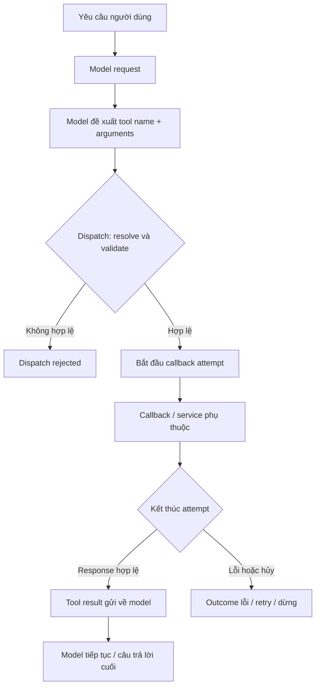
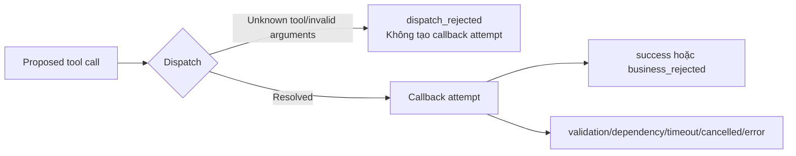

# Theo dõi tên công cụ, thời lượng và lỗi

Một trợ lý sử dụng Spring AI nhận yêu cầu: **“Kiểm tra trạng thái đơn DH-204 và chỉ tạo phiếu hỗ trợ nếu đơn giao thất bại.”** Model gọi `lookup_order`, sau đó có thể gọi `create_support_ticket` và cuối cùng viết câu trả lời. Nếu hệ thống chậm hoặc trả lời sai, bản ghi “tool called” là chưa đủ. Người vận hành cần biết **công cụ cụ thể nào đã thực thi**, **mỗi lần mất bao lâu**, **lỗi xảy ra ở giai đoạn nào** và **agent đã xử lý kết quả đúng chưa**.

Bài học thuộc chương **Quan sát công cụ** của mô-đun **SPRING_AI_EVALUATION_OBSERVABILITY**. Mô-đun hướng tới đánh giá chất lượng ứng dụng Spring AI bằng tập dữ liệu, relevance, fact checking và kiểm thử RAG/tool calling; đồng thời dùng metrics, traces, chi phí và độ trễ để phát hiện nguyên nhân suy giảm khi thay đổi prompt, model hoặc pipeline. Trọng tâm của bài này là **theo dõi tên công cụ, thời lượng và lỗi tại từng lần thực thi**, từ đó thiết kế dashboard và quy trình điều tra đủ chính xác để hỗ trợ đánh giá chất lượng.

> **Nguyên tắc cốt lõi:** tên tool phải là **định danh chuẩn hóa**, thời lượng phải có **ranh giới đo rõ ràng**, và lỗi phải được **phân loại theo bản chất**. “Callback chạy thành công” **không đồng nghĩa** với “agent đã ra quyết định nghiệp vụ đúng”.

## 1. Kết quả học tập

Sau bài này, bạn có thể:

1. Giải thích sự khác nhau giữa **model đề xuất tool call**, **dispatch**, **callback attempt**, **logical operation** và **tool result**.
2. Thiết kế trường `tool.name` canonical và phân biệt với tên do model tự viết, mô tả hiển thị, tên method Java và ID nghiệp vụ.
3. Đặt ranh giới đo duration; dùng timer/observation để theo dõi **p50, p95, p99**, timeout và thời gian end-to-end.
4. Phân loại **success, business rejection, validation error, dependency error, timeout, cancellation** và các lỗi chưa biết.
5. Đo các chỉ số theo **callback attempts** và theo **logical operations** mà không đếm retry như những yêu cầu nghiệp vụ mới.
6. Dùng Micrometer `Observation` và phương thức `@Tool` trong Spring AI để ghi tên tool, outcome, duration và exception một cách có kiểm soát.
7. Tránh metric tags có cardinality cao, rò rỉ arguments, kết quả công cụ và exception messages.
8. Nối metrics với traces, nhãn người và kiểm thử rule để chẩn đoán sự cố hoặc hồi quy trong tool-calling agent.

## 2. Đơn vị nào đang được quan sát?

Spring AI có thể khai báo công cụ qua `@Tool`, `ToolCallback` hoặc các cách tích hợp tương ứng với phiên bản framework. Một lời gọi công cụ thường đi qua các giai đoạn:



Đây là sơ đồ **logic**, không phải cam kết rằng mọi Spring AI version đều xuất đúng các spans như hình.

| Đơn vị | Ý nghĩa | Mẫu số nên dùng |
|---|---|---|
| **Application request** | Một yêu cầu người dùng hoặc tác vụ agent | Số lượt người dùng/tác vụ |
| **Model tool proposal** | Một yêu cầu gọi công cụ do model đề xuất | Số đề xuất có cấu trúc |
| **Dispatch attempt** | Xác định công cụ, chuyển đổi/kiểm arguments, kiểm quyền | Số lần dispatch |
| **Callback attempt** | Một lần mã công cụ thực sự được thực thi | Số attempts đã bắt đầu |
| **Logical operation** | Một mục đích nghiệp vụ có thể gồm nhiều retries | Số thao tác nghiệp vụ |
| **Tool result message** | Kết quả/lỗi được đưa lại vào vòng hội thoại model | Số thông điệp kết quả |

Ví dụ model đề xuất một `lookup_order` nhưng arguments sai kiểu, bị từ chối **trước callback**: có một proposal và một dispatch rejection, nhưng **không có callback attempt**. Nếu một callback gọi API bị timeout rồi retry, có thể có **một proposal và hai callback attempts**.

Cần thống nhất các đơn vị này trước khi đặt tên metric. Nếu dashboard dùng từ “tool calls” cho cả đề xuất lẫn thực thi, tỷ lệ thành công sẽ có mẫu số không đáng tin.

### 2.1. Tool được yêu cầu khác tool được thực thi

Xét một chuỗi:

```text
Model output:
  name = "lookup_order"
  arguments = {"orderId":"DH-204"}

Tool registry:
  canonical name = "lookup_order"
  implementation = OrderTools.lookupOrder

Callback:
  lookupOrder("DH-204") -> {"deliveryStatus":"DELIVERED"}
```

**Tên do model đề xuất** là dữ liệu đầu vào của dispatcher. **Tên công cụ chuẩn hóa** lấy từ registry/định nghĩa đã được ứng dụng quản lý. Không dùng một chuỗi tên tùy ý do model sinh làm metric tag khi việc resolve thất bại.

## 3. Theo dõi tên công cụ: canonical name thay cho chuỗi tự do

Tên là chiều lọc quan trọng nhất trong dashboard tool observability. Nếu `lookup_order` chậm và `create_support_ticket` có lỗi, phải phân tích được từng nhóm mà không tạo hàng nghìn biến thể tên.

### 3.1. Tên nào nên dùng?

| Trường | Ví dụ | Nguồn đáng tin | Cách dùng |
|---|---|---|---|
| `tool.name` | `lookup_order` | Registry/tool definition đã đăng ký | **Metric tag** nếu số lượng hữu hạn |
| `tool.version` | `v2` | Cấu hình/schema version của ứng dụng | Tag có kiểm soát, log/trace |
| `tool.kind` | `read` hoặc `write` | Metadata do ứng dụng khai báo | Tag tổng hợp hữu ích |
| `java.method` | `OrderTools.lookupOrder` | Code/trace runtime | Thông tin điều tra nếu cần |
| `proposedToolName` | `lookup_order_vip_free_text` | Model response | Không đưa trực tiếp vào metric tag |
| `tool_call_id` | `call-abc` | Structured metadata của model nếu có | Log/trace, không phải metric tag |
| `callbackInvocationId` | `inv-204-01` | Ứng dụng tạo cho mỗi attempt | Log/trace, không phải metric tag |
| `orderId` | `DH-204` | Arguments nghiệp vụ | Không dùng làm metric tag |

Khi công cụ được đổi tên hoặc đổi schema, cần quyết định rõ **version nào là ranh giới thay đổi có ý nghĩa**. Ví dụ `lookup_order` ở `v1` chấp nhận `orderId` dạng chuỗi, `v2` kiểm tra định dạng nghiêm ngặt hơn. Việc phân tích theo `tool.version` có thể giải thích số lỗi validation tăng sau triển khai.

### 3.2. Tên công cụ lạ phải có nhóm riêng

Một model có thể đề xuất `lookupOrder$$unknown_4628`. Nếu tên đó không có trong registry:

- Ghi `dispatch.outcome=unknown_tool`;
- Nếu cần thống kê, dùng `tool.name=unknown_tool` hoặc nhóm hữu hạn do hệ thống xác định;
- Giữ chuỗi raw trong log/trace **chỉ khi an toàn và cần điều tra**, có giới hạn độ dài và quyền truy cập;
- Không ghi một callback attempt nếu phần thực thi chưa bắt đầu.

Đây là cách ngăn **cardinality explosion** và giảm ảnh hưởng của dữ liệu không đáng tin lên hệ thống metrics.

### 3.3. Đặt tên nhất quán với mục đích

Một số tổ chức muốn tách:

```text
tool.name = "lookup_order"       // Công cụ logic
tool.version = "v2"             // Phiên bản schema/triển khai
tool.kind = "read"              // read hoặc write
tool.outcome = "success"        // Kết quả chuẩn hóa
```

Không nên đổi `tool.name` theo từng `orderId`, vùng khách hàng, user prompt, tên workflow hay message của exception. Những chi tiết đó thuộc dữ liệu per-request hoặc phân đoạn được tổng hợp có chủ ý, không phải danh tính công cụ.

## 4. Đo thời lượng: đo đúng ranh giới

**Duration** là thời gian từ mốc bắt đầu đến mốc kết thúc đã được định nghĩa. Trong một agent có nhiều lớp, có nhiều loại latency khác nhau:

| Loại thời gian | Điểm bắt đầu | Điểm kết thúc |
|---|---|---|
| **Tool dispatch latency** | Bắt đầu resolve/parse/validate tool request | Callback bắt đầu hoặc dispatch bị từ chối |
| **Callback attempt latency** | Trước khi thực thi phần mã callback | Callback trả response hoặc lỗi/hủy tại ranh giới đó |
| **Downstream API latency** | Bắt đầu request HTTP/DB từ callback | Nhận response hoặc lỗi từ dependency |
| **Logical operation latency** | Bắt đầu thao tác nghiệp vụ | Kết quả cuối sau retry/backoff, hoặc kết thúc thất bại |
| **Agent request latency** | Bắt đầu request ứng dụng | Câu trả lời cuối/quyết định nghiệp vụ, bao gồm các vòng model/tool |
| **Human review turnaround** | Ca được chuyển người | Được người phân xử | 

Nếu đoạn callback gọi HTTP service bên trong, thời gian HTTP **nằm trong** callback duration ở đường đồng bộ. Không cộng cả callback và downstream spans vào tổng latency khi chúng lồng nhau.

### 4.1. Dùng timer hoặc monotonic clock

Khi tự đo Java, có thể dùng `System.nanoTime()` để tính **khoảng thời gian**, thay vì trừ hai `Instant.now()` có thể chịu ảnh hưởng từ đồng hồ hệ thống. Tuy nhiên, với Spring Boot/Micrometer, `Observation` hoặc `Timer` thường thuận tiện hơn vì đưa thời lượng vào hạ tầng đo lường và liên kết tracing theo cấu hình.

Đặt observation start **ngay trước công việc định đo** và stop **trong đường finally/completion phù hợp**. Nếu exception xuất hiện, vẫn phải stop và lưu outcome tương ứng.

### 4.2. Callback bất đồng bộ và job nền

Giả sử `generate_report` chỉ đặt một job vào hàng đợi trong **30 ms** và trả `jobId`, trong khi job xử lý mất **4 phút**. Callback timer **30 ms là đúng** nếu phạm vi của nó chỉ là **thời gian enqueue**. Nó **không đại diện** cho thời gian báo cáo sẵn sàng.

Cần ghi riêng:

- `callback.duration`: từ nhận callback đến trả `jobId`;
- `job.duration`: từ khi worker bắt đầu đến khi job hoàn tất;
- `logicalOperation.duration`: từ yêu cầu ban đầu tới trạng thái hoàn tất nếu đó là điều người dùng quan tâm;
- `jobId`/`logicalOperationId` trong log/trace để liên kết, không dùng làm metric tag.

Nếu callback trả một đối tượng reactive/future mà observation chỉ bọc **thời điểm tạo publisher**, duration có thể bị đo thấp. Với luồng bất đồng bộ, observation phải kết thúc tại **terminal signal** thích hợp hoặc có một observation khác đo giai đoạn chạy thật. Cần kiểm cách framework/provider xử lý async theo phiên bản cụ thể.

## 5. Phân vị latency: p50, p95, p99 và throughput

Trung bình không cho thấy phần đuôi chậm. Hãy đo các phân vị:

- **p50**: giá trị trung vị của các duration.
- **p95**: khoảng 95% các giá trị không vượt quá mốc được báo theo quy ước tính phân vị.
- **p99**: quan sát đuôi rất chậm, thường nhạy với tải và timeout.
- **Throughput**: số callback attempts hoặc logical operations hoàn tất mỗi đơn vị thời gian ở một mức tải cụ thể.

### 5.1. Ví dụ tính thủ công

Có 20 thời lượng callback (mili giây), đã sắp tăng:

```text
40, 42, 45, 46, 49,
51, 53, 55, 58, 60,
63, 66, 69, 72, 75,
80, 85, 100, 160, 900
```

Nếu dùng quy ước **nearest-rank** cho bộ dữ liệu nhỏ:

\[
p_q = x_{\lceil qn\rceil},
\]

trong đó dữ liệu đã sắp xếp tăng dần và `x_k` là phần tử thứ k (đếm từ 1):

- `p50 = x10 = 60 ms`;
- `p95 = x19 = 160 ms`;
- `p99 = x20 = 900 ms`.

Một callback cực chậm làm `p99` tăng mạnh trong ví dụ. Trong backend metrics thực tế, percentiles có thể được tính bằng histogram/ước lượng và **khác quy ước nearest-rank**; luôn nêu cách tính và cửa sổ thời gian.

### 5.2. Đo theo từng tool và theo toàn luồng

Một dashboard phù hợp có thể hiển thị:

| Phạm vi | Chỉ số | Câu hỏi |
|---|---|---|
| `lookup_order` callback attempts | p50/p95/p99 duration | API tra cứu đang chậm? |
| `create_support_ticket` callback attempts | p95 duration và error rate | API ghi dữ liệu có nghẽn hoặc lỗi? |
| Logical operation sau retries | p95 end-to-end | Backoff có kéo dài thời gian xử lý? |
| Agent request | p95 latency, model round count, tool call count | Người dùng phải chờ bao lâu? |
| Model request | p95 latency, token usage | Model hay tool mới là bottleneck? |

**Không lấy trung bình p95 giữa các tool** để suy p95 của cả agent. Nếu hai callback chạy song song, tổng duration từng callback có thể lớn hơn thời gian chờ thực tế. Với pipeline nhiều vòng, p95 end-to-end phải tính từ **các request hoàn chỉnh**, không từ tổng các phân vị của span con.

### 5.3. Xử lý timeout trong báo cáo latency

Nếu 10% callback timeout sau 5 giây nhưng Timer chỉ ghi các lượt **thành công**, dashboard có thể báo p95 = 120 ms và che giấu trải nghiệm thật. Báo song song:

- p95 của callback attempts **theo chính sách thu thập đã công bố**;
- `timeoutRate`;
- `errorRate`;
- độ trễ logical operation/agent request;
- tỷ lệ request có **callback chưa hoàn tất** tại thời điểm chụp số liệu.

Timeout có thể đo duration tới mốc bị hủy hoặc kết thúc thực tế, tùy cơ chế gọi; ghi rõ. **Không tự suy rằng thời điểm client timeout cũng là thời điểm server dừng chạy**, nhất là với công cụ có side effect.

## 6. Phân loại lỗi và kết quả nghiệp vụ

Một callback có thể kết thúc theo nhiều kiểu. Nếu mọi trường hợp khác `success` đều thành “error”, số liệu vừa thiếu chi tiết vừa có thể gây hiểu sai.

| `tool.outcome` | Tình huống | Có callback thực thi? | Có luôn là lỗi hệ thống? |
|---|---|---|---|
| `success` | Callback trả response hợp lệ, nghiệp vụ đạt điều kiện | Có | Không |
| `business_rejected` | `NOT_FOUND`, không đủ điều kiện mở phiếu, giới hạn nghiệp vụ | Có | **Không**, có thể là kết quả đúng |
| `validation_error` | Arguments sai và bị phát hiện trong callback | Có | Không nhất thiết là lỗi dependency |
| `dependency_error` | DB/API ngoài hỏng, HTTP 5xx, lỗi kết nối | Có | Có thể là lỗi hệ thống phụ thuộc |
| `timeout` | Vượt giới hạn thời gian | Có nếu đã bắt đầu callback | Có thể phụ thuộc nhiều lớp |
| `cancelled` | Luồng bị hủy/disconnect | Có nếu callback đã bắt đầu | Không tự kết luận lỗi bên ngoài |
| `unexpected_error` | Exception chưa phân loại | Có | Cần điều tra |
| `dispatch_rejected` | Unknown tool, parse/schema/authorization từ chối trước callback | **Không** | Thuộc lớp dispatch |

**Một kết quả từ chối nghiệp vụ có thể là thành công về mặt kỹ thuật**. Ví dụ `lookup_order("DH-999")` trả `NOT_FOUND` là output hợp lệ, và agent nên nói “Không tìm thấy đơn”. Nếu nhà phát triển gắn `NOT_FOUND` như HTTP 500 ở tất cả trường hợp, metric availability sẽ sai.

### 6.1. Phân loại lỗi theo một tầng bổ sung

Có thể dùng tag `error.category` với tập giá trị hữu hạn:

```text
none
argument_validation
authentication
authorization
network
dependency_4xx
dependency_5xx
timeout
rate_limit
cancellation
serialization
unexpected
```

Tên cụ thể là **quy ước ứng dụng**, không phải chuẩn bắt buộc của Spring AI/Micrometer. Cần một bảng ánh xạ exception/error code thành category, tránh dùng `exception.getMessage()` làm tag.

Một callback có thể trả `business_rejected` mà **không ném exception**; khi đó `error.category=none` hoặc nhóm nghiệp vụ phù hợp theo chính sách. Không cần tạo exception giả để biến trạng thái nghiệp vụ thành lỗi vận hành.

### 6.2. Lỗi trước callback và trong callback



Sơ đồ dùng `dispatch_rejected` để nhấn mạnh khác biệt mẫu số. Trong trace thực tế, một callback attempt chỉ được ghi khi **ranh giới callback đã bắt đầu**. Nếu validation được thực thi ngay tại đầu phương thức `@Tool`, nó **thuộc callback duration**; nếu Spring AI/dispatcher từ chối trước khi vào phương thức, nó thuộc dispatch.

## 7. Đếm attempts, logical operations và retries

Một request có thể có một tool request nhưng nhiều callback attempts do retry. Ví dụ:

```text
User request R1
  Model proposes lookup_order(DH-204) once
  Logical operation O1
    Attempt 1: dependency_timeout
    Backoff: 200 ms
    Attempt 2: success
  Final tool result: DELIVERED
```

Nên lưu:

- `modelToolCallId` hoặc scoped tool call key để biết model đề xuất gì;
- `callbackInvocationId` mới ở mỗi attempt;
- `attemptIndex` để phân biệt lần đầu và retry;
- `logicalOperationId` để nối retries;
- outcome/duration cho từng attempt;
- final operation status/latency riêng.

Khi tính:

\[
\operatorname{AttemptErrorRate} =
\frac{\text{số callback attempts lỗi kỹ thuật}}
     {\text{tổng callback attempts}},
\]

\[
\operatorname{OperationFinalErrorRate} =
\frac{\text{số logical operations kết thúc lỗi}}
     {\text{tổng logical operations}},
\]

\[
\operatorname{RetryOperationRate} =
\frac{\text{số logical operations có ít nhất một retry}}
     {\text{tổng logical operations}}.
\]

Các mẫu số này khác nhau. **Callback attempts** phản ánh tải và chi phí hệ thống; **logical operations** phản ánh tỉ lệ thao tác nghiệp vụ hoàn tất sau các lần thử.

### 7.1. Timeout của tool ghi dữ liệu và idempotency

Với `create_support_ticket`, timeout **không chứng minh** API chưa tạo phiếu. Nếu phía server đã commit trước khi response bị mất, retry mù có thể sinh phiếu trùng.

Biện pháp:

1. Gán `logicalOperationId` và **idempotency key** cho thao tác ghi theo hợp đồng downstream.
2. Ghi attempt index, trạng thái commit/result hoặc thông tin truy vấn trạng thái phù hợp.
3. Retry có giới hạn và chính sách xác minh sau timeout.
4. Không cho model tự quyết định “gọi lại cho chắc” khi thiếu bằng chứng rằng thao tác chưa xảy ra.
5. Tách lỗi kỹ thuật sau commit khỏi việc tạo thao tác nghiệp vụ mới.

**Observability phục vụ phát hiện và điều tra; bảo đảm idempotency phải được thực thi bởi lớp nghiệp vụ**, không chỉ bằng cách thêm trace/span.

## 8. Ví dụ số liệu: 100 operations nhưng 112 callback attempts

Giả sử một benchmark gồm **100 logical operations**. Mỗi operation có một lần gọi đầu, những operation lỗi kỹ thuật có thể được retry tối đa một lần.

**100 lượt đầu:**

- 76 `success`;
- 12 `business_rejected` (kết quả hợp lệ không đạt điều kiện);
- 8 `dependency_error`;
- 4 `timeout`.

**12 operations lỗi kỹ thuật được retry một lần:**

- 9 `success`;
- 2 `dependency_error`;
- 1 `timeout`.

Tổng hợp theo attempts:

| Outcome | Lượt đầu | Retry | Tổng |
|---|---:|---:|---:|
| `success` | 76 | 9 | **85** |
| `business_rejected` | 12 | 0 | **12** |
| `dependency_error` | 8 | 2 | **10** |
| `timeout` | 4 | 1 | **5** |
| **Tổng** | **100** | **12** | **112** |

### 8.1. Các phép tính theo attempts

- **Attempt success rate**: `85/112 ≈ 75,9%`.
- **Attempt technical error rate** (dependency + timeout): `(10+5)/112 = 15/112 ≈ 13,4%`.
- **Business rejection attempt rate**: `12/112 ≈ 10,7%`.
- **Retry attempts / all attempts**: `12/112 ≈ 10,7%`.

### 8.2. Các phép tính theo logical operations

Sau retry, 100 operations có:

- 85 operations kết thúc `success`;
- 12 operations kết thúc `business_rejected` hợp lệ;
- 3 operations kết thúc lỗi kỹ thuật (2 dependency_error, 1 timeout).

Do đó:

| Chỉ số operation | Công thức | Giá trị |
|---|---|---:|
| Hoàn tất kỹ thuật theo hợp đồng, kể cả business rejection | (85+12)/100 | **97%** |
| Đạt điều kiện nghiệp vụ `success` | 85/100 | **85%** |
| Kết thúc lỗi kỹ thuật | 3/100 | **3%** |
| Operations cần retry | 12/100 | **12%** |

Trong bảng này **technical completion ≠ business success**. Nếu `NOT_FOUND` là một kết quả được phép trong hợp đồng, nó vẫn tính “đã hoàn tất kỹ thuật” dù agent không thể tiếp tục thao tác cần tồn tại đơn.

### 8.3. Một phép tính chi phí minh họa

Giả sử mỗi attempt phát sinh phí downstream **0,003 USD** (giá **giả định**, không phải giá provider), tổng phí:

\[
112 \times 0{,}003 = 0{,}336\ \text{USD}.
\]

Chỉ tính 100 operations sẽ bỏ sót 12 lần gọi thực tế. Tuy nhiên, nếu downstream chỉ tính phí cho những request thành công hoặc có giá khác nhau theo outcome, công thức phải dùng **usage/billing thực tế**. **Token model** cũng là một chi phí riêng theo **model requests**, không mặc định bằng số callback attempts.

## 9. Metric tags: tối ưu khả năng phân tích mà không gây cardinality cao

Một hệ thống metrics dùng Prometheus/Micrometer thường tạo một chuỗi dữ liệu cho mỗi tổ hợp tên metric và các tag. Nếu tag `orderId` nhận hàng triệu giá trị, lượng chuỗi có thể tăng mạnh, gây chi phí và vấn đề hiệu năng.

| Giá trị | Có nên là metric tag? | Lý do |
|---|---|---|
| `tool.name=lookup_order` | **Có**, nếu tool registry hữu hạn | So sánh nhóm công cụ |
| `tool.kind=read/write` | Có | Cardinality thấp |
| `tool.outcome=success/timeout/...` | Có | Tập giá trị cố định |
| `error.category=network/validation/...` | Có | Nhóm lỗi hữu ích |
| `tool.version=v2` | Có, nếu tập phiên bản hoạt động được kiểm soát | Phát hiện hồi quy |
| `orderId=DH-204` | **Không** | ID nghiệp vụ, cardinality/rủi ro dữ liệu |
| `traceId`, `spanId`, `invocationId` | **Không** | Gần như duy nhất từng lượt |
| Raw JSON arguments/output | **Không** | Có thể chứa dữ liệu cá nhân/bí mật |
| `exception.message` | **Không** | Nội dung không ổn định, có thể chứa thông tin nhạy cảm |
| Tên tool do model bịa tùy ý | **Không** | Không giới hạn giá trị |

Các ID theo từng lượt vẫn rất hữu ích trong **log/trace có phân quyền** để đi từ biểu đồ lỗi về nguyên nhân. **Metric tags dùng để tổng hợp; trace/log dùng để truy nguyên.**

### 9.1. Tách tên canonical và ID cá thể

```text
Metrics:
  app.ai.tool.callback.duration{tool.name="lookup_order",
                                tool.outcome="timeout"}

Trace/log:
  traceId = tr-204
  modelRequestId = m-01
  providerToolCallId = call-01
  callbackInvocationId = inv-01
  logicalOperationId = op-204
```

Đây là **schema do ứng dụng đặt**. Các ID tool call có thể không được provider cấp hoặc không được Spring AI đưa tới cùng một hook ở mọi phiên bản; khi thiếu, tạo ID nội bộ có scope rõ ràng. Không dùng chuỗi từ câu trả lời model làm ID hệ thống.

### 9.2. Khi cần quan sát nhiều phiên bản

Tránh một tag phiên bản nhận giá trị hash commit độc nhất cho mọi build nếu backend không chịu được cardinality. Có thể dùng `tool.schema.version` dạng nhóm hữu hạn, còn `commitId`/`deploymentId` chi tiết ở log, trace hoặc metadata run. Quy ước phụ thuộc giới hạn cardinality của hệ thống, không phải mọi phiên bản đều nên thành tag.

## 10. Spring AI và Micrometer: xác định instrumentation đã có

Spring AI có khả năng observability dựa trên Spring/Micrometer cho các thành phần được tích hợp ở phiên bản/cấu hình tương ứng. Tool calling có thể được thực thi nội bộ bởi framework, qua `ToolCallback` hoặc từ phương thức `@Tool`. Những bản Spring AI khác nhau có thể thay đổi **tên observation, convention, tag và vị trí instrumentation**.

Trước khi tạo timer tùy chỉnh:

1. Xem **tài liệu Spring AI theo phiên bản dự án**.
2. Bật Spring Boot Actuator/Micrometer/tracing/exporter theo hệ thống đang chạy.
3. Gọi thử một tool chỉ đọc ở môi trường kiểm thử.
4. Kiểm **đã có observation/span cho callback chưa**, tên và tag là gì.
5. Xác định **phạm vi duration**: dispatch, callback, method body hay downstream request.
6. Chỉ thêm observation ứng dụng nếu cần **business outcome** hoặc một ranh giới chưa được framework đo.
7. Tránh bọc **cùng ranh giới bằng hai timer/counter tương đương** và cộng cả hai thành tổng attempts.

Trong ví dụ dưới đây, `app.ai.tool.business.execute` là **observation name do ứng dụng tạo**; không có khẳng định đây là tên mặc định của Spring AI.

## 11. Ví dụ Java: quan sát tên, duration và lỗi trong `@Tool`

Giả sử dịch vụ tra đơn chỉ đọc. Ta dùng `@Tool` để Spring AI có thể cung cấp công cụ cho model và `ObservationRegistry` để ghi observation trong phần thân nghiệp vụ.

**Giả định:** Java 17+, dự án đã có Spring AI và Micrometer Observation; `OrderService` là dependency được ứng dụng cung cấp. Mã dưới đây tập trung vào ranh giới đo; không phải một ứng dụng Spring Boot hoàn chỉnh.

```java
import io.micrometer.observation.Observation;
import io.micrometer.observation.ObservationRegistry;
import org.springframework.ai.tool.annotation.Tool;

import java.util.Objects;

public final class ObservableOrderTools {

    public record OrderInfo(String orderId, String deliveryStatus) {}

    public interface OrderService {
        // Có thể trả NOT_FOUND như một kết quả theo hợp đồng.
        OrderInfo find(String orderId);
    }

    public static final class DependencyTimeout
            extends RuntimeException {
        public DependencyTimeout(String message) {
            super(message);
        }
    }

    private final OrderService orderService;
    private final ObservationRegistry observationRegistry;

    public ObservableOrderTools(
            OrderService orderService,
            ObservationRegistry observationRegistry) {
        this.orderService = Objects.requireNonNull(orderService);
        this.observationRegistry =
                Objects.requireNonNull(observationRegistry);
    }

    @Tool(description = "Tra cứu trạng thái giao hàng của một đơn")
    public OrderInfo lookupOrder(String orderId) {

        Observation observation = Observation
                .createNotStarted(
                        "app.ai.tool.business.execute",
                        observationRegistry)
                .lowCardinalityKeyValue("tool.name", "lookup_order")
                .lowCardinalityKeyValue("tool.kind", "read")
                .lowCardinalityKeyValue("tool.version", "v1");

        String outcome = "unexpected_error";
        String errorCategory = "none";

        observation.start();

        try (Observation.Scope scope = observation.openScope()) {
            if (orderId == null
                    || !orderId.matches("DH-[0-9]{3,8}")) {
                outcome = "validation_error";
                errorCategory = "argument_validation";
                throw new IllegalArgumentException(
                        "Invalid orderId format");
            }

            OrderInfo result = orderService.find(orderId);

            if (result == null) {
                outcome = "unexpected_error";
                errorCategory = "serialization";
                throw new IllegalStateException(
                        "OrderService returned null");
            }

            if ("NOT_FOUND".equals(result.deliveryStatus())) {
                outcome = "business_rejected";
            } else {
                outcome = "success";
            }
            return result;

        } catch (DependencyTimeout ex) {
            outcome = "timeout";
            errorCategory = "timeout";
            observation.error(ex);
            throw ex;

        } catch (IllegalArgumentException ex) {
            observation.error(ex);
            throw ex;

        } catch (RuntimeException ex) {
            if ("unexpected_error".equals(outcome)) {
                errorCategory = "dependency_or_internal";
            }
            observation.error(ex);
            throw ex;

        } finally {
            // Không đưa orderId hoặc exception message thành tag.
            observation.lowCardinalityKeyValue(
                    "tool.outcome", outcome);
            observation.lowCardinalityKeyValue(
                    "error.category", errorCategory);
            observation.stop();
        }
    }
}
```

### 11.1. Phân tích mã

- `tool.name=lookup_order` là **canonical name** do ứng dụng kiểm soát, không phải chuỗi model tự viết.
- `observation.start()` trước phần xử lý, `observation.stop()` trong `finally` giúp ghi kết thúc khi return hoặc throw.
- `Observation.Scope` hỗ trợ truyền ngữ cảnh cho instrumentation đồng bộ lồng bên trong; khi chuyển thread cần thêm cơ chế propagation phù hợp.
- `observation.error(ex)` đánh dấu exception. Không cần đưa toàn bộ `ex.getMessage()` vào metric tag.
- `NOT_FOUND` được biểu diễn bằng kết quả hợp đồng và `business_rejected`; không giả tạo dependency exception.
- `validation_error` xảy ra trong phương thức `lookupOrder` nên được tính trong **business-method observation**. Nếu parse/validate xảy ra trước phương thức, phải đo ở **dispatch layer**.
- Đây là ví dụ **read-only**. Khi thêm tool tạo/sửa dữ liệu, cần kiểm authorization, idempotency và retry bên ngoài observation.

### 11.2. Một hạn chế quan trọng của ví dụ

Đoạn mã đo **phần thân phương thức** được gọi qua tool callback; nó không mặc nhiên đo toàn bộ:

- Chuyển JSON arguments thành Java parameters;
- Resolve tool name và kiểm quyền tại dispatch;
- Serialize result thành tool response message;
- Truyền tool result tới model và nhận final answer.

Đó là các ranh giới khác. Nếu yêu cầu là **“mỗi callback attempt có một timer”** trên toàn bộ framework, hãy kiểm observation có sẵn hoặc bọc chính ranh giới `ToolCallback` một cách phù hợp với phiên bản. Không đặt hai timer trùng phạm vi rồi diễn giải như hai lần callback.

### 11.3. Cách gọi công cụ trong ChatClient

Một đoạn tích hợp tối giản, khi ứng dụng đã cấu hình đúng `ChatModel` và objects:

```java
import org.springframework.ai.chat.client.ChatClient;
import org.springframework.ai.chat.model.ChatModel;

public final class OrderAgent {
    private final ChatClient client;
    private final ObservableOrderTools tools;

    public OrderAgent(
            ChatModel generatorModel,
            ObservableOrderTools tools) {
        this.client = ChatClient.builder(generatorModel).build();
        this.tools = tools;
    }

    public String handle(String question) {
        return client.prompt()
                .user(question)
                .tools(tools)
                .call()
                .content();
    }
}
```

Phương thức `.tools(tools)` minh họa cấu hình tool object cho ChatClient ở các phiên bản có hỗ trợ cơ chế này. **API chính xác và cách định danh công cụ phụ thuộc phiên bản Spring AI**. Ở hệ thống thật, bổ sung giới hạn vòng gọi tool, chính sách timeout, output validation và cấu hình observability/permission tương ứng.

## 12. Một lựa chọn khác: `Timer` trực tiếp thay vì `Observation`

Nếu hệ thống **không dùng Observation cho ranh giới này** và chỉ cần một timer chuyên biệt, Micrometer `Timer` có thể đo duration và count. Chọn **một trong hai cách** để tránh đếm trùng.

Ví dụ thuần Java/Micrometer:

```java
import io.micrometer.core.instrument.MeterRegistry;
import io.micrometer.core.instrument.Timer;

import java.util.function.Supplier;

public final class TimedToolCall {

    public static <T> T measure(
            MeterRegistry registry,
            String canonicalToolName,
            Supplier<T> operation) {

        // Ví dụ dành cho tool name đã được validate từ registry.
        Timer.Sample sample = Timer.start(registry);
        String outcome = "error";

        try {
            T result = operation.get();
            outcome = "success";
            return result;
        } finally {
            Timer timer = Timer.builder("app.ai.tool.callback.duration")
                    .tag("tool.name", canonicalToolName)
                    .tag("tool.outcome", outcome)
                    .register(registry);

            sample.stop(timer);
        }
    }
}
```

**Giới hạn rõ ràng:** hàm tối giản này chỉ phân biệt success/error, **chưa** biết business rejection, timeout, cancellation hay exception category. Nó không tự tạo trace span theo cách một Observation tích hợp handler có thể làm. `canonicalToolName` phải lấy từ danh sách tool có kiểm soát; không nhận tùy ý từ user/model. Trong dự án thật cần bổ sung validation và policy theo hợp đồng công cụ.

Sự khác biệt giữa hai cách:

| Tiêu chí | `Observation` | `Timer` |
|---|---|---|
| Đo duration | Có, thông qua observation handlers/metering được cấu hình | Có trực tiếp |
| Kết nối tracing | Có thể qua Observation/Tracing handlers | Không tự có parent span nhờ riêng Timer |
| Low/high cardinality metadata | Observation API phân loại key values | Timer tags dùng cho metrics |
| Ghi exception | `observation.error(ex)` | Cần logic phụ trợ |
| Rủi ro double count | Có nếu cùng ranh giới đã được framework đo | Có nếu tạo thêm timer trùng |

## 13. Tracing: từ biểu đồ p95 tới một lần gọi có vấn đề

Metrics nói **“`lookup_order` p95 tăng”**. Traces/logs giúp xác định **vì sao**:

```text
Application request req-204 / trace tr-204
 ├── ChatModel #1            630 ms
 ├── Tool dispatch            12 ms
 ├── lookup_order callback  1,420 ms
 │    └── Order API HTTP    1,310 ms
 ├── ChatModel #2            710 ms
 └── Other overhead          80 ms

Total end-to-end: 2,852 ms
```

Ở đường tuần tự minh họa này, tổng là `630+12+1420+710+80 = 2852 ms`. **Order API HTTP 1.310 ms đã nằm trong callback 1.420 ms**, không cộng lần hai.

### 13.1. Một callback span nên có gì?

| Thuộc tính | Mục đích | Hạn chế |
|---|---|---|
| Canonical `tool.name` | Nhận diện công cụ | Tập hữu hạn |
| `tool.outcome` và `error.category` | Nhóm kết quả và nguyên nhân | Danh mục chuẩn hóa |
| `tool.version` | So trước/sau triển khai | Quản lý phiên bản |
| `callbackInvocationId` | Tìm đúng attempt | Chỉ để trace/log, không metric tag |
| Scoped `tool call key` | Nối lời gọi model với attempt | Phụ thuộc metadata/hook thực tế |
| `logicalOperationId`, `attemptIndex` | Nối retry và workflow | Không metric tag ID cá thể |
| `durationMs` | Định vị phần chậm | Đo bằng runtime |
| `dependency.service` | Xem downstream gây chậm | Tên dịch vụ có kiểm soát |

**Không mặc định log raw arguments/result**. Nếu cần phục hồi một lỗi cụ thể, lưu thông tin tối thiểu có thể kiểm chứng, che ID nhạy cảm, phân quyền và giới hạn thời gian lưu.

### 13.2. Quan hệ span và correlation

Một trace ID có thể bao **nhiều model rounds và nhiều callbacks**. Nó giúp tìm toàn bộ request, nhưng không tự chỉ ra tool result nào thuộc tool call nào khi có song song. Cần liên kết bằng **model request ID, provider tool call ID nếu có, callback invocation ID và logical operation ID** theo scope đúng.

Khi callback chạy trên executor hoặc hệ thống khác, phải kiểm **context propagation**. Nếu backend tracing có sampling, thiếu span trong giao diện **không tự chứng minh callback không chạy**. Đối chiếu event/metrics đáng tin ở lớp ứng dụng.

## 14. Kiểm tra chất lượng agent bằng cách nối tool outcome với nghiệp vụ

Xét quy tắc:

> **Chỉ tạo phiếu hỗ trợ cho đơn DH-204 nếu `lookup_order` trả `DELIVERY_FAILED`.**

Trace ghi:

```json
{
  "toolEvents": [
    {
      "tool": "lookup_order",
      "arguments": {"orderId": "DH-204"},
      "result": {"deliveryStatus": "DELIVERED"},
      "outcome": "success",
      "durationMs": 85
    },
    {
      "tool": "create_support_ticket",
      "arguments": {"orderId": "DH-204"},
      "result": {"ticketId": "SUP-51"},
      "outcome": "success",
      "durationMs": 260
    }
  ],
  "finalAnswer": "Tôi đã tạo phiếu hỗ trợ SUP-51."
}
```

Về mặt kỹ thuật, cả hai callbacks **success**. Về nghiệp vụ, agent **FAIL** vì tạo phiếu khi điều kiện không được thỏa. Những loại kết luận cần báo riêng:

| Chỉ số | Kết quả trong ví dụ |
|---|---|
| Callback availability | Hai attempts hoàn tất |
| Callback outcome | `success` ở cả hai |
| Tool selection correctness | Sai ở bước gọi `create_support_ticket` |
| Precondition correctness | **FAIL** do `DELIVERED` |
| Final-answer faithfulness | Có thể phản ánh việc tạo phiếu thật, nhưng **không biện minh được hành động sai** |
| End-to-end workflow quality | **FAIL** |

**Quan trắc công cụ không tự thay thế evaluation**. Metrics và traces cho biết chuyện gì thực sự xảy ra; **gold labels, state-machine rule hoặc test oracle** xác định hành động đó có đúng không.

### 14.1. Đúng công cụ nhưng sai arguments

Giả sử model cần tra `DH-204` nhưng đề xuất `lookup_order("DH-240")`. Callback có thể trả success và latency thấp. Để phát hiện lỗi, cần so **user intent → tool arguments → tool result** với nhãn/rule tham chiếu. Không thể kết luận “chọn đúng tool” chỉ vì tên `lookup_order` hợp lệ.

### 14.2. Không lấy lời model làm trạng thái thực thi

Một final answer “Tôi đã gọi tool thành công” không tạo được observation. Nguồn sự thật về invocation/outcome là dispatcher và callback instrumentation; final answer chỉ là một đối tượng để **chấm độ trung thực với tool trace**.

## 15. Dashboard thiết kế theo câu hỏi vận hành

Một dashboard hiệu quả không chỉ liệt kê metrics; nó cần giúp người dùng chuyển từ hiện tượng sang nguyên nhân.

### 15.1. Tầng tổng quan

| Panel | Metric/nhóm phép tính | Tại sao cần |
|---|---|---|
| Callback attempt rate | Count theo tool.name, outcome | Công cụ nào được gọi nhiều? |
| p50/p95/p99 callback duration | Timer/histogram theo tool.name | Công cụ nào gây chậm? |
| Technical error rate | Dependency/timeout/unexpected theo attempts | Lỗi kỹ thuật tăng ở đâu? |
| Business rejection rate | `business_rejected` theo tool | Chính sách nghiệp vụ có thường từ chối? |
| Retry operation rate | Operations có retry / tổng operations | Retry đang che lỗi hay tăng tải? |
| Dispatch rejection rate | Unknown tool/invalid args trước callback | Model/registry/schema có vấn đề? |
| Agent end-to-end p95 | Trên request ứng dụng | Người dùng bị ảnh hưởng thế nào? |
| Tool correctness rate | So trace với gold labels/rule | Agent có chọn tool và xử lý kết quả đúng không? |

### 15.2. Tầng drill-down

Người vận hành click `tool.name=lookup_order` có lỗi timeout tăng, sau đó truy **trace IDs liên quan** để xem:

- Thời gian chờ hàng đợi;
- HTTP/DB dependency duration;
- Kiểu lỗi chuẩn hóa;
- Retry và backoff;
- Prompt/model/tool version lúc xảy ra;
- Mẫu đầu vào bị lỗi, sau khi đã bảo vệ dữ liệu riêng tư;
- Agent đã dùng kết quả tool thế nào.

Không đưa trace IDs thành metric tags để “dễ click” nếu điều đó làm tăng cardinality. Dùng cơ chế exemplars/trace linkage của hạ tầng nếu được hỗ trợ và phù hợp với chính sách dữ liệu.

## 16. Phân tích hồi quy theo phiên bản prompt, model và tool

Một sự suy giảm chất lượng có thể do nhiều nguyên nhân khác nhau:

| Quan sát | Giả thuyết khả dĩ | Cách xác minh |
|---|---|---|
| Số callback attempts/request tăng, p95 mỗi callback không đổi | Model/prompt gọi tool lặp | So tool sequence/round count trên cùng dataset |
| `lookup_order` p95 tăng, callback count không đổi | Dependency latency hoặc tải | Xem HTTP/DB spans, rate limits |
| `validation_error` tăng sau đổi schema | Model còn tạo arguments theo schema cũ | So `tool.version` và arguments đã chuẩn hóa |
| `business_rejected` tăng | Người dùng hỏi nhiều ca không đủ điều kiện hoặc policy thay đổi | So data mix, policy version, expected behavior |
| `timeout` tăng kèm retry | Dependency chậm, connection/rate limit, cấu hình timeout | So error categories, attempts, operation duration |
| Tool callbacks success nhưng final answer sai nhiều | Generator hiểu sai tool result | So gold labels, faithfulness với tool output |
| `create_support_ticket` calls tăng | Agent vi phạm precondition hoặc lượng yêu cầu tăng thật | So số requests và trace theo điều kiện nghiệp vụ |
| Chi phí tăng nhưng callback duration không đổi | Model rounds/token, retries, tool calls tăng | Tách model usage và tool/API usage |

### 16.1. Gắn phiên bản ở đâu?

Một event/trace metadata minh họa:

```json
{
  "runId": "eval-tools-2026-11-27",
  "applicationRequestId": "req-204",
  "traceId": "example-trace-id",
  "modelRequestId": "model-round-02",
  "toolCallKey": "req-204:model-round-02:call-01",
  "callbackInvocationId": "inv-02",
  "canonicalToolName": "lookup_order",
  "toolSchemaVersion": "orders-v2",
  "generatorPromptVersion": "agent-prompt-v5",
  "generatorModelVersion": "generator-v3",
  "retrieverVersion": "rag-v2",
  "executionStatus": "COMPLETED",
  "outcome": "success",
  "durationMs": 85,
  "inputPayloadLogged": false,
  "outputPayloadLogged": false
}
```

Đây là **schema do ứng dụng định nghĩa**, không phải cấu trúc mặc định của Spring AI. Các ID ví dụ không nhất thiết theo định dạng trace thực tế; không được dùng chúng thay cho ID do tracing runtime sinh trong production. `runId` và phiên bản dataset giúp đối chiếu **cùng bộ kiểm thử** trước và sau thay đổi.

### 16.2. Giữ thước đo cố định khi so chất lượng

Nếu đổi cả generator model, tool schema và rubric chấm cùng lúc, rất khó nói tỷ lệ FAIL tăng là do agent kém hơn hay tiêu chí đánh giá đã khác. Trên benchmark:

1. Khóa `datasetVersion` và các input snapshot.
2. Dùng cùng expected tool sequence/arguments và nhãn người.
3. So các prompt/model dưới cùng tool schema khi có thể.
4. Nếu tool schema đổi, tạo migration và so những điều kiện tương đương; không so trực tiếp các lỗi validation không cùng nghĩa.
5. Ghi token/model rounds/callback counts và p95 theo từng phiên bản.
6. Mở trace của mẫu vừa đổi nhãn để hiểu nguyên nhân.

## 17. Bảo vệ hệ thống quan trắc khỏi rò dữ liệu và thao túng

Tool inputs/outputs có thể chứa **thông tin khách hàng, mã đơn, số tiền, email, token hoặc nội dung do bên ngoài kiểm soát**. Một payload trong tool output cũng có thể giống chỉ dẫn hệ thống, nhưng **không có quyền thay đổi cách ghi metric hoặc rubric đánh giá**.

Nên áp dụng:

- **Không log raw arguments/result theo mặc định**; ghi metadata tối thiểu và allowlist field.
- Giới hạn cardinality, độ dài và tập giá trị của `tool.name`/`error.category`.
- Không đưa `exception.getMessage()` vào tag; nếu cần điều tra, đưa vào log đã redact/limit.
- Sinh correlation IDs ở lớp ứng dụng/instrumentation thay vì lấy từ model text hoặc người dùng.
- Kiểm **quyền truy cập log/trace**, retention và sampling; có chính sách đối với dữ liệu nhạy cảm.
- Không sử dụng một URL trong tool output để tự động gửi log/debug dữ liệu ra ngoài.
- Không ghi toàn bộ prompt chứa bí mật chỉ để tìm một lỗi p95; cân nhắc snapshot được kiểm soát hoặc tham chiếu bảo mật.
- Không để việc instrument làm thay đổi kết quả tool, nuốt exception hoặc retry một thao tác ghi.

### 17.1. Cardinality không chỉ là vấn đề hiệu năng

Nếu model có thể tự đặt vô số tên tool hoặc error messages, những dữ liệu không đáng tin có thể làm tăng lượng metric series ngoài ý muốn. Dùng **canonical registry names và bảng phân loại hữu hạn** vừa giảm chi phí, vừa tạo hệ thống quan trắc khó bị thao túng hơn.

## 18. Kiểm thử instrumentation trước khi sử dụng metrics

Các trường hợp cần thử với fake repository/service để tránh tác động thật:

| Test | Tình huống | Kỳ vọng |
|---|---|---|
| **TC01** | Callback success | Một attempt, đúng tên canonical, outcome success |
| **TC02** | Callback trả NOT_FOUND hợp lệ | Outcome business_rejected; không tự tạo dependency error |
| **TC03** | Arguments không hợp lệ **trong** callback | Có attempt, validation_error |
| **TC04** | Arguments sai bị từ chối **trước** callback | Dispatch rejection; **không** có attempt |
| **TC05** | DB/API ném exception | Error được ghi, observation stop |
| **TC06** | Callback timeout | Outcome timeout, duration/timeout policy rõ |
| **TC07** | Callback bị hủy | Outcome cancelled nếu callback thực sự được bắt đầu; không treo timer |
| **TC08** | Một operation retry một lần | Hai attempts, một logical operation |
| **TC09** | Hai tool chạy song song | Mỗi tool có duration riêng, không cộng làm wall-clock |
| **TC10** | Async tool chỉ schedule job | Callback duration đo schedule, job duration riêng |
| **TC11** | Tool name lạ do model đề xuất | Metric tag canonical `unknown_tool`/dispatch rejection |
| **TC12** | Exception chứa email/token trong message | Không xuất message dưới dạng tag/log không che |
| **TC13** | Spring AI đã có callback observation tự động | Không tạo double-count cùng ranh giới |
| **TC14** | Tool ghi dữ liệu timeout sau commit | Retry không tạo side effect trùng; có idempotency |
| **TC15** | Trace sampling bỏ mất span | Event/count đáng tin không bị diễn giải là không chạy |
| **TC16** | Callback success nhưng agent gọi sai điều kiện | Technical success, workflow correctness = FAIL |
| **TC17** | Tool schema v1 → v2 | Có `tool.version` và phân tích validation error theo version |
| **TC18** | Kết quả tool bị serialize lỗi sau callback | Phân biệt callback success và tool-result delivery error |

### 18.1. Kiểm thử Micrometer như thế nào?

Tùy phiên bản Micrometer/Spring Boot, có thể dùng registry/handler kiểm thử hoặc một `SimpleMeterRegistry` trong unit/integration test để xem:

- Timer/counter ghi bao nhiêu lần khi callback chạy 1, 2 hoặc nhiều attempts;
- Tag values chỉ đến từ danh sách hữu hạn;
- Duration được ghi cả khi callback ném lỗi;
- Outcome đúng với trạng thái/hợp đồng của công cụ;
- Không có hai meter đồng nghĩa nếu framework đã tạo observation khác;
- Trace/span được nối trong những trường hợp context propagation đã cấu hình.

**Bài này trình bày giao thức và code minh họa, không khẳng định đã chạy thử trong dự án cụ thể.** Khi triển khai, phải kiểm phiên bản framework/provider và tên meters thực tế.

## 19. Các sai lầm thường gặp

| Sai lầm | Hậu quả | Sửa thế nào |
|---|---|---|
| Ghi tên tool tự do từ model vào metric tag | Cardinality cao, dễ bị thao túng | Dùng canonical name từ registry |
| Gộp dispatch rejected vào callback failed | Đếm callback chưa chạy | Tách stage và mẫu số |
| Không ghi duration khi exception | p95 chỉ gồm đường thành công | Stop timer trong finally/completion |
| Xem `NOT_FOUND` là dependency failure | Hiểu sai availability | Tách business rejection |
| Gọi retry là model đề xuất thêm tool | Sai số lượng quyết định model | Tách proposal, operation, attempt |
| Chỉ tính success rate theo attempts để báo operations | Sai tỷ lệ thành công cuối | Báo cả hai mẫu số |
| Chỉ báo latency trung bình | Che đuôi chậm/timeout | p50/p95/p99 và error rate |
| Lấy p95 callback cộng p95 HTTP/DB | Double-count span lồng nhau | Đo parent latency end-to-end |
| Dừng timer khi schedule async job | Đánh giá thấp thời gian tác vụ | Job span/metric riêng |
| Dùng timestamp wall-clock không thích hợp để trừ duration | Có thể sai khi clock thay đổi | Timer/monotonic clock |
| Đưa order ID/exception message làm tag | Dữ liệu nhạy cảm và cardinality cao | Metric tags tổng hợp, log/trace đã redact |
| Đo bằng hai timer cùng ranh giới | Double-count attempts | Dùng observation sẵn có hoặc một cách đo |
| Tool callback success nên kết luận agent đúng | Bỏ sót sai precondition/tool args | Chấm workflow bằng rule/gold labels |
| Timeout tool ghi dữ liệu là chắc chắn chưa commit | Retry tạo thao tác trùng | Idempotency và kiểm commit |
| So p95 trên bộ mẫu khác nhau rồi quy lỗi cho model | Data mix không tương đương | Khóa dataset/input snapshots, kiểm trace |
| Không giữ prompt/model/tool versions | Không truy hồi thay đổi | Metadata theo run/attempt |
| Chỉ dùng tracing sampled để đếm đầy đủ | Thiếu spans bị hiểu nhầm là không gọi | Dùng metrics/event đáng tin với sampling rõ |

## 20. Quy trình triển khai trong dự án Spring AI

1. **Liệt kê công cụ:** tên canonical, mô tả, version/schema, read/write, dependency và rủi ro side effect.
2. **Phân định stages:** model proposal, dispatch, callback attempt, downstream call, tool result, logical operation.
3. **Xây taxonomy:** tập `tool.name` và `outcome`/`error.category` hữu hạn, có quy tắc versioning.
4. **Kiểm observability sẵn có:** theo đúng phiên bản Spring AI/Micrometer/Spring Boot; tránh tạo trùng.
5. **Instrument callback:** start trước phần thực thi, stop khi hoàn tất/lỗi; ghi error theo nhóm, không log payload tự do.
6. **Instrument dispatch nếu cần:** ghi unknown tool/invalid args trước callback riêng.
7. **Nối ID:** model tool call ID, callback invocation ID, logical operation ID, trace/span IDs theo scope.
8. **Định nghĩa retries:** giới hạn, idempotency và cách tính attempts so với operations.
9. **Xuất metrics:** count, duration histogram/timer theo tool/outcome/version và error categories.
10. **Kiểm cardinality và dữ liệu:** redact, sampling/retention, quyền truy cập, không có raw IDs trong tags.
11. **Lập dashboard:** request/attempt rates, business rejection, errors/timeouts, p50/p95/p99, retries.
12. **Tạo gold set:** expected tool selection/arguments/precondition và kết quả; chấm tool correctness riêng.
13. **Chạy kiểm thử:** success, failure, timeout, cancellation, parallel, async, schema change, side effects.
14. **Phân tích hồi quy:** cùng dataset/rubric, so phiên bản generator/prompt/tool/downstream, model rounds và chi phí.
15. **Theo dõi production:** cảnh báo theo SLO có mẫu số và thời gian quan trắc, mở trace khi bất thường.

### Checklist trước khi công bố số liệu

- [ ] `tool.name` từ registry, không dùng chuỗi raw do model tự sinh.
- [ ] Phân biệt callback attempt và dispatch rejection.
- [ ] Mỗi callback attempt có duration và outcome theo đúng ranh giới.
- [ ] Lỗi kỹ thuật và kết quả nghiệp vụ hợp lệ được tách rõ.
- [ ] Timeout/cancelled không bị loại âm thầm khỏi mẫu số.
- [ ] Có metrics theo attempts **và** final operations.
- [ ] Retry có attempt index, logical operation và idempotency khi cần.
- [ ] p50/p95/p99 được diễn giải theo cách tính và loại dữ liệu.
- [ ] Không cộng lại thời lượng của spans lồng nhau.
- [ ] Không ghi raw identifiers/arguments/error messages vào metric tags.
- [ ] Có trace để nối model, tool, downstream và final answer.
- [ ] Không double-count instrumentation sẵn có của Spring AI.
- [ ] Có quality evaluation riêng cho tool correctness.
- [ ] Có prompt/model/tool/schema version để tìm nguyên nhân hồi quy.

## 21. Bài luyện tập

### Bài 1 — Phân biệt proposal và callback

Model đề xuất `lookup_order` với arguments sai; lớp dispatch chặn trước khi phương thức Java được gọi. Có bao nhiêu callback attempts? Metric nào cần tăng và vì sao?

### Bài 2 — Chọn metric tags

Các trường có sẵn: `toolName` (canonical), `orderId`, `outcome`, `errorCategory`, `traceId`, `exceptionMessage`. Hãy chọn trường nào phù hợp metric tags, trường nào nên để log/trace có phân quyền.

### Bài 3 — Tính attempts và operations

Trong 100 logical operations: 76 thành công lượt đầu, 12 business rejected, 8 dependency errors và 4 timeouts. Cả 12 lỗi kỹ thuật được retry; 9 retry success, 2 dependency errors, 1 timeout.

Tính tổng callback attempts, attempt technical error rate, operation final technical completion và retry operation rate.

### Bài 4 — Phân vị latency

Cho 20 duration đã sắp tăng ở mục 5.1. Dùng nearest-rank hãy tính p50/p95/p99. Vì sao một callback 900 ms có thể làm p99 cao mà không làm p95 bằng 900 ms trong ví dụ?

### Bài 5 — Tool thành công nhưng hành vi sai

User yêu cầu chỉ tạo phiếu nếu `deliveryStatus=DELIVERY_FAILED`. `lookup_order` trả `DELIVERED`; agent vẫn gọi `create_support_ticket` và callback thành công.

Hãy ghi outcome kỹ thuật của callback và verdict chất lượng của workflow; nêu bằng chứng cần dùng.

### Bài 6 — Timeout sau commit

Một tool ghi trả timeout 3 giây, nhưng API bên ngoài có thể đã tạo phiếu. Nêu hai biện pháp kỹ thuật trước khi retry và cách quan trắc cần thiết.

### Bài 7 — Ngộ nhận về p95

`lookup_order` callback p95 = 700 ms, downstream HTTP p95 = 600 ms, model response p95 = 800 ms. Có được cộng thành `2.100 ms` rồi gọi p95 agent không? Đề xuất phép đo chính xác hơn.

### Bài 8 — Debug hồi quy

Sau đổi prompt generator, p95 agent tăng 40%, nhưng p95 callback `lookup_order` gần như không đổi. Số lượt gọi tool trung bình/request tăng từ 1,0 lên 1,7. Hãy nêu cách dùng traces và gold set để xác minh giả thuyết.

### Bài 9 — Async và context propagation

Callback chỉ schedule job trong 25 ms; job mất 5 phút và chạy trên worker khác. Hãy nêu latency mà callback timer đo, các thông tin cần để đo cả job và cách liên kết hai pha.

### Bài 10 — Kiểm instrumentation kép

Ứng dụng đã bật observation tool callback của Spring AI. Nhóm thêm một `Timer` quanh **chính cùng ranh giới callback** và cộng counts của hai metric.

Vì sao có nguy cơ sai? Nên xác nhận và sửa thế nào?

### Gợi ý đáp án

1. **0 callback attempts**; tăng `dispatch_rejected`/`validation_error` ở dispatch. Không ghi một callback giả.
2. `toolName` canonical, `outcome` và `errorCategory` chuẩn hóa có thể làm tag. `orderId`, `traceId` và `exceptionMessage` không phù hợp metric tag; chỉ giữ ở log/trace khi thật sự cần và đã bảo vệ.
3. Attempts = `100+12=112`; technical errors theo attempts = `(8+4+2+1)/112=15/112≈13,4%`; final technical completion = `(76+9+12)/100=97%`; operations có retry = `12/100=12%`.
4. `p50=60 ms`, `p95=160 ms`, `p99=900 ms`. Nearest-rank của p95 chọn phần tử thứ 19, p99 chọn phần tử thứ 20.
5. Callback có thể cùng `success`; **workflow FAIL** do trạng thái không thỏa precondition. Cần tool trace/arguments/results và rule nghiệp vụ đã định.
6. Dùng idempotency key, truy trạng thái commit/ticket ID trước retry, ghi logicalOperationId và attemptIndex; không coi timeout là bằng chứng thao tác chưa xảy ra.
7. **Không**. HTTP nằm trong callback; percentiles không cộng tuyến tính. Đo latency end-to-end của **từng application request** và tính p95 trên phân phối đó.
8. So cùng dataset, model/prompt versions và expected tool sequences; trace cho thấy tool được gọi nhiều vòng hơn, dù từng callback không chậm hơn. Đo thêm model rounds/token/cost và tool correctness.
9. Callback timer đo khoảng **25 ms** schedule. Thêm job-processing duration và logical operation end-to-end, truyền trace/application correlation qua queue/worker.
10. Đếm cùng callback hai lần nếu cộng các metric cùng ý nghĩa. Kiểm name/boundary/tags của instrumentation có sẵn và dùng một nguồn đếm; nếu thêm business span, đặt phạm vi và chỉ số khác rõ ràng.

## Tài liệu tham khảo

- [Spring AI Reference — Tool Calling](https://docs.spring.io/spring-ai/reference/api/tools.html): khai báo tool, tool callbacks và vòng tool execution; kiểm đúng phiên bản dự án.
- [Spring AI Reference — Observability](https://docs.spring.io/spring-ai/reference/observability/): quan trắc các thành phần Spring AI và những thông tin cấu hình liên quan.
- [Spring AI Reference — Chat Client API](https://docs.spring.io/spring-ai/reference/api/chatclient.html): sử dụng `ChatClient` với tools.
- [Micrometer Observation Reference](https://docs.micrometer.io/micrometer/reference/observation.html): observation start/stop, error và key values.
- [Micrometer Metrics — Timers](https://docs.micrometer.io/micrometer/reference/concepts/timers.html): duration, count, histograms và percentiles.
- [Micrometer Tracing Reference](https://docs.micrometer.io/tracing/reference/): trace/span correlation và context propagation.
- [OpenTelemetry — Traces](https://opentelemetry.io/docs/concepts/signals/traces/): spans, attributes và cấu trúc trace.
- [Spring Boot Actuator](https://docs.spring.io/spring-boot/reference/actuator/index.html): cấu hình metrics, observability và tracing.

**Kết luận:** ba dữ liệu nền tảng của tool observability là **tên công cụ chuẩn hóa**, **thời lượng được đo tại đúng ranh giới** và **kết quả/lỗi được phân loại có quy tắc**. Khi báo attempts, retries, business rejection và technical failure theo đúng mẫu số, gắn trace an toàn và giữ phiên bản prompt/model/tool, bạn có thể tìm ra vì sao hệ thống chậm hoặc lỗi. Muốn biết agent **hành động đúng hay không**, vẫn phải đối chiếu toàn bộ tool trace với rule nghiệp vụ hoặc nhãn người — không thể suy chất lượng chỉ từ callback success.
