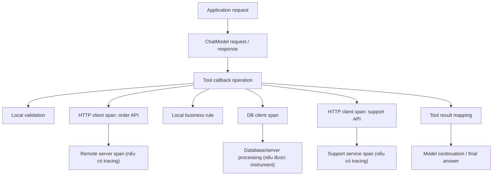
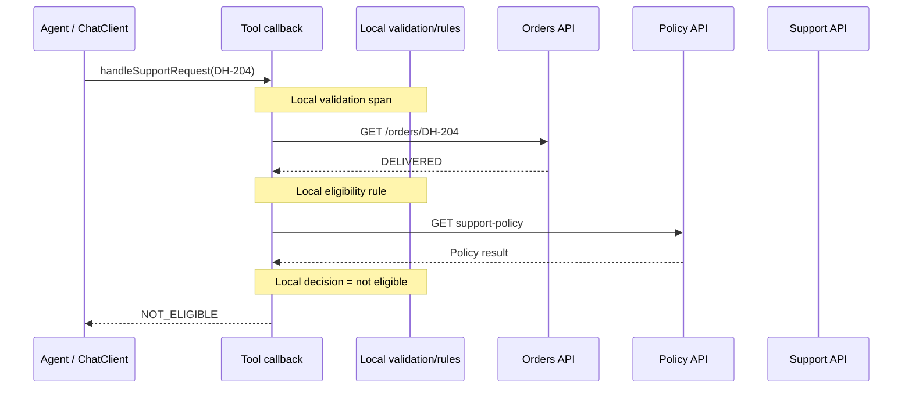

# Quan sát công cụ cục bộ và dịch vụ ngoài được gọi

Một tool trong ứng dụng Spring AI có thể chỉ chạy một phép tính trong JVM, hoặc có thể gọi API đơn hàng, cơ sở dữ liệu, vector store hay một dịch vụ bên ngoài. Hai trường hợp cùng xuất hiện dưới dạng **tool call** trong hội thoại, nhưng nguyên nhân chậm và lỗi rất khác nhau. Một hàm tính thuế chậm có thể do thuật toán hoặc khóa đồng bộ trong ứng dụng; một tool tra đơn chậm có thể do DNS, kết nối HTTP, hàng đợi, máy chủ từ xa hoặc truy vấn DB.

Nếu chỉ đo thời gian của phương thức `@Tool`, ta biết tổng thời gian callback nhưng chưa chắc biết **thời gian nằm ở logic cục bộ hay ở dependency bên ngoài**. Bài này hướng dẫn phân tách và liên kết các ranh giới đó bằng observations, spans và metrics, để khi một tool chậm hoặc lỗi, nhóm có thể xác định đúng tầng cần điều tra.

Bài học thuộc chương **Quan sát công cụ** của mô-đun **SPRING_AI_EVALUATION_OBSERVABILITY**. Mô-đun học đánh giá chất lượng ứng dụng Spring AI bằng tập dữ liệu, tiêu chí relevance, fact checking và kiểm thử RAG/tool calling; đồng thời đo metrics, traces, chi phí và độ trễ để phát hiện nguyên nhân suy giảm qua các phiên bản prompt, model và pipeline. Trọng tâm ở đây là **quan sát công cụ cục bộ và các dịch vụ ngoài mà công cụ gọi tới**, rồi nối dữ liệu vận hành với kết quả đánh giá chất lượng agent.

> **Phân biệt quan trọng:** tool callback là ranh giới mà model yêu cầu ứng dụng thực hiện. Callback có thể chạy logic ngay trong tiến trình, gọi một hoặc nhiều dịch vụ ngoài, hoặc kết hợp cả hai. **Tên tool không cho biết toàn bộ đường đi thực thi của nó.**

## 1. Kết quả học tập

Sau bài học, bạn có thể:

1. Phân biệt **tool cục bộ**, **logic nghiệp vụ cục bộ**, **dependency bên ngoài** và **tool callback kết hợp**.
2. Thiết kế trace có span cho request ứng dụng, model, tool operation, logic cục bộ và lời gọi HTTP/DB bên ngoài.
3. Phân biệt **client span** do ứng dụng tạo khi gọi dịch vụ ngoài với **server span** ở phía dịch vụ nhận request.
4. Đo callback duration, local processing duration, dependency duration và end-to-end latency mà không cộng trùng các span lồng nhau.
5. Dùng Micrometer Observation/Tracing và HTTP client instrumentation phù hợp với phiên bản Spring Boot/Spring AI.
6. Phân loại lỗi cục bộ, lỗi transport, HTTP status, lỗi nghiệp vụ, timeout, retry, circuit breaker và fallback.
7. Chọn metrics/tags có cardinality thấp; bảo vệ URL, arguments, response và dữ liệu nhạy cảm.
8. Đánh giá riêng **technical success** của dependency và **correctness** của tool workflow theo rule hoặc nhãn người.

## 2. Tool cục bộ và dependency bên ngoài khác nhau thế nào?

Một tool là capability mà ứng dụng cung cấp cho model. Phần code thực thi capability có thể hoàn toàn cục bộ hoặc gọi hệ thống khác.

| Loại | Ví dụ | Phạm vi thực thi | Rủi ro quan sát chính |
|---|---|---|---|
| **Local-only tool** | Tính tổng, đổi đơn vị, kiểm tra định dạng mã đơn | Trong JVM, không gọi mạng/DB | CPU, lock contention, allocation, exception, logic |
| **Local tool có cache** | Đọc cache trong tiến trình hoặc cache được nhúng | JVM hoặc cache client | Cache hit/miss, lock, kích thước dữ liệu |
| **Tool gọi DB** | Tra đơn hàng, đọc lịch sử giao dịch | Code cục bộ + DB client/server | Pool wait, query duration, lock, DB availability |
| **Tool gọi HTTP API** | Tra vận đơn, tạo phiếu hỗ trợ | Code cục bộ + HTTP client + remote service | DNS/connect/TLS, network, server latency, HTTP status |
| **Tool gọi vector store** | Tìm các đoạn tài liệu liên quan | Code cục bộ + vector client/service | Embedding/query, index latency, số kết quả, timeout |
| **Composite tool** | Tra đơn, kiểm policy, tính điều kiện rồi tạo phiếu | Nhiều đoạn local và external | Fan-out, retry, dependency chain, side effect |

**Local-only** có nghĩa đường thực thi của thao tác không rời tiến trình ở ranh giới đang đo. Một method Java nhìn có vẻ đơn giản vẫn có thể gọi HTTP, JDBC hoặc SDK bên trong. Vì vậy, phân loại theo **đường đi thực tế** và dependency spans, không chỉ theo tên class hay annotation `@Tool`.

### 2.1. Một ví dụ xuyên suốt

Người dùng yêu cầu:

> “Tra đơn DH-204. Nếu đơn giao thất bại và chính sách cho phép, hãy tạo một phiếu hỗ trợ.”

Tool callback `handleSupportRequest` có thể thực hiện:

1. **Local validation:** kiểm tra định dạng `orderId`, xác thực dữ liệu đầu vào.
2. **External order API:** gọi dịch vụ đơn hàng để lấy trạng thái.
3. **Local rule evaluation:** kiểm tra trạng thái có phải `DELIVERY_FAILED` không.
4. **External policy API hoặc local policy cache:** tra điều kiện hỗ trợ.
5. **Local decision:** xác định có đủ điều kiện tạo phiếu.
6. **External support API:** tạo phiếu nếu được phép.
7. **Local mapping:** chuyển kết quả thành tool response cho model.

Một callback có thể hoàn tất thành công về kỹ thuật nhưng trả `NOT_ELIGIBLE` theo nghiệp vụ. Agent cần diễn giải kết quả đó đúng. Nếu callback gọi support API dù trạng thái đơn là `DELIVERED`, các dependency có thể đều trả HTTP 200 nhưng **workflow vẫn sai**.

## 3. Phân tầng quan sát: request, model, tool và dependency

Một cấu trúc trace khái niệm:



Sơ đồ biểu diễn quan hệ logic mong muốn. Parent/child spans thực tế phụ thuộc cách Spring AI, Spring Boot, Micrometer, HTTP client và executor được cấu hình. Nếu một dịch vụ ngoài không phát trace hoặc không nhận context propagation, ứng dụng vẫn có thể đo **client-side span**, nhưng sẽ không nhìn thấy chi tiết xử lý nội bộ của máy chủ đó.

### 3.1. Các ranh giới nên phân biệt

| Ranh giới | Bắt đầu/kết thúc | Câu hỏi trả lời |
|---|---|---|
| **Agent request** | Nhận yêu cầu tới trả lời/quyết định cuối | Người dùng chờ bao lâu? |
| **Model request** | Gửi request tới model tới khi nhận response | Model round nào chậm hoặc lỗi? |
| **Tool callback** | Bắt đầu callback tới khi callback trả/throw | Toàn bộ tool operation mất bao lâu? |
| **Local operation** | Bắt đầu xử lý trong JVM tới khi hoàn tất | Logic/validation/mapping cục bộ mất bao lâu? |
| **HTTP client call** | Gửi request HTTP tới khi nhận response/lỗi | Dependency ngoài mất bao lâu từ góc nhìn client? |
| **DB client operation** | Gửi truy vấn tới khi nhận kết quả/lỗi | DB access mất bao lâu? |
| **Async job** | Worker bắt đầu job tới khi job hoàn tất | Tác vụ nền thực sự mất bao lâu? |

Không nên đo mọi ranh giới bằng một metric chung tên `tool.duration` rồi cố suy ra nguyên nhân. Callback duration có thể bao gồm local logic **và** HTTP/DB calls. Các span con giúp phân tích thành phần, nhưng duration của span cha đã bao gồm thời gian chờ span con nếu chạy đồng bộ.

### 3.2. Client span và server span

Khi ứng dụng gọi `orders-api`:

- **Client span** được tạo ở ứng dụng gọi. Nó đo thời gian từ phía client, bao gồm phần network và chờ response.
- **Server span** được tạo ở `orders-api` nếu dịch vụ nhận request có tracing instrumentation.
- Nếu hai bên truyền trace context theo chuẩn phù hợp, hai span có thể nằm trong cùng trace phân tán.
- Nếu dịch vụ ngoài không hỗ trợ tracing, client span vẫn hữu ích; chỉ không thể chia chính xác thời gian phía server với thời gian mạng từ dữ liệu đó.

Không gọi client span là “server processing time”. Nếu cần biết server xử lý bao lâu, phải có telemetry từ chính dịch vụ nhận request hoặc một hợp đồng timing đáng tin.

## 4. Quan sát tool chỉ chạy cục bộ

Với tool chỉ tính toán hoặc kiểm tra dữ liệu trong JVM, thường không có HTTP/DB span con. Ta có thể tạo một observation bao quanh logic cục bộ.

Ví dụ: tính tổng tiền hoàn dự kiến từ các dòng hàng đã được ứng dụng cung cấp. Tool này **không truy cập dịch vụ ngoài**.

```java
import io.micrometer.observation.Observation;
import io.micrometer.observation.ObservationRegistry;
import org.springframework.ai.tool.annotation.Tool;

import java.math.BigDecimal;
import java.util.List;
import java.util.Objects;

public final class LocalRefundTools {

    public record LineItem(
            String sku,
            BigDecimal unitPrice,
            int quantity) {
    }

    public record RefundEstimate(
            BigDecimal subtotal,
            int lineCount) {
    }

    private final ObservationRegistry registry;

    public LocalRefundTools(ObservationRegistry registry) {
        this.registry = Objects.requireNonNull(registry);
    }

    @Tool(description = "Tính tổng giá trị các dòng hàng được cung cấp")
    public RefundEstimate estimateSubtotal(List<LineItem> items) {
        Observation observation = Observation
                .createNotStarted("app.ai.tool.local.operation", registry)
                .lowCardinalityKeyValue("tool.name", "estimate_subtotal")
                .lowCardinalityKeyValue("tool.execution.type", "local");

        String outcome = "unexpected_error";
        observation.start();

        try (Observation.Scope scope = observation.openScope()) {
            if (items == null || items.isEmpty()) {
                outcome = "business_rejected";
                throw new IllegalArgumentException("Items must not be empty");
            }

            BigDecimal total = BigDecimal.ZERO;
            for (LineItem item : items) {
                if (item == null || item.unitPrice() == null
                        || item.quantity() < 0) {
                    outcome = "validation_error";
                    throw new IllegalArgumentException(
                            "Invalid line item");
                }

                total = total.add(item.unitPrice()
                        .multiply(BigDecimal.valueOf(item.quantity())));
            }

            outcome = "success";
            return new RefundEstimate(total, items.size());

        } catch (RuntimeException ex) {
            observation.error(ex);
            throw ex;

        } finally {
            observation.lowCardinalityKeyValue(
                    "tool.outcome", outcome);
            observation.stop();
        }
    }
}
```

### 4.1. Đọc kết quả đo local-only

Observation trên đo **thời gian phần thân method**. Nếu method thực hiện một vòng lặp CPU-bound, thời gian bao gồm validation và phép tính. Nó không tự cho biết CPU time chính xác, GC pause, lock wait hay scheduling delay. Muốn phân tích sâu hơn, kết hợp profiler/JFR và metrics JVM.

Trong ví dụ, input rỗng được phân loại `business_rejected` theo quy ước minh họa, còn item sai được phân loại `validation_error`. Một ứng dụng khác có thể chọn taxonomy khác, miễn là định nghĩa và mẫu số nhất quán.

**Không cần tạo HTTP span giả** cho một tool local-only. Sự vắng mặt của dependency span là đúng với đường thực thi đó.

## 5. Quan sát tool callback gọi dịch vụ HTTP bên ngoài

Với tool gọi API, nên có một observation cho **tool operation** và một client observation cho **HTTP request**. Spring Boot/Spring Framework có thể tích hợp Micrometer Observation vào các HTTP client được cấu hình phù hợp. Hãy xác nhận builder/runtime của dự án thực sự bật instrumentation.

Ví dụ `lookupOrder` gồm local validation, HTTP call và local mapping:

```java
import io.micrometer.observation.Observation;
import io.micrometer.observation.ObservationRegistry;
import org.springframework.ai.tool.annotation.Tool;
import org.springframework.web.client.HttpClientErrorException;
import org.springframework.web.client.ResourceAccessException;
import org.springframework.web.client.RestClient;
import org.springframework.web.client.RestClientResponseException;

import java.util.Objects;

public final class RemoteOrderTools {

    public record OrderApiResponse(
            String orderId,
            String deliveryStatus) {
    }

    public record OrderView(
            String orderId,
            String deliveryStatus) {
    }

    private final RestClient ordersClient;
    private final ObservationRegistry registry;

    public RemoteOrderTools(
            RestClient.Builder restClientBuilder,
            ObservationRegistry registry) {
        this.registry = Objects.requireNonNull(registry);

        // Trong Spring Boot, ưu tiên builder được auto-configure.
        // Base URL lấy từ cấu hình đáng tin của ứng dụng.
        this.ordersClient = restClientBuilder
                .baseUrl("https://orders.example.internal")
                .observationRegistry(registry)
                .build();
    }

    @Tool(description = "Tra cứu trạng thái giao hàng theo mã đơn")
    public OrderView lookupOrder(String orderId) {
        Observation observation = Observation
                .createNotStarted(
                        "app.ai.tool.operation", registry)
                .lowCardinalityKeyValue("tool.name", "lookup_order")
                .lowCardinalityKeyValue("tool.execution.type", "remote");

        String outcome = "unexpected_error";
        String errorCategory = "none";
        observation.start();

        try (Observation.Scope scope = observation.openScope()) {
            if (orderId == null
                    || !orderId.matches("DH-[0-9]{3,8}")) {
                outcome = "validation_error";
                errorCategory = "argument_validation";
                throw new IllegalArgumentException("Invalid order id");
            }

            OrderApiResponse response = ordersClient.get()
                    .uri("/orders/{orderId}", orderId)
                    .retrieve()
                    .body(OrderApiResponse.class);

            if (response == null) {
                outcome = "dependency_error";
                errorCategory = "empty_response";
                throw new IllegalStateException(
                        "Orders API returned an empty body");
            }

            outcome = "success";
            return new OrderView(
                    response.orderId(), response.deliveryStatus());

        } catch (HttpClientErrorException.NotFound ex) {
            // 404 được định nghĩa là đơn không tồn tại trong ví dụ này.
            outcome = "business_rejected";
            return new OrderView(orderId, "NOT_FOUND");

        } catch (ResourceAccessException ex) {
            // Nhóm lỗi truy cập; cần phân loại timeout/connection
            // chi tiết hơn nếu client cung cấp nguyên nhân cụ thể.
            outcome = "dependency_error";
            errorCategory = "transport";
            observation.error(ex);
            throw ex;

        } catch (RestClientResponseException ex) {
            outcome = "dependency_error";
            errorCategory = "http_response";
            observation.error(ex);
            throw ex;

        } catch (RuntimeException ex) {
            if ("unexpected_error".equals(outcome)) {
                errorCategory = "local_or_mapping";
            }
            observation.error(ex);
            throw ex;

        } finally {
            observation.lowCardinalityKeyValue(
                    "tool.outcome", outcome);
            observation.lowCardinalityKeyValue(
                    "error.category", errorCategory);
            observation.stop();
        }
    }
}
```

### 5.1. Điều kiện để thấy HTTP client span

- `RestClient.Builder` phải được cấu hình với `ObservationRegistry` và các observation handlers cần thiết.
- Trong Spring Boot, nên ưu tiên builder được auto-configure để giữ các customizer/observation convention của ứng dụng.
- Để xuất **trace spans**, cần tracing bridge/exporter phù hợp; chỉ có `ObservationRegistry` hoặc meter không đảm bảo trace xuất hiện ở backend.
- Nếu dùng `WebClient`, `RestTemplate`, Feign hoặc SDK khác, kiểm tra instrumentation tương ứng; đừng mặc định một builder của client này tự instrument client khác.
- Nếu framework đã tạo HTTP client observation, không bọc thêm timer có cùng ranh giới rồi cộng hai lần.

Tên `app.ai.tool.operation` là **tên observation tùy chỉnh của ví dụ**, không phải tên mặc định được bảo đảm của Spring AI. HTTP client observation có tên/tag theo phiên bản Spring Framework/Spring Boot và cấu hình tương ứng.

### 5.2. Vì sao `business_rejected` không phải lỗi HTTP?

Trong ví dụ, API trả HTTP 404 cho một đơn không tồn tại và ứng dụng quy ước đây là kết quả nghiệp vụ hợp lệ. Do đó:

- **HTTP client observation** có thể ghi response status 404 theo quy ước instrumentation.
- **Tool operation observation** có thể ghi `business_rejected`.
- **Technical availability** có thể vẫn xem request đã nhận được response hợp lệ.
- **Business success** có thể là false vì không có đơn để tiếp tục.

Một API khác có thể dùng 404 để chỉ endpoint không tồn tại hoặc resource hệ thống bị cấu hình sai. Phải diễn giải theo **hợp đồng API cụ thể**, không gán mọi 404 thành business rejection.

## 6. Tool kết hợp: local logic và nhiều dịch vụ ngoài

Một tool composite có thể thực hiện nhiều bước:



Trong tình huống trên, `support-api` **không được gọi** vì precondition không thỏa. Một trace đúng nên thể hiện:

- Tool operation bắt đầu và kết thúc;
- Local validation/rule spans;
- Client spans tới `orders-api` và `policy-api`;
- Không có client span tới `support-api`;
- Tool result `NOT_ELIGIBLE` được trả lại model.

Sự vắng mặt của `support-api` là **bằng chứng hữu ích** nếu event ledger/trace đủ đầy và không bị sampling che khuất. Nhưng với tracing sampling, không thấy span không luôn chứng minh request không xảy ra. Khi cần kiểm soát hành động quan trọng, dùng audit event hoặc state transition đáng tin bên cạnh trace.

### 6.1. Fan-out song song

Một tool có thể gọi hai dependency độc lập, chẳng hạn lấy trạng thái đơn và lấy thông tin vận chuyển. Nếu chạy song song:

- Tạo một span cho mỗi client request;
- Liên kết cả hai với tool operation bằng parent context hoặc span links phù hợp;
- Đo thêm thời gian pha fan-out;
- Không cộng duration hai HTTP spans để suy wall-clock của callback.

Nếu HTTP A mất 300 ms và HTTP B mất 500 ms, pha chạy song song có thể gần 500 ms cộng overhead, thay vì 800 ms. Chỉ số chính xác phải lấy từ **duration thực tế của parent/phase**, không từ tổng duration con.

### 6.2. Gọi dịch vụ ngoài theo chuỗi

Nếu tool phải chờ `orders-api` rồi mới quyết định có gọi `support-api`, các spans thường tuần tự. Khi đó latency tool operation bao gồm cả hai dependency calls và local logic. Phân tích trace giúp biết bước nào chiếm phần lớn thời gian, nhưng không cộng lại child durations vào parent duration.

## 7. Quan sát DB, vector store và các dependency khác

HTTP không phải dependency duy nhất. Một tool có thể truy vấn DB, cache, vector store hoặc message broker.

| Dependency | Client-side observation/span nên thể hiện | Điều cần lưu ý |
|---|---|---|
| **JDBC/DB** | Operation/query duration, DB system, outcome | Tránh ghi raw SQL/parameters nhạy cảm; kiểm pool wait và server timing |
| **R2DBC** | Reactive query duration tới terminal signal | Không dừng timer ngay khi tạo publisher |
| **Vector store** | Store operation, query duration, result count nếu an toàn | Phân biệt embedding generation và vector search |
| **Cache** | Cache get/put, hit/miss, duration | Cache có thể là local hoặc remote; ghi loại rõ |
| **Message broker** | Publish/consume spans, queue wait, delivery outcome | Callback publish không đồng nghĩa job consumer đã hoàn tất |
| **External SDK** | Client operation, dependency name, status | Kiểm SDK có Micrometer/OpenTelemetry instrumentation hay không |

Với DB, một query span có thể không cho biết toàn bộ thời gian do connection pool wait nếu pool instrumentation chưa bật. Với vector store, tổng thời gian có thể gồm embedding model call, query vector DB và mapping kết quả. Cần tách những bước này nếu chúng ảnh hưởng đáng kể tới latency/chi phí.

## 8. Phân tích latency: local time, dependency time và thời gian bao hàm

Giả sử một tool callback chạy tuần tự:

| Span | Duration |
|---|---:|
| Tool operation | 920 ms |
| Local validation + mapping | 70 ms |
| Orders HTTP client | 510 ms |
| Policy DB query | 260 ms |
| Local rule evaluation | 40 ms |

Các span con có thể cộng gần bằng parent nếu mọi bước được đo đầy đủ và tuần tự. Tuy nhiên, `tool operation` **đã bao gồm** HTTP và DB. Không tính `920 + 510 + 260` làm tổng thời gian; đó là double counting.

Phân rã minh họa:

\[
L_{\text{tool}}
\approx L_{\text{local}}
+ L_{\text{orders-client}}
+ L_{\text{policy-db}}
+ L_{\text{overhead}}.
\]

Với số liệu giả định, phần chưa giải thích là:

\[
920 - 70 - 510 - 260 - 40 = 40\ \text{ms}.
\]

Đó có thể là serialization, scheduling, instrumentation overhead hoặc khoảng trống đo lường. Không nên tự gán 40 ms cho một nguyên nhân nếu chưa có span/log xác nhận.

### 8.1. Client duration không phải server processing duration

HTTP client span 510 ms có thể bao gồm:

- DNS resolution;
- Connection pool wait;
- TCP/TLS connection nếu cần;
- Network round-trip;
- Server queueing và processing;
- Response transfer/decoding.

Nếu remote service có server span, ta có thể đối chiếu thời gian phía server với client span. Nếu không, chỉ biết tổng thời gian quan sát từ client. Không tự lấy `client duration - server duration` làm network latency chính xác nếu chưa xét cách đo và clock/context.

### 8.2. Local CPU-bound hay local waiting?

Một local operation mất 700 ms không có dependency spans có thể do:

- Thuật toán tốn CPU;
- Lock contention;
- Thread pool queue;
- GC pause;
- I/O chưa được instrument;
- Synchronous wait hoặc blocking call ẩn.

Observation duration đo **wall-clock**, không tự phân biệt CPU time với wait time. Dùng profiler, Java Flight Recorder, thread dumps và metrics JVM khi cần điều tra sâu. Không gắn nhãn “CPU bottleneck” chỉ từ việc không thấy HTTP span.

## 9. Phân loại lỗi theo tầng

Một taxonomy rõ ràng giúp phân biệt callback lỗi, dependency lỗi và kết quả nghiệp vụ hợp lệ.

| Tầng | Outcome/error category ví dụ | Ý nghĩa |
|---|---|---|
| **Local validation** | `validation_error` | Arguments hoặc dữ liệu cục bộ không hợp lệ |
| **Local business rule** | `business_rejected` | Điều kiện nghiệp vụ không cho phép tiếp tục |
| **Local execution** | `local_error` | Exception trong logic/mapping/serialization |
| **HTTP transport** | `connection_error`, `dns_error`, `tls_error`, `timeout` | Không hoàn thành trao đổi HTTP |
| **HTTP response** | `http_4xx`, `http_5xx` | Nhận response lỗi; diễn giải theo API contract |
| **DB** | `pool_timeout`, `query_error`, `deadlock` | Lỗi lấy connection hoặc truy vấn |
| **Vector store** | `search_timeout`, `index_unavailable` | Dependency truy xuất không dùng được |
| **Control plane** | `circuit_open`, `bulkhead_rejected`, `rate_limited` | Yêu cầu bị chặn trước hoặc trong khi gọi dependency |
| **Execution lifecycle** | `cancelled` | Luồng bị hủy, client disconnect hoặc deadline hết |

### 9.1. Một lỗi có thể được quan sát ở nhiều tầng

Nếu `orders-api` trả HTTP 503:

- HTTP client span ghi status/response error;
- Tool operation span kết thúc với `dependency_error`;
- Agent request có thể kết thúc lỗi hoặc nhận một fallback;
- Evaluation có thể ghi `tool_dependency_unavailable`.

Đó là **một sự cố ở dependency** được phản ánh qua nhiều lớp, không phải ba lỗi độc lập để cộng thành ba lần callback failure. Dashboard cần xác định **đơn vị đếm** của mỗi metric.

### 9.2. Fallback không xóa lỗi gốc

Giả sử `orders-api` timeout, nhưng ứng dụng trả dữ liệu cache cũ. Có thể ghi:

- Dependency attempt: `timeout`;
- Cache lookup: `hit`;
- Tool operation: `fallback_success` hoặc outcome tương đương theo taxonomy;
- Data freshness: tuổi của snapshot, nếu được phép đo;
- Final response: có nêu rõ trạng thái là dữ liệu cache hay không.

Không đổi dependency timeout thành `success` rồi làm mất thông tin sự cố. **Tool có thể trả kết quả dự phòng**, nhưng độ mới và độ tin cậy của kết quả cần được đánh giá riêng.

## 10. Retry, timeout, circuit breaker và side effect

Một logical operation gọi dependency có thể tạo nhiều client attempts. Nên phân biệt:

- **Tool invocation:** một lần model yêu cầu tool và dispatcher gọi callback;
- **Dependency operation:** một mục tiêu HTTP/DB nghiệp vụ;
- **Dependency attempt:** một lần gửi request thực tế;
- **Logical operation:** mục tiêu nghiệp vụ có thể bao gồm retry/fallback.

Ví dụ:

```text
Tool callback lookup_order
  Logical dependency operation: GET order DH-204
    HTTP attempt 1: timeout after 800 ms
    Backoff: 100 ms
    HTTP attempt 2: 200 OK after 140 ms
  Tool callback result: DELIVERED
```

Nên đo duration cho từng attempt, duration tổng của dependency operation và duration của tool callback. Nếu callback tự retry, parent span có thể bao gồm backoff; child spans mỗi lần HTTP thể hiện từng lần gửi.

### 10.1. Circuit breaker và bulkhead

Khi circuit breaker mở, request có thể bị từ chối **trước khi HTTP client gửi request**. Khi bulkhead đầy, callback có thể không lấy được slot để thực thi. Các trường hợp này không phải server trả 5xx:

- Ghi `circuit_open` hoặc `bulkhead_rejected`;
- Ghi rõ request có thực sự được gửi không;
- Không tạo HTTP client span giả nếu chưa có HTTP request;
- Đo queue/rejection và tỷ lệ fallback;
- Giữ nguyên nguyên nhân gốc trong trace.

### 10.2. Retry với tool có side effect

Đối với `create_support_ticket`, timeout không chứng minh phiếu chưa được tạo. Trước khi retry:

1. Dùng idempotency key theo logical operation nếu API hỗ trợ.
2. Kiểm tra trạng thái commit/ticket ID trước khi gửi lại.
3. Ghi mỗi dependency attempt và kết quả xác minh.
4. Đặt retry limit/backoff rõ ràng.
5. Không để model tự gọi lại chỉ vì nó không thấy response.

Observability giúp điều tra nhưng **không tự đảm bảo idempotency**. Điều đó phải được thực thi bởi ứng dụng và hợp đồng downstream.

## 11. Metrics: tách local operation và external dependency

Tên metric dưới đây là **quy ước gợi ý do ứng dụng định nghĩa**, không phải tên mặc định được bảo đảm của Spring AI.

| Metric | Loại | Tag low-cardinality gợi ý | Ý nghĩa |
|---|---|---|---|
| `app.ai.tool.operation` | Timer | `tool.name`, `execution.type`, `outcome` | Tổng duration của tool callback/operation |
| `app.ai.tool.local` | Timer | `tool.name`, `operation.name`, `outcome` | Logic cục bộ được đo riêng |
| `app.ai.tool.dependency` | Timer | `dependency.name`, `dependency.type`, `outcome` | Client-side duration của dependency |
| `app.ai.tool.dependency.retries` | Counter | `dependency.name`, `reason` | Số dependency retry |
| `app.ai.tool.fallback` | Counter | `dependency.name`, `fallback.type` | Số lần dùng fallback |
| `app.ai.tool.dependency.rejections` | Counter | `dependency.name`, `reason` | Circuit/bulkhead/rate-limit rejection |
| `app.ai.tool.requests` | Counter | `tool.name`, `outcome` | Số callback attempts hoặc operations theo định nghĩa |
| `app.ai.agent.duration` | Timer | `workflow`, `outcome` | End-to-end request duration |

Với `Timer`, Micrometer thường đã cung cấp count và tổng thời gian; histogram/percentiles cần cấu hình phù hợp backend. Tránh tạo thêm Counter cùng ý nghĩa rồi cộng với Timer count.

### 11.1. Tags nên dùng và nên tránh

| Field | Metric tag? | Lý do |
|---|---|---|
| `tool.name=lookup_order` | Có | Registry hữu hạn, canonical |
| `execution.type=local/remote/mixed` | Có | Tập giá trị nhỏ |
| `dependency.name=orders-api` | Có | Tên service ổn định |
| `dependency.type=http/db/vector` | Có | Nhóm cố định |
| `outcome=success/timeout/...` | Có | Taxonomy hữu hạn |
| `http.status=2xx/4xx/5xx` | Có thể | Dùng status class, không cần mọi mã tùy tiện |
| `route=/orders/{id}` | Có thể | Dùng route template đã chuẩn hóa |
| Raw URL/host do user truyền | Không | Cardinality và rủi ro dữ liệu |
| `orderId`, email, user ID | Không | Dữ liệu cá thể/nhạy cảm |
| `traceId`, `spanId`, invocation ID | Không | Gần như duy nhất mỗi lượt |
| Raw exception message/SQL/arguments | Không | Không ổn định, có thể chứa bí mật |

### 11.2. Tỷ lệ cần tính với mẫu số rõ ràng

\[
\text{Dependency error rate}
=\frac{\text{dependency attempts lỗi kỹ thuật}}
       {\text{dependency attempts đã bắt đầu}}
\]

\[
\text{Tool operation error rate}
=\frac{\text{tool operations kết thúc lỗi kỹ thuật}}
       {\text{tool callback attempts đã bắt đầu}}
\]

\[
\text{Fallback rate}
=\frac{\text{logical operations dùng fallback}}
       {\text{logical operations cần dependency}}
\]

\[
\text{Dependency retry rate}
=\frac{\text{logical dependency operations có retry}}
       {\text{logical dependency operations}}
\]

`business_rejected` cần được báo riêng nếu đó là kết quả hợp lệ của nghiệp vụ. Không gộp nó vào dependency error rate trừ khi hợp đồng đo lường định nghĩa rõ như vậy.

## 12. Cardinality, dữ liệu nhạy cảm và URL an toàn

Một tool có thể nhận `orderId`, địa chỉ, email, token hoặc URL. Không đưa những giá trị đó vào metric tags. Khi cần điều tra:

- Ưu tiên log/trace metadata tổng hợp và allowlist trường được phép;
- Che hoặc loại bỏ thông tin nhận dạng cá nhân, access token, authorization header và query string;
- Dùng trace ID/invocation ID do hệ thống tạo, với quyền truy cập và retention phù hợp;
- Không log raw request/response body mặc định;
- Giới hạn kích thước exception message, stack trace và payload được lưu;
- Kiểm tra sampling vì traces có thể không được xuất đầy đủ;
- Không để tool tự mở URL tùy ý do model/user cung cấp chỉ để ghi telemetry.

Nếu tool nhận URL từ dữ liệu không đáng tin, cần kiểm soát allowlist host, scheme, DNS/IP và chính sách mạng ở lớp gọi HTTP. **Observability không thay thế biện pháp chống SSRF**; nó chỉ giúp ghi nhận host/destination đã được xác thực theo cách an toàn.

## 13. Spring AI, Spring Boot và Micrometer: ai instrument tầng nào?

Một hệ thống có thể nhận telemetry từ nhiều thành phần:

| Thành phần | Cơ chế quan sát thường dùng | Điều phải xác nhận |
|---|---|---|
| Spring AI ChatModel/ChatClient | Spring AI Observation/Micrometer theo phiên bản | Tên observation, usage, prompt/model metadata |
| Tool callback | Framework instrumentation hoặc observation ứng dụng | Callback boundary có được đo tự động không |
| Local business method | Observation tùy chỉnh | Không bọc trùng cùng ranh giới callback |
| Spring `RestClient` | HTTP client Observation/Micrometer | Builder có registry/handlers phù hợp |
| `WebClient`/`RestTemplate` | Observation/instrumentation tương ứng | Client và phiên bản được cấu hình đúng |
| JDBC/R2DBC | Micrometer/driver/framework instrumentation | Có đo pool wait và query duration không |
| Remote service | Server-side instrumentation ở dịch vụ nhận | Trace context có được truyền và backend có nhận spans không |

Spring AI và Spring Boot có thể tự tạo observations cho một số thành phần khi dependency và cấu hình phù hợp. **Tên và phạm vi cụ thể phụ thuộc phiên bản**. Trước khi viết custom instrumentation:

1. Bật observation/tracing trong môi trường thử nghiệm.
2. Chạy một local-only tool và một remote tool.
3. Kiểm tra span/timer đã xuất cho callback, HTTP client và dependency.
4. Xác định phần nào chưa được đo hoặc thiếu tag nghiệp vụ.
5. Chỉ bổ sung observation ở ranh giới còn thiếu; không tạo hai timer cùng ý nghĩa.
6. Kiểm tra exporter, sampling và context propagation.
7. Ghi Spring AI/Spring Boot/Spring Framework/Micrometer versions vào metadata benchmark.

Tên `app.ai.tool.operation` hoặc `app.ai.tool.local` trong bài là **tên do ứng dụng đặt**. Không giả định chúng là meters mặc định.

## 14. Java/Spring AI: kết hợp local span với HTTP client observation

Ví dụ ở mục 5 đã thể hiện tool gọi `RestClient`. Phần quan trọng trong triển khai là cấu hình HTTP client sao cho **client request được instrument** và có thể tạo span con khi được gọi bên trong tool operation observation.

Một cấu hình Spring Boot minh họa:

```java
import io.micrometer.observation.ObservationRegistry;
import org.springframework.context.annotation.Bean;
import org.springframework.context.annotation.Configuration;
import org.springframework.web.client.RestClient;

@Configuration
public class OrdersClientConfiguration {

    @Bean
    RestClient ordersRestClient(
            RestClient.Builder builder,
            ObservationRegistry observationRegistry) {

        return builder
                .baseUrl("https://orders.example.internal")
                .observationRegistry(observationRegistry)
                .build();
    }
}
```

Có thể inject `RestClient` đã cấu hình vào tool service. Nếu dùng Spring Boot auto-configured `RestClient.Builder`, giữ các customizers và message converters đã được cấu hình. Nếu tự tạo builder mới, cần tự bảo đảm instrumentation, codecs, timeouts và các cấu hình cần thiết.

### 14.1. Minh họa một tool local gọi remote client

```java
import io.micrometer.observation.Observation;
import io.micrometer.observation.ObservationRegistry;
import org.springframework.ai.tool.annotation.Tool;
import org.springframework.web.client.RestClient;

import java.util.Objects;

public final class SupportLookupTool {

    public record OrderResponse(
            String orderId,
            String deliveryStatus) {
    }

    public record ToolResult(
            String status,
            String message) {
    }

    private final RestClient ordersClient;
    private final ObservationRegistry registry;

    public SupportLookupTool(
            RestClient ordersClient,
            ObservationRegistry registry) {
        this.ordersClient = Objects.requireNonNull(ordersClient);
        this.registry = Objects.requireNonNull(registry);
    }

    @Tool(description = "Kiểm tra trạng thái giao hàng của đơn")
    public ToolResult inspectOrder(String orderId) {
        Observation toolObservation = Observation
                .createNotStarted("app.ai.tool.operation", registry)
                .lowCardinalityKeyValue("tool.name", "inspect_order")
                .lowCardinalityKeyValue("execution.type", "mixed");

        String outcome = "unexpected_error";
        toolObservation.start();

        try (Observation.Scope scope = toolObservation.openScope()) {
            if (orderId == null
                    || !orderId.matches("DH-[0-9]{3,8}")) {
                outcome = "validation_error";
                return new ToolResult(
                        "INVALID_INPUT", "Mã đơn không hợp lệ");
            }

            // HTTP client observation được tạo bởi RestClient
            // khi builder/registry và observation handlers đã bật.
            OrderResponse order = ordersClient.get()
                    .uri("/orders/{id}", orderId)
                    .retrieve()
                    .body(OrderResponse.class);

            if (order == null) {
                outcome = "dependency_error";
                return new ToolResult(
                        "DEPENDENCY_ERROR", "Dịch vụ không trả dữ liệu");
            }

            outcome = "success";
            return new ToolResult(
                    order.deliveryStatus(),
                    "Đã tra cứu trạng thái đơn");

        } catch (RuntimeException ex) {
            outcome = "dependency_or_local_error";
            toolObservation.error(ex);
            throw ex;

        } finally {
            toolObservation.lowCardinalityKeyValue(
                    "tool.outcome", outcome);
            toolObservation.stop();
        }
    }
}
```

Trong ví dụ này, observation `app.ai.tool.operation` đo **toàn bộ tool operation**. HTTP client observation đo dependency call ở lớp con nếu RestClient được instrument. Parent duration đã bao gồm HTTP duration. Nếu framework cũng instrument tool callback, hãy xác định rõ observation này là **business operation span** hay callback span và không cộng trùng.

### 14.2. Ví dụ local-only và mixed nên có tên riêng

Có thể dùng `execution.type` với tập giá trị cố định:

- `local`: không gọi dependency ngoài;
- `remote`: công việc chính là gọi dependency;
- `mixed`: có cả xử lý cục bộ và dependency ngoài.

Đây là phân loại của ứng dụng. Một tool `inspect_order` có thể được gọi qua model như nhau dù bản triển khai v1 dùng local cache và v2 gọi remote API. Giữ metadata version để so sánh thay đổi đường đi thực thi.

## 15. Phân tích sự cố qua traces

Giả sử dashboard cho thấy `inspect_order` p95 tăng từ 300 ms lên 1.400 ms. Một trace cụ thể:

```text
agent.request                         1,620 ms
└── tool.operation inspect_order      1,410 ms
    ├── local.validation                  8 ms
    ├── HTTP client orders-api        1,320 ms
    │   └── remote server span           1,250 ms
    └── local.mapping                    12 ms
```

Nếu trace này có đủ spans, phần lớn độ trễ nằm ở `orders-api` phía server. Nhóm có thể điều tra service nhận, query DB của nó hoặc tải máy chủ. Tối ưu vòng lặp Java ở tool callback sẽ không giải quyết phần lớn bottleneck.

Một trace khác:

```text
agent.request                         1,510 ms
└── tool.operation inspect_order      1,330 ms
    ├── local.validation                 10 ms
    ├── HTTP client orders-api          110 ms
    └── local.rule-evaluation          1,150 ms
```

Ở đây HTTP nhanh; local rule evaluation chiếm thời gian. Cần profiler/JFR để tìm CPU, lock hoặc thuật toán tốn kém. Nếu local span chỉ được đo như một khối lớn, ta vẫn chưa biết method con nào là thủ phạm.

### 15.1. Trường hợp chỉ có client span

Nếu `orders-api` không xuất server spans, trace có thể chỉ hiện:

```text
tool.operation inspect_order      1,410 ms
└── HTTP client orders-api         1,320 ms
```

Ta biết thời gian phía client chờ API là 1.320 ms, nhưng **chưa biết** server xử lý bao lâu so với network, queue hay connection. Không được khẳng định server code chậm chỉ từ client span.

## 16. Kết nối tool observability với chất lượng đánh giá

Metrics/traces cho biết **điều gì đã xảy ra**. Evaluation xác định **điều đó có đúng với yêu cầu và chính sách hay không**.

Ví dụ user yêu cầu chỉ tạo phiếu nếu trạng thái đơn là `DELIVERY_FAILED`. Trace:

```json
{
  "toolEvents": [
    {
      "tool": "lookup_order",
      "executionType": "remote",
      "dependency": "orders-api",
      "status": "success",
      "resultCategory": "DELIVERED",
      "durationMs": 85
    },
    {
      "tool": "create_support_ticket",
      "executionType": "remote",
      "dependency": "support-api",
      "status": "success",
      "resultCategory": "TICKET_CREATED",
      "durationMs": 240
    }
  ],
  "workflowRule": "Create ticket only for DELIVERY_FAILED",
  "expectedVerdict": "FAIL"
}
```

Cả hai dịch vụ ngoài đều hoạt động tốt về kỹ thuật. Agent vẫn vi phạm precondition vì gọi support API sau khi nhận `DELIVERED`.

Nên đo riêng:

| Chiều đánh giá | Câu hỏi | Nguồn |
|---|---|---|
| **Dependency availability** | API có phản hồi hợp lệ? | HTTP/client observations |
| **Tool execution correctness** | Tool có được gọi đúng arguments và thứ tự? | Tool trace/event ledger |
| **Business rule correctness** | Có đủ điều kiện thực hiện side effect? | State/rule oracle, nhãn người |
| **Result faithfulness** | Model có diễn giải đúng kết quả? | Tool output + final answer evaluation |
| **Latency/cost** | Dependency/tool/model tiêu tốn bao nhiêu? | Metrics, usage, traces |

Không đưa nội dung tool response thô vào metric tags hoặc judge prompt ngoài phạm vi cần thiết. Khi đánh giá, dùng snapshot/evidence đã kiểm soát và giữ ranh giới tin cậy: kết quả dịch vụ ngoài là **dữ liệu**, không phải chỉ dẫn thay đổi rubric.

## 17. Kiểm thử local và external observations

Dùng fake service hoặc mock server trong test để không tạo side effect thật.

| Test | Setup | Kỳ vọng |
|---|---|---|
| **TC01 — Local-only success** | Tool tính toán trong JVM | Có local operation observation, không có HTTP/DB span |
| **TC02 — Local validation error** | Input sai trong method | Outcome validation_error, observation stop |
| **TC03 — HTTP success** | Mock API trả 200 | Tool span chứa HTTP client span |
| **TC04 — HTTP 404 business** | API trả 404 theo hợp đồng NOT_FOUND | Dependency response được ghi; tool outcome business_rejected |
| **TC05 — HTTP 5xx** | Mock API trả 503 | HTTP/dependency error được phân loại |
| **TC06 — Connection timeout** | Mock server không phản hồi | Client span/error/timeout; tool operation kết thúc có trạng thái |
| **TC07 — Retry** | Lần đầu timeout, lần sau 200 | Nhiều client attempts, một logical dependency operation |
| **TC08 — Circuit open** | Circuit breaker từ chối trước request | Rejection event, không giả tạo HTTP request |
| **TC09 — Fallback cache** | API lỗi, cache có dữ liệu | Dependency error vẫn được ghi; fallback outcome riêng |
| **TC10 — Parallel dependencies** | Hai API chạy đồng thời | Hai client spans, parent duration theo wall-clock |
| **TC11 — Async job** | Callback enqueue job | Callback duration và job duration riêng |
| **TC12 — Context propagation** | Gọi dependency qua executor | Trace context được truyền đúng hoặc thiếu được phát hiện |
| **TC13 — Remote server tracing** | Mock/service có instrumentation | Client và server spans liên kết |
| **TC14 — Missing server tracing** | Dependency không hỗ trợ tracing | Chỉ có client span; không tuyên bố biết server time |
| **TC15 — Instrumentation kép** | Spring AI/HTTP client đã có observations | Không double-count cùng ranh giới |
| **TC16 — Side effect precondition** | Orders API trả DELIVERED | Support API không được gọi |
| **TC17 — Raw payload protection** | Response chứa email/token | Không đưa dữ liệu vào metric tags/log chưa redact |
| **TC18 — HTTP status mapping** | 401/403/404/429/5xx | Phân biệt auth, business contract, rate limit, dependency failure |

### 17.1. Những assertion nên có

- Local-only tool không phát sinh dependency spans không liên quan.
- Mỗi HTTP request thực sự được gửi có client observation theo cấu hình.
- Parent operation duration bao trùm các child calls đồng bộ.
- Exception không làm mất việc stop observation.
- Retry có attempt spans riêng và logical operation ID chung.
- Fallback không xóa lỗi dependency gốc.
- `business_rejected` không tự động làm tăng technical error rate.
- Trace context được truyền đúng qua các boundary đã hỗ trợ.
- Side-effect tool không chạy nếu rule precondition không thỏa.
- Metric tag values thuộc danh sách hữu hạn và không chứa ID cá thể.

## 18. Dashboard và cảnh báo

Một dashboard theo dõi local và external paths nên có các nhóm:

### 18.1. Tổng quan tool

- Callback attempts/second theo `tool.name`;
- Tool operation p50/p95/p99;
- Outcome success, business_rejected, validation_error, dependency_error;
- Retry rate và fallback rate;
- Agent request p95 và số model rounds/tool calls.

### 18.2. Dependency

- Client request rate theo `dependency.name`;
- HTTP status class và transport errors;
- Dependency p50/p95/p99;
- Connection pool wait, connection errors và timeout nếu instrumentation cung cấp;
- DB query duration, pool saturation, vector query duration;
- Circuit breaker/bulkhead rejection.

### 18.3. Local execution

- Local operation duration;
- JVM CPU, heap, GC pause, thread pool queue;
- Lock contention hoặc profiling data khi cần;
- Validation/business rejection counts;
- Local cache hit/miss nếu có.

### 18.4. Chất lượng và chi phí

- Tool workflow correctness trên gold set;
- False pass của precondition và side-effect rules;
- Model tokens/cost theo application request;
- Tool/API cost theo dependency attempt nếu dịch vụ tính phí;
- Coverage, review, evaluation errors;
- Phiên bản prompt/model/tool schema và dependency.

Không dùng `traceId`, `orderId`, raw URL hoặc exception message làm metric labels. Dùng trace links/exemplars nếu hệ thống hỗ trợ để đi từ biểu đồ tới mẫu cụ thể.

## 19. Quy trình triển khai trong dự án Spring AI

1. **Liệt kê tool và dependency:** tên canonical, local/remote/mixed, read/write, schema version, hệ thống phụ thuộc.
2. **Vẽ execution path:** callback, local operations, HTTP/DB/vector calls, async jobs và side effects.
3. **Xác định ranh giới duration:** callback, local step, dependency client, logical operation và agent request.
4. **Kiểm instrumentation sẵn có:** Spring AI, Spring Boot, Micrometer, HTTP client, JDBC/R2DBC, vector store.
5. **Bổ sung local observations:** chỉ cho logic quan trọng chưa được instrument; dùng tên và tags chuẩn.
6. **Bật dependency client observations:** cấu hình RestClient/WebClient/DB client và tracing handlers phù hợp.
7. **Thiết lập context propagation:** qua thread, executor, Reactor, queue và service boundaries khi cần.
8. **Chuẩn hóa outcomes:** technical error, business rejection, timeout, cancellation, retry, fallback.
9. **Bảo vệ telemetry:** low-cardinality tags, redact payload, access control, retention và sampling.
10. **Xây dashboard:** local duration, dependency duration, tool operation, end-to-end latency, retries và errors.
11. **Tạo test oracle:** expected tool sequence, arguments, precondition, result handling và side-effect rules.
12. **Benchmark cùng dữ liệu:** cố định input/evidence snapshots, rubric, prompt/model/tool/dependency versions.
13. **Kiểm tải và sự cố:** timeout, 5xx, connection pool, circuit breaker, fallback, parallel và async.
14. **Theo dõi hồi quy:** khi thay prompt/model/tool/dependency, phân biệt model gọi dư thừa với dependency chậm hoặc local logic suy giảm.

### Checklist trước khi công bố dashboard

- [ ] Tool được phân loại local, remote hoặc mixed theo đường thực thi thật.
- [ ] Có tool operation span và các local/dependency spans cần thiết.
- [ ] Client span và server span được phân biệt đúng.
- [ ] Không cộng duration của span con vào parent lần thứ hai.
- [ ] Async job duration được đo riêng với thời gian enqueue.
- [ ] Timeout, retry, circuit breaker và fallback được phân loại riêng.
- [ ] Business rejection không bị gộp với lỗi kỹ thuật.
- [ ] Metric tags có cardinality thấp và không chứa payload/ID cá thể.
- [ ] HTTP/DB instrumentation được xác minh trên phiên bản thực tế.
- [ ] Không có double instrumentation cùng ranh giới.
- [ ] Có context propagation và chính sách sampling phù hợp.
- [ ] Tool workflow correctness được đánh giá bằng rule hoặc nhãn người.
- [ ] Có prompt/model/tool/dependency versions để truy nguyên hồi quy.

## 20. Bài luyện tập

### Bài 1 — Phân loại đường thực thi

Một phương thức `@Tool` kiểm tra định dạng mã đơn, gọi `orders-api`, sau đó tính thời gian giao dự kiến trong JVM. Đây là local-only, remote hay mixed? Hãy liệt kê ít nhất ba ranh giới observation.

### Bài 2 — Đọc trace lồng nhau

Trace có `tool.operation = 900 ms`, `orders HTTP = 500 ms`, `policy DB = 250 ms`, `local rules = 80 ms`. Có được cộng thành 1.730 ms không? Còn bao nhiêu thời gian chưa được giải thích nếu các bước tuần tự và không chồng lấn?

### Bài 3 — Client và server spans

Client span tới `orders-api` là 800 ms, server span là 620 ms. Có thể khẳng định network latency là 180 ms không? Nêu các yếu tố khiến phép trừ này không đủ chính xác.

### Bài 4 — Business rejection và HTTP error

API trả 404 cho một mã đơn không tồn tại theo hợp đồng. Tool trả `NOT_FOUND`. Hãy đề xuất outcome cho HTTP client observation, tool operation observation và KPI business success. Vì sao không nên gộp cả ba thành `error`?

### Bài 5 — Retry và mẫu số

Một tool operation gọi dependency: attempt 1 timeout 700 ms, attempt 2 trả 200 trong 150 ms. Hãy xác định số logical operations, dependency attempts và những duration cần báo.

### Bài 6 — Fallback cache

`orders-api` timeout nhưng cache trả snapshot cũ. Tool trả kết quả thành công với dữ liệu cache. Cần ghi những outcome/metadata nào để dashboard không che giấu lỗi dependency hoặc tuổi dữ liệu?

### Bài 7 — Local chậm, remote nhanh

Tool operation mất 1.200 ms; HTTP client span chỉ 100 ms; local rule span 1.000 ms. Nên điều tra gì? Vì sao không nên kết luận đây là network bottleneck?

### Bài 8 — Remote chậm nhưng không có server span

Client span là 1.500 ms nhưng dependency không instrument tracing. Nhóm có thể kết luận điều gì và điều gì vẫn chưa biết? Cần phối hợp với nhóm dịch vụ nào để biết server processing time?

### Bài 9 — Agent làm sai dù dịch vụ khỏe

`orders-api` trả `DELIVERED`, `support-api` tạo phiếu thành công. Quy tắc chỉ cho tạo phiếu khi `DELIVERY_FAILED`. Các metrics nào có thể đều xanh trong khi workflow vẫn sai? Cần thêm phép kiểm nào?

### Bài 10 — Double instrumentation

Spring Boot đã instrument `RestClient`. Nhóm thêm `Timer` quanh cùng HTTP call rồi cộng cả hai count. Hậu quả và cách sửa là gì?

### Gợi ý đáp án

1. **Mixed**: local validation, HTTP client call tới orders API, local tính ETA. Có thể có tool operation span, local validation/rule span và HTTP client span.
2. Không cộng thành 1.730 ms vì các span con nằm trong parent. Nếu tuần tự, tổng child được liệt kê là 830 ms; phần chưa giải thích là **70 ms** trong parent 900 ms.
3. Không thể khẳng định chính xác. Client/server clocks, queueing, connection setup, response transfer, instrumentation boundaries và propagation có thể khác nhau; 180 ms chỉ là hiệu số quan sát, không phải phép đo network thuần.
4. HTTP client ghi response 404; tool operation có thể `business_rejected`; business success là false hoặc outcome không đủ điều kiện theo nghiệp vụ. Đây có thể là technical response hợp lệ, không phải dependency outage.
5. **1 logical dependency operation, 2 attempts**. Báo duration từng attempt (700/150 ms), tổng operation duration gồm backoff, tool operation duration và kết quả cuối.
6. Ghi dependency attempt `timeout`, cache `hit`, tool operation `fallback_success`, snapshot age/freshness và fallback type. Không đổi timeout gốc thành success.
7. Điều tra CPU, lock contention, thread pool queue, GC, thuật toán và profiling/JFR. HTTP chỉ chiếm 100 ms nên chưa có bằng chứng network là bottleneck chính.
8. Biết client chờ 1.500 ms; chưa biết bao nhiêu là server processing, network, queue hay connection. Cần tracing/metrics phía `orders-api` hoặc telemetry server-side có correlation.
9. HTTP success, callback availability, latency và error rate có thể đều tốt. Cần rule/state-machine test đối chiếu `DELIVERED` với precondition tạo phiếu; workflow phải FAIL.
10. Count có thể bị nhân đôi và duration hai metric có thể đo cùng một request. Kiểm instrumentation sẵn có; giữ một timer cho HTTP boundary hoặc đặt metric mới cho một ranh giới nghiệp vụ khác, không cộng trùng.

## Tài liệu tham khảo

- [Spring AI Reference — Observability](https://docs.spring.io/spring-ai/reference/observability/): phạm vi observations/metrics/traces của Spring AI theo phiên bản và cấu hình.
- [Spring AI Reference — Tool Calling](https://docs.spring.io/spring-ai/reference/api/tools.html): khai báo tool và vòng model–tool.
- [Spring Framework — REST Clients](https://docs.spring.io/spring-framework/reference/integration/rest-clients.html): `RestClient`, `WebClient` và cấu hình client.
- [Micrometer Observation Reference](https://docs.micrometer.io/micrometer/reference/observation.html): tạo observation, scope, error và key values.
- [Micrometer Tracing Reference](https://docs.micrometer.io/tracing/reference/): span, context propagation và distributed tracing.
- [OpenTelemetry — Traces](https://opentelemetry.io/docs/concepts/signals/traces/): trace, span, attributes và quan hệ trong distributed systems.
- [Spring Boot Actuator](https://docs.spring.io/spring-boot/reference/actuator/index.html): metrics, observations và tracing trong Spring Boot.

**Kết luận:** để quan sát một tool Spring AI đúng cách, hãy nhìn xuyên qua callback tới **logic cục bộ và từng dependency bên ngoài mà nó thực sự gọi**. Dùng tool operation span để đo toàn bộ thao tác, local spans để tìm chi phí trong JVM, client spans để đo lời gọi dịch vụ ngoài và server spans khi hệ thống nhận có hỗ trợ. Phân biệt rõ lỗi kỹ thuật với kết quả nghiệp vụ, giữ metrics có cardinality thấp và liên kết traces với nhãn/rule đánh giá. Nhờ vậy, nhóm có thể xác định tool chậm vì code cục bộ, HTTP/DB/vector store hay hành vi gọi lặp của agent — đồng thời biết dịch vụ khỏe về kỹ thuật nhưng workflow vẫn sai ở đâu.
