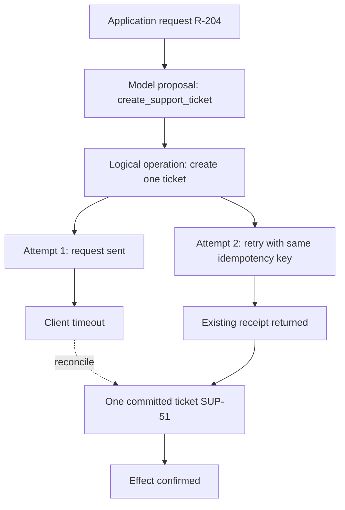
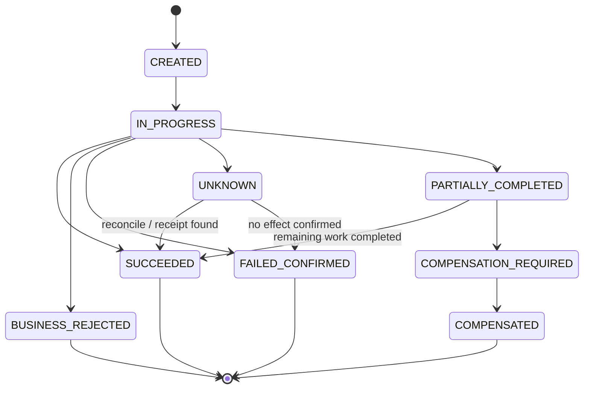
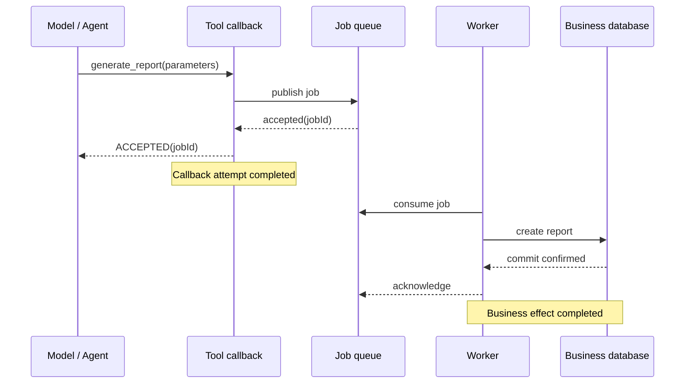

# Phân biệt số lần thử, số lần hoàn tất và tác động nghiệp vụ

Một agent Spring AI nhận yêu cầu: **“Nếu đơn DH-204 giao thất bại, hãy tạo một phiếu hỗ trợ.”** Model đề xuất gọi `lookup_order`. Callback thực thi, gọi dịch vụ đơn hàng và nhận trạng thái. Nếu đủ điều kiện, agent tiếp tục gọi `create_support_ticket`. Nhưng lần gọi tạo phiếu bị timeout: phía client không nhận được phản hồi, trong khi dịch vụ bên ngoài có thể đã ghi phiếu thành công.

Lúc này, ba câu hỏi có câu trả lời khác nhau:

- **Có bao nhiêu lần thử?** Có thể đã có hai callback attempts do retry.
- **Có bao nhiêu lần hoàn tất?** Có thể cả hai attempts đều đã kết thúc ở phía client, nhưng một attempt kết thúc bằng timeout và trạng thái phía server chưa rõ.
- **Có bao nhiêu tác động nghiệp vụ thực sự xảy ra?** Có thể chỉ một phiếu được tạo, dù hệ thống đã gửi hai request.

Nếu dashboard chỉ đếm số lần gọi hoặc số lần callback trả về bình thường, nó có thể báo sai tải, tỷ lệ hoàn tất và số tác động bên ngoài. Bài học này xây dựng cách đo riêng **attempts, completions, logical operations và business effects**, đặc biệt cho tool có side effect.

Bài thuộc chương **Quan sát công cụ** của mô-đun **SPRING_AI_EVALUATION_OBSERVABILITY**. Mô-đun học đánh giá chất lượng ứng dụng Spring AI bằng tập dữ liệu, tiêu chí relevance, fact checking và kiểm thử RAG/tool calling; đồng thời đo metrics, traces, chi phí và độ trễ để phát hiện suy giảm qua các phiên bản prompt, model và pipeline. Trọng tâm bài là **định nghĩa đúng đơn vị đếm và trạng thái cuối**, để metrics phản ánh cả quá trình thực thi lẫn kết quả nghiệp vụ.

> **Nguyên tắc:** một lần thử là một lần thực thi; một lần hoàn tất là một lần thực thi đi tới trạng thái kết thúc theo định nghĩa; một tác động nghiệp vụ là một thay đổi có ý nghĩa ở hệ thống đích. **Ba đại lượng này không thể thay thế cho nhau.**

## 1. Kết quả học tập

Sau bài học, bạn có thể:

1. Phân biệt **model tool proposal**, **callback attempt**, **logical operation**, **terminal completion** và **business effect**.
2. Định nghĩa các trạng thái `STARTED`, `SUCCEEDED`, `FAILED`, `TIMED_OUT`, `UNKNOWN`, `CONFIRMED` và `COMPENSATED` theo đúng ranh giới.
3. Tính attempt rate, terminal rate, success rate, operation completion rate, retry rate và effect confirmation rate với mẫu số rõ ràng.
4. Giải thích vì sao timeout không chứng minh thao tác bên ngoài chưa được commit.
5. Thiết kế idempotency key và cơ chế reconcile để hạn chế side effect trùng khi retry.
6. Phân biệt callback trả response, dependency chấp nhận request, effect đã commit và người dùng nhận được kết quả.
7. Xử lý tool bất đồng bộ, partial success, nhiều effects và compensation.
8. Dùng Java/Spring AI và Micrometer để ghi metrics theo đơn vị đếm chính xác.
9. Đối chiếu traces/tool events với rule nghiệp vụ hoặc nhãn người để đánh giá agent có thực hiện đúng hành động hay không.

## 2. Năm đơn vị cần phân biệt

Một tool workflow thường có ít nhất năm đơn vị:

| Đơn vị | Câu hỏi | Ví dụ |
|---|---|---|
| **Tool proposal** | Model đã yêu cầu công cụ bao nhiêu lần? | Model trả một tool call `create_support_ticket` |
| **Callback attempt** | Mã callback đã thực sự bắt đầu chạy bao nhiêu lần? | Lần đầu timeout, lần hai retry |
| **Logical operation** | Ứng dụng đang cố hoàn thành mục tiêu nghiệp vụ nào? | Tạo một phiếu hỗ trợ cho yêu cầu R-204 |
| **Completion** | Attempt/operation đã đi tới trạng thái terminal nào? | Callback kết thúc, operation thành công/thất bại/chưa rõ |
| **Business effect** | Hệ thống đích đã thay đổi điều gì? | Một ticket có ID SUP-51 được commit |

Không dùng một metric tên chung `tool.calls` để đại diện cho tất cả. Một proposal có thể bị dispatcher từ chối trước callback; một proposal có thể tạo nhiều attempts; một logical operation có thể bao gồm nhiều tool calls; một attempt có thể kết thúc timeout trong khi effect đã xảy ra.

### 2.1. Quan hệ một–nhiều



Trong ví dụ, có **một proposal, một logical operation, hai attempts và một effect được xác nhận**. Retry thứ hai trả về receipt của effect đã tồn tại; nó không tạo thêm ticket. Số lần attempt thành công nhận response có thể là một hoặc hai tùy hợp đồng response/replay, nhưng số effect mới vẫn là một.

## 3. Định nghĩa ranh giới trước khi đặt metric

Từ “completed” rất dễ gây nhầm. Nó có thể nói callback đã kết thúc, operation nghiệp vụ đã được giải quyết, hay effect đã được hệ thống đích xác nhận. Hãy dùng tên cụ thể:

| Tên nên dùng | Định nghĩa |
|---|---|
| **Attempt started** | Callback/dependency request đã đi qua ranh giới bắt đầu thực thi |
| **Attempt terminal** | Attempt đã có trạng thái kết thúc được ghi nhận ở phía đang đo |
| **Attempt response success** | Client nhận response hợp lệ theo hợp đồng của dependency |
| **Logical operation resolved** | Mục tiêu nghiệp vụ có kết quả xác định: thành công, bị từ chối hoặc thất bại đã biết |
| **Effect requested** | Ứng dụng đã yêu cầu hệ thống đích thực hiện thay đổi |
| **Effect confirmed** | Có receipt/trạng thái đáng tin xác nhận thay đổi đã được commit |
| **Effect unknown** | Không thể xác định effect đã xảy ra hay chưa |
| **Effect compensated** | Một thay đổi trước đó đã được bù trừ bằng hành động khác |

Tránh metric tên `tool_completed_total` nếu không có định nghĩa đi kèm. Hãy chọn tên như `tool_attempt_terminal_total`, `tool_operation_resolved_total`, `tool_effect_confirmed_total`.

### 3.1. Completion của attempt không phải completion của operation

Một callback attempt có thể kết thúc bằng timeout, exception hoặc cancellation. Ở phía client, attempt đã **terminal** vì ứng dụng đã dừng chờ. Nhưng logical operation vẫn có thể ở trạng thái `UNKNOWN` nếu request đã đến server và server có thể đã commit.

Ví dụ:

- Attempt 1: HTTP request gửi đi; client timeout sau 2 giây.
- Server: đã tạo ticket, nhưng response bị mất.
- Logical operation: chưa được xác nhận cho tới khi truy vấn receipt hoặc replay idempotent request.
- Business effect: ticket có thể đã tồn tại trước khi ứng dụng biết điều đó.

Do vậy, khi nói “attempt hoàn tất”, cần chỉ rõ **terminal ở phía client**. Không suy ra trạng thái commit từ terminal state của attempt.

## 4. Mô hình trạng thái cho attempt, operation và effect

Không nên dùng một enum duy nhất để diễn tả cả ba. Chúng có vòng đời khác nhau.

### 4.1. Callback attempt

```text
NOT_STARTED
    |
    v
STARTED
    |
    +--> RESPONSE_SUCCESS
    |
    +--> RESPONSE_REJECTED
    |
    +--> TECHNICAL_ERROR
    |
    +--> TIMED_OUT
    |
    +--> CANCELLED
    |
    +--> UNKNOWN_TERMINAL (process lost / outcome unavailable)
```

`RESPONSE_SUCCESS` nghĩa callback nhận response hợp lệ theo hợp đồng kỹ thuật. Nó chưa chứng minh effect đã commit, trừ khi response chứa receipt xác nhận theo hợp đồng. `TIMED_OUT` nghĩa caller không nhận được kết quả đúng hạn; server có thể vẫn đang chạy hoặc đã commit.

### 4.2. Logical operation



Các trạng thái terminal và khả năng chuyển trạng thái cần được định nghĩa theo nghiệp vụ. Ví dụ `UNKNOWN` có thể là trạng thái tạm thời cần reconciliation, không phải kết quả cuối. Một workflow có nhiều side effects có thể ở `PARTIALLY_COMPLETED` nếu một thay đổi đã commit còn thay đổi khác thất bại.

### 4.3. Business effect

Một effect có vòng đời riêng:

| Trạng thái | Ý nghĩa |
|---|---|
| `NOT_REQUESTED` | Điều kiện nghiệp vụ chưa cho phép hoặc chưa yêu cầu effect |
| `REQUESTED` | Ứng dụng đã gửi yêu cầu thay đổi tới hệ thống đích |
| `ACCEPTED` | Hệ thống đích xác nhận tiếp nhận; chưa chắc đã commit |
| `COMMIT_CONFIRMED` | Có receipt/trạng thái đáng tin cho biết effect đã được commit |
| `REJECTED` | Hệ thống đích từ chối và hợp đồng xác nhận không có effect |
| `UNKNOWN` | Không thể xác định effect đã xảy ra hay chưa |
| `COMPENSATION_REQUESTED` | Đã yêu cầu hành động bù trừ |
| `COMPENSATED` | Hành động bù trừ được xác nhận hoàn tất |

`ACCEPTED` và `COMMIT_CONFIRMED` phải được tách nếu dependency xử lý bất đồng bộ. HTTP 202 hoặc `jobId` thường chỉ xác nhận đã nhận công việc; nó không chứng minh báo cáo, phiếu hay giao dịch đã hoàn thành.

## 5. Tính đúng số attempts, completions và effects

Một bộ metrics cần trả lời các câu hỏi khác nhau.

| Metric | Công thức | Đơn vị |
|---|---|---|
| Attempt start count | Số event `ATTEMPT_STARTED` | Attempts |
| Attempt terminal count | Số attempts có terminal event | Attempts |
| Attempt terminal rate | Terminal attempts / attempts đã bắt đầu trong cohort đã đủ thời gian | Tỷ lệ |
| Attempt response success rate | Attempts nhận response hợp lệ / attempts đã bắt đầu | Tỷ lệ |
| Retry amplification | Tổng attempts / logical operations có thực thi | Attempts/operation |
| Retry operation rate | Operations có từ hai attempts trở lên / operations có thực thi | Tỷ lệ |
| Operation resolved rate | Operations đã có kết quả xác định / operations bắt đầu | Tỷ lệ |
| Effect confirmation rate | Effects commit-confirmed / effects được yêu cầu | Tỷ lệ |
| Effect duplication rate | Effects trùng ngoài chính sách / logical effect intents | Tỷ lệ |
| Unknown effect rate | Effects chưa thể xác định / effects đã yêu cầu | Tỷ lệ |

### 5.1. Chọn đúng mẫu số

Ví dụ có 100 logical operations và 120 callback attempts. Tỷ lệ success `110/120` là chỉ số theo **attempts** nếu 110 attempts nhận response hợp lệ. Nó không cho biết 110 operations thành công; cùng một operation có thể được đếm nhiều lần.

Tương tự, nếu 80 operations yêu cầu side effect và 76 effect được xác nhận, effect confirmation rate là `76/80 = 95%`. Không chia cho 120 attempts vì retry không tạo thêm 20 yêu cầu nghiệp vụ độc lập.

### 5.2. Cohort phải đủ thời gian để kết thúc

Nếu một operation mới bắt đầu cách đây 100 ms nhưng timeout policy là 5 giây, không thể đưa nó vào mẫu số “operation đã giải quyết” như thể nó đã thất bại. Với các metric tỷ lệ theo cửa sổ thời gian:

- Tách `IN_PROGRESS` khỏi terminal outcomes;
- Định nghĩa thời hạn tối đa trước khi gắn `TIMED_OUT` hoặc `UNKNOWN`;
- Dùng cohort đã đủ thời gian quan sát khi so completion rate;
- Báo số lượng đang mở và tuổi của các operation đang mở;
- Không xóa operation chưa terminal khỏi báo cáo mà không ghi rõ.

Một dashboard chỉ hiển thị terminal records có thể trông rất tốt khi hàng đợi đang tích tụ nhiều operation chưa hoàn tất.

## 6. Ví dụ số liệu: 100 operations, 110 attempts, 69 effects

Xét benchmark gồm **100 logical operations**:

- 70 operations đủ điều kiện yêu cầu tạo một ticket;
- 30 operations không đủ điều kiện và phải bị từ chối nghiệp vụ;
- Mỗi operation có một callback attempt ban đầu;
- Các lỗi kỹ thuật có thể được retry một lần.

**100 attempts đầu tiên:**

| Nhóm | Số lượng | Trạng thái |
|---|---:|---|
| Tạo ticket và nhận receipt commit | 60 | Response success, effect confirmed |
| Dependency từ chối trước khi nhận yêu cầu | 6 | Technical error đã biết, không có effect |
| Client timeout sau khi gửi yêu cầu | 4 | Attempt terminal, effect chưa rõ |
| Không đủ điều kiện nghiệp vụ | 30 | Business rejected, không yêu cầu effect |
| **Tổng** | **100** | |

Ứng dụng thực hiện thêm **10 retry attempts**:

- 6 attempts retry cho các request được xác nhận chưa được dependency tiếp nhận; cả 6 tạo ticket thành công.
- 4 attempts replay với **cùng idempotency key** cho các timeout mơ hồ; 3 trả về receipt của ticket đã được commit trước đó, 1 vẫn không thể xác định kết quả.

Tổng hợp:

| Kết quả của attempt | Lượt đầu | Retry/replay | Tổng |
|---|---:|---:|---:|
| Response success/receipt hợp lệ | 60 | 9 | **69** |
| Technical error đã biết | 6 | 0 | **6** |
| Timeout/không xác định | 4 | 1 | **5** |
| Business rejected | 30 | 0 | **30** |
| **Tổng attempts** | **100** | **10** | **110** |

Có một chi tiết cần hiểu đúng: trong 9 response thành công của retry/replay, 3 response trả lại receipt của effect đã tồn tại. Vì vậy, **69 response hợp lệ không đồng nghĩa 69 effects mới do các lần response đó tạo ra**. Số effect riêng biệt được xác nhận là:

- 60 effects từ lần đầu;
- 6 effects mới sau retry;
- 3 receipts xác nhận effect đã được commit từ trước;
- **Tổng 69 effects riêng biệt được xác nhận**;
- 1 effect vẫn `UNKNOWN`;
- 30 operations bị từ chối nên không có effect được yêu cầu.

### 6.1. Tính theo attempts

- Attempt response success rate: `69 / 110 ≈ 62,7%`.
- Attempt technical error rate đã biết: `6 / 110 ≈ 5,5%`.
- Attempt timeout/unknown rate: `5 / 110 ≈ 4,5%`.
- Business rejection attempts: `30 / 110 ≈ 27,3%`.
- Tổng attempts trên operations: `110 / 100 = 1,10`.

Các tỷ lệ này mô tả **các lần thực thi**, không phải kết quả nghiệp vụ cuối.

### 6.2. Tính theo logical operations

- Operations có kết quả nghiệp vụ xác định: 99/100 = **99%**.
- Operations kết thúc với effect được xác nhận: 69/100 = **69%**.
- Operations bị từ chối hợp lệ: 30/100 = **30%**.
- Operations có effect chưa rõ: 1/100 = **1%**.
- Operations có retry: 10/100 = **10%**.

Nếu chỉ xét 70 operations đủ điều kiện tạo ticket:

\[
\text{Effect confirmation rate}
=\frac{69}{70}\times100\%
\approx98{,}57\%.
\]

Một operation vẫn `UNKNOWN`; không được tính nó là thành công hoặc thất bại đã xác nhận.

### 6.3. Đếm số tác động nghiệp vụ

- **Effect requests:** 70 logical effect intents.
- **Distinct committed effects confirmed:** 69.
- **Unknown effects:** 1.
- **Business rejected before effect request:** 30.
- **Duplicate effects:** 0 trong ví dụ vì replay dùng cùng idempotency key và trả receipt cũ.

Nếu dashboard chỉ đếm `POST /tickets` requests, nó có thể ghi 76 request (60 ban đầu + 6 retry + 4 replay + một số lần gửi khác theo transport). Số request gửi đi không phải số ticket đã tạo. Muốn đếm ticket, dùng **receipt/ID duy nhất từ hệ thống đích hoặc audit event commit**.

## 7. Phân biệt response success, operation completion và effect confirmation

Một HTTP response 2xx có thể biểu thị nhiều điều:

| Response | Có thể khẳng định điều gì? | Chưa thể khẳng định điều gì? |
|---|---|---|
| HTTP 200 với ticket receipt và trạng thái committed | API xác nhận ticket tồn tại theo hợp đồng | Agent đã gọi đúng điều kiện nghiệp vụ hay chưa |
| HTTP 202 với `jobId` | Hệ thống đã nhận job | Job đã hoàn tất và effect đã commit |
| HTTP 204 | Request được xử lý theo hợp đồng endpoint | Không nhất thiết có receipt chi tiết cho effect |
| HTTP 409 idempotency replay | Có thể là request trùng được xử lý theo hợp đồng | Phải đọc receipt/trạng thái để biết effect ban đầu |
| Client timeout | Client không nhận response đúng hạn | Server chưa nhận hoặc chưa commit |
| HTTP 500 | Client nhận lỗi server | Không luôn chứng minh không có commit; server có thể lỗi khi trả response sau commit |

**Không suy trạng thái nghiệp vụ từ status code một cách máy móc.** Phải biết API contract: khi nào nó commit, khi nào trả receipt, khi nào có thể lỗi sau commit, và cách truy vấn trạng thái.

### 7.1. Bốn câu hỏi riêng cho một lần gọi

1. **Request đã được gửi chưa?** Kiểm event client send/dispatch.
2. **Dependency có nhận/tiếp nhận request không?** Dựa vào response hoặc telemetry phía server.
3. **Business effect đã commit chưa?** Dựa vào receipt, transaction/audit event hoặc trạng thái authoritative.
4. **Agent đã xử lý kết quả đúng chưa?** So tool trace với rule/expected action.

Một hệ thống có thể trả lời “có” cho câu 1, “không rõ” cho câu 2, “có” cho câu 3 và “không” cho câu 4. Đây là lý do phải tách các tầng.

## 8. Retry, idempotency và nguy cơ side effect trùng

Retry giúp phục hồi lỗi tạm thời, nhưng tool có side effect phải được thiết kế để **cùng một ý định nghiệp vụ không tạo nhiều thay đổi ngoài mong muốn**.

### 8.1. Idempotency key thuộc về logical effect

Ví dụ một operation tạo ticket có key:

```text
logicalOperationId = op-req-204-create-ticket
idempotencyKey = support-ticket:op-req-204-create-ticket

Attempt 1:
  POST /tickets
  Idempotency-Key: support-ticket:op-req-204-create-ticket
  Client timeout

Attempt 2:
  POST /tickets
  Idempotency-Key: support-ticket:op-req-204-create-ticket
  Server returns the original ticket receipt
```

Cùng một key được dùng cho retries của **cùng một logical effect**. Không tạo key mới ở mỗi retry; nếu làm vậy, server không nhận ra đây là cùng một ý định và có thể tạo thêm ticket.

Ngược lại, hai yêu cầu độc lập của người dùng muốn tạo hai ticket khác nhau phải có hai logical operation IDs/keys khác nhau, ngay cả khi cùng `orderId`. Không dùng riêng mã đơn làm idempotency key toàn cục vì có thể ngăn nhầm hai hành động hợp lệ.

### 8.2. Idempotency key phải được kiểm soát bởi ứng dụng

Không để model tự chọn idempotency key trong arguments. Ứng dụng nên:

1. Xác định logical operation sau khi xác thực yêu cầu và điều kiện nghiệp vụ;
2. Sinh hoặc lấy key ổn định cho operation đó;
3. Lưu key cùng trạng thái operation;
4. Dùng lại key cho retries/replays;
5. Đối chiếu receipt trả về với operation và effect đúng;
6. Áp dụng retention/expiry phù hợp với hợp đồng downstream.

Key phải được bảo vệ như metadata nghiệp vụ. Không đưa key hoặc order ID vào metric tags.

### 8.3. Exactly-once không phải lời hứa đơn giản của mạng

Một client gửi request rồi timeout không thể biết chắc server đã commit hay chưa nếu không có giao thức hỗ trợ. Trong hệ thống phân tán, mục tiêu thực tế thường là:

- Delivery/retry có thể xảy ra **at-least-once**;
- Consumer/server dùng **idempotency/deduplication**;
- Có receipt hoặc trạng thái authoritative để reconcile;
- Event được xử lý idempotent nếu broker giao lại;
- Tác động nghiệp vụ duy nhất được bảo đảm bởi ràng buộc ở hệ thống sở hữu dữ liệu.

Không nên quảng cáo “exactly once” chỉ vì client code có một lần gọi. Một request có thể được truyền lại, server có thể commit nhưng response mất, hoặc event được giao lại.

### 8.4. Khi dependency không hỗ trợ idempotency

Nếu API không có idempotency key hoặc truy vấn trạng thái:

- Không retry mù các thao tác ghi có nguy cơ trùng;
- Chuyển operation sang `UNKNOWN`;
- Thực hiện reconciliation thủ công/qua kênh authoritative;
- Dùng một business key/unique constraint nếu hệ thống đích cho phép;
- Ghi rõ giới hạn bảo đảm và chuyển người xử lý khi hậu quả lớn.

Retry tự động chỉ an toàn khi biết request chưa được tiếp nhận, hoặc hợp đồng downstream bảo đảm deduplication.

## 9. Logical operation có thể gồm nhiều effects

Một tool composite có thể thực hiện nhiều thay đổi:

```text
Operation: onboard customer
  Effect A: create customer profile
  Effect B: create billing account
  Effect C: send welcome notification
```

Nếu A và B commit nhưng C thất bại, operation không thể được báo đơn giản là `FAILED` hoặc `SUCCEEDED` mà không nói rõ partial state.

| Effect | Trạng thái |
|---|---|
| Tạo customer profile | `COMMIT_CONFIRMED` |
| Tạo billing account | `COMMIT_CONFIRMED` |
| Gửi welcome notification | `UNKNOWN` |

Logical operation có thể là `PARTIALLY_COMPLETED` hoặc `COMPENSATION_REQUIRED`, tùy chính sách. Cần theo dõi từng effect bằng ID riêng và liên kết với operation cha.

### 9.1. Compensation không xóa lịch sử effect

Trong mô hình saga, nếu đã tạo billing account rồi phải hủy, hệ thống thực hiện **compensating action**. Không viết lại lịch sử như thể account chưa từng được tạo.

Ghi rõ:

- Effect ban đầu: `COMMIT_CONFIRMED`;
- Compensation requested: đã yêu cầu hủy;
- Compensation result: `COMPENSATED` hoặc `UNKNOWN`;
- Logical operation final outcome: `COMPENSATED`/`FAILED_COMPENSATED` theo taxonomy ứng dụng.

Số lần effect ban đầu và số lần compensation là hai số liệu khác nhau. Không trừ hai counters để báo “net zero” rồi làm mất audit trail.

### 9.2. Đếm từng effect, không đếm từng response

Nếu một operation tạo một ticket và gửi hai notification, có thể có:

- Một logical operation;
- Một ticket effect;
- Hai notification effects;
- Nhiều callback/dependency attempts;
- Nhiều response messages.

Dashboard nên ghi `effect.type` từ danh mục hữu hạn và trạng thái từng effect. Không dùng một `effects_total` mà không biết nó đếm loại thay đổi nào.

## 10. Tool bất đồng bộ: accepted chưa phải completed

Một tool có thể enqueue job và trả về ngay:



Trong ví dụ:

- Callback attempt có thể hoàn tất sau 30 ms;
- Queue chấp nhận job;
- Job worker chạy 4 phút;
- Báo cáo chỉ được xác nhận hoàn tất khi DB/object store có receipt.

Do đó, metrics nên tách:

| Metric | Ý nghĩa |
|---|---|
| `tool_attempt_terminal_total` | Callback đã kết thúc |
| `job_accepted_total` | Queue đã nhận job |
| `job_started_total` | Worker bắt đầu xử lý |
| `job_terminal_total` | Worker hoàn tất hoặc thất bại |
| `business_effect_confirmed_total` | Effect đã commit/xác nhận |
| `job_queue_wait` | Thời gian chờ từ accepted tới started |
| `job_execution_duration` | Thời gian worker xử lý |

Không báo “report completed” khi callback chỉ nhận `jobId`. Nếu model cần trả lời ngay, tool result phải thể hiện trạng thái `ACCEPTED`/`PENDING`, không tự đổi thành `COMPLETED`.

## 11. Phân biệt retry do ứng dụng và tool call mới do model

Có hai nguồn làm số lần thực thi tăng:

1. **Application retry:** ứng dụng tự gọi lại callback/dependency vì timeout hoặc lỗi tạm thời.
2. **Model re-proposal:** model ở lượt sau đề xuất một tool call mới, có thể do không nhận kết quả hoặc do prompt.

Hai trường hợp cần được đếm riêng:

| Sự kiện | Proposal count | Callback attempts | Logical operation |
|---|---:|---:|---|
| Một proposal, callback retry một lần | 1 | 2 | Có thể vẫn 1 |
| Model đề xuất lại tool ở lượt tiếp theo | +1 | +1 hoặc nhiều hơn | Có thể là cùng operation nếu dedup đúng, hoặc operation mới |
| Hai tool calls khác nhau cùng tên trong một model response | 2 | Thường 2+ | Có thể 2 logical operations |
| Callback timeout, agent không retry | 1 | 1 | Operation có thể `UNKNOWN` |

Không mặc định hai model proposals cùng arguments là cùng một operation. Ứng dụng phải xác định **ý định nghiệp vụ và khóa deduplication**. Nếu không, model có thể tạo hai tác động hợp lệ riêng biệt hoặc vô tình tạo duplicate.

## 12. Metrics và event model

### 12.1. Bộ metric gợi ý

Các tên sau là **quy ước ứng dụng**, không phải tên mặc định bắt buộc của Spring AI.

| Metric | Đơn vị | Tags low-cardinality | Câu hỏi |
|---|---|---|---|
| `app.ai.tool.attempt.started` | Counter | tool, execution type | Bao nhiêu attempts bắt đầu? |
| `app.ai.tool.attempt.terminal` | Counter | tool, terminal outcome | Bao nhiêu attempts đã kết thúc? |
| `app.ai.tool.attempt.duration` | Timer | tool, outcome | Mỗi attempt mất bao lâu? |
| `app.ai.tool.operation.started` | Counter | tool, operation type | Bao nhiêu logical operations bắt đầu? |
| `app.ai.tool.operation.resolved` | Counter | tool, final outcome | Bao nhiêu operations có kết quả xác định? |
| `app.ai.tool.retry.operations` | Counter | tool, retry reason | Bao nhiêu operations có retry? |
| `app.ai.tool.effect.requested` | Counter | tool, effect type | Bao nhiêu effects được yêu cầu? |
| `app.ai.tool.effect.confirmed` | Counter | tool, effect type | Bao nhiêu effects được xác nhận? |
| `app.ai.tool.effect.unknown` | Counter | tool, effect type | Bao nhiêu effects chưa rõ? |
| `app.ai.tool.effect.compensated` | Counter | tool, effect type | Bao nhiêu effects được bù trừ? |

Không đưa `applicationRequestId`, `traceId`, `orderId`, `idempotencyKey`, `ticketId` hoặc `callbackInvocationId` vào metric tags. Các ID cá thể thuộc log/trace/event store có phân quyền.

### 12.2. Event record nên lưu

```json
{
  "eventId": "evt-204-08",
  "eventType": "BUSINESS_EFFECT_CONFIRMED",
  "applicationRequestId": "req-204",
  "logicalOperationId": "op-create-ticket-204",
  "effectId": "effect-ticket-01",
  "effectType": "support_ticket_created",
  "idempotencyKeyRef": "key-ref-01",
  "attemptId": "attempt-02",
  "attemptIndex": 2,
  "toolName": "create_support_ticket",
  "attemptOutcome": "response_success",
  "effectStatus": "commit_confirmed",
  "externalReceiptRef": "SUP-51",
  "occurredAt": "2026-11-27T10:00:00Z"
}
```

Đây là schema minh họa do ứng dụng định nghĩa. `idempotencyKeyRef` là tham chiếu được bảo vệ, không phải giá trị key nhạy cảm cần phát tán. Không log raw payload nếu không có lý do và chính sách phù hợp.

### 12.3. Event phải idempotent khi ghi nhận

Một event có thể được gửi lại do queue hoặc exporter retry. Dùng `eventId` duy nhất và xử lý dedup ở event store nếu cần đếm chính xác. Nếu consumer nhận cùng `BUSINESS_EFFECT_CONFIRMED` hai lần và tăng counter hai lần, dashboard sẽ báo hai effects dù chỉ có một effect.

Counters từ telemetry streaming có thể mất hoặc lặp tùy hệ thống. Với chỉ số audit quan trọng, dùng nguồn sự thật nghiệp vụ (ledger/transaction/outbox) và tổng hợp metrics từ dữ liệu đã deduplicated.

## 13. Java: mô hình hóa attempts và effects riêng

Đoạn Java 17 dưới đây minh họa các kiểu dữ liệu tách rời. Nó là mô hình ứng dụng, không phải class có sẵn của Spring AI.

```java
import java.time.Instant;
import java.util.Objects;

public final class ToolExecutionModel {

    public enum AttemptOutcome {
        RESPONSE_SUCCESS,
        BUSINESS_REJECTED,
        TECHNICAL_ERROR,
        TIMED_OUT,
        CANCELLED,
        UNKNOWN_TERMINAL
    }

    public enum OperationOutcome {
        IN_PROGRESS,
        SUCCEEDED,
        BUSINESS_REJECTED,
        FAILED_CONFIRMED,
        PARTIALLY_COMPLETED,
        UNKNOWN,
        COMPENSATED
    }

    public enum EffectStatus {
        NOT_REQUESTED,
        REQUESTED,
        ACCEPTED,
        COMMIT_CONFIRMED,
        REJECTED,
        UNKNOWN,
        COMPENSATION_REQUESTED,
        COMPENSATED
    }

    public record AttemptRecord(
            String invocationId,
            String logicalOperationId,
            int attemptIndex,
            AttemptOutcome outcome,
            Instant startedAt,
            Instant terminalAt) {

        public AttemptRecord {
            Objects.requireNonNull(invocationId);
            Objects.requireNonNull(logicalOperationId);
            Objects.requireNonNull(outcome);
            Objects.requireNonNull(startedAt);
            Objects.requireNonNull(terminalAt);
            if (attemptIndex < 1 || terminalAt.isBefore(startedAt)) {
                throw new IllegalArgumentException("Invalid attempt");
            }
        }
    }

    public record EffectRecord(
            String effectId,
            String logicalOperationId,
            String effectType,
            EffectStatus status,
            String receiptReference,
            Instant updatedAt) {

        public EffectRecord {
            Objects.requireNonNull(effectId);
            Objects.requireNonNull(logicalOperationId);
            Objects.requireNonNull(effectType);
            Objects.requireNonNull(status);
            Objects.requireNonNull(updatedAt);

            if (status == EffectStatus.COMMIT_CONFIRMED
                    && (receiptReference == null
                    || receiptReference.isBlank())) {
                throw new IllegalArgumentException(
                        "Confirmed effect requires a receipt reference");
            }
        }
    }

    private ToolExecutionModel() {
    }
}
```

Một `AttemptRecord` không có field `effectStatus`, vì attempt và effect có thể có kết quả khác nhau. Ví dụ attempt timeout nhưng effect sau đó được xác nhận bằng reconciliation. `EffectRecord` có receipt reference để chứng minh trạng thái commit theo hợp đồng; không nhất thiết lưu raw response.

### 13.1. Tính duration từ timestamp phù hợp

Trong code thực tế, dùng Timer/Observation hoặc monotonic clock để đo elapsed time. `Instant` trong record ở trên phục vụ **audit timestamp**; không nên dựa vào đồng hồ wall-clock để tính duration trong một tiến trình nếu có thể dùng `System.nanoTime()`/Micrometer Timer.

### 13.2. Lưu lịch sử trạng thái thay vì ghi đè

Khi effect chuyển từ `UNKNOWN` sang `COMMIT_CONFIRMED`, lưu event reconciliation mới và cập nhật projection hiện tại. Giữ lịch sử cho biết:

- Lúc nào request được gửi;
- Lúc nào client timeout;
- Lúc nào effect được xác minh;
- Receipt nào xác nhận effect;
- Ai/worker nào thực hiện reconciliation.

Không sửa event cũ từ `UNKNOWN` thành `SUCCESS` rồi xóa dấu vết timeout. Trạng thái hiện tại có thể được cập nhật, nhưng audit trail phải giữ nguyên các sự kiện đã xảy ra.

## 14. Java: phối hợp side effect với idempotency và trạng thái unknown

Ví dụ sau minh họa một service tạo ticket. `idempotencyKey` được **ứng dụng cấp từ logical operation**, không phải tham số model tự quyết định. Gateway giả định hỗ trợ idempotency và trả cùng receipt khi cùng key được gửi lại.

```java
import java.util.Objects;

public final class SupportTicketCoordinator {

    public record TicketReceipt(
            String ticketId,
            boolean replayedExistingResult) {
    }

    public enum EffectOutcome {
        COMMIT_CONFIRMED,
        REJECTED,
        UNKNOWN
    }

    public record EffectResult(
            EffectOutcome outcome,
            String ticketId,
            String explanation) {
    }

    public interface SupportGateway {
        // Hợp đồng downstream phải deduplicate theo idempotencyKey.
        TicketReceipt createTicket(
                String orderId,
                String idempotencyKey);
    }

    public static final class DependencyTimeout
            extends RuntimeException {
        public DependencyTimeout(String message) {
            super(message);
        }
    }

    private final SupportGateway gateway;

    public SupportTicketCoordinator(SupportGateway gateway) {
        this.gateway = Objects.requireNonNull(gateway);
    }

    public EffectResult create(
            String orderId,
            String applicationOwnedIdempotencyKey) {

        if (orderId == null || orderId.isBlank()
                || applicationOwnedIdempotencyKey == null
                || applicationOwnedIdempotencyKey.isBlank()) {
            throw new IllegalArgumentException("Invalid operation context");
        }

        try {
            TicketReceipt receipt = gateway.createTicket(
                    orderId, applicationOwnedIdempotencyKey);

            if (receipt == null || receipt.ticketId() == null
                    || receipt.ticketId().isBlank()) {
                // Response không đủ để xác nhận effect.
                return new EffectResult(
                        EffectOutcome.UNKNOWN,
                        null,
                        "Không xác định được trạng thái tạo phiếu");
            }

            return new EffectResult(
                    EffectOutcome.COMMIT_CONFIRMED,
                    receipt.ticketId(),
                    receipt.replayedExistingResult()
                            ? "Đã xác nhận phiếu đã tồn tại"
                            : "Đã tạo và xác nhận phiếu");

        } catch (DependencyTimeout ex) {
            // Timeout không chứng minh server chưa commit.
            return new EffectResult(
                    EffectOutcome.UNKNOWN,
                    null,
                    "Yêu cầu hết thời gian chờ; cần đối soát");

        } catch (IllegalArgumentException ex) {
            return new EffectResult(
                    EffectOutcome.REJECTED,
                    null,
                    "Yêu cầu không hợp lệ");
        }
    }
}
```

**Giới hạn của ví dụ:** lớp gateway phải thực sự thực hiện idempotency phía server. Nếu downstream bỏ qua key, việc truyền key không tạo ra bảo đảm deduplication. `UNKNOWN` cần được ghi vào operation ledger và xử lý bằng reconciliation; không tự động chuyển thành `FAILED_CONFIRMED`.

### 14.1. Tích hợp với Spring AI tool

Một phương thức `@Tool` có thể gọi coordinator và trả một kết quả có trạng thái rõ ràng:

- `COMMIT_CONFIRMED`: có receipt xác nhận;
- `REJECTED`: hệ thống đích từ chối theo hợp đồng;
- `UNKNOWN`: client không xác định được trạng thái, cần đối soát.

Cách lấy logical operation ID/idempotency key từ orchestration context phụ thuộc API và phiên bản Spring AI. Hãy truyền qua metadata/context do ứng dụng quản lý. **Không thêm idempotency key vào schema arguments để model tự sinh** và không tin model tự báo rằng effect đã commit.

Khi tool trả `UNKNOWN`, prompt/rubric cần hướng model nói rõ trạng thái chưa xác định và không khẳng định đã tạo ticket. Quyết định retry phải do ứng dụng thực hiện theo idempotency/reconciliation policy.

## 15. Micrometer: đo counts theo đúng đơn vị

Ví dụ Java dưới đây minh họa counters/timer với tags có cardinality thấp. Tên metric là quy ước của ứng dụng.

```java
import io.micrometer.core.instrument.Counter;
import io.micrometer.core.instrument.MeterRegistry;
import io.micrometer.core.instrument.Timer;

import java.time.Duration;
import java.util.concurrent.TimeUnit;

public final class ToolExecutionMetrics {

    private final MeterRegistry registry;

    public ToolExecutionMetrics(MeterRegistry registry) {
        this.registry = registry;
    }

    public void attemptStarted(String toolName) {
        Counter.builder("app.ai.tool.attempt.started")
                .tag("tool.name", toolName)
                .register(registry)
                .increment();
    }

    public void attemptTerminal(
            String toolName,
            String outcome,
            Duration duration) {

        Counter.builder("app.ai.tool.attempt.terminal")
                .tag("tool.name", toolName)
                .tag("outcome", outcome)
                .register(registry)
                .increment();

        Timer.builder("app.ai.tool.attempt.duration")
                .tag("tool.name", toolName)
                .tag("outcome", outcome)
                .register(registry)
                .record(duration.toNanos(), TimeUnit.NANOSECONDS);
    }

    public void effectTransition(
            String toolName,
            String effectType,
            String status) {

        Counter.builder("app.ai.tool.effect.transition")
                .tag("tool.name", toolName)
                .tag("effect.type", effectType)
                .tag("effect.status", status)
                .register(registry)
                .increment();
    }
}
```

### 15.1. Dùng metrics code đúng cách

- Gọi `attemptStarted` đúng một lần khi attempt thực sự bắt đầu.
- Gọi `attemptTerminal` đúng một lần khi attempt đi tới terminal state.
- Gọi `effectTransition` cho từng **event chuyển trạng thái**; không coi mọi lần replay response là một effect mới.
- Dùng canonical tool names và enums/taxonomy hữu hạn cho tags.
- Không thêm request ID, ticket ID, order ID, idempotency key hoặc exception message vào tags.
- Nếu event có thể được giao lại, deduplicate trước khi tăng counter hoặc tổng hợp từ event store đã deduplicated.
- Micrometer Timer đã có count; tránh cộng Timer count và một Counter khác cùng ý nghĩa.

Code trên là minh họa cho lớp metrics; trong ứng dụng production nên có một recorder/handler bảo đảm mỗi lifecycle event chỉ được ghi một lần và không để instrumentation làm thay đổi hành vi tool.

## 16. Xử lý operation chưa rõ và reconciliation

`UNKNOWN` không phải một cách né tránh kết luận. Nó là trạng thái đúng khi bằng chứng hiện tại chưa đủ.

### 16.1. Những nguồn có thể đối soát

- Truy vấn trạng thái bằng business operation ID hoặc idempotency key;
- Lấy receipt từ API downstream;
- Đọc audit/event ledger authoritative;
- Kiểm tra trạng thái transaction hoặc job;
- Đối chiếu hệ thống nhận message và consumer;
- Chuyển người xử lý khi hệ thống đích không hỗ trợ truy vấn đáng tin.

Không dùng final answer của model làm bằng chứng commit. Model có thể nói “đã tạo phiếu” dù callback timeout; chỉ hệ thống sở hữu ticket mới xác nhận được.

### 16.2. Reconciliation phải idempotent

Một job reconciliation có thể chạy lại nhiều lần. Nó cần:

1. Đọc trạng thái hiện tại và operation key;
2. Truy vấn nguồn authoritative;
3. Ghi event kết quả có event ID;
4. Chỉ chuyển `UNKNOWN` sang `COMMIT_CONFIRMED` khi có receipt đáng tin;
5. Giữ trạng thái `UNKNOWN` nếu không thể kết luận;
6. Không tạo effect mới chỉ để kiểm tra effect cũ.

### 16.3. Đo backlog unknown

Metrics nên có:

- Số operation `UNKNOWN` đang mở;
- Tuổi của operation `UNKNOWN` lâu nhất;
- Tỷ lệ reconciliation thành công;
- Thời gian từ timeout tới xác nhận;
- Số operation cần human review;
- Số effect được xác nhận sau khi caller timeout.

Đây là tín hiệu quan trọng hơn việc cố ép tất cả timeout thành `FAILED`.

## 17. Partial success, compensation và workflow nhiều bước

Một workflow có thể tạo ticket rồi gửi notification. Ticket đã commit nhưng notification thất bại:

| Effect | Trạng thái |
|---|---|
| Ticket created | `COMMIT_CONFIRMED` |
| Notification sent | `FAILED_CONFIRMED` |

Logical operation có thể là `PARTIALLY_COMPLETED`. Nếu chính sách yêu cầu hủy ticket, hệ thống cần một compensation riêng; không giả định việc gửi notification thất bại làm ticket tự biến mất.

Đo riêng:

- Số effect intents;
- Số effect requests;
- Số effects accepted;
- Số effects commit-confirmed;
- Số effects rejected/unknown;
- Số compensation requested/confirmed;
- Số operations partially completed.

Không cộng notification attempts vào ticket effects. Mỗi loại effect có một danh mục và ID riêng.

## 18. Quan sát tool read-only và tool có side effect

Không phải mọi tool đều tạo thay đổi nghiệp vụ.

| Loại tool | Điều cần đếm | Điều không nên suy ra |
|---|---|---|
| **Read-only lookup** | Attempts, response completion, read result/snapshot | Mỗi response là một business effect |
| **Calculation/local transform** | Attempts, operation completion, output validity | Có external effect nếu chỉ tính trong JVM |
| **Write/create/update** | Attempts, effect requested/confirmed/unknown, receipt | Một HTTP 2xx luôn là một effect mới |
| **Async enqueue** | Callback completion, job accepted/started/terminal, effect confirmation | Enqueue accepted nghĩa job đã hoàn tất |
| **Composite workflow** | Từng operation/effect, partial state, compensation | Một callback success nghĩa toàn workflow success |

Với tool đọc, “effect count” có thể không áp dụng; thay vào đó đo snapshot/version/freshness và correctness của dữ liệu trả về. Không ép mọi tool vào mô hình side effect.

## 19. Kết nối metrics với tool correctness và đánh giá chất lượng

Một agent có thể có:

- Attempt count ổn định;
- Callback response success rate cao;
- Dependency latency thấp;
- Số effect confirmed đúng một lần;

nhưng vẫn thực hiện **sai hành động** vì model gọi tool khi precondition không thỏa.

Ví dụ:

```text
Rule:
  Chỉ tạo ticket khi order.deliveryStatus == DELIVERY_FAILED

Trace:
  lookup_order -> DELIVERED (response success)
  create_support_ticket -> SUP-51 (effect confirmed)

Technical view:
  callbacks completed
  support API healthy
  one ticket committed

Quality view:
  FAIL — side effect không được phép
```

Do đó cần đánh giá:

| Câu hỏi | Dữ liệu | Oracle/metric |
|---|---|---|
| Model chọn đúng tool? | Tool proposals | Expected tool selection |
| Arguments đúng? | Normalized arguments | Schema + semantic assertions |
| Precondition thỏa? | Tool results/state snapshot | Business rule/state machine |
| Callback có kết thúc? | Attempt terminal event | Attempt terminal rate |
| Operation có giải quyết? | Logical operation state | Operation resolved rate |
| Effect có commit? | Receipt/audit event | Effect confirmation rate |
| Effect có bị tạo trùng? | Effect IDs/idempotency key | Duplicate effect rate |
| Final answer trung thực? | Effect receipt + final answer | Faithfulness/human evaluation |

**Technical success không phải quality success.** Metrics phản ánh vận hành; rule/gold set đánh giá tính đúng đắn của quyết định.

## 20. Kiểm thử counts và state transitions

Dùng fake gateway/mock server và event sink để không tạo giao dịch thật.

| Test | Tình huống | Kỳ vọng |
|---|---|---|
| **TC01** | Callback thành công, effect commit có receipt | 1 attempt, 1 operation resolved, 1 effect confirmed |
| **TC02** | Callback bị dispatcher từ chối trước khi chạy | 0 callback attempts; 1 dispatch rejection |
| **TC03** | Callback exception trước khi gửi request | Attempt technical error; effect not requested |
| **TC04** | Dependency trả business rejection | Attempt terminal; operation business_rejected; không effect |
| **TC05** | Client timeout sau khi gửi yêu cầu | Attempt terminal timeout; effect unknown |
| **TC06** | Server commit nhưng response bị mất | Reconcile xác nhận effect; không tạo effect mới |
| **TC07** | Retry cùng idempotency key | Nhiều attempts, một logical effect |
| **TC08** | Retry dùng key mới sai quy tắc | Phát hiện nguy cơ duplicate effect |
| **TC09** | HTTP 202/job accepted | Callback terminal; job còn pending |
| **TC10** | Worker hoàn tất job | Job terminal và effect confirmed nếu có receipt |
| **TC11** | Hai effects, một thành công một thất bại | Operation partial/compensation state |
| **TC12** | Compensation thành công | Effect ban đầu và compensation được ghi riêng |
| **TC13** | Reconciliation event giao lặp | Không tăng effect confirmed counter hai lần |
| **TC14** | Model re-proposes tool ở lượt mới | Proposal mới; dedup operation theo policy, không tự gộp |
| **TC15** | Tool read-only trả dữ liệu | Có attempt/result; không tăng side-effect count |
| **TC16** | Effect confirmed nhưng final answer nói thất bại | Tool/effect đúng; final-answer faithfulness FAIL |
| **TC17** | Final answer nói đã tạo nhưng effect unknown | Không cho kết luận success; answer phải nói chưa xác định |
| **TC18** | Operation chưa terminal trong cửa sổ metrics | Đếm in-progress/unknown riêng, không tính như completed |

### 20.1. Assertions cần có

- Mỗi attempt start có tối đa một terminal event theo attempt ID.
- Retry tạo attempt ID mới nhưng giữ logical operation/idempotency scope.
- Một effect ID không được xác nhận hai lần chỉ vì response được replay.
- Timeout không tự chuyển effect thành `FAILED_CONFIRMED`.
- `ACCEPTED` không được tính là `COMMIT_CONFIRMED`.
- Operation partial success không bị ép thành success toàn phần.
- Compensation không xóa event commit ban đầu.
- Read-only tools không tăng effect counters.
- Model final answer không được dùng làm nguồn sự thật về effect.
- Metrics có mẫu số và cohort rõ ràng; ID cá thể không nằm trong tags.

## 21. Quy trình triển khai trong dự án Spring AI

1. **Liệt kê tool và side effects:** read/write, dependency, loại effect, rủi ro duplicate và hợp đồng receipt.
2. **Định nghĩa đơn vị:** model proposal, dispatch, callback attempt, logical operation, job và business effect.
3. **Thiết kế state machine:** trạng thái attempt, operation và effect độc lập; quy định chuyển trạng thái hợp lệ.
4. **Định nghĩa completion:** attempt terminal, operation resolved và effect confirmed có tên riêng.
5. **Thiết kế idempotency:** key do ứng dụng quản lý, scope theo logical effect, retention và downstream deduplication.
6. **Instrument lifecycle:** started/terminal attempt, operation state, effect requested/confirmed/unknown/compensated.
7. **Xây event ledger:** event ID, operation/effect/attempt IDs, receipt reference, dedup và audit trail.
8. **Xử lý timeout:** phân biệt known failure với unknown; có reconciliation và human escalation khi cần.
9. **Xử lý async:** callback accepted, job started/terminal và effect commit đo riêng.
10. **Tổng hợp metrics:** attempts, completion, retries, logical operation resolution và distinct effects với mẫu số phù hợp.
11. **Kiểm side effects:** replay, duplicate, partial success, compensation và precondition rules.
12. **Nối với Spring AI:** tool context/metadata do ứng dụng quản lý; không để model tự cấp idempotency key.
13. **Chấm correctness:** expected tool sequence, arguments, precondition, effect và final answer trên gold set.
14. **Theo dõi hồi quy:** giữ dataset/rubric và prompt/model/tool/dependency versions; so counts, latency, cost và duplicate effects.

### Checklist trước khi công bố dashboard

- [ ] Attempt, operation, completion và effect có định nghĩa riêng.
- [ ] Metric không dùng tên mơ hồ `tool_completed_total`.
- [ ] Attempts bắt đầu và attempts terminal có counters riêng.
- [ ] Operation resolved rate dùng logical operations làm mẫu số.
- [ ] Effect confirmation rate dùng effect requests/intents phù hợp làm mẫu số.
- [ ] Timeout/unknown không bị tự động tính là failed hoặc success.
- [ ] Retry giữ idempotency key cho cùng logical effect.
- [ ] Replay receipt không bị đếm thành effect mới.
- [ ] Async accepted và business effect committed được tách.
- [ ] Partial success và compensation có trạng thái riêng.
- [ ] Read-only tools không làm tăng side-effect counts.
- [ ] Event store deduplicate event delivery khi cần.
- [ ] ID cá thể không xuất hiện trong metric tags.
- [ ] Tool correctness được đánh giá bằng rule/gold labels, không chỉ callback metrics.

## 22. Bài luyện tập

### Bài 1 — Đếm đúng đơn vị

Một model đề xuất một tool call. Callback chạy lần đầu rồi timeout. Ứng dụng retry và nhận receipt cũ theo idempotency key.

Hãy xác định số proposal, callback attempts, logical operations, response-success attempts và distinct business effects.

### Bài 2 — Tính tỷ lệ theo attempts và operations

Có 50 logical operations. 10 operations được retry một lần, tổng 60 attempts. Trong 60 attempts, 54 nhận response hợp lệ và 6 technical errors. Có 47 operations được giải quyết, 2 operation bị business rejection và 1 operation còn unknown.

1. Attempt response success rate?
2. Operation resolved rate nếu business rejection là kết quả xác định?
3. Unknown operation rate?
4. Vì sao không lấy 54/60 để báo business completion rate?

### Bài 3 — Effect confirmation rate

Có 80 effect requests, 75 commit-confirmed, 3 rejected và 2 unknown. Tính effect confirmation rate, rejected rate và unknown rate. Các mẫu số có giống nhau không?

### Bài 4 — HTTP 202

Tool callback gọi API tạo báo cáo, nhận HTTP 202 và `jobId`. Callback kết thúc thành công sau 40 ms; worker hoàn tất sau 3 phút.

Những gì đã completed ở mốc 40 ms? Khi nào mới được báo report effect completed?

### Bài 5 — Timeout sau commit

API tạo ticket đã commit SUP-51 nhưng response bị mất. Client timeout rồi retry với cùng idempotency key; server trả receipt SUP-51.

Hãy đếm attempts, effect requests, distinct effects và giải thích tại sao response replay không phải effect mới.

### Bài 6 — Idempotency key sai

Một nhóm tạo idempotency key mới cho mỗi retry. Một request timeout sau commit, lần retry tạo ticket thứ hai.

Lỗi thiết kế ở đâu? Nêu phạm vi key nên dùng và nơi lưu key.

### Bài 7 — Partial success

Một operation tạo profile thành công, tạo billing account thành công, gửi notification thất bại. Dashboard chỉ báo operation FAILED.

Những thông tin nào bị mất? Đề xuất trạng thái operation và metrics theo effect.

### Bài 8 — Business rejection

Một tool read-only tra đơn không tồn tại và trả `NOT_FOUND` bình thường. Có nên tính callback attempt là technical error không? Phân biệt technical completion và business success.

### Bài 9 — Reconciliation

Một effect ở trạng thái UNKNOWN sau timeout. Nguồn authoritative trả receipt đã commit. Cần ghi sự kiện nào và chuyển trạng thái ra sao? Vì sao không sửa lịch sử timeout thành success?

### Bài 10 — Tool correctness

Callback tạo ticket trả response success, effect confirmed. Nhưng rule nói chỉ tạo ticket nếu đơn giao thất bại, trong khi tool lookup trả DELIVERED.

Metrics nào có thể vẫn xanh? Phép kiểm nào phải đánh dấu workflow FAIL?

### Gợi ý đáp án

1. **1 proposal**, **2 callback attempts**, **1 logical operation**, thường **1 attempt nhận response hợp lệ** (lần retry trả receipt; lần đầu timeout), **1 distinct effect**.
2. Attempt response success = `54/60 = 90%`. Operation resolved = `(47+2)/50 = 98%` nếu 47 là resolved chưa bao gồm hai business rejections; cần kiểm định nghĩa dữ liệu để tránh cộng trùng. Unknown = `1/50 = 2%`. 54/60 là theo attempts, có retry nên không đại diện số operations.
3. Confirmation = `75/80 = 93,75%`; rejected = `3/80 = 3,75%`; unknown = `2/80 = 2,5%`. Cùng mẫu số là 80 effect requests, nhưng mỗi tỷ lệ mô tả trạng thái khác nhau.
4. Callback attempt đã kết thúc; API đã accepted/enqueued job. Job chưa completed. Chỉ báo report effect completed khi worker có terminal success và receipt/trạng thái xác nhận.
5. **2 attempts**, một logical effect request (nếu cùng intent), **1 distinct effect** SUP-51. Replay trả receipt cũ, không tạo ticket mới.
6. Key thay đổi làm downstream không deduplicate được cùng một intent. Dùng key ổn định theo logical operation/effect; lưu ở operation ledger và truyền qua mọi retry.
7. Mất trạng thái từng effect và khả năng biết profile/account đã tồn tại. Operation nên `PARTIALLY_COMPLETED` hoặc `COMPENSATION_REQUIRED`; đo từng effect requested/confirmed/failed/compensated.
8. Không. Callback có thể terminal response success theo hợp đồng. Business success có thể false/NOT_FOUND, nhưng technical completion vẫn thành công.
9. Ghi event `BUSINESS_EFFECT_CONFIRMED`/reconciliation với receipt, thời điểm và operation/effect IDs; chuyển projection UNKNOWN → COMMIT_CONFIRMED. Giữ timeout event vì đó là sự kiện thực tế và cần audit.
10. Attempt success, dependency availability và effect confirmation có thể đều xanh. Rule/state-machine evaluation đối chiếu lookup result DELIVERED với điều kiện tạo ticket phải FAIL.

## Tài liệu tham khảo

- [Spring AI Reference — Tool Calling](https://docs.spring.io/spring-ai/reference/api/tools.html): tool callbacks, tool context và vòng model–tool; kiểm tra đúng phiên bản dự án.
- [Spring AI Reference — Observability](https://docs.spring.io/spring-ai/reference/observability/): observations/traces của các thành phần Spring AI theo phiên bản và cấu hình.
- [Micrometer Observation](https://docs.micrometer.io/micrometer/reference/observation.html): observation lifecycle, handlers, errors và key values.
- [Micrometer Metrics — Counters](https://docs.micrometer.io/micrometer/reference/concepts/counters.html): đếm sự kiện và cách diễn giải counter.
- [Micrometer Metrics — Timers](https://docs.micrometer.io/micrometer/reference/concepts/timers.html): đo thời lượng và count của operations.
- [OpenTelemetry — Traces](https://opentelemetry.io/docs/concepts/signals/traces/): liên kết các spans qua distributed operations.
- [AWS Builders' Library — Making retries safe with idempotent APIs](https://aws.amazon.com/builders-library/making-retries-safe-with-idempotent-APIs/): thiết kế retry và idempotency cho thao tác có side effect.
- [Microservices.io — Idempotent Consumer](https://microservices.io/patterns/communication-style/idempotent-consumer.html): xử lý message giao lặp và deduplication.

**Kết luận:** muốn biết tool hoạt động đáng tin đến đâu, đừng chỉ đếm callback thành công. Hãy đo **attempts** để hiểu tải và retry, **terminal completions** để hiểu vòng đời thực thi, **logical operations** để biết mục tiêu nghiệp vụ đã được giải quyết chưa, và **business effects** để xác nhận thay đổi thực sự ở hệ thống đích. Khi timeout được giữ ở trạng thái chưa rõ cho tới lúc đối soát, retries dùng idempotency key ổn định và từng effect có receipt/audit riêng, metrics sẽ phản ánh đúng điều đã xảy ra. Kết hợp những dữ liệu đó với rule hoặc nhãn người để đánh giá tool workflow, bạn có thể phát hiện cả lỗi vận hành lẫn trường hợp hệ thống kỹ thuật khỏe nhưng agent thực hiện sai hành động.
