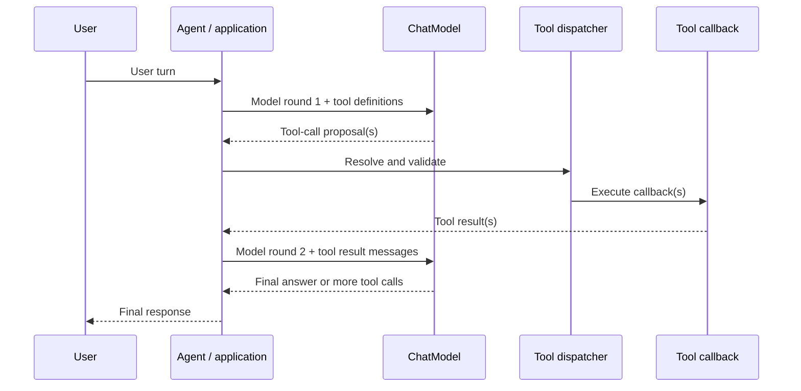
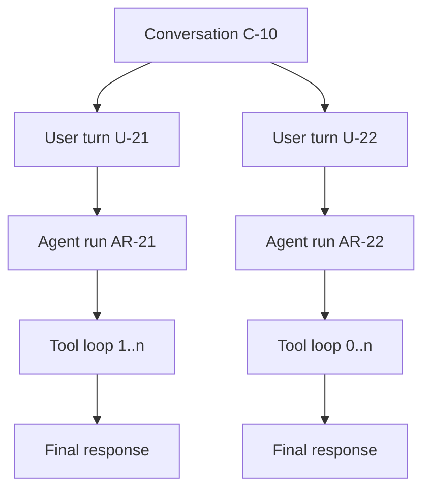
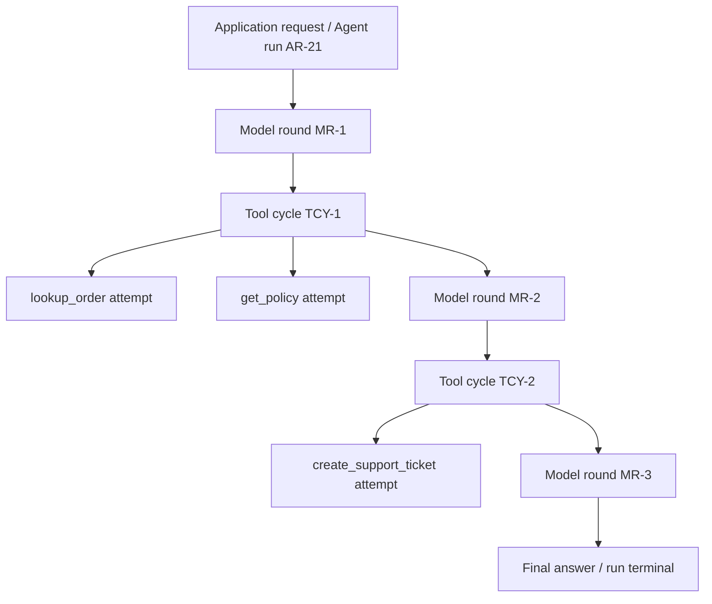

# Phân biệt vòng lặp công cụ với các lượt chat độc lập

Một người dùng hỏi trợ lý: **“Kiểm tra đơn DH-204 và nếu giao thất bại thì tạo phiếu hỗ trợ.”** Model yêu cầu gọi `lookup_order`. Ứng dụng thực thi công cụ, đưa kết quả trở lại model; model tiếp tục yêu cầu `create_support_ticket` hoặc trả lời cuối. Chuỗi model → tool → kết quả tool → model này là **vòng lặp công cụ (tool loop)** nằm bên trong một lần xử lý yêu cầu của agent.

Sau đó, người dùng gửi tin nhắn mới: **“Còn đơn DH-205 thì sao?”** Đây là một **lượt chat mới** trong cùng hội thoại. Ứng dụng có thể tiếp tục dùng lịch sử hội thoại, nhưng lượt mới là một yêu cầu xử lý mới; nó không tự động là phần tiếp theo của vòng lặp công cụ trước.

Nếu dashboard chỉ đếm “turns” hoặc “tool calls”, hai loại luồng này dễ bị trộn. Ta có thể tưởng một agent gọi tool quá nhiều trong một vòng, trong khi thực tế người dùng gửi nhiều câu hỏi độc lập; hoặc tưởng một lượt chat chỉ có một lần gọi model, trong khi một tool loop có thể tạo nhiều model rounds. Bài này xây dựng cách phân biệt các đơn vị, theo dõi quan hệ của chúng và đánh giá chính xác hành vi tool calling trong Spring AI.

Bài thuộc chương **Quan sát công cụ** của mô-đun **SPRING_AI_EVALUATION_OBSERVABILITY**. Mô-đun học đánh giá chất lượng ứng dụng Spring AI bằng tập dữ liệu, tiêu chí relevance, fact checking và kiểm thử RAG/tool calling; đồng thời đo metrics, traces, chi phí và độ trễ để phát hiện suy giảm qua các phiên bản prompt, model và pipeline. Trọng tâm của bài là **phân biệt vòng lặp công cụ với các lượt chat độc lập**, để số liệu vận hành phản ánh đúng cấu trúc điều phối của agent.

> **Nguyên tắc:** một lượt người dùng, một lần chạy agent, một lượt gọi model, một vòng tool loop và một callback attempt là những đơn vị khác nhau. Hãy đặt tên và đếm riêng từng đơn vị trước khi xây metrics hoặc đánh giá chất lượng.

## 1. Kết quả học tập

Sau bài học, bạn có thể:

1. Phân biệt **conversation**, **user chat turn**, **application request**, **agent run**, **model round**, **tool-call batch/cycle** và **callback attempt**.
2. Mô tả chu trình model đề xuất tool → ứng dụng dispatch → callback chạy → tool result được đưa lại model → model tiếp tục hoặc kết thúc.
3. Nhận diện nhiều tool calls trong cùng một model response, retries của callback và các model rounds nối tiếp.
4. Phân biệt một user follow-up mới trong cùng conversation với phần tiếp tục của agent run đang hoạt động.
5. Thiết kế ID và trace/span để liên kết các cấp mà không gộp nhầm những lượt độc lập.
6. Theo dõi giới hạn vòng tool, deadline, số lần gọi, token/cost budget và các điều kiện dừng.
7. Hiểu khác biệt giữa tool execution tự động của framework và orchestration do ứng dụng kiểm soát trong Spring AI.
8. Đo số vòng model, tool cycles, callback attempts và end-to-end latency theo mẫu số đúng.
9. Xây test/evaluation để kiểm tra agent có dừng đúng lúc, dùng kết quả tool đúng cách và không lặp tool vô hạn.

## 2. Bộ từ vựng: một hội thoại có nhiều đơn vị thực thi

Các hệ thống thường dùng từ “turn” theo nhiều nghĩa. Trong bài này, ta quy ước rõ:

| Đơn vị | Định nghĩa | Ví dụ |
|---|---|---|
| **Conversation** | Một hội thoại có lịch sử nhiều tin nhắn | Cuộc trao đổi giữa người dùng và trợ lý về các đơn hàng |
| **User chat turn** | Một lần người dùng gửi một yêu cầu/tin nhắn mới | “Kiểm tra DH-204” |
| **Application request** | Một request tới API/backend để xử lý một hành động | POST /agent/respond |
| **Agent run** | Một lần agent xử lý application request, gồm các model rounds và tool executions | Xử lý câu hỏi DH-204 đến khi có kết quả |
| **Model round** | Một lần ứng dụng gửi context tới model và nhận một response | Model round 1 đề xuất tool; round 2 tổng hợp |
| **Tool-call proposal** | Một yêu cầu tool có cấu trúc trong model response | Gọi lookup_order với DH-204 |
| **Tool-call batch/cycle** | Nhóm một hoặc nhiều tool proposals từ một model response, được thực thi và kết quả đưa lại model | Một response đề xuất lookup_order và get_policy |
| **Callback attempt** | Một lần mã callback thực sự bắt đầu chạy | Attempt 1 timeout, attempt 2 retry |
| **Tool result message** | Kết quả của tool được đưa vào lịch sử/context cho model | Kết quả lookup_order = DELIVERED |

Ở một số framework, từ **assistant turn** có thể chỉ toàn bộ lượt phản hồi của assistant, bao gồm các tool calls. Ở nơi khác, “turn” chỉ một message. Vì vậy, trong metrics và tài liệu kỹ thuật, nên dùng các tên cụ thể ở bảng thay vì dựa vào từ “turn” không có định nghĩa.

### 2.1. Một user turn có thể chứa nhiều model rounds

Ví dụ:

```text
Conversation C-10
  User chat turn U-21:
    "Kiểm tra DH-204 và chỉ tạo phiếu nếu giao thất bại."

    Agent run AR-21:
      Model round MR-1:
        proposal: lookup_order(DH-204)
      Tool cycle TCY-1:
        callback attempt A-1 -> success
        tool result -> DELIVERED

      Model round MR-2:
        final answer:
        "Đơn đã giao thành công; không tạo phiếu."

  User chat turn U-22:
    "Vậy đơn DH-205 thì sao?"

    Agent run AR-22:
      Model round MR-1:
        proposal: lookup_order(DH-205)
      Tool cycle TCY-1:
        callback attempt A-1 -> success
        tool result -> DELIVERY_FAILED
      Model round MR-2:
        proposal: create_support_ticket(DH-205)
      Tool cycle TCY-2:
        callback attempt A-1 -> success
        tool result -> ticket SUP-52
      Model round MR-3:
        final answer
```

Có **một conversation**, **hai user chat turns**, **hai application requests/agent runs**, **năm model rounds**, **ba tool-call cycles** và số callback attempts phụ thuộc retry. Không thể lấy số model rounds làm số user turns, hoặc số tool cycles làm số tool proposals.

### 2.2. User turn mới có thể dùng lại conversation history

Lượt U-22 có thể nhận lịch sử của U-21 làm context, nhưng:

- U-22 vẫn là một user turn mới;
- AR-22 là agent run mới;
- Model request của AR-22 có thể chứa message cũ từ conversation;
- Tool loop của AR-21 đã kết thúc và không tự mở lại;
- Việc U-22 nhắc lại DH-204 không biến nó thành callback retry của AR-21.

Lịch sử hội thoại mô tả **ngữ cảnh giao tiếp**; agent run mô tả **một lần thực thi**. Hai khái niệm liên quan nhưng không đồng nhất.

## 3. Tool loop thực sự diễn ra như thế nào?

Một tool loop phổ biến có cấu trúc:



Các bước:

1. Ứng dụng nhận một user turn và tạo agent run.
2. Agent gọi model với context hiện có, prompt và tool definitions.
3. Model trả lời bằng nội dung cuối hoặc một/nhiều tool-call proposals.
4. Nếu có tool calls, framework/ứng dụng resolve và kiểm tra arguments/quyền.
5. Callback thực thi; mỗi lần thực thi thật có attempt riêng.
6. Kết quả callback được biểu diễn thành tool result message gắn đúng tool call.
7. Agent gửi lịch sử cập nhật trở lại model trong một model round mới.
8. Model có thể yêu cầu thêm tools, hoặc trả final answer.
9. Agent run kết thúc khi đạt điều kiện dừng.

**Tool loop không phải vòng lặp do model tự chạy trong một lần inference.** Ứng dụng thường điều phối nhiều lần gọi model và thực thi công cụ giữa các lần đó. Cách framework tự động hóa chu trình có thể khác theo phiên bản và cấu hình.

### 3.1. Một tool-call cycle có thể có nhiều proposals

Một model response có thể yêu cầu hai công cụ độc lập:

```text
Model round MR-1:
  Tool call A: lookup_order(DH-204)
  Tool call B: get_delivery_policy(region=VN)

Tool-call batch/cycle TCY-1:
  Callback A -> result A
  Callback B -> result B

Model round MR-2:
  Receives both tool results
  Returns final answer
```

Trong bài này, **tool-call cycle** là một batch proposals xuất phát từ một model response và được xử lý trước khi model được gọi tiếp. Nếu một response chỉ có một tool proposal, cycle đó có một proposal. Nếu có ba proposals, vẫn có một batch/cycle nhưng ba tool calls. Tên này là quy ước đo lường của ứng dụng; hệ thống khác có thể gọi là tool execution round hoặc tool batch.

Các callbacks trong một batch có thể chạy tuần tự hoặc song song tùy framework, dependency và chính sách orchestration. Không suy ra concurrency chỉ từ việc model trả nhiều proposals.

### 3.2. Retry không tạo model round mới

Nếu callback của proposal A timeout và ứng dụng retry:

```text
Model round MR-1
  Proposal A: lookup_order(DH-204)
    Callback attempt A-1 -> timeout
    Callback attempt A-2 -> success
  Tool result for proposal A

Model round MR-2
  Receives result A
  Final answer
```

Đây là **một model round tạo proposal**, **một tool-call cycle**, **một proposal** và **hai callback attempts**. Retry nằm trong execution policy của ứng dụng; nó không phải model đã suy nghĩ thêm một lần hay yêu cầu tool mới.

Ngược lại, nếu model nhận tool result nhưng ở MR-2 lại đề xuất lookup_order lần nữa, đó là **proposal mới trong model round mới**. Có thể cùng logical operation hoặc là một hành động khác; cần correlation/business key để phân loại.

## 4. Lượt chat độc lập khác phần tiếp tục tool loop ra sao?

Một cuộc trò chuyện có thể chứa nhiều user turns. Mỗi turn có thể kích hoạt agent run mới:



Một turn mới không nhất thiết có tool loop; model có thể trả lời trực tiếp. Một turn có thể có nhiều tool cycles. Một conversation có thể chứa nhiều agent runs.

| Tình huống | Cùng agent run? | Model round mới? | Tool loop mới? |
|---|---|---|---|
| Callback trả result, agent gọi model tiếp | Có | Có | Tiếp tục cycle/loop hiện tại |
| Model round tiếp theo đề xuất tool khác | Có | Có | Có cycle mới trong cùng loop |
| Callback retry trong lúc thực thi | Có | **Không** | Không tạo cycle mới |
| User gửi câu hỏi mới sau final answer | **Không**, thông thường | Có khi xử lý turn mới | Agent run mới, có thể có loop mới |
| Client retry HTTP request do mất response | Có thể tạo request/run mới nếu không dedup | Có thể | Phụ thuộc idempotency/orchestration |
| Worker tiếp tục async job đã enqueue | Thường là tác vụ liên quan, không phải model round mới | Không nhất thiết | Job lifecycle riêng |

Một số ứng dụng hỗ trợ **streaming** hoặc tạm dừng để chờ người dùng phê duyệt. Khi đó agent run có thể được suspend/resume. Cần quy định resume có giữ cùng run ID hay tạo execution segment mới; không được đếm một user follow-up như một callback retry chỉ vì nó tiếp tục cùng conversation.

### 4.1. User follow-up trong khi agent run còn hoạt động

Có thể người dùng gửi tin nhắn mới trước khi agent run trước hoàn tất. Hệ thống cần một chính sách rõ:

- Từ chối hoặc queue yêu cầu mới;
- Hủy agent run cũ rồi xử lý turn mới;
- Cho phép hai runs song song trong cùng conversation với state/version được kiểm soát;
- Yêu cầu người dùng chờ hoặc xác nhận.

Nếu cho hai runs chạy song song trên cùng conversation memory, cần tránh cả hai cùng ghi đè lịch sử hoặc đọc trạng thái không nhất quán. Dùng version/sequence hoặc cơ chế serialization theo conversation khi phù hợp.

**Không giả định một conversation chỉ có một agent run đang hoạt động** nếu ứng dụng chưa thực thi ràng buộc đó.

## 5. Vòng lặp kết thúc khi nào?

Một tool loop phải có điều kiện dừng xác định. Những lý do phổ biến:

| Termination reason | Ý nghĩa |
|---|---|
| `FINAL_ANSWER` | Model trả câu trả lời cuối, không còn tool call |
| `NO_TOOL_CALL` | Model response không yêu cầu tool |
| `MAX_TOOL_ROUNDS` | Đạt giới hạn số tool-call cycles |
| `MAX_MODEL_ROUNDS` | Đạt giới hạn tổng model requests |
| `MAX_TOOL_CALLS` | Đạt ngân sách số proposals/callbacks theo chính sách |
| `DEADLINE_EXCEEDED` | Hết thời gian cho agent run |
| `TOKEN_BUDGET_EXCEEDED` | Hết ngân sách token/chi phí |
| `CANCELLED` | Người dùng/hệ thống hủy |
| `POLICY_REJECTED` | Chính sách an toàn/quyền không cho tiếp tục |
| `TOOL_TERMINAL_ERROR` | Tool error không thể phục hồi hoặc policy dừng |
| `MODEL_ERROR` | Model request thất bại |
| `MAX_REPETITION` | Phát hiện lặp tool/arguments bất thường |

Không gộp mọi lý do kết thúc thành `success`. Một agent run có thể kết thúc có kiểm soát bằng `MAX_TOOL_ROUNDS` nhưng **chưa hoàn thành yêu cầu người dùng**. Hãy tách `run.terminal_status` với `run.completion_outcome`.

### 5.1. Giới hạn vòng để tránh lặp vô hạn

Ví dụ cấu hình do ứng dụng quản lý:

```yaml
agent:
  max-model-rounds: 8
  max-tool-call-cycles: 5
  max-tool-proposals: 12
  max-callback-attempts: 16
  request-deadline: 20s
  max-retries-per-proposal: 1
```

Đây chỉ là giá trị minh họa. Chọn ngưỡng dựa trên workflow, latency SLO, provider limits, token budget và mức rủi ro side effect. Không có một ngưỡng phù hợp cho mọi agent.

### 5.2. Phát hiện lặp tool

Có thể cảnh báo khi cùng một canonical tool, cùng logical intent và cùng normalized arguments bị gọi lặp nhiều lần trong một run mà không có thay đổi trạng thái giải thích được. Tuy nhiên:

- Hai lần tra cùng đơn có thể hợp lệ nếu snapshot/version đã thay đổi;
- Hai arguments giống nhau không tự động có nghĩa là duplicate effect;
- Một retry do ứng dụng phải được tách khỏi model re-proposal;
- Tool read-only và tool write cần chính sách repetition khác nhau.

Dùng tool-call key, operation ID, normalized argument fingerprint đã bảo vệ và event sequence; không log raw arguments để phát hiện repetition.

## 6. Các cấp ID để nối conversation, run và tool loop

Đề xuất mô hình định danh:

| ID | Phạm vi | Được tạo bởi | Dùng để |
|---|---|---|---|
| `conversationId` | Toàn hội thoại | Ứng dụng/session service | Nối các user turns |
| `userTurnId` | Một tin nhắn yêu cầu mới | API/application | Đếm user turns |
| `applicationRequestId` | Một request tới backend | Gateway/application | Truy vết request boundary |
| `agentRunId` | Một lần agent xử lý request | Agent orchestrator | Nối model rounds/tool loops trong run |
| `modelRequestId` | Một lần gọi model | Application/provider metadata | Phân biệt model rounds |
| `modelResponseId` | Một response của provider nếu có | Provider | Nối response metadata |
| `toolCycleId` | Một batch tool proposals | Application | Nối proposals/callbacks trong cycle |
| `providerToolCallId` | Một tool proposal trong model response | Provider nếu có | Gắn tool result đúng request |
| `callbackInvocationId` | Một callback attempt | Application/instrumentation | Đếm lần thực thi thật |
| `logicalOperationId` | Một mục tiêu nghiệp vụ | Application/business layer | Gộp retry/side effect đúng phạm vi |
| `traceId` / `spanId` | Trace/span | Tracing runtime | Distributed tracing |

Không dùng một ID thay cho ID khác. `conversationId` có thể kéo dài hàng ngày, trong khi `agentRunId` chỉ tồn tại cho một request. `traceId` thường bao một run; nó không nhất thiết bao cả cuộc hội thoại dài. Nếu muốn liên kết các runs cùng conversation, lưu `conversationId` như metadata có kiểm soát trong logs/traces, không đưa vào metric tag.

### 6.1. Khóa nối tool proposal với callback

Nếu provider cấp tool call ID, dùng khóa có scope:

```text
ToolCallKey =
  (agentRunId, modelRequestId, providerToolCallId)
```

Nếu provider không cấp ID ổn định, ứng dụng tạo `appToolCallKey` từ `modelRequestId` và ordinal hoặc ID riêng. Ghi rõ nguồn ID. Không giả mạo rằng ID nội bộ là ID provider.

Mỗi callback retry có `callbackInvocationId` mới nhưng giữ cùng `ToolCallKey`/logical operation theo policy. Một model re-proposal ở round khác phải có `ToolCallKey` mới, dù tool name và arguments giống nhau.

### 6.2. Conversation ID không phải idempotency key

Không dùng `conversationId` làm idempotency key cho tool ghi dữ liệu. Một conversation có thể chứa nhiều yêu cầu tạo ticket hợp lệ. Idempotency scope cần gắn với **logical effect intent** cụ thể, ví dụ một operation tạo một ticket cho một user turn/run, chứ không phải toàn hội thoại.

## 7. Event model: ghi sự kiện theo từng cấp

Một event ledger có thể ghi các loại event sau:

| Event | Khi nào | ID chính |
|---|---|---|
| `USER_TURN_RECEIVED` | Người dùng gửi tin nhắn mới | conversationId, userTurnId |
| `AGENT_RUN_STARTED` | Backend bắt đầu xử lý turn | applicationRequestId, agentRunId |
| `MODEL_ROUND_STARTED` | Gửi request tới model | agentRunId, modelRequestId |
| `MODEL_RESPONSE_RECEIVED` | Nhận response | modelRequestId, modelResponseId |
| `TOOL_CYCLE_STARTED` | Response có tool proposals và dispatcher bắt đầu xử lý batch | toolCycleId |
| `TOOL_PROPOSAL_RECORDED` | Ghi một tool call trong response | ToolCallKey |
| `CALLBACK_ATTEMPT_STARTED` | Callback thực sự bắt đầu | callbackInvocationId, ToolCallKey |
| `CALLBACK_ATTEMPT_TERMINAL` | Attempt kết thúc | callbackInvocationId |
| `TOOL_RESULT_EMITTED` | Tool result message được tạo/đưa vào context | ToolCallKey, resultMessageId |
| `MODEL_ROUND_RESUMED` | Gọi model với tool results | modelRequestId mới, toolCycleId trước |
| `AGENT_RUN_TERMINAL` | Agent run dừng | agentRunId, terminationReason |
| `USER_RESPONSE_DELIVERED` | Response được gửi về client | userTurnId, responseId |

Event names là quy ước ứng dụng, không phải event schema mặc định của Spring AI. Cần ghi `occurredAt`, `sequence` hoặc version để phục hồi thứ tự logic, nhất là khi callbacks chạy song song và events đến không đúng thứ tự.

### 7.1. Một ví dụ event stream

```text
USER_TURN_RECEIVED        C-10 / U-21
AGENT_RUN_STARTED         AR-21
MODEL_ROUND_STARTED       MR-1
MODEL_RESPONSE_RECEIVED  MR-1: tool calls [A, B]
TOOL_CYCLE_STARTED        TCY-1
TOOL_PROPOSAL_RECORDED    AR-21/MR-1/A
TOOL_PROPOSAL_RECORDED    AR-21/MR-1/B
CALLBACK_ATTEMPT_STARTED  INV-A-1
CALLBACK_ATTEMPT_STARTED  INV-B-1
CALLBACK_ATTEMPT_TERMINAL INV-B-1 success
CALLBACK_ATTEMPT_TERMINAL INV-A-1 success
TOOL_RESULT_EMITTED       result-A, result-B
MODEL_ROUND_STARTED       MR-2
MODEL_RESPONSE_RECEIVED  MR-2: final answer
AGENT_RUN_TERMINAL        FINAL_ANSWER
USER_RESPONSE_DELIVERED   U-21
```

B và A hoàn tất ngược thứ tự, nhưng vẫn nối đúng proposal bằng key. Thứ tự callback completion không thay đổi thứ tự model proposals hoặc ý nghĩa tool results. Khi gửi tool result messages, tuân thủ giao thức/provider/framework; không tự sắp xếp theo thứ tự đến nếu giao thức yêu cầu một cách ghép khác.

## 8. Trace hierarchy: một run có nhiều model rounds và tool cycles

Trace logic mong muốn:



Trong tracing thực tế, framework có thể tạo các spans với tên và quan hệ khác. Sơ đồ là **mô hình liên kết nghiệp vụ**, không phải cam kết về span names. Với async/fan-out, có thể dùng span links hoặc correlation metadata thay cho parent-child trực tiếp.

Một user turn mới có thể tạo trace/run mới, dù cùng conversation:

```text
Conversation C-10
  User turn U-21 -> Agent run AR-21 -> Trace TR-21
  User turn U-22 -> Agent run AR-22 -> Trace TR-22
```

Hai trace khác nhau có thể cùng mang `conversationId=C-10`. Không nối hai trace thành một trace khổng lồ chỉ vì chúng thuộc cùng hội thoại; giữ ranh giới theo request và dùng correlation metadata để tìm các lượt liên quan.

## 9. Spring AI: tool execution tự động và orchestration tường minh

Spring AI hỗ trợ khai báo tools và tích hợp chúng vào luồng ChatModel/ChatClient. Tùy phiên bản và cách cấu hình, framework có thể **tự điều phối** việc gọi tool, đưa kết quả trở lại model và tiếp tục cho tới khi có câu trả lời cuối. Ứng dụng cũng có thể kiểm soát vòng điều phối rõ hơn thông qua các lớp phù hợp với API/provider đang dùng.

### 9.1. Framework-managed tool loop

Một ví dụ sử dụng ChatClient ở mức khái niệm:

```java
ChatClient client = ChatClient.builder(chatModel).build();

String answer = client.prompt()
        .user("Tra trạng thái đơn DH-204")
        .tools(orderTools)
        .call()
        .content();
```

Ở cấu hình hỗ trợ auto tool execution, lời gọi `call()` có thể bao gồm nhiều model rounds và callback executions bên trong. Do đó, một lần gọi phương thức Java `call()` **không nhất thiết tương đương một model request**. Để quan sát từng round/cycle, cần kiểm tra observations và hooks thực tế của Spring AI/provider version.

Ưu điểm là framework xử lý protocol và tool result linkage. Giới hạn là ứng dụng có thể không nhìn thấy mọi metadata hoặc không có hook ở đúng boundary để ghi custom IDs/round counts. Không giả định phương thức `@Tool` tự nhận provider tool call ID hoặc model request ID nếu API không cung cấp.

### 9.2. Application-managed orchestration

Ứng dụng có thể kiểm soát loop nếu API model/provider và phiên bản framework hỗ trợ việc đọc tool calls có cấu trúc, dispatch callback và gửi tool results tiếp theo.

Pseudocode:

```text
create agentRunId
modelMessages = conversation context

for modelRoundIndex in 1..maxModelRounds:
    create modelRequestId
    response = call model(modelMessages)

    if response has no tool calls:
        save final answer
        terminate FINAL_ANSWER

    create toolCycleId
    proposals = response.structuredToolCalls

    if tool budget/deadline exceeded:
        terminate with budget/deadline reason

    results = dispatch proposals
    append assistant tool-call message and matching tool result messages
    modelMessages = modelMessages + tool messages

terminate MAX_MODEL_ROUNDS if no final answer
```

Đây là **pseudocode**, không phải API method names được bảo đảm của Spring AI. Khi triển khai manual orchestration, phải tuân thủ protocol của provider: assistant tool-call message, tool result role/call ID, thứ tự/format và các yêu cầu về conversation state. Không bật framework auto-execution rồi tự dispatch lại cùng proposals; điều đó có thể thực thi side effect hai lần.

### 9.3. Chọn cách nào?

| Tiêu chí | Framework-managed | Application-managed |
|---|---|---|
| Độ đơn giản | Ít code orchestration | Cần quản lý state/loop |
| Protocol tool results | Framework xử lý theo tích hợp | Ứng dụng phải tuân thủ chính xác |
| Custom round/cycle policy | Phụ thuộc hooks/config | Kiểm soát rõ |
| Tool-call budget | Dựa vào khả năng framework hoặc wrapper | Có thể áp dụng tại mỗi bước |
| Correlation IDs | Phụ thuộc metadata/hook có sẵn | Có thể tạo ledger rõ ở từng boundary |
| Retry/idempotency | Vẫn cần policy ở application/dependency layer | Vẫn cần policy ở application/dependency layer |
| Rủi ro | Thiếu visibility ở boundary cần đo | Sai protocol hoặc chạy tool trùng |

Không có một lựa chọn luôn tốt hơn. Hãy chọn theo mức kiểm soát cần thiết và khả năng instrumentation của phiên bản Spring AI đang chạy.

## 10. Guardrails cho tool loop

Agent có thể lặp tool không cần thiết, hoặc tiếp tục gọi model khi deadline đã hết. Orchestrator cần guardrails độc lập với prompt.

### 10.1. Giới hạn theo nhiều chiều

- `maxModelRounds`: số lần gọi model tối đa trong một agent run;
- `maxToolCycles`: số batch tool proposals tối đa;
- `maxToolProposals`: tổng số tool calls model đề xuất;
- `maxCallbackAttempts`: tổng số lần callback thực thi, bao gồm retries;
- `maxRetriesPerProposal`: retry cap cho một proposal;
- `deadline`: thời gian wall-clock còn lại;
- `tokenBudget`/`costBudget`: ngân sách model;
- `sideEffectBudget`: giới hạn số tác động ghi hoặc yêu cầu phê duyệt.

Các giới hạn này không thay thế nhau. Một response có thể đề xuất 10 tools trong một cycle; một proposal có thể retry ba lần; nhiều model rounds có thể không có tool call. Cần kiểm tra từng ngân sách ở đúng boundary.

### 10.2. Thứ tự kiểm tra trước khi dispatch

Trước khi callback chạy:

1. Xác minh model response có tool calls có cấu trúc hợp lệ;
2. Resolve tên canonical trong registry;
3. Validate schema/arguments;
4. Kiểm quyền và policy;
5. Kiểm deadline, budget, cycle/proposal/attempt limits;
6. Kiểm precondition và idempotency context nếu là side effect;
7. Ghi proposal/dispatch outcome;
8. Chỉ sau đó bắt đầu callback attempt.

Nếu budget hết trước callback, ghi `POLICY_REJECTED` hoặc reason phù hợp ở dispatch; không tạo callback attempt giả.

### 10.3. Dừng an toàn khi hết vòng

Nếu đạt `MAX_TOOL_ROUNDS`, agent có thể trả lời rằng chưa thể hoàn tất hoặc chuyển người xử lý. Không tự tạo một câu trả lời khẳng định thành công nếu chưa có tool result/effect confirmation. Lưu termination reason và những tool calls chưa được xử lý để audit.

## 11. Đo số rounds và cycles mà không nhầm mẫu số

Metric names sau là gợi ý do ứng dụng định nghĩa:

| Metric | Đơn vị đếm | Tag low-cardinality gợi ý |
|---|---|---|
| `app.ai.conversation.user_turns` | User turns | channel, workflow |
| `app.ai.agent.runs.started` | Agent runs | workflow, model family |
| `app.ai.agent.runs.terminal` | Agent runs kết thúc | terminal reason, outcome |
| `app.ai.model.rounds` | Model requests | model family, round outcome |
| `app.ai.tool.cycles` | Tool-call batches | workflow, outcome |
| `app.ai.tool.proposals` | Structured tool proposals | tool name, dispatch outcome |
| `app.ai.tool.callback.attempts` | Callback attempts | canonical tool, outcome |
| `app.ai.tool.results.emitted` | Tool result messages | tool name, result kind |
| `app.ai.agent.rounds.per.run` | Phân phối rounds/run | workflow |
| `app.ai.agent.tool.cycles.per.run` | Phân phối cycles/run | workflow |

Không đưa `conversationId`, `userTurnId`, `agentRunId`, `traceId`, `providerToolCallId` hoặc raw arguments vào metric tags. Những ID này thuộc logs/traces/event store có phân quyền.

### 11.1. Ví dụ một cohort gồm 100 agent runs

Giả sử:

- 100 user turns tạo 100 agent runs;
- 100 runs tạo 260 model rounds;
- 80 runs có ít nhất một tool cycle;
- Tổng 120 tool cycles;
- 150 tool proposals trong các cycles;
- 165 callback attempts do 15 retry attempts bổ sung;
- 145 tool result messages được phát ra;
- 20 proposals bị dispatch rejection hoặc callback terminal error theo các nhánh đã phân loại.

Các tỷ lệ có thể báo:

| Chỉ số | Công thức | Giá trị |
|---|---|---:|
| Model rounds/run | 260/100 | **2,6** |
| Runs có tool loop | 80/100 | **80%** |
| Tool cycles/run | 120/100 | **1,2** |
| Proposals/cycle | 150/120 | **1,25** |
| Callback attempts/proposal được dispatch | 165/150 nếu cả 150 đã dispatch | **1,10** |
| Tool results/proposals | 145/150 | **96,7%** |

Các số liệu trên chỉ nhất quán nếu định nghĩa rõ 150 proposals đã dispatch và 20 trường hợp không có result là các terminal outcomes đã được giải thích; không được tự coi tất cả là linkage gap. Nếu có proposal bị reject trước callback, mẫu số callback attempts phải là số proposals thực sự dispatch, không phải mọi proposals.

### 11.2. Phân phối hữu ích hơn số trung bình

Báo phân phối `model rounds per run` và `tool cycles per run`:

- p50/p95/p99;
- tỷ lệ run có 0, 1, 2, 3+ tool cycles;
- tỷ lệ chạm max rounds;
- số callback attempts/retries;
- termination reasons;
- end-to-end latency và token/cost theo run.

Trung bình 2,6 rounds/run có thể che giấu 90 runs chỉ có một round và 10 runs lặp 16 rounds. Percentiles và histogram giúp phát hiện loop bất thường.

## 12. Latency và cost theo từng tầng

Một tool loop có thể tạo nhiều lần gọi model. Chi phí/độ trễ của agent run gồm các vòng đó:

```text
Agent run AR-21
  Model round 1                520 ms
  Tool cycle 1
    lookup_order               100 ms
    get_policy                 180 ms
  Model round 2                610 ms
  Tool cycle 2
    create_support_ticket      300 ms
  Model round 3                430 ms
  Orchestration overhead        60 ms

End-to-end (đường tuần tự minh họa) = 2,200 ms
```

Nếu hai tools trong cycle 1 chạy song song, pha đó có thể gần 180 ms cộng overhead, không phải 280 ms. Phải đo phase/parent duration thực tế.

### 12.1. Tách cost model và cost tool

- **Model cost:** tổng token/giá của từng model round trong agent run;
- **Tool/dependency cost:** chi phí mỗi callback/dependency attempt, bao gồm retry nếu tính phí;
- **Agent run cost:** tổng chi phí tất cả model rounds và tool/dependency work;
- **Conversation cost:** tổng chi phí của nhiều agent runs thuộc conversation, nếu mục tiêu báo cáo cần cấp này.

Không lấy số model rounds làm số tool cycles. Một round có thể không có tools hoặc có nhiều proposals; một callback retry không tạo thêm model token usage trừ khi ứng dụng gọi model lại.

### 12.2. Retry và model re-proposal ảnh hưởng khác nhau

- Callback retry làm tăng attempts/dependency cost nhưng không nhất thiết tăng model rounds.
- Model re-proposal làm tăng model rounds và tool proposals, có thể tạo thêm callback attempts.
- User gửi một câu hỏi mới tạo user turn/agent run mới và thêm cost ở cấp conversation.
- Client retry application request có thể vô tình chạy lại cả agent; cần request idempotency/dedup ở API layer.

Báo các đại lượng riêng để xác định nguồn chi phí tăng.

## 13. Memory và conversation history không phải tool loop state

Conversation memory có thể chứa:

- User messages;
- Assistant final answers;
- Tool-call/tool-result messages theo cách framework lưu;
- Metadata hoặc summary của các lượt trước.

Tool loop state cần thêm những dữ liệu thực thi:

- Agent run ID;
- Model round index;
- Tool cycle ID;
- Pending proposals;
- Callback attempts/outcomes;
- Tool results đã gắn call ID;
- Budget/deadline và termination reason.

Không giả định chỉ cần load conversation history là có thể resume chính xác một tool loop đã bị process crash. Muốn resume, cần lưu **execution state**/ledger riêng và đảm bảo idempotency cho các callbacks có side effect.

### 13.1. Khi user nhắc lại yêu cầu cũ

Người dùng có thể nói “tiếp tục việc tạo phiếu lúc nãy”. Đây là user turn mới nhưng tham chiếu logical operation trước. Ứng dụng cần:

1. Tìm operation/run liên quan bằng context có kiểm soát;
2. Đọc trạng thái authoritative;
3. Nếu operation đã commit, trả receipt thay vì tạo lại;
4. Nếu operation `UNKNOWN`, reconcile trước khi retry;
5. Nếu là yêu cầu nghiệp vụ mới, tạo logical operation ID mới.

Không gộp hai user turns thành một chỉ vì chúng có cùng conversation ID; cũng không tạo side effect mới chỉ vì model lặp lại tool call trong lượt mới.

## 14. Java: mô hình hóa agent run và tool cycle

Đoạn Java 17 dưới đây mô tả các đơn vị thực thi ở mức application. Đây là **mô hình domain do ứng dụng xây dựng**, không phải class mặc định Spring AI.

```java
import java.time.Instant;
import java.util.Objects;

public final class AgentRunModel {

    public enum RunTerminalReason {
        FINAL_ANSWER,
        MAX_TOOL_ROUNDS,
        MAX_MODEL_ROUNDS,
        DEADLINE_EXCEEDED,
        TOKEN_BUDGET_EXCEEDED,
        CANCELLED,
        POLICY_REJECTED,
        TOOL_TERMINAL_ERROR,
        MODEL_ERROR
    }

    public record AgentRun(
            String conversationId,
            String userTurnId,
            String applicationRequestId,
            String agentRunId,
            Instant startedAt) {

        public AgentRun {
            Objects.requireNonNull(conversationId);
            Objects.requireNonNull(userTurnId);
            Objects.requireNonNull(applicationRequestId);
            Objects.requireNonNull(agentRunId);
            Objects.requireNonNull(startedAt);
        }
    }

    public record ModelRound(
            String agentRunId,
            String modelRequestId,
            int roundIndex,
            String modelName) {

        public ModelRound {
            Objects.requireNonNull(agentRunId);
            Objects.requireNonNull(modelRequestId);
            Objects.requireNonNull(modelName);
            if (roundIndex < 1) {
                throw new IllegalArgumentException("roundIndex must be positive");
            }
        }
    }

    public record ToolCycle(
            String agentRunId,
            String modelRequestId,
            String toolCycleId,
            int cycleIndex,
            int proposalCount) {

        public ToolCycle {
            Objects.requireNonNull(agentRunId);
            Objects.requireNonNull(modelRequestId);
            Objects.requireNonNull(toolCycleId);
            if (cycleIndex < 1 || proposalCount < 1) {
                throw new IllegalArgumentException("Invalid tool cycle");
            }
        }
    }

    public record RunTerminal(
            String agentRunId,
            RunTerminalReason reason,
            String completionOutcome,
            Instant endedAt) {

        public RunTerminal {
            Objects.requireNonNull(agentRunId);
            Objects.requireNonNull(reason);
            Objects.requireNonNull(completionOutcome);
            Objects.requireNonNull(endedAt);
        }
    }

    private AgentRunModel() {
    }
}
```

Điểm quan trọng là `ModelRound` và `ToolCycle` đều tham chiếu `agentRunId`, nhưng cycle còn tham chiếu model request đã sinh proposals. Một user turn mới sẽ có `userTurnId` và `agentRunId` mới, dù `conversationId` giữ nguyên.

### 14.1. Invariant nên kiểm tra

- Một `agentRunId` thuộc một user turn/application request theo hợp đồng.
- `roundIndex` tăng trong phạm vi agent run.
- Một tool cycle thuộc một model response/round.
- Mỗi proposal trong cycle có scoped tool call key riêng.
- Callback attempts chỉ được tạo khi dispatch đã vào callback.
- Một tool result message nối đúng proposal.
- Agent run chỉ có một terminal event logic; event delivery lặp phải deduplicate.
- Resume/suspend phải có state/version rõ ràng, không tạo run trùng ngoài ý muốn.

## 15. Pseudocode: một vòng điều phối có giới hạn

Ví dụ sau mô tả cách một application-managed orchestrator có thể kiểm tra giới hạn. Các interface `ModelGateway`, `ToolDispatcher` và `RunLedger` là **abstractions minh họa**; không phải API có sẵn mang đúng tên này trong Spring AI.

```java
public final class BoundedToolLoop {

    public record Limits(
            int maxModelRounds,
            int maxToolCycles,
            int maxToolProposals) {
    }

    public record ModelResponse(
            boolean hasFinalAnswer,
            String finalAnswer,
            java.util.List<ToolProposal> toolCalls) {
    }

    public record ToolProposal(
            String callKey,
            String canonicalToolName,
            String arguments) {
    }

    public interface ModelGateway {
        ModelResponse complete(
                String modelRequestId,
                java.util.List<String> messages);
    }

    public interface ToolDispatcher {
        java.util.List<String> execute(
                String toolCycleId,
                java.util.List<ToolProposal> proposals);
    }

    public interface RunLedger {
        void modelRoundStarted(String requestId, int index);
        void toolCycleStarted(String cycleId, int index, int proposals);
        void terminal(String reason, String outcome);
    }

    private final ModelGateway model;
    private final ToolDispatcher dispatcher;
    private final RunLedger ledger;
    private final Limits limits;

    public BoundedToolLoop(
            ModelGateway model,
            ToolDispatcher dispatcher,
            RunLedger ledger,
            Limits limits) {
        this.model = model;
        this.dispatcher = dispatcher;
        this.ledger = ledger;
        this.limits = limits;
    }

    public String run(java.util.List<String> initialMessages) {
        var messages = new java.util.ArrayList<>(initialMessages);
        int totalProposals = 0;
        int toolCycles = 0;

        for (int round = 1; round <= limits.maxModelRounds(); round++) {
            String modelRequestId = java.util.UUID.randomUUID().toString();
            ledger.modelRoundStarted(modelRequestId, round);

            ModelResponse response = model.complete(modelRequestId, messages);

            if (response.hasFinalAnswer()) {
                ledger.terminal("FINAL_ANSWER", "COMPLETED");
                return response.finalAnswer();
            }

            if (response.toolCalls() == null || response.toolCalls().isEmpty()) {
                ledger.terminal("NO_TOOL_CALL", "INCOMPLETE_OR_EMPTY");
                return "Chưa có kết quả để trả lời.";
            }

            toolCycles++;
            totalProposals += response.toolCalls().size();

            if (toolCycles > limits.maxToolCycles()
                    || totalProposals > limits.maxToolProposals()) {
                ledger.terminal("TOOL_BUDGET_EXCEEDED", "INCOMPLETE");
                return "Yêu cầu vượt giới hạn thực thi công cụ.";
            }

            String cycleId = java.util.UUID.randomUUID().toString();
            ledger.toolCycleStarted(
                    cycleId, toolCycles, response.toolCalls().size());

            // Dispatcher phải trả tool results được ghép đúng callKey.
            var toolMessages = dispatcher.execute(
                    cycleId, response.toolCalls());

            messages.add("assistant tool calls: " + response.toolCalls());
            messages.addAll(toolMessages);
        }

        ledger.terminal("MAX_MODEL_ROUNDS", "INCOMPLETE");
        return "Đã đạt giới hạn số lượt xử lý; cần tiếp tục hoặc chuyển hỗ trợ.";
    }
}
```

### 15.1. Giới hạn của pseudocode

Đoạn code giúp minh họa cách phân biệt model rounds và tool cycles, nhưng **chưa phải production orchestrator**:

- Chưa có timeout/deadline hoặc cancellation;
- Chưa có retry policy và callback attempt IDs;
- Chưa validate structured arguments, permissions, canonical tool registry;
- Chưa bảo vệ side effects bằng idempotency;
- Chưa xử lý parallel results, streaming hoặc provider protocol cụ thể;
- Message strings chỉ minh họa; production phải dùng message types/objects của Spring AI/provider;
- Cần xử lý model response lỗi và trường hợp response vừa có content vừa có tool calls theo contract provider;
- Cần lưu ledger bền vững nếu muốn resume sau process failure.

Nếu dùng framework-managed tool loop, không copy vòng lặp này để chạy song song cùng cơ chế tự động. Hãy instrument các hooks/boundaries framework thực sự cung cấp.

## 16. Nối Spring AI với conversation và agent run

Một ứng dụng thường cần giữ các context sau:

| Context | Nơi phù hợp | Không nên |
|---|---|---|
| `conversationId` | Conversation store/session metadata | Metric tag có cardinality cao |
| `userTurnId` | Request metadata/event ledger | Dùng làm tool call ID |
| `agentRunId` | Orchestration context/trace metadata | Dùng thay conversation ID |
| `modelRequestId` | Model invocation metadata | Tự gán vào tool arguments |
| `toolCycleId` | Dispatcher/event ledger | Dùng thay provider tool call ID |
| `callbackInvocationId` | Callback wrapper/instrumentation | Gộp retries cùng một ID |
| `logicalOperationId` | Business context/idempotency layer | Lấy trực tiếp từ model text |

Trong Spring AI, các cơ chế `ToolContext`, advisors, observations hoặc application metadata có thể hỗ trợ truyền một phần context, nhưng **khả năng cụ thể phụ thuộc phiên bản**. Không giả định tất cả ID tự xuất hiện trong phương thức `@Tool`. Hãy xác minh boundary nơi model response có tool call metadata và boundary nơi callback được dispatch.

### 16.1. Auto execution không có nghĩa một model round

Khi `ChatClient` được cấu hình tools và framework tự thực thi tool calls, một lời gọi client có thể chạy nhiều vòng model/tool nội bộ. Do vậy:

- `ChatClient.call()` count có thể gần với agent request count;
- Model provider request count có thể lớn hơn;
- Tool callback count có thể lớn hơn hoặc nhỏ hơn model request count;
- Một response có nhiều tool proposals;
- Retries ở callback không nhất thiết gọi model lại.

Nếu muốn biết số model rounds chính xác, đo tại model invocation boundary hoặc dùng telemetry được framework/provider công bố, không suy từ số lần application gọi `ChatClient`.

## 17. Metrics, dashboard và cảnh báo

### 17.1. Metric names gợi ý

Các tên sau là quy ước ứng dụng:

| Metric | Đếm gì? | Tag low-cardinality |
|---|---|---|
| `app.ai.conversation.turns.started` | User turns | channel, workflow |
| `app.ai.agent.runs.started` | Agent runs | workflow, model family |
| `app.ai.agent.runs.terminal` | Run terminal events | termination reason, outcome |
| `app.ai.model.rounds` | Model requests | model family, response type |
| `app.ai.tool.cycles` | Tool-call batches | workflow, cycle outcome |
| `app.ai.tool.proposals` | Tool proposals | canonical tool, dispatch outcome |
| `app.ai.tool.callback.attempts` | Callback attempts | canonical tool, attempt outcome |
| `app.ai.tool.results` | Tool result messages | canonical tool, result kind |
| `app.ai.agent.tool.rounds` | Tool cycles per run distribution | workflow |
| `app.ai.agent.model.rounds` | Model rounds per run distribution | workflow |
| `app.ai.agent.duration` | End-to-end run duration | workflow, terminal outcome |

Không thêm IDs cá thể như conversation, turn, run, trace, call hoặc invocation vào tags. Dùng logs/traces/event store để drill-down.

### 17.2. Các dashboard cần có

**Agent run overview**

- Runs started/terminal;
- Run completion outcome;
- Termination reasons;
- p50/p95/p99 run duration;
- Runs chạm max rounds/deadline/budget.

**Model loop**

- Model rounds per run;
- Token/cost per run;
- Model latency theo round index (nếu round index được lưu ở event/trace, không làm metric cardinality tăng không kiểm soát);
- Model errors và empty/no-tool responses.

**Tool loop**

- Runs có tool cycles;
- Tool cycles per run;
- Proposals per cycle;
- Callback attempts per proposal;
- Retry rate;
- Tool results emitted và unresolved proposals;
- Tool sequence correctness.

**Conversation**

- User turns per conversation;
- Agent runs per conversation;
- Follow-up rate;
- Conversation cumulative cost, nếu mục tiêu báo cáo cần cấp này.

### 17.3. Cảnh báo có ý nghĩa

- Tỷ lệ run kết thúc bằng `MAX_TOOL_ROUNDS` tăng;
- p95 model rounds/run tăng bất thường;
- Tool proposals/cycle hoặc callbacks/proposal tăng;
- Cùng tool/normalized intent lặp quá ngưỡng;
- Run deadline bị vượt;
- Có proposal không có terminal dispatch/callback/result state;
- Một conversation có nhiều runs đồng thời ghi vào memory;
- Token/cost per run tăng sau prompt/model rollout;
- Final answer được phát ra dù side-effect effect vẫn `UNKNOWN`.

Cảnh báo nên gắn với SLO và cohort có đủ thời gian quan sát. Đừng cảnh báo chỉ vì một conversation có nhiều user turns; điều đó có thể là hành vi bình thường.

## 18. Evaluation: chấm tool loop và chat turn riêng

Một test case cho agent không chỉ lưu câu trả lời cuối. Nó có thể lưu expected behavior ở các cấp:

```json
{
  "sampleId": "order-support-204",
  "datasetVersion": "tool-loop-v2",
  "userTurn": "Chỉ tạo phiếu nếu DH-204 giao thất bại",
  "expected": {
    "maxToolCycles": 2,
    "toolSequence": [
      {"tool": "lookup_order", "orderId": "DH-204"}
    ],
    "forbiddenTools": ["create_support_ticket"],
    "finalOutcome": "DELIVERED_NO_TICKET"
  },
  "observed": {
    "modelRounds": 2,
    "toolCycles": 1,
    "toolProposals": 1,
    "callbackAttempts": 1,
    "toolResults": 1,
    "terminationReason": "FINAL_ANSWER"
  },
  "verdict": "PASS"
}
```

Schema này là ví dụ do ứng dụng định nghĩa. Dữ liệu expected/observed nên dùng normalized tool names/arguments đã được bảo vệ; không lưu thông tin nhạy cảm không cần thiết.

### 18.1. Các chiều evaluation

| Chiều | Câu hỏi | Oracle |
|---|---|---|
| Turn handling | Agent có xử lý đúng user request mới không? | User-turn dataset |
| Tool selection | Model có chọn đúng tool? | Expected tool set/sequence |
| Tool loop control | Có gọi dư hoặc lặp vô hạn? | Max rounds/cycle and repetition rules |
| Arguments | Có truyền đúng tham số? | Schema + semantic assertions |
| Result consumption | Model có dùng tool result đúng? | Fact checking/faithfulness |
| Termination | Có dừng đúng lúc và nói đúng trạng thái? | Expected termination reason/outcome |
| Cross-turn memory | Lượt mới có dùng đúng lịch sử, không trộn runs? | Multi-turn test |
| Side effects | Có tạo thay đổi chỉ khi precondition thỏa? | State/effect oracle |

### 18.2. Test multi-turn để phân biệt run độc lập

Một fixture có hai user turns trong cùng conversation:

- U-1: hỏi trạng thái DH-204; tool trả `DELIVERED`; agent kết thúc không tạo ticket.
- U-2: hỏi DH-205; tool trả `DELIVERY_FAILED`; agent tạo đúng một ticket.
- U-3: hỏi “phiếu của DH-205 đâu?”; agent có thể dùng receipt từ conversation state hoặc truy vấn lại theo policy.

Assertions:

- Có ba `userTurnId` và ba `agentRunId`;
- Mỗi run có model rounds/tool cycles riêng;
- U-2 không được tính là retry của U-1;
- U-3 không tạo ticket mới nếu effect của U-2 đã commit;
- Conversation memory không làm lẫn order IDs/results;
- Tổng conversation cost là tổng của các runs theo quy ước.

## 19. Kiểm thử tool loop và independent turns

| Test | Tình huống | Kỳ vọng |
|---|---|---|
| **TC01** | Model trả final answer ngay | Một model round, zero tool cycles |
| **TC02** | Một model round đề xuất một tool | Một proposal, một cycle |
| **TC03** | Một response đề xuất ba tools | Một cycle, ba proposals |
| **TC04** | Callback retry một lần | Proposal/cycle không tăng; attempts tăng hai |
| **TC05** | Model round tiếp theo đề xuất tool khác | Model rounds và tool cycles tăng |
| **TC06** | User gửi turn mới sau final answer | User turn/run mới, không phải retry |
| **TC07** | Hai user turns cùng conversation | Conversation ID chung, turn/run IDs riêng |
| **TC08** | Hai agent runs chạy song song | Có run correlation riêng và memory concurrency policy |
| **TC09** | Đạt max tool cycles | Run terminal reason max limit, không báo task success giả |
| **TC10** | Đạt deadline khi callback đang chạy | Cancellation/timeout state rõ; effect có thể unknown |
| **TC11** | Tool result được đưa lại model | Đúng tool call key/result linkage |
| **TC12** | Model lặp cùng tool nhiều round | Phát hiện repetition; policy dừng/tiếp tục rõ |
| **TC13** | Tool call bị dispatch reject | Proposal có, callback attempts zero |
| **TC14** | Tool chạy async và trả job ID | Callback kết thúc; job lifecycle riêng |
| **TC15** | Agent run suspend/resume chờ approval | Run/resume segment IDs theo quy ước, không đếm nhầm user turn |
| **TC16** | HTTP client retry dependency | Dependency attempts tăng, model rounds không tự tăng |
| **TC17** | Client retry application request | Dedup request/run theo idempotency policy |
| **TC18** | Conversation history chứa tool result cũ | Không coi result cũ là callback mới |
| **TC19** | Model re-proposes tool ở user turn mới | Proposal mới, logical operation dedup theo policy |
| **TC20** | Final answer khi effect status unknown | Không khẳng định side effect đã hoàn tất |
| **TC21** | Model response có tool call batch trả results out of order | Kết quả vẫn nối đúng từng proposal |
| **TC22** | Một cycle có cả read và write tools | Kiểm precondition/order/approval cho side effect |
| **TC23** | Model error sau khi tool đã chạy | Effect ledger vẫn giữ trạng thái; run failure không xóa effect |
| **TC24** | Streaming partial response rồi tool proposal | Không đếm chunk stream như model round mới |

### 19.1. Các invariant nên xác nhận

- Một user turn được tiếp nhận có một định danh ổn định; request retries được deduplicate theo policy.
- Một agent run có nhiều model rounds; round index không reset giữa tool cycles.
- Một tool cycle thuộc model response đã sinh proposals.
- Callback retry không làm tăng model proposal count.
- Model re-proposal làm tăng proposal count và có key mới.
- User turn mới tạo agent run mới dù cùng conversation.
- Tool result nối đúng proposal; không ghép theo thứ tự completion.
- Mọi run có terminal reason hoặc trạng thái in-progress có tuổi.
- Max-round/deadline/budget termination không bị ghi thành completed-success nếu yêu cầu chưa đạt.
- Memory và execution ledger có consistency/concurrency policy.
- Tool correctness được chấm riêng với số lần thực thi.

## 20. Quy trình triển khai trong dự án Spring AI

1. **Chốt từ vựng:** conversation, user turn, application request, agent run, model round, tool cycle, proposal, callback attempt, tool result.
2. **Chọn ranh giới request:** xác định khi nào một user message trở thành application request và agent run.
3. **Chọn tool execution mode:** framework-managed hay application-managed; kiểm API/observations theo Spring AI version.
4. **Tạo IDs:** conversation/turn/run/model/cycle/tool-call/invocation/logical operation theo scope rõ ràng.
5. **Ghi event lifecycle:** run start, model round, tool proposal, cycle, attempts, results, termination.
6. **Thiết lập guardrails:** max rounds/cycles/proposals/attempts, deadline, token/cost và side-effect budget.
7. **Xử lý retries:** phân biệt application retry, dependency retry và model re-proposal; dùng idempotency cho effects.
8. **Quản lý multi-turn memory:** versioning/serialization hoặc concurrency policy để không ghi đè lịch sử.
9. **Xây metrics:** đếm từng đơn vị riêng, chọn mẫu số rõ ràng và tags low-cardinality.
10. **Nối traces:** application request → agent run → model rounds → tool cycles → callback/dependencies.
11. **Tạo evaluation dataset:** expected tool sequence, rounds, termination, final answer, cross-turn state và side effects.
12. **Kiểm thử failure modes:** loop limit, timeout, cancellation, streaming, parallel tools, request retry, resume.
13. **So hồi quy:** giữ dataset/rubric; so prompt/model/tool versions, rounds, cycles, latency và cost.
14. **Theo dõi production:** phát hiện loops dài, proposals dư thừa, result linkage gaps, run overlap và memory races.

### Checklist trước khi công bố dashboard

- [ ] Conversation, user turn, application request và agent run có định nghĩa riêng.
- [ ] Model rounds không bị đếm như user turns.
- [ ] Tool-call cycles không bị đếm như proposals hoặc callback attempts.
- [ ] Một response có nhiều proposals được đếm đúng batch và từng call.
- [ ] Callback retry không làm tăng model rounds/proposals.
- [ ] Model re-proposal được ghi là proposal mới.
- [ ] User follow-up mới tạo run mới, dù dùng cùng conversation history.
- [ ] Mọi run có termination reason và completion outcome riêng.
- [ ] Có max rounds/cycles/deadline/token/cost budgets.
- [ ] Tool results nối đúng proposal IDs.
- [ ] Metrics dùng mẫu số và cohort đúng.
- [ ] Không đưa IDs cá thể vào metric tags.
- [ ] Multi-turn memory có chính sách concurrency/version rõ.
- [ ] Có evaluation kiểm tra tool loop, final answer và cross-turn behavior.

## 21. Bài luyện tập

### Bài 1 — Đếm các cấp trong một turn

Một user turn tạo một agent run. Model round 1 đề xuất hai tools; mỗi callback chạy một lần. Model round 2 đề xuất thêm một tool; callback này timeout rồi retry thành công. Model round 3 trả final answer.

Hãy đếm: user turns, agent runs, model rounds, tool cycles, proposals, callback attempts.

### Bài 2 — Phân biệt retry và re-proposal

Trong cùng agent run, callback của `lookup_order` timeout và application retry thành công. Sau khi nhận result, model lại đề xuất `lookup_order` lần nữa.

Có bao nhiêu proposals, cycles, callback attempts? Hai lần gọi tool có cùng ToolCallKey không? Vì sao?

### Bài 3 — Multi-turn conversation

Conversation C-10 có ba user messages, mỗi message được xử lý xong trước khi user gửi tiếp. U-1 có một tool cycle, U-2 không gọi tool, U-3 có hai tool cycles.

Hãy tính user turns, agent runs và tool cycles. Có thể gộp ba runs thành một trace duy nhất không?

### Bài 4 — Một response có nhiều tools

Model round 1 đề xuất `lookup_order` và `get_policy`; callback B hoàn tất trước callback A. Vì sao không được ghép result theo thứ tự hoàn tất? Những IDs nào cần có?

### Bài 5 — Giới hạn vòng

Agent được cấu hình maxModelRounds=4, maxToolCycles=3. Nó đã dùng bốn model rounds nhưng vẫn nhận tool proposals ở round 4.

Termination reason nào phù hợp? Có được báo user request completed-success không? Nêu cách phản hồi an toàn.

### Bài 6 — Tính metrics

Có 100 agent runs, 260 model rounds, 120 tool cycles, 150 proposals và 165 callback attempts. Tính model rounds/run, cycles/run, proposals/cycle và attempts/proposal. Giải thích vì sao attempts/proposal lớn hơn 1.

### Bài 7 — Client retry application request

Người dùng gửi request, server xử lý agent xong nhưng response HTTP bị mất. Client gửi lại cùng request. Vì sao có nguy cơ chạy lại toàn tool loop? Nêu hai cơ chế giảm duplicate execution.

### Bài 8 — User follow-up nhắc lại thao tác

U-1 yêu cầu tạo ticket; operation đã commit nhưng final answer bị mất. U-2 nói “tiếp tục tạo phiếu lúc nãy”. Cần tra cứu gì trước khi gọi tool write lần nữa? Vì sao conversation ID không phải idempotency key?

### Bài 9 — Tool loop dài bất thường

Sau khi đổi prompt, p95 model rounds/run tăng từ 2 lên 7, p95 callback latency không đổi. Nêu ba giả thuyết và cách dùng trace/gold set xác minh.

### Bài 10 — Auto execution

Một lần gọi `ChatClient.call()` thực thi hai model rounds và một tool cycle nội bộ. Dashboard chỉ đếm số lần application gọi `call()`.

Dashboard đang thiếu gì? Ở boundary nào nên instrument để có số model rounds chính xác?

### Gợi ý đáp án

1. **1 user turn**, **1 agent run**, **3 model rounds**, **2 tool cycles**, **3 proposals**, **4 callback attempts** (hai callback ở cycle 1, một proposal ở cycle 2 với hai attempts).
2. Có **2 proposals** (proposal ban đầu và re-proposal sau result), **2 cycles** nếu mỗi proposal xuất phát từ một model response khác nhau, **3 callback attempts** (lần đầu timeout + retry success + lần re-proposal). ToolCallKeys khác nhau vì modelRequestId/round khác nhau; retry của proposal đầu giữ cùng key.
3. **3 user turns**, **3 agent runs**, **3 tool cycles**. Thông thường có ba traces theo ba application requests/runs; liên kết bằng conversationId thay vì gộp thành một trace dài.
4. Kết quả đến ngược thứ tự có thể bị gán nhầm. Cần scoped ToolCallKey gồm agentRunId/modelRequestId/providerToolCallId hoặc appToolCallKey, cùng callback invocation IDs cho attempts.
5. `MAX_MODEL_ROUNDS`. Run chưa đạt final answer nên không báo completed-success; có thể trả trạng thái chưa hoàn tất, giải thích giới hạn hoặc chuyển người xử lý.
6. Rounds/run = **2,6**; cycles/run = **1,2**; proposals/cycle = **1,25**; attempts/proposal = **1,1**. Trung bình attempts cao hơn 1 do retry (hoặc nhiều attempts theo policy); phải đối chiếu attempt records.
7. Request retry có thể tạo agent run và tool side effects mới nếu không dedup. Dùng idempotency/request key ở API boundary, lưu run/result để replay response, và idempotency key cho logical effects.
8. Tra operation ledger/receipt/authoritative state và idempotency status; nếu effect đã commit thì trả receipt. Conversation ID bao nhiều yêu cầu độc lập, nên không định danh một logical effect cụ thể.
9. Prompt có thể khiến model gọi tool lặp, tạo nhiều proposals/cycles, hoặc không dùng tool result và yêu cầu thêm dữ liệu. So tool sequences/expected rounds trên cùng gold set; trace theo modelRequestId, toolCycleId và callback outcomes; kiểm final-answer quality.
10. Thiếu số model rounds, tool cycles, proposals và callback attempts bên trong framework. Instrument tại model invocation boundary và tool dispatch/callback boundary theo hook/telemetry có sẵn ở phiên bản Spring AI; không suy rounds từ số call().

## Tài liệu tham khảo

- [Spring AI Reference — Tool Calling](https://docs.spring.io/spring-ai/reference/api/tools.html): khai báo tools, callback execution và cách framework tích hợp tool calling; kiểm đúng phiên bản dự án.
- [Spring AI Reference — Chat Client API](https://docs.spring.io/spring-ai/reference/api/chatclient.html): cách sử dụng ChatClient và cấu hình tools.
- [Spring AI Reference — Observability](https://docs.spring.io/spring-ai/reference/observability/): observations/traces cho các thành phần Spring AI theo phiên bản/cấu hình.
- [Micrometer Observation Reference](https://docs.micrometer.io/micrometer/reference/observation.html): vòng đời observation, scope, error và key values.
- [Micrometer Tracing Reference](https://docs.micrometer.io/tracing/reference/): spans, trace context và propagation.
- [OpenTelemetry — Traces](https://opentelemetry.io/docs/concepts/signals/traces/): mô hình trace/span và quan hệ giữa các thao tác.
- [OpenTelemetry — Context Propagation](https://opentelemetry.io/docs/concepts/context-propagation/): truyền context qua các ranh giới thực thi.

**Kết luận:** một user chat turn có thể kích hoạt nhiều model rounds và tool cycles; một cycle có thể chứa nhiều tool proposals; mỗi proposal có thể tạo nhiều callback attempts do retry. Một user follow-up mới trong cùng conversation là một lần xử lý mới, dù nó dùng lại lịch sử trước đó. Khi phân biệt các cấp này, gắn ID đúng scope, giới hạn vòng lặp và đo metrics theo đơn vị riêng, bạn có thể phát hiện agent gọi tool dư thừa, lặp vô hạn, tốn token hoặc trộn trạng thái giữa các lượt chat — đồng thời đánh giá được liệu mỗi run có hoàn tất đúng yêu cầu người dùng hay không.
