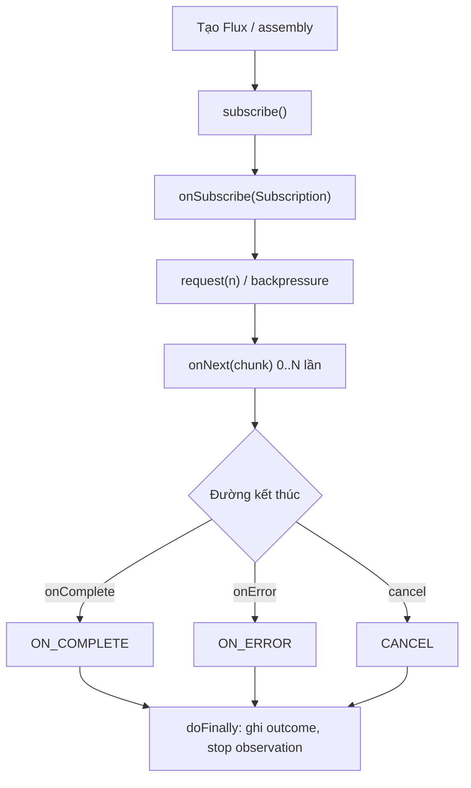

# Vòng đời observation từ subscription đến hoàn tất hoặc hủy trong Spring AI

> **Chương:** Streaming và bất đồng bộ  
> **Module:** `SPRING_AI_EVALUATION_OBSERVABILITY` — học đánh giá chất lượng ứng dụng Spring AI bằng tập dữ liệu, tiêu chí relevance, fact checking, kiểm thử RAG và tool calling; đồng thời theo dõi metrics, traces, token, chi phí và độ trễ để phát hiện suy giảm chất lượng giữa các phiên bản prompt, model và pipeline.

## Mục tiêu học tập

Sau bài này, bạn có thể:

1. Mô tả đúng sự khác biệt giữa **tạo publisher**, **đăng ký subscription**, **phát phần dữ liệu đầu tiên** và **kết thúc subscription** khi Spring AI trả dữ liệu streaming.
2. Phân biệt ba đường kết thúc `ON_COMPLETE`, `ON_ERROR` và `CANCEL` của Reactor, hiểu vì sao đo observation chỉ ở `doOnComplete` sẽ bỏ sót request.
3. Đặt điểm `start` và `stop` của Micrometer `Observation` tương ứng một subscription, kể cả khi người dùng ngắt kết nối hoặc downstream hủy stream.
4. Đo time to first chunk, tổng thời gian stream, số chunks, trạng thái kết thúc; phân biệt các số liệu này với **token usage thật, thời gian provider, TTFT phía client** và chi phí.
5. Viết phép thử với Reactor `StepVerifier` cho complete/error/cancel, suy luận tác động của `retry`, `timeout`, `take`, backpressure, hot/cold publisher và reactive context propagation.
6. Kết hợp dữ liệu streaming với traces, metrics, prompt/model/pipeline version và phép đánh giá RAG để khoanh vùng lỗi giữa retrieval, sinh nội dung và hạ tầng.

## 1. Từ một lời gọi API đến nhiều tín hiệu bất đồng bộ

Trong ứng dụng đồng bộ, thao tác `ChatModel.call(...)` thường trả về một kết quả hoặc ném lỗi. Lời gọi streaming, ví dụ một số phiên bản Spring AI cung cấp `ChatClient.prompt().user(...).stream().content()`, thường trả một `Flux<String>`. **Việc nhận được `Flux` chưa có nghĩa model đã sinh xong hoặc request đã được gửi đến provider.**

Với một publisher kiểu *cold*, quy trình thông thường:



Các tín hiệu `onComplete` và `onError` là tín hiệu terminal từ publisher đến subscriber; `cancel()` là thao tác từ subscriber gửi ngược lên `Subscription` để chấm dứt nhu cầu nhận dữ liệu. **Cancel không phải một sự kiện `onComplete` bình thường.**

Trong Reactor, `Flux.doFinally(...)` nhận `SignalType` khi kết thúc bởi complete, error hoặc cancel. Đây là điểm tổng hợp phù hợp khi cần kết thúc một observation dù client đã rời đi.

### Một dòng thời gian minh họa

```text
t=0 ms      Service dựng Flux và trả về cho HTTP layer
t=12 ms     HTTP layer subscribe -> bắt đầu observation của subscription
t=20 ms     Bắt đầu kết nối/provider call
t=180 ms    onNext("Quy")
t=201 ms    onNext(" định")
t=240 ms    onNext(" ...")
t=430 ms    onComplete -> doFinally(ON_COMPLETE) -> stop observation
```

Trong ví dụ này:

- **Thời gian dựng Flux:** không phải thời gian sinh, không nên tự gán thành latency của model.
- **Subscription duration:** khoảng từ t=12 đến t=430, xấp xỉ 418 ms.
- **Time to first non-empty chunk:** khoảng từ t=12 đến t=180, xấp xỉ 168 ms.
- **Số chunk:** 3 lần phát dữ liệu có nội dung, **không đồng nghĩa** 3 tokens.
- **Outcome:** completed; nếu client rời đi ở t=260 thì outcome tại điểm downstream có thể là cancelled và không có `onComplete`.

Các con số trên chỉ minh họa, không phản ánh latency mặc định của Spring AI hay một provider cụ thể.

## 2. Chọn đơn vị đo: request, attempt hay subscription?

Một HTTP request không nhất thiết tương ứng chính xác một subscription:

| Đơn vị | Ví dụ | Ý nghĩa chẩn đoán |
| --- | --- | --- |
| **Request người dùng** | Một lần nhấn “Gửi” trong UI | End-to-end latency, kết quả mà người dùng nhận được |
| **Subscription** | Một subscriber đăng ký vào `Flux` | Đường complete/error/cancel thực sự quan sát ở ranh giới này |
| **Model attempt** | Một lần kết nối/call provider | Usage, lỗi provider, retry, chi phí phát sinh |
| **Tool attempt** | Gọi retrieval, SQL, HTTP API hay tool | Lỗi/thời gian riêng của nguồn dữ liệu |
| **RAG pipeline run** | Retrieval → rerank → context → generation | Chất lượng câu trả lời và hành trình bằng chứng |

Ví dụ một request có `retry(2)`: lần gọi đầu lỗi, lần thứ hai lỗi, lần thứ ba thành công. Tùy vị trí gắn instrumentation, ta có thể quan sát **ba subscription/attempt upstream** và **một request cuối hoàn tất**. Nếu gộp cả ba thành “một lần thành công không có lỗi”, dashboard sẽ che mất provider error rate và chi phí retry.

### Quy tắc định danh

Nên có:

- `request_id`: liên kết toàn bộ công việc cho một yêu cầu của người dùng.
- `call_id` hoặc `model_call_id`: một lần gọi model cụ thể.
- `attempt_id` hoặc `attempt_number`: một lượt thử khi retry.
- `subscription_id`: nếu có nhiều subscriber, multicast hoặc replay cần phân biệt.
- `trace_id`: định danh của trace phân tán khi có tracing.

Đừng đưa các ID duy nhất này làm **metric tags** (cardinality rất cao). Có thể lưu chúng trong trace/log hoặc kho audit có phân quyền; metric labels chỉ nên dùng `outcome`, nhóm pipeline, model family hoặc những giá trị hữu hạn khác.

## 3. Vì sao không nên start observation lúc tạo Flux?

Phần lớn publisher Reactor có tính lazy: dựng chuỗi operator chưa chạy đến logic tạo dữ liệu. Đoạn sau **không có subscription**:

```java
Flux<String> stream = Flux.just("xin ", "chào");
// Chưa gọi subscribe, chưa có onNext, chưa hoàn tất.
```

Một lỗi thường gặp:

```java
// KHÔNG NÊN: Observation bắt đầu khi service method được gọi
// nhưng có thể không có ai subscribe vào Flux.
Observation observation = Observation
        .createNotStarted("app.ai.stream", observationRegistry)
        .start();
return chatClient.prompt().user(question).stream().content()
        .doOnComplete(observation::stop);
```

Các vấn đề:

1. Nếu caller **không subscribe**, observation đã start nhưng không stop.
2. Nếu caller **cancel**, `doOnComplete` không được gọi.
3. Nếu publisher **onError**, `doOnComplete` không được gọi.
4. Nếu có **nhiều subscription**, các subscriber dùng chung một `observation`; việc stop có thể bị gọi sai hoặc không thể phân biệt từng lượt.

Đúng hướng là tạo observation trong `Flux.defer(...)` (hoặc tại hook subscription có quản lý trạng thái tương đương), và kết thúc ở `doFinally(...)` **thuộc chính subscription ấy**.

### Khi nào đặt observation ở request thay vì subscription?

Không phải mọi phép đo đều nên start tại subscribe. Một observation **HTTP end-to-end** có thể bắt đầu từ khi server nhận request để bao gồm authentication, xây dữ liệu và serialization. Một observation **stream subscription** start tại subscribe để đo vòng đời một luồng cụ thể. Cả hai có thể tồn tại và tạo span cha–con nếu được cấu hình tracing đúng.

Đừng đổi tên hai phép đo này thành cùng một `request_duration` rồi cộng/trừ một cách tùy ý. Chúng có thời điểm bắt đầu, phạm vi và điều kiện kết thúc khác nhau.

## 4. Các terminal signal: complete, error, cancel

| Tín hiệu tại `doFinally` | Thường phát sinh khi | Nên ghi outcome | Điều không thể suy ra |
| --- | --- | --- | --- |
| `SignalType.ON_COMPLETE` | Publisher gửi `onComplete`, model stream đi đến kết thúc bình thường tại ranh giới đo | `completed` | Người dùng đã nhìn thấy toàn bộ nội dung trên màn hình |
| `SignalType.ON_ERROR` | Publisher báo lỗi, chẳng hạn provider timeout hoặc payload lỗi | `error`, thêm loại lỗi được phép ghi | Provider chắc chắn không tính phí phần đã sinh |
| `SignalType.CANCEL` | Subscriber hủy vì client disconnect, `take`, timeout downstream, điều hướng UI hoặc shutdown | `cancelled` | Provider đã ngay lập tức dừng xử lý hoặc đã hoàn trả usage |

Đặt observation tại **upstream** hay **downstream** của các operator có thể tạo kết quả khác:

```text
upstream source ---- [doFinally(A)] ---- timeout ---- [doFinally(B)] ---- subscriber

Nếu timeout phát lỗi:
  A có thể thấy CANCEL do timeout hủy upstream.
  B có thể thấy ON_ERROR vì timeout biến im lặng thành TimeoutException.
```

Vì vậy, báo cáo không nên chỉ có “stream outcome” không kèm **điểm đo**. Có thể lưu `subscription_outcome` cho layer đang quan sát, `provider_attempt_outcome` và `http_delivery_outcome` riêng.

### Sự khác nhau giữa các hook Reactor

| Hook | Có ích để | Hạn chế |
| --- | --- | --- |
| `doOnSubscribe` | Biết subscription được thiết lập | Không bắt mọi cách terminal |
| `doOnRequest` | Quan sát demand/backpressure | Số lượng demand không phải số chunks đã gửi |
| `doOnNext` | Đếm chunks, ghi thời điểm chunk đầu tiên | Không được gọi nếu publisher không phát dữ liệu |
| `doOnComplete` | Biết stream hoàn tất bình thường | Không chạy khi error/cancel |
| `doOnError` | Ghi lỗi và phân loại ngoại lệ | Không chạy khi cancel thuần |
| `doOnCancel` | Biết cancellation được yêu cầu | Không thay thế đo completion/error |
| `doFinally` | Tổng hợp complete/error/cancel và cleanup | Cần hiểu vị trí operator, được gọi sau terminal/cancel |
| `doOnTerminate` | Quan sát completion hoặc error | **Không bao quát cancellation** |

Muốn thu đầy đủ outcome, thường dùng `doOnError` ghi chi tiết lỗi và `doFinally` để thống kê/stop. Không chỉ dựa vào `doOnTerminate`.

## 5. Ví dụ Spring AI + Micrometer: một observation cho mỗi subscription

Ví dụ Java 17+ sử dụng những khái niệm API phổ biến: Spring AI `ChatClient`, Project Reactor `Flux`, Micrometer `ObservationRegistry` và `MeterRegistry`. **Chữ ký Spring AI và thư viện quan sát cần được đối chiếu với phiên bản dependencies của dự án khi triển khai.** Đoạn mã minh họa cách **bao vòng đời subscription**, không giả định tên span mặc định của Spring AI.

```java
import java.time.Duration;
import java.util.concurrent.atomic.AtomicBoolean;
import java.util.concurrent.atomic.AtomicLong;

import io.micrometer.core.instrument.Counter;
import io.micrometer.core.instrument.DistributionSummary;
import io.micrometer.core.instrument.MeterRegistry;
import io.micrometer.core.instrument.Timer;
import io.micrometer.observation.Observation;
import io.micrometer.observation.ObservationRegistry;
import org.springframework.ai.chat.client.ChatClient;
import reactor.core.publisher.Flux;
import reactor.core.publisher.SignalType;

public final class ObservedAiStreamingService {
    private final ChatClient chatClient;
    private final ObservationRegistry observationRegistry;
    private final MeterRegistry meterRegistry;

    public ObservedAiStreamingService(
            ChatClient chatClient,
            ObservationRegistry observationRegistry,
            MeterRegistry meterRegistry) {
        this.chatClient = chatClient;
        this.observationRegistry = observationRegistry;
        this.meterRegistry = meterRegistry;
    }

    public Flux<String> answerStream(String question) {
        // Mỗi subscriber sẽ đi vào supplier của defer riêng.
        // Không tạo/start Observation bên ngoài defer.
        return Flux.defer(() -> {
            Observation observation = Observation
                    .createNotStarted("app.ai.stream.subscription",
                            observationRegistry)
                    .lowCardinalityKeyValue("pipeline", "rag-answer")
                    .start();

            long startedAtNs = System.nanoTime();
            AtomicBoolean firstNonEmptyChunkSeen = new AtomicBoolean(false);
            AtomicLong emittedChunks = new AtomicLong(0);

            Flux<String> source;
            try {
                // Đặt việc dựng upstream trong defer để lỗi đồng bộ
                // được biểu diễn bằng onError và đi qua doFinally.
                source = chatClient.prompt()
                        .user(question)
                        .stream()
                        .content();
            } catch (RuntimeException ex) {
                source = Flux.error(ex);
            }

            return source
                    .doOnNext(chunk -> {
                        if (chunk != null && !chunk.isEmpty()) {
                            emittedChunks.incrementAndGet();
                            if (firstNonEmptyChunkSeen
                                    .compareAndSet(false, true)) {
                                long ttfcNs =
                                        System.nanoTime() - startedAtNs;
                                Timer.builder("app.ai.stream.first_chunk")
                                        .tag("pipeline", "rag-answer")
                                        .register(meterRegistry)
                                        .record(Duration.ofNanos(ttfcNs));
                            }
                        }
                    })
                    .doOnError(observation::error)
                    .doFinally(signal -> {
                        String outcome = switch (signal) {
                            case ON_COMPLETE -> "completed";
                            case ON_ERROR -> "error";
                            case CANCEL -> "cancelled";
                            default -> "other";
                        };

                        observation.lowCardinalityKeyValue(
                                "outcome", outcome);
                        observation.lowCardinalityKeyValue(
                                "had_chunk",
                                Boolean.toString(
                                        firstNonEmptyChunkSeen.get()));
                        try {
                            long durationNs =
                                    System.nanoTime() - startedAtNs;
                            Timer.builder("app.ai.stream.duration")
                                    .tag("pipeline", "rag-answer")
                                    .tag("outcome", outcome)
                                    .register(meterRegistry)
                                    .record(Duration.ofNanos(durationNs));

                            DistributionSummary.builder(
                                            "app.ai.stream.chunks")
                                    .baseUnit("chunks")
                                    .tag("outcome", outcome)
                                    .register(meterRegistry)
                                    .record(emittedChunks.get());

                            Counter.builder("app.ai.stream.terminated")
                                    .tag("outcome", outcome)
                                    .register(meterRegistry)
                                    .increment();
                        } finally {
                            // Kể cả khi ghi metric gặp lỗi, vẫn stop.
                            observation.stop();
                        }
                    });
        });
    }
}
```

### Đọc chính xác ý nghĩa của ví dụ

1. `Flux.defer` tạo **một observation riêng cho mỗi subscription**; nếu không ai đăng ký, phương thức `answerStream` chỉ trả publisher, chưa start observation.
2. `doFinally` stop observation khi **completed, error hoặc cancelled**. Không lấy `doOnComplete` làm nơi cleanup duy nhất.
3. `doOnError(observation::error)` ghi ngoại lệ vào observation tại điểm đo; nó **không nuốt lỗi**. Lỗi vẫn được truyền xuống subscriber trừ khi phía dưới có operator thay đổi nó.
4. `first_chunk` đo **thời gian đến chunk có nội dung đầu tiên quan sát được ở service**, không phải chính xác TTFT/token đầu tiên ở provider hay thời điểm browser thực sự hiển thị.
5. `emittedChunks` là **số phần tử `onNext` không rỗng**, không phải số tokens. Một chuỗi `"xin chào"` có thể gồm nhiều tokens và một token có thể bị phân thành nhiều chunks ở tầng transport.
6. `duration` tính từ khi supplier `defer` chạy đến termination tại ranh giới đo, có thể bao gồm bước dựng prompt/advisor nếu những bước đó được thực hiện lúc subscribe; không nhất thiết bao gồm thời gian HTTP request đã chờ trước subscription.
7. Khi có `retry` bên ngoài method này, mỗi attempt mới có thể tạo thêm subscription và observation. Hãy đo số attempt riêng, không gọi số observation là số lượt người dùng bấm gửi.

**Giới hạn của mã:** Đây là ví dụ instrumentation, chưa xử lý lưu metadata audit, retry policy, lỗi của exporter, log phân quyền hoặc tích hợp tracing parent–child qua các thread. Trong production nên tái sử dụng/cấu hình meter để tránh tạo lại builder trên từng chunk và thử độ chính xác khi pipeline chạy thực. Các mã dùng `ObservationRegistry` và `MeterRegistry`; muốn metric/trace xuất hiện cần cấu hình handler, registry và exporter phù hợp.

### Vì sao không giữ `Observation.Scope` mở xuyên stream?

Với xử lý bất đồng bộ, các tín hiệu `onNext`, `onError`, `doFinally` có thể chạy ở **các thread khác nhau**. Không nên làm:

```java
// Tránh pattern này: Scope có thể được mở trên thread A,
// rồi đóng trong doFinally chạy trên thread B.
Observation.Scope scope = observation.openScope();
return flux.doFinally(signal -> scope.close());
```

`Observation.Scope` thường gắn với context/thread đang hoạt động. Mở và đóng scope trên các thread khác nhau có thể tạo **trace sai**, rò rỉ hoặc làm mất context. Cần sử dụng cơ chế **Reactor Context + Micrometer Context Propagation** tương thích phiên bản đang chạy nếu muốn observation/span cha được gắn đúng qua asynchronous boundaries.

## 6. Reactive Context, span cha–con và tính bất đồng bộ

Observation cho biết phạm vi công việc đang đo; còn **trace propagation** quyết định những span phát sinh từ retrieval, model call, tool call có thuộc cùng trace hay không.

Một request có thể có cấu trúc mong muốn:

```text
HTTP request span
  └── RAG pipeline observation
        ├── vector search span
        ├── rerank span
        └── stream subscription observation
              ├── provider model attempt
              └── stream chunks / termination
```

Nếu chỉ `Observation.start()` trong `Flux.defer` mà **không truyền parent observation qua reactive context**, observation vẫn có thể ghi metric, nhưng không thể mặc định child spans nằm trong đúng parent. Tùy Micrometer, Reactor, Spring Boot và cấu hình instrument, cần kiểm tra:

- Context được đặt khi xử lý request ở đâu (`Reactor Context` hay thread-local)?
- Có tích hợp `io.micrometer:context-propagation` và cấu hình bridge phù hợp không?
- Có bật cơ chế automatic context propagation nếu phiên bản Reactor hỗ trợ và dự án chủ động chọn không?
- `publishOn`, `subscribeOn`, `flatMap`, `parallel` hoặc scheduler tùy biến có làm mất context ở một nhánh không?
- Lời gọi model và retrieval có tạo span con **đúng trace ID** khi phát sinh trên thread khác không?

Một ví dụ dùng `Reactor Context` cho thông tin correlation **không nhạy cảm**:

```java
import reactor.core.publisher.Flux;

Flux<String> instrumented = Flux.deferContextual(context -> {
    String correlation = context.getOrDefault(
            "requestCorrelation", "not-provided");
    // Có thể liên kết correlation với event/log có phân quyền.
    // Không dùng correlation biến thiên làm metric tag.
    return service.answerStream(question);
}).contextWrite(ctx -> ctx.put("requestCorrelation", "req-demo"));
```

Ví dụ trên chỉ minh họa **cơ chế Reactor Context**, chưa tự động chuyển `requestCorrelation` thành active tracing scope. Mã `Hooks.enableAutomaticContextPropagation()` (nếu dự án/phiên bản hỗ trợ) là một tùy chọn toàn cục cần kiểm thử và đặt tại bootstrap phù hợp, không gọi tùy tiện bên trong từng request.

### Kiểm chứng trace thực tế

Với một trace kiểm thử, kiểm tra:

1. HTTP/request span và stream subscription span có quan hệ cha–con đúng không?
2. Span retrieval và model call có tương ứng với **đúng subscription/call ID**?
3. Khi cancel, span còn mở mãi hay được kết thúc?
4. Retry có tạo các spans attempts riêng và vẫn liên kết với request không?
5. Sau scheduler switch, có spans mồ côi hoặc request ID bị lấy nhầm từ thread khác không?

Không đủ để kiểm tra “có một trace ID xuất hiện ở console”; cần xem cấu trúc trace và lifecycle.

## 7. Đo time to first chunk, tổng thời gian và chi phí

Streaming tạo nhiều mốc thời gian; nên đặt tên metric mô tả **đúng ranh giới**.

| Số đo | Bắt đầu → kết thúc | Dùng để | Lưu ý |
| --- | --- | --- | --- |
| **Time to first non-empty chunk (TTFC)** | Subscription → `onNext` đầu có nội dung | Khả năng phản hồi bước đầu của service | Chưa chắc là token đầu hoặc bytes đến client |
| **Time to first token (TTFT)** | Ranh giới provider đã định → token đầu được provider báo | Phản hồi đầu của model | Không thể suy ra chỉ từ `Flux<String>` chunks |
| **End-to-end streaming latency** | HTTP request received → client nhận kết thúc | Trải nghiệm toàn bộ request | Phải đo thêm ở client/transport nếu muốn thời điểm nhận cuối |
| **Subscription duration** | Bắt đầu subscription → complete/error/cancel | Vòng đời reactive stream | Cancel thường có thời lượng ngắn nhưng chưa phản ánh chi phí provider |
| **Time between chunks** | `onNext` trước → `onNext` sau | Phát hiện gián đoạn hoặc buffering | Backpressure và transport có thể ảnh hưởng |
| **Output token usage** | Số tokens theo provider/report | Phí và mức tiêu thụ tài nguyên | Không thay bằng count chunks hoặc độ dài ký tự |
| **Estimated cost/request** | Tính theo usage và bảng giá/version | So sánh pipeline/model | Streaming bị hủy có thể thiếu usage cuối |

### Không trộn các nhóm dữ liệu

Một lần stream có thể phát 20 chunks và 120 output tokens; `chunks=20` không phải `output_tokens=20`. Khi dùng `ChatClient...stream().content()`, thường chỉ nhận nội dung đã cắt metadata ở mức ứng dụng. Nếu cần usage, hãy dùng API trả stream `ChatResponse` (khi phiên bản/provider hỗ trợ), response metadata hoặc dữ liệu tính phí mà provider cung cấp; **không giả định metadata xuất hiện trên mọi chunk**.

Nếu stream bị cancel ở giữa, provider có thể đã xử lý thêm tokens nhưng không trả usage cuối. Báo **usage unavailable/partial** hoặc ước tính có nhãn rõ ràng; không tự gán cost = 0.

### Đọc p95 cho đúng

Giả sử 1.000 subscriptions có:

| Outcome | Số lượng | Tỷ lệ |
| --- | ---: | ---: |
| `completed` | 700 | 70% |
| `cancelled` | 220 | 22% |
| `error` | 80 | 8% |

Nếu chỉ lấy p95 duration của **700 completed** thì con số này mô tả độ trễ các stream hoàn tất, **không** đại diện 1.000 subscriptions. Một stream bị hủy sau 40 ms có thể làm duration trung bình trông tốt hơn nhưng người dùng thực chất không nhận được câu trả lời. Nên báo p50/p95 theo outcome, error/cancel rate và tỷ lệ hoàn tất.

Không mặc định mọi cancellation là trải nghiệm xấu: người dùng có thể chủ động dừng vì đã thấy đủ thông tin, hoặc ứng dụng cố ý dùng `take(1)` để lấy bản cập nhật đầu tiên. Muốn kết luận chất lượng UX phải có bối cảnh hành vi và ranh giới đo.

## 8. Cancellation và backpressure trong thực tế

### 8.1. Những nguyên nhân phổ biến khiến stream bị hủy

- Người dùng nhấn **Dừng sinh**, đóng trang hoặc điều hướng sang trang khác.
- Kết nối HTTP/SSE/WebSocket ngắt; server hủy subscription upstream khi phát hiện disconnect.
- Downstream gọi `take(1)`, `next()` hoặc `takeUntil(...)` sau khi có đủ dữ liệu.
- `timeout(...)` phát tín hiệu lỗi cho downstream và hủy upstream.
- Hủy do shutdown, timeout ở gateway, reverse proxy hoặc policy của ứng dụng.

Tại một lớp, các nguyên nhân khác nhau có thể đều xuất hiện dưới `CANCEL`. Không suy ra “user clicked stop” từ `SignalType.CANCEL`; nếu cần phân loại, ghi thêm **reason** từ HTTP/UI/tool layer khi có nguồn đáng tin.

### 8.2. Backpressure không phải lỗi

Reactive Streams cho phép subscriber gọi `request(n)` để điều tiết số phần tử muốn nhận. Khi downstream chậm, các publisher hỗ trợ backpressure có thể điều chỉnh lượng dữ liệu gửi. Tuy nhiên, không phải mọi transport/model provider đều hỗ trợ tạm dừng việc sinh token tương ứng với downstream demand.

Có thể quan sát demand:

```java
Flux<String> observed = source
        .doOnRequest(n -> {
            // Có thể ghi demand theo nhóm, không tạo metric
            // cardinality cao cho mọi giá trị n của từng request.
        })
        .doOnCancel(() -> {
            // Cancellation được yêu cầu; tổng hợp outcome ở doFinally.
        })
        .doFinally(signal -> {
            // ON_COMPLETE / ON_ERROR / CANCEL.
        });
```

Đừng `collectList()` hoặc `blockLast()` trong đường xử lý HTTP streaming chỉ để lấy nội dung tổng hợp cho evaluation: điều này có thể làm mất lợi ích streaming, giữ dữ liệu lớn trong RAM hoặc block event-loop nếu dùng sai ngữ cảnh.

### 8.3. Luồng bị hủy trước và sau chunk đầu tiên

| Kịch bản | Chunks đã phát | TTFC có giá trị? | Outcome |
| --- | ---: | --- | --- |
| Model trả hết nội dung | Nhiều | Có | completed |
| Model kết thúc nhưng không phát chunk | 0 | Không; nên báo N/A | completed |
| Client cancel ngay | 0 | Không; nên báo N/A | cancelled |
| Client cancel khi đã nhận một phần | Nhiều | Có | cancelled |
| Provider lỗi trước chunk đầu | 0 | Không; nên báo N/A | error |
| Provider lỗi sau vài chunks | Nhiều | Có | error |

Từ bảng có thể thấy **không có TTFC** không đồng nghĩa model chậm: nó có thể hoàn tất rỗng, lỗi hoặc bị hủy trước khi phát chunk. Khi đo quality/usage, luôn gắn TTFC với outcome.

## 9. Retry, timeout và fallback thay đổi ý nghĩa của outcome

Các operator có thể chuyển đổi đường kết thúc:

```java
Flux<String> withTimeoutAndRetry = service.answerStream(question)
        .timeout(Duration.ofSeconds(12))
        .retry(2);
```

Với cấu hình đó:

1. `retry(2)` có thể subscribe lại nguồn tối đa hai lần **sau lần đầu thất bại**, tức tối đa ba attempts.
2. `timeout` phát `TimeoutException` cho phía downstream khi quá hạn; đồng thời hủy subscription upstream.
3. Observation **bên trong** `answerStream` có thể nhìn thấy `CANCEL` khi timeout hủy upstream, trong khi subscriber cuối nhìn thấy `ON_ERROR` nếu hết retry.
4. Nếu retry sau khi đã gửi vài chunks cho client, người dùng có thể nhận **nội dung lặp** hoặc câu trả lời đổi hướng. Không tự áp dụng retry cho toàn bộ stream đã phát dữ liệu mà không có chiến lược phát lại/khử trùng.
5. Các attempts có thể phát sinh **token và chi phí riêng**, kể cả khi chỉ attempt cuối tạo câu trả lời thành công.

Đây là một **ví dụ về cơ chế** và không phải cấu hình retry được khuyên dùng cho mọi ứng dụng. Với provider non-idempotent hoặc tool gây side effect, retry còn có thể thực thi lệnh nhiều lần; cần đặt retry ở mức và điều kiện lỗi đã được thẩm định.

### Ví dụ fallback làm thay đổi outcome

```java
Flux<String> visible = service.answerStream(question)
        .onErrorResume(ex ->
                Flux.just("Hiện chưa thể tạo câu trả lời."));
```

Ở boundary của `answerStream`, attempt gốc có thể **ON_ERROR**. Ở boundary `visible` sau `onErrorResume`, subscriber nhận thông báo fallback rồi **ON_COMPLETE**. Cả hai đều là quan sát đúng **ở hai ranh giới khác nhau**. Nếu dashboard chỉ đếm completed cuối cùng, lỗi provider sẽ bị che khuất.

## 10. Kết hợp với RAG, tool calling và quality evaluation

Một request streaming RAG có thể thực hiện retrieval và tool calls trước khi phát chunk đầu tiên, hoặc có nhiều lượt model call. Vì vậy TTFC lớn không mặc định do model chậm.

```text
request req-500
  search_documents      80 ms
  rerank                65 ms
  context_assembly      22 ms
  model attempt         subscribe
    first nonempty chunk sau 210 ms
    12 chunks đã phát
    client disconnect
    doFinally(CANCEL)
  evaluation
    outcome = partial_answer
    full_answer_quality = NOT_JUDGED
```

Nếu yêu cầu chất lượng RAG, cần phân biệt:

- **Retrieval quality:** nguồn đã truy xuất có liên quan/đủ bằng chứng theo `Recall@K`, `Precision@K` và golden labels không?
- **Final prompt evidence:** chunks/đoạn nào thực sự được chèn vào prompt của **lượt model call đã stream**?
- **Partial answer:** những claims đã phát trước cancel có grounded/citation đúng không? Điều này chỉ chấm được nếu có đủ snapshot phần đã phát và rubric.
- **Final answer:** chỉ có khi hoàn tất; không được dùng câu trả lời **chưa sinh xong** để đánh giá completeness như một câu trả lời hoàn chỉnh.
- **Tool calling:** tool error, retry, nguồn trả về và model call sau tool phải có `call_id`/`tool_call_id` riêng.

### Phân loại kết quả evaluation khi stream chưa hoàn tất

| Outcome | Có thể chấm gì? | Không nên chấm như thế nào? |
| --- | --- | --- |
| completed | Full answer correctness, completeness, groundedness, citation support | Không mặc định tốt chỉ vì hoàn tất |
| cancelled sau nhiều chunks | Partial-claim groundedness, độ dài đã phát, cancel reason nếu có | Không gán “full answer incomplete” cho lỗi model nếu người dùng cố ý dừng |
| cancelled trước chunk đầu | Pipeline/transport outcome và latency đến cancel | Không gán điểm answer relevance = 0 vì chưa có answer |
| error sau nội dung một phần | Partial-claim correctness, failure stage, retry attempts | Không đánh đồng với từ chối hợp lý do thiếu evidence |
| error trước chunk đầu | Provider/retrieval/tool failures và availability | Không tự chấm factual correctness |

Khi chấm câu trả lời stream, cần có sự kiện **finalization** (hoặc xác nhận kết thúc hoàn chỉnh) để biết văn bản đã đủ. Nối mọi chunks rồi tự giả định thành một câu trả lời đầy đủ sẽ làm sai metric trên các request bị cancel/error.

## 11. Kiểm thử vòng đời với Reactor StepVerifier

Để kiểm tra instrumentation mà không gọi LLM thật, trước hết dùng publisher giả xác định được hoàn tất, lỗi và hủy. Phần sau dùng Reactor Test (`reactor-test`), JUnit 5 và `SignalType`.

```java
import static org.junit.jupiter.api.Assertions.assertEquals;
import static org.junit.jupiter.api.Assertions.assertTrue;

import java.util.concurrent.CountDownLatch;
import java.util.concurrent.TimeUnit;
import java.util.concurrent.atomic.AtomicReference;

import org.junit.jupiter.api.Test;
import reactor.core.publisher.Flux;
import reactor.core.publisher.SignalType;
import reactor.test.StepVerifier;

public class StreamingLifecycleSignalsTest {

    @Test
    void completionIsObserved() throws Exception {
        AtomicReference<SignalType> last = new AtomicReference<>();
        CountDownLatch finalized = new CountDownLatch(1);
        Flux<String> flux = Flux.just("a", "b")
                .doFinally(s -> {
                    last.set(s);
                    finalized.countDown();
                });

        StepVerifier.create(flux)
                .expectNext("a", "b")
                .verifyComplete();
        assertTrue(finalized.await(1, TimeUnit.SECONDS));
        assertEquals(SignalType.ON_COMPLETE, last.get());
    }

    @Test
    void errorIsObserved() throws Exception {
        AtomicReference<SignalType> last = new AtomicReference<>();
        CountDownLatch finalized = new CountDownLatch(1);
        Flux<String> flux = Flux.<String>error(
                        new IllegalStateException("provider failed"))
                .doFinally(s -> {
                    last.set(s);
                    finalized.countDown();
                });

        StepVerifier.create(flux)
                .expectError(IllegalStateException.class)
                .verify();
        assertTrue(finalized.await(1, TimeUnit.SECONDS));
        assertEquals(SignalType.ON_ERROR, last.get());
    }

    @Test
    void cancellationIsObserved() throws Exception {
        AtomicReference<SignalType> last = new AtomicReference<>();
        CountDownLatch finalized = new CountDownLatch(1);
        Flux<String> flux = Flux.<String>never()
                .doFinally(s -> {
                    last.set(s);
                    finalized.countDown();
                });

        StepVerifier.create(flux)
                .thenCancel()
                .verify();
        assertTrue(finalized.await(1, TimeUnit.SECONDS));
        assertEquals(SignalType.CANCEL, last.get());
    }
}
```

**Vì sao có `CountDownLatch`?** `doFinally` có thể chạy sau khi terminal signal được chuyển downstream; một test xác minh StepVerifier rồi đọc `AtomicReference` ngay đôi khi có race. Latch làm kết quả test ổn định hơn. Timeout 1 giây trong test chỉ là giới hạn chờ callback nội bộ, có thể điều chỉnh theo môi trường kiểm thử; không phải SLA của ứng dụng.

### Các ca kiểm thử bổ sung

| Test | Publisher/operator | Kỳ vọng |
| --- | --- | --- |
| Không subscribe | Dựng publisher nhưng không gọi `subscribe` | Observation chưa start; không có termination metric |
| Một subscriber completed | `Flux.just("a","b")` | Một observation started/stopped, outcome completed |
| Hai subscribers cold | Subscribe hai lần `Flux.defer(...)` | Hai observation độc lập |
| Hủy trước chunk đầu | `Flux.never()` + `thenCancel` | cancelled, chunk count 0, không có TTFC |
| Hủy sau chunk | `Flux.just("a","b").take(1)` | Upstream có thể thấy CANCEL; downstream có thể completed |
| Lỗi sau chunk đầu | `Flux.concat(Flux.just("a"), Flux.error(...))` | error; có partial chunks |
| Fallback sau error | `onErrorResume` | Phân biệt upstream error và downstream completed |
| Timeout | `timeout` với thời gian ảo | Downstream error, upstream cancel; không đợi thời gian thật |
| Retry | `retry(2)` với publisher lỗi vài lần rồi thành công | Attempts được đếm riêng, request cuối có thể completed |
| Thay scheduler | `publishOn`, `subscribeOn` | Không mất trace parent/correlation và không stop scope sai thread |
| Streaming rỗng | `Flux.empty()` | completed, không có TTFC |
| Client disconnect | Test HTTP integration/WebFlux | Cancellation lan đến upstream, observation kết thúc |

Trong Reactor Test, `StepVerifier.withVirtualTime(...)` giúp mô phỏng delay/timeout mà không phải chờ đồng hồ thật, nhưng các scheduler và publisher trong test phải được tạo đúng bên trong supplier để dùng thời gian ảo. Đừng dùng thời gian ảo để đánh giá latency provider thực tế.

### Kiểm thử stream observation độc lập với API provider

Có thể tạo một interface nội bộ trả `Flux<String>` hoặc một fake `ChatClient`/adapter để ép ba kết thúc khác nhau. Test số lần `Observation.start/stop` và kết quả `MeterRegistry` theo subscription, bao gồm retry. Việc test mỗi operator riêng lẻ không tự chứng minh Micrometer exporter đã gửi span đúng; cần thêm một test integration với registry/tracing handler thực.

## 12. Streaming HTTP/SSE: observation kết thúc tại đâu?

Trong ứng dụng Spring WebFlux, controller có thể trả `Flux` dưới dạng Server-Sent Events (SSE). Ví dụ ở mức minh họa:

```java
import org.springframework.http.MediaType;
import org.springframework.http.codec.ServerSentEvent;
import org.springframework.web.bind.annotation.PostMapping;
import org.springframework.web.bind.annotation.RequestBody;
import org.springframework.web.bind.annotation.RestController;
import reactor.core.publisher.Flux;

@RestController
public class StreamingAnswerController {
    private final ObservedAiStreamingService service;

    public StreamingAnswerController(ObservedAiStreamingService service) {
        this.service = service;
    }

    public record AskRequest(String question) {}

    @PostMapping(
            path = "/api/answer/stream",
            consumes = MediaType.APPLICATION_JSON_VALUE,
            produces = MediaType.TEXT_EVENT_STREAM_VALUE)
    public Flux<ServerSentEvent<String>> stream(
            @RequestBody AskRequest request) {
        return service.answerStream(request.question())
                .map(text -> ServerSentEvent.builder(text).build());
    }
}
```

Spring WebFlux sẽ subscribe vào publisher khi xử lý response theo cơ chế reactive của framework. Khi client ngắt kết nối, cancellation **thường** được truyền upstream, nhưng thời điểm phát hiện phụ thuộc server, proxy, socket và cấu hình buffer; test integration cần xác minh thật. `doFinally(CANCEL)` ở service cho biết subscriber upstream đã hủy, **không xác nhận từng chunk đã đến browser**.

POST SSE cần client hỗ trợ đọc response stream (chẳng hạn Fetch API); `EventSource` gốc của trình duyệt thường dùng GET. Với câu hỏi có dữ liệu riêng tư, POST giúp tránh đặt nguyên văn câu hỏi vào URL; vẫn cần cơ chế xác thực, quyền truy cập và bảo vệ payload.

### Hai loại thời gian kết thúc

1. **Upstream stream finalized:** service thấy complete/error/cancel và dừng observation.
2. **HTTP delivery finalized:** server/client kết thúc việc truyền đến người dùng, có thể chậm hơn, thất bại riêng hoặc buffer.

Để đánh giá trải nghiệm, cần đối chiếu thêm số liệu transport/client chứ không coi `doFinally(ON_COMPLETE)` của service là bằng chứng chắc chắn người dùng đã đọc đủ nội dung.

## 13. Quan sát streaming và regression giữa các phiên bản

Khi thay prompt, model hoặc pipeline RAG, không chỉ so tốc độ phát chunk. Cùng bộ test và yêu cầu, một cấu hình có thể có TTFC thấp nhưng tăng lỗi/cancel hoặc làm câu trả lời kém chính xác hơn.

Một bản ghi per-subscription gợi ý:

```json
{
  "run_id": "stream-eval-001",
  "request_id": "req-example-22",
  "call_id": "req-example-22-answer-1",
  "attempt_number": 1,
  "observation_boundary": "reactor_content_subscription",
  "termination_signal": "CANCEL",
  "outcome": "cancelled",
  "had_nonempty_chunk": true,
  "emitted_chunk_count": 12,
  "time_to_first_chunk_ms": 190,
  "subscription_duration_ms": 600,
  "provider_token_usage": null,
  "usage_state": "unavailable_after_cancel",
  "corpus_version": "policy-v3",
  "prompt_version": "answer-v5",
  "model_version": "model-a",
  "pipeline_version": "rag-stream-v2",
  "final_context_manifest_ref": "audit://example/req-22/call-1",
  "evaluation": {
    "partial_claim_groundedness": "NOT_JUDGED",
    "full_answer_completeness": "NOT_APPLICABLE"
  }
}
```

Đây là **schema và số liệu minh họa**, không phải event mặc định Spring AI tự phát. Các trường `request_id`, `call_id` có thể nằm ở trace/audit thay vì metric labels. Nếu partial answer chứa dữ liệu nhạy cảm, không ghi raw chunks vào span attributes; lưu tham chiếu đến kho được phân quyền và mã hóa nếu cần phân tích.

| Chỉ số cùng bộ test (giả định) | Bản A | Bản B | Câu hỏi điều tra |
| --- | ---: | ---: | --- |
| Completion rate | 94% | 88% | B có nhiều cancel/error hơn vì sao? |
| Cancellation rate | 3% | 7% | Có thay UI, timeout hoặc cách đo không? |
| Error rate | 3% | 5% | Provider/tool lỗi hay operator biến lỗi? |
| p95 TTFC của streams có chunk | 420 ms | 310 ms | B phản hồi đầu nhanh hơn, nhưng trên cùng population không? |
| p95 subscription duration của completed | 2,0 s | 2,5 s | B mất thời gian hoàn tất lâu hơn |
| Grounded answer rate trên completed | 0,89 | 0,86 | Chất lượng nội dung có giảm không? |
| Cost per successful answer | 0,012 USD | 0,016 USD | Retry/reranker/usage tăng ở bước nào? |

Không kết luận chỉ từ bảng tổng hợp. Có thể B phát chunk đầu nhanh hơn nhưng người dùng nhận ít câu trả lời hoàn chỉnh hơn; cần đối chiếu lỗi theo stage, client cancellations, provider attempts và dữ liệu chất lượng. `Grounded answer rate` chỉ trên completed có thể bị **thiên lệch chọn mẫu** nếu nhiều câu khó bị hủy và loại khỏi bộ chấm.

### Quy trình đối chiếu có kiểm soát

1. Cố định `dataset`, corpus, truy vấn, quyền, prompt và model nếu chỉ thử transport/streaming.
2. Ghi `publisher boundary`, subscription/attempt IDs, terminal reason, thời gian chunk đầu, thời gian đến terminal và số chunks.
3. Đo provider/tool calls, input/output tokens, retries và chi phí ở tầng chúng thực sự được báo cáo.
4. Chỉ chấm **full answer** trên kết quả hoàn chỉnh; định nghĩa phép chấm partial riêng.
5. Tách completed/cancelled/error khi báo latency và quality, bao gồm tỷ lệ thiếu usage.
6. Dùng cùng quy tắc instrumentation và version judge khi so các phiên bản pipeline/model/prompt.
7. Duyệt các case có outcome đổi từ completed sang cancelled/error, đặc biệt khi đổi timeout, buffer và cơ chế reconnect.

## 14. Những lỗi instrumentation cần tránh

| Lỗi triển khai | Hậu quả | Cách khắc phục |
| --- | --- | --- |
| Start observation khi tạo publisher | Stream không subscribe vẫn tạo observation treo | Start trong `Flux.defer` hoặc subscription lifecycle hook |
| Stop chỉ ở `doOnComplete` | Error/cancel không đóng observation | Dùng `doFinally` cho cleanup |
| Ghi một observation dùng chung cho nhiều subscribers | Trộn latency, outcome và spans | Tạo state riêng cho mỗi subscription |
| Mở Scope ở thread A và đóng ở thread B | Context rò/sai parent span | Dùng Reactor context propagation tương thích |
| Coi `ON_COMPLETE` nghĩa là “client đã đọc hết” | Overstate trải nghiệm | Đo transport/client riêng |
| Coi `CANCEL` luôn là lỗi provider | Chẩn đoán sai | Ghi boundary, downstream reason và policy timeout |
| Gộp retry attempts vào một outcome success | Che provider errors, cost và latency | Đo từng attempt và request-level outcome |
| Coi số chunks là số tokens | Ước tính chi phí sai | Dùng provider usage, trạng thái missing/partial |
| Chấm partial answer như full answer | Completeness bị đánh giá sai | Tách partial quality và full quality |
| Đưa request ID, raw chunks vào metric labels | Cardinality cao, rò dữ liệu | Labels cardinality thấp, evidence ở kho có quyền |
| Quên test cold/hot/`share`/`cache` | Số subscriptions không giống số provider calls | Công bố semantics của publisher và điểm đo |

### Hot publisher và chia sẻ subscription

Với `share()`, nhiều người đăng ký có thể nhận dữ liệu từ **một upstream subscription**; với `cache()`, subscriber đến sau có thể nhận dữ liệu phát lại mà không tạo provider call mới. Nếu observation đặt trước hoặc sau `share/cache`, số lượt quan sát và thời gian có thể rất khác.

Vì vậy cần hỏi: **“Đang đo subscriber của UI, upstream provider call hay cả hai?”**. Đặt instrumentation ở ranh giới phù hợp và kiểm tra bằng test có nhiều subscribers.

## 15. Bài thực hành

Giả sử một endpoint Spring AI streaming trả lời câu hỏi về chính sách. Ba lần chạy giả định:

| Lượt | Sự kiện | Thông tin bổ sung |
| --- | --- | --- |
| **A** | Subscribe tại 0 ms, chunk đầu 150 ms, hoàn tất ở 1.200 ms | 25 chunks, có usage provider |
| **B** | Subscribe tại 0 ms, chunk đầu 210 ms, client cancel ở 600 ms | 8 chunks, không có usage cuối |
| **C** | Subscribe tại 0 ms, provider lỗi ở 800 ms, không phát chunk | Lỗi network, chưa có answer |

**Yêu cầu:**

1. Cho biết `doFinally` nhận `SignalType` nào ở A, B, C.
2. Tính TTFC và subscription duration của mỗi lượt; khi nào TTFC là `N/A`?
3. Vì sao không được chấm B là “câu trả lời thiếu nội dung” theo cùng rubric completeness của A?
4. Nếu ở B client bị timeout nhưng upstream observation thấy `CANCEL`, downstream có thể thấy tín hiệu gì?
5. Nếu hệ thống triển khai `retry(2)` cho C, cần ghi thêm những gì?
6. Nêu ba cách test vòng đời và hai loại telemetry phải liên kết để tìm nguyên nhân một đợt tăng cancellation.

### Đáp án tham khảo

1. A là `ON_COMPLETE`; B là `CANCEL`; C là `ON_ERROR` **tại ranh giới subscription của bảng**.
2. A: TTFC 150 ms, duration 1.200 ms. B: TTFC 210 ms, duration 600 ms. C: TTFC **N/A** do chưa có chunk, duration 800 ms.
3. B chưa phát một câu trả lời cuối; completeness full answer không áp dụng theo cùng nghĩa. Có thể kiểm tra groundedness của những claim đã phát nếu giữ được snapshot partial và rubric tương ứng.
4. Nếu operator `timeout` phía downstream phát `TimeoutException`, downstream có thể `ON_ERROR` trong khi upstream bị hủy và thấy `CANCEL`.
5. Ghi `attempt_number`, từng terminal signal, lỗi, subscription duration, usage/chi phí nếu có, dữ liệu đã phát, và request-level outcome; tránh replay nội dung gây lặp ở client.
6. Test `Flux.just` + complete, `Flux.error` + error, `Flux.never` + cancel bằng `StepVerifier`; bổ sung integration test client disconnect và timeout. Liên kết **trace theo stage/attempt** với **metrics outcome, latency và retry**, rồi đối chiếu chất lượng trên completed/partial.

## Ghi nhớ

- **Publisher chưa phải execution:** stream kiểu cold chỉ khởi chạy khi subscribe; start observation theo subscription, không theo lúc dựng `Flux`.
- **Complete/error/cancel là ba đường kết thúc khác nhau:** dùng `doFinally` để đóng observation trong cả ba; `doOnComplete` không đủ.
- **Mỗi ranh giới có ý nghĩa riêng:** provider attempt, Reactor subscription, HTTP delivery và request người dùng có thể mang outcome khác nhau, đặc biệt khi timeout/retry/fallback.
- **Không giữ thread-local Scope xuyên các asynchronous boundaries:** kiểm tra Micrometer–Reactor context propagation và quan hệ parent–child spans.
- **Đo đúng số liệu:** TTFC khác TTFT, chunks khác tokens; cancellation không bảo đảm cost bằng 0; tách p95 và quality theo outcome.
- **Gắn streaming với evaluation:** chỉ chấm full answer khi hoàn tất, đánh giá partial riêng và liên kết trace, prompt/model/corpus version, RAG evidence, token, chi phí và độ trễ để tìm nguồn gốc suy giảm.
