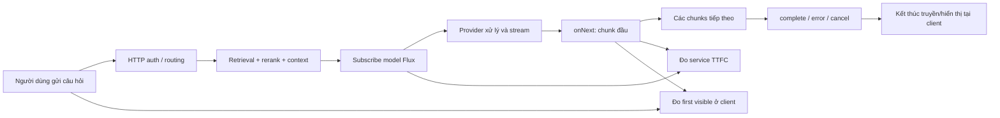
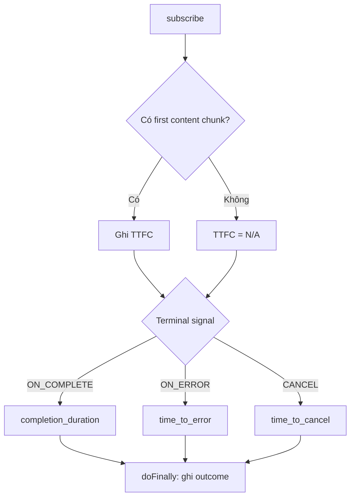

# Phân biệt độ trễ token đầu tiên và thời gian hoàn tất trong Spring AI Streaming

> **Chương:** Streaming và bất đồng bộ  
> **Module:** `SPRING_AI_EVALUATION_OBSERVABILITY` — đánh giá ứng dụng Spring AI bằng tập dữ liệu, relevance, fact checking, kiểm thử RAG và tool calling; kết hợp metrics, traces, độ trễ, token và chi phí để phát hiện suy giảm chất lượng giữa các phiên bản prompt, model và pipeline.

## Mục tiêu học tập

Hoàn thành bài này, bạn có thể:

1. Phân biệt **Time to First Token (TTFT)** phía provider, **Time to First Content Chunk (TTFC)** của luồng Spring AI và **Time to First Visible Content** tại giao diện.
2. Tính đúng **thời gian hoàn tất** tại các ranh giới model subscription, HTTP request và client delivery; hiểu vì sao không thể dùng các mốc này thay thế nhau.
3. Thiết kế metric cho streaming có ba đường kết thúc `complete`, `error`, `cancel`, ghi nhận trường hợp không có chunk đầu tiên và số liệu chưa đầy đủ.
4. Triển khai quan sát bằng Reactor `Flux` và Micrometer, thử nghiệm bằng `StepVerifier`, phân biệt token usage của provider với số chunks hoặc số ký tự.
5. Khoanh vùng sự chậm trễ do retrieval, rerank, tool, prompt assembly, model, backpressure hoặc mạng; so sánh cấu hình theo chất lượng RAG, chi phí và độ trễ.

## 1. Streaming có hai câu hỏi về tốc độ

Người dùng một ứng dụng hỏi đáp thường quan tâm:

- **“Bao lâu thì có nội dung đầu tiên để đọc?”** — cảm nhận hệ thống có phản hồi sớm hay không.
- **“Bao lâu thì có câu trả lời hoàn chỉnh?”** — khi nào người dùng có thể dựa vào toàn bộ kết quả, các điều kiện và trích dẫn.

Hai câu hỏi này có thể cho ra kết luận trái ngược. Một model có thể xuất những từ đầu tiên nhanh nhưng sinh phần còn lại rất chậm. Model khác khởi đầu chậm hơn nhưng hoàn thành câu trả lời ngắn và chính xác sớm hơn.

| Đại lượng | Cách hiểu chính xác | Không đồng nghĩa với |
| --- | --- | --- |
| **Provider TTFT** | Từ mốc gửi/bắt đầu request ở provider boundary đến **token đầu tiên mà provider stream công bố** | Thời gian có chữ đầu ở browser hoặc mốc xử lý token nội bộ chưa quan sát được |
| **Service TTFC** | Từ lúc subscription quan sát bắt đầu đến `onNext` có nội dung đầu tiên | Đúng một token; có thể là nhiều tokens hoặc nội dung được buffer |
| **HTTP TTFB** | Từ mốc request phía client đến **byte đầu tiên** của HTTP response theo cách đo đã chọn | Token/chữ đầu tiên; có thể chỉ là headers hoặc SSE heartbeat |
| **Time to first visible content** | Từ thao tác người dùng đến lúc UI hiển thị phần chữ đầu | Mốc `onNext` ở server |
| **Stream completion time** | Từ lúc subscription bắt đầu đến `onComplete` ở ranh giới reactive đang đo | Client đã nhận hết và render xong |
| **End-to-end completion latency** | Từ lúc gửi request đến khi phía client nhận kết quả/đánh dấu kết thúc theo hợp đồng | Thời lượng chỉ tính provider model call |

Tất cả đều hữu ích nếu **mốc bắt đầu, mốc kết thúc và vị trí instrumentation** được công bố rõ. Không có một chữ “latency” tự nó đủ để diễn giải biểu đồ.



**Quy tắc:** Khi chỉ có `Flux<String>` từ `ChatClient.stream().content()`, ta thường đo được **TTFC ở điểm quan sát**. Không được tự đặt tên đó là TTFT chính xác của provider nếu chưa có tín hiệu/telemetry token thực sự.

## 2. Timeline ví dụ: cùng request, nhiều đồng hồ

Giả sử ứng dụng tra cứu chính sách công tác có pipeline RAG và cung cấp câu trả lời bằng SSE. Một lần chạy **giả định**:

| Thời điểm so với thao tác gửi | Sự kiện |
| ---: | --- |
| `0 ms` | Người dùng gửi câu hỏi |
| `20 ms` | Kết thúc routing/authentication |
| `150 ms` | Vector retrieval hoàn tất |
| `240 ms` | Reranker hoàn tất |
| `260 ms` | Dựng prompt xong và model stream được subscribe |
| `440 ms` | Service thấy `onNext` có nội dung đầu tiên |
| `480 ms` | Browser hiển thị chữ đầu tiên |
| `1.200 ms` | Service thấy chunk nội dung cuối |
| `1.240 ms` | Model publisher phát `onComplete` |
| `1.290 ms` | Client xác nhận nhận xong response |

Từ cùng timeline:

\[
\text{Service TTFC} = 440 - 260 = 180\,\mathrm{ms}
\]

\[
\text{Subscription completion} = 1240 - 260 = 980\,\mathrm{ms}
\]

\[
\text{First visible latency} = 480 - 0 = 480\,\mathrm{ms}
\]

\[
\text{Client end-to-end completion} = 1290 - 0 = 1290\,\mathrm{ms}
\]

\[
\text{Post-first-chunk tail} = 1240 - 440 = 800\,\mathrm{ms}
\]

Model provider có thể công bố token đầu trước khi service thấy chunk ở `440 ms`, nhưng **timeline này không chứa mốc đó**. Vì vậy **không thể tính provider TTFT** từ các dữ kiện trên.

### Điều gì làm các mốc lệch nhau?

Thời gian trước model subscription gồm routing, phân quyền, retrieval, rerank, tool calls và tạo prompt. Sau khi provider có token đầu, SDK, network, buffering, serialization, server và browser còn có thể làm chậm việc nhìn thấy chữ đầu.

**Vì sao nên đo theo stage:** Nếu end-to-end first-visible tăng 200 ms nhưng service TTFC gần như không đổi, điều tra retrieval/rerank, HTTP delivery hoặc rendering **trước khi kết luận model sinh token đầu chậm hơn**.

## 3. Định nghĩa TTFT, TTFC và TTFB thật chặt chẽ

### 3.1. Provider TTFT

Trong benchmark của provider hoặc adapter thấp, người ta thường đo từ khi **bắt đầu gửi một yêu cầu model** đến khi nhận sự kiện token đầu tiên từ stream. Hợp đồng từng SDK/provider có thể khác:

- Bắt đầu đo ngay trước network dispatch hay sau khi request đã được kết nối?
- Sự kiện đầu tiên là **metadata/role** hay **token nội dung**?
- Có cache, queueing, batching, tool call hoặc reasoning/hidden tokens không?
- Token đầu tiên có được đo ở **adapter nhận token** hay ở **provider server**?

Nếu không định nghĩa các câu hỏi này, hai nhà cung cấp đều gọi một số đo là `TTFT` nhưng con số không so sánh trực tiếp được.

### 3.2. Time to First Content Chunk (TTFC)

Ở Spring AI, một số phiên bản hỗ trợ:

```java
Flux<String> content = chatClient.prompt()
        .user(question)
        .stream()
        .content();
```

Một phần tử `String` có thể chứa **một token, nhiều token, khoảng trắng hoặc dữ liệu đã buffer**. Để đo trải nghiệm nội dung, ta thường chọn **chunk đầu có ý nghĩa** thay vì chunk đầu bất kể nội dung.

Ví dụ:

```text
onNext("")          -> không tính là nội dung
onNext(" ")         -> tùy chính sách: bỏ qua khoảng trắng
onNext("Theo ")     -> nội dung có thể đọc được đầu tiên
onNext("quy định")  -> chunk tiếp theo
```

Nếu rubric dùng `!text.isBlank()` để nhận diện, cần ghi rõ đây là **first non-blank chunk** chứ không phải “first provider token”. Một khoảng trắng có thể là một token thực sự nhưng không hiển thị chữ; bỏ qua nó có chủ đích phục vụ UX.

### 3.3. HTTP Time to First Byte (TTFB)

TTFB ở trình duyệt hay hệ thống quan sát network là một mốc khác. Với SSE, headers hoặc heartbeat có thể xuất hiện sớm nhưng chưa có nội dung trả lời. Nếu proxy buffer dữ liệu, `onNext` tại service đã xảy ra nhưng browser còn chưa nhận byte nào.

Hãy đo cả **server TTFC** và **client first-visible** khi tối ưu UX. Không dùng TTFB làm thay thế cho thời gian token/chữ đầu tiên nếu transport có các sự kiện không chứa nội dung.

### 3.4. Completion time

Subscription complete được nhận diện ở `SignalType.ON_COMPLETE`. Đây là lúc publisher ở **ranh giới quan sát** hoàn tất bình thường, không nhất thiết đã flush toàn bộ HTTP bytes hoặc render xong ở client. Với tool calling hoặc streaming đa lượt, một lần `onComplete` có thể chỉ kết thúc **một model call**, chưa phải request người dùng đã hoàn tất.

**Kết luận ngắn:** Tên metric nên có cả **mốc** và **ranh giới**, ví dụ `app.ai.model.subscription.ttfc` hoặc `app.ai.http.first_visible`; tránh đặt tất cả là `response_time`.

## 4. Độ trễ đầu và đuôi phản ánh các nút thắt khác nhau

Thời gian hoàn tất của một stream có nội dung thường chia được thành:

\[
\text{Subscription duration} =
\text{TTFC} + \text{post-first-chunk tail}.
\]

Đẳng thức chỉ dùng khi **cùng đồng hồ và cùng mốc subscription**, đã quan sát được chunk đầu, và stream có mốc kết thúc. Tách tail giúp điều tra throughput sau khi bắt đầu sinh.

| Triệu chứng | Giả thuyết thường gặp | Cách kiểm tra |
| --- | --- | --- |
| TTFC tăng, tail không đổi | Provider queue, model prefill, prompt lớn, network dispatch, RAG trước model | Phân rã pre-subscription và provider timing |
| TTFC gần như không đổi, tail tăng | Model sinh nhiều tokens, tốc độ giải mã thấp, buffering/backpressure | Usage output tokens, khoảng cách chunks, provider latency |
| TTFC thấp nhưng full completion rất cao | Model stream mở sớm nhưng trả lời dài hoặc có nhiều pause | Token throughput và time between chunks |
| Server TTFC tốt, browser first-visible chậm | Buffer ở proxy, SSE serialization, mạng hoặc rendering | Browser timing và HTTP instrumentation |
| Completed duration thấp, cancel rate tăng | Nhiều request bị hủy sớm, không phải hệ thống nhanh hơn | Báo outcome, số chunks và completion rate |

### Token throughput khác chunk throughput

Trong trường hợp provider có dữ liệu token-level phù hợp, tốc độ phát sau token đầu có thể ước tính:

\[
\text{Tokens per second}_{\mathrm{tail}}
 \approx \frac{N_{\mathrm{output}}-1}{t_{\mathrm{last\ token}}-t_{\mathrm{first\ token}}}
\]

Đây là **ước tính dựa trên giả định** cả số token lẫn thời điểm token đều quan sát được; nếu chỉ có chunks thì không áp dụng nguyên công thức. Khi chỉ biết output tokens tổng và duration của model, `tokens/s` tính từ tổng duration có ý nghĩa khác tốc độ **sau token đầu**, bởi nó bao gồm thời gian chờ trước token đầu.

Nếu output có chỉ một token, hoặc không có timestamp token cuối, phép chia trên không xác định. Không điền 0 hay giá trị tùy ý.

## 5. Streaming không phải một đường kết thúc duy nhất

Reactor có ba đường cần theo dõi tại mỗi subscription:

| Kết thúc ở ranh giới đo | Tín hiệu | Có completion latency không? | Có thể đo TTFC? |
| --- | --- | --- | --- |
| Hoàn tất bình thường | `ON_COMPLETE` | Có: mốc complete - start | Có, **nếu** đã phát chunk nội dung |
| Thất bại | `ON_ERROR` | **Không phải thời gian hoàn tất thành công**; đo time-to-error | Có nếu đã có chunk trước lỗi |
| Bị hủy | `CANCEL` | **Không phải thời gian hoàn tất thành công**; đo time-to-cancel | Có nếu đã có chunk trước hủy |

Một stream có thể hoàn tất **không có nội dung**. Khi đó completion duration có giá trị, còn TTFC là **N/A**. Một stream lỗi trước chunk đầu cũng không có TTFC. Nếu quan sát lần đầu trên một nhánh hot publisher sau khi đã phát nội dung, TTFC của subscriber không phản ánh TTFT của provider.



### Có nên bỏ error/cancel khỏi biểu đồ latency?

Không bỏ khỏi **dashboard reliability**, nhưng không trộn duration của error/cancel vào phân phối “time to complete success” rồi xem như cùng một loại trải nghiệm. Đề xuất tách:

- `completed_subscription_duration`, p50/p95 **chỉ trên completed**.
- `time_to_error` và `time_to_cancel` cùng tỷ lệ error/cancel.
- `first_content_latency` trên **những subscription thực sự có chunk**, phân đoạn theo outcome.
- `completion_rate` và `empty_completion_rate`.

Tập completed có thể thiên lệch: câu khó hoặc model chậm bị hủy nhiều hơn, khiến p95 của completed trông tốt giả tạo. Luôn báo số mẫu và outcome ratios cạnh latency.

## 6. Reactor: đo TTFC và terminal duration theo subscription

Ví dụ Java 17+ sử dụng `Flux.defer` để tạo state **mỗi subscription một lần**, `doOnNext` để ghi chunk đầu và `doFinally` để ghi hoàn tất/lỗi/hủy. Đồng hồ `System.nanoTime()` phù hợp để đo **khoảng thời gian** (không dùng như wall-clock timestamp).

Hàm nhận `Supplier<Flux<T>>` để trì hoãn dựng upstream cho đến subscription. Cách này giảm nguy cơ start đo trong khi không ai subscribe và giúp test không cần gọi model thật.

```java
import java.util.Objects;
import java.util.OptionalLong;
import java.util.concurrent.atomic.AtomicInteger;
import java.util.concurrent.atomic.AtomicLong;
import java.util.function.Consumer;
import java.util.function.LongSupplier;
import java.util.function.Predicate;
import java.util.function.Supplier;

import reactor.core.publisher.Flux;
import reactor.core.publisher.SignalType;

public final class StreamLatencyProbe {
    private StreamLatencyProbe() {}

    public record Sample(
            SignalType terminal,
            OptionalLong firstContentLatencyNanos,
            long terminalDurationNanos,
            int totalChunks,
            int meaningfulChunks) {}

    public static <T> Flux<T> observe(
            Supplier<Flux<T>> sourceFactory,
            Predicate<T> meaningful,
            LongSupplier nanoClock,
            Consumer<Sample> onSample) {

        Objects.requireNonNull(sourceFactory);
        Objects.requireNonNull(meaningful);
        Objects.requireNonNull(nanoClock);
        Objects.requireNonNull(onSample);

        // Defer bảo đảm mỗi subscription có state và đồng hồ riêng.
        return Flux.defer(() -> {
            long started = nanoClock.getAsLong();
            AtomicLong first = new AtomicLong(-1L);
            AtomicInteger total = new AtomicInteger();
            AtomicInteger nonempty = new AtomicInteger();

            Flux<T> source;
            try {
                source = Objects.requireNonNull(sourceFactory.get());
            } catch (Throwable failure) {
                // Giữ lỗi trong luồng để doFinally vẫn thực thi.
                source = Flux.error(failure);
            }

            return source
                    .doOnNext(value -> {
                        total.incrementAndGet();
                        if (meaningful.test(value)) {
                            nonempty.incrementAndGet();
                            long elapsed = nanoClock.getAsLong() - started;
                            first.compareAndSet(-1L, Math.max(0L, elapsed));
                        }
                    })
                    .doFinally(terminal -> {
                        long elapsed = Math.max(
                                0L, nanoClock.getAsLong() - started);
                        OptionalLong firstContent = first.get() < 0
                                ? OptionalLong.empty()
                                : OptionalLong.of(first.get());
                        onSample.accept(new Sample(
                                terminal,
                                firstContent,
                                elapsed,
                                total.get(),
                                nonempty.get()));
                    });
        });
    }
}
```

### Ý nghĩa chính xác của sample

- `firstContentLatencyNanos` là **TTFC tại subscription boundary này**, nếu có chunk đạt `meaningful`. Nếu stream rỗng, lỗi/hủy trước chunk hoặc chỉ phát nội dung không đạt predicate thì để `OptionalLong.empty()`.
- `terminalDurationNanos` đo đến terminal **bất kể outcome**; chỉ gọi là `completion duration` khi `terminal == ON_COMPLETE`.
- `totalChunks` đếm các lần `onNext` mà tầng này nhận; `meaningfulChunks` chỉ đếm chunks đạt predicate.
- `nanoClock` được tiêm vào để test deterministic. Nếu dùng clock giả không đơn điệu thì code clamp về 0, nhưng production cần dùng clock đơn điệu.
- `onSample` phải chạy nhanh và không ném lỗi; exporter lỗi có thể làm nhiễu đường terminal. Trong hệ thống thực nên dùng recorder tin cậy hoặc bảo vệ callback theo chính sách telemetry.

**Về operator placement:** Probe được cài bên ngoài `sourceFactory` ở ví dụ này. Nếu thêm `timeout` ở ngoài probe, upstream có thể thấy `CANCEL` khi timeout hủy, còn downstream thấy `ON_ERROR`. Ghi nhận mốc đo để tránh gọi hai tín hiệu đó là mâu thuẫn.

### Kết nối với Spring AI

Một số phiên bản Spring AI cung cấp `ChatClient.prompt().user(...).stream().content()`:

```java
import reactor.core.publisher.Flux;
import org.springframework.ai.chat.client.ChatClient;

// Trong một service đã có chatClient và recordSample:
Flux<String> answer = StreamLatencyProbe.observe(
        () -> chatClient.prompt()
                .user(question)
                .stream()
                .content(),
        value -> value != null && !value.isBlank(),
        System::nanoTime,
        sample -> recordSample(sample));

// Trả 'answer' cho HTTP/WebFlux layer.
// Nếu không có subscriber, sourceFactory chưa được chạy.
```

Đây là **đoạn code bên trong một phương thức**, cần cài `recordSample` trong ứng dụng và cấu hình `ChatClient`. API/chữ ký streaming phụ thuộc phiên bản Spring AI và provider. Hàm không tự trích xuất provider token usage, không đo network delivery, không phải trace context propagation và không tự ghép các chunks thành full answer để chấm groundedness.

### Vì sao không dùng `doOnComplete` để tính mọi thời lượng?

`doOnComplete` chỉ chạy khi completion bình thường, bỏ sót error/cancel và có thể gây **leak** nếu observation đã start. `doFinally` nhìn thấy cả `ON_COMPLETE`, `ON_ERROR`, `CANCEL` tại ranh giới đang gắn, cho phép lưu sample có outcome đúng.

## 7. Micrometer: ghi các phân phối thay vì chỉ log từng request

Một `Sample` có thể được chuyển thành metrics với nhãn cardinality thấp. Ví dụ adapter dưới dùng `MeterRegistry` của Micrometer và ghi:

- `app.ai.stream.first_content` khi có chunk đầu.
- `app.ai.stream.completed_duration` cho stream hoàn tất.
- `app.ai.stream.terminated_duration` có gắn outcome để nhìn các đường kết thúc khác.
- `app.ai.stream.terminal_count` để tính completion/error/cancel rates.

```java
import java.util.concurrent.TimeUnit;

import io.micrometer.core.instrument.Counter;
import io.micrometer.core.instrument.MeterRegistry;
import io.micrometer.core.instrument.Timer;
import reactor.core.publisher.SignalType;

public final class StreamLatencyMeters {
    private final MeterRegistry registry;

    public StreamLatencyMeters(MeterRegistry registry) {
        this.registry = registry;
    }

    public void record(StreamLatencyProbe.Sample sample) {
        String outcome = switch (sample.terminal()) {
            case ON_COMPLETE -> "completed";
            case ON_ERROR -> "error";
            case CANCEL -> "cancelled";
            default -> "other";
        };

        Counter.builder("app.ai.stream.terminal_count")
                .tag("outcome", outcome)
                .register(registry)
                .increment();

        Timer.builder("app.ai.stream.terminated_duration")
                .tag("outcome", outcome)
                .register(registry)
                .record(sample.terminalDurationNanos(), TimeUnit.NANOSECONDS);

        sample.firstContentLatencyNanos().ifPresent(value ->
                Timer.builder("app.ai.stream.first_content")
                        .tag("outcome", outcome)
                        .register(registry)
                        .record(value, TimeUnit.NANOSECONDS));

        if (sample.terminal() == SignalType.ON_COMPLETE) {
            Timer.builder("app.ai.stream.completed_duration")
                    .register(registry)
                    .record(sample.terminalDurationNanos(),
                            TimeUnit.NANOSECONDS);
        }
    }
}
```

Micrometer `Timer` dùng đơn vị thời gian theo registry/exporter. Hãy thống nhất cách hiển thị (ms hoặc s) trên dashboard. Đoạn mã mang tính minh họa: cần bảo đảm meter registration/tag strategy phù hợp và kiểm thử không tăng cardinality khi thêm pipeline/model labels.

### Chọn labels có kiểm soát

| Label nên cân nhắc | Lý do |
| --- | --- |
| `outcome=completed/error/cancelled` | Tập hữu hạn, phục vụ phân tích terminal |
| `stage=model_stream/http_delivery` | Phân biệt ranh giới đo |
| `pipeline_version` với tập phiên bản có kiểm soát | So sánh release |
| `model_family` hoặc tên model đã chuẩn hóa | So sánh các nhóm model |
| `request_id`, `trace_id`, `prompt_hash` | **Không dùng làm metric labels** vì cardinality có thể rất lớn; dùng trace/audit |

Nếu cần tính p95 chính xác trên hệ thống monitoring, phải cấu hình **histogram/SLO buckets** hoặc cơ chế percentile phù hợp. `Timer` ghi giá trị nhưng không bảo đảm exporter mặc định có histogram hoặc p95 được cấu hình.

## 8. Kiểm thử complete, error, cancel và thời gian đầu

Mã sau dùng Reactor Test (`reactor-test`), JUnit 5 và clock giả để xác minh `StreamLatencyProbe` mà không gọi provider. Các con số không nhằm mô phỏng latency thật, chỉ kiểm chứng **logic đo và outcome**.

```java
import static org.junit.jupiter.api.Assertions.*;

import java.util.OptionalLong;
import java.util.concurrent.CountDownLatch;
import java.util.concurrent.TimeUnit;
import java.util.concurrent.atomic.AtomicLong;
import java.util.concurrent.atomic.AtomicReference;

import org.junit.jupiter.api.Test;
import reactor.core.publisher.Flux;
import reactor.core.publisher.SignalType;
import reactor.test.StepVerifier;

class StreamLatencyProbeTest {

    @Test
    void completedRecordsFirstChunkAndFullDuration() throws Exception {
        AtomicLong clock = new AtomicLong(1_000_000L);
        AtomicReference<StreamLatencyProbe.Sample> captured =
                new AtomicReference<>();
        CountDownLatch done = new CountDownLatch(1);

        Flux<String> observed = StreamLatencyProbe.observe(
                () -> Flux.just("", "Xin", " chào")
                        .doOnNext(value -> clock.addAndGet(10_000_000L)),
                text -> text != null && !text.isBlank(),
                clock::get,
                sample -> {
                    captured.set(sample);
                    done.countDown();
                });

        StepVerifier.create(observed)
                .expectNext("", "Xin", " chào")
                .verifyComplete();

        assertTrue(done.await(1, TimeUnit.SECONDS));
        var sample = captured.get();
        assertEquals(SignalType.ON_COMPLETE, sample.terminal());
        assertEquals(OptionalLong.of(20_000_000L),
                sample.firstContentLatencyNanos());
        assertEquals(30_000_000L, sample.terminalDurationNanos());
        assertEquals(3, sample.totalChunks());
        assertEquals(2, sample.meaningfulChunks());
    }

    @Test
    void errorBeforeFirstContentHasNoTtfc() throws Exception {
        AtomicReference<StreamLatencyProbe.Sample> captured =
                new AtomicReference<>();
        CountDownLatch done = new CountDownLatch(1);

        Flux<String> observed = StreamLatencyProbe.observe(
                () -> Flux.error(new IllegalStateException("test error")),
                text -> text != null && !text.isBlank(),
                System::nanoTime,
                sample -> {
                    captured.set(sample);
                    done.countDown();
                });

        StepVerifier.create(observed)
                .expectError(IllegalStateException.class)
                .verify();
        assertTrue(done.await(1, TimeUnit.SECONDS));
        assertEquals(SignalType.ON_ERROR, captured.get().terminal());
        assertTrue(captured.get().firstContentLatencyNanos().isEmpty());
    }

    @Test
    void cancelBeforeContentHasNoTtfc() throws Exception {
        AtomicReference<StreamLatencyProbe.Sample> captured =
                new AtomicReference<>();
        CountDownLatch done = new CountDownLatch(1);

        Flux<String> observed = StreamLatencyProbe.observe(
                Flux::never,
                text -> text != null && !text.isBlank(),
                System::nanoTime,
                sample -> {
                    captured.set(sample);
                    done.countDown();
                });

        StepVerifier.create(observed)
                .thenCancel()
                .verify();
        assertTrue(done.await(1, TimeUnit.SECONDS));
        assertEquals(SignalType.CANCEL, captured.get().terminal());
        assertTrue(captured.get().firstContentLatencyNanos().isEmpty());
    }
}
```

**Lưu ý về `CountDownLatch`:** `doFinally` có thể chạy sau khi terminal đã được truyền đến subscriber và `StepVerifier` đã kết thúc. Chờ latch giúp tránh race khi kiểm tra callback đo. Trong test cần đặt timeout phù hợp hệ thống CI; không coi giá trị 1 giây trong test là SLA sản phẩm.

### Những test nên thêm trước production

| Kịch bản | Publisher hoặc operator | Kỳ vọng |
| --- | --- | --- |
| Không subscribe | Chỉ tạo `Flux` | Không tạo sample/meter mới |
| Complete rỗng | `Flux.empty()` | Outcome completed, TTFC N/A |
| Chunk rỗng rồi mới có nội dung | `Flux.just("", "a")` | TTFC đo khi nhận "a" |
| Error sau khi đã gửi một phần | `Flux.concat(Flux.just("a"), Flux.error(...))` | Có TTFC, outcome error |
| Cancel sau chunk đầu | `take(1)` hoặc explicit cancel | TTFC có giá trị; upstream có thể nhận cancel |
| Hai subscribers cold | Subscribe hai lần vào publisher `defer` | Hai sample và hai bộ thời gian |
| `share/cache` | Nhiều subscribers một upstream | Phân biệt số subscribers và provider attempts |
| Timeout | `timeout` sau probe | Có thể có upstream cancel, downstream error |
| Retry | `retry(2)` và upstream lỗi | Phân biệt per-attempt sample và request-level outcome |
| Scheduler switch | `publishOn`/`subscribeOn` | Timing và trace context được bảo toàn đúng ranh giới |

## 9. Retry, timeout, fallback làm sai lệch số đo thế nào?

Ví dụ:

```java
Flux<String> result = StreamLatencyProbe.observe(
        () -> sourceFromProvider(),
        text -> text != null && !text.isBlank(),
        System::nanoTime,
        meters::record)
        .timeout(Duration.ofSeconds(10))
        .retry(2);
```

Giả sử lần đầu timeout, lần thứ hai lỗi, lần ba thành công:

- **Per-attempt probe** có thể ghi một lần `cancelled` (do timeout hủy upstream), một lần `error` và một lần `completed`.
- **Subscriber cuối** có thể chỉ thấy `completed` vì retry đã xử lý các lỗi trước đó.
- **Request-level TTFC** là thời gian từ request ban đầu đến chunk đầu mà người dùng thật sự nhận; nếu retry xảy ra trước chunk, nó bao gồm cả các lần chờ/lỗi.
- **Attempt-level TTFC** chỉ đo từ lúc subscribe attempt tương ứng; thường **nhỏ hơn request-level latency** và không được dùng thay thế.
- Chi phí có thể phát sinh ở cả những attempts thất bại, nên cost của một request có thể lớn hơn cost của attempt thành công.

**Không retry vô điều kiện một stream đã phát nội dung**: subscriber có thể nhận phần đầu lặp lại hoặc một câu trả lời bắt đầu lại, gây sai thứ tự/citation. Nếu cần retry, xác định chính sách trước khi phát chunk, idempotency, timeout và đặc tính của tools có side effects.

### `onErrorResume` cũng ảnh hưởng terminal

```java
Flux<String> output = sourceFromProvider()
        .onErrorResume(ex -> Flux.just(
                "Chưa thể tạo câu trả lời lúc này."));
```

Ở provider boundary có thể có error, nhưng ở output boundary subscriber nhận một fallback rồi `ON_COMPLETE`. Nếu ghi metric duy nhất sau `onErrorResume`, lỗi bị che khuất; cần instrument cả **provider attempt** và **response delivery**.

### Timeout theo từng tầng

| Timeout | Có thể kết thúc gì? | Ghi chú |
| --- | --- | --- |
| Provider connect timeout | Attempt chưa stream nội dung | Không có TTFC; có time-to-error |
| First-chunk timeout | Không nhận chunk trong giới hạn | Chỉ áp dụng tới chunk đầu nếu code định nghĩa rõ |
| Idle-between-chunks timeout | Khoảng cách giữa chunks quá dài | Có thể lỗi sau partial answer |
| Total request deadline | Hết thời gian toàn request | Có thể cancel upstream và trả lỗi/fallback |
| Client disconnect/proxy timeout | Truyền bị đóng | Server có thể phát hiện cancel trễ; cần HTTP instrumentation |

Một `Flux.timeout(Duration)` mặc định theo hành vi operator của Reactor có thể giám sát khoảng cách tín hiệu; **không nên tự xem là chính sách total deadline** khi chưa kiểm tra cấu hình. Nếu cần giới hạn tổng thời gian, phải thiết kế cơ chế deadline phù hợp và kiểm thử thứ tự các operator.

## 10. RAG và tool calling: đừng gán mọi TTFC cao cho model

Một request RAG có thể mất phần lớn thời gian trước khi subscribe model stream. Ví dụ:

```text
Request received
  25 ms   authorization, tenant scope
  140 ms  vector retrieval
  90 ms   rerank
  35 ms   prompt/context assembly
  210 ms  model subscription -> first nonblank content
  780 ms  remaining stream until completion
```

Với pipeline **tuần tự** theo số liệu trên, server từ khi nhận request đến first content là:

\[
25+140+90+35+210=500\,\mathrm{ms}.
\]

Model subscription TTFC vẫn chỉ **210 ms**. Nếu rerank tăng từ 90 lên 260 ms mà model TTFC không đổi, first content của toàn request sẽ tăng 170 ms. Tối ưu model lúc này không giải quyết nguyên nhân chính.

**Cẩn thận:** Với các nhánh xử lý chạy song song, không thể cộng tất cả span duration để được end-to-end latency vì các span có thể **chồng nhau**. Khi đó phải xem critical path trên trace.

### Tool calling có nhiều lượt model

Một request có thể có chuỗi:

```text
model call-1: stream hoặc trả tool decision
tool call-1: searchPolicies, lấy D01/D02
model call-2: sinh câu trả lời từ tool output
```

Nếu UI chỉ hiển thị câu trả lời ở `call-2` thì “first visible answer” của request bao gồm **model call-1 + tool + model call-2 TTFC**. Không thể đo bằng cách chỉ lấy TTFC của `call-2`.

Ghi `request_id`, `call_id`, `tool_call_id`, `attempt_number` và span timings để phân biệt bottleneck. Nội dung tool chỉ là bằng chứng của model call sau khi đã được đưa vào messages; tránh đánh giá groundedness của `call-1` dựa trên dữ liệu tool chỉ xuất hiện sau đó.

### Liên hệ với đánh giá RAG

| Khía cạnh | Metric cần đo | Rủi ro khi tối ưu sai |
| --- | --- | --- |
| Tìm đúng nguồn | `Recall@K`, `Precision@K`, fact coverage | Giảm top K để TTFC thấp có thể làm thiếu bằng chứng |
| Ngữ cảnh cuối | Final-prompt evidence coverage | Chunk bị cắt để giảm token có thể làm mất ngoại lệ |
| Câu trả lời | Groundedness, correctness, citation support | Stream nhanh nhưng claim sai không phải cải thiện chất lượng |
| Độ trễ đầu | Service TTFC, client first-visible, provider TTFT nếu có | Không so các boundary khác nhau |
| Độ trễ hoàn tất | Completed duration/end-to-end completion | Stream đầu nhanh nhưng đuôi chậm vẫn ảnh hưởng người dùng |
| Hiệu quả chi phí | Token usage, cost/successful answer, retry overhead | Cancel không đồng nghĩa chi phí bằng 0 |

## 11. Token, tiền và thời gian hoàn tất

Khi cùng model sinh nhiều hơn, completion duration có thể tăng ngay cả khi TTFC giữ nguyên. Tuy nhiên, **số output tokens không phải yếu tố duy nhất**: context length ảnh hưởng prefill, provider queueing, network backpressure và sự khác biệt sampling/SDK cũng tác động.

Giả sử hai cấu hình giả định:

| Metric | Cấu hình A | Cấu hình B |
| --- | ---: | ---: |
| TTFC tại service | 240 ms | 150 ms |
| Subscription completion | 950 ms | 1.600 ms |
| Output tokens (provider báo) | 180 | 360 |
| Grounded answer rate | 0,92 | 0,87 |
| Cost per completed answer | 0,008 USD | 0,014 USD |

B phản hồi đầu sớm hơn 90 ms, nhưng hoàn tất muộn hơn 650 ms, sinh nhiều tokens hơn và có điểm groundedness thấp hơn. Kết luận “B nhanh hơn A” là thiếu điều kiện: **B chỉ tốt hơn về service TTFC** trong ví dụ, còn completion, chi phí và chất lượng kém hơn.

### Usage bị thiếu khi hủy

Khi client cancel giữa chừng, provider có thể không gửi metadata usage cuối hoặc đã xử lý tokens mà app không nhận. Ghi trạng thái:

- `usage_state=complete`: có usage đáng tin do provider trả.
- `usage_state=partial`: mới có một phần usage.
- `usage_state=unavailable`: không nhận được usage từ nguồn đáng tin.
- `cost_state=estimated` khi phải ước lượng; ghi model, phiên bản bảng giá và giả định.

Đừng mặc định `tokens=0` hoặc `cost=0` cho stream bị hủy. Nếu thống kê chi phí trên completed only, báo rõ vì sao nó khác **cost per user request**.

## 12. So sánh p50/p95 đúng tập dân số

Một dashboard streaming nên hiển thị **ít nhất hai phân phối latency** và **tỷ lệ outcome**:

1. TTFC trên các subscriptions **đã phát nội dung** (có thể tách theo completed/cancelled/error).
2. Completion duration trên subscriptions **completed**.
3. Error/cancel rate cùng số sample; time-to-error/time-to-cancel phân phối riêng.

Ví dụ 1.000 subscriptions:

| Outcome | Số lượt | Trong completed p95? | Trong TTFC p95? |
| --- | ---: | --- | --- |
| Completed và có nội dung | 700 | Có | Có |
| Completed nhưng rỗng | 40 | Có | Không |
| Cancel sau chunk đầu | 130 | Không | Có |
| Cancel trước chunk đầu | 70 | Không | Không |
| Error trước chunk đầu | 60 | Không | Không |

Với cách phân loại này, `completion_rate = (700+40)/1000 = 74%`. Tỷ lệ có TTFC đo được là `(700+130)/1000 = 83%`. Nếu chỉ dùng 700 streams vừa completed vừa có nội dung để tính TTFC thì đã **thay mẫu số**, tạo selection bias.

**Không diễn giải p95 một mình:** p95 TTFC giảm có thể xảy ra vì các requests chậm đã bị timeout/cancel trước chunk đầu và không còn nằm trong phân phối. Hãy đọc p95 cùng `first-content-availability`, cancel rate và completion rate.

### Có nên so sánh p95 giữa model A và B?

Chỉ khi cùng định nghĩa boundary, cùng đơn vị đo, cùng population test và điều kiện tải phù hợp. Nếu model A được đo từ HTTP request còn model B từ provider stream subscription, số đo chênh lệch có thể phản ánh **khác phạm vi instrumentation**, không phản ánh model nhanh hơn.

Khi benchmark có tính ngẫu nhiên, nên chạy số mẫu đủ lớn, giữ query/corpus/prompt/model config có kiểm soát, báo phân phối theo nhóm chiều dài đầu ra, input tokens, loại câu hỏi và outcome.

## 13. Tracing: tìm critical path và phát hiện buffering

Trong Spring AI có thể tích hợp Micrometer Observations và tracing theo phiên bản/cấu hình. Ví dụ schema quan sát:

```text
trace_id = tr-stream-002
request_id = req-002
  http.request                  start=0, end=1290 ms
    auth                       0..20
    vector.retrieval           20..150
    reranker                   150..240
    context.assemble           240..260
    model.stream.subscribe     260..1240
      first_content_event      at 440
      last_content_event       at 1200
      terminal_signal          ON_COMPLETE at 1240
  client_first_visible         at 480
  client_completed             at 1290
```

Đây là **minh họa**, không phải tên spans mặc định do Spring AI tự cung cấp. Client timestamps phải được thu và **đồng bộ phương pháp đo/clock** nếu muốn đặt chung timeline với server. Một trace trên server không tự chứa thời điểm browser render.

### Vì sao spans có thể trông thiếu hoặc sai?

- Reactive streams chuyển qua `publishOn`/`subscribeOn`, nhưng context propagation giữa Micrometer và Reactor chưa được cấu hình phù hợp.
- Observation scope/thread-local được mở ở thread này rồi đóng ở thread khác.
- Chỉ instrument `ChatModel` mà bỏ thời gian retrieval và HTTP queue.
- Các child spans chạy song song, bị cộng duration như thể nối tiếp.
- Response bị buffer ở gateway; server thấy first chunk nhưng client chưa thấy.
- Retry tạo nhiều model attempts nhưng dashboard chỉ giữ completion của request cuối.

Khi phân tích độ trễ, kết hợp **span timing**, **HTTP/SSE telemetry**, **client rendering timing** và **provider usage**, không suy diễn từ một timer đơn lẻ.

## 14. Quy trình regression evaluation giữa phiên bản prompt, model và pipeline

Chọn một bộ câu hỏi có nhãn và corpus cố định. Ghi mỗi run:

```json
{
  "run_id": "stream-eval-002",
  "case_id": "travel-policy-01",
  "request_id": "req-example-002",
  "call_id": "call-002-answer",
  "subscription_boundary": "chatclient_content_flux",
  "outcome": "completed",
  "time_to_first_content_ms": 180,
  "subscription_completion_ms": 980,
  "client_time_to_first_visible_ms": 480,
  "client_end_to_end_completion_ms": 1290,
  "provider_ttft_ms": null,
  "provider_ttft_state": "not_measured",
  "content_chunks": 42,
  "provider_output_tokens": 166,
  "usage_state": "complete",
  "corpus_version": "policy-v3",
  "prompt_version": "answer-v5",
  "model_version": "model-a",
  "pipeline_version": "rag-stream-v2",
  "retrieval_recall_at_5": 1.0,
  "final_context_fact_coverage": 1.0,
  "groundedness": "SUPPORTED",
  "trace_ref": "tr-stream-002"
}
```

Các số liệu **chỉ minh họa**. `provider_ttft_ms=null` thể hiện không có tín hiệu TTFT từ provider, không phải provider mất 0 ms. Những thông tin request/call ID nên thuộc tracing/audit, **không** là time-series metric labels.

### Checklist trước khi công bố “phiên bản mới nhanh hơn”

| Câu hỏi | Phải làm gì? |
| --- | --- |
| TTFT hay TTFC? | Đặt tên theo nguồn dữ liệu và boundary |
| Start/end ở đâu? | Lưu mốc subscription, provider, HTTP, client riêng |
| Có bao nhiêu completed/cancel/error? | Báo tỷ lệ và số mẫu |
| Số tokens/độ dài output có tương đương? | So output length và usage, không chỉ latency |
| Cấu hình RAG có đổi? | Ghi candidate K, rerank, tool và context version |
| Prompt/model có đổi? | Ghi versions và sampling settings |
| Có retry/fallback? | Đo attempts riêng và request-level kết quả |
| Có kiểm tra chất lượng? | Groundedness, factual correctness, citation support, completeness |
| Có kiểm tra chi phí? | Cost per request/successful answer, usage missing |
| Client thực sự thấy nhanh hơn? | Đo first visible ở browser/transport |

### Một thí nghiệm kiểm soát tốt

Nếu chỉ muốn so model streaming, giữ nguyên câu hỏi, system prompt, final context snapshot và cách hiển thị; thay model rồi đo **service TTFC**, **completed duration**, **output tokens**, **groundedness** và **cost**. Nếu muốn kiểm tra reranker, giữ model/prompt và so thời gian **trước subscription** lẫn chất lượng context cuối.

Đối với câu hỏi dài hoặc nhiều nguồn, một cải tiến TTFC không có ý nghĩa nếu model bị yêu cầu trả lời thiếu ngoại lệ để giảm tokens. Quality và latency phải được tối ưu **cùng lúc**.

## 15. Bài thực hành

Một hệ thống trợ lý công tác chạy ba request:

| Request | Subscription | Chunk đầu | Terminal | Outcome | Output tokens |
| --- | ---: | ---: | ---: | --- | ---: |
| **A** | `100 ms` | `340 ms` | `1.100 ms` | completed | 190 |
| **B** | `200 ms` | `320 ms` | `2.000 ms` | completed | 430 |
| **C** | `150 ms` | Chưa phát | `700 ms` | cancelled | Không có usage |

Giả sử mọi mốc trong bảng được đo trên **cùng đồng hồ server**. Mỗi request được gửi ở `0 ms`. Với A, client thấy chữ đầu ở `380 ms` và nhận kết thúc ở `1.160 ms`. Với B, client thấy chữ đầu ở `410 ms` và nhận kết thúc ở `2.080 ms`.

**Yêu cầu:**

1. Tính service TTFC và subscription duration của A, B, C.
2. Tính first-visible latency và end-to-end completion của A và B.
3. Với B, TTFC tốt hơn nhưng completion chậm hơn A. Cần thêm metric nào để hiểu **phần đuôi**?
4. Có được tính TTFC của C là `550 ms` không? Tại sao?
5. Nếu stream C bị cancel vì gateway timeout, tại boundary upstream/downstream có thể quan sát những outcome nào?
6. Nếu chạy một model mới có TTFC giảm 30% nhưng groundedness giảm, nên đánh giá kết quả cải tiến ra sao?

### Đáp án tham khảo

1. A: TTFC = `340−100 = 240 ms`, duration = `1.100−100 = 1.000 ms`. B: TTFC = `320−200 = 120 ms`, duration = `2.000−200 = 1.800 ms`. C: TTFC = **N/A**, duration đến cancel = `700−150 = 550 ms` — **không** phải completion duration thành công.
2. A: first-visible = `380 ms`, client completion = `1.160 ms`. B: first-visible = `410 ms`, client completion = `2.080 ms`. Dù B có service TTFC ngắn hơn, A hiển thị chữ đầu sớm hơn vì những bước trước subscribe và truyền tải.
3. Đo output tokens, token/s ở phần sinh sau token đầu nếu provider hỗ trợ, khoảng cách chunks, tail duration, provider queue/network và số lần retry. B có nhiều output tokens hơn nên thời gian hoàn tất dài hơn là điều cần kiểm tra.
4. **Không.** `550 ms` là time-to-cancel; vì không có chunk nội dung nào, TTFC không xác định theo định nghĩa của bài.
5. Upstream có thể thấy `CANCEL` khi downstream timeout hủy subscription; downstream có thể thấy `ON_ERROR` nếu operator timeout tạo `TimeoutException`, hoặc một fallback completed nếu ứng dụng thay lỗi bằng thông điệp.
6. Không chỉ dựa vào TTFC. Báo completion time, completion/error/cancel rates, output tokens, chi phí và groundedness trên cùng tập câu hỏi; cải thiện độ trễ đầu nhưng làm giảm căn cứ có thể không đạt tiêu chí phát hành.

## Ghi nhớ

- **TTFT, TTFC, TTFB và first-visible không phải một:** phải công bố ranh giới đo; `Flux<String>` chunks thường không đủ xác nhận provider TTFT.
- **TTFC tốt không đồng nghĩa hoàn tất nhanh:** đánh giá cả latency đầu, phần đuôi và completion duration, kèm độ dài đầu ra.
- **Complete/error/cancel phải tách biệt:** TTFC có thể N/A; time-to-error/time-to-cancel không phải thời gian hoàn tất thành công.
- **Đo theo subscription và request:** `Flux.defer`, `doOnNext`, `doFinally` cho ranh giới Reactor; HTTP/client và provider attempts cần telemetry riêng.
- **Chunks không phải tokens:** dùng usage từ provider để so chi phí; stream bị hủy có thể thiếu số token cuối.
- **Tối ưu cùng chất lượng RAG:** trace retrieval/tool/model, prompt/context version và đánh giá groundedness, completeness, citation để hiểu vì sao một phiên bản nhanh hơn nhưng trả lời kém hơn.
