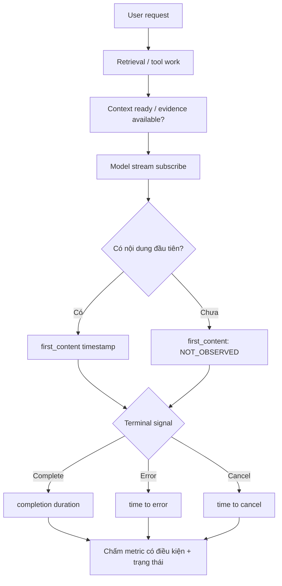

# Đo các mốc streaming khi có dữ liệu cần thiết trong Spring AI

> **Chương:** Streaming và bất đồng bộ  
> **Module:** `SPRING_AI_EVALUATION_OBSERVABILITY` — đánh giá chất lượng ứng dụng Spring AI bằng tập dữ liệu, relevance, fact checking và kiểm thử RAG/tool calling; đồng thời theo dõi metrics, traces, chi phí và độ trễ để phát hiện suy giảm chất lượng theo phiên bản prompt, model và pipeline.

## Mục tiêu học tập

Sau bài này, bạn có thể:

1. Thiết kế **hợp đồng sự kiện (milestone contract)** cho một luồng streaming: sự kiện nào cần đo, sinh ra ở đâu, điều kiện để sự kiện tồn tại và cách gắn với đúng request/model call.
2. Chỉ tính một khoảng thời gian **khi đã quan sát đủ hai mốc phù hợp**; phân biệt `NOT_APPLICABLE`, `NOT_OBSERVED`, `UNAVAILABLE` và giá trị đo bằng 0.
3. Ghi nhận các mốc của RAG, tool calling và generation như `final_context_ready`, `model_subscribed`, `first_nonblank_content`, `last_content`, `terminal` và `client_first_visible` mà không đồng nhất chúng.
4. Viết instrumentation Java/Project Reactor cho `Flux` dùng đồng hồ đơn điệu, ghi completed/error/cancel và tránh tạo observation hoặc latency giả cho stream chưa subscribe.
5. Đưa milestone có điều kiện vào Micrometer, kiểm thử với `StepVerifier` và đọc trace để phân biệt chậm retrieval, chậm model, buffering, retry hoặc thiếu dữ liệu đo.
6. Liên hệ latency với **quality** (relevance, groundedness, citation, completeness), usage và cost khi so sánh các phiên bản Spring AI.

## 1. Chỉ đo mốc khi có sự kiện thật và đủ dữ kiện

Trong streaming, không phải request nào cũng đi qua tất cả các mốc. Một request có thể không trả tài liệu RAG, một model stream có thể không phát chunk, tool có thể lỗi, client có thể hủy trước khi sinh nội dung và provider có thể không gửi usage ở cuối.

Nếu hệ thống mặc định mọi mốc còn thiếu bằng **0 ms**, dashboard dễ cho kết luận sai:

- Stream bị hủy trước chunk đầu bị báo **time to first content = 0 ms**: nhìn như nhanh nhất dù người dùng không thấy nội dung.
- Provider không cung cấp token usage bị báo **cost = 0**: đánh giá thấp chi phí của những attempts thất bại.
- Retriever chạy xong nhưng không có tài liệu liên quan bị báo **time to evidence = 0**: che khuất thiếu dữ liệu.
- Model phát xong nhưng client mất kết nối bị báo **end-to-end success**: bỏ sót vấn đề delivery.

**Nguyên tắc của bài:** Một số đo chỉ có giá trị khi **đúng điều kiện đo**, **đủ hai đầu mốc**, **cùng ranh giới**, **cùng đơn vị** và **trạng thái dữ liệu được khai báo rõ**.



Ở sơ đồ, **context ready** nghĩa là quá trình lắp ngữ cảnh kết thúc; **evidence available/sufficient** là một **kết luận đánh giá nội dung khác**. Một context đã được lắp xong nhưng rỗng vẫn có mốc `context_ready`, song không thể tự nhận là có đủ bằng chứng trả lời.

## 2. Danh mục milestone và điều kiện xuất hiện

Với ứng dụng hỏi đáp dùng Spring AI, nên chia thành ba lớp: request/pipeline, model subscription và client delivery.

| Milestone | Ranh giới ghi nhận | Điều kiện tồn tại | Khi thiếu |
| --- | --- | --- | --- |
| `request_accepted` | HTTP/controller hoặc orchestration | Yêu cầu thật được chấp nhận | Không có request để đánh giá |
| `retrieval_started` | Trước truy vấn vector/tool | Pipeline có retrieval | `NOT_APPLICABLE` nếu không thực hiện |
| `retrieval_completed` | Search trả success hoặc empty | Lời gọi kết thúc thành công | Lỗi phải ghi `retrieval_error`, không gán completed |
| `first_candidate_received` | Retrieval stage | Có candidate thực sự được trả về | `NOT_APPLICABLE` khi search thành công nhưng rỗng |
| `final_context_ready` | Sau filter/rerank/chọn/cắt, trước model | Bước tạo context hoàn tất, kể cả context rỗng | `NOT_OBSERVED` nếu dừng trước bước đó |
| `sufficient_evidence_verified` | Evidence gate/evaluator | Đã kiểm tra đủ required facts ở context cuối | Không tự phát sự kiện khi chưa chấm |
| `model_subscribed` | Subscription vào publisher của model | Có subscriber thật | Không có khi chỉ dựng `Flux` |
| `first_content` | `onNext` đầu tiên thỏa predicate nội dung | Có chunk hợp lệ | N/A nếu stream kết thúc không có chunk |
| `first_citation_observed` | Parser citation của output streaming | Parser xác nhận marker citation hoàn chỉnh | N/A nếu output không cần citation |
| `last_content` | Chunk hợp lệ cuối quan sát được | Đã có ít nhất một chunk | N/A khi chưa từng có nội dung |
| `stream_terminal` | `doFinally` | Subscription kết thúc bởi complete/error/cancel | Chưa có nếu đang hoạt động |
| `client_first_visible` | Giao diện hoặc client renderer | UI đã hiển thị nội dung hữu ích | Không suy ra từ server `onNext` |
| `client_completed` | Client xác nhận đã nhận kết thúc | Có tín hiệu hoàn tất ở client | Không có nếu disconnect/cancel |

Không nên tạo `sufficient_evidence_verified` chỉ vì retriever trả trên 3 tài liệu hay similarity vượt 0,9. Đó là một **quyết định nội dung** cần rubric, gold facts hoặc một bước đánh giá phù hợp.

### Phân biệt các mốc “first”

- **First byte:** Có thể là HTTP header hoặc SSE heartbeat, không có chữ trả lời.
- **First model event:** Có thể chứa role/metadata, không chứa text.
- **First nonblank content:** Có ký tự có ý nghĩa theo predicate đã chọn tại service.
- **First citation:** Marker đầu tiên được parser xác nhận, không tự chứng minh claim đã đúng.
- **First supported claim:** Một nhận định **đã hoàn chỉnh và được bằng chứng hỗ trợ**; cần parser và evaluator ở cấp claim, không đồng nghĩa chunk đầu.
- **First visible content:** Giao diện thật sự hiển thị nội dung cho người dùng.

Không có lý do để mọi sản phẩm đều phải đo tất cả. Hãy chọn mốc phục vụ câu hỏi chẩn đoán, rồi ghi rõ **điều kiện kích hoạt**.

## 3. Phân biệt không áp dụng, chưa quan sát và dữ liệu không khả dụng

Một metric production nên có **trạng thái dữ liệu**, không chỉ một số.

| Trạng thái | Ý nghĩa | Ví dụ | Cách dùng |
| --- | --- | --- | --- |
| `OBSERVED` | Đã nhận sự kiện hợp lệ và đo được | Subscribe đến chunk đầu = 180 ms | Có thể tính phân phối |
| `NOT_APPLICABLE` | Mốc không nằm trong contract của case này | Pipeline không gọi retrieval | Không tính vào mẫu metric đó |
| `NOT_OBSERVED` | Mốc đáng lẽ có thể xuất hiện nhưng chưa được ghi nhận | Stream đang chạy; chưa có chunk | Giữ trạng thái pending |
| `UNAVAILABLE` | Hệ thống biết số liệu có thể tồn tại nhưng không có nguồn tin cậy để lấy | Provider không trả token usage sau cancel | Báo tỷ lệ thiếu data |
| `INVALID` | Hai timestamp không cùng clock/boundary hoặc thứ tự bất hợp lệ | End trước start do ghép event sai | Không tính latency, điều tra instrumentation |

**Zero thật khác missing:** Khoảng thời gian bằng 0 có thể hợp lệ trong test với clock giả hoặc độ phân giải đồng hồ, nhưng chỉ khi **cả hai mốc thật sự được ghi nhận** và phép trừ cho 0. Không dùng `0` làm mã thay thế cho giá trị không có.

Một schema event minh họa:

```json
{
  "request_id": "req-003",
  "call_id": "req-003-model-2",
  "milestone": "first_nonblank_content",
  "observation_boundary": "service_content_flux",
  "source": "reactor_doOnNext",
  "observed": true,
  "elapsed_nanos_since_subscription": 180000000,
  "clock_domain": "service-process-monotonic",
  "status": "OBSERVED"
}
```

Không dùng timestamp `System.nanoTime()` như thời gian UTC. Nó phù hợp để **lấy hiệu hai mốc trong cùng một clock domain**, không thể ghép trực tiếp với thời điểm trình duyệt hoặc server khác mà chưa có phương pháp đồng bộ.

### Khi nào được tính latency?

Một duration chỉ được tính nếu:

1. **Start milestone** đã có và hợp lệ.
2. **End milestone** đã có và hợp lệ.
3. Hai mốc dùng **cùng clock domain** hoặc cơ chế đối chiếu đồng hồ đáng tin.
4. End không trước start; thứ tự event phù hợp với contract.
5. Tên metric nói rõ **phạm vi** (request, provider attempt, model subscription, client).

Nếu thiếu bất kỳ điều kiện nào, xuất `N/A`/status, **không nội suy** con số chỉ để có đủ cột báo cáo.

## 4. Timeline RAG nhiều mốc: từ evidence đến stream hoàn tất

Giả sử một truy vấn chính sách cần hai facts từ tài liệu. Những timestamp dưới đây **giả định** đều được đo trên cùng đồng hồ ở service, tính tương đối với lúc nhận request:

| Thời điểm | Event | Ý nghĩa |
| ---: | --- | --- |
| 0 ms | `request_accepted` | Bắt đầu đo server end-to-end |
| 25 ms | `retrieval_started` | Đã xong auth/routing |
| 145 ms | `retrieval_completed` | Search hoàn tất, có candidates |
| 195 ms | `rerank_completed` | Đã xếp thứ tự nguồn |
| 225 ms | `final_context_ready` | Context được lắp sau lọc/cắt |
| 235 ms | `sufficient_evidence_verified` | Evidence gate xác minh đủ facts |
| 250 ms | `model_subscribed` | Bắt đầu một subscription đo stream |
| 430 ms | `first_content` | Chunk đầu có nội dung |
| 600 ms | `first_citation_observed` | Parser thấy marker citation hoàn chỉnh |
| 1.040 ms | `last_content` | Chunk cuối chứa nội dung |
| 1.090 ms | `stream_terminal = complete` | Model publisher kết thúc bình thường |

Một số phép tính có ý nghĩa:

\[
\operatorname{retrievalLatency} = 145-25 = 120\text{ ms}
\]

\[
\operatorname{timeToContextReady} = 225-0 = 225\text{ ms}
\]

\[
\operatorname{evidenceVerificationLatency} = 235-225 = 10\text{ ms}
\]

\[
\operatorname{serviceTTFC} = 430-250 = 180\text{ ms}
\]

\[
\operatorname{subscriptionCompletion} = 1090-250 = 840\text{ ms}
\]

\[
\operatorname{tailAfterFirstContent} = 1090-430 = 660\text{ ms}
\]

\[
\operatorname{requestToFirstContent} = 430-0 = 430\text{ ms}
\]

**Không thể tính** thời gian chữ đầu xuất hiện trên trình duyệt từ bảng này, vì chưa có event `client_first_visible`. Cũng không thể kết luận provider TTFT bằng 180 ms: số đó bắt đầu từ subscription service và kết thúc ở chunk content do framework phát.

### Ý nghĩa của “dữ liệu cần thiết”

Người dùng hỏi “Thời hạn và ai phê duyệt?”. Retriever tìm được nguồn về thời hạn ở 145 ms, nhưng nguồn về người duyệt chỉ có sau một lần tool/fetch khác. Nếu ứng dụng đo `time_to_first_relevant_document`, mốc đó **không đồng nghĩa** lúc context đã đủ hai facts. Có thể ghi riêng:

- `first_relevant_evidence_seen`: lần đầu tìm thấy một đoạn liên quan **theo nhãn hoặc đánh giá**.
- `required_evidence_ready`: tập đoạn cuối đã có đủ các facts cần thiết theo rubric.
- `final_context_ready`: đã lắp xong messages dù bằng chứng còn thiếu.

Metric `time_to_required_evidence` chỉ được tính khi có **gold facts/rubric hỗ trợ** và mốc `required_evidence_ready` được ghi thực sự. Nếu câu hỏi không có bằng chứng, mốc này không tồn tại; theo dõi **abstention correctness** thay vì gán thời gian 0.

## 5. Kiểm tra “first useful content” không thể chỉ nhìn chuỗi đầu

Trong nhiều ứng dụng, câu trả lời có thể bắt đầu bằng “Theo các tài liệu hiện có...” rồi sau đó mới đưa ra thời hạn hoặc ngoại lệ. `first_nonblank_content` đo cảm giác bắt đầu sinh, nhưng **không đo được thời điểm người dùng nhận một thông tin đủ để hành động**.

Một quy trình để định nghĩa `first_supported_claim`:

1. Nối các chunks theo thứ tự và xác định **ranh giới câu/claim đã hoàn tất**. Không chấm một nửa câu bị cắt ở “trừ trường hợp...”.
2. Đối chiếu claim với **ngữ cảnh thực tế đã gửi tới model call tương ứng**, không chỉ danh sách retrieved candidates.
3. Kiểm tra phủ định, đơn vị, phạm vi hiệu lực, điều kiện và citation.
4. Ghi thời điểm claim đầu tiên được xác nhận là **SUPPORTED** theo rubric.
5. Giữ `judge_version`, `rubric_version` và độ trễ của chính evaluator nếu có.

Mốc này **có thể được đánh giá offline sau khi chạy xong** bằng cách replay các chunks kèm event times. Khi đó `first_supported_claim_time` là thời điểm chunk cuối cùng của claim xuất hiện theo dữ liệu đã ghi, **không phải** thời điểm judge hoàn tất chấm; cả hai có ý nghĩa khác và phải có tên riêng.

**Không lấy LLM judge chạy sau cùng và khẳng định người dùng đã có “đáp án hữu ích đầu tiên” ngay tại mốc chunk đầu**. Một claim đúng có thể chỉ trở nên đúng sau khi ngoại lệ hoặc nguồn được trích xuất hiện trong các chunks tiếp theo.

### Trường hợp một citation chưa hoàn chỉnh

Một marker có thể được stream thành ba chunks: `"["`, `"D01"`, `"]"`. `first_citation_observed` chỉ nên được ghi khi parser đã nhận **đủ marker và mapping hợp lệ**, không phải khi thấy ký tự `[`. Dù marker hợp lệ, semantic citation support vẫn cần kiểm tra nội dung claim.

## 6. Reactor: một bộ ghi mốc có điều kiện theo subscription

Ví dụ Java 17+ dưới đây tạo state riêng cho mỗi subscription bằng `Flux.defer`. Bộ đo chỉ ghi `firstContent` khi có chunk không trắng; ghi `lastContent` sau mỗi chunk hợp lệ; giữ terminal outcome và số chunks. Mỗi khoảng thời gian sử dụng một `LongSupplier` làm đồng hồ đơn điệu được tiêm vào để có thể kiểm thử.

```java
import java.util.Objects;
import java.util.OptionalLong;
import java.util.concurrent.atomic.AtomicInteger;
import java.util.concurrent.atomic.AtomicLong;
import java.util.function.Consumer;
import java.util.function.LongSupplier;
import java.util.function.Supplier;

import reactor.core.publisher.Flux;
import reactor.core.publisher.SignalType;

public final class ConditionalStreamMilestones {
    private ConditionalStreamMilestones() {}

    public record Sample(
            SignalType terminalSignal,
            OptionalLong firstContentNs,
            OptionalLong lastContentNs,
            long timeToTerminalNs,
            int totalChunks,
            int nonblankChunks) {}

    public static Flux<String> instrument(
            Supplier<Flux<String>> sourceFactory,
            LongSupplier nanoClock,
            Consumer<Sample> sampleSink) {

        Objects.requireNonNull(sourceFactory, "sourceFactory");
        Objects.requireNonNull(nanoClock, "nanoClock");
        Objects.requireNonNull(sampleSink, "sampleSink");

        return Flux.defer(() -> {
            long start = nanoClock.getAsLong();
            AtomicLong firstNs = new AtomicLong(-1L);
            AtomicLong lastNs = new AtomicLong(-1L);
            AtomicInteger all = new AtomicInteger();
            AtomicInteger nonblank = new AtomicInteger();

            Flux<String> source;
            try {
                source = Objects.requireNonNull(
                        sourceFactory.get(), "source Flux");
            } catch (Throwable ex) {
                // Lỗi khi dựng upstream cũng thành onError,
                // để doFinally có cơ hội ghi terminal sample.
                source = Flux.error(ex);
            }

            return source
                    .doOnNext(chunk -> {
                        all.incrementAndGet();
                        if (chunk != null && !chunk.isBlank()) {
                            nonblank.incrementAndGet();
                            long now = nanoClock.getAsLong();
                            long elapsed = Math.max(0L, now - start);
                            firstNs.compareAndSet(-1L, elapsed);
                            lastNs.set(elapsed);
                        }
                    })
                    .doFinally(signal -> {
                        long duration = Math.max(
                                0L, nanoClock.getAsLong() - start);
                        OptionalLong first = firstNs.get() < 0
                                ? OptionalLong.empty()
                                : OptionalLong.of(firstNs.get());
                        OptionalLong last = lastNs.get() < 0
                                ? OptionalLong.empty()
                                : OptionalLong.of(lastNs.get());

                        // sampleSink được yêu cầu không ném lỗi.
                        // Telemetry lỗi không được thay đổi response stream.
                        sampleSink.accept(new Sample(
                                signal, first, last, duration,
                                all.get(), nonblank.get()));
                    });
        });
    }
}
```

### Những gì đoạn mã đo và không đo

- **Có đo:** từ lúc `defer` được subscribe đến chunk có text không trắng đầu tiên, chunk không trắng cuối, terminal complete/error/cancel và số `onNext` quan sát được.
- **Không đo:** provider TTFT chính xác, token-level throughput, HTTP TTFB, client first-visible, cost, hay mức độ đúng của claim.
- **Không cần stream hoàn tất mới có mốc first/last content:** một stream cancel sau vài chunks vẫn có hai mốc này và một `timeToTerminalNs` được phân loại là *time-to-cancel*, không phải completion latency.
- **Nếu stream không phát content:** `OptionalLong.empty()`; không ghi 0 như thể đã có chunk ngay lập tức.
- **Nếu không ai subscribe:** chưa tạo source và chưa có sample, vì `Flux.defer` là lazy.
- **Nếu upstream được chia sẻ/hot:** số subscriber có thể khác số provider calls. Cần xác định bộ đo đang bao lấy nhánh nào trước khi diễn giải count.

**Ràng buộc telemetry:** Trong production, `sampleSink` nên là callback nhanh, không ném lỗi và không block event loop. Nếu cần ghi kho audit từ xa, chuyển sự kiện sang kênh bất đồng bộ có giới hạn tải và chính sách backpressure rõ ràng; tránh làm một lỗi exporter biến stream thành lỗi hoặc treo. Mã trên minh họa lifecycle, chưa xử lý riêng exception phát sinh trong metric exporter.

### Kết nối với Spring AI

Một số phiên bản Spring AI có `ChatClient` streaming content:

```java
import reactor.core.publisher.Flux;
import org.springframework.ai.chat.client.ChatClient;

// Trong service đã có ChatClient và recorder:
Flux<String> stream = ConditionalStreamMilestones.instrument(
        () -> chatClient.prompt()
                .user(question)
                .stream()
                .content(),
        System::nanoTime,
        sample -> metricsRecorder.record(sample));

// Trả stream cho HTTP/WebFlux layer.
// Không block()/collectList() chỉ để tính metric.
```

API cụ thể và việc metadata usage có được stream hay không phụ thuộc Spring AI/provider/version. `ChatClient.stream().content()` chỉ cung cấp luồng content; muốn token usage hoặc raw ChatResponse events cần dùng interface tương ứng nếu có, không tự suy từ số chunks.

## 7. Đo các mốc RAG/tool trước khi subscription

Milestone streaming không chỉ có `onNext` của model. Đối với tác vụ RAG, có thể cần biết bao lâu **dữ liệu cần thiết** mới sẵn sàng để model trả lời.

Một số mốc cần instrument tại application orchestration:

```text
request.accepted
  retrieval.start
  retrieval.done               status=success, candidates=8
  filter.done                  authorized=6
  rerank.done                  selected=4
  final_context.ready          blocks=4, truncated=1
  evidence.check.done          required_facts_covered=2/3
  model.subscription.start
  model.first_nonblank
  model.last_nonblank
  model.terminal               outcome=completed
```

Trong ví dụ, `evidence.check.done` có dữ liệu định lượng nhưng **không đủ facts**; không phát `required_evidence.ready`. Đây là khác biệt giữa *kết thúc bước kiểm tra* và *đạt điều kiện*.

### Thiết kế milestone store

Nếu một request có nhiều nhánh tool và model calls, cần bản ghi **theo đúng phạm vi**:

| Trường | Vai trò |
| --- | --- |
| `request_id` | Liên kết toàn bộ user request |
| `call_id` | Phân biệt model call trước và sau tool |
| `attempt_number` | Phân biệt retries |
| `tool_call_id` hoặc `retrieval_step_id` | Không gộp thời gian của các tool riêng |
| `stage` và `milestone` | Tên sự kiện có hợp đồng rõ |
| `clock_domain`, `elapsed_ns` hoặc `start/end` | Tính latency khi hợp lệ |
| `outcome`, `reason_code` | Completed/error/cancel/no-evidence |
| `evidence_manifest_ref` | Đối chiếu dữ liệu RAG đã vào prompt |
| `corpus/prompt/model/pipeline_version` | So sánh regression |

Những ID trên phù hợp với log/trace/audit có phân quyền, **không nên dùng làm labels cho metric time series**.

### Trường hợp nguồn chỉ xuất hiện sau tool

```text
call-1: model chọn tool tìm tài liệu
tool-1: searchPolicies -> D01
call-2: model yêu cầu tải phụ lục
tool-2: fetchAppendix -> D03
call-3: model nhận D01 + D03, sinh answer
```

Nếu người dùng cần cả `D01` và `D03`, `required_evidence_ready` chỉ có thể được xem xét **sau khi D03 đã vào đúng context của call-3**. Không gán nguồn này cho call-1 hoặc coi lần đầu tool trả một tài liệu là bằng chứng câu hỏi đã đủ căn cứ.

### Observation và trace cha–con

Micrometer Observation/Tracing có thể đo đoạn retrieval, tool và model streaming theo cấu hình, nhưng `Observation.start()` bên trong Reactor `defer` không tự bảo đảm quan hệ span cha–con chính xác qua các scheduler. Cần kiểm tra **Reactor Context + Micrometer Context Propagation** tương thích phiên bản đang chạy. Không mở một `Observation.Scope` trong thread A rồi đóng trong `doFinally` ở thread B.

## 8. Khi đủ hai mốc mới xuất metric qua Micrometer

Từ `Sample` của phần 6, chỉ nên ghi timer first content **khi `OptionalLong` có giá trị**, và timer completion **khi terminal là complete**. Error/cancel có duration riêng nhưng không phải completion success.

Ví dụ Java dùng Micrometer `MeterRegistry`:

```java
import java.util.concurrent.TimeUnit;

import io.micrometer.core.instrument.Counter;
import io.micrometer.core.instrument.MeterRegistry;
import io.micrometer.core.instrument.Timer;
import reactor.core.publisher.SignalType;

public final class ConditionalStreamMetrics {
    private final MeterRegistry registry;

    public ConditionalStreamMetrics(MeterRegistry registry) {
        this.registry = registry;
    }

    public void record(ConditionalStreamMilestones.Sample sample) {
        String outcome = switch (sample.terminalSignal()) {
            case ON_COMPLETE -> "completed";
            case ON_ERROR -> "error";
            case CANCEL -> "cancelled";
            default -> "other";
        };

        Counter.builder("app.ai.stream.terminal")
                .tag("outcome", outcome)
                .register(registry)
                .increment();

        Timer.builder("app.ai.stream.time_to_terminal")
                .tag("outcome", outcome)
                .register(registry)
                .record(sample.timeToTerminalNs(),
                        TimeUnit.NANOSECONDS);

        sample.firstContentNs().ifPresent(nanos ->
                Timer.builder("app.ai.stream.first_nonblank")
                        .tag("outcome", outcome)
                        .register(registry)
                        .record(nanos, TimeUnit.NANOSECONDS));

        if (sample.terminalSignal() == SignalType.ON_COMPLETE) {
            Timer.builder("app.ai.stream.completed_duration")
                    .register(registry)
                    .record(sample.timeToTerminalNs(),
                            TimeUnit.NANOSECONDS);
        }
    }
}
```

### Tại sao không xuất sample thiếu mốc với giá trị 0?

Vì các timers mô tả **phân phối những sự kiện thực sự đo được**. Stream chưa có first content là một loại outcome khác, cần đếm bằng counter hoặc trạng thái:

```text
stream_terminated_total{outcome="cancelled"} = 120
first_nonblank_samples{outcome="cancelled"} = 30
first_content_missing_total{outcome="cancelled"} = 90
```

Nếu không có timestamp đầu tiên, **không cộng thêm một quan sát 0 ms** vào histogram TTFC. Việc đó làm p50/p95 tốt giả tạo. Đồng thời phải báo tỷ lệ `first_content_available` để tránh selection bias khi chỉ tính trên những luồng có text.

Tên metrics ở ví dụ là **tự định nghĩa cho ứng dụng**, không phải tên mặc định Spring AI; cấu hình percentile histogram/SLO buckets còn tùy Micrometer registry và hệ thống monitoring.

### Nhãn có cardinality thấp

Các tag hợp lý thường là `outcome`, `stage`, model family hoặc pipeline version được kiểm soát. Tránh gắn câu hỏi, `request_id`, `call_id`, `trace_id`, `source_id` và raw prompt vào metrics. Đặt dữ liệu cần điều tra chi tiết ở traces hoặc kho audit có phân quyền.

## 9. Kiểm thử với StepVerifier: có mốc, thiếu mốc và cancellation

Mã dưới đây dùng JUnit 5, Reactor Test và đồng hồ giả. Nó kiểm tra chính xác trường hợp **không phát dữ liệu**, **phát dữ liệu có điều kiện**, **error** và **cancel** mà không gọi provider. `CountDownLatch` tránh đọc callback `doFinally` quá sớm khi test đã nhận terminal.

```java
import static org.junit.jupiter.api.Assertions.assertEquals;
import static org.junit.jupiter.api.Assertions.assertTrue;

import java.util.concurrent.CountDownLatch;
import java.util.concurrent.TimeUnit;
import java.util.concurrent.atomic.AtomicLong;
import java.util.concurrent.atomic.AtomicReference;

import org.junit.jupiter.api.Test;
import reactor.core.publisher.Flux;
import reactor.core.publisher.SignalType;
import reactor.test.StepVerifier;

class ConditionalStreamMilestonesTest {

    @Test
    void recordsFirstOnlyWhenNonblankChunkExists() throws Exception {
        AtomicLong clock = new AtomicLong(1_000_000L);
        AtomicReference<ConditionalStreamMilestones.Sample> value =
                new AtomicReference<>();
        CountDownLatch done = new CountDownLatch(1);

        var stream = ConditionalStreamMilestones.instrument(
                () -> Flux.just("", "  ", "Xin", " chào")
                        .doOnNext(chunk -> clock.addAndGet(10_000_000L)),
                clock::get,
                sample -> {
                    value.set(sample);
                    done.countDown();
                });

        StepVerifier.create(stream)
                .expectNext("", "  ", "Xin", " chào")
                .verifyComplete();
        assertTrue(done.await(1, TimeUnit.SECONDS));

        var sample = value.get();
        assertEquals(SignalType.ON_COMPLETE,
                sample.terminalSignal());
        assertEquals(30_000_000L,
                sample.firstContentNs().orElseThrow());
        assertEquals(40_000_000L,
                sample.lastContentNs().orElseThrow());
        assertEquals(40_000_000L, sample.timeToTerminalNs());
        assertEquals(4, sample.totalChunks());
        assertEquals(2, sample.nonblankChunks());
    }

    @Test
    void emptyCompletionHasNoFirstOrLastContent() throws Exception {
        AtomicReference<ConditionalStreamMilestones.Sample> value =
                new AtomicReference<>();
        CountDownLatch done = new CountDownLatch(1);

        var stream = ConditionalStreamMilestones.instrument(
                Flux::empty,
                System::nanoTime,
                sample -> {
                    value.set(sample);
                    done.countDown();
                });

        StepVerifier.create(stream).verifyComplete();
        assertTrue(done.await(1, TimeUnit.SECONDS));
        assertEquals(SignalType.ON_COMPLETE,
                value.get().terminalSignal());
        assertTrue(value.get().firstContentNs().isEmpty());
        assertTrue(value.get().lastContentNs().isEmpty());
    }

    @Test
    void errorBeforeContentHasNoTtfc() throws Exception {
        AtomicReference<ConditionalStreamMilestones.Sample> value =
                new AtomicReference<>();
        CountDownLatch done = new CountDownLatch(1);

        var stream = ConditionalStreamMilestones.instrument(
                () -> Flux.error(new IllegalStateException("provider")),
                System::nanoTime,
                sample -> {
                    value.set(sample);
                    done.countDown();
                });

        StepVerifier.create(stream)
                .expectError(IllegalStateException.class)
                .verify();
        assertTrue(done.await(1, TimeUnit.SECONDS));
        assertEquals(SignalType.ON_ERROR,
                value.get().terminalSignal());
        assertTrue(value.get().firstContentNs().isEmpty());
    }

    @Test
    void cancelBeforeContentHasNoTtfc() throws Exception {
        AtomicReference<ConditionalStreamMilestones.Sample> value =
                new AtomicReference<>();
        CountDownLatch done = new CountDownLatch(1);

        var stream = ConditionalStreamMilestones.instrument(
                Flux::never,
                System::nanoTime,
                sample -> {
                    value.set(sample);
                    done.countDown();
                });

        StepVerifier.create(stream).thenCancel().verify();
        assertTrue(done.await(1, TimeUnit.SECONDS));
        assertEquals(SignalType.CANCEL,
                value.get().terminalSignal());
        assertTrue(value.get().firstContentNs().isEmpty());
    }
}
```

Trong test trên, đồng hồ giả tăng 10 ms theo mỗi phần tử `onNext`. Hai chunks đầu rỗng/blank nên lần đầu có nội dung nằm ở 30 ms, chunk nội dung cuối ở 40 ms; completion sau phần tử cuối ghi 40 ms. Đây là kiểm thử logic, **không mô phỏng độ trễ provider thực**.

### Bộ test mở rộng

| Test | Kỳ vọng |
| --- | --- |
| Chỉ dựng `Flux`, không subscribe | Không tạo sample hoặc gọi source |
| Subscribe hai lần vào cold publisher | Hai sample độc lập |
| Có chunk rồi cancel | First/last tồn tại, outcome CANCEL |
| `timeout` sau probe | Probe upstream có thể CANCEL, downstream ON_ERROR |
| `retry(2)` ngoài probe | Có thể có nhiều samples attempt, một kết quả request |
| `onErrorResume` | Upstream ERROR, downstream có thể COMPLETE |
| `share()/cache()` | Số subscribers có thể khác số provider calls |
| Đổi scheduler | Timestamp hợp lệ, context tracing không rơi |
| Callback telemetry ném lỗi | Không làm hỏng luồng khi đã có chính sách bảo vệ |
| Stream có citation rải qua nhiều chunks | Chỉ đánh dấu citation khi marker hoàn chỉnh |
| Corpus không có đáp án | Không tự tạo `required_evidence_ready` |

## 10. Retry, timeout và streaming nhiều lượt làm đổi nghĩa milestone

Giả sử:

```java
Flux<String> answer = ConditionalStreamMilestones.instrument(
        () -> sourceFromProvider(),
        System::nanoTime,
        metricsRecorder::record)
        .timeout(java.time.Duration.ofSeconds(8))
        .retry(2);
```

Đây là **minh họa operator**, không phải khuyến nghị retry mọi stream. Nếu lần đầu timeout rồi lần hai thành công:

- Đối với attempt thứ nhất, probe trước `timeout` có thể thấy `CANCEL` vì timeout **hủy upstream**.
- Downstream của `timeout` nhìn thấy `ON_ERROR`, sau đó `retry` subscribe mới.
- Probe ở attempt thứ hai đo TTFC từ lúc **attempt thứ hai subscribe**, không bao gồm thời gian đã tiêu của attempt đầu.
- Request-level first visible phải tính từ lúc request ban đầu được nhận, không lấy riêng TTFC của attempt cuối.
- Nếu attempt đầu đã stream vài chunks cho UI, retry toàn bộ có thể làm **nội dung lặp hoặc citation không nhất quán**.

Với một agent có model/tool calls nhiều lượt, `first_content` của mỗi call không phải `first_visible_answer` của toàn request. Có thể cần hai series:

1. **Model call/attempt milestones** theo `call_id` và `attempt_number`.
2. **Request/client milestones** theo `request_id` và sự kiện thực tế ở UI.

Không cộng tổng mọi span durations để suy ra end-to-end nếu tool/model calls chạy song song; cần xem **critical path** và các mốc trên trace.

## 11. Dữ liệu thiếu và chất lượng RAG: đánh giá đúng đối tượng

Mốc streaming thành công là tín hiệu vận hành, **không tự nói câu trả lời đúng**. Sau model completion, hãy chấm RAG theo bộ nhãn:

| Tình trạng | Có thể chấm | Tránh suy luận |
| --- | --- | --- |
| Completed, đủ văn bản | Full-answer correctness, groundedness, completeness, citation support | Completion = factual correctness |
| Completed nhưng không có nội dung | Availability, empty response, abstention nếu contract cho phép | TTFC = 0; content tốt vì stream thành công |
| Cancel sau vài câu | Partial claim groundedness nếu giữ được các câu hoàn chỉnh | Full-answer completeness như câu trả lời đầy đủ |
| Cancel trước chunk | Reliability, time-to-cancel, missing-first rate | Model trả sai factual correctness dù chưa có answer |
| Error sau partial content | Error stage, phần đã phát, usage state | Provider chắc chắn không tính phí |
| Retrieval success nhưng thiếu fact | Retrieval fact coverage, expected abstention | Context đủ vì có ít nhất một tài liệu |
| Tool lỗi trước model | Tool availability và transparency | Model TTFC vô hạn hoặc retrieval recall = 0 |

Khi người dùng hỏi nhiều ý, “first supported claim” có thể xuất hiện sớm nhưng **full answer completeness** chỉ tính được sau khi tất cả facts bắt buộc đã có và stream hoàn tất. Đừng dùng thời gian đến claim đầu tiên để thay cho thời gian đến câu trả lời đầy đủ.

Nếu corpus có bản chính sách cũ, model có thể grounded vào bản cũ nhưng factually incorrect so với bản đang hiệu lực. Đo groundedness trên **final context của đúng call**, còn correctness dựa trên nguồn chuẩn độc lập theo thời điểm và quyền.

## 12. Traces và metric để tìm đúng tầng gây chậm

Một trace streaming RAG minh họa:

```text
trace = tr-stream-003
  request.accepted             t=0
    auth                        0..25
    retrieval                  25..145
    rerank                    145..195
    context_assembly          195..225
    evidence_check            225..235   result=2/2 facts covered
    model.subscribe           250
       first_nonblank         430
       first_citation         600
       last_nonblank         1040
       terminal_complete     1090
  client_first_visible         NOT_MEASURED
```

Đây là mô hình số liệu **do ứng dụng định nghĩa**, không phải các tên spans mặc định Spring AI sẽ tự sinh. Tracing giúp:

- Phân biệt `timeToContextReady` cao (retrieval/rerank/assembly) với `serviceTTFC` cao (sau subscribe).
- Phân biệt model phát dữ liệu chậm với HTTP proxy buffer khiến UI hiển thị muộn.
- Xem cancel/error xảy ra ở provider attempt hay downstream HTTP.
- Liên hệ mỗi model call với đúng `final_context_manifest_ref`, tránh dùng evidence của tool trả về **sau** call đó.
- Quan sát reranker/tool tốn thời gian nhưng không nâng coverage hoặc correctness.

**Lưu ý đồng hồ:** Bảng trace chỉ dùng chung timeline nếu dữ liệu event có nguồn clock tương thích. `System.nanoTime()` lấy ở hai process khác nhau không có cùng gốc; muốn ghép client/server phải dùng instrument có chuẩn đồng bộ hoặc báo riêng duration từ mỗi bên.

### Dashboard tối thiểu

| Nhóm | Số liệu đề xuất | Điều kiện đọc |
| --- | --- | --- |
| First content | p50/p95 TTFC, số samples có mốc đầu | Tách theo outcome, báo missing-first rate |
| Completion | p50/p95 subscription completion | Chỉ completed, kèm completion rate |
| Failure | time-to-error/time-to-cancel, timeout/retry counts | Không trộn với completed duration |
| Retrieval | p95 retrieval/rerank, Recall@K, fact coverage | Có qrels và version tương ứng |
| Model | token usage, provider TTFT nếu có, output length | Không suy usage từ chunk count |
| UX | client first-visible, HTTP delivery completion | Cần instrumentation phía client/transport |
| Quality | groundedness, citation accuracy, completeness | Chỉ full-answer trên streams hoàn chỉnh |
| Data quality | unjudged, missing usage, invalid milestone pairs | Không ẩn case thiếu dữ liệu |

### Lưu trữ an toàn

Tránh ghi nguyên văn prompt, tài liệu RAG, thông tin cá nhân hoặc API key vào metric labels/span attributes thông thường. Dùng correlation IDs và `manifest_ref` trong traces; lưu snapshot cần cho evaluation trong kho audit có phân quyền, mã hóa và chính sách retention. Request/trace IDs cũng không phù hợp làm labels của histogram vì cardinality cao.

## 13. Thí nghiệm regression theo mốc và chất lượng

Giả sử đội phát triển đổi pipeline để rút ngắn thời gian phản hồi đầu tiên. Số liệu **giả định** trên cùng tập benchmark:

| Chỉ số | Baseline A | Bản B |
| --- | ---: | ---: |
| First-content availability | 95% | 88% |
| p95 service TTFC (trong nhóm có chunk) | 460 ms | 320 ms |
| p95 completed subscription duration | 2,1 s | 2,5 s |
| Completion rate | 93% | 84% |
| Final-context fact coverage | 0,89 | 0,81 |
| Groundedness trên completed | 0,91 | 0,85 |
| Cost per successful answer | 0,014 USD | 0,017 USD |

B nhìn nhanh hơn khi **có chunk đầu**, nhưng xác suất có chunk và xác suất hoàn tất đều giảm; final fact coverage và groundedness cũng thấp hơn. Không được kết luận “B tốt hơn” chỉ từ p95 TTFC.

### Cần kiểm soát những gì?

1. **Input:** giữ bộ câu hỏi, corpus/ACL, ngày hiệu lực và golden facts.
2. **Model/prompt:** nếu chỉ đổi một tầng thì cố định các tầng khác; ghi `prompt_version`, `model_version` và sampling settings.
3. **Milestone contract:** cùng predicate chunk đầu, cùng điểm đo, clock domain và chính sách missing.
4. **Outcome:** so riêng completed/error/cancel, retry attempts và usage unavailable.
5. **Độ dài output:** đối chiếu output tokens, câu trả lời rút gọn và completeness; model sinh ít hơn có thể giúp hoàn tất nhanh nhưng thiếu ý.
6. **Thống kê:** báo số case, phân nhóm câu dễ/khó và các cặp kết quả cùng `case_id`; xem paired differences hoặc khoảng tin cậy khi đủ dữ liệu.
7. **Trace:** điều tra requests đổi outcome hoặc mất `required_evidence_ready` trước khi sửa model.

Đối với các mốc mang ý nghĩa chất lượng như `first_supported_claim`, phải giữ cùng rubric/phiên bản judge, không so trực tiếp nếu thay cả tiêu chí đánh giá.

## 14. Checklist thiết kế phép đo có điều kiện

| Câu hỏi | Cách kiểm chứng |
| --- | --- |
| Metric có contract mốc start/end không? | Ghi rõ stage và source của mỗi event |
| Có đo cả request, subscription, provider attempt? | Correlation `request_id/call_id/attempt` |
| Có mốc chỉ xuất hiện khi có dữ liệu? | Không ghi 0 cho missing |
| Có tách complete/error/cancel? | `doFinally` và outcome tags |
| TTFC có đúng predicate không? | Test chunk rỗng, whitespace, partial text |
| Có đồng bộ clock giữa các process? | Nếu không, chỉ dùng durations nội bộ |
| Evidence-ready có nghĩa là đủ facts? | Tách `final_context_ready` và `required_evidence_ready` |
| Có count missing/unavailable? | Báo first-content availability và usage missing |
| Có buffer hoặc client delay? | Instrument server và UI riêng |
| Retry có đếm attempts? | Logs/traces per attempt, request outcome riêng |
| Metrics có ổn định và an toàn? | Cardinality thấp, không lộ dữ liệu, recorder không block |
| Có quality evaluation? | Final-context coverage, groundedness, citation, completeness |

## 15. Bài thực hành

Một hệ thống Spring AI streaming có dữ liệu **giả định**:

| Request | Model subscribe | First content | Last content | Terminal | Outcome |
| --- | ---: | ---: | ---: | ---: | --- |
| **A** | 200 ms | 380 ms | 920 ms | 970 ms | completed |
| **B** | 150 ms | Không có | Không có | 620 ms | cancelled |
| **C** | 250 ms | 450 ms | 650 ms | 700 ms | error |

Tất cả timestamp ở bảng là mốc tương đối trên cùng đồng hồ server, tính từ `request_accepted = 0`. Với A, `final_context_ready = 180 ms` và kiểm tra evidence đủ ở 190 ms. Với B, retrieval không có nguồn, context vẫn sẵn sàng ở 130 ms nhưng evidence gate đánh dấu `insufficient`. Với C, provider đã phát một phần trước khi lỗi.

**Yêu cầu:**

1. Tính `service TTFC` của A, B, C; những trường hợp nào không có giá trị?
2. Tính `time-to-terminal` của cả ba; mốc nào được phép gọi là `completion duration`?
3. Tính thời gian từ request đến context ready và evidence-check hoàn tất của A. Hai mốc này có chứng minh câu trả lời đúng không?
4. Nếu dashboard ghi B có TTFC = 0 ms, kết luận sai nào sẽ xuất hiện?
5. Có được chấm completeness của B và C giống một câu trả lời hoàn chỉnh không?
6. Nếu client của A hiển thị chữ đầu ở 450 ms, giá trị `client-first-visible` và `service TTFC` khác nhau bao nhiêu? Vì sao chúng không thể dùng thay thế?
7. Nếu tool phải trả thêm `D03` mới đủ facts cho C, khi nào được ghi `required_evidence_ready`?

### Đáp án tham khảo

1. A: `380 - 200 = 180 ms`. B: **N/A** vì không có chunk. C: `450 - 250 = 200 ms` dù stream sau đó lỗi.
2. A: `970 - 200 = 770 ms`, là **completion duration**. B: `620 - 150 = 470 ms` là **time-to-cancel**, không phải hoàn tất thành công. C: `700 - 250 = 450 ms` là **time-to-error**.
3. A: time to context ready = `180 - 0 = 180 ms`. Evidence check từ context ready tới lúc xác minh đủ là `190 - 180 = 10 ms`. Chúng chỉ cho biết dữ liệu đã được chuẩn bị và được đánh giá đủ facts, không chứng minh model sinh đúng.
4. TTFC bằng 0 làm B trông phản hồi tức thời dù thực tế người dùng **không nhận nội dung**; nó kéo phân phối latency xuống thấp giả tạo.
5. Không. B bị hủy trước chunk đầu nên không có full answer; C lỗi sau partial stream, chỉ chấm các claims đã hoàn chỉnh nếu có rubric và snapshot; full completeness nên là **N/A**, không tự gán zero như lỗi model.
6. Client-first-visible từ request = `450 ms`, service TTFC = `180 ms`. Hai giá trị chênh `270 ms` nhưng đo **khác điểm bắt đầu**; 270 ms bao gồm các giai đoạn trước subscription cùng phần truyền/hiển thị, không thể quy hết cho network.
7. Chỉ sau khi `D03` thực sự vào final context của đúng model call và một bước kiểm tra đáng tin xác nhận **đủ các facts bắt buộc**; không ghi vì D03 vừa xuất hiện trong retrieval candidates.

## Ghi nhớ

- **Milestone có điều kiện:** không phải mỗi stream đều có first content, citation, đủ evidence hoặc provider usage; chỉ tính latency khi có mốc thực và đúng clock domain.
- **Missing không phải zero:** dùng `N/A`, `NOT_APPLICABLE`, `UNAVAILABLE` hoặc `INVALID` có nghĩa rõ ràng và đo tỷ lệ thiếu dữ liệu.
- **Ghi theo đúng phạm vi:** request, model call, provider attempt, Reactor subscription và client delivery có các thời điểm khác nhau.
- **Đo bằng Reactor an toàn:** dùng `Flux.defer` cho state theo subscription, `doOnNext` cho first/last nội dung và `doFinally` cho complete/error/cancel.
- **Dữ liệu cần thiết không đồng nghĩa dữ liệu đã tải:** chỉ ghi `required_evidence_ready` khi đủ bằng chứng được đánh giá trong context cuối; không suy từ số hit hoặc similarity score.
- **So sánh latency cùng chất lượng:** ghép traces/metrics với evidence provenance, groundedness, citation, completeness, usage, cost và phiên bản pipeline để tránh tối ưu tốc độ nhưng làm suy giảm đáp án.
