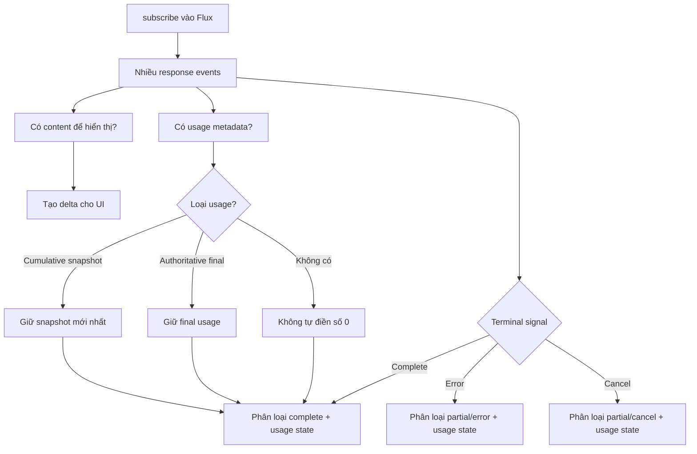

# Thu thập usage cuối luồng và xử lý phản hồi chưa hoàn tất trong Spring AI

> **Chương:** Streaming và bất đồng bộ  
> **Module:** `SPRING_AI_EVALUATION_OBSERVABILITY` — đánh giá ứng dụng Spring AI bằng tập dữ liệu, tiêu chí relevance, fact checking, kiểm thử RAG và tool calling; đồng thời đo metrics, traces, token, chi phí và độ trễ để phát hiện suy giảm chất lượng qua các phiên bản prompt, model và pipeline.

## Mục tiêu học tập

Sau bài này, bạn có thể:

1. Giải thích **vì sao token usage có thể chỉ đến ở cuối stream**, chỉ có trên một số sự kiện, hoặc hoàn toàn không được provider trả về.
2. Phân biệt `Flux<String>` nội dung với `Flux<ChatResponse>` và **usage metadata**; biết lúc nào cần quan sát phản hồi đầy đủ thay vì chỉ chuỗi text.
3. Thiết kế một **collector theo từng subscription/model attempt** để nhận usage cuối cùng hoặc snapshot tạm, không cộng dồn nhầm các giá trị tích lũy.
4. Xử lý đúng phản hồi **completed, empty, errored, cancelled, truncated, fallback** và các trường hợp thiếu usage mà không mặc định tokens/cost bằng 0.
5. Viết ví dụ Java/Reactor, kiểm thử với `StepVerifier`, xuất metrics, lưu provenance và tính chi phí có điều kiện.
6. Đánh giá **câu trả lời hoàn chỉnh và phần đã phát** theo rubric riêng; liên kết kết quả với evidence của RAG, tool calls, phiên bản model/prompt và traces.

## 1. Vì sao “đã có text” không có nghĩa “đã có usage”?

Streaming cho phép hiển thị nội dung khi model đang sinh. Dữ liệu thường tới dưới dạng các **events/chunks**. Mỗi event có thể chứa text, một phần cấu trúc tool call, metadata hoặc tín hiệu kết thúc. Không thể khẳng định event chứa text đầu tiên cũng có token usage cuối cùng.

Giả sử một luồng model giả định:

```text
T = 0 ms    subscribe / bắt đầu model attempt
T = 180 ms  event #1: text = "Theo "
T = 220 ms  event #2: text = "quy định..."
T = 900 ms  event #3: text = " [1]."
T = 930 ms  event #4: finish_reason = stop
T = 940 ms  event #5: usage = input=1200, output=170, total=1370
T = 950 ms  onComplete
```

Nếu chỉ lấy các event text, ứng dụng có thể bỏ lỡ event #5 vì nó **không mang nội dung để hiển thị**. Nếu consumer hủy ở 700 ms, event usage cuối có thể **không bao giờ đến**, dù provider đã xử lý một phần tokens.

Tùy provider, SDK và phiên bản Spring AI, usage có thể xuất hiện:

- Trong metadata của một `ChatResponse` cuối stream.
- Trong một event chuyên biệt sau khi phần text đã dừng.
- Trong nhiều snapshot usage cập nhật dần; đôi khi snapshot chỉ là ước lượng.
- Chỉ trong response tổng hoặc qua billing/usage API ngoài luồng.
- Không có khi bị cancel, lỗi network hoặc response bị cắt trước final event.

**Nguyên tắc:** *Không nhận được usage* có nghĩa **chưa có số đo usage đáng tin**, chứ không đồng nghĩa model đã dùng **0 token**.



Sơ đồ mô tả collector ở **ranh giới application stream**. Nó không khẳng định provider luôn có event usage riêng hoặc metadata xuất hiện sau mọi text event.

## 2. Bốn loại “hoàn tất” không nên đánh đồng

Một response streaming có ít nhất bốn góc nhìn:

| Ranh giới | “Hoàn tất” nghĩa là gì? | Có thể thiếu gì? |
| --- | --- | --- |
| **Provider generation** | Provider báo một lý do kết thúc, ví dụ stop, length hoặc tool handoff | Usage, nội dung cuối đã nhận đủ, trạng thái delivery |
| **Reactor subscription** | Publisher tại vị trí đang đo phát `onComplete` | Ý nghĩa semantic completeness, token usage, client đã nhận hết |
| **HTTP/SSE delivery** | Server hoàn tất truyền ở ranh giới transport | Browser đã render hoặc người dùng đã đọc |
| **User answer** | Câu trả lời cuối đáp ứng đầy đủ facts/citation theo contract | Chứng cứ đầy đủ, tính đúng thực tế |

Model có thể phát `onComplete` bình thường nhưng câu trả lời vẫn **bị cắt vì giới hạn output tokens** nếu finish reason là `length`. Đây là thành công vận hành ở subscription, nhưng không nhất thiết là **câu trả lời hoàn chỉnh**.

Ngược lại, một stream có thể bị downstream `CANCEL` vì client đã nhận đủ câu muốn xem, nhưng provider attempt có thể vẫn có usage được chốt ở hệ thống tính phí. Không suy ra provider miễn phí hay user đã nhận thiếu nội dung chỉ từ một `SignalType.CANCEL`.

### Ba terminal signals chính của Reactor

| Tín hiệu `doFinally` | Tình huống thường gặp | Trạng thái phản hồi phù hợp |
| --- | --- | --- |
| `ON_COMPLETE` | Publisher kết thúc bình thường | Đã hoàn tất *stream*; kiểm tra thêm finish reason và nội dung |
| `ON_ERROR` | Provider, adapter hoặc operator phát lỗi | `PARTIAL_ERROR` nếu đã có output, nếu không là `FAILED_NO_OUTPUT` |
| `CANCEL` | Subscriber hủy, timeout downstream, `take`, disconnect | `PARTIAL_CANCELLED` nếu đã có output, nếu không là `CANCELLED_NO_OUTPUT` |

`doOnComplete` không chạy khi error/cancel. Dùng `doFinally` để ghi **terminal outcome** trên cả ba đường; dùng `doOnError` để ghi loại lỗi. Các hook có thể nhìn thấy **outcome khác nhau** nếu đặt trước/sau `timeout`, `retry` hoặc `onErrorResume`.

## 3. Phải chọn API streaming theo dữ liệu cần thu

Trong các phiên bản Spring AI hỗ trợ `ChatClient`, API thường được diễn đạt theo hai dạng:

```java
// Phù hợp khi chỉ muốn đưa text ra UI.
Flux<String> visibleText = chatClient.prompt()
        .user(question)
        .stream()
        .content();

// Phù hợp khi cần kiểm tra response metadata bên cạnh text.
Flux<ChatResponse> responseEvents = chatClient.prompt()
        .user(question)
        .stream()
        .chatResponse();
```

Đây là ví dụ **khái niệm API**, cần import `Flux`, `ChatClient` và `ChatResponse` theo dependency của dự án. Tùy Spring AI version và provider, API có thể khác; nhất là khả năng truyền usage trong từng `ChatResponse`.

**Giới hạn của `content()`:** Stream này cung cấp phần nội dung đã được trích xuất. Nếu adapter cung cấp usage ở một `ChatResponse` không chứa text, không thể kỳ vọng `Flux<String>` còn giữ metadata. Muốn quan sát usage, thường nên bắt đầu từ response stream mức **ChatResponse** hoặc callback/billing telemetry provider tương ứng.

### Những gì cần kiểm tra ở response event

- `ChatResponse.getMetadata()` có metadata không?
- Metadata có thông tin `Usage` và token counts không, hoặc là đối tượng mặc định/placeholder?
- Usage là **snapshot tích lũy, delta theo event hay bản cuối có thẩm quyền**?
- Trường `finishReason`, tool calls hoặc content-filter outcome ở đâu? Có được trả trên stream không?
- Một `ChatResponse` không có generation text nhưng có metadata có đi qua adapter không?
- Usage có thể xuất hiện trong **model call cuối**, trong từng attempt, hoặc một provider wrapper aggregate nhiều call?

Một số phiên bản Spring AI cung cấp `ChatResponse.getMetadata().getUsage()` và các field token counts tương ứng. **Không suy đoán chính xác tên getter, sự hiện diện hoặc ý nghĩa finality cho mọi phiên bản/provider.** Hãy viết adapter theo dependency thực tế và fixture provider đã xác nhận.

### Không subscribe hai lần chỉ để lấy text và usage

Đoạn sau có rủi ro khi `ChatClient` trả publisher kiểu cold:

```java
// SAI VỀ MẶT THIẾT KẾ: có thể phát sinh hai model calls độc lập.
chatClient.prompt().user(question).stream().content().subscribe(ui::send);
chatClient.prompt().user(question).stream().chatResponse()
        .subscribe(usageCollector::accept);
```

Hai lời gọi này **không nhất thiết là hai view của cùng một provider request**. Chúng có thể được gửi riêng, có nội dung khác nhau, mỗi lời gọi có usage và chi phí riêng. Thiết kế đúng là **một subscription vào cùng upstream response stream**, rồi tách xử lý text và usage trong **một đường pipeline** hoặc dùng multicast có chủ đích và kiểm thử semantics.

## 4. Final usage, cumulative snapshot và delta là ba loại khác nhau

Trước khi tính tiền hay xuất metrics, adapter phải định nghĩa **ngữ nghĩa số đếm**.

| Dạng usage | Ví dụ trong luồng | Cách thu thập |
| --- | --- | --- |
| **Final authoritative snapshot** | Cuối luồng báo `input=1200, output=170` | Giữ làm số cuối của đúng model attempt |
| **Cumulative partial snapshot** | Lần 1 `output=20`, lần 2 `output=80` | Giữ snapshot **mới nhất**, không cộng 20+80 |
| **Incremental delta** | Lần 1 `+20`, lần 2 `+60` | Chỉ cộng nếu contract provider xác nhận là **delta**, có quy tắc tránh trùng |
| **Provider estimate** | SDK ước lượng output=140 trước khi hết luồng | Ghi trạng thái `ESTIMATED` hoặc `PARTIAL` |
| **No usage available** | Không có usage event | `UNAVAILABLE`, không tự thay bằng 0 |

Ví dụ:

```text
Event A: usage.output = 40  (cumulative)
Event B: usage.output = 90  (cumulative)
Event C: usage.output = 130 (final)

ĐÚNG: final output = 130
SAI:  40 + 90 + 130 = 260
```

Ngay cả khi mọi event có trường `usage`, số liệu vẫn có thể là **cùng số đếm được lặp lại**. Không cộng usage theo số lượng events nếu chưa chứng minh rằng chúng là increments.

### Đặt tên token counts theo contract thực tế

Provider có thể phân biệt:

- **Input/prompt tokens** và **output/completion tokens**.
- Cached input tokens, reasoning tokens hoặc các loại modality có giá khác nhau.
- `totalTokens` được báo trực tiếp, đôi khi không bằng phép cộng đơn giản trong mọi mô hình định giá.

Không nên bắt buộc `total = input + output` trong mọi provider adapter nếu hợp đồng usage có category khác. Lưu token counts như đã được báo và chuẩn hóa các nhóm chỉ khi provider xác định rõ.

### Final event không nhất thiết là “chunk cuối có text”

Một sự kiện metadata-only có thể đến sau nội dung cuối. Nếu collector chỉ ghi usage trong `doOnNext(text)` của `Flux<String>` thì có thể bỏ mất final usage. Nên kiểm tra metadata **trên tất cả `ChatResponse` events**, kể cả events không sinh text cho UI.

## 5. Thiết kế trạng thái usage và phản hồi chưa hoàn tất

Một bản ghi có ích nên tách **terminal outcome**, **độ đầy đủ nội dung** và **độ tin cậy của usage**.

| Trường | Giá trị minh họa | Ý nghĩa |
| --- | --- | --- |
| `stream_outcome` | `COMPLETED / ERROR / CANCELLED` | Tín hiệu ở boundary đã quan sát |
| `content_state` | `COMPLETE / PARTIAL / EMPTY / UNKNOWN` | Độ đầy đủ của nội dung theo contract |
| `finish_reason` | `stop / length / tool_calls / unknown` | Lý do provider kết thúc nếu có |
| `usage_state` | `FINAL / PARTIAL / ESTIMATED / UNAVAILABLE / INVALID` | Mức tin cậy của token counts |
| `usage_source` | `stream_metadata / provider_billing / estimate` | Nguồn phát số liệu |
| `usage_observed_at` | Event index hoặc timestamp | Khi nào số usage được quan sát |
| `attempt_id`, `call_id` | Định danh model attempt | Tránh cộng trùng requests/retries |

Không phải mọi cặp trạng thái đều tương ứng nhau. Ví dụ:

- `stream_outcome=COMPLETED`, `usage_state=UNAVAILABLE`: hoàn tất stream nhưng provider không báo usage.
- `stream_outcome=CANCELLED`, `usage_state=PARTIAL`: đã có snapshot trước khi client hủy.
- `stream_outcome=COMPLETED`, `content_state=PARTIAL`: model dừng do length limit hoặc tool handoff nhưng chưa có final answer.
- `stream_outcome=ERROR`, `usage_state=FINAL`: có thể xảy ra nếu usage được chốt trước khi downstream gặp lỗi truyền; vẫn phải phân biệt boundary.

### Xử lý nội dung đã phát một phần

Một chuỗi như:

> “Theo chính sách, thông thường phải nộp trước 3 ngày, trừ khi…”

có thể **chưa phải một claim hoàn chỉnh**. Nếu client hủy ngay sau chữ “trừ khi”, không được coi đây là câu trả lời đầy đủ để chấm completeness theo cùng rubric của response hoàn tất.

Nên giữ:

1. `partial_text` hoặc tham chiếu snapshot phần đã phát, nếu chính sách bảo mật cho phép.
2. `emitted_content_chunk_count`, `first_content_latency`, `last_content_latency`.
3. `content_finalized=false` cùng `reason=cancel/error/length`.
4. Chỉ chấm **các claims hoàn chỉnh đã xuất hiện**; phần dở dang có trạng thái `NOT_JUDGED`.
5. `usage_state` độc lập với `content_state`: một phần text không bảo đảm có/không có usage.

Nếu hệ thống dùng cấu trúc JSON stream, một object đang dở giữa chừng **không phải JSON hợp lệ**. Đừng gán placeholder “}” để làm nó hợp lệ rồi coi như nội dung model đã trả; phải đánh dấu `STRUCTURED_OUTPUT_INCOMPLETE` hoặc lỗi tương ứng.

## 6. Java: collector thu usage theo **một subscription** và đúng finality

Ví dụ sau dùng **Java 17+ và Project Reactor**. Bộ collector là lớp trung gian **không phụ thuộc Spring AI/provider**; adapter cho `ChatResponse` chịu trách nhiệm trích usage và quyết định liệu nó là final hay cumulative partial.

Thiết kế chọn **snapshot final mới nhất**, nếu không có final thì giữ **cumulative partial mới nhất**. Collector **không cộng các delta** vì không biết contract event; muốn xử lý delta cần adapter cộng trước, xác minh không trùng/replay.

```java
import java.util.Objects;
import java.util.Optional;
import java.util.concurrent.atomic.AtomicInteger;
import java.util.concurrent.atomic.AtomicReference;
import java.util.function.Consumer;
import java.util.function.Function;
import java.util.function.Supplier;

import reactor.core.publisher.Flux;
import reactor.core.publisher.SignalType;

public final class StreamUsageCollector {
    private StreamUsageCollector() {}

    public enum UsageKind {
        PARTIAL_CUMULATIVE,
        AUTHORITATIVE_FINAL
    }

    public enum UsageState {
        FINAL, PARTIAL, UNAVAILABLE
    }

    // Dùng Long nullable cho những token categories chưa được provider báo.
    public record UsageSample(
            Long inputTokens,
            Long outputTokens,
            Long totalTokens,
            UsageKind kind) {

        public UsageSample {
            Objects.requireNonNull(kind, "kind");
            if (inputTokens == null && outputTokens == null
                    && totalTokens == null) {
                throw new IllegalArgumentException(
                        "Usage sample không có trường nào được quan sát");
            }
            if ((inputTokens != null && inputTokens < 0)
                    || (outputTokens != null && outputTokens < 0)
                    || (totalTokens != null && totalTokens < 0)) {
                throw new IllegalArgumentException(
                        "Token counts không được âm");
            }
        }
    }

    public record Report(
            SignalType termination,
            UsageState usageState,
            Optional<UsageSample> usage,
            int responseEventCount,
            int extractionFailures) {}

    public static <T> Flux<T> observe(
            Supplier<Flux<T>> sourceFactory,
            Function<T, Optional<UsageSample>> extractor,
            Consumer<Report> reportSink) {

        Objects.requireNonNull(sourceFactory, "sourceFactory");
        Objects.requireNonNull(extractor, "extractor");
        Objects.requireNonNull(reportSink, "reportSink");

        // Flux.defer: state mới cho MỖI subscription.
        return Flux.defer(() -> {
            AtomicReference<UsageSample> lastPartial =
                    new AtomicReference<>();
            AtomicReference<UsageSample> lastFinal =
                    new AtomicReference<>();
            AtomicInteger events = new AtomicInteger();
            AtomicInteger extractionFailures = new AtomicInteger();

            Flux<T> source;
            try {
                source = Objects.requireNonNull(
                        sourceFactory.get(), "source Flux");
            } catch (RuntimeException failure) {
                // Cũng kết thúc qua doFinally(ON_ERROR).
                source = Flux.error(failure);
            }

            return source
                    .doOnNext(event -> {
                        events.incrementAndGet();
                        try {
                            Optional<UsageSample> candidate =
                                    Objects.requireNonNull(
                                            extractor.apply(event),
                                            "extractor result");
                            candidate.ifPresent(sample -> {
                                if (sample.kind()
                                        == UsageKind.AUTHORITATIVE_FINAL) {
                                    lastFinal.set(sample);
                                } else {
                                    lastPartial.set(sample);
                                }
                            });
                        } catch (RuntimeException extractionError) {
                            // Telemetry extraction không làm hỏng stream UI.
                            // Cần audit/log loại lỗi ở tầng recorder an toàn.
                            extractionFailures.incrementAndGet();
                        }
                    })
                    .doFinally(signal -> {
                        UsageSample finalValue = lastFinal.get();
                        UsageSample partialValue = lastPartial.get();
                        UsageSample selected = finalValue != null
                                ? finalValue : partialValue;
                        UsageState state = finalValue != null
                                ? UsageState.FINAL
                                : partialValue != null
                                    ? UsageState.PARTIAL
                                    : UsageState.UNAVAILABLE;

                        Report report = new Report(
                                signal, state,
                                Optional.ofNullable(selected),
                                events.get(), extractionFailures.get());
                        try {
                            reportSink.accept(report);
                        } catch (RuntimeException telemetryFailure) {
                            // Chính sách production: log/audit tối thiểu
                            // mà không làm lỗi telemetry thay đổi stream.
                        }
                    });
        });
    }
}
```

### Đọc kết quả collector cho đúng

- `UsageState.FINAL` chỉ có ý nghĩa khi **provider adapter xác nhận** một usage event là bản cuối có thẩm quyền. Collector không thể tự suy từ “event cuối cùng thấy được”.
- `PARTIAL` là snapshot cumulative **gần nhất**; nó chưa phải final và không đại diện chắc chắn cho billing thực tế.
- `UNAVAILABLE` nghĩa là không có usage sample hợp lệ. Nếu có `extractionFailures > 0`, cần phân loại thêm nguồn lỗi instrumentation; **không** gọi usage bằng 0.
- `responseEventCount` đếm **onNext events** (kể cả metadata-only), không phải text chunks hay output tokens.
- Mỗi subscription được đo riêng; với `retry` bên ngoài, có thể có nhiều reports trong một request.
- Collector bắt một số `RuntimeException` ở bước trích metadata để không làm hỏng luồng nội dung. Trong production, cần có báo cáo lỗi telemetry có kiểm soát và không để lỗi làm mất dữ liệu chẩn đoán.

**Giới hạn có chủ đích:** Mã không coi partial snapshot là đủ để định giá chính xác, không tự phân biệt delta với cumulative, không làm đồng bộ billing, không bảo đảm callback lưu trữ được gửi thành công và không tự thu nội dung để chấm. Việc tự động xác định finality chỉ có thể dựa vào contract provider/version hoặc một signal đủ tin cậy.

### Ví dụ kết quả với một stream hoàn tất

```java
import java.util.List;
import java.util.Optional;
import reactor.core.publisher.Flux;

record DemoEvent(
        String text,
        StreamUsageCollector.UsageSample usage) {}

var finalUsage = new StreamUsageCollector.UsageSample(
        1200L, 170L, 1370L,
        StreamUsageCollector.UsageKind.AUTHORITATIVE_FINAL);

Flux<DemoEvent> observed = StreamUsageCollector.observe(
        () -> Flux.fromIterable(List.of(
                new DemoEvent("Theo ", null),
                new DemoEvent("quy định [1].", null),
                new DemoEvent("", finalUsage))),
        event -> Optional.ofNullable(event.usage()),
        report -> {
            // Stream completes: report.usageState() == FINAL
            // report.usage().orElseThrow().outputTokens() == 170
            // report.responseEventCount() == 3 (không phải 170)
        });
```

Đây là đoạn trong một method hoặc test fixture; nó không đại diện response schema của nhà cung cấp. Trong integration, `DemoEvent` được thay bằng `ChatResponse` hoặc event adapter tương ứng.

## 7. Adapter Spring AI: quan sát response một lần, tách text và usage

Một thiết kế thực dụng là có **một nguồn `Flux<ChatResponse>` duy nhất**, một adapter chuyển usage metadata thành `UsageSample`, và một adapter chuyển response thành **text delta** phù hợp với provider.

```java
import java.util.Optional;
import org.springframework.ai.chat.model.ChatResponse;

public interface ChatStreamEventAdapter {

    // Phải biết dữ liệu provider là final hay cumulative partial.
    Optional<StreamUsageCollector.UsageSample> usage(
            ChatResponse event);

    // Chỉ trả delta nội dung thực sự, không trả metadata-only.
    // Nếu provider trả cumulative text, cần lấy delta đúng cách.
    Optional<String> contentDelta(ChatResponse event);
}
```

Áp dụng trong một service có `ChatClient` và adapter đã được cấu hình:

```java
import org.springframework.ai.chat.client.ChatClient;
import org.springframework.ai.chat.model.ChatResponse;
import reactor.core.publisher.Flux;

// Ví dụ nằm trong method có các biến chatClient, eventAdapter, reportSink.
Flux<ChatResponse> raw = StreamUsageCollector.observe(
        () -> chatClient.prompt()
                .user(question)
                .stream()
                .chatResponse(),
        eventAdapter::usage,
        reportSink::record);

// Không subscribe raw riêng để thu usage!
// Chỉ tạo một chuỗi downstream cho cả UI và collector.
Flux<String> visible = raw.<String>handle((event, sink) ->
        eventAdapter.contentDelta(event)
                .filter(s -> !s.isEmpty())
                .ifPresent(sink::next));
```

Khi HTTP/WebFlux subscribe vào `visible`, collector cũng được subscribe **trên chính upstream** tương ứng; metadata-only event được xử lý bởi `observe` trước khi bị loại khỏi luồng text.

### Tại sao tách adapter theo phiên bản?

Không thể mặc định mọi `ChatResponse` có cùng shape:

- `getResult()` hoặc thế hệ generation/output có thể không xuất hiện trong event metadata-only.
- Một vài response streams trả text **delta**, một số adapter có thể trả **cumulative snapshot**. Nếu nối cumulative text liên tục, nội dung bị lặp; adapter phải chuẩn hóa delta.
- Token usage có thể ở `response.getMetadata().getUsage()`, hoặc một trường native metadata; **có metadata chưa đủ xác nhận đó là final**.
- Provider có thể trả `finishReason=length` hoặc handoff tool call; `onComplete` không có nghĩa câu trả lời nghiệp vụ đã đủ.
- Một số Spring AI versions/providers không expose final usage trong `ChatResponse` streaming. Phải ghi `UNAVAILABLE` hoặc dùng nguồn billing riêng, không tự bịa support.

Để triển khai adapter, hãy đối chiếu **dependency và behavior thật** bằng fixture cho trường hợp cuối có usage, metadata-only, complete không usage, cancel và error. Ví dụ gọi API ở trên có điều kiện theo phiên bản, không phải cam kết chữ ký chạy trên mọi Spring AI release.

### Cảnh báo về việc đọc chữ “final” từ thời điểm onComplete

Một collector có thể quan sát `onComplete` mà không thấy usage. Điều này không cấp quyền đổi `UsageState.UNAVAILABLE` thành `FINAL`. “Stream terminal” và “usage finality” là hai trục độc lập.

## 8. Phản hồi chưa hoàn tất: quản lý phần đã phát và ý nghĩa finish reason

Khi gặp `CANCEL` hoặc `ON_ERROR`, ứng dụng có thể đã gửi một phần văn bản tới người dùng. Hãy phân biệt:

| Tình huống | Nội dung lưu được | Usage có thể có | Hành vi đánh giá |
| --- | --- | --- | --- |
| `ON_COMPLETE`, final reason stop | Toàn bộ phần publisher trả | Final/partial/missing tùy provider | Chấm full answer nếu cấu trúc và nội dung hoàn chỉnh |
| `ON_COMPLETE`, reason length | Có văn bản nhưng bị giới hạn output | Final có thể vẫn có | Đánh dấu **truncated by model**, không tự chấm đủ ý |
| `ON_COMPLETE`, tool call handoff | Có thể chưa có user-facing answer | Usage từng model call nếu có | Đánh giá tool workflow và call tiếp theo |
| `ON_COMPLETE`, output rỗng | Không có text | Usage có thể có | Không gán TTFC hoặc answer completeness tùy ý |
| `ON_ERROR` sau vài chunks | Partial text | Usage partial hoặc missing | Chấm partial claims nếu có snapshot, báo lỗi stage |
| `CANCEL` trước chunk | Không có text | Thường không có final usage | Time-to-cancel và availability, không chấm full answer |
| `CANCEL` sau vài chunks | Partial text | Usage partial/final/missing | Giữ trạng thái unfinished, không tự nối thành câu hoàn chỉnh |

Một event có `finish_reason=stop` tại provider nhưng stream bị lỗi **sau đó** ở tầng HTTP có thể tạo kết quả khác giữa provider call và client delivery. Vì vậy log phải có **điểm đo** cho từng trạng thái.

### Cách xử lý partial output có cấu trúc

Giả sử yêu cầu model tạo:

```json
{
  "answer": "Đơn công tác phải nộp trước 3 ngày làm việc.",
  "citations": ["D01"],
  "status": "COMPLETE"
}
```

Nếu stream bị cắt sau chuỗi `"citations": ["D`, output lúc đó **không phải JSON hợp lệ**. Đừng tự bổ sung ký tự kết thúc để “sửa” rồi chấp nhận như output model đã sinh. Nên giữ raw partial tại kho audit được phép, gắn `structured_output_state=INCOMPLETE` và không gửi downstream như schema đã được validate.

Với citation text, marker `[D01]` có thể trải qua nhiều chunks; cần đợi parser xác nhận cả marker và liên kết nguồn. Một `"[D"` chưa chứng minh citation hợp lệ.

### Đừng chấm partial như full answer

Groundedness có thể chấm trên **atomic claims đã hoàn chỉnh**, nhưng **full-answer completeness** phải để `NOT_APPLICABLE` hoặc trạng thái chưa chấm tương ứng nếu request dừng sớm. Một lỗi `CANCEL` không tự chứng minh model “bỏ sót ngoại lệ” nếu ngoại lệ đáng ra xuất hiện ở phần chưa được sinh.

## 9. Cancellation, retry, timeout và fallback làm lệch dữ liệu usage

### 9.1. Timeout có thể tạo hai terminal outcomes

```java
Flux<ChatResponse> observed =
        StreamUsageCollector.observe(
                () -> sourceFromProvider(),
                usageAdapter::usage,
                reports::record);

Flux<ChatResponse> downstream =
        observed.timeout(java.time.Duration.ofSeconds(12));
```

Khi timeout phát `TimeoutException`:

- Collector nằm **upstream** của `timeout` có thể ghi `SignalType.CANCEL` do downstream hủy subscription.
- Downstream của `timeout` có thể ghi `ON_ERROR`.
- Nếu usage cuối chưa tới, collector báo `UNAVAILABLE` hoặc `PARTIAL`, không được báo 0 tokens.
- Phải ghi `observation_boundary` trước khi so sánh error/cancel rates từ hai vị trí.

### 9.2. Retry tạo nhiều attempts, không phải một model call miễn phí

```java
Flux<ChatResponse> withRetry =
        StreamUsageCollector.observe(
                () -> sourceFromProvider(),
                usageAdapter::usage,
                reports::record)
        .retry(2);
```

`retry(2)` cho phép tối đa **hai lần subscribe lại sau lần đầu**, tổng tối đa ba attempts khi có lỗi liên tiếp. Mỗi attempt có thể có input tokens, output tokens và chi phí. Nếu retry xảy ra sau vài text chunks đã phát, nội dung của attempt sau có thể **lặp** phần đầu hoặc không nhất quán với những gì UI đã nhận.

Một chính sách triển khai cần quy định:

1. **Retry có được phép sau khi đã phát text không?** Thường nên hạn chế vì nguy cơ duplicate và phá vỡ citation.
2. Có `attempt_number`, `provider_request_id` và idempotency key nếu provider hỗ trợ không?
3. Usage được tính **theo attempt** hay provider đã aggregate qua các attempts?
4. Khi tính cost/request, có đủ dữ liệu từ mọi attempt không? Một attempt thiếu usage khiến tổng cost chính xác **không xác định**.
5. Nếu tool có side effects, retry có thể lặp thao tác; cần quy tắc idempotency riêng.

**Không cộng final usage của các events trong cùng attempt.** Nhưng nếu có hai attempts thực sự được provider thực hiện và mỗi attempt có final usage, chi phí request có thể là **tổng chi phí của hai attempts**, tùy billing; phải tránh tính trùng usage aggregate do provider đã báo.

### 9.3. Fallback che lỗi provider nếu đo sai tầng

```java
Flux<String> userVisible = providerText
        .onErrorResume(ex ->
                Flux.just("Hiện chưa thể tạo câu trả lời."));
```

Đối với attempt provider, outcome là error; đối với output sau fallback, outcome có thể là completed. Không chấm fallback message là **answer completion success** của model gốc, không gán chi phí model bằng 0 chỉ vì nội dung hiển thị ngắn.

### 9.4. Client disconnect không bảo đảm provider dừng tính phí ngay

Cancellation là yêu cầu ngừng downstream; việc hủy truyền tới provider phụ thuộc SDK, HTTP transport và cơ chế model. Provider có thể đã tạo thêm tokens, hoặc trả usage qua nguồn khác. Trên dashboard, cần phân biệt **observed streamed tokens**, **reported billed usage** và **estimated cost**.

## 10. Tính chi phí: khi nào có thể và khi nào phải hoãn?

Một công thức tính chi phí đơn giản:

\[
\operatorname{Cost} =
\frac{N_\text{input}\cdot P_\text{input}
      +N_\text{output}\cdot P_\text{output}}{10^6}
\]

Ở đây `P` là giá giả định theo **1 triệu tokens** cho đúng model/currency/thời điểm, và `N` là token usage **đáng tin** của model attempt. Đây là công thức minh họa cho giá input/output cơ bản, không bao gồm cached tokens, reasoning/multimodal/tool charge, thuế hoặc mức giá theo khu vực.

Giả sử provider báo usage cuối cho một attempt:

| Loại | Token count | Giá giả định trên 1 triệu tokens | Chi phí |
| --- | ---: | ---: | ---: |
| Input | 1.200 | 0,50 USD | 0,00060 USD |
| Output | 170 | 2,00 USD | 0,00034 USD |
| **Tổng** | **1.370** | — | **0,00094 USD** |

Các mức giá **hoàn toàn giả định**, không phải báo giá hiện hành của bất kỳ nhà cung cấp nào. Nếu provider chỉ báo total tokens mà không tách input/output, **không thể tính chính xác** bằng công thức giá hai loại trên trừ khi có thêm phân bổ đáng tin.

### Chính sách cho usage chưa đầy đủ

| Usage state | Nên báo cost ra sao? |
| --- | --- |
| `FINAL` và có đủ categories | Tính `REPORTED_BASED_COST` theo bảng giá/version |
| `FINAL` nhưng thiếu nhóm giá | Báo `PARTIAL_COST` hoặc chờ phân bổ/billing |
| `PARTIAL` cumulative snapshot | Có thể báo `PROVISIONAL_ESTIMATE` với giả định rõ; **không xem là billed final** |
| `UNAVAILABLE` | `COST_UNKNOWN`, hoặc ước lượng có nhãn `ESTIMATED` và sai số |
| Billing API đã đối soát | `RECONCILED_COST`, ghi nguồn và thời điểm cập nhật |

Nếu một request có ba attempts, một attempt báo final usage, hai attempt thiếu usage, **không** báo cost/request chính xác chỉ dựa trên attempt cuối. Có thể báo tổng phần đã biết và trạng thái `incomplete_coverage` để tránh hiểu nhầm.

### Chi phí của đánh giá cũng đáng đo

Trong `SPRING_AI_EVALUATION_OBSERVABILITY`, một request RAG có thể thêm reranker, LLM-as-a-judge, tool gọi ngoài và fact-checking. Chi phí end-to-end cần phân biệt:

- Generation model calls.
- Reranker/model judge calls.
- Tool/retrieval/database compute và network, nếu có giá.
- Retry attempts, timeout và calls thất bại.

Chi phí “per successful answer” khác chi phí “per request”; nếu số request bị cancel/error tăng, báo cả completion rate để không kết luận sai về tiết kiệm.

## 11. Micrometer: metrics cho usage và tính đầy đủ của số liệu

Trong Spring AI, Micrometer Observation/Tracing có thể ghi span/metric tùy dependency và cấu hình. Tên metric ở đây là **ví dụ tự định nghĩa của ứng dụng**; không phải cam kết Spring AI mặc định xuất các tên đó.

Các số nên thống kê:

| Metric | Giá trị hữu ích | Lưu ý |
| --- | --- | --- |
| `stream_termination_total` | Số completed/error/cancelled theo stage | Nêu rõ subscription boundary |
| `usage_final_total` | Số attempts có final usage được xác nhận | Không nhầm với tổng tokens |
| `usage_partial_total` | Số attempts chỉ có snapshot tạm | Có thể khác billing thực tế |
| `usage_unavailable_total` | Số attempts không có usage đáng tin | Không ép thành zero |
| `usage_extraction_error_total` | Lỗi adapter/metadata schema | Giúp phát hiện provider version drift |
| `input_tokens`/`output_tokens` | Token counts theo final usage | Chỉ ghi khi field đã quan sát và hợp đồng phù hợp |
| `cost_reported_based` | Giá tính từ usage final | Phải ghi version bảng giá và mức thiếu |
| `partial_response_total` | Error/cancel/truncated có partial text | Không chấm full-answer như completed |
| `usage_coverage_rate` | Tỷ lệ attempts có final usage/tổng attempts | Nên phân theo provider/outcome |

### Java adapter ghi số liệu có điều kiện

Ví dụ sau nhận `StreamUsageCollector.Report` và Micrometer `MeterRegistry`:

```java
import io.micrometer.core.instrument.Counter;
import io.micrometer.core.instrument.DistributionSummary;
import io.micrometer.core.instrument.MeterRegistry;

public final class StreamUsageMeters {
    private final MeterRegistry meterRegistry;

    public StreamUsageMeters(MeterRegistry meterRegistry) {
        this.meterRegistry = meterRegistry;
    }

    public void record(StreamUsageCollector.Report report) {
        String outcome = switch (report.termination()) {
            case ON_COMPLETE -> "completed";
            case ON_ERROR -> "error";
            case CANCEL -> "cancelled";
            default -> "other";
        };
        String usageState = report.usageState().name().toLowerCase();

        Counter.builder("app.ai.stream.terminated")
                .tag("outcome", outcome)
                .tag("usage_state", usageState)
                .register(meterRegistry)
                .increment();

        Counter.builder("app.ai.stream.usage_extraction_errors")
                .tag("outcome", outcome)
                .register(meterRegistry)
                .increment(report.extractionFailures());

        if (report.usageState()
                == StreamUsageCollector.UsageState.FINAL) {
            report.usage().ifPresent(usage -> {
                if (usage.inputTokens() != null) {
                    DistributionSummary.builder(
                                    "app.ai.stream.input_tokens")
                            .baseUnit("tokens")
                            .register(meterRegistry)
                            .record(usage.inputTokens());
                }
                if (usage.outputTokens() != null) {
                    DistributionSummary.builder(
                                    "app.ai.stream.output_tokens")
                            .baseUnit("tokens")
                            .register(meterRegistry)
                            .record(usage.outputTokens());
                }
            });
        }
    }
}
```

**Cẩn trọng với phép tổng hợp:** DistributionSummary ở đây ghi **một sample trên một attempt có usage final**; nó không ghi từng event. Không gắn `request_id`, `trace_id`, nội dung prompt, user hoặc document IDs vào metric tags vì cardinality cao và có thể lộ dữ liệu. `Report` chỉ ghi outcome và usage, chưa chứa model family, pricing version hay provider request ID; các trường ấy nên được bổ sung trong lớp recorder/trace có kiểm soát.

### Đo chất lượng dữ liệu telemetry

Không đủ chỉ nhìn tổng tokens. Một đợt deployment có thể làm usage “giảm” vì adapter mới **không đọc được metadata**, không phải model tiêu thụ ít hơn. Vì vậy hãy đặt cạnh nhau:

- `usage_coverage_rate` trên **mọi model attempts**.
- `usage_extraction_error_rate`.
- `completion/error/cancel rates`.
- `token usage` trên **những attempts có số liệu**, kèm số mẫu và tỷ lệ thiếu.

Nếu usage coverage của bản B giảm từ 98% xuống 62%, mọi kết luận “B tiết kiệm tokens 40%” đều đáng nghi cho đến khi xử lý missingness.

## 12. Kiểm thử bằng StepVerifier: final, partial, missing và cancel

Các test dùng JUnit 5 và Reactor Test, không gọi provider. Chúng kiểm tra rằng collector chọn **final usage**, không cộng snapshots, đồng thời báo outcome khi error/cancel.

```java
import static org.junit.jupiter.api.Assertions.assertEquals;
import static org.junit.jupiter.api.Assertions.assertTrue;

import java.util.List;
import java.util.Optional;
import java.util.concurrent.CountDownLatch;
import java.util.concurrent.TimeUnit;
import java.util.concurrent.atomic.AtomicInteger;
import java.util.concurrent.atomic.AtomicReference;

import org.junit.jupiter.api.Test;
import reactor.core.publisher.Flux;
import reactor.core.publisher.SignalType;
import reactor.test.StepVerifier;

class StreamUsageCollectorTest {

    record Event(String text,
                 StreamUsageCollector.UsageSample usage) {}

    private static StreamUsageCollector.UsageSample partial(long output) {
        return new StreamUsageCollector.UsageSample(
                100L, output, null,
                StreamUsageCollector.UsageKind.PARTIAL_CUMULATIVE);
    }

    private static StreamUsageCollector.UsageSample finalUsage(long output) {
        return new StreamUsageCollector.UsageSample(
                100L, output, 100L + output,
                StreamUsageCollector.UsageKind.AUTHORITATIVE_FINAL);
    }

    @Test
    void finalMetadataOnlyEventWinsOverPartialSnapshots() throws Exception {
        var captured =
                new AtomicReference<StreamUsageCollector.Report>();
        var done = new CountDownLatch(1);

        Flux<Event> stream = StreamUsageCollector.observe(
                () -> Flux.fromIterable(List.of(
                        new Event("Xin", partial(20)),
                        new Event(" chào", partial(60)),
                        new Event("", finalUsage(80)))),
                event -> Optional.ofNullable(event.usage()),
                report -> {
                    captured.set(report);
                    done.countDown();
                });

        StepVerifier.create(stream).expectNextCount(3).verifyComplete();
        assertTrue(done.await(1, TimeUnit.SECONDS));

        var report = captured.get();
        assertEquals(SignalType.ON_COMPLETE, report.termination());
        assertEquals(StreamUsageCollector.UsageState.FINAL,
                report.usageState());
        assertEquals(80L,
                report.usage().orElseThrow().outputTokens());
        assertEquals(3, report.responseEventCount());
        // Không cộng 20 + 60 + 80 thành 160.
    }

    @Test
    void errorAfterPartialUsageKeepsPartialState() throws Exception {
        var captured =
                new AtomicReference<StreamUsageCollector.Report>();
        var done = new CountDownLatch(1);

        var stream = StreamUsageCollector.observe(
                () -> Flux.concat(
                        Flux.just(new Event("một phần", partial(30))),
                        Flux.<Event>error(
                                new IllegalStateException("network"))),
                event -> Optional.ofNullable(event.usage()),
                report -> {
                    captured.set(report);
                    done.countDown();
                });

        StepVerifier.create(stream)
                .expectNextCount(1)
                .expectError(IllegalStateException.class)
                .verify();
        assertTrue(done.await(1, TimeUnit.SECONDS));
        assertEquals(SignalType.ON_ERROR,
                captured.get().termination());
        assertEquals(StreamUsageCollector.UsageState.PARTIAL,
                captured.get().usageState());
        assertEquals(30L,
                captured.get().usage().orElseThrow().outputTokens());
    }

    @Test
    void cancellationBeforeUsageIsUnavailableNotZero() throws Exception {
        var captured =
                new AtomicReference<StreamUsageCollector.Report>();
        var done = new CountDownLatch(1);

        var stream = StreamUsageCollector.observe(
                Flux::never,
                event -> Optional.empty(),
                report -> {
                    captured.set(report);
                    done.countDown();
                });

        StepVerifier.create(stream).thenCancel().verify();
        assertTrue(done.await(1, TimeUnit.SECONDS));
        assertEquals(SignalType.CANCEL, captured.get().termination());
        assertEquals(StreamUsageCollector.UsageState.UNAVAILABLE,
                captured.get().usageState());
        assertTrue(captured.get().usage().isEmpty());
    }

    @Test
    void noSubscriptionProducesNoReport() {
        AtomicInteger reports = new AtomicInteger();
        Flux<Event> stream = StreamUsageCollector.observe(
                Flux::empty,
                event -> Optional.empty(),
                report -> reports.incrementAndGet());
        // Không gọi subscribe/StepVerifier.
        assertEquals(0, reports.get());
    }
}
```

`CountDownLatch` tránh một race có thể xảy ra khi `doFinally` chạy sau khi StepVerifier đã nhận terminal signal. Các test trên chỉ kiểm tra collector với provider event **giả lập**; chúng không chứng minh provider thật luôn đưa final usage vào `ChatResponse`.

### Bộ test integration bắt buộc cho adapter thực

| Tình huống | Kỳ vọng |
| --- | --- |
| Usage nằm ở event cuối chỉ có metadata | Không mất usage khi lọc empty text |
| Usage xuất hiện ở nhiều cumulative snapshots | Chọn bản mới nhất/final, không cộng trùng |
| Không có usage dù `onComplete` | `UNAVAILABLE`, không ghi 0 |
| Cancel trước final usage | `PARTIAL` hoặc `UNAVAILABLE`, có outcome CANCEL |
| Error sau khi đã phát text | Lưu partial + error, không chấm full answer |
| Finish reason `length` | Stream có thể complete nhưng content incomplete |
| Fallback sau lỗi | Report provider error riêng, không gọi fallback là model success |
| `retry(2)` | Nhiều reports theo attempt, tính cost không trùng |
| Tool handoff | Có thể không có user answer ở model call đầu |
| Client disconnect | Server cancel lan tới upstream; usage coverage được ghi đúng |
| Nâng phiên bản Spring AI/provider | Metadata extraction vẫn đúng; báo lỗi nếu contract thay |

Nên giữ **fixture response events** được kiểm duyệt, không dùng raw nội dung nhạy cảm. Khi có nhiều kiểu token (cached/reasoning/tool), test từng kiểu pricing/usage theo provider contract.

## 13. Usage cuối luồng trong RAG và tool calling nhiều lượt

Một request RAG có thể gọi vector search, reranker, một hoặc nhiều tools, rồi nhiều lần gọi `ChatModel`. Usage **theo từng model attempt**, không phải tự động tổng hợp cho cả request.

```text
request_id = req-400
  retrieval.search          source_ids = [D01, D02]
  model.call-1              chọn searchDetails tool
    stream end              usage = 320 input, 40 output (final)
  tool.searchDetails        trả về D03
  model.call-2              sinh câu trả lời user-facing
    stream cancelled        usage = unavailable
  request terminal          partial_answer
```

Trong ví dụ, không thể báo **total request model tokens = 360**, vì call-2 chưa có usage. Chỉ có thể báo **known usage = 360 tokens** cho call-1, cộng với trạng thái `request_usage_incomplete=true`. Nếu có billing đối soát sau đó, cập nhật tổng theo đúng nguồn và không cộng lại call-1 nếu đã nằm trong bản aggregate.

### Gắn usage với evidence và chất lượng

Một mô hình cần biết không chỉ số tokens mà còn:

- `corpus_version`, `index_version`, `prompt_version`, `model_version`.
- `call_id`, `tool_call_id`, `attempt_number` và `trace_id`.
- Danh sách source IDs/ranks và **final context manifest** của đúng lần gọi.
- `input_tokens`/`output_tokens`, usage state và pricing version.
- Terminal outcome và content state.
- Đánh giá claim-level groundedness, citation support và factual correctness nếu có thể.

Nếu call-2 bị cancel trước khi sinh hết, không thể đánh giá full-answer completeness như một request hoàn tất. Nếu prompt chứa đủ `D01,D02,D03` nhưng model sinh sai một fact đã hoàn chỉnh, có thể chấm groundedness **trên phần đã phát**, song kết quả đó khác full-answer quality.

### Retry/tool effects

Nếu model yêu cầu tool ghi dữ liệu, retry có thể khiến tool chạy nhiều lần; usage của model có thể phát sinh ở từng attempt trong khi kết quả nghiệp vụ của tool thay đổi. Đừng tối ưu “tokens per successful request” bằng cách bỏ qua những lần tool gọi thất bại hoặc chi phí retry.

## 14. Observability, provenance và dữ liệu cần đối soát

Một record per attempt minh họa:

```json
{
  "request_id": "req-example-004",
  "call_id": "call-2-answer",
  "attempt_number": 1,
  "stream_boundary": "chatresponse_subscription",
  "stream_outcome": "CANCELLED",
  "content_state": "PARTIAL",
  "response_event_count": 16,
  "visible_text_chunk_count": 13,
  "usage": {
    "state": "PARTIAL",
    "source": "stream_metadata",
    "input_tokens": 1200,
    "output_tokens": 80,
    "total_tokens": null,
    "snapshot_kind": "cumulative",
    "extraction_failures": 0
  },
  "cost": {
    "state": "UNKNOWN_FINAL",
    "known_or_estimated_usd": null,
    "pricing_version": "example-price-v1"
  },
  "prompt_version": "rag-answer-v5",
  "model_version": "model-a",
  "corpus_version": "travel-policy-v3",
  "pipeline_version": "rag-stream-v4",
  "final_context_manifest_ref": "audit://example/req-004/call-2",
  "evaluation": {
    "partial_claim_groundedness": "NOT_JUDGED",
    "full_answer_completeness": "NOT_APPLICABLE"
  }
}
```

Đây là **schema ứng dụng tự định nghĩa**, không phải object `ChatResponse` mặc định của Spring AI. Giá trị `output_tokens=80` là **snapshot tạm**; không được in bảng chi phí như billed usage cuối. Nếu cần thanh toán/đối soát, ưu tiên dữ liệu billing có thẩm quyền theo `provider_request_id` và ghi lịch sử hiệu chỉnh.

### Trace giả định

```text
trace_id = tr-usage-004
  request.accepted                   t=0
    retrieval                       30..140 ms
    rerank                         140..220 ms
    context.assembly               220..260 ms
    model.call-1                    outcome=completed, usage_final=true
    tool.searchDetails             outcome=completed
    model.call-2
      subscribe                      t=510 ms
      first_content                  t=720 ms
      last_content                   t=1320 ms
      subscription_terminal          t=1340 ms, outcome=CANCEL
      usage_state                    PARTIAL
  request.delivery                   partial
```

Các span/event names chỉ minh họa. Muốn xác định model call chậm, cần đo `time to first content` và stream duration theo từng attempt; muốn xác định retrieval/rerank tốn thời gian, xem spans upstream. Dữ liệu usage có thể đến sau chunk cuối nhưng trước terminal; lưu thứ tự events giúp hiểu vì sao mất final metadata.

### Bảo mật và khả năng tái lập

Không ghi nguyên văn prompt, tài liệu nội bộ, raw chunks, API key hoặc thông tin cá nhân vào metric labels. Metric labels nên có cardinality thấp như `outcome`, `usage_state`, `provider_family`, nhóm model hoặc pipeline version đã chuẩn hóa. `request_id` và `trace_id` phù hợp trong trace/audit có phân quyền hơn là time-series labels.

Nếu cần lưu partial answer để đánh giá, hãy dùng kho audit được mã hóa, phân quyền, có retention phù hợp và chính sách xóa; lưu fingerprint/digest khi chỉ cần xác định bản nào đã được sử dụng. Mẫu raw text ngắn cũng có thể bị suy đoán từ hash, nên đánh giá rủi ro trước khi log.

## 15. Regression: phiên bản mới thật sự tiết kiệm hay chỉ mất usage?

Giả sử hai pipeline streaming chạy cùng tập câu hỏi (số liệu **giả định**):

| Chỉ số | Baseline A | Bản B |
| --- | ---: | ---: |
| Completion rate | 94% | 86% |
| Cancellation rate | 4% | 10% |
| Error rate | 2% | 4% |
| Final usage coverage trên attempts | 97% | 61% |
| Mean output tokens trên các attempts có usage final | 210 | 145 |
| p95 time to first content (có text) | 410 ms | 320 ms |
| Groundedness trên completed | 0,91 | 0,87 |
| Cost per successful answer có đủ usage | 0,010 USD | 0,009 USD |

B có first content nhanh hơn và mean output tokens **trên mẫu có usage** thấp hơn, nhưng tỷ lệ thiếu final usage tăng mạnh. Có thể model B tạo ít tokens thật; cũng có thể usage events bị mất do adapter thay phiên bản hoặc nhiều requests bị cancel trước final metadata. Không nên kết luận B “tiết kiệm 31% tokens” khi **mẫu đo đã thay đổi**.

### Cách làm regression đáng tin

1. Cố định `dataset`, corpus/index, quyền truy cập, golden answers và các facts bắt buộc.
2. Ghi `Spring AI/provider/SDK` versions, prompt/model versions và sampling settings.
3. Dùng cùng **bộ quy tắc finality** cho usage events; kiểm tra fixture từ provider thật sau mỗi nâng cấp.
4. Báo outcome ratios, usage coverage, sample count, cost coverage cùng p50/p95.
5. Phân biệt `estimated` và `reconciled`, lưu phiên bản bảng giá.
6. So sánh chi phí/request, chi phí/attempt và chi phí/**successful answer** trên các tập mẫu được định nghĩa rõ.
7. Chấm groundedness, factual correctness và citation support trên câu trả lời hoàn chỉnh; đo partial quality riêng khi cần.
8. Điều tra các case thay đổi outcome hoặc mất metadata bằng trace và final context manifest.

**Quy tắc phát hành:** Cải thiện token hoặc latency **không đủ** nếu completion rate, chất lượng RAG hoặc độ đầy đủ telemetry giảm ngoài mức cho phép.

## 16. Checklist trước khi đưa collector vào production

| Câu hỏi | Kiểm tra |
| --- | --- |
| Có lấy `ChatResponse` hoặc nguồn usage tương đương không? | Không chỉ subscribe `Flux<String>` rồi suy metadata |
| Provider có contract usage delta/cumulative/final không? | Adapter gắn đúng `UsageKind` |
| Final usage có thể nằm trong metadata-only event không? | Test không làm mất event đó |
| Một request có bao nhiêu model attempts? | `call_id`/`attempt_number` và billing correlation |
| Có tạo subscription hai lần để lấy content/usage? | Dùng một upstream cho cả hai |
| Stream complete nhưng thiếu usage thì sao? | `UNAVAILABLE`, không gán 0 |
| Error/cancel sau partial có được ghi? | `doFinally`, partial text và reason |
| Finish reason `length`/tool handoff có được phân loại? | Không coi mọi `ON_COMPLETE` là full answer |
| Retry có tính trùng usage không? | Theo attempt, không cộng cumulative snapshots |
| Tính cost có đúng model/tier/version không? | Giá và token categories phù hợp |
| Telemetry adapter/extraction lỗi có cảnh báo không? | `extractionFailures` và usage coverage |
| Có giữ trace/context cho RAG evaluation không? | Manifest theo đúng model call |
| Có privacy và cardinality policy không? | Không log raw private data vào metric labels |
| Có chấm chất lượng trên kết quả đầy đủ? | Groundedness, fact checking, citation, completeness |

## 17. Bài thực hành

Một luồng Spring AI được quan sát với ba model attempts **giả định**:

| Attempt | Sự kiện usage quan sát | Terminal | Text |
| --- | --- | --- | --- |
| **A** | Cumulative `output=30`; cumulative `output=70`; final `input=1.000, output=120` | `ON_COMPLETE` | Câu trả lời hoàn chỉnh, có citation |
| **B** | Cumulative `input=1.000, output=45`; sau đó không có final | `CANCEL` | Đã phát một nửa câu |
| **C** | Không có usage event | `ON_ERROR` | Chưa có nội dung |

Giả sử giá minh họa `P_input=0,50 USD` và `P_output=2,00 USD` trên một triệu tokens. Với C, provider có thể vẫn tính phí dù event usage chưa đến.

**Yêu cầu:**

1. Với A, giá trị `output_tokens` cuối là bao nhiêu? Vì sao không được cộng `30 + 70 + 120`?
2. Tính chi phí cơ bản của A theo giá giả định (chưa gồm cached/reasoning/tool fees).
3. Gán `UsageState` và `stream_outcome` cho B, C. Có thể tính chi phí billed chính xác cho B, C không?
4. Với B, có thể dùng một nửa câu đã phát để chấm **full-answer completeness** không?
5. Nếu downstream dùng `onErrorResume` để hiển thị câu fallback cho C, subscriber cuối có thể thấy outcome gì, và provider boundary phải ghi gì?
6. Khi B phát partial output nhưng `final_context_manifest` có đủ chứng cứ, một claim chưa hoàn chỉnh có được coi là sai factual correctness không?
7. Khi nâng cấp Spring AI mà final usage coverage giảm từ 98% xuống 60%, cần kiểm tra những giả thuyết nào trước khi kết luận model dùng ít tokens hơn?

### Đáp án tham khảo

1. A có **120 output tokens**. Các số 30/70 là cumulative snapshots, final 120 đã bao gồm chúng; cộng thành 220 sẽ đếm trùng.
2. Input cost: `1.000×0,50/1.000.000 = 0,00050 USD`. Output cost: `120×2,00/1.000.000 = 0,00024 USD`. Tổng **0,00074 USD** theo giá giả định.
3. B: `usageState=PARTIAL`, `streamOutcome=CANCELLED`. C: `usageState=UNAVAILABLE`, `streamOutcome=ERROR`. Không thể khẳng định billed cost chính xác cho B/C chỉ từ dữ liệu hiện có; có thể lưu snapshot tạm/đợi đối soát.
4. Không. B là partial response, có thể chấm groundedness những **atomic claims hoàn chỉnh đã phát** nếu có snapshot và rubric; full-answer completeness phải `NOT_APPLICABLE` hoặc trạng thái chưa chấm.
5. Subscriber sau fallback có thể `ON_COMPLETE`, nhưng attempt/provider upstream đã `ON_ERROR`. Cần ghi cả hai boundary, không che lỗi.
6. Không. Thiếu phần cuối do cancel không đủ để kết luận một claim dở dang là sai. Chỉ chấm claim hoàn chỉnh và có bằng chứng theo rubric; ghi `NOT_JUDGED` cho claim chưa thành câu.
7. Kiểm tra response metadata shape, `ChatResponse` adapter, final usage event có bị lọc vì không chứa text không, cancellation/error rates, retry, provider flags, SDK version và billing reconciliation; đối chiếu usage coverage trước khi tính lại cost hoặc hiệu quả tokens.

## Ghi nhớ

- **Usage có thể đến ở cuối hoặc vắng mặt:** nhận được text/`onComplete` không bảo đảm đã có final usage.
- **Không cộng cumulative snapshots:** giữ final có thẩm quyền; partial chỉ là số tạm, delta chỉ cộng khi provider contract thực sự nói đó là delta.
- **Một subscription để quan sát content và metadata:** dùng response stream mức `ChatResponse` và adapter, tránh vô tình gọi model hai lần.
- **Tách ba chiều trạng thái:** terminal complete/error/cancel, mức hoàn chỉnh của content và mức tin cậy của usage; không tự lấp missing bằng 0.
- **Partial answer phải được chấm riêng:** không coi dở dang do hủy/lỗi/length là câu trả lời đầy đủ; kiểm tra citation và groundedness trên claims hoàn chỉnh.
- **Cost có điều kiện:** dùng token usage đúng attempt, phiên bản bảng giá và trạng thái final/estimated/reconciled; không xem cancel là miễn phí.
- **Đánh giá end-to-end:** liên kết metrics, traces, provider attempts, evidence RAG và phiên bản prompt/model/pipeline để tối ưu chi phí mà không che mất lỗi hoặc làm giảm chất lượng câu trả lời.
