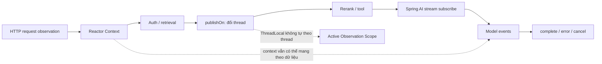

# Lan truyền observation qua Reactor Context và scheduler trong Spring AI

> **Chương:** Streaming và bất đồng bộ  
> **Module:** `SPRING_AI_EVALUATION_OBSERVABILITY` — đánh giá chất lượng ứng dụng Spring AI bằng tập dữ liệu, relevance, fact checking và kiểm thử RAG/tool calling; đồng thời đo metrics, traces, token, chi phí và độ trễ để tìm nguyên nhân suy giảm theo phiên bản prompt, model và pipeline.

## Mục tiêu học tập

Sau bài này, bạn có thể:

1. Giải thích vì sao một luồng `Flux` vẫn chạy đúng nhưng **trace/span cha–con hoặc correlation ID bị mất** sau `publishOn`, `subscribeOn`, `flatMap` hay chuyển sang executor.
2. Phân biệt **Reactor Context**, **ThreadLocal**, **Micrometer Observation/Scope** và **Micrometer Context Propagation**; không nhầm việc mang một object trong context với việc nó đang là observation *active* trên thread.
3. Lựa chọn giữa lan truyền **tường minh bằng `contextWrite/deferContextual`** và cơ chế khôi phục ThreadLocal **tự động hoặc có kiểm soát**, tùy phiên bản Reactor/Micrometer/Spring Boot.
4. Tạo và kết thúc observation **theo subscription** cho luồng Spring AI, gắn parent observation đúng nguồn, dừng ở complete/error/cancel và không mở Scope lâu qua các scheduler.
5. Thiết kế test với `StepVerifier` cho scheduler switch, multiple subscribers, error, cancel và kiểm tra **trace hierarchy**, không chỉ kiểm tra các log có cùng trace ID.
6. Gắn observation với pipeline RAG, tool calling và các metrics về retrieval, generation, token, chi phí, latency mà không làm rò rỉ dữ liệu hoặc tăng cardinality.

## 1. Tình huống: streaming vẫn chạy nhưng trace bị đứt

Giả sử một API Spring WebFlux nhận câu hỏi chính sách. Ứng dụng dùng Spring AI để tra tài liệu, rerank, thêm context vào prompt và stream câu trả lời. Mọi chunk vẫn tới trình duyệt, nhưng hệ thống tracing hiện:

- Span HTTP request có `trace_id=A`.
- Span tìm kiếm vector đôi lúc thuộc `trace_id=A`, đôi lúc đứng một mình.
- Span model call xuất hiện dưới một trace khác sau `publishOn`.
- Khi client ngắt kết nối, observation đo stream không có sự kiện stop.

Những triệu chứng này không nhất thiết là model hoặc vector database lỗi. Chúng có thể đến từ **cách lan truyền context hoặc vị trí tạo/đóng observation**.



**Hai vấn đề riêng biệt:** (1) Context có chứa thông tin parent/correlation đúng không? (2) Tại nơi thư viện đo instrumentation cần sử dụng, thông tin ấy có được **khôi phục thành active observation** hay không? Giải quyết được (1) chưa đủ để tự khẳng định (2).

## 2. Bốn khái niệm không được đánh đồng

| Khái niệm | Phạm vi / cơ chế | Điều nó bảo đảm | Điều không tự bảo đảm |
| --- | --- | --- | --- |
| **Reactor `Context`** | Dữ liệu bất biến gắn với **Subscriber**, truy cập qua `ContextView` | Các operator tương thích có thể đọc dữ liệu theo subscription, kể cả qua scheduler | Tự đổi `ThreadLocal`/MDC hoặc tự tạo span con |
| **Java `ThreadLocal`** | Biến gắn với thread đang chạy | Thư viện đồng bộ có thể tìm context hiện hành trên cùng thread | Giá trị tự chuyển sang thread khác khi `publishOn/subscribeOn` |
| **Micrometer `Observation`** | Vòng đời đo một thao tác: start/error/stop, tags, handlers | Có thể phát metrics/tracing tùy registry và handlers | Tự trở thành observation active ở mọi callback bất đồng bộ |
| **`Observation.Scope`** | Đưa một observation vào current scope của thread trong khoảng `openScope()` → `close()` | Code đồng bộ trong khoảng scope có thể truy cập current observation | Được phép mở trên thread A rồi đóng tùy ý trên thread B |
| **Micrometer Context Propagation** | Cơ chế bridge giữa ThreadLocal accessors và context carriers | Có thể capture/restore những ThreadLocal đã đăng ký theo hợp đồng | Tự lan truyền mọi ThreadLocal hoặc bảo đảm instrumentation của mọi thư viện đúng |

Trong kiến trúc thực, cả bốn thường xuất hiện cùng nhau. Lưu một `Observation` object vào Reactor Context để gọi `parentObservation(...)` là **lan truyền tham chiếu tường minh**; điều đó không tự làm `ObservationRegistry.getCurrentObservation()` trả observation ấy trên mọi thread.

### Khác biệt với trace ID

`trace_id`, `span_id`, baggage/correlation ID và `request_id` cũng không giống nhau:

- **Trace ID:** liên kết các spans thuộc một trace phân tán.
- **Span ID:** định danh một đơn vị công việc; mỗi child span có span ID riêng.
- **Request ID:** định danh nghiệp vụ hoặc HTTP request theo ứng dụng; có thể tồn tại ngay cả khi không bật tracing.
- **Baggage:** metadata truyền giữa các service khi được cấu hình; có thể tốn tài nguyên hoặc gây rò rỉ nếu đưa dữ liệu nhạy cảm vào.

Không dùng một chuỗi `request_id` trong Reactor Context làm bằng chứng rằng Micrometer đã tạo đúng quan hệ parent–child của spans. Phải kiểm tra quan hệ span thật.

## 3. Reactor Context đi theo subscriber, không theo thread

Reactor `Context` thường được viết bằng `contextWrite(...)` và đọc qua `deferContextual(...)`. Về mặt ý niệm, dữ liệu được truyền từ **downstream subscriber về upstream operators** trong pha subscription; nó không phải map mutable toàn cục.

Ví dụ Java 17+ sử dụng Reactor:

```java
import reactor.core.publisher.Mono;
import reactor.core.scheduler.Schedulers;
import reactor.util.context.Context;

Mono<String> pipeline = Mono.deferContextual(ctx -> {
        String requestMarker = ctx.get("requestMarker");
        return Mono.just("first=" + requestMarker);
    })
    .publishOn(Schedulers.parallel())
    .flatMap(prefix -> Mono.deferContextual(ctx -> {
        String requestMarker = ctx.get("requestMarker");
        return Mono.just(prefix + ", second=" + requestMarker);
    }))
    .subscribeOn(Schedulers.boundedElastic())
    .contextWrite(Context.of("requestMarker", "demo-42"));

// Một subscription bình thường phát:
// first=demo-42, second=demo-42
```

`publishOn` và `subscribeOn` đổi bối cảnh chạy, nhưng các operator đọc `ContextView` vẫn nhận được marker của cùng subscription. **Ví dụ này chứng minh Reactor Context, chưa chứng minh active Micrometer Observation/ThreadLocal.**

### Lỗi thường gặp: viết context sai chiều

`contextWrite` ảnh hưởng những operator nằm **upstream** tương ứng với vị trí của nó trong chuỗi, không phải mọi operator đặt phía sau về mặt source code.

```java
Mono<String> upstream = Mono.deferContextual(ctx ->
        Mono.just(ctx.getOrDefault("locale", "missing")));

Mono<String> works = upstream
        .contextWrite(ctx -> ctx.put("locale", "vi"));
// works thấy locale=vi trong deferContextual upstream.

Mono<String> downstreamRead = upstream
        .contextWrite(ctx -> ctx.put("locale", "vi"))
        .flatMap(ignored -> Mono.deferContextual(ctx ->
                Mono.just(ctx.getOrDefault("locale", "missing"))));
// deferContextual ở nhánh downstream sau contextWrite
// không bắt buộc thấy "vi"; có thể nhận "missing".
```

Muốn nhiều operator cùng sử dụng một context key, nên đặt `contextWrite` ở biên subscriber/downstream phù hợp và dùng `deferContextual` tại nơi cần đọc. Đừng sửa lỗi bằng cách dùng biến `static` hoặc `ThreadLocal` toàn cục chứa request ID.

### Khi nào cần tạo key riêng?

Nên dùng key không dễ va chạm:

```java
private static final Object REQUEST_CONTEXT_KEY = new Object();

// Viết: .contextWrite(ctx -> ctx.put(REQUEST_CONTEXT_KEY, correlation))
// Đọc:  .deferContextual(ctx -> Mono.just(ctx.get(REQUEST_CONTEXT_KEY)))
```

Đối với các thành phần trong cùng ứng dụng, key object tường minh giúp tránh hai thư viện dùng chung chuỗi `"traceId"` nhưng với ý nghĩa khác nhau. Không lưu bí mật hoặc bản ghi người dùng vào Reactor Context nếu không có lý do và kiểm soát quyền.

## 4. Scheduler switch làm gì và không làm gì?

Một pipeline RAG thường dùng nhiều scheduler hoặc có các bước I/O bất đồng bộ:

| Operator / cơ chế | Tác động thường gặp | Rủi ro với observation |
| --- | --- | --- |
| `publishOn(scheduler)` | Đổi nơi thực thi các tín hiệu downstream từ vị trí đặt operator | ThreadLocal/active Scope có thể không còn trên thread mới |
| `subscribeOn(scheduler)` | Ảnh hưởng nơi bắt đầu subscription và phần upstream tương ứng | Parent scope từ thread gọi service có thể không active trên thread subscribe |
| `flatMap` | Đăng ký inner publishers, có thể chạy xen kẽ/bất đồng bộ | Gắn nhầm observation/correlation khi dùng mutable state chung |
| `parallel()/runOn` | Chia tín hiệu sang nhiều rails/worker threads | Không được dùng một Scope mở một lần cho nhiều worker |
| `boundedElastic()` | Scheduler phù hợp cho tác vụ blocking được kiểm soát | Blocking call có thể không tự nhận MDC/ThreadLocal nếu không bridge |
| `CompletableFuture` / executor thuần Java | Thoát khỏi Reactor operator chain | Không mặc định có Reactor Context hoặc active Observation |
| Hot publisher / `share()/cache()` | Nhiều subscribers có thể chung upstream | Một upstream model call khác với số downstream subscriptions |

**Thread nào đang chạy là chi tiết thực thi**, không phải danh tính request. Trong `flatMap` nhiều câu hỏi song song, không nên gán global `currentRequestId` để đo: các tín hiệu xen kẽ sẽ trộn trace và dữ liệu.

### Phân biệt scheduler với async tool/client

Không phải mọi lời gọi Spring AI đều dùng Reactor trong toàn bộ stack. Một đoạn code dùng reactive publisher vẫn có thể gọi một SDK đồng bộ, CompletableFuture hoặc gRPC client dưới lớp adapter. Khi đi qua ranh giới **không còn Reactor**, cần kiểm tra cơ chế propagation chuyên biệt cho ranh giới đó.

Việc đặt `publishOn(boundedElastic())` trước một lời gọi blocking không tự tạo parent span, không thay thế cấu hình timeout, và không bảo đảm ThreadLocal được sao chép.

## 5. Observation: tạo, gắn parent, start, error, stop

Micrometer `Observation` có thể ghi metrics/traces nếu `ObservationRegistry` được cấu hình handlers phù hợp. Một luồng streaming cần **một vòng đời observation rõ ràng**, thường bắt đầu khi subscribe vào công việc được đo và dừng ở complete/error/cancel.

```text
HTTP observation (parent)
    |
    +-- RAG pipeline observation
         |
         +-- retrieval / rerank / tool observations
         |
         +-- model stream subscription observation
              start: subscribe
              onNext: chunks 0..N
              doOnError: record error
              doFinally: completed / error / cancelled
              stop: sau khi lưu outcome
```

**Scope khác lifecycle:** `observation.start()` tạo vòng đời công việc, `observation.openScope()` làm nó current **trên thread hiện tại**, và `observation.stop()` kết thúc vòng đời. Một `Observation.Scope` không cần (và không nên) giữ mở suốt hàng giây streaming khi callbacks có thể nhảy thread.

### Lỗi dễ gặp

```java
// SAI: mở Scope ở thread dựng Flux và đóng ở callback khác thread.
Observation.Scope scope = observation.openScope();
return modelFlux
        .publishOn(Schedulers.parallel())
        .doFinally(signal -> scope.close());
```

Việc dùng scope như trên có thể làm hỏng current observation của thread, gây span bị gắn nhầm cha hoặc giữ thread-local state lâu hơn dự kiến.

Nếu thực sự cần truy cập current observation trong một **đoạn code đồng bộ ngắn**, có thể mở và đóng scope trên **cùng callback/thread**:

```java
Flux<String> withScopedLogging = modelFlux
        .doOnNext(chunk -> {
            try (Observation.Scope ignored = observation.openScope()) {
                // Đoạn này chạy đồng bộ trong chính callback onNext.
                // Một thư viện dựa vào ThreadLocal có thể thấy observation.
            }
        });
```

Đoạn trên **không truyền active scope sang callback kế tiếp**. Mỗi callback cần cơ chế khôi phục context phù hợp hoặc scope cục bộ riêng nếu thư viện buộc phải đọc ThreadLocal. Đừng coi đây là chiến lược duy nhất cho toàn bộ pipeline; cấu hình context propagation của framework có thể phù hợp hơn.

## 6. Java: lan truyền parent observation bằng Reactor Context

Ví dụ sau xây một boundary rõ ràng cho **một subscription**. Nó dùng một key riêng lưu `Observation` trong Reactor Context và **gắn parent tường minh** cho observation mới. Khi hoàn tất, lỗi hoặc cancel, observation được stop qua `doFinally`.

Mã giả định Java 17+, Micrometer Observation và Reactor tương thích. Ví dụ tập trung vào **liên kết parent object và vòng đời**, không thay thế cơ chế tự động khôi phục thread-local của Micrometer.

```java
import java.util.Objects;
import java.util.function.Supplier;

import io.micrometer.observation.Observation;
import io.micrometer.observation.ObservationRegistry;
import reactor.core.publisher.Flux;

public final class ReactorObservationBoundary {
    private ReactorObservationBoundary() {}

    private static final Object CURRENT_OBSERVATION_KEY = new Object();

    public static <T> Flux<T> withParent(
            Flux<T> source, Observation parent) {
        Objects.requireNonNull(source, "source");
        Objects.requireNonNull(parent, "parent");
        return source.contextWrite(
                ctx -> ctx.put(CURRENT_OBSERVATION_KEY, parent));
    }

    public static <T> Flux<T> observeSubscription(
            String observationName,
            Supplier<Flux<T>> sourceFactory,
            ObservationRegistry registry) {

        Objects.requireNonNull(observationName, "observationName");
        Objects.requireNonNull(sourceFactory, "sourceFactory");
        Objects.requireNonNull(registry, "registry");

        return Flux.deferContextual(parentContext -> {
            Observation child = Observation
                    .createNotStarted(observationName, registry)
                    .lowCardinalityKeyValue("stage", "model-stream");

            parentContext
                    .<Observation>getOrEmpty(CURRENT_OBSERVATION_KEY)
                    .ifPresent(child::parentObservation);
            child.start();

            Flux<T> source;
            try {
                source = Objects.requireNonNull(
                        sourceFactory.get(), "model publisher");
            } catch (RuntimeException failure) {
                source = Flux.error(failure);
            }

            return source
                    .doOnError(child::error)
                    .doFinally(signal -> {
                        String outcome = switch (signal) {
                            case ON_COMPLETE -> "completed";
                            case ON_ERROR -> "error";
                            case CANCEL -> "cancelled";
                            default -> "other";
                        };
                        child.lowCardinalityKeyValue("outcome", outcome);
                        child.stop();
                    })
                    // Các publisher upstream có thể đọc child tường minh.
                    .contextWrite(ctx ->
                            ctx.put(CURRENT_OBSERVATION_KEY, child));
        });
    }
}
```

### Cách sử dụng với một subscription

```java
import reactor.core.publisher.Flux;

// Trong service có ChatClient và ObservationRegistry.
Flux<String> answer = ReactorObservationBoundary
        .observeSubscription(
                "app.ai.model.stream.subscription",
                () -> chatClient.prompt()
                        .user(question)
                        .stream()
                        .content(),
                observationRegistry);

// HTTP/WebFlux sẽ subscribe vào answer.
// Nếu chưa subscribe, supplier chưa tạo stream và observation chưa start.
```

Nếu request đã có **parent Observation** do HTTP hoặc orchestration quản lý, có thể nối nó qua `withParent(...)` ở điểm tạo luồng thích hợp. Cần bảo đảm parent thuộc **đúng request, đúng subscription** và vòng đời của parent bao bọc child đúng ý nghĩa; không dùng một parent static cho nhiều requests.

**Không có parent là trạng thái hợp lệ:** Khi không thấy `CURRENT_OBSERVATION_KEY`, boundary vẫn tạo observation mới; nếu tracing đã cấu hình, nó có thể trở thành root observation/span. Đừng tự gán parent giả bằng ID từ request khác.

### Điều kiện để code có giá trị

1. `Flux.deferContextual` bảo đảm tạo state riêng khi có subscription; nhiều subscribers vào cold pipeline có thể tạo **nhiều observations và nhiều model calls**.
2. `parentObservation(...)` là **quan hệ tường minh** giữa Micrometer Observations. Nó không làm Spring AI SDK tự đọc active observation trong `ThreadLocal`.
3. `contextWrite` ở đây mang một **Observation object** cho các operators upstream tương thích; nó không tự động đăng ký `ThreadLocalAccessor` hoặc khôi phục `Observation.Scope`.
4. `doOnError` ghi lỗi vào child và giữ lỗi đi xuống subscriber; `doFinally` ghi outcome rồi stop kể cả cancel.
5. Khi có `retry` ở ngoài boundary, mỗi attempt có thể tạo một child mới; cần đo request-level và attempt-level riêng.
6. Nếu ứng dụng hoặc Spring AI đã instrument model calls, tránh tạo **hai observations cùng một ý nghĩa** rồi cộng đôi metrics. Boundary này có thể được đặt là một span custom ở cấp subscription, còn model/provider span nội bộ thuộc cấp thấp hơn.

## 7. Context Propagation: cầu nối từ Reactor Context sang ThreadLocal

Micrometer Context Propagation cung cấp khái niệm **ThreadLocalAccessor** và **context snapshots** để capture/restore trạng thái đã đăng ký. Reactor có tích hợp với cơ chế này trong các phiên bản tương ứng, nhưng **mức độ tự động phụ thuộc dependency và cấu hình**.

Hai cách thực hành:

| Cách | Ý tưởng | Ưu điểm | Cần lưu ý |
| --- | --- | --- | --- |
| **Tường minh qua Reactor Context** | Truyền parent/correlation bằng `contextWrite`, đọc bằng `deferContextual`; gắn parent khi tạo child | Rõ ràng, test được, ít phụ thuộc ambient thread state | Thư viện chỉ biết `ThreadLocal` sẽ không tự đọc Reactor Context |
| **Micrometer Context Propagation** | Đăng ký accessors, capture vào context, restore scope tại các operator/boundary hỗ trợ | Tích hợp thuận tiện với instrumentation dùng `ThreadLocal` | Phải kiểm tra Reactor/Micrometer/Spring versions, overhead và chính xác parent span |

Trong các phiên bản Reactor hỗ trợ, có thể bật automatic context propagation **ở bootstrap**:

```java
import reactor.core.publisher.Hooks;

// Đặt tại bootstrap, trước khi tạo các subscriptions cần đo.
// Chỉ khi đã cấu hình context-propagation và accessors tương thích.
Hooks.enableAutomaticContextPropagation();
```

**Lưu ý quan trọng:** Đây là cơ chế toàn cục đối với Reactor trong process; không bật/tắt trong mỗi request. Nó không khẳng định mọi ThreadLocal tùy ý được phục hồi: cần accessor tương ứng và carrier chứa giá trị cần khôi phục. Ở một số phiên bản/cấu hình, default mode chỉ khôi phục ThreadLocal trong những operator được hỗ trợ; automatic mode có phạm vi khác. Hãy kiểm tra tài liệu và test integration của **dependency đang dùng**, không suy từ một snippet.

### `contextCapture()` và điểm subscription

`contextCapture()` có thể đưa **những ThreadLocal đã đăng ký** từ thread hiện tại vào Reactor Context khi subscription xảy ra. Nó hữu ích khi gọi reactive chain từ code imperative đang có current observation và accessor đúng. Tuy nhiên:

- Khi subscribe diễn ra trên thread không giữ ThreadLocal mong muốn, snapshot có thể rỗng.
- Dùng `contextWrite` tường minh từ một entrypoint reactive đáng tin thường rõ hơn.
- Không có gì bảo đảm một `CompletableFuture` hoặc executor tùy biến tự nhận Reactor Context.
- Bật automatic mode không thay thế kiểm tra trace hierarchy và lifetime.

Ví dụ *chỉ minh họa vị trí operator*:

```java
Flux<String> publisher = sourceFlux
        // Có ý nghĩa khi đã đăng ký ThreadLocalAccessors phù hợp
        // và caller subscribe trong ThreadLocal scope mong muốn.
        .contextCapture();
```

Không dùng `contextCapture()` làm “phép sửa thần kỳ” cho mọi span mồ côi. Phải xác nhận dữ liệu đã được capture và khôi phục **tại callback thật**, đặc biệt khi chuyển scheduler.

## 8. Xuất nhập sang executor hoặc CompletableFuture

Các phép toán Reactor không có quyền điều khiển mọi thread trong hệ thống. Ví dụ một advisor gọi SDK dùng `CompletableFuture.supplyAsync(...)` hoặc một thư viện JDBC blocking qua executor:

```text
Reactor pipeline (ContextView có observation)
    |
    +-- submit task -> external Executor (thread khác)
                           |
                           +-- ThreadLocal có thể rỗng
                           +-- model SDK / JDBC / HTTP call
```

Một chiến lược an toàn:

1. Thu parent/correlation từ **Reactor Context hiện hành** tại boundary.
2. Tạo child Observation và truyền **tường minh** vào adapter nếu adapter kiểm soát được.
3. Nếu thư viện cần ThreadLocal, sử dụng cơ chế **ContextSnapshot/capture/restore** tương thích, có try-with-resources để đóng scope **trên cùng thread task**.
4. Trong callback completion, đưa dữ liệu trở lại publisher và giữ correlation ID/attempt ID; tránh dựa vào thread đang chạy.
5. Kiểm thử parent span và không rò ThreadLocal giữa hai tasks liên tiếp trên cùng thread pool.

Pseudo-flow, không phải mã có thể biên dịch nguyên xi:

```text
captured = capture registered observation context at submit boundary
executor.submit(() -> {
    scope = restore captured thread-locals on THIS worker thread
    try:
        call blocking SDK; emit result/error
    finally:
        scope.close() on THIS worker thread
})
```

Không truyền một `Observation.Scope` đã mở từ thread request vào task. Phần cần chuyển là **context có thể restore**, không phải scope đang gắn với thread nguồn.

### Khi nào cần dùng `boundedElastic`?

Với công việc blocking, `Schedulers.boundedElastic()` giúp tránh block event-loop nhưng **không tự định nghĩa ngữ nghĩa tracing**. Nếu Spring AI adapter đã có API async/reactive chuẩn, ưu tiên API đó; nếu cần chuyển blocking SDK sang boundedElastic, hãy tạo publisher lazy và kiểm thử propagation tại boundary:

```java
Mono<String> callBlockingAdapter = Mono
        .fromCallable(() -> legacyClient.fetchAnswer(question))
        .subscribeOn(Schedulers.boundedElastic());
```

Mã chỉ minh họa scheduling; việc lời gọi `legacyClient` có thấy current Observation hay không phụ thuộc propagation đã cấu hình, không phải bản thân `subscribeOn`.

## 9. Spring AI: đặt observation ở đúng ranh giới RAG và model

Trong một ứng dụng Spring AI, retrieval có thể nằm bên trong advisor, service riêng hoặc tool, rồi mới stream response từ `ChatModel`. Một trace tốt cần thể hiện **đường đi thực sự của dữ liệu**:

```text
HTTP request span
  RAG pipeline span
    vector search        corpus/index version, rank metrics
    metadata/ACL filter  authorized count
    reranker             selected count, latency
    final context build  manifest ref, truncated count
    model stream attempt
      first nonblank content
      response chunks
      terminal complete/error/cancel
    evaluation           groundedness, citation support, completeness
```

Không tự nhận kết quả của một `VectorStore.similaritySearch(...)` bên ngoài là kết quả advisor đã dùng nếu advisor có query rewrite/filter/rerank khác. Muốn xác minh groundedness phải biết **context cuối đi vào đúng model call**, không chỉ source IDs đã được tìm thấy.

### Nhúng observation vào luồng Spring AI

Với các phiên bản hỗ trợ `ChatClient` streaming content:

```java
import reactor.core.publisher.Flux;

Flux<String> stream = ReactorObservationBoundary
        .observeSubscription(
                "app.ai.answer.content.subscription",
                () -> chatClient.prompt()
                        .user(question)
                        .stream()
                        .content(),
                observationRegistry)
        .contextWrite(ctx ->
                ctx.put("requestCorrelation", correlationId));

// Trả stream cho Spring WebFlux, không blockLast()/collectList()
// chỉ để đo metrics hay để giữ trace context.
```

`requestCorrelation` nằm trong Reactor Context để hỗ trợ liên kết audit, không được tự đưa làm time-series metric tag có cardinality cao. Nếu cần gắn parent observation tường minh, phải có parent thật từ request/orchestration và dùng `withParent` theo contract của lớp boundary.

### Streaming ChatResponse và usage

`ChatClient.stream().content()` thường chỉ cung cấp text. Nếu cần thu token usage/finish reason cuối luồng và biết response thực sự hoàn chỉnh hay không, có thể cần stream `ChatResponse` hoặc provider adapter tương ứng (phụ thuộc phiên bản). Observation context không tự tạo usage; nó chỉ giúp liên kết **telemetry đúng model attempt**.

Với cancel, final usage có thể không được trả. Báo `usage_state=UNAVAILABLE/PARTIAL` thay vì `tokens=0`. Một attempt lỗi có thể vẫn phát sinh chi phí phía provider.

## 10. Bản đồ lỗi khi trace bị mất qua scheduler

| Triệu chứng | Giả thuyết nên kiểm tra | Bằng chứng / phép thử |
| --- | --- | --- |
| Correlation marker trong `deferContextual` đúng, active observation trong callback null | Reactor Context có data nhưng ThreadLocal chưa được restore | Kiểm tra accessor, automatic mode, callback scope |
| Sau `publishOn` child span trở thành root | Mất active parent ở thread mới | So trace parent–child trước/sau scheduler switch |
| `subscribeOn` làm thiếu request span | Snapshot ThreadLocal được capture trên thread không đúng | Đọc flow entrypoint và vị trí `contextCapture/contextWrite` |
| `flatMap` đồng thời làm spans gắn nhầm request | State dùng chung hoặc biến mutable ngoài subscription | Chạy nhiều request xen kẽ, dùng key và state theo subscription |
| `doFinally` không stop observation khi client hủy | Stop chỉ được gắn ở `doOnComplete` hoặc sai vị trí operator | Test explicit cancellation/HTTP disconnect |
| Trace đứt khi gọi SDK bất đồng bộ | Executor/CompletableFuture không có bridge | Test context restore ở boundary của task |
| Có hai spans cùng tên cho một model call | Instrumentation Spring AI và wrapper custom bị trùng | Kiểm tra handlers, model attempt IDs và boundary |
| Parent span đã stop trước child | Lifecycle request/subscription không lồng nhau đúng | Xem thời điểm start/stop của parent/child |
| `MDC` đúng ở thread đầu nhưng trống ở worker | MDC là ThreadLocal riêng, chưa có accessor | Kiểm tra MDC propagation riêng, không suy từ Observation |
| Tăng số traces khi `retry(2)` | Mỗi attempt được subscribe lại | Gắn `request_id` và `attempt_number`, không đếm attempt như request |

### Khi một trace ID vẫn đúng nhưng kết quả đo vẫn sai

Một trace có thể liên kết spans đúng nhưng observation tạo quá sớm (khi dựng cold `Flux`) hoặc stop quá muộn. Khi đó latency vẫn bị phóng đại hoặc observation rò. Cần kiểm tra **vòng đời** độc lập với quan hệ parent–child.

Tương tự, có thể đo được p95 stream duration chính xác nhưng lại không thu được context của advisor: metric vận hành đúng không chứng minh RAG groundedness đúng.

## 11. Kiểm thử Reactor Context qua `publishOn` và `subscribeOn`

Test này chỉ kiểm tra **Reactor Context** qua hai scheduler. Nó không tự xác minh Micrometer active Observation; phần đó cần test khác với `ObservationRegistry` và tracing handler.

```java
import static org.junit.jupiter.api.Assertions.assertTrue;

import java.util.concurrent.atomic.AtomicBoolean;

import org.junit.jupiter.api.Test;
import reactor.core.publisher.Mono;
import reactor.core.scheduler.Schedulers;
import reactor.test.StepVerifier;

class ReactorContextPropagationTest {

    @Test
    void contextIsReadableAcrossSchedulerSwitches() {
        AtomicBoolean firstWasRead = new AtomicBoolean();

        Mono<String> pipeline = Mono.deferContextual(ctx -> {
                String marker = ctx.get("marker");
                firstWasRead.set(true);
                return Mono.just(marker);
            })
            .publishOn(Schedulers.parallel())
            .flatMap(left -> Mono.deferContextual(ctx ->
                    Mono.just(left + "/" + ctx.get("marker"))))
            .subscribeOn(Schedulers.boundedElastic())
            .contextWrite(ctx -> ctx.put("marker", "request-42"));

        StepVerifier.create(pipeline)
                .expectNext("request-42/request-42")
                .verifyComplete();
        assertTrue(firstWasRead.get());
    }
}
```

Đây là test thuần Reactor; `contextWrite` ở cuối bảo đảm các operator upstream nhận marker. Nếu đổi vị trí `contextWrite`, test có thể thất bại mà scheduler không hề có lỗi. Đây là lỗi **hướng truyền Context**, không phải lỗi scheduler.

## 12. Kiểm thử observation start/stop theo subscription

Test tiếp theo dùng `ObservationRegistry.create()` với một `ObservationHandler` đếm số lần start/stop. Nó xác nhận completion, cancellation và error **không để observation treo**, kể cả khi callbacks chạy trên scheduler. Không gọi provider thật.

```java
import static org.junit.jupiter.api.Assertions.assertEquals;
import static org.junit.jupiter.api.Assertions.assertTrue;

import java.util.concurrent.CountDownLatch;
import java.util.concurrent.TimeUnit;
import java.util.concurrent.atomic.AtomicInteger;

import io.micrometer.observation.Observation;
import io.micrometer.observation.ObservationHandler;
import io.micrometer.observation.ObservationRegistry;
import org.junit.jupiter.api.Test;
import reactor.core.publisher.Flux;
import reactor.core.scheduler.Schedulers;
import reactor.test.StepVerifier;

class ReactorObservationBoundaryTest {

    @Test
    void completedStreamStartsAndStopsOneObservation() throws Exception {
        var started = new AtomicInteger();
        var stopped = new AtomicInteger();
        var latch = new CountDownLatch(1);

        ObservationRegistry registry =
                recordingRegistry(started, stopped, latch);
        Flux<String> stream = ReactorObservationBoundary
                .observeSubscription("test.model.stream",
                        () -> Flux.just("a", "b")
                                .publishOn(Schedulers.parallel()),
                        registry);

        // Chưa subscribe: chưa start observation.
        assertEquals(0, started.get());
        StepVerifier.create(stream)
                .expectNext("a", "b")
                .verifyComplete();

        assertTrue(latch.await(1, TimeUnit.SECONDS));
        assertEquals(1, started.get());
        assertEquals(1, stopped.get());
    }

    @Test
    void cancelledStreamStillStops() throws Exception {
        var started = new AtomicInteger();
        var stopped = new AtomicInteger();
        var latch = new CountDownLatch(1);
        var registry = recordingRegistry(started, stopped, latch);

        Flux<String> stream = ReactorObservationBoundary
                .observeSubscription(
                        "test.model.stream", Flux::never, registry);

        StepVerifier.create(stream)
                .thenCancel()
                .verify();

        assertTrue(latch.await(1, TimeUnit.SECONDS));
        assertEquals(1, started.get());
        assertEquals(1, stopped.get());
    }

    @Test
    void failedStreamStillStops() throws Exception {
        var started = new AtomicInteger();
        var stopped = new AtomicInteger();
        var latch = new CountDownLatch(1);
        var registry = recordingRegistry(started, stopped, latch);

        Flux<String> stream = ReactorObservationBoundary
                .observeSubscription(
                        "test.model.stream",
                        () -> Flux.error(
                                new IllegalStateException("provider")),
                        registry);

        StepVerifier.create(stream)
                .expectError(IllegalStateException.class)
                .verify();

        assertTrue(latch.await(1, TimeUnit.SECONDS));
        assertEquals(1, started.get());
        assertEquals(1, stopped.get());
    }

    private static ObservationRegistry recordingRegistry(
            AtomicInteger started,
            AtomicInteger stopped,
            CountDownLatch stopLatch) {

        ObservationRegistry registry = ObservationRegistry.create();
        registry.observationConfig().observationHandler(
                new ObservationHandler<Observation.Context>() {
                    @Override
                    public boolean supportsContext(
                            Observation.Context context) {
                        return true;
                    }

                    @Override
                    public void onStart(Observation.Context context) {
                        started.incrementAndGet();
                    }

                    @Override
                    public void onStop(Observation.Context context) {
                        stopped.incrementAndGet();
                        stopLatch.countDown();
                    }
                });
        return registry;
    }
}
```

`doFinally` có thể chạy sau khi terminal đã được chuyển downstream và `StepVerifier` kết thúc; `CountDownLatch` giúp tránh race khi kiểm tra callback. Test này **không xác thực parent span trong một exporter tracing thực**; nó chỉ xác thực lifecycle của lớp boundary.

### Kiểm thử đúng parent–child thực sự

Với Spring Boot/Micrometer Tracing được cấu hình tương thích và một registry test:

1. Tạo request parent observation từ **đúng entrypoint**.
2. Ghi parent vào Reactor Context hoặc dùng bridge được cấu hình.
3. Chạy model stream có `publishOn/subscribeOn`.
4. Lấy exported/test spans và xác nhận **child span thuộc trace của parent, với parentSpanId đúng**.
5. Hủy stream và xác nhận child span kết thúc, không có span mồ côi.
6. Lặp với hai requests xen kẽ; không để request A lấy observation của B.

Chỉ thấy log `trace_id` giống nhau chưa đủ: child span có thể chưa được tạo, hoặc có trace ID nhưng parent link sai.

## 13. Retry, timeout, cancellation và nhiều subscriptions

Observation cần được gắn tại **ranh giới muốn đo**, vì các Reactor operators có thể biến đổi terminal signals:

```text
modelFlux -- [observation A] -- timeout -- retry -- [observation B] -- UI

Attempt A:
  timeout hủy upstream -> observation A có thể ghi CANCEL
  timeout phát TimeoutException -> downstream có thể nhận ON_ERROR
  retry subscribe lại upstream -> một attempt A mới

Request B:
  sau các attempts, UI có thể nhận ON_COMPLETE hoặc ON_ERROR
```

Nếu chỉ đo `observation B`, có thể thấy một request hoàn tất mà không thấy các provider attempts đã lỗi trước đó. Nếu chỉ đo A, không biết user-facing request cuối cùng có thành công không.

### Test bổ sung đáng có

| Ca kiểm thử | Kỳ vọng |
| --- | --- |
| Cold publisher không có subscriber | Không start/stop observation |
| Hai subscribers vào cold publisher | Hai observations riêng, có thể là hai model calls |
| `share()/cache()` | Phân biệt một upstream subscription với nhiều downstream subscribers |
| `Flux.never()` + cancel | `doFinally(CANCEL)` dừng observation |
| `timeout` bên ngoài observer | Upstream cancel nhưng downstream có thể error |
| `retry(2)` | Nhiều attempt observations, request-level outcome riêng |
| `onErrorResume` | Provider error không bị che bởi fallback completed |
| `flatMap` xử lý nhiều requests | Không lẫn parent/correlation giữa subscriptions |
| `publishOn` nhiều lần | Reactor Context vẫn đúng; active observation theo cấu hình |
| Executor ngoài Reactor | Context restore đúng ở task, cleanup trên cùng thread |

Trong Spring AI tool calling, mỗi model call và tool call cũng có thể là một attempt riêng; nội dung tool chỉ được dùng làm bằng chứng cho những model calls **sau khi** tool result được đưa vào messages. Không gộp evidence hay token usage của tất cả các calls vào một span model duy nhất nếu mục tiêu là chẩn đoán.

## 14. Metrics và tracing nào nên gắn vào observation?

Một observation tốt có **low-cardinality labels**, còn dữ liệu request cụ thể ở span/log/audit theo quyền.

| Dữ liệu | Vị trí phù hợp | Chú ý |
| --- | --- | --- |
| `stage=vector_search/model_stream/tool` | Low-cardinality tag | Dễ nhóm latency theo stage |
| `outcome=completed/error/cancelled` | Low-cardinality tag | Bắt cả ba đường kết thúc |
| `pipeline_version`, nhóm model | Tag nếu số giá trị được kiểm soát | Tránh tạo hàng nghìn series |
| `request_id`, `call_id`, `attempt_number` | Trace/audit correlation | Không dùng unique ID làm metric label |
| `trace_id`, `span_id`, parent link | Tracing | Kiểm tra cả quan hệ và start/stop |
| `retrieval_recall@K`, fact coverage | Evaluation record theo bộ nhãn | Phải xác định K, đơn vị source/chunk |
| `input/output tokens`, estimated cost | Usage/billing record theo attempt | Streaming cancel có thể thiếu usage |
| `final_context_manifest_ref` | Audit store tham chiếu | Không đưa raw tài liệu vào span thông thường |
| `p50/p95 latency`, error/cancel rates | Metrics/dashboard | Tách outcome và có đủ mẫu |

### Một trace giả định

```text
trace_id = tr-stream-context-005
  http.request                request_id=req-005
    rag.pipeline              pipeline_version=v3
      vector.search           corpus_version=policy-v4
      rerank                  selected=4
      model.subscription      observation=app.ai.answer.content
        model.provider.call   attempt=1
        stream.first_content  elapsed_ms=220
        stream.terminal       outcome=cancelled
      evaluation              partial_claims=2, full_answer=N/A
```

Các tên spans và dữ liệu trên do ứng dụng **minh họa**, không phải đảm bảo Spring AI tự xuất như vậy ở mọi phiên bản. Một trace có `model.subscription` là child của `rag.pipeline` chỉ đáng tin khi parent được truyền đúng và tracing backend xác nhận mối quan hệ ấy.

### Không nhầm observation với evaluation

Một stream có parent–child traces đúng và outcome completed **không có nghĩa câu trả lời đúng**. Đối với RAG, cần tiếp tục kiểm chứng:

- Candidate retrieval có đủ nguồn chuẩn không?
- Final prompt thực sự có các đoạn chứng minh facts không?
- Những claims trong answer có grounded và đúng thực tế không?
- Citation links có dẫn đúng đoạn bằng chứng không?
- Tool calls có được gắn với model call tương ứng không?

Observation giúp giải thích **vì sao/ở đâu** chất lượng suy giảm; nó không tự thay thế golden labels, rubric hoặc đánh giá nội dung.

## 15. Chẩn đoán regression sau khi đổi scheduler hoặc nâng cấp

Ví dụ hai phiên bản pipeline Spring AI **giả định**:

| Chỉ số | Phiên bản A | Phiên bản B |
| --- | ---: | ---: |
| Có đầy đủ parent–child traces | 98% | 64% |
| Stream observations được stop đúng | 99,8% | 92% |
| p95 stream subscription duration (completed) | 2,1 s | 2,0 s |
| p95 retrieval + rerank duration | 360 ms | 350 ms |
| Model call errors có trace liên kết request | 97% | 58% |
| Grounded answer rate trên completed | 0,90 | 0,89 |

B có duration trông tốt hơn một chút, nhưng độ bao phủ trace và stop observation giảm mạnh. Không thể chắc chắn B vận hành tốt hơn; có thể các observations lỗi bị thiếu khỏi tập mẫu, hoặc context bị mất khi chuyển scheduler/executor.

### Quy trình kiểm tra

1. Khóa `dataset`, corpus, prompt/model/pipeline version khi có thể.
2. Xác định vị trí thay đổi: thêm `publishOn`, `subscribeOn`, `flatMap`, executor hay cập nhật Reactor/Micrometer/Spring Boot.
3. So sánh số request, số subscriptions, số attempts, số observations start/stop và số exported spans.
4. Dùng test marker Reactor Context để xác nhận carrier còn dữ liệu.
5. Dùng test Micrometer/Tracing để kiểm tra **active Observation và parent link**, không chỉ marker.
6. Kiểm tra default/automatic context propagation mode, ThreadLocal accessors, scope và vị trí `contextCapture`.
7. Kiểm tra error/cancel/retry thay vì chỉ chạy stream completed.
8. So lại latency/usage/cost và quality trên những requests có telemetry đáng tin; báo tỷ lệ dữ liệu thiếu.

Nếu vấn đề chỉ xuất hiện ở tool SDK dùng executor riêng, sửa context bridge ở **executor boundary** hiệu quả hơn là thêm `publishOn` tùy tiện trong mọi bước.

## 16. Bảo mật và hiệu năng của context propagation

Context mang nhiều dữ liệu dễ tạo rủi ro:

- **Rò dữ liệu:** Không đưa raw prompt, nguồn RAG, API keys hoặc thông tin cá nhân vào baggage/span attributes/metric tags.
- **Cardinality:** Không dùng `request_id`, `source_id`, `trace_id` làm metric labels.
- **Memory lifetime:** Không giữ request payload lớn trong Reactor Context của long-lived/hot publishers; chỉ mang references/IDs thật sự cần.
- **ThreadLocal leak:** Accessor/scope phải restore giá trị cũ hoặc clear đúng khi kết thúc callback, đặc biệt trên thread pool tái sử dụng.
- **Overhead:** Automatic context propagation có chi phí capture/restore; benchmark trên tải thực thay vì bật mọi thứ rồi giả định không ảnh hưởng latency.
- **Multiple subscriptions:** Một cold publisher bị subscribe hai lần có thể gọi model hai lần, tăng tokens/chi phí; `share/cache` thay đổi lifecycle nên phải kiểm thử.
- **Sampling:** Khi tracing có sampling, không được suy “không có span” luôn là propagation failure; xác định trước sampling policy và số request được lấy mẫu.

Nếu cần giữ nguyên văn context để kiểm thử groundedness, hãy lưu ở kho audit mã hóa, phân quyền, có retention và tham chiếu từ trace. Dữ liệu đo chất lượng có thể chứa thông tin nhạy cảm ngay cả khi metric labels chỉ là IDs.

## 17. Bài thực hành: khoanh vùng span bị đứt

Một ứng dụng streaming RAG được cấu hình:

```text
HTTP request trên thread A
  observation HTTP đang active
  service dựng Flux<ChatResponse>
  .publishOn(Schedulers.parallel())
  .flatMap(... truy vấn tool qua executor riêng ...)
  .doFinally(... stop observation ...)
```

Đội vận hành ghi nhận:

| Case | Hiện tượng | Dữ kiện quan sát |
| --- | --- | --- |
| **A** | Sau `publishOn`, `deferContextual` vẫn thấy `requestMarker`, nhưng thư viện đồng bộ dùng current observation báo null | Reactor Context có marker |
| **B** | `doFinally` đóng một Scope được mở từ thread HTTP | Scope đóng ở thread khác |
| **C** | Client cancel trước chunk đầu; observation không stop | Cleanup chỉ dùng `doOnComplete` |
| **D** | Sau khi thêm `retry(2)`, có 3 model spans cho một request | Hai attempts lỗi trước attempt thành công |
| **E** | Trace retrieval đúng nhưng model span trở thành root sau khi dùng SDK `CompletableFuture` | Chuyển sang executor ngoài Reactor |

**Yêu cầu:**

1. Với A, phân biệt lỗi mang dữ liệu bằng Reactor Context và lỗi khôi phục active Observation. Cần kiểm tra cấu hình nào?
2. Với B, vì sao đóng Scope qua thread có rủi ro? Nêu cách thay thế.
3. Với C, nên dùng hook nào để stop khi complete/error/cancel?
4. Với D, nên ghi số attempts và cost thế nào để không hiểu 3 spans là 3 lượt người dùng?
5. Với E, cần đặt propagation ở ranh giới nào thay vì mặc định `publishOn` tự sửa lỗi?
6. Nêu hai kiểm tra độc lập để chứng minh một request có trace đúng **và** nội dung RAG đúng.
7. Nếu `ReactorContextPropagationTest` PASS nhưng tracing test FAIL, có thể kết luận Reactor Context bị mất không?

### Đáp án gợi ý

1. Marker Reactor Context vẫn tồn tại, nên nghi **bridge/ThreadLocal restoration**: kiểm tra ThreadLocalAccessor cho observation, cấu hình Reactor/Micrometer context-propagation, mode, `contextCapture` và chỗ thư viện đọc current observation.
2. Scope gắn với current thread; mở ở A đóng ở B có thể để trạng thái sai/rò. Dùng cơ chế propagation có restore/cleanup theo callback, hoặc `try-with-resources` để mở–đóng Scope **trong cùng một callback/thread**.
3. Dùng `doFinally(signal)` ở **đúng boundary** để ghi complete/error/cancel rồi stop; dùng `doOnError` nếu cần ghi exception.
4. Một request có ba **model attempts**; ghi `request_id` chung, `call_id/attempt_number` riêng, usage/cost cho từng attempt nếu có, và request-level result một lần. Không tự cộng snapshots cumulative của cùng attempt.
5. Ở ranh giới **submit task vào external executor** và khi callback quay về; dùng explicit context/reference hoặc capture/restore ThreadLocal theo Micrometer Context Propagation phù hợp.
6. (i) Tracing test xác minh **trace ID, parentSpanId và spans đóng đúng** qua scheduler. (ii) RAG evaluation kiểm tra gold facts, **final prompt evidence**, grounded claims và citation support, không dùng sự tồn tại của span làm chứng cứ trả lời đúng.
7. Không. Test PASS chứng minh **carrier Reactor Context** có marker; tracing FAIL có thể do accessor/active scope, parent observation lifecycle, sampling, exporter hoặc instrumentation. Cần kiểm tra chính xác ranh giới lỗi.

## Ghi nhớ

- **Reactor Context khác ThreadLocal:** `contextWrite/deferContextual` mang dữ liệu theo subscriber; active Micrometer Observation cần scope/bridge đúng.
- **Đổi scheduler không đồng nghĩa mất Reactor Context**, nhưng ThreadLocal hoặc MDC có thể không còn active ở callback mới nếu thiếu propagation.
- **Observation có lifecycle riêng:** start theo subscription, ghi error khi có lỗi, stop ở `doFinally` cho complete/error/cancel; không giữ Scope mở qua nhiều threads.
- **Gắn parent tường minh hoặc cấu hình Context Propagation đúng phiên bản:** đừng giả định một chuỗi request ID hoặc `Hooks.enableAutomaticContextPropagation()` tự sửa mọi ranh giới.
- **Kiểm thử hai lớp độc lập:** Reactor Context marker qua scheduler và Micrometer Tracing parent–child spans trong integration, kể cả cancel/retry/tool executor.
- **Tối ưu quan sát gắn với chất lượng:** liên kết traces, metrics, token/chi phí và latency với provenance RAG, final context, groundedness, citations và các phiên bản prompt/model/pipeline.
