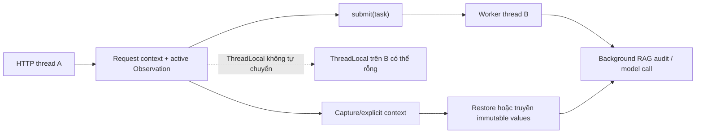

# Truyền ngữ cảnh qua executor hoặc tác vụ nền trong Spring AI

> **Chương:** Streaming và bất đồng bộ  
> **Module:** `SPRING_AI_EVALUATION_OBSERVABILITY` — đánh giá chất lượng ứng dụng Spring AI bằng tập dữ liệu, relevance, fact checking, kiểm thử RAG và tool calling; đồng thời theo dõi metrics, traces, token, chi phí và độ trễ để tìm nguyên nhân suy giảm giữa các phiên bản prompt, model và pipeline.

## Mục tiêu học tập

Sau bài này, bạn có thể:

1. Giải thích vì sao `ThreadLocal`, MDC, active Observation hoặc security context có thể mất khi công việc chuyển sang `Executor`, `CompletableFuture` hoặc `@Async`.
2. Phân biệt **Reactor Context**, **ThreadLocal**, **Micrometer Context Propagation**, **Observation.Scope** và dữ liệu nghiệp vụ cần truyền tường minh.
3. Chọn cách truyền phù hợp: immutable context object, `ContextSnapshot`, `TaskDecorator`, wrapper executor hoặc cơ chế chuyên biệt của Spring Security.
4. Tạo một child observation cho tác vụ nền, giữ parent/trace đúng và đóng scope trên **chính thread thực thi**.
5. Kết hợp Reactor pipeline với executor mà không đánh mất tenant, correlation, model/prompt version hoặc trace; không mang request resources và transaction qua thread một cách tùy tiện.
6. Kiểm thử context propagation, thread reuse, error/cancel và parent-child trace; gắn kết quả với metrics, token usage, chi phí và đánh giá RAG.

## 1. Vấn đề: tác vụ chạy xong nhưng không còn ngữ cảnh của request

Một API Spring AI nhận câu hỏi, tìm tài liệu, gọi model rồi ghi audit bất đồng bộ. Trên thread HTTP, ứng dụng có thể đang giữ:

- `request_id` để liên kết log của một yêu cầu.
- `trace/span` để các spans của retrieval, rerank, model call nằm trong cùng trace.
- `MDC` để log tự thêm correlation ID.
- `tenant_id` và danh tính/ủy quyền của người dùng.
- Phiên bản corpus, prompt, model và pipeline để tái lập kết quả.

Khi code chuyển việc sang thread pool, các giá trị gắn với thread ban đầu không tự đi theo. Tác vụ nền vẫn có thể chạy thành công, nhưng log thiếu request ID, span thành root không mong muốn, hoặc audit ghi nhầm tenant nếu ứng dụng dùng state chia sẻ không an toàn.

Ví dụ:



**Điểm quan trọng:** Truyền context không phải là truyền nguyên thread, cũng không phải giữ một `Observation.Scope` đang mở rồi đóng ở thread khác. Cần mang **giá trị cần thiết** sang boundary mới và thiết lập vòng đời tại nơi tác vụ thực sự chạy.

## 2. Phân biệt các loại context

| Loại | Thường chứa gì? | Cách đi qua async boundary |
| --- | --- | --- |
| **Reactor `Context`** | Dữ liệu gắn với subscription: request marker, observation reference, metadata pipeline | `contextWrite` / `deferContextual`; khi sang executor ngoài Reactor, lấy giá trị rồi truyền rõ |
| **Java `ThreadLocal`** | Giá trị hiện hành trên một thread, như ambient context | Micrometer Context Propagation hoặc wrapper capture/restore |
| **MDC** | Trường logging gắn với thread | Accessor/bridge logging tương thích; không giả định tự lan truyền |
| **Micrometer `Observation`** | Vòng đời một thao tác và quan hệ parent/child | Tạo child với parent đúng; mở scope trên thread chạy tác vụ và stop ở terminal |
| **`Observation.Scope`** | Đưa một observation vào current scope của thread trong khoảng `openScope()` → `close()` | Code đồng bộ trong khoảng scope có thể truy cập current observation; không được mở ở A rồi đóng ở B |
| **Micrometer Context Propagation** | Cơ chế bridge giữa ThreadLocal accessors và context carriers | Có thể capture/restore những ThreadLocal đã đăng ký theo hợp đồng |
| **Spring SecurityContext** | Authentication và authorization context | Cơ chế chuyên biệt Spring Security như delegating executor; không tự copy tùy tiện |
| **Transaction context** | Transaction/resource gắn với thread hoặc execution context của framework | Mở transaction mới trong tác vụ nền khi cần; không bê connection/EntityManager đang mở sang thread khác |
| **Business context** | Tenant, locale, correlation, version, actor reference | Immutable record/value object, truyền tường minh và xác thực lại quyền |

Không phải mọi thứ có tên “context” đều có cùng semantics. Một `request_id` có thể truyền bằng record; một transaction đang mở không thể coi như một chuỗi để sao chép; một Observation object có thể làm parent nhưng không tự biến thành active ThreadLocal ở worker.

### Ba câu hỏi trước khi truyền

1. **Tác vụ cần dữ liệu nào?** Chỉ request ID/tenant/version hay còn cần authentication và quyền?
2. **Tác vụ sống bao lâu?** Kết thúc trước HTTP response hay có thể chạy sau khi request đã đóng?
3. **Thư viện đọc context bằng cách nào?** Nhận tham số tường minh, đọc Reactor Context, hay tìm ThreadLocal/MDC hiện hành?

Chọn cơ chế theo ba câu hỏi này, không chọn một giải pháp propagation rồi áp cho mọi loại dữ liệu.

## 3. Reactor Context không tự truyền sang executor tùy ý

Reactor Context đi theo subscription trong chuỗi reactive tương thích. Khi code đang ở `deferContextual`, ta có thể đọc context rồi **chuyển các giá trị cần thiết thành biến bất biến** trước khi gửi công việc tới executor.

Ví dụ:

```java
import reactor.core.publisher.Mono;
import reactor.core.scheduler.Schedulers;

record RequestContext(
        String requestId,
        String tenantId,
        String pipelineVersion) {}

private static final Object REQUEST_CONTEXT_KEY = new Object();

Mono<String> result = Mono.deferContextual(ctx -> {
    RequestContext request = ctx.get(REQUEST_CONTEXT_KEY);

    // RequestContext được capture rõ ràng trong lambda.
    // Công việc blocking không cần đọc Reactor Context.
    return Mono.fromCallable(() -> legacyService.process(request))
            .subscribeOn(Schedulers.boundedElastic());
}).contextWrite(ctx -> ctx.put(
        REQUEST_CONTEXT_KEY,
        new RequestContext("req-42", "tenant-demo", "rag-v3")));
```

Trong ví dụ, `deferContextual` chạy theo subscription và lấy một immutable record. Lambda của `fromCallable` mang record đó sang worker thread. Đây là **truyền dữ liệu nghiệp vụ tường minh**; nó không tự khôi phục MDC, SecurityContext hoặc active Observation cho thư viện đồng bộ.

### Khi nào cần Context Propagation?

Nếu thư viện ở worker chỉ đọc `ThreadLocal` (ví dụ instrumentation dùng current Observation), cần một bridge capture/restore tương thích. Nếu service nhận được `RequestContext` qua tham số, không cần ép dữ liệu đó vào ThreadLocal chỉ để “có context”.

Đối với một chuỗi thuần Reactor, `publishOn`/`subscribeOn` thường giữ Reactor Context theo subscriber; khi chuyển sang `ExecutorService.execute(...)` hoặc `CompletableFuture.supplyAsync(...)`, đừng giả định executor tự hiểu Reactor Context.

## 4. Truyền immutable business context trước

Một record nhỏ thường là hợp đồng tốt nhất giữa request và background task:

```java
import java.time.Instant;
import java.util.Objects;

public record AiTaskContext(
        String requestId,
        String tenantId,
        String actorReference,
        String corpusVersion,
        String promptVersion,
        String modelVersion,
        Instant requestedAt) {

    public AiTaskContext {
        Objects.requireNonNull(requestId);
        Objects.requireNonNull(tenantId);
        Objects.requireNonNull(corpusVersion);
        Objects.requireNonNull(promptVersion);
        Objects.requireNonNull(modelVersion);
        Objects.requireNonNull(requestedAt);
        if (requestId.isBlank() || tenantId.isBlank()) {
            throw new IllegalArgumentException(
                    "requestId và tenantId không được rỗng");
        }
    }
}
```

Tác vụ nền có thể dùng record để:

- Giới hạn truy vấn vào đúng tenant đã được xác thực.
- Ghi rõ corpus/index, prompt và model version dùng khi tạo câu trả lời.
- Liên kết log/audit với request gốc mà không cần giữ servlet request.
- Tái lập evaluation hoặc phân tích regression sau này.

**Không đưa toàn bộ `HttpServletRequest`, request body nhạy cảm, `SecurityContext` nguyên trạng hoặc object mutable dùng chung vào record chỉ để truyền tiện.** Chỉ giữ dữ liệu tối thiểu, được phép lưu và cần thiết cho tác vụ.

### Correlation không thay authorization

`tenantId` hoặc `actorReference` trong record là dữ liệu để truy vết, không tự chứng minh người gọi còn quyền thực hiện công việc. Với tác vụ chạy trễ hoặc được queue lại:

1. Xác định tác vụ có chạy theo **quyền tại thời điểm gửi** hay **quyền tại thời điểm thực thi**.
2. Dùng service identity/authorization policy phù hợp.
3. Xác minh tenant và phạm vi dữ liệu ở tầng truy cập dữ liệu.
4. Không dùng một request ID do client tự khai làm căn cứ quyền.

## 5. Micrometer Context Propagation: capture và restore ThreadLocal

Micrometer Context Propagation cung cấp registry cho các accessor và snapshot để chuyển những giá trị **đã đăng ký** giữa các context carrier. Với một executor thuần, quy trình khái niệm:

1. Trên thread gửi việc, capture snapshot từ các ThreadLocals có accessor.
2. Gửi một Runnable đã được bọc hoặc tự restore snapshot ở worker.
3. Chạy task trong scope đã restore.
4. Đóng scope trong `finally` để khôi phục trạng thái thread trước đó.

Ví dụ đăng ký một accessor cho correlation ID. API cụ thể cần khớp phiên bản thư viện `io.micrometer:context-propagation`:

```java
import io.micrometer.context.ContextRegistry;
import io.micrometer.context.ThreadLocalAccessor;

public final class RequestCorrelation {
    private RequestCorrelation() {}

    private static final ThreadLocal<String> REQUEST_ID =
            new ThreadLocal<>();
    private static final Object KEY = new Object();

    public static String current() {
        return REQUEST_ID.get();
    }

    public static void set(String value) {
        REQUEST_ID.set(value);
    }

    public static void clear() {
        REQUEST_ID.remove();
    }

    public static void registerAccessor() {
        ContextRegistry.getInstance().registerThreadLocalAccessor(
                new ThreadLocalAccessor<String>() {
                    @Override
                    public Object key() {
                        return KEY;
                    }

                    @Override
                    public String getValue() {
                        return REQUEST_ID.get();
                    }

                    @Override
                    public void setValue(String value) {
                        REQUEST_ID.set(value);
                    }

                    @Override
                    public void reset() {
                        REQUEST_ID.remove();
                    }
                });
    }
}
```

Accessor cần được đăng ký **một lần lúc bootstrap**, không đăng ký lại trên mỗi request. Nếu ứng dụng đã có accessor do framework/instrumentation cung cấp cho observation, tracing hoặc logging, hãy dùng accessor tương ứng; tránh đăng ký trùng cùng key với semantics khác.

### Capture snapshot và chạy một task

```java
import io.micrometer.context.ContextSnapshot;
import io.micrometer.context.ContextSnapshotFactory;

import java.util.concurrent.ExecutorService;

public final class ContextAwareSubmitter {
    private final ContextSnapshotFactory snapshotFactory =
            ContextSnapshotFactory.builder().build();

    public void submit(ExecutorService executor, Runnable task) {
        // Gọi tại thread đang có các ThreadLocal cần truyền.
        ContextSnapshot snapshot = snapshotFactory.captureAll();

        executor.execute(() -> {
            try (ContextSnapshot.Scope ignored =
                         snapshot.setThreadLocals()) {
                task.run();
            }
            // Scope.close() khôi phục/xóa giá trị trên worker thread.
        });
    }
}
```

`captureAll()` chỉ capture các giá trị có accessor đã đăng ký và đang hiện diện tại **thời điểm capture**. Nó không đọc Reactor Context một cách thần kỳ nếu các giá trị chỉ nằm trong Reactor Context và chưa được bridge sang ThreadLocal.

### Vì sao phải đóng Scope?

Thread pool tái sử dụng worker. Nếu request A đặt `REQUEST_ID=req-A` mà không restore/clear, task B chạy sau có thể đọc nhầm `req-A`. Đây là lỗi rò ngữ cảnh và có thể nghiêm trọng nếu dữ liệu tenant/auth cũng bị xử lý sai.

`ContextSnapshot.Scope` dùng try-with-resources để khôi phục trạng thái trước đó khi task kết thúc, kể cả khi task ném exception. Không giữ scope mở sau khi task trả về hoặc truyền scope object sang một thread khác.

**Giới hạn:** Snapshot chỉ là ảnh chụp của context được đăng ký. Nếu một tác vụ nền chạy lâu và cần thông tin mới về quyền, trạng thái tenant hoặc cấu hình, phải truy vấn/xác thực lại theo policy; snapshot cũ không phải nguồn sự thật vĩnh viễn.

## 6. Dùng TaskDecorator cho Spring TaskExecutor và @Async

Spring Framework có `TaskDecorator` để bọc Runnable trước khi executor thực thi. Đây là một điểm tích hợp phù hợp cho `ThreadPoolTaskExecutor` khi muốn capture context từ thread submit và restore trên worker.

```java
import io.micrometer.context.ContextSnapshot;
import io.micrometer.context.ContextSnapshotFactory;
import org.springframework.context.annotation.Bean;
import org.springframework.context.annotation.Configuration;
import org.springframework.core.task.TaskDecorator;
import org.springframework.scheduling.concurrent.ThreadPoolTaskExecutor;

import java.util.concurrent.Executor;

@Configuration
public class BackgroundExecutorConfiguration {

    @Bean
    ContextSnapshotFactory contextSnapshotFactory() {
        return ContextSnapshotFactory.builder().build();
    }

    @Bean(name = "aiBackgroundExecutor")
    Executor aiBackgroundExecutor(
            ContextSnapshotFactory snapshotFactory) {

        ThreadPoolTaskExecutor executor = new ThreadPoolTaskExecutor();
        executor.setCorePoolSize(4);
        executor.setMaxPoolSize(12);
        executor.setQueueCapacity(200);
        executor.setThreadNamePrefix("ai-background-");

        TaskDecorator decorator = task -> {
            // decorate được gọi ở đường submit; capture context hiện tại.
            ContextSnapshot snapshot = snapshotFactory.captureAll();
            return () -> {
                try (ContextSnapshot.Scope ignored =
                             snapshot.setThreadLocals()) {
                    task.run();
                }
            };
        };
        executor.setTaskDecorator(decorator);
        return executor;
    }
}
```

Đoạn mã là cấu hình minh họa. Cần bảo đảm accessor đã đăng ký trước khi task được gửi; nếu chỉ dùng Micrometer/Spring Boot auto-configuration, hãy xác nhận context propagation module và version thực tế. `TaskDecorator` không tự tạo accessors cho mọi ThreadLocal.

Sử dụng với `@Async`:

```java
import java.util.concurrent.CompletableFuture;
import org.springframework.scheduling.annotation.Async;
import org.springframework.stereotype.Service;

@Service
public class PolicyAuditService {

    @Async("aiBackgroundExecutor")
    public CompletableFuture<Void> recordAsync(
            AiTaskContext context,
            String resultReference) {

        // Business context được truyền tường minh qua tham số.
        // MDC/Observation ThreadLocals được decorator restore nếu
        // các accessor tương ứng đã được cấu hình.
        auditRepository.save(
                context.requestId(),
                context.tenantId(),
                resultReference);
        return CompletableFuture.completedFuture(null);
    }
}
```

Để `@Async` hoạt động, ứng dụng phải bật async processing (ví dụ `@EnableAsync`) và gọi method qua Spring proxy. Gọi một method async khác bằng `this.recordAsync(...)` trong cùng bean thường không đi qua proxy nên không tạo async boundary như mong đợi.

### Khi TaskDecorator chưa đủ

Một decorator capture tại thời điểm task được submit là phù hợp với task được gửi từ thread đã có context. Nhưng nếu một stage của `CompletableFuture` hoàn thành trên worker không có context rồi mới submit stage kế tiếp, decorator có thể capture **một context rỗng**. Với chuỗi nhiều bước, hãy capture snapshot ở boundary ban đầu và dùng nó tường minh cho các stage cần cùng context, hoặc dùng executor đã được bọc đúng contract.

## 7. CompletableFuture: mỗi async stage là một boundary

`CompletableFuture.supplyAsync(...)` có thể chạy trên common ForkJoinPool nếu không truyền executor. Các stage `thenApplyAsync`/`thenComposeAsync` cũng có thể chuyển thread. Không được giả định chúng mang ThreadLocal từ request ban đầu.

Ví dụ capture một snapshot và restore trong task:

```java
import io.micrometer.context.ContextSnapshot;
import io.micrometer.context.ContextSnapshotFactory;

import java.util.concurrent.CompletableFuture;
import java.util.concurrent.Executor;

public final class AsyncModelAudit {
    private final ContextSnapshotFactory snapshotFactory;
    private final Executor executor;

    public AsyncModelAudit(
            ContextSnapshotFactory snapshotFactory,
            Executor executor) {
        this.snapshotFactory = snapshotFactory;
        this.executor = executor;
    }

    public CompletableFuture<String> auditAsync(String answerId) {
        // Capture một lần tại boundary đang có context đúng.
        ContextSnapshot snapshot = snapshotFactory.captureAll();

        return CompletableFuture.supplyAsync(() -> {
            try (ContextSnapshot.Scope ignored =
                         snapshot.setThreadLocals()) {
                return auditService.readSummary(answerId);
            }
        }, executor);
    }
}
```

### Các stage nối tiếp

Nếu cần context trong nhiều async stages, mỗi callback phải chạy dưới snapshot phù hợp:

```java
ContextSnapshot snapshot = snapshotFactory.captureAll();

CompletableFuture<Result> future =
        CompletableFuture.supplyAsync(
                () -> runRetrievalWithSnapshot(snapshot),
                executor)
        .thenApplyAsync(
                value -> runEvaluationWithSnapshot(snapshot, value),
                executor);
```

Ở đây hai helper phải **tự restore và close** snapshot trong từng callback, hoặc executor được bọc để làm việc đó. Không giữ một `Scope` duy nhất bao quanh cả chuỗi future: các callback có thể chạy ở thread khác nhau và thời điểm khác nhau.

### Callback không Async có semantics khác

`thenApply` không chỉ định executor; callback có thể chạy trên thread hoàn thành stage trước hoặc ngay thread gọi nếu future đã hoàn tất. Vì vậy, nếu callback phụ thuộc ThreadLocal, không nên dựa vào “nó chắc chắn chạy trên worker đã có context”. Dùng stage async với executor có propagation rõ hoặc truyền context như tham số.

## 8. Từ Reactor Context sang executor ngoài Reactor

Đây là ranh giới dễ bị hiểu nhầm. Reactor Context có thể chứa `AiTaskContext` và một parent observation. Khi vào `deferContextual`, hãy đọc các giá trị và truyền rõ sang task:

```java
import io.micrometer.observation.Observation;
import reactor.core.publisher.Mono;
import reactor.core.scheduler.Schedulers;

private static final Object AI_CONTEXT_KEY = new Object();
private static final Object PARENT_OBSERVATION_KEY = new Object();

Mono<AuditResult> audit = Mono.deferContextual(ctx -> {
    AiTaskContext aiContext = ctx.get(AI_CONTEXT_KEY);
    Observation parent = ctx.getOrDefault(
            PARENT_OBSERVATION_KEY, null);

    return Mono.fromCallable(() ->
            runAuditWithObservation(aiContext, parent))
            .subscribeOn(Schedulers.boundedElastic());
}).contextWrite(ctx -> ctx
        .put(AI_CONTEXT_KEY, aiTaskContext)
        .put(PARENT_OBSERVATION_KEY, parentObservation));
```

`AiTaskContext` được truyền như tham số. `parent` được truyền tường minh để tạo child Observation trong worker; nó **không phải ThreadLocal Scope**. Ví dụ giả định parent còn sống đủ lâu theo lifecycle của pipeline.

Một helper đồng bộ:

```java
import io.micrometer.observation.Observation;
import io.micrometer.observation.ObservationRegistry;

AuditResult runAuditWithObservation(
        AiTaskContext context,
        Observation parent) {

    Observation child = Observation
            .createNotStarted("app.ai.background.audit",
                    observationRegistry)
            .lowCardinalityKeyValue("stage", "audit");

    if (parent != null) {
        child.parentObservation(parent);
    }
    child.start();

    try (Observation.Scope ignored = child.openScope()) {
        return auditService.run(context);
    } catch (RuntimeException failure) {
        child.error(failure);
        throw failure;
    } finally {
        child.stop();
    }
}
```

Scope được mở và đóng **trên cùng worker thread**. Child observation bắt đầu/dừng trong cùng tác vụ đồng bộ. Nếu tác vụ trả về một publisher khác, không được stop ngay khi chỉ tạo publisher; cần đặt lifecycle quanh subscription/terminal của publisher ấy.

### Khi không cần ThreadLocal

Nếu tất cả code downstream nhận `AiTaskContext` bằng tham số, có thể chỉ cần Reactor Context → tham số immutable. Không cần capture/restore ThreadLocal chỉ để mang request ID. Điều này giảm coupling với thread và làm unit test dễ hơn.

## 9. Observation của tác vụ nền và tuổi thọ parent

Một request HTTP có thể khởi chạy tác vụ nền chạy thêm 20 phút. Nếu giữ request Observation scope mở cho đến khi background task kết thúc:

- HTTP request bị coi là chưa kết thúc dù response đã trả.
- Span duration bị kéo dài sai semantics.
- Scope có thể rò qua thread hoặc callback.
- Một queue retry sau vài phút có thể cố khôi phục context đã hết vòng đời nghiệp vụ.

Hãy quyết định một trong hai mô hình:

| Mô hình | Dùng khi | Cách biểu diễn |
| --- | --- | --- |
| **Child operation trong cùng request** | Công việc thực sự là phần của response và request chờ nó hoàn tất | Child Observation/span thuộc parent; parent sống đến khi pipeline hoàn tất |
| **Detached background job** | API trả nhanh, job chạy độc lập/queue/retry sau đó | Tạo job ID và observation riêng; giữ correlation reference. Dùng span link nếu tracing backend/API hỗ trợ và semantics phù hợp |

Không mặc định một tác vụ detached phải là child span còn sống dưới request đã kết thúc. Trong mô hình queue, thường hữu ích hơn khi tạo trace/span cho job, mang `request_id` làm correlation metadata và liên kết parent theo cơ chế tracing hỗ trợ.

**Observation object và span context không phải cùng một thứ:** Nếu chỉ cần liên kết một trace đã kết thúc, có thể cần lưu context/trace identifiers theo tracing API thay vì giữ nguyên object Observation đang active. Hãy theo contract của bridge Micrometer Tracing/OpenTelemetry đang dùng.

## 10. Spring Security, transaction và request scope cần cơ chế riêng

Không phải mọi context đều nên đưa vào `ContextSnapshot` chung.

### SecurityContext

Nếu tác vụ cần chạy với danh tính bảo mật của caller, Spring Security cung cấp các wrapper như `DelegatingSecurityContextExecutor` hoặc `DelegatingSecurityContextAsyncTaskExecutor` tùy loại executor và phiên bản. Dùng cơ chế này theo chính sách của ứng dụng thay vì tự sao chép `SecurityContextHolder` bằng một ThreadLocal accessor tùy tiện.

Phải quyết định:

- Công việc chạy theo **quyền caller** hay **service account**?
- Quyền có được kiểm tra lại lúc job thực thi không?
- Job có được phép tiếp tục sau khi user logout hoặc quyền bị thu hồi không?
- Audit có ghi actor reference và policy version không?

Correlation ID/tenant ID không phải authorization. Đừng đưa token bearer hoặc secret vào MDC, trace attributes hay task payload chỉ để tiện debug.

### Transaction và persistence context

Transaction thường gắn với thread/execution context do transaction manager quản lý. Không capture một `EntityManager`, JDBC Connection hoặc transaction đang mở rồi dùng ở worker thread khác. Nếu tác vụ nền cần ghi database:

1. Truyền ID/command/value object.
2. Mở transaction mới trong method được gọi trên worker (ví dụ method `@Transactional` qua Spring proxy).
3. Đọc lại entity trong transaction của worker.
4. Thiết kế idempotency/retry vì background task có thể chạy nhiều lần.

### Servlet request/session attributes

Không giữ `HttpServletRequest`, `HttpServletResponse`, session mutable hoặc request-scoped bean sau khi HTTP request kết thúc. Copy những trường được phép như locale, tenant reference, request ID vào immutable context; nếu cần dữ liệu mới, truy vấn qua service có quyền.

## 11. Spring AI: truyền context cho RAG và tool calls nền

Một pipeline có thể cần background tasks để:

- Ghi evaluation result sau khi stream hoàn tất.
- Tạo audit record từ final context manifest.
- Chạy một bộ judge offline sau khi user nhận response.
- Tính cost/reconcile usage sau khi provider billing xuất hiện.
- Lập chỉ mục lại hoặc tạo embedding theo batch.

Các tác vụ này có semantics khác nhau:

| Tác vụ | Context cần | Điều không nên truyền |
| --- | --- | --- |
| Evaluation sau response | Request/case ID, corpus/prompt/model version, final evidence reference, answer reference | Toàn bộ HTTP request hoặc active Scope |
| Billing reconciliation | Provider request ID, attempt IDs, usage source, pricing version | Chỉ output tokens của attempt cuối nếu có retry |
| Background indexing | Tenant scope, document reference, index version, actor/job identity | EntityManager/transaction của request |
| Tool execution | Tool call ID, tenant, allowlisted arguments, policy reference | Raw authentication token trong log |
| Async judge | Dataset/case ID, answer/evidence snapshot, rubric/judge version | Dữ liệu nhạy cảm không cần cho chấm |

### Ví dụ service audit nhận context rõ ràng

```java
public record EvaluationJob(
        String jobId,
        String requestId,
        String tenantId,
        String caseId,
        String corpusVersion,
        String promptVersion,
        String modelVersion,
        String evidenceManifestRef,
        String answerReference) {}

public interface EvaluationJobService {
    void evaluate(EvaluationJob job);
}
```

Một message queue có thể lưu `EvaluationJob` và worker đọc lại khi chạy. Job có thể sống lâu hơn request; dùng `jobId` để retry/idempotency và `requestId` để correlation. Kiểm tra lại quyền truy cập vào evidence manifest khi worker thực thi, đặc biệt nếu dữ liệu có thể bị xóa hoặc quyền thay đổi.

### Không để background evaluation làm sai latency người dùng

Nếu evaluation chạy sau response, không cộng duration của judge vào `user_response_latency`. Ghi:

- `request_latency` cho response path.
- `background_evaluation_duration` cho job.
- `evaluation_queue_wait` cho thời gian chờ queue.
- `evaluation_status` và `judge_version`.

Nếu evaluation đồng bộ và người dùng phải chờ kết quả, khi đó mới đưa nó vào end-to-end response path theo đúng contract.

## 12. Cleanup, thread reuse, cancellation và exception

Context propagation đúng không chỉ là “giá trị có mặt ở worker”. Nó còn phải **được dọn đúng lúc**.

| Tình huống | Rủi ro | Cách xử lý |
| --- | --- | --- |
| Task kết thúc bình thường | ThreadLocal còn sót sang task sau | Đóng `ContextSnapshot.Scope` trong try-with-resources |
| Task ném exception | Cleanup không chạy nếu chỉ đặt ở cuối thân hàm | Dùng `finally`/try-with-resources |
| Task bị cancel trước khi bắt đầu | Snapshot đã capture nhưng task không chạy | Không mở scope trước khi task chạy; giải phóng tài nguyên gắn với queue nếu cần |
| Task bị interrupt khi chạy | Code bỏ qua interrupt hoặc scope không đóng | `finally` luôn chạy; tôn trọng interrupt |
| Worker tái sử dụng | Context của A lẫn vào B | Test hai task liên tiếp trên cùng single-thread executor |
| Task retry | Dùng snapshot cũ sau khi quyền/context đã đổi | Revalidate business/security context theo policy |
| Async job sống lâu | Giữ request payload hoặc Observation scope quá lâu | Lưu job context nhỏ, tạo observation mới cho mỗi attempt |
| Exporter/telemetry lỗi | Làm task nghiệp vụ thất bại ngoài ý muốn | Cách ly lỗi telemetry, có fallback/log an toàn |

### Helper chạy task trong snapshot

```java
import io.micrometer.context.ContextSnapshot;

public final class SnapshotTask {
    private SnapshotTask() {}

    public static Runnable wrap(
            ContextSnapshot snapshot,
            Runnable delegate) {
        return () -> {
            try (ContextSnapshot.Scope ignored =
                         snapshot.setThreadLocals()) {
                delegate.run();
            }
        };
    }
}
```

Đoạn helper không capture snapshot; caller phải capture ở đúng boundary và chỉ chia sẻ snapshot theo contract của thư viện. Mỗi lần chạy task tạo scope riêng, và scope đóng trên worker thread.

## 13. Kiểm thử context propagation với executor thật

Một test quan trọng dùng **single-thread executor** để bảo đảm hai tác vụ lần lượt dùng lại cùng worker. Test chứng minh snapshot khôi phục giá trị cho task A và không rò sang task B.

```java
import static org.junit.jupiter.api.Assertions.assertEquals;
import static org.junit.jupiter.api.Assertions.assertNull;

import io.micrometer.context.ContextSnapshot;
import io.micrometer.context.ContextSnapshotFactory;
import org.junit.jupiter.api.Test;

import java.util.concurrent.ExecutorService;
import java.util.concurrent.Executors;
import java.util.concurrent.CompletableFuture;

class ExecutorContextPropagationTest {

    @Test
    void restoresContextAndClearsItBeforeNextTask() throws Exception {
        ExecutorService executor =
                Executors.newSingleThreadExecutor();
        try {
            RequestCorrelation.registerAccessor();
            ContextSnapshotFactory factory =
                    ContextSnapshotFactory.builder().build();

            RequestCorrelation.set("req-A");
            ContextSnapshot snapshot = factory.captureAll();
            RequestCorrelation.clear();

            String capturedValue = executor.submit(() -> {
                try (ContextSnapshot.Scope ignored =
                             snapshot.setThreadLocals()) {
                    return RequestCorrelation.current();
                }
            }).get();
            assertEquals("req-A", capturedValue);

            // Cùng worker thread: sau scope, không còn req-A.
            String leakedValue = executor.submit(
                    RequestCorrelation::current).get();
            assertNull(leakedValue);
        } finally {
            RequestCorrelation.clear();
            executor.shutdownNow();
        }
    }
}
```

Đây là ví dụ minh họa API Micrometer Context Propagation; trong test suite thực, đăng ký accessor **một lần** ở setup dùng chung để tránh trùng key khi chạy nhiều test. Nếu có các accessor khác (MDC/Observation), test riêng từng loại và xác nhận trạng thái trước/sau task.

### Kiểm thử Reactor Context và executor boundary

```java
import static org.junit.jupiter.api.Assertions.assertEquals;

import java.util.concurrent.ExecutorService;
import java.util.concurrent.Executors;

import org.junit.jupiter.api.Test;
import reactor.core.publisher.Mono;
import reactor.test.StepVerifier;

class ReactorToExecutorContextTest {

    private static final Object KEY = new Object();

    @Test
    void readsContextThenPassesImmutableValueToWorker() {
        ExecutorService executor =
                Executors.newSingleThreadExecutor();
        try {
            Mono<String> pipeline = Mono.deferContextual(ctx -> {
                RequestContext request = ctx.get(KEY);
                return Mono.fromFuture(CompletableFuture.supplyAsync(
                        () -> request.requestId() + "/" +
                                request.tenantId(),
                        executor));
            }).contextWrite(ctx -> ctx.put(KEY,
                    new RequestContext("req-7", "tenant-2", "rag-v1")));

            StepVerifier.create(pipeline)
                    .expectNext("req-7/tenant-2")
                    .verifyComplete();
        } finally {
            executor.shutdownNow();
        }
    }
}
```

Test này **không cần** Micrometer ContextSnapshot: nó chứng minh cách lấy value từ Reactor Context và truyền tường minh qua lambda sang một executor. Trong production, dùng adapter async phù hợp và quản lý vòng đời executor qua Spring; không block event loop.

### Test bổ sung nên có

| Ca | Điều cần xác nhận |
| --- | --- |
| Hai request A/B đồng thời | Không trộn tenant, request ID hoặc parent Observation |
| Task ném exception | ThreadLocal được restore/clear |
| Task bị cancel/interrupted | Scope và tài nguyên được cleanup |
| `@Async` qua proxy | TaskDecorator thực sự được gọi |
| CompletableFuture chain nhiều stage | Context có ở từng async callback cần thiết |
| Executor ngoài Spring | Wrapper snapshot hoạt động và thread không rò |
| Reactor `publishOn` | Reactor Context còn; active Observation được bridge đúng |
| Retry | Mỗi attempt có ID/Observation riêng và correlation đúng |
| Detached job | Không giữ request Scope; job có trace/correlation riêng |
| Security context | Quyền được truyền/kiểm tra theo policy chuyên biệt |

## 14. Metrics và traces cho công việc nền

Một request có thể kết thúc nhanh nhưng job evaluation chạy thêm 5 giây. Dashboard cần tách hai lifecycle:

| Metric | Ý nghĩa |
| --- | --- |
| `background_job_submitted_total` | Số job được gửi |
| `background_job_started_total` | Số job bắt đầu chạy |
| `background_job_completed_total` | Số job hoàn tất |
| `background_job_failed_total` | Số job lỗi |
| `background_job_cancelled_total` | Số job bị hủy |
| `background_queue_wait` | Từ submit đến start |
| `background_execution_duration` | Từ start đến terminal |
| `context_propagation_missing_total` | Số task thiếu context bắt buộc theo contract |
| `evaluation_cost` | Chi phí judge/model/tool nếu có usage đáng tin |
| `usage_coverage` | Tỷ lệ attempts có usage final |

Tên metric trên là do ứng dụng định nghĩa. Dùng tags có cardinality thấp như `job_type`, `outcome`, nhóm executor hoặc pipeline version. Không gắn `request_id`, `job_id`, raw tenant ID, prompt hoặc document ID làm metric labels.

### Trace mẫu

```text
HTTP request span
  RAG answer span
    vector search
    model stream
  response sent

background evaluation job span (tác vụ detached)
  queue wait
  load evidence manifest
  judge call attempt
  persist score
```

Nếu background job được thiết kế là phần đồng bộ của request, có thể là child span trong trace gốc. Nếu detached, cân nhắc trace riêng và liên kết correlation/parent context theo tracing backend hỗ trợ. Không kéo dài span HTTP chỉ để chờ job đã được tách ra.

### Liên kết với quality evaluation

Job nền cần lưu đủ version để score không bị gắn nhầm:

- `dataset_version` và `case_id`.
- `corpus_version`/`index_version` cùng evidence manifest.
- `prompt_version`, `model_version`, `pipeline_version`.
- `judge_version`, `rubric_version`.
- `request_id`, `job_id`, `attempt_number` và trace reference.
- Token usage, usage state, pricing version và cost nếu được xác nhận.

Nếu background judge chạy sau khi corpus đã đổi, nó vẫn phải chấm **snapshot evidence đã dùng trong request gốc**, hoặc ghi rõ đang chấm theo corpus mới. Không truy vấn lại “cùng câu hỏi” trên corpus hiện tại rồi giả vờ đó là bằng chứng của câu trả lời cũ.

## 15. Các lỗi thường gặp và cách khoanh vùng

| Triệu chứng | Nguyên nhân có thể | Hướng xử lý |
| --- | --- | --- |
| Log worker thiếu request ID | ThreadLocal không được capture/restore hoặc không có accessor | Kiểm tra accessor, snapshot và task boundary |
| Reactor Context có key nhưng thư viện báo current Observation null | Carrier có dữ liệu nhưng chưa restore active scope | Kiểm tra bridge Micrometer/Reactor và scope trên callback |
| Parent span sai hoặc thành root | Snapshot capture sai thời điểm hoặc parent lifecycle không phù hợp | Kiểm tra trace hierarchy và parent reference |
| Tenant của task B giống task A | ThreadLocal leak hoặc state mutable dùng chung | Dùng immutable context, close scope và test thread reuse |
| `@Async` không có propagation | Method không qua proxy, executor khác bean hoặc decorator không được gắn | Kiểm tra invocation/proxy và đúng executor qualifier |
| Stage `thenApply` thiếu context | Callback chạy trên thread hoàn thành trước đó | Dùng tham số explicit hoặc async stage với wrapper |
| Background transaction lỗi | Đang dùng transaction/resource từ request thread | Mở transaction mới trong worker |
| Job chạy sau logout nhưng vẫn dùng quyền cũ | Security snapshot sống quá lâu | Revalidate quyền hoặc chạy theo service identity |
| Số spans tăng sau retry | Đếm attempts như requests | Tách request ID và attempt ID |
| Cost/job thiếu | Provider usage không final hoặc một attempt mất metadata | Ghi usage state, reconcile billing |
| Evaluation không tái lập | Không lưu evidence/prompt/model/judge version | Gắn provenance và manifest reference |

## 16. Bài thực hành

Một ứng dụng Spring AI nhận request `req-77` từ tenant `tenant-A`. Pipeline tìm tài liệu và tạo câu trả lời. Sau khi trả HTTP response, ứng dụng gửi hai tác vụ:

1. `auditAnswer` chạy bằng `ThreadPoolTaskExecutor` để ghi manifest và model version.
2. `judgeAnswer` chạy qua `CompletableFuture` trên một executor khác để đánh giá groundedness.

Đội phát triển quan sát:

| Tình huống | Kết quả |
| --- | --- |
| A | `auditAnswer` ghi đúng `request_id`, nhưng span không có parent |
| B | `judgeAnswer` không thấy MDC request ID và không thấy current Observation |
| C | Task B sau đó đọc nhầm tenant từ task trước trên cùng worker |
| D | Một transaction JPA đang mở ở HTTP thread được đưa vào task nền và phát sinh lỗi |
| E | Model call retry hai lần; báo cáo chỉ tính usage attempt cuối |

**Yêu cầu:**

1. Với A, vì sao correlation đúng nhưng parent span vẫn có thể sai? Cần kiểm tra những gì?
2. Với B, phân biệt việc thiếu MDC với thiếu Reactor Context/active Observation. Cần propagation nào?
3. Với C, mô tả cách ngăn thread-local leak và một test xác nhận.
4. Với D, nên truyền gì vào task và mở transaction ở đâu?
5. Với E, cần lưu những ID/trạng thái nào để tính usage/cost không thiếu hoặc cộng trùng?
6. Nếu `judgeAnswer` là job detached, có nên giữ HTTP Observation Scope đến khi job xong không?

### Đáp án gợi ý

1. `request_id` có thể đã được truyền bằng record hoặc tham số, nhưng parent Observation chưa được gắn vào child. Kiểm tra snapshot capture, accessor, thời điểm parent, explicit `parentObservation`, trace exporter và parentSpanId.
2. MDC là context logging; Reactor Context là carrier theo subscription; active Observation có thể dựa vào ThreadLocal. Dùng accessor/bridge phù hợp cho MDC/Observation, hoặc truyền dữ liệu nghiệp vụ tường minh; không giả định một cách xử lý sẽ tự bao phủ tất cả.
3. Bọc task bằng `ContextSnapshot.Scope` trong try-with-resources để restore trạng thái trước đó. Test bằng single-thread executor: task A thấy `req-A`, task B tiếp theo thấy `null`/giá trị nền đã định, không thấy `req-A`.
4. Truyền ID/command/value object (ví dụ tenant và entity ID đã được xác thực), không truyền EntityManager/transaction đang mở. Worker mở transaction mới qua service method `@Transactional` được gọi qua Spring proxy.
5. Lưu `request_id`, `call_id`, `attempt_number`, provider request ID nếu có, terminal outcome, usage state, final/partial snapshots và pricing version. Mỗi attempt có final usage riêng; không cộng cumulative snapshots trong cùng attempt và không bỏ các attempt đã tiêu token.
6. Không. Job detached có lifecycle riêng; tạo observation/span cho job, giữ correlation reference hoặc link phù hợp. HTTP request/span kết thúc khi response path hoàn tất.

## Ghi nhớ

- **Executor không tự mang ThreadLocal:** chuyển thread cần truyền dữ liệu tường minh hoặc capture/restore những ThreadLocals đã đăng ký.
- **Reactor Context khác ThreadLocal:** đọc giá trị ở `deferContextual`, rồi truyền immutable context vào executor; context carrier không tự làm active Observation trên worker.
- **Micrometer ContextSnapshot cần accessor:** capture đúng thời điểm, restore trong worker và đóng Scope bằng try-with-resources để tránh rò trên thread pool.
- **TaskDecorator hữu ích cho Spring @Async:** nhưng mọi async stage và executor boundary phải có propagation đúng; nested CompletableFuture có thể cần snapshot gốc.
- **Observation Scope chỉ sống trong callback/thread:** tạo child với parent phù hợp, mở/đóng trên worker; job detached có lifecycle riêng.
- **Security và transaction cần cơ chế chuyên biệt:** không bê request, token, EntityManager hoặc transaction đang mở sang thread khác.
- **Đánh giá phải có provenance:** gắn request/job/attempt, corpus/prompt/model/judge version, evidence manifest, usage và cost để truy vết RAG và tái lập kết quả.
