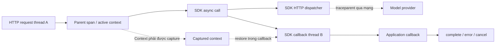

# Xử lý trace đứt đoạn khi SDK đổi thread trong Spring AI

> **Chương:** Streaming và bất đồng bộ  
> **Module:** `SPRING_AI_EVALUATION_OBSERVABILITY` — đánh giá chất lượng ứng dụng Spring AI bằng tập dữ liệu, relevance, fact checking, kiểm thử RAG/tool calling; đồng thời đo metrics, traces, token, chi phí và độ trễ để tìm nguyên nhân suy giảm qua các phiên bản prompt, model và pipeline.

## Mục tiêu học tập

Sau bài này, bạn có thể:

1. Nhận diện trace bị đứt khi SDK gửi request, đọc stream hoặc gọi callback trên executor/thread pool riêng.
2. Phân biệt **context propagation trong process**, **trace propagation qua HTTP/RPC** và **MDC/log correlation**.
3. Capture OpenTelemetry Context hoặc Micrometer context ở đúng boundary, khôi phục context trong callback và đóng scope trên chính thread đang chạy callback.
4. Chọn giải pháp phù hợp khi SDK cho cấu hình executor, chỉ cung cấp callback, tự quản lý thread nội bộ hoặc đã được auto-instrument.
5. Quản lý vòng đời span cho async call/stream qua complete, error, cancel; không để span mồ côi, span treo hoặc parent link sai.
6. Kiểm thử trace parent-child qua thread switch, phân biệt lỗi propagation với sampling/exporter và liên kết trace với evaluation RAG, token usage, chi phí.

## 1. Dấu hiệu SDK đổi thread làm trace bị đứt

Một ứng dụng Spring AI chạy trên WebFlux có thể xử lý request trên event-loop thread, sau đó gọi SDK model bất đồng bộ. SDK chuyển việc sang HTTP dispatcher, worker pool hoặc callback executor riêng. Kết quả model vẫn về và UI vẫn nhận chunks, nhưng tracing hiển thị:

- Span HTTP có trace ID, còn callback xử lý câu trả lời không có current span.
- Span model call trở thành một root trace mới thay vì child của request.
- Log trong callback mất MDC hoặc correlation ID.
- Span được tạo nhưng không stop khi stream bị hủy.
- Trace có cùng trace ID nhưng quan hệ parent-child hoặc thời lượng không đúng.

Những dấu hiệu này cần được phân tích riêng. **Mất current context trong callback**, **không inject trace context vào request gửi sang provider**, và **span không được export do sampling/configuration** là ba nguyên nhân khác nhau.



Đổi thread tự nó không làm một trace phân tán mất trace ID nếu instrumentation và propagation được cấu hình đúng. Vấn đề xuất hiện khi **context không được mang qua boundary**, hoặc SDK không được instrument ở điểm gửi request/callback.

## 2. Ba lớp propagation cần phân biệt

| Lớp | Câu hỏi | Cơ chế thường dùng | Lỗi thường gặp |
| --- | --- | --- | --- |
| **Trong cùng process** | Callback trên thread B biết span hiện hành nào? | OpenTelemetry Context, Micrometer Context Propagation, executor/callback wrapper | ThreadLocal của thread A không có trên B |
| **Qua mạng** | Provider/service nhận request biết trace cha nào? | W3C Trace Context (traceparent, tracestate) hoặc propagator tương ứng | SDK HTTP client không inject headers hoặc propagation bị tắt |
| **Log correlation** | Log của callback có trace/request ID không? | MDC bridge, logging instrumentation, ThreadLocal accessor | Trace đúng nhưng MDC chưa được restore; hoặc MDC có request ID nhưng span parent sai |

Không dùng việc log có request_id làm bằng chứng tracing đúng. Một request ID có thể được truyền tường minh bằng tham số trong khi callback vẫn không có current span. Ngược lại, span có thể đúng nhưng logger chưa được cấu hình để thêm trace ID vào MDC.

### Trace ID, span ID và parent span ID

- **Trace ID** liên kết nhiều spans thuộc cùng một trace.
- **Span ID** định danh một operation cụ thể.
- **Parent span ID** chỉ ra span nào trực tiếp tạo operation con.
- **Baggage** mang metadata được propagator cho phép truyền qua service boundary; không nên dùng để chuyển dữ liệu nhạy cảm hoặc payload lớn.

Nếu callback chạy trên thread mới và không có context, code tạo span mới có thể vô tình tạo **root span khác**. Nếu context được capture nhưng parent span đã kết thúc, trace vẫn có thể liên kết đúng về mặt cấu trúc; tuy nhiên cần xem xét semantics của job detached và thời gian sống của parent.

## 3. Vì sao SDK có thể đổi thread?

SDK async thường tách nhiều loại công việc:

| Thành phần | Vai trò | Thread có thể dùng |
| --- | --- | --- |
| HTTP dispatcher | Gửi request và đọc response từ socket | Event loop/dispatcher riêng |
| Streaming parser | Chuyển byte thành events/chunks | Reader/worker thread |
| Callback executor | Gọi onNext, onError, onComplete hoặc listener | Executor do SDK quản lý hoặc do ứng dụng truyền |
| Completion stage | Hoàn tất CompletableFuture | Thread hoàn tất upstream hoặc executor chỉ định |
| Retry/backoff scheduler | Thực hiện retry, delay và timeout | Scheduler/timer riêng |
| Tool callback | Chạy code tích hợp của ứng dụng | Executor riêng, có thể lồng nhiều async stages |

Không phải SDK nào cũng dùng một thread cố định. Một request có thể nhận headers trên thread A, chunk đầu trên thread B, chunk tiếp theo trên thread C và terminal callback trên thread D. Không được lưu Scope hoặc biến currentSpan mutable toàn cục rồi giả định mọi callback chạy tuần tự trên một worker.

### Phân biệt thread switch với process boundary

Nếu SDK gọi một service từ xa, propagation qua HTTP/RPC phải được thực hiện tại client transport. Nếu SDK chỉ chuyển callback sang thread khác trong cùng JVM, cần context propagation trong process. Một giải pháp chỉ bọc callback **không tự inject traceparent vào HTTP request**; một HTTP instrumentation inject header đúng cũng **không tự khôi phục current span trong callback ứng dụng**.

## 4. Kiểm tra SDK trước khi sửa instrumentation

Trước khi thêm wrapper, xác định SDK cung cấp những điểm mở rộng nào:

1. Có thể truyền Executor/ExecutorService vào client builder không?
2. Có thể truyền callback executor riêng cho streaming listener không?
3. Có API whenComplete, thenApply, listener hoặc event consumer mà ứng dụng kiểm soát không?
4. SDK có dùng HTTP client đã được OpenTelemetry Java Agent hoặc Micrometer Tracing instrument không?
5. SDK có context propagation integration riêng cho Reactor, OpenTelemetry hoặc framework không?
6. SDK có tự tạo span model call hay Spring AI đã tạo observation/span tương ứng?

Chọn đúng boundary sẽ giảm nguy cơ tạo span trùng. Nếu SDK đã được auto-instrument ở HTTP transport và Spring AI đã tạo model observation, không thêm một span “model call” thứ ba có cùng semantics chỉ để chữa log thiếu MDC.

### Ma trận lựa chọn

| SDK behavior | Cách xử lý ưu tiên |
| --- | --- |
| SDK nhận executor do ứng dụng cung cấp | Truyền executor được bọc bằng context đã capture hoặc executor propagation tích hợp |
| SDK nhận callback/listener | Capture context lúc đăng ký; restore trong từng callback |
| SDK trả CompletableFuture | Wrap callback/stage; chỉ định executor có propagation khi dùng *Async |
| SDK tự tạo executor nhưng có hook để cấu hình | Bọc executor tại điểm cấu hình, kiểm tra callback thật |
| SDK tự tạo thread và không có hook | Dùng callback wrapper, SDK integration hoặc auto instrumentation; nếu không có điểm nào phù hợp, ghi nhận giới hạn |
| SDK gọi HTTP qua transport đã instrument | Xác minh outbound span và traceparent; tránh inject header lần hai |

## 5. OpenTelemetry Context: capture và khôi phục trong callback

OpenTelemetry Java dùng Context để giữ span hiện hành và các context values khác. Khi gọi SDK trên một thread đang có parent span, capture context tại thời điểm đó:

```java
import io.opentelemetry.context.Context;
import io.opentelemetry.context.Scope;

Context captured = Context.current();

sdkClient.callAsync(request).whenComplete((response, error) -> {
    try (Scope ignored = captured.makeCurrent()) {
        if (error != null) {
            recordFailure(error);
        } else {
            processResponse(response);
        }
    }
});
```

`captured.makeCurrent()` khôi phục context trên **thread thực thi callback**. `Scope.close()` khôi phục context trước đó trên thread đó. Cách này hoạt động dù callback được SDK gọi từ worker khác hoặc được thực thi inline trên thread hoàn tất future.

### Không giữ Scope qua thời gian chờ async

Sai lầm thường gặp là mở scope trước khi gọi SDK rồi đóng trong callback:

```java
// Không làm như vậy: scope được mở trên thread gọi
// nhưng callback có thể chạy trên thread khác.
Scope scope = Context.current().makeCurrent();
sdkClient.callAsync(request).whenComplete((response, error) -> {
    processResponse(response);
    scope.close();
});
```

Scope là trạng thái current của thread, không phải một handle có thể chuyển sang worker khác. Hãy capture Context (giá trị có thể khôi phục), rồi mở/đóng một scope mới **bên trong callback**.

### Callback lồng nhau

whenComplete chỉ khôi phục context cho callback đó. Một stage tiếp theo hoặc callback khác không tự động được bảo đảm giữ context nếu nó chạy trên executor khác. Wrap từng callback cần tracing:

```java
Context captured = Context.current();

CompletableFuture<Result> result =
        sdkClient.callAsync(request)
        .thenApply(response -> {
            try (Scope ignored = captured.makeCurrent()) {
                return mapResponse(response);
            }
        })
        .thenApplyAsync(mapped -> {
            try (Scope ignored = captured.makeCurrent()) {
                return evaluate(mapped);
            }
        }, evaluationExecutor);
```

Đoạn mã minh họa việc restore context trong từng callback. Nếu mapResponse trả về CompletionStage mới, cần thiết kế propagation cho cả stage đó; không giả định scope của callback đầu sống sang công việc bất đồng bộ bên trong.

## 6. Bọc executor SDK cung cấp

Nếu SDK cho phép truyền executor, có thể capture context một lần ở boundary và tạo executor cố định cho request/operation:

```java
import io.opentelemetry.context.Context;
import java.util.concurrent.Executor;

Context captured = Context.current();
Executor contextAwareExecutor = captured.wrap(delegateExecutor);

// Truyền contextAwareExecutor vào SDK builder hoặc request options
// nếu SDK thực sự dùng executor được cấu hình cho callbacks.
SdkClient client = SdkClient.builder()
        .callbackExecutor(contextAwareExecutor)
        .build();
```

`Context.wrap(Executor)` tạo executor wrapper dùng context đã capture. Điều này phù hợp khi mọi task được submit qua executor đó cần gắn với cùng operation. Nếu executor là dùng chung toàn ứng dụng, **không** tạo wrapper cố định bằng context của một request rồi chia sẻ cho tất cả requests; mỗi operation cần context đúng của chính nó.

### Capture theo từng task hay capture cố định?

| Cách | Khi capture | Phù hợp khi |
| --- | --- | --- |
| `captured.wrap(executor)` | Capture một Context trước khi bọc | Một SDK operation có nhiều callbacks cần cùng parent context |
| `Context.taskWrapping(executor)` | Capture context tại thời điểm task được submit qua wrapper (theo API/version) | Executor dùng chung, task được submit khi current context đúng |
| Wrap từng callback bằng `captured.makeCurrent()` | Khi callback chạy | SDK không cho cấu hình executor nhưng cho đăng ký listener/callback |

Đối với SDK submit task nội bộ từ thread không có current context, wrapper kiểu capture-at-submit có thể capture **context rỗng**. Trong trường hợp đó cần wrapper đã capture cố định ở boundary ban đầu hoặc truyền context vào callback tường minh.

### Kiểm tra SDK có thực sự dùng executor đó

Một số SDK chỉ dùng executor truyền vào cho callback; HTTP dispatcher, parser và retry scheduler vẫn có pool riêng. Hãy kiểm tra thread name/callback thực tế và trace spans. Đừng kết luận toàn bộ SDK đã được context-aware chỉ vì đã cấu hình một Executor.

## 7. SDK không cho cấu hình executor: bọc callback/listener

Khi SDK tự quản lý thread, điểm kiểm soát thường là callback mà ứng dụng đăng ký. Capture context **trước khi đăng ký** listener:

```java
import io.opentelemetry.context.Context;
import io.opentelemetry.context.Scope;

Context streamContext = Context.current();

SdkStreamListener listener = new SdkStreamListener() {
    @Override
    public void onNext(SdkEvent event) {
        try (Scope ignored = streamContext.makeCurrent()) {
            handleEvent(event);
        }
    }

    @Override
    public void onError(Throwable error) {
        try (Scope ignored = streamContext.makeCurrent()) {
            recordStreamError(error);
        }
    }

    @Override
    public void onComplete() {
        try (Scope ignored = streamContext.makeCurrent()) {
            recordStreamCompleted();
        }
    }
};

sdkClient.stream(request, listener);
```

`SdkStreamListener` và `SdkEvent` là tên giao diện minh họa; thay bằng listener thật của SDK. Mỗi callback mở/đóng scope riêng. Không giữ một scope xuyên suốt thời gian stream vì callbacks có thể chạy trên nhiều threads.

### Nếu callback chỉ trả một CompletableFuture

Có thể bọc các completion callbacks bằng cùng captured context:

```java
Context operationContext = Context.current();

CompletableFuture<Response> future =
        sdkClient.invokeAsync(request);

future.whenComplete((response, error) -> {
    try (Scope ignored = operationContext.makeCurrent()) {
        if (error != null) {
            recordFailure(error);
        } else {
            recordSuccess(response);
        }
    }
});
```

Nếu SDK cung cấp future mà một thư viện khác đăng ký callback sau đó, callback của thư viện ấy có thể chạy ngoài scope này. Tốt nhất wrap **mỗi callback có thao tác tracing**, hoặc chuyển sang executor có propagation cho stage đó.

## 8. Tạo span cho một SDK streaming operation

Khi SDK không có instrumentation phù hợp và ứng dụng cần một span ở ranh giới subscription, có thể tạo một span custom. Phải xác định rõ đây là span **application-level SDK stream**, không trùng với span HTTP client do agent tạo.

Ví dụ Java sử dụng OpenTelemetry API:

```java
import io.opentelemetry.api.trace.Span;
import io.opentelemetry.api.trace.SpanKind;
import io.opentelemetry.api.trace.StatusCode;
import io.opentelemetry.api.trace.Tracer;
import io.opentelemetry.context.Context;
import io.opentelemetry.context.Scope;

import java.util.concurrent.atomic.AtomicBoolean;
import java.util.concurrent.atomic.AtomicLong;

Context parent = Context.current();
Span span = tracer.spanBuilder("app.ai.sdk.stream")
        .setParent(parent)
        .setSpanKind(SpanKind.INTERNAL)
        .startSpan();
Context streamContext = parent.with(span);

AtomicBoolean ended = new AtomicBoolean();
AtomicLong chunkCount = new AtomicLong();

void onChunk(SdkEvent event) {
    try (Scope ignored = streamContext.makeCurrent()) {
        chunkCount.incrementAndGet();
        span.addEvent("sdk.stream.chunk");
        // Không ghi raw prompt hoặc text nhạy cảm thành span attribute.
        handleEvent(event);
    }
}

void finish(String outcome, Throwable error) {
    if (!ended.compareAndSet(false, true)) {
        return;
    }
    try (Scope ignored = streamContext.makeCurrent()) {
        span.setAttribute("stream.outcome", outcome);
        span.setAttribute("stream.chunk_count", chunkCount.get());
        if (error != null) {
            span.recordException(error);
            span.setStatus(StatusCode.ERROR);
        }
    } finally {
        span.end();
    }
}
```

Đây là các method minh họa nằm trong một adapter; tracer, handleEvent và SdkEvent được cung cấp bởi ứng dụng/SDK. `SpanKind.INTERNAL` phù hợp nếu span mô tả operation nội bộ; span CLIENT cho lời gọi mạng nên do HTTP/RPC instrumentation hoặc adapter transport quản lý theo đúng semantics.

### Kết thúc đúng một lần

Streaming có thể phát terminal callback sau khi ứng dụng đã chủ động cancel. Dùng một cờ atomic hoặc cơ chế lifecycle idempotent để tránh gọi span.end() nhiều lần:

```java
void onError(Throwable error) {
    finish("error", error);
}

void onComplete() {
    finish("completed", null);
}

void cancel(SdkCallHandle handle) {
    try {
        handle.cancel();
    } finally {
        finish("cancelled", null);
    }
}
```

`SdkCallHandle` là kiểu minh họa. API cancel thật tùy SDK. Nếu SDK không có callback xác nhận cancel, ứng dụng có thể chỉ biết **đã yêu cầu hủy**, không được khẳng định provider đã dừng xử lý hoặc không tính phí. Ghi outcome và boundary rõ ràng.

### Không giữ span active ngoài callback

Span object có thể được giữ để ghi event/attribute theo contract của OpenTelemetry, nhưng current Scope chỉ tồn tại trong callback. span.end() chỉ gọi khi operation thực sự kết thúc theo boundary đã chọn. Với một request có nhiều model attempts, tạo span hoặc child operation theo attempt; không tái sử dụng một span đã end.

## 9. Micrometer Observation và ContextSnapshot

Nếu ứng dụng Spring Boot/Spring AI dùng Micrometer Observation và Micrometer Tracing, hãy theo **cùng instrumentation stack** thay vì tạo OpenTelemetry spans thủ công song song cho mọi thao tác.

Micrometer Context Propagation capture/restore những ThreadLocal đã đăng ký bằng ContextSnapshot. Ví dụ:

```java
import io.micrometer.context.ContextSnapshot;
import io.micrometer.context.ContextSnapshotFactory;

ContextSnapshotFactory snapshotFactory =
        ContextSnapshotFactory.builder().build();

// Capture tại thread đang có Observation/ThreadLocals cần truyền,
// với điều kiện các accessors tương ứng đã được đăng ký.
ContextSnapshot snapshot = snapshotFactory.captureAll();

sdkClient.invokeAsync(request).whenComplete((response, error) -> {
    try (ContextSnapshot.Scope ignored = snapshot.setThreadLocals()) {
        if (error != null) {
            recordFailure(error);
        } else {
            processResponse(response);
        }
    }
});
```

Snapshot chỉ capture giá trị mà các ThreadLocalAccessor đã đăng ký và có mặt tại thời điểm capture. Nếu OpenTelemetry Context chỉ nằm trong một carrier riêng và chưa được bridge/accessor phù hợp, không giả định captureAll() tự lấy được nó.

### Dùng Observation cho lifecycle của operation

Ví dụ tạo Observation ở boundary ứng dụng:

```java
import io.micrometer.observation.Observation;
import io.micrometer.observation.ObservationRegistry;

Observation observation = Observation
        .createNotStarted("app.ai.sdk.stream", observationRegistry)
        .lowCardinalityKeyValue("stage", "model-stream");

observation.start();

// Capture context theo cấu hình Micrometer của ứng dụng.
// Mỗi callback mở scope riêng và đóng ngay sau callback.
ContextSnapshot snapshot = snapshotFactory.captureAll();

sdkClient.invokeAsync(request).whenComplete((response, error) -> {
    try (ContextSnapshot.Scope ignored = snapshot.setThreadLocals()) {
        if (error != null) {
            observation.error(error);
        } else {
            recordResult(response);
        }
    } finally {
        observation.stop();
    }
});
```

Ví dụ rút gọn này chỉ phù hợp với **một completion callback duy nhất**. Với streaming listener nhiều events, không stop ở callback đầu tiên; giữ lifecycle cho đến complete/error/cancel, còn scope chỉ mở riêng trong từng callback. Nếu cần parent Observation, phải gắn parent từ request/orchestration theo Micrometer API và context propagation đã cấu hình.

### Không trộn hai cơ chế tùy tiện

| Stack đang dùng | Ưu tiên |
| --- | --- |
| OpenTelemetry API/SDK hoặc Java Agent | io.opentelemetry.context.Context và instrumentation/propagators tương ứng |
| Micrometer Observation + Micrometer Tracing | Observation, Context Propagation và bridge được Spring Boot cấu hình |
| Spring Boot tích hợp OpenTelemetry qua Micrometer bridge | Theo bridge đang active; tránh tự tạo span song song cùng boundary |
| SDK có instrumentation riêng | Kiểm tra integration đó tạo span nào, context carrier nào và callback nào được wrap |

Hai stack có thể tích hợp với nhau, nhưng phải biết bridge nào đang làm nhiệm vụ. Nếu vừa mở custom OTel span vừa tạo Micrometer Observation cùng tên cho một model call, backend có thể thấy duplicate spans/metrics và chi phí instrumentation tăng.

## 10. Trace qua mạng: kiểm tra outbound propagation riêng

Context hiện hành trong JVM không tự đảm bảo provider nhận trace context. Với HTTP client được instrument, instrumentation thường:

1. Đọc current span/context tại lúc gửi request.
2. Tạo client span theo cấu hình.
3. Inject trace context vào HTTP headers, thường qua W3C Trace Context.
4. Export span sau khi request/response kết thúc.

Nếu SDK dùng HTTP transport riêng không được instrument, trace có thể kết thúc tại ứng dụng dù callback đã được khôi phục đúng. Hãy kiểm tra:

- SDK dùng HTTP client nào và client đó có auto instrumentation không.
- Có outbound client span hay không.
- Request thực sự có traceparent/propagation headers theo policy không.
- Proxy/gateway có xóa hoặc thay headers không.
- Provider có trả trace context riêng hay chỉ hỗ trợ correlation ID.

### Không inject traceparent thủ công khi auto instrumentation đã làm

Inject hai lần hoặc tạo span client trùng có thể làm parent sai, header bị ghi đè hoặc trace tree khó đọc. Nếu cần instrument transport tùy biến, dùng propagator API của OpenTelemetry tại **đúng outbound request boundary**, không tự ghép chuỗi traceparent từ trace ID/span ID bằng tay.

Ví dụ khái niệm:

```java
// Pseudocode: dùng TextMapSetter phù hợp với HTTP request builder.
TextMapSetter<RequestBuilder> setter =
        (carrier, key, value) -> carrier.header(key, value);

GlobalOpenTelemetry.getPropagators()
        .getTextMapPropagator()
        .inject(Context.current(), requestBuilder, setter);
```

Đây là ví dụ API định hướng; RequestBuilder/setter phải khớp HTTP client thật và không nên dùng nếu agent/client instrumentation đã inject. Baggage cần allowlist; không đưa tenant secrets, prompt hoặc dữ liệu cá nhân vào headers.

## 11. Khi trace vẫn không thấy: propagation, sampling hay exporter?

Không phải trace nào không xuất hiện cũng là context propagation failure.

| Quan sát | Nguyên nhân cần kiểm tra | Bằng chứng |
| --- | --- | --- |
| Callback không có current span, trace ID rỗng | Context không được capture/restore | Kiểm tra Context.current() trước và trong callback |
| Callback có đúng trace ID nhưng span thành root | Parent context không được gắn lúc tạo span | Kiểm tra parent span ID và thời điểm tạo span |
| Local spans đúng nhưng provider không thấy trace | Outbound HTTP/RPC propagation thiếu | Kiểm tra client span và headers ở transport |
| Span có trong SDK nhưng backend không thấy | Sampling/exporter/collector/network | Kiểm tra sampled flag, exporter logs, collector |
| Span xuất hiện nhưng không có end time | Terminal callback/cancel không stop span | Test complete/error/cancel và kiểm tra end timestamp |
| Log thiếu trace ID nhưng trace tree đúng | MDC/logging correlation bridge chưa cấu hình | Kiểm tra logging instrumentation/accessor |
| Có hai root traces cho một request | SDK hoặc callback tạo span từ Context.root()/không parent | Kiểm tra code tạo span và SDK instrumentation |
| Parent span đã kết thúc trước job nền | Detached work dùng lifecycle parent không phù hợp | Chọn job trace riêng/span link/correlation |
| Chỉ lỗi khi retry | Context capture ở lần đầu, attempt sau không dùng lại đúng context | Test từng attempt và executor submit boundary |
| Trace mất khi streaming cancel | Cancel không tới adapter cleanup | Theo dõi cancel signal và span end |

### Kiểm tra theo thứ tự

1. Ghi nhận current trace/span trước khi gọi SDK.
2. Ghi nhận current trace/span trong callback trên thread SDK.
3. Xác minh callback có đúng parent context sau restore.
4. Kiểm tra span được tạo có parent span ID đúng.
5. Kiểm tra terminal callback có gọi end/stop.
6. Kiểm tra sampled flag, exporter và collector.
7. Kiểm tra outbound headers/client span nếu cần trace xuyên mạng.

Không log raw prompt, authorization headers hoặc nội dung tài liệu để chẩn đoán. Chỉ cần trace/span IDs, thread name, attempt ID và event type đã được kiểm soát.

## 12. Kiểm thử context khi SDK callback đổi thread

Test sau dùng OpenTelemetry API để xác minh callback trên executor khác vẫn thấy đúng trace context. Nó không gọi provider thật.

```java
import static org.junit.jupiter.api.Assertions.assertEquals;

import io.opentelemetry.api.trace.Span;
import io.opentelemetry.api.trace.SpanContext;
import io.opentelemetry.api.trace.Tracer;
import io.opentelemetry.context.Context;
import io.opentelemetry.context.Scope;
import org.junit.jupiter.api.Test;

import java.util.concurrent.CompletableFuture;
import java.util.concurrent.ExecutorService;
import java.util.concurrent.Executors;

class SdkThreadContextTest {

    @Test
    void restoresCapturedContextOnSdkCallbackThread(Tracer tracer)
            throws Exception {
        ExecutorService sdkExecutor =
                Executors.newSingleThreadExecutor();
        Span parent = tracer.spanBuilder("http.request").startSpan();
        try {
            Context captured;
            try (Scope ignored = parent.makeCurrent()) {
                captured = Context.current();
            }

            SpanContext expected = parent.getSpanContext();
            CompletableFuture<SpanContext> callback =
                    CompletableFuture.supplyAsync(
                            () -> {
                                try (Scope ignored = captured.makeCurrent()) {
                                    return Span.current().getSpanContext();
                                }
                            },
                            sdkExecutor);

            SpanContext actual = callback.get();
            assertEquals(expected.getTraceId(), actual.getTraceId());
            assertEquals(expected.getSpanId(), actual.getSpanId());
        } finally {
            parent.end();
            sdkExecutor.shutdownNow();
        }
    }
}
```

Đoạn test là ví dụ với Tracer được cung cấp bởi test fixture/DI. Test kiểm tra current context, **chưa kiểm tra exporter đã tạo child span**.

### Kiểm tra parent-child span thực sự

Một test tracing integration nên:

1. Dùng in-memory exporter hoặc test tracer provider.
2. Tạo parent span và capture context.
3. Chạy SDK callback trên single-thread executor có context wrapper.
4. Tạo child span bên trong callback.
5. Kết thúc child và parent.
6. Xác nhận child có cùng trace ID, parent span ID bằng span ID của parent, và có end timestamp.

Không chỉ so trace ID: hai root spans có thể cùng trace ID do được gán context sai nhưng vẫn không có quan hệ parent-child như mong muốn.

## 13. Kiểm thử stream terminal, cancel và thread reuse

Với SDK streaming, cần test cả callback nhiều lần và terminal:

| Kịch bản | Kết quả cần xác nhận |
| --- | --- |
| onNext trên worker A, onComplete trên worker B | Mỗi callback đều khôi phục context đúng |
| onError sau vài chunks | Span ghi exception và kết thúc đúng một lần |
| Cancel trước chunk đầu | Span outcome cancelled, không tạo first-content metric |
| Cancel sau một phần output | Partial response được đánh dấu, span dừng |
| Callback terminal tới sau cancel | Cleanup idempotent, không end span hai lần |
| Hai requests xen kẽ trên cùng pool | Không lẫn trace/tenant/correlation |
| Retry | Mỗi attempt có span/context phù hợp và ID riêng |
| Executor dùng chung | Không giữ captured context của request A cho request B |
| Callback gọi async stage mới | Stage mới cũng được wrap hoặc dùng executor có propagation |
| SDK tự tạo thread không có hook | Callback wrapper/instrumentation vẫn tạo được parent link ở boundary kiểm soát |

### Thread reuse là test bắt buộc

Một worker pool thường tái sử dụng thread. Test request A chạy xong, rồi request B chạy trên cùng worker; callback B không được nhìn thấy context của A. Việc Scope.close() hoặc ContextSnapshot.Scope.close() khôi phục trạng thái trước đó là điều kiện quan trọng.

### Cancellation phải đi qua cả SDK và observation

Nếu ứng dụng chỉ stop span mà không gọi API cancel của SDK, provider có thể vẫn sinh tokens. Nếu chỉ cancel SDK mà không stop span, trace có thể treo. Adapter cần liên kết hai hành động và ghi rõ:

- cancel_requested: ứng dụng đã yêu cầu cancel.
- cancel_observed: SDK/stream đã phát tín hiệu cancel hoặc callback tương ứng.
- provider_usage_state: final/partial/unavailable nếu provider có usage.

Không khẳng định provider đã ngừng tính phí chỉ vì subscriber đã cancel.

## 14. Spring AI và RAG: trace đúng phải gắn với đúng evidence

Trong ứng dụng RAG, một trace có thể gồm:

```text
HTTP request
  query rewrite
  vector retrieval
  ACL filter
  rerank
  final context assembly
  model SDK request
    SDK transport / provider call
    stream callbacks
  response delivery
  async evaluation job
```

Nếu model callback được xử lý trên thread SDK mà context mất, trace có thể tách thành một root span. Nhưng ngay cả khi propagation đã đúng, **groundedness vẫn cần evidence provenance**:

- Lưu corpus/index version và ACL/filter context.
- Lưu manifest tham chiếu đến chunks cuối cùng thực sự gửi vào đúng model call.
- Gắn request_id, call_id, attempt_number, model/prompt/pipeline versions.
- Đo retrieval latency, model TTFC, completion duration và client first-visible ở các boundary riêng.
- Gắn token usage theo đúng attempt; cancel có thể làm usage cuối không có.
- Chấm relevance, fact coverage, groundedness, citation support và completeness theo rubric.

Một trace parent-child đúng chỉ chứng minh quan hệ thực thi được ghi nhận; nó không chứng minh model đã nhận đủ bằng chứng hoặc câu trả lời đúng.

### Tool calling nhiều lượt

Một request có thể gọi model để chọn tool, chạy tool trên executor khác, rồi gọi model lần hai để tạo câu trả lời. Mỗi bước cần context:

| Operation | Context cần liên kết |
| --- | --- |
| Model call 1 | Request parent, model attempt 1 |
| Tool execution | Child/linked operation với tool call ID và tenant policy |
| Model call 2 | Cùng request, call ID mới, final tool result đã đưa vào prompt |
| Evaluation job | Job span riêng hoặc liên kết trace phù hợp; evidence manifest đúng call 2 |

Nếu tool SDK tự đổi thread, dùng cùng nguyên tắc capture/restore tại callback/executor boundary. Không gắn kết quả tool vào span model call 1 nếu kết quả chỉ được tạo ra sau call đó.

## 15. Metrics và trace attributes nên ghi gì?

Dùng attributes có cardinality thấp để phân tích nhóm:

| Attribute/metric | Mục đích |
| --- | --- |
| sdk.name, sdk.version | Phát hiện behavior thay đổi sau nâng cấp |
| stage=model_stream/tool_callback/evaluation | Phân biệt operation |
| outcome=completed/error/cancelled | Phân tích terminal |
| executor.type hoặc nhóm executor | So sánh callback/thread boundary |
| pipeline_version, model family | Phân tích regression theo phiên bản |
| callback.thread.name (chỉ khi policy cho phép, tránh cardinality cao) | Chẩn đoán worker switch trong trace/log |
| request_id, call_id, attempt_number | Correlation trong trace/log/audit, không làm metric labels |
| trace_id, span_id, parent_span_id | Xác minh trace hierarchy |
| first_content_latency, stream_duration | Đo độ trễ tại boundary rõ ràng |
| usage_state, input/output tokens, estimated cost | Theo dõi usage coverage và chi phí |

Không đưa raw prompt, answer, document text, API key, authorization header hoặc tenant secrets vào span attributes. Trace có thể được nhiều hệ thống truy cập hơn kho dữ liệu nghiệp vụ.

### Phân biệt missing span và missing metric

Một span không được export vì sampling không nhất thiết có nghĩa metric cũng mất. Metrics có thể được ghi qua Observation handler khác. Ngược lại, span có thể được export nhưng metric không được tạo do handler/registry chưa cấu hình. Khi dashboard thiếu dữ liệu, kiểm tra **cả instrumentation path và exporter/registry**.

## 16. Bài thực hành

Một ứng dụng Spring AI nhận request req-007 trên thread reactor-http-nio-3. SDK model dùng callback executor riêng:

| Thời điểm | Thread | Sự kiện |
| --- | --- | --- |
| T0 | reactor-http-nio-3 | HTTP parent span đang active |
| T1 | reactor-http-nio-3 | Gọi sdkClient.streamAsync() |
| T2 | sdk-http-2 | SDK gửi request HTTP |
| T3 | sdk-callback-5 | Callback chunk đầu, Span.current() là invalid |
| T4 | sdk-callback-7 | Callback chunk tiếp theo, MDC không có request ID |
| T5 | sdk-callback-7 | onComplete, span custom không được end |

Trace backend cho thấy HTTP span và SDK HTTP client span có cùng trace ID, nhưng custom callback span là root. Một số request bị cancel giữa luồng.

**Yêu cầu:**

1. Tại T3, cần capture/restore dữ liệu gì và ở thời điểm nào?
2. Tại T2, điều gì chứng minh outbound propagation hoạt động? Có cần inject traceparent thủ công không?
3. Vì sao cùng trace ID vẫn chưa chứng minh custom callback span có parent đúng?
4. Làm thế nào xử lý callback trên sdk-callback-5 và sdk-callback-7 mà không giữ một Scope xuyên suốt?
5. Khi cancel, cần kết thúc span và gửi tín hiệu gì tới SDK?
6. Nếu SDK không cho cấu hình executor, chọn điểm propagation nào?
7. Nếu auto instrumentation đã tạo HTTP client span và Spring AI đã tạo model observation, cần tránh lỗi gì khi thêm custom span?

### Đáp án gợi ý

1. Capture Context.current() khi request parent còn active, trước khi đăng ký stream/gọi SDK. Trong từng callback, dùng try (Scope ignored = captured.makeCurrent()) rồi đóng ngay sau callback.
2. Kiểm tra SDK HTTP client span và header propagation ở outbound request/transport. Nếu auto instrumentation đã inject W3C trace context thì không inject thủ công lần nữa.
3. Trace ID chỉ liên kết trace; parent span ID mới xác định quan hệ trực tiếp. Custom span có thể là root hoặc child của span khác trong cùng trace.
4. Mỗi onNext, onError, onComplete tự mở/đóng scope bằng cùng captured context. Không lưu một Scope mở từ T1 rồi đóng ở T5.
5. Gọi API cancel của SDK khi có thể, ghi cancel_requested/cancel_observed, và end span đúng một lần trong cleanup idempotent. Không khẳng định provider dừng tính phí ngay.
6. Capture context trước khi đăng ký callback, bọc từng callback. Nếu SDK có listener hook, đặt wrapper tại listener adapter; nếu có SDK instrumentation, kiểm tra nó trước.
7. Tránh duplicate spans/metrics cho cùng model call hoặc HTTP request. Xác định rõ boundary của custom span và parent relationship.

## Ghi nhớ

- **SDK đổi thread là một async boundary:** ThreadLocal không tự đi theo; capture context ở nơi parent còn active và restore trong từng callback.
- **Context trong process khác propagation qua mạng:** callback wrapper không tự inject traceparent; outbound HTTP instrumentation cũng không tự khôi phục current span ở callback ứng dụng.
- **Scope phải mở/đóng trên cùng thread:** dùng captured OpenTelemetry Context hoặc Micrometer ContextSnapshot; không chuyển một Scope đang mở sang worker khác.
- **Chọn đúng điểm kiểm soát:** bọc executor SDK cung cấp, callback/listener hoặc async stage; SDK không có hook thì dùng instrumentation phù hợp và ghi rõ giới hạn.
- **Quản lý lifecycle đầy đủ:** complete/error/cancel đều phải có cleanup; cancel cần phối hợp với API SDK và không đồng nghĩa provider đã ngừng tính phí.
- **Kiểm tra parent span ID, không chỉ trace ID:** phân biệt propagation với sampling, exporter và MDC.
- **Gắn tracing với chất lượng RAG:** trace đúng phải đi cùng evidence manifest, phiên bản prompt/model/pipeline, usage, cost, relevance, groundedness và citation support để giải thích regression.
