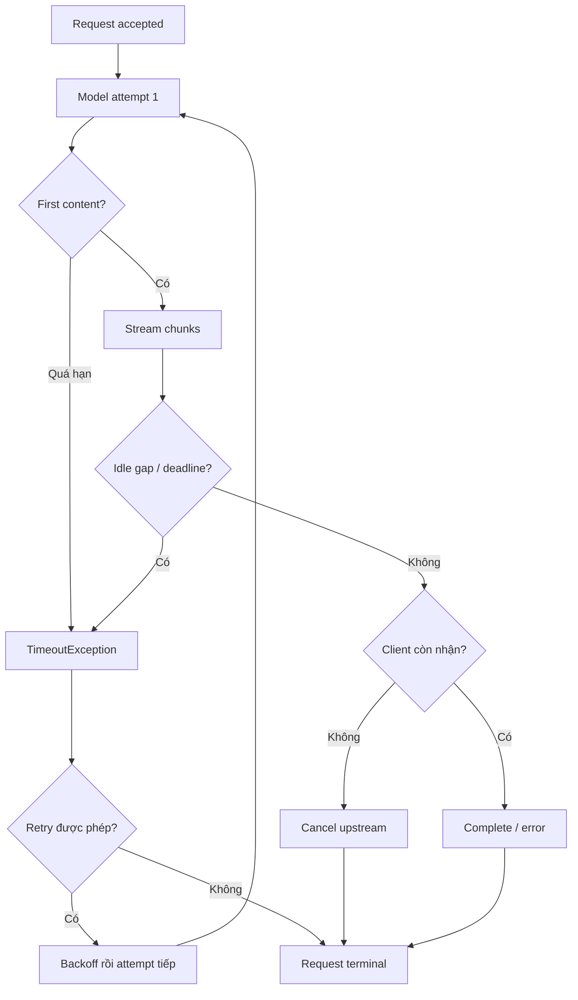

# Quan sát timeout, retry và hủy luồng trong Spring AI

> **Chương:** Streaming và bất đồng bộ  
> **Module:** `SPRING_AI_EVALUATION_OBSERVABILITY` — đánh giá chất lượng ứng dụng Spring AI bằng tập dữ liệu, relevance, fact checking, kiểm thử RAG và tool calling; đồng thời theo dõi metrics, traces, token, chi phí và độ trễ để phát hiện nguyên nhân suy giảm giữa các phiên bản prompt, model và pipeline.

## Mục tiêu học tập

Sau bài này, bạn có thể:

1. Phân biệt timeout ở kết nối, thời gian chờ chunk đầu, khoảng im lặng giữa chunks, model attempt và deadline toàn request.
2. Giải thích vì sao Reactor timeout thường hủy upstream rồi phát `TimeoutException` xuống downstream, trong khi người dùng hủy subscription tạo `CANCEL`.
3. Thiết kế retry có giới hạn, backoff, jitter, phân loại lỗi và ngân sách thời gian; không retry mù sau khi đã gửi nội dung cho người dùng.
4. Phân biệt trạng thái của **request**, **model attempt**, **SDK call** và **HTTP delivery** khi complete/error/timeout/cancel.
5. Liên kết client disconnect với API cancel của SDK, dừng timer/span đúng lúc và ghi nhận partial answer cùng usage chưa đầy đủ.
6. Kiểm thử timeout, retry, cancel và partial output bằng `StepVerifier`, đồng hồ ảo và publisher giả lập.
7. Dùng metrics/traces để giải thích ảnh hưởng của retry và timeout tới relevance, groundedness, completeness, token usage, cost và latency.

## 1. Vì sao phải quan sát cả timeout, retry và cancel?

Một câu hỏi RAG được gửi tới Spring AI. Retriever tìm được tài liệu, model bắt đầu stream câu trả lời, nhưng provider phản hồi chậm. Người dùng đợi vài giây rồi đóng tab. Nếu chỉ đo số request lỗi, ta không biết:

- Model chưa phát chunk đầu hay đã phát được một phần câu trả lời?
- Timeout do kết nối, do im lặng giữa hai chunks hay do vượt deadline toàn request?
- Ứng dụng chủ động hủy do timeout hay trình duyệt đã ngắt kết nối?
- Retry có tạo thêm model call và chi phí không?
- Một tool call có side effect đã được thực thi trước khi retry chưa?
- Câu trả lời partial có bị đánh giá nhầm như câu trả lời hoàn chỉnh không?

Các tín hiệu này có ý nghĩa khác nhau. Một stream có thể bị cancel ở phía subscriber nhưng provider vẫn tiếp tục xử lý trong một khoảng thời gian. Một timeout có thể xuất hiện ở downstream dưới dạng lỗi, trong khi upstream quan sát thấy cancellation. Retry có thể biến một attempt lỗi thành request thành công, nhưng request vẫn đã tiêu tài nguyên ở attempt trước.



**Nguyên tắc:** quan sát riêng outcome của request và từng attempt; ghi rõ timeout/cancel xảy ra ở boundary nào; không biến dữ liệu chưa hoàn tất thành một kết quả thành công.

## 2. Bốn loại timeout có ý nghĩa khác nhau

Tên gọi “timeout 10 giây” chưa đủ để chẩn đoán. Cần chỉ rõ đồng hồ bắt đầu ở đâu và điều gì làm nó được reset.

| Loại timeout | Bắt đầu khi | Điều kiện hết hạn | Câu hỏi được trả lời |
| --- | --- | --- | --- |
| **Connect/transport timeout** | SDK bắt đầu thiết lập kết nối | Không kết nối hoặc không nhận được phản hồi transport đúng hạn | Có thiết lập được kết nối tới provider không? |
| **First-content timeout** | Model attempt subscribe/gửi request | Chưa có nội dung hữu ích đầu tiên sau ngân sách | Người dùng phải đợi bao lâu mới thấy câu trả lời bắt đầu? |
| **Inter-chunk idle timeout** | Nhận một chunk nội dung hợp lệ | Không có chunk tiếp theo trong khoảng cho phép | Stream có bị đứng giữa chừng không? |
| **Attempt deadline** | Bắt đầu một model/tool attempt | Attempt chưa terminal sau tổng thời gian cho phép | Một lần gọi provider có kéo dài quá mức không? |
| **Request deadline** | Request được nhận hoặc orchestration bắt đầu | Toàn pipeline, bao gồm retrieval, retry và backoff, vượt ngân sách | Hệ thống có hoàn thành yêu cầu trong SLA không? |

Connect timeout thường do HTTP client/provider SDK cấu hình. Reactor `timeout` trên publisher quan sát tín hiệu ở ranh giới của publisher; nó không nhất thiết đo TCP connect hoặc thời gian provider xử lý nội bộ.

### `Flux.timeout(Duration)` thường đo khoảng im lặng

Với `Flux`, `timeout(Duration)` đặt giới hạn từ subscription tới tín hiệu đầu tiên và sau đó giới hạn khoảng cách giữa các tín hiệu tiếp theo. Timer được khởi động lại khi publisher phát `onNext`.

Điều này có hai hệ quả:

- Nếu model phát một chunk mỗi giây, `timeout(3s)` có thể không bao giờ hết hạn dù tổng stream kéo dài một phút.
- Nếu publisher phát metadata/heartbeat nhưng không có text, timer trên raw events có thể được reset dù người dùng vẫn chưa thấy nội dung.

Nếu mục tiêu là **first visible content**, hãy đo trên luồng content sau khi lọc event không tạo nội dung hữu ích, hoặc tạo một timer riêng cho mốc first content. Nếu mục tiêu là **tổng thời gian request**, cần deadline tuyệt đối không bị reset theo từng chunk.

## 3. Đặt timeout ở đúng boundary

Một request Spring AI có nhiều tầng: HTTP, retrieval, tool, model call, stream adapter và client delivery. Timeout ở một tầng sẽ hủy hoặc báo lỗi tại tầng đó; không nên đặt một con số chung rồi áp dụng cho mọi thao tác.

| Boundary | Ví dụ ngân sách | Hành vi khi hết hạn |
| --- | ---: | --- |
| HTTP connect | 1–3 giây | Transport báo lỗi kết nối |
| Retrieval | 300–800 ms | Dừng truy vấn hoặc trả lỗi retrieval |
| First content | 3 giây | Không có nội dung đầu tiên đúng hạn |
| Inter-chunk idle | 5 giây | Stream ngừng phát content quá lâu |
| Model attempt | 15 giây | Hủy attempt đang chạy |
| Request end-to-end | 25 giây | Dừng cả pipeline và các retry/backoff còn lại |

Các con số chỉ là **ví dụ minh họa**, cần chọn theo SLA, provider và độ khó của dataset. Ngân sách con phải nằm trong deadline còn lại của request; không cấp mỗi tầng 25 giây rồi khiến tổng request kéo dài nhiều phút.

### Timeout theo thứ tự pipeline

```text
request deadline: 25 s (bắt đầu tại HTTP request)
  retrieval budget:       tối đa 0.8 s
  context assembly:       tối đa 0.2 s
  model attempt 1:        tối đa 10 s
  retry backoff:          tối đa 0.4 s
  model attempt 2:        tối đa 10 s
  response delivery:     phần thời gian còn lại
```

Nếu retrieval mất 700 ms, request còn khoảng 24,3 giây. Không nên vẫn cấp nguyên 25 giây cho model attempt vì tổng pipeline sẽ vượt deadline. Một **deadline tuyệt đối** có thể được truyền xuống các bước để mỗi bước tính thời gian còn lại.

### Phân biệt timeout server với timeout proxy/client

Gateway hoặc browser có thể đóng kết nối trước khi timeout của model attempt xảy ra. Ngược lại, server có thể hết deadline rồi mới đóng HTTP stream. Hãy ghi nhận riêng:

- `server_request_deadline_exceeded`
- `model_attempt_timeout`
- `http_client_disconnect_observed`
- `sdk_cancel_requested` / `sdk_cancel_observed`

Không suy ra client đã hủy chỉ vì server trả `TimeoutException`; cũng không suy ra model provider đã dừng chỉ vì HTTP response đã đóng.

## 4. Reactor timeout: first content và idle gap

Với một publisher chỉ phát text content, có thể đặt timeout cho chunk hữu ích đầu tiên và khoảng im lặng giữa các chunks:

```java
import java.time.Duration;

import reactor.core.publisher.Flux;
import reactor.core.publisher.Mono;

Flux<String> contentWithIdleLimit(
        Flux<String> source,
        Duration firstContentBudget,
        Duration interChunkIdleBudget) {

    return source
            .filter(chunk -> chunk != null && !chunk.isBlank())
            .timeout(
                    Mono.delay(firstContentBudget),
                    chunk -> Mono.delay(interChunkIdleBudget));
}
```

`firstContentBudget` chỉ áp dụng trước tín hiệu content đầu tiên. Sau mỗi chunk, `interChunkIdleBudget` được dùng cho khoảng chờ tiếp theo. Khi timer phát tín hiệu, Reactor hủy upstream và downstream nhận `TimeoutException` nếu không có fallback.

Trong ứng dụng Spring AI, raw stream có thể là `Flux<ChatResponse>` với metadata-only events. Adapter nên chuyển response thành content delta trước khi áp first-content/idle timeout nếu metric hướng tới trải nghiệm hiển thị. Nếu cần timeout cho provider event stream, đo thêm một publisher ở boundary raw event.

### Timeout không đồng nghĩa với request deadline

Publisher phát đều đặn mỗi 2 giây có thể chạy rất lâu mà không vi phạm idle timeout 5 giây. Vì vậy cần một deadline tổng riêng cho request/attempt. Đừng gọi metric `request_duration` bằng duration được đo từ một timeout reset sau mỗi chunk.

## 5. Deadline tuyệt đối không reset theo chunks

Một cách diễn đạt deadline là giữ thời điểm hết hạn cố định bằng đồng hồ đơn điệu. Ví dụ helper sau minh họa cách dùng `timeout(firstTimeout, nextTimeoutFactory)` để tính **thời gian còn lại** sau mỗi tín hiệu:

```java
import java.time.Duration;
import java.util.Objects;

import reactor.core.publisher.Flux;
import reactor.core.publisher.Mono;

public final class AbsoluteDeadline {
    private AbsoluteDeadline() {}

    public static <T> Flux<T> apply(
            Flux<T> source, Duration budget) {

        Objects.requireNonNull(source);
        Objects.requireNonNull(budget);
        if (budget.isNegative() || budget.isZero()) {
            return Flux.error(
                    new IllegalArgumentException("budget must be positive"));
        }

        return Flux.defer(() -> {
            long deadlineNanos =
                    System.nanoTime() + budget.toNanos();
            Mono<Long> firstTimeout = Mono.delay(budget);

            return source.timeout(
                    firstTimeout,
                    value -> {
                        long remaining =
                                deadlineNanos - System.nanoTime();
                        Duration wait = Duration.ofNanos(
                                Math.max(0L, remaining));
                        return Mono.delay(wait);
                    });
        });
    }
}
```

Mốc bắt đầu được tạo bên trong `Flux.defer`, nên mỗi subscription có deadline riêng. Sau mỗi `onNext`, helper tính thời gian còn lại từ cùng deadline; chunk mới không gia hạn tổng ngân sách. `System.nanoTime()` phù hợp để đo elapsed time trong cùng process, không dùng để ghi timestamp UTC hoặc so sánh giữa các máy.

Helper là ví dụ kỹ thuật. Trong production, nên dùng một deadline object được truyền xuyên pipeline, chọn scheduler phù hợp, và xử lý rõ `TimeoutException`/cancellation ở từng boundary. Kiểm thử bằng virtual time cần tiêm clock/scheduler thay vì trộn trực tiếp đồng hồ hệ thống.

## 6. Retry: subscription mới, attempt mới

Trong Reactor, `retry`/`retryWhen` resubscribe vào publisher upstream khi nhận lỗi đủ điều kiện. Với một model call streaming, điều này thường có nghĩa **gọi provider lại** nếu publisher được tạo lazy đúng cách.

```java
import java.time.Duration;
import reactor.core.publisher.Flux;
import reactor.util.retry.Retry;

Flux<String> answer = Flux.defer(
        () -> modelClient.streamContent(prompt))
    .timeout(Duration.ofSeconds(10))
    .retryWhen(Retry.backoff(
            2, Duration.ofMillis(200))
            .maxBackoff(Duration.ofSeconds(2))
            .jitter(0.5)
            .filter(this::isTransientFailure));
```

`Retry.backoff(2, ...)` cho phép tối đa **hai lần retry sau attempt đầu**, tức tối đa ba attempts nếu cả hai retry đều được thực hiện. `Flux.defer` tạo publisher mới ở mỗi subscription; nếu giữ một hot publisher hoặc một response đã được tạo từ trước, retry có thể không tạo được request mới như mong muốn.

### Lỗi nào có thể retry?

| Loại lỗi | Chính sách thường phù hợp |
| --- | --- |
| Network reset/temporary connection failure | Có thể retry nếu chưa phát nội dung và còn deadline |
| HTTP 429/rate limit | Tôn trọng `Retry-After` nếu SDK expose; backoff và giới hạn concurrency |
| HTTP 5xx tạm thời | Có thể retry có giới hạn |
| Timeout trước chunk đầu | Có thể retry nếu call an toàn và còn ngân sách |
| Invalid API key/401/403 | Không retry mù; xử lý credential/permission |
| Invalid request/400/schema error | Không retry nếu payload không thay đổi |
| Content policy refusal | Không retry để tìm cách vượt chính sách |
| Tool validation/business error | Chỉ retry nếu có điều kiện khắc phục rõ |
| Client cancellation | Không retry; request không còn subscriber |

`isTransientFailure` phải phân loại exception theo SDK/provider thật. Tránh retry mọi `RuntimeException`; điều đó có thể lặp một lỗi lập trình, lặp side effect hoặc làm tăng tải khi hệ thống đang quá tải.

### Backoff, jitter và deadline

Exponential backoff tăng khoảng chờ giữa các lần retry; jitter phân tán thời điểm retry để nhiều request không đồng loạt gọi lại provider. Nhưng backoff tiêu thụ request deadline. Trước mỗi lần retry, cần kiểm tra:

- Còn đủ thời gian cho một attempt có ý nghĩa không?
- Có còn token/cost budget không?
- Provider có yêu cầu thời gian chờ cụ thể không?
- Request đã phát content cho người dùng chưa?
- Lỗi có thể khắc phục bằng retry không?

Nếu request deadline còn 500 ms nhưng backoff tiếp theo là 2 giây, không nên lên lịch retry rồi để request treo đến lúc timeout tổng.

## 7. Không retry mù sau khi đã phát content

Đây là quy tắc đặc biệt quan trọng với streaming. Giả sử attempt 1 đã gửi:

> “Theo chính sách, hồ sơ cần nộp trước 3 ngày làm việc…”

Sau đó kết nối lỗi. Nếu retry toàn bộ và nối chunks attempt 2 vào cùng response, người dùng có thể thấy câu đầu bị lặp, citation khác hoặc nội dung mâu thuẫn.

Một chính sách thận trọng là chỉ retry tự động **trước khi có content hữu ích đầu tiên**:

```java
import java.time.Duration;
import java.util.concurrent.atomic.AtomicBoolean;

import reactor.core.publisher.Flux;
import reactor.util.retry.Retry;

Flux<String> retryBeforeVisibleContent(String prompt) {
    return Flux.defer(() -> {
        // Một state cho mỗi request subscription,
        // được giữ xuyên các attempts của request đó.
        AtomicBoolean visibleContentEmitted =
                new AtomicBoolean(false);

        Flux<String> attempts = Flux.defer(
                () -> modelClient.streamContent(prompt))
                .doOnNext(chunk -> {
                    if (chunk != null && !chunk.isBlank()) {
                        visibleContentEmitted.set(true);
                    }
                });

        return attempts.retryWhen(
                Retry.backoff(2, Duration.ofMillis(200))
                        .filter(error ->
                                !visibleContentEmitted.get()
                                && isTransientFailure(error)));
    });
}
```

Outer `Flux.defer` tạo cờ riêng cho mỗi request subscriber; cờ không bị reset khi `retryWhen` resubscribe. Khi đã phát content hữu ích, lỗi tiếp theo không thỏa filter và được truyền xuống downstream.

Nếu sản phẩm có giao thức resume với sequence number/cursor và client hỗ trợ deduplicate, có thể thiết kế retry sau content theo contract riêng. Khi không có khả năng resume, lựa chọn an toàn thường là đánh dấu partial/error và yêu cầu một request mới thay vì nối mù output mới vào output cũ.

### Metadata không phải content hiển thị

Nếu nguồn là `Flux<ChatResponse>`, event có thể chỉ chứa usage/finish metadata. Không đặt cờ `visibleContentEmitted` chỉ vì nhận được một event. Hãy đặt cờ khi adapter xác nhận có content delta không trắng hoặc một payload thực sự đã gửi cho UI.

## 8. Timeout kết hợp retry: thứ tự operator quyết định cách đo

Ví dụ một request có idle timeout cho mỗi attempt, retry có giới hạn và deadline tổng:

```java
import java.time.Duration;
import java.util.concurrent.atomic.AtomicBoolean;
import java.util.concurrent.atomic.AtomicInteger;

import reactor.core.publisher.Flux;
import reactor.core.publisher.Mono;
import reactor.util.retry.Retry;

Flux<String> requestStream(String prompt) {
    return Flux.defer(() -> {
        AtomicInteger attemptNumber = new AtomicInteger();
        AtomicBoolean visibleContentEmitted = new AtomicBoolean(false);

        Flux<String> oneAttempt = Flux.defer(() -> {
            int attempt = attemptNumber.incrementAndGet();
            return modelClient.streamContent(prompt)
                    .doOnNext(chunk -> {
                        if (chunk != null && !chunk.isBlank()) {
                            visibleContentEmitted.set(true);
                        }
                    })
                    .doFinally(signal ->
                            metrics.recordAttemptTerminal(
                                    attempt, signal));
        });

        Flux<String> retried = oneAttempt
                .timeout(
                        Mono.delay(Duration.ofSeconds(3)),
                        chunk -> Mono.delay(Duration.ofSeconds(5)))
                .retryWhen(
                        Retry.backoff(2, Duration.ofMillis(200))
                                .maxBackoff(Duration.ofSeconds(1))
                                .filter(error ->
                                        !visibleContentEmitted.get()
                                        && isTransientFailure(error)));

        return AbsoluteDeadline.apply(
                        retried, Duration.ofSeconds(20))
                .doFinally(metrics::recordRequestTerminal);
    });
}
```

Ý nghĩa của vị trí operator:

- `doFinally` bên trong `oneAttempt` chạy cho **mỗi attempt**.
- `timeout(first, next)` áp giới hạn chờ content đầu và idle gap cho từng lần subscribe; khi hết hạn, nó hủy upstream và báo `TimeoutException` xuống retry operator.
- `retryWhen` có thể tạo attempt mới nếu lỗi được filter cho phép và còn ngân sách.
- `AbsoluteDeadline` bao quanh cả retry/backoff; deadline tổng không được reset khi attempt mới bắt đầu.
- `doFinally` ngoài cùng ghi outcome **cuối cùng của request**, sau complete/error/cancel.

Trong ví dụ, `AbsoluteDeadline` bắt đầu khi publisher `requestStream` được subscribe. Nếu retrieval đã chạy trước đó và SLA tính từ lúc HTTP request được nhận, hãy đặt deadline ở ngoài **toàn bộ orchestration** hoặc truyền thời điểm hết hạn/ngân sách còn lại vào `requestStream`; không khởi động lại 20 giây tại model stage.

### Vì sao attempt có thể thấy CANCEL khi request gặp timeout?

Khi timeout operator hết hạn, nó hủy subscription upstream. Vì vậy `doFinally` ở source attempt có thể nhận `SignalType.CANCEL`, trong khi downstream của timeout nhận `TimeoutException` (`ON_ERROR`). Hai kết quả không mâu thuẫn: chúng được quan sát ở **hai boundary khác nhau**.

Không phân loại mọi `CANCEL` upstream thành “người dùng đóng tab”. Muốn xác định nguyên nhân, phải liên kết nó với timeout operator, request deadline hoặc downstream cancellation ở boundary ngoài.

## 9. Phân biệt terminal signals theo từng boundary

| Boundary được đo | Timeout xảy ra ở operator phía ngoài | Người dùng hủy subscription |
| --- | --- | --- |
| Source/model attempt | Thường thấy `CANCEL` do timeout hủy upstream | Thường thấy `CANCEL` lan xuống |
| Sau timeout operator | Nhận `TimeoutException`/`ON_ERROR` | Nhận `CANCEL` nếu downstream cancel |
| Sau retry operator | Có thể complete nếu attempt sau thành công; error nếu hết retry | `CANCEL`; retry/backoff bị hủy |
| HTTP response delivery | Có thể đóng do server timeout/error | Có thể thấy disconnect/cancel từ client |
| Provider | Tùy SDK có gửi cancel và provider có thực thi hay không | Không thể suy từ Reactor signal rằng provider đã dừng |

### `doOnCancel`, `doOnError`, `doFinally`

- `doOnCancel` chỉ chạy khi subscription bị hủy tại vị trí operator đó.
- `doOnError` chạy khi có lỗi đi qua boundary, ví dụ `TimeoutException`.
- `doOnComplete` chỉ chạy khi complete bình thường.
- `doFinally` nhận `ON_COMPLETE`, `ON_ERROR` hoặc `CANCEL`, phù hợp để dọn lifecycle tổng quát.

Không dùng `doOnComplete` làm nơi duy nhất stop span hoặc giải phóng tài nguyên, vì error/cancel không đi qua hook đó. Cũng không dựa riêng vào `doFinally(CANCEL)` để suy ra ai là người hủy.

## 10. Kết nối cancellation tới SDK và client disconnect

Trong WebFlux, khi client ngắt kết nối, response publisher có thể nhận cancellation. Nhưng việc cancellation truyền tiếp tới SDK phụ thuộc adapter có nối signal đó với API cancel của SDK hay không.

Ví dụ minh họa với một SDK có call handle:

```java
import reactor.core.publisher.Flux;

Flux<String> streamFromSdk(SdkClient sdk, Request request) {
    return Flux.defer(() -> {
        SdkCallHandle handle = sdk.startStream(request);
        return Flux.from(handle.publisher())
                .doOnCancel(handle::cancel);
    });
}
```

`SdkCallHandle` là interface minh họa. SDK thật có thể trả `Disposable`, `Call`, `CancellableFuture` hoặc listener registration. Cần đọc contract của SDK để biết:

1. `cancel()` chỉ hủy callback hay hủy cả network request?
2. Cancel có thread-safe và idempotent không?
3. SDK có phát terminal callback sau cancel không?
4. Provider có thể đã xử lý/generate thêm tokens trước khi nhận cancel không?
5. Usage cuối có còn được trả qua callback/billing API không?

### Không biến cancel thành fallback thành công

`onErrorResume` xử lý error, không phải một signal cancellation thuần của Reactor. Đừng cố biến mọi trường hợp thành một chuỗi fallback để dashboard luôn báo completed. Nếu người dùng đã rời trang, fallback có thể không được nhận; nếu cancellation do server timeout, hãy ghi timeout và policy tương ứng.

### Hủy nhiều tài nguyên trong một request

Một agent có thể đang chờ model stream, tool call và retrieval song song. Khi request bị hủy, cần dừng các công việc không còn cần thiết theo policy:

- Hủy subscription model stream.
- Gọi cancel cho SDK/provider nếu API hỗ trợ.
- Hủy tool call đang chờ nếu an toàn.
- Dừng retry/backoff timer.
- Không hủy công việc audit bắt buộc hoặc billing reconciliation nếu chúng phải hoàn thành độc lập; chuyển chúng sang job lifecycle riêng.

## 11. Partial answer: lưu và đánh giá đúng

Khi timeout/cancel/error xảy ra sau một số chunks, response có thể chứa nội dung đã phát nhưng chưa hoàn chỉnh. Nên lưu trạng thái tách biệt:

| Field | Giá trị ví dụ | Ý nghĩa |
| --- | --- | --- |
| `request_outcome` | `ERROR` / `CANCELLED` / `COMPLETED` | Kết quả ở request boundary |
| `attempt_outcome` | `CANCELLED` / `ERROR` / `COMPLETED` | Kết quả từng model call |
| `content_state` | `EMPTY` / `PARTIAL` / `COMPLETE` / `UNKNOWN` | Mức hoàn chỉnh của output |
| `termination_reason` | `FIRST_CONTENT_TIMEOUT` / `IDLE_TIMEOUT` / `CLIENT_DISCONNECT` | Nguyên nhân đã quan sát |
| `retry_count` | `1` | Số lần retry thực tế |
| `usage_state` | `FINAL` / `PARTIAL` / `UNAVAILABLE` | Mức tin cậy của usage |
| `evidence_manifest_ref` | `audit://...` | Context RAG thực sự đã gửi vào model |
| `finish_reason` | `stop` / `length` / `tool_calls` / `unknown` | Lý do model kết thúc nếu có |

### Chấm quality trên partial output

- Có thể chấm **atomic claims hoàn chỉnh đã phát** về groundedness nếu có snapshot evidence đúng attempt.
- Claim bị cắt giữa câu cần `NOT_JUDGED`, không tự xem là factual error.
- `full_answer_completeness` không nên chấm như response hoàn chỉnh nếu stream bị hủy hoặc timeout.
- Nếu model đã trả đủ câu nhưng HTTP delivery bị ngắt, phân biệt provider content completion với client delivery completion.
- Không coi `onComplete` là nội dung đầy đủ nếu provider finish reason là `length` hoặc tool handoff.

Ví dụ, model đã phát “Thời hạn là 3 ngày làm việc” rồi timeout trước khi phát ngoại lệ “trừ trường hợp hồ sơ bổ sung”. Claim đầu có thể grounded, nhưng câu trả lời tổng thể vẫn thiếu điều kiện quan trọng. Chỉ số first-content latency tốt không bù được completeness suy giảm.

## 12. Retry và tool side effects

Retry model generation và retry tool execution có rủi ro khác nhau.

| Hoạt động | Rủi ro khi retry | Biện pháp |
| --- | --- | --- |
| Model generation thuần | Token/cost tăng, output lặp nếu đã stream | Retry trước first content; attempt ID; budget |
| Vector retrieval | Tải tăng, kết quả có thể thay đổi theo index | Giữ index version/query, giới hạn retry |
| Reranker | Tốn thêm compute, thứ tự có thể khác | Ghi version và input candidates |
| Tool đọc dữ liệu | Tải tăng, snapshot có thể thay đổi | Idempotent read, version/consistency |
| Tool ghi dữ liệu | Tạo side effect trùng | Idempotency key, deduplication, transaction/outbox |
| Tool gửi thông báo/thanh toán | Gửi hoặc tính phí hai lần | Không retry mù; xác nhận trạng thái và idempotency |

Với tool có side effect, một timeout không chứng minh thao tác chưa thực thi. Server có thể đã xử lý nhưng response bị mất. Trước khi retry, phải tra trạng thái theo operation ID/idempotency key hoặc dùng workflow có khả năng deduplicate.

### Request ID, call ID và attempt ID

Một request có thể có nhiều model calls và mỗi call có nhiều attempts:

```text
request_id = req-008
  call_id = answer-call-1
    attempt_id = attempt-1   timeout before content
    attempt_id = attempt-2   completed
  call_id = tool-planning-call
    attempt_id = attempt-1   completed with tool handoff
  call_id = final-answer-call
    attempt_id = attempt-1   cancelled after partial content
```

Không gộp ba model calls thành một attempt. Cost của request phải tính từ các attempts thực sự được provider thực hiện và usage/billing tương ứng; nếu một attempt thiếu usage, đánh dấu tổng cost chưa đầy đủ.

## 13. Metrics và traces cho timeout/retry/cancel

Một dashboard hữu ích nên phân biệt số lần xảy ra và thời gian đến khi xảy ra:

| Metric đề xuất | Ý nghĩa | Tag nên dùng |
| --- | --- | --- |
| `ai.stream.timeout.total` | Tổng timeout | `scope=first_content/idle/attempt/request`, `stage` |
| `ai.stream.retry.total` | Số retry đã thực hiện | `reason_class`, `stage` |
| `ai.stream.retry.exhausted` | Request hết số lần retry | `stage`, `provider_family` |
| `ai.stream.cancel.total` | Cancellation tại boundary | `boundary=attempt/request/delivery` |
| `ai.stream.partial.total` | Request kết thúc khi đã phát một phần content | `reason` |
| `ai.stream.time_to_timeout` | Thời gian tới timeout | `scope`, `stage` |
| `ai.stream.backoff.duration` | Thời gian chờ giữa attempts | `provider_family` |
| `ai.stream.attempt.duration` | Duration của từng attempt | `outcome`, `stage` |
| `ai.stream.request.duration` | Duration end-to-end | `outcome` |
| `ai.stream.usage.coverage` | Tỷ lệ attempts có final usage | `provider_family`, `outcome` |

Tên metric là ví dụ do ứng dụng định nghĩa. Không dùng `request_id`, `call_id`, `attempt_id`, prompt hoặc document ID làm metric labels vì cardinality cao và có thể lộ dữ liệu.

### Trace hierarchy

```text
request span
  retrieval span
  model call span
    attempt 1 span
      first-content timer
      timeout event
    retry backoff span/event
    attempt 2 span
      stream chunks
      terminal completed
  response delivery span
```

Mỗi attempt nên có span hoặc event rõ ràng; retry không xóa lịch sử attempt trước. Ghi exception/timeout ở boundary phát lỗi, đồng thời ghi cancellation ở upstream attempt nếu operator đã hủy nó. Không ghi hai lỗi độc lập nếu chỉ là hai góc nhìn của cùng một timeout mà không có quan hệ.

### Usage và chi phí

Provider có thể không gửi final usage khi stream bị cancel hoặc timeout. Vì vậy:

- `usage_state=FINAL` chỉ khi provider/adapter xác nhận final usage.
- `PARTIAL` là snapshot tạm; không coi là billed final.
- `UNAVAILABLE` không có nghĩa 0 tokens hoặc miễn phí.
- Retry tạo thêm attempts; không cộng cumulative snapshots trong cùng attempt, nhưng không bỏ chi phí của attempts khác.
- Khi billing reconciliation về sau có dữ liệu, cập nhật cost theo provider request ID và tránh tính trùng.

## 14. Spring AI: tổ chức pipeline với retry và deadline

Ví dụ dưới đây là skeleton theo Reactor. API `ChatClient.stream().content()` hoặc `.chatResponse()` tùy phiên bản Spring AI/provider; hãy đặt adapter đúng kiểu response của dự án:

```java
import java.time.Duration;
import java.util.concurrent.TimeoutException;
import java.util.concurrent.atomic.AtomicBoolean;
import java.util.concurrent.atomic.AtomicInteger;

import org.springframework.ai.chat.client.ChatClient;
import reactor.core.publisher.Flux;
import reactor.core.publisher.Mono;
import reactor.util.retry.Retry;

public final class StreamingAnswerService {
    private final ChatClient chatClient;
    private final StreamMetrics metrics;

    public Flux<String> answer(String question) {
        return Flux.defer(() -> {
            AtomicInteger attempts = new AtomicInteger();
            AtomicBoolean visible = new AtomicBoolean();

            Flux<String> oneAttempt = Flux.defer(() -> {
                int attempt = attempts.incrementAndGet();
                return chatClient.prompt()
                        .user(question)
                        .stream()
                        .content()
                        .filter(text -> text != null && !text.isBlank())
                        .doOnNext(text -> visible.set(true))
                        .doFinally(signal ->
                                metrics.recordAttempt(attempt, signal));
            });

            Flux<String> retryable = oneAttempt
                    .timeout(
                            Mono.delay(Duration.ofSeconds(3)),
                            chunk -> Mono.delay(Duration.ofSeconds(5)))
                    .retryWhen(
                            Retry.backoff(2, Duration.ofMillis(200))
                                    .maxBackoff(Duration.ofSeconds(1))
                                    .jitter(0.5)
                                    .filter(error ->
                                            !visible.get()
                                            && isTransient(error)));

            return AbsoluteDeadline.apply(
                            retryable, Duration.ofSeconds(20))
                    .doFinally(metrics::recordRequest);
        });
    }

    private boolean isTransient(Throwable error) {
        // Phân loại theo exception/status thực của provider SDK.
        return error instanceof java.io.IOException
                || error instanceof TimeoutException;
    }
}
```

Skeleton minh họa luồng quyết định; cần bổ sung imports, adapter, metrics recorder và exception classification thực tế. Ví dụ chỉ retry trước content hữu ích. Nếu API `content()` không giữ finish reason/usage, hãy đo metadata ở response stream riêng trong cùng một subscription hoặc dùng adapter tương ứng.

### Điều cần chú ý khi đặt `doFinally`

`metrics.recordAttempt` nằm trong publisher của từng attempt, nên chạy mỗi lần resubscribe. `metrics.recordRequest` nằm ngoài retry và deadline, nên ghi một outcome cuối cho request. Nếu recorder cần phân biệt timeout với client cancel, truyền thêm reason state từ operator/boundary; không suy nguyên nhân chỉ từ `SignalType.CANCEL`.

## 15. Kiểm thử timeout bằng StepVerifier và virtual time

Virtual time giúp kiểm tra timeout mà không phải chờ thật. Tạo publisher **bên trong supplier** của `withVirtualTime` để Reactor dùng scheduler ảo.

```java
import java.time.Duration;
import java.util.concurrent.TimeoutException;

import org.junit.jupiter.api.Test;
import reactor.core.publisher.Flux;
import reactor.test.StepVerifier;

class StreamTimeoutTest {

    @Test
    void timesOutBeforeFirstChunk() {
        StepVerifier.withVirtualTime(() ->
                Flux.<String>never()
                        .timeout(Duration.ofSeconds(3)))
                .thenAwait(Duration.ofSeconds(3))
                .expectError(TimeoutException.class)
                .verify();
    }

    @Test
    void idleTimeoutBetweenChunks() {
        StepVerifier.withVirtualTime(() ->
                Flux.concat(
                        Flux.just("first"),
                        Flux.never())
                        .timeout(Duration.ofSeconds(2)))
                .expectNext("first")
                .thenAwait(Duration.ofSeconds(2))
                .expectError(TimeoutException.class)
                .verify();
    }
}
```

Test đầu xác nhận không có tín hiệu đầu tiên trong 3 giây; test thứ hai xác nhận stream có chunk đầu nhưng im lặng quá 2 giây. Đây là test operator semantics, không mô phỏng độ trễ provider thật.

### Kiểm thử retry và số attempts

```java
import static org.junit.jupiter.api.Assertions.assertEquals;

import java.io.IOException;
import java.time.Duration;
import java.util.concurrent.atomic.AtomicInteger;

import org.junit.jupiter.api.Test;
import reactor.core.publisher.Flux;
import reactor.test.StepVerifier;
import reactor.util.retry.Retry;

class StreamRetryTest {

    @Test
    void retriesTransientFailureUpToConfiguredLimit() {
        AtomicInteger attempts = new AtomicInteger();

        StepVerifier.withVirtualTime(() ->
                Flux.defer(() -> {
                    int attempt = attempts.incrementAndGet();
                    if (attempt < 3) {
                        return Flux.error(
                                new IOException("temporary"));
                    }
                    return Flux.just("answer");
                }).retryWhen(
                        Retry.backoff(2, Duration.ofSeconds(1))
                                .jitter(0.0)))
                .thenAwait(Duration.ofSeconds(3))
                .expectNext("answer")
                .verifyComplete();

        assertEquals(3, attempts.get());
    }
}
```

`Retry.backoff(2, ...)` có hai retry tối đa, do đó test thành công ở attempt thứ ba. Test thực tế nên thêm lỗi không retryable, hết retry budget và request deadline xảy ra trong backoff.

## 16. Kiểm thử cancel và không retry sau partial content

### Cancellation phải ghi đúng signal

```java
import static org.junit.jupiter.api.Assertions.assertEquals;

import java.util.concurrent.atomic.AtomicReference;

import org.junit.jupiter.api.Test;
import reactor.core.publisher.Flux;
import reactor.core.publisher.SignalType;
import reactor.test.StepVerifier;

class StreamCancelTest {

    @Test
    void downstreamCancelIsRecordedAsCancel() {
        AtomicReference<SignalType> terminal =
                new AtomicReference<>();

        Flux<Long> stream = Flux.interval(
                        java.time.Duration.ofMillis(100))
                .doFinally(terminal::set);

        StepVerifier.create(stream)
                .expectNext(0L)
                .thenCancel()
                .verify();

        assertEquals(SignalType.CANCEL, terminal.get());
    }
}
```

Test này kiểm tra cancellation ở một boundary Reactor. Nó không chứng minh SDK/provider thật đã nhận cancel; integration test cần kiểm tra adapter gọi `handle.cancel()` hoặc API tương ứng.

### Không retry sau khi đã phát một phần câu trả lời

```java
import static org.junit.jupiter.api.Assertions.assertEquals;

import java.io.IOException;
import java.time.Duration;
import java.util.concurrent.atomic.AtomicBoolean;
import java.util.concurrent.atomic.AtomicInteger;

import org.junit.jupiter.api.Test;
import reactor.core.publisher.Flux;
import reactor.test.StepVerifier;
import reactor.util.retry.Retry;

class NoRetryAfterPartialTest {

    @Test
    void doesNotReplayAfterVisibleChunk() {
        AtomicInteger attempts = new AtomicInteger();

        Flux<String> result = Flux.defer(() -> {
            AtomicBoolean visible = new AtomicBoolean();
            return Flux.defer(() -> {
                int attempt = attempts.incrementAndGet();
                if (attempt == 1) {
                    return Flux.concat(
                            Flux.just("partial answer"),
                            Flux.error(new IOException("reset")));
                }
                return Flux.just("new full answer");
            })
            .doOnNext(chunk -> visible.set(true))
            .retryWhen(Retry.backoff(
                    2, Duration.ofMillis(10))
                    .filter(error -> !visible.get()));
        });

        StepVerifier.create(result)
                .expectNext("partial answer")
                .expectError(IOException.class)
                .verify();

        assertEquals(1, attempts.get());
    }
}
```

Ở ví dụ, cờ `visible` nằm ngoài publisher được retry nhưng bên trong `Flux.defer` của request, nên được giữ qua attempts và tách riêng giữa subscribers. Khi chunk đầu được phát, lỗi sau đó không còn đủ điều kiện retry.

## 17. Checklist vận hành và regression

| Câu hỏi | Bằng chứng cần có |
| --- | --- |
| Timeout thuộc boundary nào? | Connect/first-content/idle/attempt/request/delivery |
| Timer có reset theo mọi event hay chỉ content hữu ích? | Định nghĩa predicate và operator placement |
| Có deadline tổng không? | Deadline bắt đầu ở request và bao gồm backoff |
| Retry có phân loại lỗi? | Retryable status/exception, max attempts, jitter |
| Source có tạo request mới khi retry? | Lazy publisher/`Flux.defer` và attempt IDs |
| Retry sau content có gây lặp? | Visible-content gate hoặc resume/dedup protocol |
| Tool có side effect không? | Idempotency key và trạng thái operation |
| Timeout có hủy upstream? | Attempt `doFinally(CANCEL)` và downstream `TimeoutException` |
| Client disconnect có tới SDK? | SDK cancel API được gọi và có integration test |
| Span có stop trên mọi terminal? | Complete/error/cancel test |
| Usage có final không? | `FINAL/PARTIAL/UNAVAILABLE`, billing reconciliation |
| Partial answer có bị chấm full? | `content_state` và evaluation policy |
| Metrics có tách request/attempt? | Outcome counters, duration và retry counts |
| Có sampling/missing telemetry? | Coverage và số mẫu theo version |

### Thí nghiệm regression giả định

| Chỉ số | Pipeline A | Pipeline B |
| --- | ---: | ---: |
| p95 first-content latency | 480 ms | 390 ms |
| Request completion rate | 95% | 87% |
| Retry attempts/request | 0,08 | 0,62 |
| Partial response rate | 2% | 9% |
| Usage final coverage | 97% | 71% |
| Groundedness trên completed | 0,92 | 0,90 |
| Full-answer completeness | 0,91 | 0,82 |
| Cost per successful answer | 0,012 USD | 0,016 USD |

B có first content nhanh hơn nhưng completion thấp, retry nhiều, usage coverage giảm và cost cao hơn. Không kết luận B tốt hơn chỉ từ TTFC. Cần điều tra timeout policy, provider rate limit, cancellation propagation, retry sau partial và metadata usage trước khi phát hành.

## 18. Bài thực hành

Một request hỏi về chính sách công tác có deadline tổng 20 giây. Pipeline dùng retrieval và stream model. Số liệu **giả định**:

| Mốc | Attempt 1 | Attempt 2 |
| --- | ---: | ---: |
| Bắt đầu attempt | 600 ms | 4.200 ms |
| Chunk content đầu | Không có | 4.650 ms |
| Chunk content cuối | Không có | 11.000 ms |
| Terminal | Timeout tại 4.000 ms | Complete tại 11.300 ms |
| Usage | Unavailable | Final: input 1.000, output 180 |

Request được nhận tại 0 ms; retrieval/context assembly mất 600 ms trước attempt 1. Backoff giữa attempts là 200 ms. Sau khi attempt 2 hoàn tất, server gửi response và client nhận xong ở 11.500 ms. Giá giả định: input 0,50 USD/1 triệu tokens; output 2,00 USD/1 triệu tokens.

**Yêu cầu:**

1. Attempt 1 có terminal signal nào ở source boundary nếu timeout operator hủy upstream? Downstream của timeout thấy gì?
2. Giải thích cách timeline tạo ra thời điểm bắt đầu attempt 2 tại 4.200 ms tính từ lúc request được nhận.
3. Tính time-to-first-content từ lúc request nhận và từ lúc attempt 2 bắt đầu.
4. Tính request duration tới server terminal và tới client delivery complete.
5. Có được báo usage/cost request bằng 0 vì attempt 1 thiếu usage không?
6. Tính cost cơ bản của attempt 2 theo giá giả định.
7. Nếu attempt 1 đã phát một chunk trước khi timeout, có nên tự động retry rồi nối attempt 2 không?
8. Nếu client disconnect ở 8.000 ms trong attempt 2, cần ghi những outcomes nào?

### Đáp án gợi ý

1. Attempt source thường thấy `CANCEL` vì timeout operator hủy upstream. Downstream sau timeout thấy `TimeoutException`/`ON_ERROR`; hai signal ở hai boundary khác nhau.
2. Attempt 1 bắt đầu ở 600 ms sau retrieval/context assembly, timeout ở 4.000 ms, rồi backoff 200 ms; vì vậy attempt 2 bắt đầu ở 4.200 ms. Trong hệ thống thật phải đo từng mốc thay vì suy từ một số tổng.
3. Từ request: `4.650 ms`. Từ attempt 2: `4.650 - 4.200 = 450 ms`.
4. Server request terminal: `11.300 ms` từ lúc nhận. Client delivery complete: `11.500 ms`; hai mốc khác nhau 200 ms.
5. Không. Attempt 1 có usage `UNAVAILABLE`; không có nghĩa 0 token hoặc miễn phí. Tổng request cost chưa đầy đủ cho tới khi có billing reconciliation hoặc usage đáng tin của attempt 1.
6. Input: `1.000 × 0,50 / 1.000.000 = 0,00050 USD`. Output: `180 × 2,00 / 1.000.000 = 0,00036 USD`. Tổng **0,00086 USD** cho attempt 2, chưa gồm phí khác.
7. Không retry mù. Nếu đã phát content cho client, retry có thể làm lặp hoặc mâu thuẫn. Chỉ retry nếu có giao thức resume/dedup được thiết kế và kiểm thử; nếu không, đánh dấu partial/error.
8. Request/client boundary ghi `CANCELLED` hoặc disconnect theo tín hiệu thực tế; attempt 2 có thể thấy `CANCEL` nếu hủy lan xuống. Ghi `cancel_requested`/`cancel_observed`, partial content và usage state. Không khẳng định provider đã ngừng xử lý hay không tính phí.

## Ghi nhớ

- **Timeout cần có boundary:** connect, first content, idle gap, attempt và request deadline trả lời những câu hỏi khác nhau.
- **`Flux.timeout(Duration)` đo khoảng im lặng giữa tín hiệu:** nó không tự giới hạn tổng thời gian khi chunks tiếp tục tới; metadata-only events cũng có thể reset timer.
- **Retry là subscription/attempt mới:** dùng publisher lazy, giới hạn số lần, backoff, jitter, phân loại lỗi và deadline tổng.
- **Không retry mù sau partial content:** output có thể lặp, citation thay đổi và câu trả lời mâu thuẫn; cần resume/dedup nếu muốn tiếp tục.
- **Timeout và cancel có signal khác nhau theo boundary:** timeout downstream thường là `TimeoutException`, upstream có thể thấy `CANCEL`; client cancel không phải một error thông thường.
- **Nối cancellation tới SDK:** hủy subscription, gọi API cancel nếu có và ghi rõ cancel requested/observed; provider có thể vẫn phát sinh usage/chi phí.
- **Đánh giá partial đúng cách:** chấm claims hoàn chỉnh nếu đủ evidence, không chấm full-answer completeness cho stream chưa hoàn tất.
- **Quan sát request và attempts riêng:** metrics, spans, usage, cost, retry và evidence provenance phải gắn đúng request/call/attempt để phát hiện regression chất lượng RAG.
