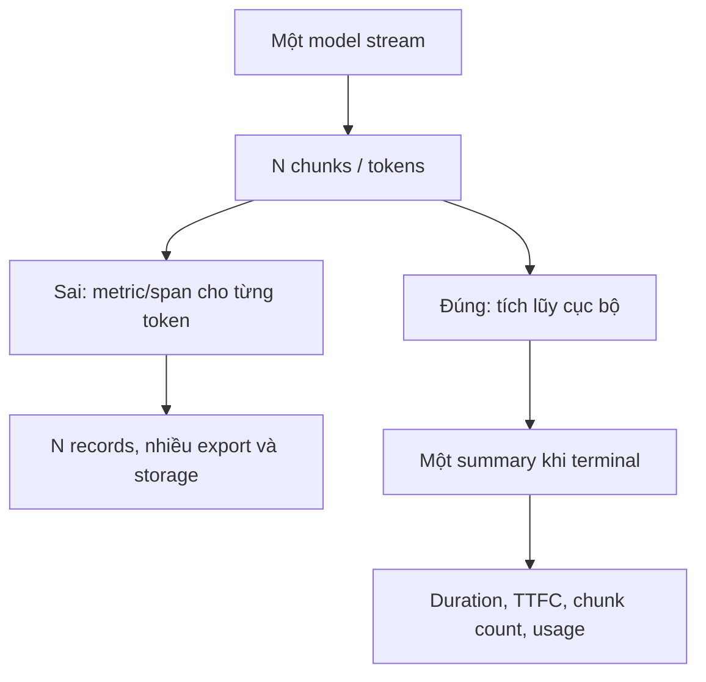

# Tránh tạo một metric hoặc span dư thừa cho mỗi token trong Spring AI

> **Chương:** Streaming và bất đồng bộ  
> **Module:** `SPRING_AI_EVALUATION_OBSERVABILITY` — đánh giá chất lượng ứng dụng Spring AI bằng tập dữ liệu, relevance, fact checking, kiểm thử RAG và tool calling; đồng thời đo metrics, traces, token, chi phí và độ trễ để phát hiện nguyên nhân suy giảm giữa các phiên bản prompt, model và pipeline.

## Mục tiêu học tập

Sau bài này, bạn có thể:

1. Phân biệt **tần suất ghi metric**, **cardinality của time series**, **số lượng span** và **số span event**; hiểu vì sao chúng tạo ra các loại chi phí khác nhau.
2. Chọn granularity quan sát phù hợp ở mức request, model call, attempt và stream thay vì tạo metric/span cho từng token.
3. Thu thập chunk count, output size, first-content latency, stream duration và token usage bằng cách **tích lũy cục bộ rồi ghi một lần ở terminal**.
4. Thiết kế metric names, tags, histogram và exemplars với cardinality có kiểm soát.
5. Dùng một span cho một operation có ý nghĩa, thêm event tại các mốc quan trọng và ghi số liệu tổng hợp khi stream kết thúc.
6. Phân biệt token usage thực tế từ provider với ước lượng dựa trên ký tự/chunk; xử lý usage partial/unavailable và cost theo từng attempt.
7. Kiểm thử rằng một stream nhiều chunks vẫn chỉ ghi một observation cho duration và một lần ghi summary ở boundary đã chọn.
8. Liên kết telemetry gọn nhẹ với relevance, groundedness, evidence provenance, retry và regression chất lượng RAG.

## 1. Vấn đề: stream càng dài, telemetry càng phình to

Một model stream câu trả lời gồm hàng nghìn token. Nếu ứng dụng tạo một metric sample, log hoặc span event cho từng token, lượng telemetry tăng theo độ dài câu trả lời và số người dùng đồng thời. Nếu tạo một child span cho mỗi token, trace có thể có hàng nghìn spans cho một model call vốn chỉ là một operation.

Hậu quả thường thấy:

- Collector, exporter và tracing backend phải xử lý lượng record lớn hơn nhiều so với số request thực.
- Chi phí lưu trữ và truy vấn tăng, trong khi phần lớn spans chỉ cho biết token đã tới.
- Dashboard có nhiều mẫu nhưng khó nhìn thấy xu hướng first-content latency, timeout, retry hoặc cost.
- Trace bị nhiễu bởi những spans/event lặp lại, làm khó tìm nguyên nhân thực sự.
- Instrumentation tạo thêm CPU allocation và contention ngay trên đường xử lý stream.



Mục tiêu không phải là bỏ telemetry. Mục tiêu là giữ lại thông tin đủ để trả lời những câu hỏi vận hành quan trọng: request mất bao lâu, có nội dung đầu tiên khi nào, stream kết thúc ra sao, đã gọi model bao nhiêu lần, tiêu thụ bao nhiêu token và câu trả lời có đạt chất lượng hay không.

## 2. Bốn khái niệm khác nhau: metric update, cardinality, span và event

Các khái niệm này thường bị gộp thành “số lượng telemetry”, nhưng cần phân biệt:

| Khái niệm | Nghĩa | Chi phí chính |
| --- | --- | --- |
| **Metric update/sample** | Một lần cập nhật Counter, Timer, Histogram hoặc DistributionSummary | CPU cập nhật, contention, export/aggregation |
| **Time-series cardinality** | Số chuỗi metric khác nhau được tạo bởi metric name + tổ hợp tag/label | RAM, số series trong registry/backend, index và query |
| **Span** | Một operation có start/end, trace ID, span ID, parent và attributes | Tạo object, export, lưu trữ và truy vấn |
| **Span event** | Một sự kiện gắn vào span đang tồn tại | Payload/export và dung lượng trace |

**Cardinality không đồng nghĩa với tần suất update.** Một Counter có cùng metric name và cùng tags được cập nhật một triệu lần vẫn có thể chỉ là một time series. Tuy nhiên, một triệu lần update vẫn tốn CPU và có thể tạo áp lực export/aggregation. Ngược lại, chỉ một update cho mỗi request nhưng tag `request_id` khác nhau sẽ tạo cardinality gần bằng số request.

Tạo một span cho mỗi token không trực tiếp tạo metric cardinality, nhưng tạo ra lượng spans rất lớn. Tạo một metric label `token_text` có thể vừa làm cardinality bùng nổ vừa làm lộ nội dung. Hai vấn đề này cần biện pháp khác nhau.

### Ví dụ so sánh

| Cách đo | Một câu trả lời 2.000 token | Nhận xét |
| --- | ---: | --- |
| Span cho mỗi token | 2.000 spans cho một model call | Thường không cần thiết |
| Event cho mỗi token | 2.000 span events | Trace phình to |
| Counter update cho mỗi token | 2.000 updates trên cùng series | Cardinality có thể thấp nhưng tần suất update cao |
| Một summary cho cả stream | 1 lần ghi chunk/token totals ở terminal | Đủ cho phần lớn dashboard vận hành |
| Một span cho model attempt | 1 span có duration và outcome | Thể hiện operation có ý nghĩa |
| Event tại first content và terminal | Khoảng 1–2 events/attempt | Ghi mốc quan trọng mà không ghi từng token |

Không có con số cố định cho mọi hệ thống. Một hệ thống debug chuyên sâu có thể cần event-level detail trong thời gian ngắn, nhưng phải có sampling, giới hạn và retention phù hợp.

## 3. Chọn granularity: request, call, attempt, stream và chunk

Trong Spring AI, một request không nhất thiết tương đương một model call. Một agent có thể gọi model để lập kế hoạch, gọi tool, rồi gọi model lần nữa. Một model call có thể retry nhiều attempts; mỗi attempt có thể phát nhiều chunks.

| Đơn vị | Ví dụ | Telemetry nên ghi |
| --- | --- | --- |
| **Request** | Người dùng hỏi một câu | End-to-end duration, outcome, request-level cost và quality |
| **Model call** | Một lần orchestration gọi ChatModel | Model family, purpose, prompt/pipeline version ở nơi phù hợp |
| **Attempt** | Một lần gọi provider, kể cả retry | Attempt duration, outcome, provider usage, retry reason |
| **Stream** | Chuỗi response events của một attempt | TTFC, total duration, chunk count, output size, finish reason |
| **Chunk** | Một delta nội dung | Cập nhật accumulator trong bộ nhớ; thường không cần span/metric riêng |
| **Token** | Đơn vị token do tokenizer/provider tính | Usage aggregate từ metadata cuối hoặc billing record |

Một cấu trúc quan sát hợp lý:

```text
request span
  retrieval span
  model call span
    attempt 1 span (timeout)
    attempt 2 span (completed)
  tool span
  model call span
    attempt 1 span (completed)
  evaluation span/job
```

Mỗi attempt là một operation có thể thất bại độc lập, tiêu tốn token và có duration riêng. Các chunks/token bên trong attempt được tổng hợp thành số liệu của stream. Không cần một span con cho mỗi chunk để biết stream có phát 120 chunks hay 2.000 chunks.

### Khi nào một chunk cần được ghi riêng?

Chỉ khi có một câu hỏi sản phẩm/vận hành cụ thể cần event-level detail, ví dụ:

- Xác định chunk đầu tiên mà UI thực sự render.
- Điều tra một giao thức streaming có sequence number bị mất hoặc đảo thứ tự.
- Chẩn đoán một lỗi parser xuất hiện ở đúng event type.

Ngay cả khi đó, hãy ưu tiên ghi **mốc đầu**, **mốc lỗi**, **mốc cuối** hoặc một mẫu có giới hạn. Không mặc định lưu mọi token vào trace.

## 4. Telemetry budget trước khi viết instrumentation

Trước khi thêm metric/span, xác định:

1. **Câu hỏi cần trả lời:** latency, throughput, lỗi, usage, cost hay quality?
2. **Đơn vị cần quan sát:** request, call, attempt hay stream?
3. **Mốc thời gian:** bắt đầu từ subscribe, provider request, first content hay client-visible?
4. **Tần suất ghi:** một lần mỗi request/attempt hay theo từng event?
5. **Cardinality:** mỗi metric có những tags nào và mỗi tag có bao nhiêu giá trị có thể có?
6. **Sampling/retention:** trace bình thường, trace chậm/lỗi và debug tạm thời được giữ bao lâu?
7. **Privacy:** telemetry có chứa prompt, answer, document text, tenant ID hoặc thông tin cá nhân không?

### Ví dụ telemetry budget cho một model stream

| Tín hiệu | Granularity | Số lần ghi điển hình |
| --- | --- | ---: |
| `ai.stream.duration` | Một stream/attempt | 1 |
| `ai.stream.time_to_first_content` | Một stream có content | 0 hoặc 1 |
| `ai.stream.content.chunks` | Tổng chunks của stream | 1 update với tổng count |
| `ai.stream.output.utf16_units` | Tổng kích thước output của stream | 0 hoặc 1 summary |
| `ai.stream.usage.input_tokens` | Usage final của attempt | 0 hoặc 1 |
| `ai.stream.usage.output_tokens` | Usage final của attempt | 0 hoặc 1 |
| `ai.model.attempt` span | Một provider attempt | 1 span |
| `first_content` span event | Mốc first content | 0 hoặc 1 |
| `stream_terminal` span event | Mốc terminal | 1 nếu span được recording |
| `token_received` event | Mỗi token | 0 trong thiết kế thông thường |

Con số trên là budget tham khảo, không phải giới hạn framework. Nếu một request có ba model calls và bốn attempts, metrics/span được ghi theo từng attempt và request theo đúng ý nghĩa; vẫn không tăng theo số token.

## 5. Metric names và tags: giữ time-series cardinality có kiểm soát

Một metric series thường được định danh bởi metric name và tổ hợp tags/labels. Nếu thêm một tag có hàng triệu giá trị như `request_id`, `trace_id`, `token_text` hoặc `document_id`, registry/backend có thể tạo rất nhiều series.

### Tags phù hợp

| Tag | Thường phù hợp? | Lý do |
| --- | --- | --- |
| `provider_family=openai/azure/bedrock/...` | Có | Tập giá trị nhỏ, hữu ích cho so sánh |
| `model_family=small/medium/large` | Có | Nhóm model có kiểm soát |
| `outcome=completed/error/cancelled/timeout` | Có | Tập giá trị nhỏ |
| `stage=retrieval/model/tool/evaluation` | Có | Tập giá trị nhỏ |
| `streaming=true/false` | Có | Boolean hữu hạn |
| `request_id` | Không | Mỗi request có thể là một giá trị mới |
| `trace_id` / `span_id` | Không | Identifier gần như duy nhất |
| `prompt_text` / `token_text` | Không | Cardinality cực cao và rủi ro dữ liệu |
| `document_id` / `chunk_id` | Thường không | Tập giá trị lớn, biến động |
| `user_id` / raw `tenant_id` | Thường không | Cardinality và privacy |
| `pipeline_version` | Có điều kiện | Chỉ nếu số version được giới hạn và có retention phù hợp |

`prompt_version`, `corpus_version`, `dataset_version` và `judge_version` thường rất hữu ích cho phân tích chất lượng. Tuy nhiên, nếu các giá trị này thay đổi liên tục hoặc mỗi experiment tạo một version mới, hãy giữ chúng trong trace attributes, audit/evaluation store hoặc analytics warehouse thay vì đưa tất cả vào metric labels.

### Không đưa dữ liệu định danh vào metric để tìm trace

Nếu cần từ một metric bất thường đi tới trace cụ thể, dùng **exemplar** nếu metrics backend hỗ trợ, hoặc log/trace correlation qua trace ID. Exemplar liên kết một sample metric với trace tham chiếu mà không tạo một time series mới cho mỗi trace.

## 6. Những metric nên đo cho streaming AI

Các metric sau thường trả lời được nhiều câu hỏi vận hành mà không cần token-level telemetry:

| Metric | Loại | Ý nghĩa |
| --- | --- | --- |
| `ai.stream.duration` | Timer/Histogram | Thời gian từ boundary stream start tới terminal |
| `ai.stream.time_to_first_content` | Timer/Histogram | Thời gian tới content hữu ích đầu tiên |
| `ai.stream.content.chunks` | Counter | Tổng số chunks, ghi tổng mỗi stream |
| `ai.stream.output.utf16_units` | DistributionSummary | Kích thước output theo UTF-16 code units, không phải token |
| `ai.stream.max_inter_chunk_gap` | Timer/Histogram | Khoảng im lặng dài nhất giữa content chunks |
| `ai.model.attempts` | Counter | Số provider attempts |
| `ai.model.retry` | Counter | Số retry |
| `ai.model.usage.input_tokens` | Counter | Input tokens từ usage đáng tin |
| `ai.model.usage.output_tokens` | Counter | Output tokens từ usage đáng tin |
| `ai.model.usage.unavailable` | Counter | Attempts không có final usage |
| `ai.request.cost` | DistributionSummary/Counter | Cost theo request hoặc attempt, theo pricing policy |

Đặt tên theo convention của metrics backend đang dùng; ví dụ trên mô tả ý nghĩa, không bắt buộc là tên chuẩn của Spring AI.

### Không nhầm chunk count với token count

Một chunk có thể chứa một phần token, nhiều token, metadata hoặc một chuỗi rỗng. Tokenization phụ thuộc model/tokenizer. Vì vậy:

- `chunk_count` đo số content events/chunks.
- `output_utf16_units` đo độ dài chuỗi theo đơn vị UTF-16 của Java.
- `output_tokens` lấy từ provider usage/tokenizer phù hợp.

Không dùng chunk count hoặc số ký tự để báo token usage thực tế, trừ khi metric được đặt tên rõ là estimate và phương pháp ước lượng được công bố.

## 7. Tích lũy số liệu trong bộ nhớ, ghi metric ở terminal

Một cách hiệu quả là tạo accumulator riêng cho mỗi stream subscription. Mỗi chunk chỉ cập nhật state cục bộ; khi stream complete/error/cancel, recorder ghi một summary.

```java
import java.util.concurrent.atomic.AtomicLong;
import java.util.concurrent.atomic.LongAdder;

final class StreamAccumulator {
    private static final long UNSET = -1L;

    private final long startedNanos = System.nanoTime();
    private final AtomicLong firstContentNanos =
            new AtomicLong(UNSET);
    private final AtomicLong lastContentNanos =
            new AtomicLong(UNSET);
    private final AtomicLong maxGapNanos =
            new AtomicLong(0L);
    private final LongAdder chunkCount = new LongAdder();
    private final LongAdder outputUtf16Units = new LongAdder();

    void onContent(String chunk) {
        if (chunk == null || chunk.isBlank()) {
            return;
        }

        long now = System.nanoTime();
        chunkCount.increment();
        outputUtf16Units.add(chunk.length());
        firstContentNanos.compareAndSet(UNSET, now);

        long previous = lastContentNanos.getAndSet(now);
        if (previous != UNSET) {
            long gap = now - previous;
            maxGapNanos.accumulateAndGet(gap, Math::max);
        }
    }

    StreamSnapshot finish(String outcome) {
        long endedNanos = System.nanoTime();
        long first = firstContentNanos.get();

        return new StreamSnapshot(
                outcome,
                endedNanos - startedNanos,
                first == UNSET ? -1L : first - startedNanos,
                maxGapNanos.get(),
                chunkCount.sum(),
                outputUtf16Units.sum());
    }
}

record StreamSnapshot(
        String outcome,
        long durationNanos,
        long timeToFirstContentNanos,
        long maxInterChunkGapNanos,
        long chunkCount,
        long outputUtf16Units) {}
```

Đoạn accumulator không gọi MeterRegistry, exporter hoặc tracing API trong `onContent`. Nó chỉ cập nhật số liệu cục bộ. `System.nanoTime()` dùng để đo elapsed time trong cùng process; không dùng làm timestamp UTC. `String.length()` đếm UTF-16 code units, vì vậy tên field được đặt rõ là `outputUtf16Units`.

Reactive Streams yêu cầu tín hiệu được serialize đối với một subscriber; `LongAdder` và atomic ở đây giúp ví dụ chịu được callback có phối hợp giữa nhiều threads. Nếu adapter đảm bảo single-thread serialization và cần tối ưu sâu hơn, có thể dùng state không đồng bộ hóa sau khi benchmark.

### Vì sao accumulator phải nằm trong `defer`?

Một publisher có thể được subscribe nhiều lần. Nếu tạo accumulator bên ngoài `Flux.defer`, nhiều subscribers có thể dùng chung counters, khiến số chunks và latency của request này lẫn sang request khác. Tạo state bên trong `defer` để mỗi subscription có một summary riêng.

## 8. Ghi Timer, Counter và DistributionSummary một lần

Recorder nhận summary khi stream kết thúc. Tags chỉ chứa nhóm giá trị có cardinality thấp:

```java
import java.util.concurrent.TimeUnit;

import io.micrometer.core.instrument.Counter;
import io.micrometer.core.instrument.DistributionSummary;
import io.micrometer.core.instrument.MeterRegistry;
import io.micrometer.core.instrument.Tags;
import io.micrometer.core.instrument.Timer;

final class StreamMetricsRecorder {
    private final MeterRegistry registry;

    StreamMetricsRecorder(MeterRegistry registry) {
        this.registry = registry;
    }

    void record(
            StreamSnapshot snapshot,
            String providerFamily,
            String modelFamily) {

        Tags tags = Tags.of(
                "provider", providerFamily,
                "model_family", modelFamily,
                "outcome", snapshot.outcome());

        registry.timer("ai.stream.duration", tags)
                .record(snapshot.durationNanos(), TimeUnit.NANOSECONDS);

        if (snapshot.chunkCount() > 0) {
            Counter.builder("ai.stream.content.chunks")
                    .tags(tags)
                    .register(registry)
                    .increment(snapshot.chunkCount());
        }

        if (snapshot.outputUtf16Units() > 0) {
            DistributionSummary.builder("ai.stream.output.utf16_units")
                    .tags(tags)
                    .register(registry)
                    .record(snapshot.outputUtf16Units());
        }

        if (snapshot.timeToFirstContentNanos() >= 0) {
            registry.timer("ai.stream.time_to_first_content", tags)
                    .record(snapshot.timeToFirstContentNanos(),
                            TimeUnit.NANOSECONDS);
        }

        if (snapshot.maxInterChunkGapNanos() > 0) {
            registry.timer("ai.stream.max_inter_chunk_gap", tags)
                    .record(snapshot.maxInterChunkGapNanos(),
                            TimeUnit.NANOSECONDS);
        }
    }
}
```

Recorder được gọi một lần cho mỗi summary. `Counter.increment(amount)` cộng tổng số chunks trong một lần cập nhật; `DistributionSummary.record(amount)` ghi tổng kích thước output của stream. Mỗi Timer có một measurement cho stream, không phải một measurement cho mỗi token.

Trong production, registry quản lý meter theo metric name và tags; đăng ký lại cùng một meter ID sẽ lấy meter hiện có. Hãy giữ tập tags hữu hạn, không thêm request ID hoặc token text vào `Tags`.

### Gắn recorder vào Reactor

Ví dụ một boundary đo stream:

```java
import java.util.concurrent.atomic.AtomicReference;

import reactor.core.publisher.Flux;
import reactor.core.publisher.SignalType;

Flux<String> measured(
        Flux<String> source,
        StreamMetricsRecorder recorder,
        String providerFamily,
        String modelFamily) {

    return Flux.defer(() -> {
        StreamAccumulator accumulator = new StreamAccumulator();
        AtomicReference<Throwable> failure = new AtomicReference<>();

        return source
                .doOnNext(accumulator::onContent)
                .doOnError(failure::set)
                .doFinally(signal -> {
                    String outcome = outcomeOf(signal, failure.get());
                    StreamSnapshot snapshot =
                            accumulator.finish(outcome);
                    recorder.record(
                            snapshot, providerFamily, modelFamily);
                });
    });
}

String outcomeOf(SignalType signal, Throwable error) {
    if (signal == SignalType.ON_COMPLETE) {
        return "completed";
    }
    if (signal == SignalType.CANCEL) {
        return "cancelled";
    }
    if (error instanceof java.util.concurrent.TimeoutException) {
        return "timeout";
    }
    return "error";
}
```

Đặt `measured(...)` tại boundary mà bạn muốn đo. Nếu `source` đã nằm sau timeout/retry, đây có thể là summary request cuối; nếu đặt bên trong mỗi attempt, đây là summary attempt. Với timeout operator nằm **bên ngoài** publisher được đo, source có thể nhận `CANCEL` trong khi downstream nhận `TimeoutException`; hãy ghi outcome ở cả hai boundary nếu cần phân biệt attempt cancellation với request timeout.

Không gắn recorder ở cả adapter, ChatClient và controller nếu cả ba cùng đo một stream duration. Chọn một owner cho mỗi metric để tránh ghi trùng.

## 9. Đo token usage một lần ở cuối attempt

Token usage là dữ liệu billing/usage, không phải số lượng chunks. Provider có thể gửi usage trong final `ChatResponse`, response metadata hoặc API billing riêng. Với streaming:

- Một số provider chỉ gửi usage ở event cuối.
- Một số adapter không expose usage khi dùng `.content()`.
- Một số provider có thể trả cumulative usage snapshot; cần hiểu semantics trước khi cộng.
- Khi cancel/timeout, usage cuối có thể thiếu dù provider đã tiêu tài nguyên.

### Nguyên tắc ghi usage

1. Gắn usage với **provider call/attempt ID**, không gắn với từng token event.
2. Chỉ đánh dấu `FINAL` khi provider/adapter xác nhận final usage.
3. Nếu chỉ có snapshot tạm, lưu `PARTIAL` và nguồn dữ liệu.
4. Nếu không có metadata, ghi `UNAVAILABLE`; không tự gán 0.
5. Nếu có retry, tổng request cost là tổng các attempts thực sự phát sinh chi phí, nhưng không cộng lặp các cumulative snapshots trong cùng một attempt.
6. Reconcile với billing record khi provider gửi số liệu trễ.

Ví dụ adapter nhận response cuối:

```java
record TokenUsage(
        long inputTokens,
        long outputTokens,
        String usageState) {}

void recordFinalUsage(
        TokenUsage usage,
        MeterRegistry registry,
        String providerFamily,
        String modelFamily) {

    if (!"FINAL".equals(usage.usageState())) {
        registry.counter(
                "ai.model.usage.not_final",
                "provider", providerFamily,
                "model_family", modelFamily,
                "usage_state", usage.usageState())
                .increment();
        return;
    }

    registry.counter(
            "ai.model.usage.input_tokens",
            "provider", providerFamily,
            "model_family", modelFamily)
            .increment(usage.inputTokens());

    registry.counter(
            "ai.model.usage.output_tokens",
            "provider", providerFamily,
            "model_family", modelFamily)
            .increment(usage.outputTokens());
}
```

Đây là ví dụ recorder ở **một lần gọi cho mỗi attempt**. Trong ứng dụng thật, dùng usage object/field của provider adapter và kiểm tra null/negative values theo contract. Nếu usage state không phải `FINAL`, có thể ghi một counter theo trạng thái hữu hạn; không tạo metric label từ raw provider response.

### content() và chatResponse()

`ChatClient.stream().content()` thuận tiện khi chỉ cần text, nhưng có thể làm mất metadata như usage, finish reason hoặc response ID tùy phiên bản/adapter. Nếu evaluation, cost hoặc audit cần metadata cuối, dùng response stream phù hợp (ví dụ `chatResponse()` khi API/version hỗ trợ), hoặc một adapter giữ cả content lẫn metadata. Không mở một subscription thứ hai chỉ để lấy usage nếu điều đó làm provider thực hiện thêm một model call.

## 10. Một span cho operation, event cho mốc quan trọng

Span nên biểu diễn một operation có start/end rõ ràng, ví dụ:

- Một request AI.
- Một model call/attempt.
- Một retrieval hoặc tool operation.
- Một background evaluation job.

Không tạo span cho từng token/chunk. Một stream 3.000 chunks vẫn chỉ cần một span cho model attempt, với các attributes tổng hợp:

| Attribute/event | Khi ghi |
| --- | --- |
| `provider.family`, `model.family` | Lúc tạo span |
| `stream.first_content` | Một lần khi content hữu ích đầu tiên xuất hiện |
| `stream.retry` | Một lần tại ranh giới retry nếu attempt mới được tạo |
| `stream.chunk_count` | Ghi số tổng hợp khi terminal |
| `stream.output_utf16_units` | Ghi số tổng hợp khi terminal |
| `stream.usage_state` | Khi có usage cuối hoặc terminal |
| `stream.outcome` | Complete/error/cancel/timeout |
| `stream.duration_ms` | Số liệu tổng hợp khi terminal nếu cần attribute |

### Ví dụ OpenTelemetry span lifecycle

```java
import java.util.concurrent.atomic.AtomicBoolean;
import java.util.concurrent.atomic.AtomicReference;

import io.opentelemetry.api.trace.Span;
import io.opentelemetry.api.trace.StatusCode;
import io.opentelemetry.context.Context;
import io.opentelemetry.context.Scope;
import reactor.core.publisher.Flux;

Flux<String> traced(
        Flux<String> source,
        io.opentelemetry.api.trace.Tracer tracer) {

    return Flux.defer(() -> {
        Context parent = Context.current();
        Span span = tracer.spanBuilder("app.ai.model.stream")
                .setParent(parent)
                .startSpan();
        Context streamContext = parent.with(span);
        StreamAccumulator accumulator = new StreamAccumulator();
        AtomicBoolean firstEventRecorded = new AtomicBoolean(false);
        AtomicReference<Throwable> failure = new AtomicReference<>();

        return source
                .doOnNext(chunk -> {
                    accumulator.onContent(chunk);
                    if (chunk != null && !chunk.isBlank()
                            && firstEventRecorded.compareAndSet(false, true)
                            && span.isRecording()) {
                        try (Scope ignored = streamContext.makeCurrent()) {
                            span.addEvent("stream.first_content");
                        }
                    }
                })
                .doOnError(error -> {
                    failure.set(error);
                    if (span.isRecording()) {
                        span.recordException(error);
                        span.setStatus(StatusCode.ERROR);
                    }
                })
                .doFinally(signal -> {
                    String outcome = outcomeOf(signal, failure.get());
                    StreamSnapshot snapshot = accumulator.finish(outcome);
                    try (Scope ignored = streamContext.makeCurrent()) {
                        span.setAttribute(
                                "stream.outcome", snapshot.outcome());
                        span.setAttribute(
                                "stream.chunk_count", snapshot.chunkCount());
                        span.setAttribute(
                                "stream.output_utf16_units",
                                snapshot.outputUtf16Units());
                        if (snapshot.timeToFirstContentNanos() >= 0) {
                            span.setAttribute(
                                    "stream.ttfc_ms",
                                    snapshot.timeToFirstContentNanos()
                                            / 1_000_000.0);
                        }
                    } finally {
                        span.end();
                    }
                });
    });
}
```

Đây là skeleton cho một span ở boundary stream; cần bổ sung dependency injection và cách phân loại timeout theo operator placement. `span.isRecording()` giúp bỏ qua event/attribute work không cần thiết khi span không được recording. Không ghi nội dung chunk/token vào span. Scope chỉ mở trong callback đồng bộ và đóng ngay tại callback; span được end đúng một lần trong `doFinally`.

### Event có giới hạn

Một span có thể ghi một vài event như `first_content`, `retry_scheduled`, `timeout` và `stream_terminal`. Tránh một event cho mọi chunk nếu mục tiêu chỉ là đo tổng lượng output. Nếu cần chẩn đoán stream bất thường, có thể ghi:

- Chunk đầu tiên.
- Chunk đầu tiên sau một khoảng idle bất thường.
- Một event khi vượt ngưỡng cảnh báo (ví dụ gap lớn hơn SLA).
- Terminal outcome.

Giới hạn số event mỗi span và không gắn text payload.

## 11. Dùng Observation của Spring AI thay vì tự instrument trùng

Spring AI/Spring Boot có thể đã cung cấp observations/metrics cho các thành phần như ChatClient, ChatModel, embedding hoặc vector store tùy phiên bản và cấu hình. Trước khi thêm span hoặc timer:

1. Kiểm tra observations hiện có và tên operation thực tế trong trace.
2. Xác định observation đó đo request orchestration, model attempt hay transport.
3. Xác định metric hiện có đã ghi duration/token usage hay chưa.
4. Chỉ bổ sung boundary còn thiếu, ví dụ first visible content hoặc tổng chunks của stream.
5. Không tạo một observation custom khác cho cùng một model call nếu chỉ để đếm tokens/chunks.

Một thiết kế tốt có thể giữ observation chuẩn của ChatModel, thêm một span/metric ở cấp ứng dụng nếu boundary khác nhau, và ghi aggregate chunk summary tại terminal. Mỗi tín hiệu có owner và semantics rõ ràng.

### Tránh đếm trùng token

Nếu Spring AI/provider instrumentation đã ghi usage cuối, custom recorder không nên cộng lại cùng usage vào một metric cùng ý nghĩa. Có thể:

- Dùng metric chuẩn đã có.
- Thêm metric riêng có tên/namespace khác nếu mục đích thực sự khác (ví dụ usage đã reconcile).
- Ghi provenance/usage state vào audit record.

Không cộng usage mỗi khi nhận một response snapshot nếu snapshot là cumulative. Hãy xác định provider gửi delta hay cumulative trước khi cộng.

## 12. Histogram, percentiles và exemplars

Timer/Histogram giúp xem phân phối latency thay vì chỉ một giá trị trung bình. Các chỉ số hữu ích:

- p50/p90/p95/p99 stream duration.
- p50/p95 time-to-first-content.
- p95 max inter-chunk gap.
- Phân phối số chunks và kích thước output theo stream.

Histogram bucket nên chọn theo SLA và dải latency thực tế. Quá nhiều buckets hoặc tags có thể làm backend tăng storage/query cost. Percentile được tính ở client-side hay backend-side tùy hệ thống; cần hiểu semantics trước khi so sánh giữa instance.

### Exemplars

Exemplar cho phép một metric sample trỏ tới trace cụ thể, thường chứa trace ID/span ID. Khi p99 latency tăng, operator có thể mở một trace exemplar để xem attempt nào chậm, có retry hay tool call nào kéo dài.

Exemplar không phải một label thông thường. Không đưa trace ID thành tag metric để đạt mục đích tương tự, vì điều đó tạo series mới cho mỗi trace.

### Sampling spans

Không nhất thiết phải export mọi trace thành công ở production:

| Loại trace | Chính sách gợi ý |
| --- | --- |
| Request bình thường, latency thấp | Head sampling với tỷ lệ phù hợp |
| Error/timeout/retry exhausted | Ưu tiên giữ qua tail sampling hoặc policy phù hợp |
| p95/p99 latency bất thường | Giữ mẫu đại diện và exemplar |
| Debug token/chunk protocol | Sampling tạm thời, giới hạn event và retention ngắn |
| Dữ liệu nhạy cảm | Không ghi raw prompt/answer; sampling không thay thế privacy controls |

Tail sampling cần collector có đủ khả năng giữ buffer và đưa ra quyết định sau khi trace kết thúc. Nếu span bị drop trước khi collector nhận được, tail policy không thể khôi phục nó.

## 13. Log: một bản tổng kết thay vì một dòng cho mỗi token

Structured log ở terminal có thể chứa:

```json
{
  "event": "ai.stream.terminal",
  "request_id": "req-91",
  "call_id": "answer-1",
  "attempt": 2,
  "provider_family": "provider-a",
  "model_family": "medium",
  "outcome": "completed",
  "chunk_count": 84,
  "output_utf16_units": 6420,
  "time_to_first_content_ms": 310,
  "stream_duration_ms": 2480,
  "usage_state": "FINAL",
  "input_tokens": 1100,
  "output_tokens": 980
}
```

Đây là log summary minh họa; trace ID có thể được logging bridge thêm tự động. Giữ request/call/attempt IDs trong log/audit để tra cứu; không dùng chúng làm metric tags. Không ghi raw answer, prompt hoặc source document vào log thông thường.

### Khi nào cần log từng chunk?

Chỉ trong debug có chủ đích, với:

- Sampling rõ ràng (ví dụ chỉ một tỷ lệ rất nhỏ requests).
- Giới hạn số chunks/bytes trên mỗi request.
- Redaction và access control.
- Retention ngắn.
- Cờ bật/tắt có thời hạn và owner chịu trách nhiệm.

Production dashboard thông thường nên dùng summary và traces ở granularity operation.

## 14. Token usage, cost và quality ở cấp attempt/request

Một request có thể có nhiều attempts. Nếu attempt đầu timeout nhưng đã tiêu tokens, attempt hai hoàn tất, cost request không chỉ là usage attempt hai. Ngược lại, nếu provider gửi cumulative snapshot trong cùng attempt, cộng tất cả snapshot sẽ đếm trùng.

| Cấp | Nên tổng hợp |
| --- | --- |
| **Attempt** | Final input/output tokens, provider request ID, pricing version, usage state, attempt cost |
| **Model call** | Tổng cost các attempts thuộc call; retry count; terminal result |
| **Request** | Tổng cost các model calls/tool calls liên quan; latency; outcome; answer quality |
| **Dataset evaluation** | Relevance, groundedness, completeness, citation support theo case/version |

### Cost không đồng nghĩa token count

Cost có thể phụ thuộc:

- Input tokens, output tokens và cached tokens.
- Model/provider pricing tier.
- Tool usage, image/audio tokens hoặc compute riêng.
- Batch/priority/region.
- Discount, currency và thời điểm bảng giá có hiệu lực.

Ghi `pricing_version` trong audit/evaluation record để tính lại cost có thể tái lập. Không tạo một metric series riêng cho từng giá trị request cost ID hoặc từng user.

### Liên hệ với chất lượng

Một câu trả lời có 1.000 tokens không tự động tốt hơn câu trả lời 300 tokens. Để tìm trade-off:

- So groundedness/relevance/completeness trên cùng dataset.
- So token usage và cost trên cùng model/prompt/corpus versions.
- So TTFC và stream duration cùng outcome/partial state.
- Kiểm tra evidence manifest cuối cùng đã gửi vào model.
- Theo dõi tỷ lệ câu trả lời partial, timeout và retry.

Metric gọn nhẹ vẫn đủ để phát hiện regression nếu nó được gắn với version/provenance phù hợp trong trace hoặc evaluation store.

## 15. Kiểm thử: nhiều chunks nhưng chỉ ghi một summary

Test sau dùng `SimpleMeterRegistry` để kiểm tra recorder: một stream có nhiều chunks vẫn ghi một observation duration, một sample output size và tổng chunk count đúng. Đây là kiểm thử granularity, không phải benchmark tải.

```java
import static org.junit.jupiter.api.Assertions.assertEquals;

import io.micrometer.core.instrument.simple.SimpleMeterRegistry;
import org.junit.jupiter.api.Test;

import reactor.core.publisher.Flux;
import reactor.test.StepVerifier;

class StreamMetricsGranularityTest {

    @Test
    void recordsOneSummaryForManyChunks() {
        SimpleMeterRegistry registry = new SimpleMeterRegistry();
        StreamMetricsRecorder recorder =
                new StreamMetricsRecorder(registry);

        Flux<String> measured = measured(
                Flux.just("one ", "two ", "three ", "four"),
                recorder,
                "provider-a",
                "medium");

        StepVerifier.create(measured)
                .expectNext("one ", "two ", "three ", "four")
                .verifyComplete();

        var tags = io.micrometer.core.instrument.Tags.of(
                "provider", "provider-a",
                "model_family", "medium",
                "outcome", "completed");

        assertEquals(1,
                registry.timer("ai.stream.duration", tags).count());
        assertEquals(4.0,
                registry.counter("ai.stream.content.chunks", tags)
                        .count());
        assertEquals(1,
                registry.summary(
                        "ai.stream.output.utf16_units", tags).count());
    }
}
```

Test minh họa giả định các lớp `StreamAccumulator`, `StreamSnapshot`, `StreamMetricsRecorder`, `measured(...)` đã được đặt trong package test/production phù hợp. `Timer.count()` là số lần ghi duration; Counter total là tổng chunks; DistributionSummary count là số stream summaries. Một stream bốn chunks vẫn chỉ tạo một Timer record và một DistributionSummary record.

### Kiểm thử nhiều subscriptions không dùng chung accumulator

Thêm test với hai subscribers/cold publisher và xác nhận mỗi subscription tạo summary riêng. Nếu accumulator được tạo ngoài `Flux.defer`, hai subscribers có thể chia sẻ state và làm tổng chunks/duration sai.

### Kiểm thử terminal khác nhau

| Kịch bản | Kiểm tra |
| --- | --- |
| Complete | Một summary với outcome completed |
| Error | Một summary với outcome error, không có first content nếu chưa phát |
| Cancel | Một summary với outcome cancelled ở boundary được đo |
| Timeout downstream | Request boundary timeout; upstream attempt có thể thấy cancel |
| Retry | Một summary cho mỗi attempt và một summary request nếu đo ở outer boundary |
| Không có content | Không ghi TTFC; chunk count và output size bằng 0 |
| Usage unavailable | Không ghi token count bằng 0; ghi trạng thái unavailable |

## 16. Chẩn đoán khi telemetry vẫn quá lớn

Nếu trace/metrics storage tăng bất thường, điều tra theo thứ tự:

1. **Span volume:** spans per request, spans per model attempt, span events per span.
2. **Metric cardinality:** số series theo metric name và label combinations; tìm labels có ID/text.
3. **Update frequency:** số metric updates/second; tìm `increment()` hoặc `record()` trong `onNext`/token callback.
4. **Log volume:** log lines/request, bytes/request, raw content.
5. **Sampling:** tỷ lệ trace được giữ, error/slow trace coverage.
6. **Duplicate instrumentation:** Spring AI observation, Micrometer, OpenTelemetry agent và custom adapter có cùng đo một operation không.
7. **Export pipeline:** queue saturation, batch size, exporter retries và collector drops.

### Bảng triệu chứng

| Triệu chứng | Nguyên nhân có thể | Hướng xử lý |
| --- | --- | --- |
| Một request có hàng nghìn spans | Span tạo trong mỗi token/chunk callback | Chuyển về một span mỗi attempt, events ở milestone |
| Cardinality tăng theo request volume | `request_id`/`trace_id` nằm trong metric tags | Chuyển ID sang trace/log/exemplar |
| Cardinality tăng theo prompt text | Raw prompt/label động làm tag | Dùng prompt version có tập giá trị giới hạn hoặc trace attribute |
| CPU tăng dù series count ổn định | Counter/Timer update trên từng token | Tích lũy cục bộ, ghi một summary terminal |
| Trace lớn dù spans count ít | Raw prompt/answer hoặc chunk payload trong attributes/events | Chỉ ghi aggregate metadata, redaction |
| Token totals bị nhân nhiều lần | Cộng cumulative usage snapshot | Chỉ lấy final snapshot hoặc tính delta theo contract |
| Usage không có ở cancelled stream | Provider không gửi final usage | Ghi unavailable/partial, reconcile billing |
| Metrics chuẩn và custom metrics gấp đôi | Hai instrumentation owners cùng ghi một metric | Chọn một owner, đổi semantics/name nếu cần |

## 17. Bài thực hành

Một endpoint Spring AI trả lời câu hỏi RAG. Một stream có 1.500 chunks, khoảng 2.200 output tokens. Team đã thêm telemetry như sau:

| Thành phần | Cách triển khai hiện tại |
| --- | --- |
| Token callback | Mỗi token tạo một child span |
| Metric | `ai.token.received{request_id, token_text}` tăng một lần mỗi token |
| Log | Ghi toàn bộ token text ở mức INFO |
| Stream timer | Ghi một duration khi complete |
| Usage | Cộng mọi usage snapshot nhận được |
| Evaluation | Ghi groundedness và completeness theo request |

Sau một ngày, tracing backend tăng mạnh span volume, metrics registry có hàng triệu series, log storage tăng và token totals cao gấp nhiều lần provider billing. Dashboard p95 duration vẫn xem được nhưng khó truy nguyên request chậm.

**Yêu cầu:**

1. Chỉ ra vấn đề cardinality và vấn đề update frequency trong metric hiện tại.
2. Đề xuất span hierarchy đủ để chẩn đoán model stream và retry.
3. Những mốc nào đáng ghi thành span event?
4. Thiết kế metric summary cho 1.500 chunks mà không ghi một sample mỗi token.
5. Nên lấy token usage và cost từ đâu, xử lý snapshot cumulative thế nào?
6. Dùng cơ chế nào để từ p95 metric mở một trace đại diện mà không thêm `trace_id` vào metric labels?
7. Nêu cách giữ khả năng điều tra khi cần debug chunk protocol trong thời gian ngắn.
8. Làm thế nào phát hiện instrumentation chuẩn của Spring AI đã ghi trùng custom metric/span?

### Đáp án gợi ý

1. `request_id` và `token_text` tạo cardinality cực cao; Counter update trên từng token gây tần suất cập nhật lớn dù cùng series. Token text còn có nguy cơ lộ nội dung.
2. Một request span, một span cho mỗi model call/attempt, thêm retrieval/tool spans nếu có. Stream chunks được tổng hợp thành attributes/metrics của attempt; không tạo child span cho mỗi token.
3. First content, retry scheduled, timeout/error nếu có, terminal complete/cancel. Chỉ thêm event cho idle vượt ngưỡng nếu cần điều tra.
4. Accumulator cục bộ đếm chunk count, output size, first-content timestamp, max gap; khi terminal ghi một Timer duration, một Counter increment tổng 1.500 chunks và một DistributionSummary record tổng output size.
5. Lấy final usage từ provider/adapter hoặc billing reconciliation, gắn provider call/attempt ID. Nếu snapshot cumulative, dùng snapshot cuối hoặc tính delta theo contract; không cộng mọi snapshot.
6. Dùng exemplar hỗ trợ trace ID/span ID hoặc structured log/trace correlation; trace ID không phải metric label.
7. Bật debug sampling có tỷ lệ nhỏ, giới hạn số chunks/bytes và thời gian, redaction nội dung, retention ngắn; tắt sau điều tra.
8. Kiểm tra observations/metrics đang được export từ Spring AI, Micrometer Tracing và Java Agent; so metric names, span names và boundary. Chọn một owner cho mỗi tín hiệu và không cộng usage trùng.

## Ghi nhớ

- **Metric update khác cardinality:** nhiều updates trên một series vẫn tốn CPU; tags chứa ID/text tạo nhiều series.
- **Không tạo span/event cho mỗi token:** một span cho request/model attempt, event cho first content/retry/terminal và summary ở cuối stream thường đủ.
- **Tích lũy cục bộ, ghi một lần:** đếm chunks, output size, TTFC và max gap trong accumulator riêng mỗi subscription; record metrics khi complete/error/cancel.
- **Token usage đến từ metadata đáng tin:** chunk count/ký tự không phải token count; usage partial/unavailable không đồng nghĩa 0.
- **Tags phải có cardinality thấp:** request/call/attempt/trace IDs nằm trong trace/log/audit; dùng exemplar để liên kết metric với trace.
- **Tránh instrumentation trùng:** kiểm tra Spring AI/Micrometer/OTel hiện có trước khi thêm custom metrics hoặc spans.
- **Telemetry phải hỗ trợ đánh giá chất lượng:** liên kết aggregate usage/cost/latency với attempt, evidence manifest, prompt/model/pipeline version, relevance và groundedness mà không lưu token text vào metric.
