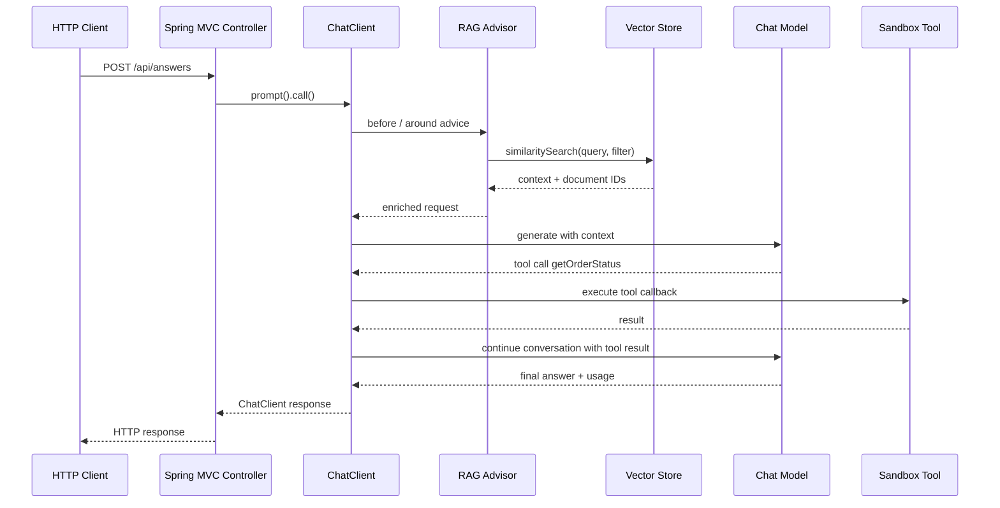
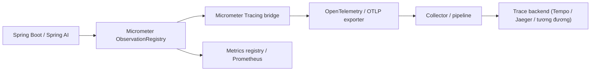

# Xây dựng cây span cho HTTP, ChatClient, advisor, mô hình và công cụ

Một yêu cầu HTTP đến ứng dụng Spring AI có thể kích hoạt hàng loạt thao tác: controller nhận câu hỏi, `ChatClient` chạy chuỗi advisor, một advisor thực hiện truy xuất RAG, `ChatModel` gọi nhà cung cấp mô hình, mô hình yêu cầu chạy tool, ứng dụng gọi tool và gửi kết quả lại mô hình. Nếu chỉ ghi một log “request hoàn thành sau 3 giây”, chúng ta không biết 3 giây đó chủ yếu nằm ở tìm kiếm vector, model, tool hay việc chờ retry. Nếu sau khi đổi prompt hoặc model, điểm relevance và fact checking giảm, ta cũng khó xác định nguồn RAG và dữ kiện nào đã được đưa vào câu trả lời.

Trong chương **Thiết kế trace** của module `SPRING_AI_EVALUATION_OBSERVABILITY`, chúng ta sẽ xây dựng **cây span** (*span tree*) thể hiện quan hệ nhân quả từ HTTP đến `ChatClient`, advisor, mô hình, retrieval và công cụ. Thiết kế này còn phục vụ việc đánh giá bằng dataset, rubric relevance/groundedness/fact checking, kiểm tra luồng RAG/tool calling, và so sánh metrics, traces, token, chi phí, độ trễ giữa các phiên bản prompt, model và pipeline.

Mục tiêu không phải “càng nhiều span càng tốt”, mà là có **đúng ranh giới vận hành, đúng quan hệ cha–con, đúng metadata và không làm lộ dữ liệu nhạy cảm**. Một trace tốt phải cho phép trả lời: thao tác nào xảy ra, sau thao tác nào, mất bao lâu, lỗi ở đâu, gọi model và tool mấy lần, phiên bản nào đã chạy, và vì sao một case được evaluator chấm PASS/FAIL hoặc chưa chấm được.

## 1. Trace, span, event, metric và log khác nhau thế nào?

| Khái niệm | Mô tả | Ví dụ trong Spring AI |
|---|---|---|
| **Trace** | Toàn bộ chuỗi thao tác thuộc một luồng xử lý được liên kết | Một request hỏi chính sách từ HTTP tới RAG, model, tool |
| **Span** | Một công việc có thời điểm bắt đầu/kết thúc, parent, thuộc tính và trạng thái | `vectorstore.search`, `chat.model.call`, `tool.getOrderStatus` |
| **Span event** | Sự kiện tức thời bên trong span; không có khoảng duration độc lập | `retry_scheduled`, `fallback_selected` |
| **Span link** | Liên hệ một span/trace với span/trace khác mà **không bắt buộc là quan hệ cha–con** | Một batch evaluator xử lý lại answer của request đã hoàn tất |
| **Metric** | Số đo tổng hợp theo nhãn có cardinality thấp | p95 độ trễ, tỉ lệ 429, số token, chi phí ước tính |
| **Log** | Bản ghi sự kiện/chi tiết có thể kèm trace ID | Case bị chặn vì filter source hoặc tool arguments không hợp lệ |

Một **span** thường có:

- **Trace ID:** mã liên kết các span thuộc cùng trace.
- **Span ID:** mã của span hiện tại.
- **Parent span ID:** mã span đã kích hoạt công việc này, nếu có.
- **Name:** thao tác có ý nghĩa ổn định, ví dụ `app.ai.answer`.
- **Start/end, duration:** thời gian tồn tại.
- **Attributes/tags:** metadata có cấu trúc; phải được kiểm soát về bảo mật và cardinality.
- **Status/error, events, links:** nguyên nhân lỗi, các mốc quan trọng và liên kết liên-trace.

Một span là **đơn vị thời gian của một operation**, không phải đơn vị dữ liệu. Đừng tạo một span riêng cho từng token nếu một lời gọi model streaming sinh hàng nghìn token; việc đó gây overhead lớn và khó quan sát. Thay vào đó, ghi các mốc như “nhận token đầu tiên” dưới dạng event/metric thích hợp và đo cả thời gian từ request tới token đầu tiên (*TTFT*).

### 1.1. Vì sao cần parent–child?

Nếu một span `rag.retrieve` nằm dưới span `app.ai.answer`, người xem hiểu retrieval là một phần của xử lý answer. Nếu model yêu cầu tool trong quá trình tạo câu trả lời, span tool cần được liên hệ với lần gọi model/chuỗi điều phối phù hợp. Quan hệ đó cho phép đọc trace như một **timeline nhân quả** thay vì danh sách log không thứ tự.

**Không suy diễn:** thời gian của các span con có thể chồng nhau. Cộng tất cả child durations thường **không bằng** duration của parent; muốn xác định bottleneck phải xem critical path, concurrency và thời gian thực giữa các thao tác.

## 2. Thiết kế cây span tham chiếu

Xét endpoint giả định `POST /api/answers` của chatbot chính sách. Ứng dụng sử dụng `ChatClient`, một advisor truy xuất tài liệu, model có quyền gọi công cụ sandbox `getOrderStatus`. Cây trace mục tiêu có thể như sau:

```text
SERVER POST /api/answers                    [root, HTTP request]
└── app.ai.answer                           [business operation]
    └── spring-ai.chatclient                [logical chat request]
        ├── advisor.rag                     [advisor processing]
        │   └── rag.retrieve                [retrieval step]
        │       ├── embedding.query         [query embedding, nếu cần]
        │       │   └── CLIENT POST /embeddings
        │       └── vectorstore.search      [topK/filter/reranker]
        ├── chat.model.call                 [model turn 1]
        │   └── CLIENT POST /chat/completions
        ├── tool.getOrderStatus             [tool execution, nếu được gọi]
        │   └── CLIENT GET /sandbox/orders/{id}
        └── chat.model.call                 [model turn 2 sau tool]
            └── CLIENT POST /chat/completions
```

Đây là **cây logic mang tính hướng dẫn**, **không phải tên span hay thứ tự parent–child được Spring AI cam kết tạo mặc định**. Với từng phiên bản Spring AI, một model call có thể là con của observation dành cho model/tool loop, một advisor có thể được instrument theo thứ tự khác, và HTTP client span có thể sinh tự động bởi một thư viện khác. Hãy quan sát trace thực trước khi thêm span thủ công, tránh tạo **hai lớp span trùng công việc**.

### 2.1. Cách đọc cây

| Tầng | Trách nhiệm | Câu hỏi trace cần trả lời |
|---|---|---|
| HTTP server | Nhận request, routing, status | Endpoint nào chậm/lỗi? |
| Application operation | Đo tổng luồng nghiệp vụ | Toàn bộ câu hỏi mất bao lâu? |
| ChatClient | Kết nối request ứng dụng với advisor/model | Một lượt chat có bao nhiêu bước? |
| Advisor | Thực thi retrieval, memory, policy hoặc guardrail | Advisor nào thêm context hay chặn lời gọi? |
| Retriever/vector store | Lấy tài liệu theo query, filter và index | Có tìm đúng source ID, topK, tenant? |
| Model/embedding | Gọi inference và nhận usage | Độ trễ provider, token, retry và model ID? |
| Tool | Chạy callback hoặc gọi hệ thống ngoài | Tool nào, args hợp lệ, gọi mấy lần, lỗi ở đâu? |

Trong ứng dụng **không sử dụng advisor để truy xuất RAG**, có thể có span `app.rag.retrieve` **trước** `ChatClient`, rồi ứng dụng tự ghép context vào prompt. Khi đó không nên cố làm retrieval thành con của một span advisor không hề tồn tại. Cây span phải phản ánh **thực tế thiết kế chương trình**.

### 2.2. Minh họa đường đi của một request có tool



Sơ đồ này mô tả **dòng nghiệp vụ**. Với một số phiên bản/cấu hình Spring AI, vòng gọi tool có thể do `ChatModel`/tool-calling manager điều phối, nên span thực sẽ phản ánh vị trí đó. Điều quan trọng là có thể **nhìn thấy hai model turns và tool execution** thay vì chỉ một span “chat succeeded”.

## 3. Đặt tên span theo công việc, không theo dữ liệu

Tên span cần **ổn định, ít biến thể và mô tả một operation**. Các tên ở bảng dưới là **quy ước do ứng dụng đề xuất**, không phải xác nhận tên mặc định của Spring AI hoặc OpenTelemetry:

| Operation | Tên gợi ý | Metadata ít cardinality |
|---|---|---|
| Nghiệp vụ trả lời | `app.ai.answer` | `feature=policy_assistant`, `mode=rag` |
| Tạo context RAG | `app.ai.context.build` | `strategy=vector_search` |
| Truy xuất | `app.ai.retrieve` | `retriever=pgvector`, `result=hit/miss/error` |
| Model generation | `app.ai.model.generate` | `provider`, `model_family`, `result` |
| Chạy tool | `app.ai.tool.execute` | `tool_name=getOrderStatus`, `result` |
| Chấm chất lượng | `app.ai.evaluate` | `rubric=groundedness`, `status` |
| Kiểm tra nguồn | `app.ai.citation.validate` | `validation=pass/fail` |

**Tránh tên span dạng** `rag.retrieve.DH-001`, `ask.user@example.com` hoặc `query-<toàn bộ câu hỏi>`. Chúng tạo cardinality cao và làm lộ dữ liệu. Với HTTP, dùng tên route đã chuẩn hóa như `POST /api/orders/{id}` chứ không lấy full URL chứa mã đơn thật.

### 3.1. Span tự động và span nghiệp vụ thủ công

Hệ sinh thái Spring Boot/Micrometer có thể phát observations cho HTTP server/client; Spring AI có các điểm observation cho nhiều thành phần AI tùy phiên bản và cấu hình. Nên phân công:

1. **Tự động:** HTTP request, HTTP client, model call, vector store hoặc tool nếu integration hiện tại đã instrument đúng.
2. **Thủ công:** span có ý nghĩa **nghiệp vụ** mà auto-instrumentation không hiểu, ví dụ `app.ai.answer`, `app.ai.citation.validate`, `app.ai.evaluation.case`.
3. **Events:** retry, fallback, áp dụng filter, cắt context, chọn policy version.
4. **Result store:** câu hỏi, answer, source IDs và rubric chi tiết, được lưu riêng có kiểm soát thay vì nhét hết vào span.

Nếu một span có tên `app.ai.retrieve` chỉ bọc nguyên một observation `vector.store.query` và cả hai đo đúng một thời gian mà không thêm thông tin, cân nhắc bỏ một lớp. Ngược lại, `app.ai.retrieve` có thể hữu ích nếu nó bao gồm **embedding + vector search + reranking + metadata validation**, là một operation nghiệp vụ rộng hơn.

## 4. Bắt đầu từ HTTP root span

Trong ứng dụng Spring Boot có tracing được bật, một HTTP request đến Spring MVC/WebFlux thường có một **server observation/span** được tạo bởi hệ thống quan sát; các thao tác con chạy trong cùng context sẽ nối vào đó. Không cần tự tạo thêm root span thủ công trong controller nếu HTTP span đã tồn tại.

### 4.1. Thông tin nên có ở tầng HTTP

| Thuộc tính/thông tin | Lợi ích | Hạn chế |
|---|---|---|
| HTTP method và route template | Nhóm latency theo API ổn định | Không ghi raw path có mã nhạy cảm |
| Status code | Phân biệt 2xx, 4xx, 5xx | HTTP 200 không chứng minh answer đúng |
| Error type đã phân loại | Chẩn đoán timeout/schema/config | Không ghi exception message chứa secret |
| Request duration | p50/p95/p99 end-to-end | Không thay thế latency chi tiết của model |
| Trace ID | Liên kết log, metrics exemplar và spans | Không dùng trace ID làm metric label |
| Correlation ID của nghiệp vụ | Liên kết evaluation dataset/case | Phải kiểm tra/khử dữ liệu không tin cậy |

**HTTP 200 với câu trả lời sai không phải HTTP error.** Lỗi nội dung phải được ghi ở **evaluation result** như `FAIL` hoặc score, không sửa sai trạng thái HTTP thành 500. Một request có thể hoàn tất thành công về kỹ thuật, nhưng bị judge chấm không grounded.

### 4.2. Context phải đi theo lời gọi xuống dưới

Trace ID và parent span được truyền theo **context** do hệ thống tracing quản lý. Khi request chuyển sang thread pool, `CompletableFuture`, Reactor, message queue hoặc service khác, **không giả định ThreadLocal tự đi theo**. Cần dùng cơ chế context propagation tương thích với Micrometer/OTel và framework thực tế.

Nếu không truyền context, tool HTTP call hoặc model call có thể trở thành trace root mới, khiến cây span bị đứt. Một trace viewer lúc ấy cho thấy HTTP đã kết thúc ở `ChatClient`, còn model/tool xuất hiện như các request không liên quan.

## 5. Tích hợp Micrometer Observation, Tracing và OpenTelemetry

Trong Spring Boot/Spring AI, **Micrometer Observation** cung cấp API ghi nhận thao tác, có thể chuyển dữ liệu thành **metrics** và **traces** khi cấu hình observation handlers, tracing bridge và exporter. **OpenTelemetry** là hệ sinh thái semantic conventions, propagation và thu thập dữ liệu; không phải chỉ cần thêm dependency là mọi span được xuất tự động.

Một cấu hình phổ biến (minh họa cho Spring Boot 3.x, cần kiểm tra BOM và phiên bản thực tế) gồm:

```groovy
dependencies {
    implementation 'org.springframework.boot:spring-boot-starter-web'
    implementation 'org.springframework.boot:spring-boot-starter-actuator'

    // Chọn đúng starter Spring AI của model/provider đang sử dụng:
    implementation 'org.springframework.ai:spring-ai-starter-model-openai'

    // Micrometer Tracing bridge và OTLP exporter:
    runtimeOnly 'io.micrometer:micrometer-tracing-bridge-otel'
    runtimeOnly 'io.opentelemetry:opentelemetry-exporter-otlp'
}
```

**Giới hạn ví dụ:** Spring Boot 3.x và các thế hệ mới hơn có thể khác nhau ở starter/module/đường cấu hình exporter. Hãy khóa Spring AI BOM cùng phiên bản Spring Boot phù hợp, dùng dependency đúng với deployment; không trộn một starter cũ với cấu hình mới rồi mặc định tracing sẽ hoạt động.

Một cấu hình cấu trúc điển hình trong `application-observability.yml`:

```yaml
management:
  tracing:
    sampling:
      probability: 1.0  # Chỉ ví dụ cho môi trường test kiểm soát.
  otlp:
    tracing:
      endpoint: http://localhost:4318/v1/traces
```

Địa chỉ OTLP trên là ví dụ một collector/test backend; để dùng production phải chỉnh theo collector, chính sách TLS/authentication và phiên bản Boot. **Không bật sampling 100% và lưu toàn bộ prompt/output trong production mà không đánh giá chi phí và rủi ro dữ liệu**. Trong test integration nhỏ, tỷ lệ 1.0 giúp kiểm tra đầy đủ parent/child; khi production, cần sampling policy phù hợp và cân nhắc tail sampling tại collector nếu cần ưu tiên trace lỗi/chậm.

### 5.1. Chuỗi xử lý telemetry



Sơ đồ biểu diễn trách nhiệm tổng quát. Dữ liệu metrics và traces có thể đi qua những exporter/backend khác nhau; không phải mọi `Observation` đều tự sinh span nếu chưa cấu hình tracing handler.

### 5.2. Kiểm chứng trước khi thêm instrumentation

Sau khi bật tracing, gửi một yêu cầu thực qua `POST /api/answers` và kiểm tra trong viewer:

- Có server span với method/route đúng không?
- `ChatClient` hoặc model có observation/span nào sẵn chưa?
- Có outbound HTTP client span cho provider không?
- Có span về retrieval/vector store/tool không?
- Parent/child đã đúng không hay xuất hiện root rời rạc?
- Prompt/answer/API key có bị ghi ngoài ý muốn vào span/log không?

Chỉ sau bước này mới quyết định cần thêm span thủ công ở đâu. Số lượng span **không phải** thước đo chất lượng instrumentation.

## 6. Thêm span nghiệp vụ cho ChatClient và RAG

### 6.1. Dùng ObservationRegistry trong service

Một cách bổ sung span nghiệp vụ là bao một thao tác bằng `Observation`. Đoạn dưới minh họa API Micrometer Observation thường dùng, giả định Spring Boot đã cung cấp bean `ObservationRegistry` và `ChatClient.Builder`:

```java
import io.micrometer.observation.Observation;
import io.micrometer.observation.ObservationRegistry;
import org.springframework.ai.chat.client.ChatClient;
import org.springframework.stereotype.Service;

@Service
public class AnswerService {
    private final ObservationRegistry observations;
    private final ChatClient chatClient;

    public AnswerService(
            ObservationRegistry observations,
            ChatClient.Builder chatClientBuilder) {
        this.observations = observations;
        this.chatClient = chatClientBuilder.build();
    }

    public String answer(String question) {
        return Observation.createNotStarted(
                        "app.ai.answer", observations)
                .lowCardinalityKeyValue("feature", "policy_assistant")
                .lowCardinalityKeyValue("operation", "answer")
                .observe(() -> chatClient.prompt()
                        .system("""
                            Trả lời theo nguồn tin cậy; không tự bịa dữ kiện.
                            """)
                        .user(question)
                        .call()
                        .content());
    }
}
```

Khi được gọi trong HTTP context **đang hoạt động**, observation `app.ai.answer` có thể trở thành span con của request; model/advisor spans sinh trong `observe(...)` sẽ nối tiếp dưới context đó nếu instrumentation và propagation đúng. `Observation.observe(...)` giúp quản lý bắt đầu/kết thúc và ghi lỗi ở ranh giới callback; không cần tạo một root span thứ hai.

**Điểm đáng chú ý:** Trong đoạn code này, `app.ai.answer` chỉ mô tả một operation tổng hợp. Các tầng ChatClient/advisor/model/tool **phải do instrumentation tương ứng sinh ra hoặc do ứng dụng instrument thêm**. Chỉ bọc controller bằng một Observation **không tự tạo cây span chi tiết** nếu các thành phần bên trong không được quan sát.

### 6.2. Bổ sung span cho retrieval do ứng dụng tự điều phối

Nếu RAG chạy trước `ChatClient`, có thể instrument lớp retrieval riêng:

```java
import io.micrometer.observation.Observation;
import io.micrometer.observation.ObservationRegistry;
import java.util.List;
import org.springframework.ai.document.Document;
import org.springframework.ai.vectorstore.SearchRequest;
import org.springframework.ai.vectorstore.VectorStore;

final class ObservedRetriever {
    private final VectorStore vectorStore;
    private final ObservationRegistry observations;

    ObservedRetriever(
            VectorStore vectorStore,
            ObservationRegistry observations) {
        this.vectorStore = vectorStore;
        this.observations = observations;
    }

    List<Document> find(String question) {
        return Observation.createNotStarted(
                        "app.ai.retrieve", observations)
                .lowCardinalityKeyValue("strategy", "vector_search")
                .observe(() -> vectorStore.similaritySearch(
                        SearchRequest.builder()
                                .query(question)
                                .topK(4)
                                .build()));
    }
}
```

Trong một số phiên bản Spring AI, `VectorStore` đã tự phát observation cho similarity search. Khi đó span `app.ai.retrieve` nên đại diện **toàn bộ bước retrieval** (bao gồm query rewrite, embedding, search, reranking, filter) chứ không đơn thuần ghi trùng một lời gọi nếu không có giá trị bổ sung.

Kết quả `Document`, nội dung chunk, score và source ID cần được lưu theo chính sách **result store hoặc trace có kiểm soát**; đừng tự động đặt toàn bộ document text vào metric labels hoặc high-cardinality span attributes. Có thể ghi `retrieval.hit_count`, `top_k`, `filter_applied=true` dưới dạng metadata ít nhạy cảm; `sourceIds` thường phù hợp hơn với chi tiết từng case trong result store.

### 6.3. Advisor trong trace

Advisor của Spring AI có thể xử lý nhiều bước: bổ sung lịch sử, truy vấn RAG, kiểm tra chính sách, viết lại câu hỏi, xử lý output. Vì thế, nên phân biệt:

| Advisor | Span hoặc event cần có | Câu hỏi chẩn đoán |
|---|---|---|
| Memory advisor | `advisor.memory.read/write` hoặc event liên quan | Có đọc nhầm conversation ID, lịch sử có bao nhiêu lượt? |
| RAG advisor | `advisor.rag`, retrieval child spans | Tài liệu nào được chèn vào prompt? |
| Query rewrite | `advisor.query.rewrite` | Model có thay đổi truy vấn làm mất ý nghĩa? |
| Guardrail/policy | `advisor.policy.check` | Vì sao câu trả lời bị chặn/fallback? |
| Output parser/validator | `advisor.output.validate` | Format lỗi ở đầu ra nào? |

**Không tự khẳng định Spring AI sinh các tên span trên**: chúng là **mô hình quan sát đề xuất**. Nếu advisor đã có observation trong phiên bản đang dùng, bổ sung tags/events hợp lệ hoặc tạo span nghiệp vụ rộng hơn thay vì chèn lớp bọc vô nghĩa.

Nếu tự viết custom advisor, hãy đặt instrumentation **quanh công việc thật sự do advisor thực hiện**, không chỉ quanh việc tạo object request. Ví dụ một advisor RAG cần đo thời gian tạo retrieval query, gọi embedding/search, xử lý context và truyền request cho phần còn lại của chain; không đặt span retrieval bao trùm cả vòng generation nếu muốn biết thời gian retrieval riêng.

## 7. Span của mô hình: phân biệt logical call, attempt và provider HTTP

Khi `ChatClient` gọi model, có thể xuất hiện nhiều tầng:

```text
app.ai.answer
└── chatclient.request          # 1 logical user request
    ├── chat.model.turn-1       # lần model quyết định tool (ví dụ)
    │   ├── provider.http       # HTTP/SDK transport attempt
    │   └── provider.http       # retry khi attempt trước bị 503
    ├── tool.getOrderStatus
    └── chat.model.turn-2       # model dùng tool result tạo final answer
        └── provider.http
```

Đây là sơ đồ **logic**, không phải cấu trúc cố định của SDK. Nếu provider SDK tự retry bên trong một model call, các transport attempts có thể không được instrument từng span ở tầng Spring AI. Cần dùng HTTP client/provider request logs hoặc telemetry phù hợp để biết **số request thực sự**.

### 7.1. Đừng gộp các thước đo khác nhau

| Thước đo | Phạm vi |
|---|---|
| `ChatClient duration` | Chuỗi advisor, model turns, tool loop và xử lý response tùy implementation |
| `Model call duration` | Lượt gọi mô hình logic |
| `Provider HTTP duration` | Một outbound request hoặc attempt |
| `Time to first token (TTFT)` | Từ khi bắt đầu request streaming đến token đầu tiên |
| `Generation duration` | Thời gian sinh nội dung theo định nghĩa đo cụ thể |
| `Tool duration` | Thời gian callback/HTTP của công cụ |
| `Total answer latency` | Từ request ứng dụng đến answer cuối |

Với streaming, một span model có thể dài bằng thời gian **tiêu thụ cả stream**, không chỉ thời gian nhận headers. Nếu callback bị hủy, cần ghi cancellation, không coi partial content là một answer hoàn tất. Các số liệu latency khác nhau phải có tên/phạm vi rõ ràng mới so sánh được giữa các phiên bản.

### 7.2. Token và chi phí thuộc span nào?

Một logical answer có thể gồm:

- Input/output tokens của **application model**, kể cả lần gọi model trước và sau tool.
- Tokens của **embedding model** khi truy vấn hoặc ingest tài liệu.
- Tokens của **judge model** nếu evaluation chạy trong hoặc sau request.
- Attempts thất bại vẫn có thể phát sinh token/chi phí nếu provider đã nhận request.

Không cộng token của những span lồng nhau hai lần. Chọn một nguồn sự thật cho usage ở mỗi provider invocation, tổng hợp theo `component` và `attemptId`. Nếu SDK trả usage ở response cuối, có thể không đủ thông tin cho các attempts bị timeout; đánh dấu **unknown/estimated**, không tự đặt 0.

### 7.3. Nhãn model/version

Để phân tích regression, nên lưu `provider`, `modelId`, `modelRevision` nếu có, `promptVersion`, `samplingConfigVersion`, `toolSchemaVersion`. Chỉ số `modelId` có thể có nhiều giá trị theo provider/alias nên kiểm soát cardinality ở **metrics**. Trên trace cá thể, metadata chi tiết có thể được giữ nếu không chứa dữ liệu nhạy cảm và backend cho phép.

## 8. Span của công cụ và vòng gọi tool

Một câu hỏi “Đơn DH-001 đang ở đâu?” có thể làm model gọi `getOrderStatus`. Nếu chỉ thấy model call đầu và cuối mà không thấy tool span, khó phân biệt model gọi tool sai tham số với service tra cứu trả chậm hoặc sai.

### 8.1. Ranh giới nên instrument

1. **Tool decision (model output):** model đề nghị công cụ nào, kết thúc lượt inference thế nào.
2. **Tool dispatch:** framework kiểm tra tên, schema, quyền và chọn callback.
3. **Tool execution:** callback chạy, có thể gọi HTTP/database bên ngoài.
4. **Tool result handling:** ứng dụng chuẩn hóa kết quả và đưa lại vào model.
5. **Subsequent model turn:** model dùng tool output để tạo answer cuối.

Chỉ các bước có **duration riêng và giá trị chẩn đoán** mới cần span; các kiểm tra ngắn có thể là event/attributes trên tool span. Ví dụ:

```text
chat.model.turn-1
  └── provider.http                 # model trả tool request
tool.getOrderStatus                 # callback được thực thi
  ├── validate.arguments            # nếu là bước đáng đo
  └── CLIENT GET /sandbox/orders/{id}
chat.model.turn-2
  └── provider.http                 # model trả lời sau tool
```

### 8.2. Tool sandbox có Observation riêng

Ví dụ Spring AI có annotation `@Tool` và một service sandbox; tên API cần đối chiếu phiên bản SDK của dự án:

```java
import io.micrometer.observation.Observation;
import io.micrometer.observation.ObservationRegistry;
import org.springframework.ai.tool.annotation.Tool;
import org.springframework.ai.tool.annotation.ToolParam;

public final class ObservedOrderTools {
    private final ObservationRegistry observations;
    private final OrderSandbox sandbox;

    public ObservedOrderTools(
            ObservationRegistry observations,
            OrderSandbox sandbox) {
        this.observations = observations;
        this.sandbox = sandbox;
    }

    @Tool(description = "Tra cứu trạng thái đơn hàng trong sandbox")
    public String getOrderStatus(
            @ToolParam(description = "Mã đơn hàng thử nghiệm")
            String orderId) {

        return Observation.createNotStarted(
                        "app.ai.tool.execute", observations)
                .lowCardinalityKeyValue(
                        "tool.name", "getOrderStatus")
                .observe(() -> sandbox.getStatus(orderId));
    }
}

interface OrderSandbox {
    String getStatus(String orderId);
}
```

Không đưa `orderId` thật vào low-cardinality tag. Với tool có tác dụng phụ như tạo/đổi đơn, chỉ cấp **API sandbox có quyền tối thiểu** trong test. Nếu callback đã được Spring AI instrument tự động, đo thêm `app.ai.tool.execute` có thể bị lặp; nên kiểm tra trace viewer để xác định lớp wrapper có giá trị không.

### 8.3. Những câu hỏi phải đọc được từ tool trace

| Vấn đề | Dấu hiệu trong trace |
|---|---|
| Model chọn sai tool | `tool.name` không thuộc tập mong đợi cho case |
| Arguments sai | Validation failure hoặc đối chiếu sanitized arguments với golden tool trace |
| Gọi lặp không cần thiết | Nhiều tool spans cùng chức năng, cùng case |
| Tool chậm | Tool duration lớn hơn các span liền kề |
| HTTP 429/503 của tool | Child client HTTP span báo status lỗi, có retry |
| Gọi tool không được phép | Dispatcher chặn trước khi callback thực thi |
| Tool trả đúng nhưng answer sai | Tool span thành công; generation turn sau tool có lỗi nội dung |

**Sai tool arguments là vấn đề có thể kiểm tra xác định**, không nhất thiết cần LLM judge. Ngược lại, answer cuối có bám đúng kết quả tool hay không có thể cần rubric và reference facts.

## 9. W3C Trace Context và lời gọi phân tán

Khi ứng dụng gọi service khác (tool HTTP, vector database qua gateway, job evaluator), span tree có thể vượt quá một process. Chuẩn **W3C Trace Context** quy định các header thường dùng:

```http
traceparent: 00-<32-hex-trace-id>-<16-hex-parent-id>-01
tracestate: <vendor-specific-trace-context>
```

Đây là **mẫu cấu trúc**, không phải header HTTP hợp lệ để gửi nguyên văn: các placeholder phải là giá trị hex và context đúng định dạng. Tracing libraries sẽ tạo và truyền chúng tự động khi được cấu hình; **không tự nối trace ID từ mã người dùng**.

### 9.1. Những ranh giới propagation cần kiểm tra

- **HTTP server → service/ChatClient:** span nghiệp vụ là con của incoming request.
- **Service → provider HTTP client:** outbound span mang trace context đúng trong process, khi thích hợp với client.
- **Service → sandbox tool HTTP:** truyền context đến service nội bộ **được tin cậy**; tracing ở service nhận có thể nối vào cùng trace.
- **Async tasks / thread pool:** bảo toàn context khi đổi thread hoặc Reactor pipeline.
- **Message queue / batch evaluator:** dùng propagation của messaging hoặc **span links** khi công việc bất đồng bộ không còn quan hệ cha–con trực tiếp.

**Cẩn trọng bảo mật:** không chuyển baggage chứa email, API key, raw prompt hay thông tin cá nhân qua HTTP. Với external LLM provider, không bắt buộc forward `traceparent` sang bên ngoài nếu không có chính sách/khả năng hỗ trợ; nhiều nhà cung cấp có request ID riêng. Hãy ghi **providerRequestId đã được kiểm soát** và nối nó với client span trong hệ thống quan sát của bạn.

### 9.2. Gọi bất đồng bộ không nên ép thành một trace quá dài

Một HTTP request có thể hoàn tất trả answer, rồi một worker chạy evaluation chất lượng **sau vài phút**. Không nên cố giữ server span HTTP mở đến khi judge chấm xong. Cách hợp lý:

```text
TRACE A: user request
  SERVER POST /api/answers
    app.ai.answer
      chatclient / retrieval / model / tool

TRACE B: async evaluation
  app.ai.evaluation.case
    judge.model.call
    result.persist
  link / correlation -> answer span của TRACE A
```

Ở backend có hỗ trợ **OpenTelemetry span links**, có thể link sang context của answer span; nếu không, result store ghi `runId`, `caseId`, `answerTraceId` và `judgeTraceId`. Một **correlation key trong database không tự tạo span link**; phải phân biệt rõ mức tích hợp. Bản ghi kết quả cũng cần có phiên bản prompt/model/index/rubric để so A/B.

## 10. Dữ liệu nào để trên span, metric và result store?

Nhồi mọi prompt, answer, tài liệu và token usage vào span làm trace nặng, tốn tiền và có thể lộ dữ liệu. Một thiết kế có **phân tầng dữ liệu**:

| Dữ liệu | Span attributes/events | Metric labels | Result store bảo vệ |
|---|---|---|---|
| Operation, status, provider | Có | Có nếu ít giá trị | Có |
| Prompt/model/rubric **version** | Có, đã kiểm soát | Chỉ nếu cardinality có hạn | Có |
| `runId`, `caseId`, trace ID | Có theo chính sách | **Không** | Có |
| Duration, retry count | Có/derive | Metric histogram/counter | Có |
| Token count/cost ước tính | Có theo component | Counter/distribution phù hợp | Có |
| Full prompt/answer | Thường **không** | **Không** | Chỉ khi được phép, redaction/retention |
| Source IDs, retrieved chunks | IDs có thể theo chính sách | **Không** | Có, cùng content hash |
| Tool arguments | Chỉ dạng đã lọc | Chỉ tool name/status | Có điều kiện, che dữ liệu nhạy cảm |
| API key/session token | **Không** | **Không** | **Không** |

Trong môi trường dữ liệu nhạy cảm, thậm chí `conversationId` hoặc mã order test có thể phải được hash hoặc pseudonymize. Lưu **hash** của prompt/corpus giúp chứng minh version không đổi; hash **không khôi phục được** nội dung khi cần replay, vì vậy có thể cần artifact storage riêng được phân quyền.

### 10.1. Low-cardinality và high-cardinality

Micrometer Observation phân biệt cách gắn key-value phục vụ metrics và tracing. Chỉ gắn giá trị **ít biến thể** như `operation=answer`, `provider=openai`, `status=ERROR` ở dạng low-cardinality. Các ID theo từng yêu cầu không nên vào metrics. Chi tiết theo case có thể được lưu vào tracing/result store có giới hạn và theo chính sách, không vì “high-cardinality” mà bỏ qua kiểm soát PII.

Ví dụ không nên làm:

```java
// SAI: mỗi câu hỏi có thể tạo metric series riêng và lộ nội dung.
observation.lowCardinalityKeyValue("question", question);
```

Thay bằng:

```java
// ĐÚNG HƯỚNG: nhóm theo chức năng và lưu question riêng nếu được phép.
observation.lowCardinalityKeyValue("feature", "policy_assistant");
observation.lowCardinalityKeyValue("answer.mode", "rag");
```

## 11. Liên kết traces với đánh giá relevance và fact checking

Cây span chủ yếu đo **điều gì xảy ra trong hệ thống**; nó không tự chấm chất lượng câu trả lời. Để nối với evaluation, mỗi case cần **kết quả có cấu trúc**:

```json
{
  "runId": "eval-run-example",
  "caseId": "rag-017",
  "variant": "prompt-B",
  "datasetVersion": "policy-eval-v3",
  "promptVersion": "rag-prompt-07",
  "modelId": "configured-app-model",
  "indexVersion": "policy-index-v2",
  "rubricVersion": "groundedness-v2",
  "retrievedSourceIds": ["policy-v2"],
  "answerTraceId": "trace-id-placeholder",
  "judgeTraceId": "judge-trace-placeholder",
  "judgeStatus": "PASS",
  "relevanceScore": 2,
  "groundednessScore": 2,
  "factCheckStatus": "PASS",
  "toolAccuracyStatus": "NOT_APPLICABLE",
  "appInputTokens": 560,
  "appOutputTokens": 72,
  "judgeInputTokens": 210,
  "judgeOutputTokens": 37,
  "appLatencyMs": 1420,
  "judgeLatencyMs": 670,
  "estimatedAppCost": null,
  "estimatedJudgeCost": null
}
```

**Đây là dữ liệu hoàn toàn minh họa**, không phải phép đo hoặc điểm đánh giá thực. Phân biệt `judgeStatus` (PASS/FAIL/INVALID/ERROR), điểm relevance/groundedness, kiểm tra factuality bằng nguồn chuẩn và trạng thái tool. `estimatedCost=null` biểu thị chi phí chưa tính được đáng tin cậy, không phải 0.

### 11.1. Phân biệt lỗi kỹ thuật và lỗi chất lượng

| Tình huống | Nhìn vào trace | Nhìn vào result store |
|---|---|---|
| Retriever trả nguồn cũ | `vectorstore.search` hoàn tất, IDs không đúng hiệu lực | Groundedness có thể cao theo nguồn sai, fact checking FAIL |
| Model không dùng context đúng | Retrieval hoàn tất, model span bình thường | Groundedness/factuality FAIL |
| Tool gọi sai mã đơn | Tool span có sanitized arguments khác expected | Tool accuracy FAIL |
| Provider timeout | Model/client span lỗi timeout/504 | Application hoặc judge ERROR |
| Judge trả JSON sai | Judge model span trả response bình thường, parser/validator fail | INVALID, không phải FAIL nội dung |
| Judge chấm nhầm PASS | Trace đủ chứng cứ, không có exception | Golden case phát hiện false pass |
| Cache lấy answer cũ | Missing provider span, cache-hit event | Kết quả live không còn tương đương baseline |

Nếu người quản trị chỉ xem một span có status OK, họ không thể kết luận answer chất lượng cao. Nếu chỉ xem judge verdict FAIL, họ chưa biết lỗi do retrieval, model hay tool. **Traces và evaluation cần được đọc cùng nhau**.

### 11.2. So sánh các phiên bản

Khi đổi prompt, model hoặc pipeline, so cùng dataset/rubric, lưu `appTraceId`/`judgeTraceId` của từng case ở hai variant. Nếu prompt B tăng latency:

1. Span retrieval của A và B có cùng topK, filter và duration không?
2. Số model calls/attempts/tool calls có tăng không?
3. Token đầu vào có tăng do context hoặc chat memory dài hơn không?
4. Tool có gọi lại/đọc API chậm hơn không?
5. Judge có chấm khác do rubric/judge prompt thay đổi?
6. Tỉ lệ case không có verdict hợp lệ (INVALID/ERROR) có tăng không?

Không so hai phiên bản bằng điểm PASS đơn độc nếu dataset/index/rubric thay đổi; trace và run manifest giúp phát hiện yếu tố gây nhiễu.

## 12. Chiến lược sampling, lưu trữ và bảo mật

### 12.1. Head sampling và tail sampling

- **Head sampling:** quyết định sớm ở đầu trace. Chi phí thấp hơn nhưng có thể bỏ lỡ trace chậm/lỗi phát hiện về sau.
- **Tail sampling:** collector quyết định giữ trace **sau khi** quan sát đủ dấu hiệu như duration, error; cần thêm tài nguyên, buffering và quy tắc xử lý trace chưa hoàn tất.
- **Debug/test sampling:** trong integration test biệt lập, có thể thu mọi trace để kiểm chứng cấu trúc; production phải có chính sách khác.

Đặc biệt với hệ thống evaluation, không nên chỉ giữ trace PASS hoặc chỉ giữ trace FAIL. Hãy giữ đại diện có kiểm soát của **PASS, FAIL, INVALID, ERROR, timeout và 429**, ưu tiên các ca critical hoặc regression để điều tra. **Metric counts** phải phản ánh mọi ca/attempt theo thiết kế, không dựa vào số trace đã sampling.

### 12.2. Không biến instrumentation thành rủi ro mới

| Rủi ro | Biện pháp |
|---|---|
| Prompt và tài liệu chứa PII | Tắt content logging mặc định, áp dụng allowlist/redaction |
| Tool arguments là bí mật | Chỉ ghi tên tool, validation status, field names an toàn |
| API key xuất hiện trong headers/exception | Sanitizer và masking trước khi xuất telemetry |
| Cardinality metrics lớn | Nhãn ổn định, hạn chế IDs |
| Trace backend lưu quá lâu | TTL/retention, quyền truy cập và audit |
| Exporter chậm hoặc lỗi làm request chậm | Hàng đợi/exporter bất đồng bộ, backpressure và giới hạn resource |
| Một trace quá lớn vì streaming | Events tổng hợp, không sinh span cho từng token |
| Sampling bỏ mất case quan trọng | Trace ID trong result store và chính sách lưu theo rủi ro |

**Bật tracing không được tự ý đổi hành vi nghiệp vụ.** Khi exporter không khả dụng, hệ thống cần xử lý suy giảm telemetry theo chính sách thay vì tự coi answer PASS hoặc làm lộ dữ liệu qua fallback debug logs.

## 13. Kiểm thử cây span thay vì chỉ nhìn hình đẹp trong viewer

Một bài integration test tốt không chỉ khẳng định có trace, mà kiểm tra **ngữ nghĩa quan hệ**. Với fake model và observation registry/test exporter, có thể kiểm tra:

| ID | Kịch bản | Assertion |
|---|---|---|
| `TRACE-01` | HTTP request gọi service | Có server span và business span cùng trace |
| `TRACE-02` | Business span gọi ChatClient | ChatClient/model spans thuộc cùng trace và context |
| `TRACE-03` | RAG advisor gọi retrieval | Retrieval xảy ra trong luồng xử lý đúng, ghi result/metadata |
| `TRACE-04` | Model yêu cầu tool rồi tiếp tục | Quan sát tool execution và cả các model turns thực tế |
| `TRACE-05` | Tool HTTP service nội bộ | Outbound client và inbound server spans được nối khi propagation bật |
| `TRACE-06` | Lời gọi model ném timeout | Span bị lỗi/record exception; result là ERROR |
| `TRACE-07` | Model trả answer sai nhưng HTTP thành công | HTTP không tự thành lỗi; evaluation FAIL riêng |
| `TRACE-08` | Retry HTTP 503 → 200 | Có thông tin attempts, lỗi đầu và success cuối |
| `TRACE-09` | Async evaluator xử lý sau HTTP | Có span link/correlation, không kéo dài HTTP root |
| `TRACE-10` | Hai case chạy song song | Không trộn conversation, span parent hoặc result IDs |
| `TRACE-11` | Prompt chứa PII/API key giả | Không xuất hiện trong attributes/logs không được phép |
| `TRACE-12` | Streaming bị hủy | Có cancellation/error phù hợp, không ghi completed giả |
| `TRACE-13` | Trace sampling thấp | Metric/result counts vẫn đúng dù thiếu một số spans |

### 13.1. Unit test Observation không thay thế trace integration

Có thể dùng `ObservationRegistry` với một handler test để xác minh một operation phát observation start/stop và error. Ví dụ cấu trúc tối giản với Micrometer:

```java
import io.micrometer.observation.Observation;
import io.micrometer.observation.ObservationRegistry;
import java.util.concurrent.atomic.AtomicInteger;

final class ObservationHarness {
    final ObservationRegistry registry = ObservationRegistry.create();
    final AtomicInteger started = new AtomicInteger();
    final AtomicInteger stopped = new AtomicInteger();

    ObservationHarness() {
        registry.observationConfig().observationHandler(
                new io.micrometer.observation.ObservationHandler<
                        Observation.Context>() {
                    @Override
                    public void onStart(Observation.Context context) {
                        started.incrementAndGet();
                    }

                    @Override
                    public void onStop(Observation.Context context) {
                        stopped.incrementAndGet();
                    }

                    @Override
                    public boolean supportsContext(
                            Observation.Context context) {
                        return true;
                    }
                });
    }
}
```

Đây là **test harness cho lifecycle của Observation**, chưa tạo một tracing backend hay kiểm tra parent span IDs. Sau khi chạy một `Observation.createNotStarted(...).observe(...)` với registry trên, có thể assert `started=1` và `stopped=1`. Muốn chứng minh cây HTTP → ChatClient → advisor → model → tool, cần **integration test có tracing handler/exporter kiểm soát được** và kiểm tra cả `traceId`, `spanId`, `parentSpanId`, span names, events cùng dữ liệu được phép thu thập.

### 13.2. Không assert mọi tên span mặc định bất biến

Trong một ứng dụng có Spring AI/Boot versions khác nhau, tên span mặc định và cách sắp xếp có thể đổi. Hãy tập trung test:

- **Các span nghiệp vụ bạn tự định nghĩa** có tên và thuộc tính đúng.
- **Quan hệ nhân quả** không bị đứt, các vòng tool/retry quan sát được.
- **Không có dữ liệu nhạy cảm** bị xuất.
- **Dữ liệu metrics/result store** đầy đủ và có correlation ID.

Với span do framework sinh, có thể viết contract test theo **version dependency đã khóa**, rồi cập nhật kỳ vọng một cách có kiểm soát khi nâng SDK. Đừng làm CI đỏ chỉ vì một tên span thư viện đổi nhưng ngữ nghĩa quan sát vẫn được đáp ứng.

## 14. Ví dụ phân tích trace khi chất lượng RAG giảm

Giả sử một thử nghiệm giả định có hai phiên bản prompt A và B trên cùng corpus chính sách:

| Thành phần | A | B |
|---|---|---|
| Retrieved source IDs | `policy-v2` | `policy-v1`, `policy-v2` |
| Answer | “14 ngày” | “30 ngày” |
| Judge groundedness | PASS | Có thể PASS theo nguồn cũ |
| Fact checking với nguồn chuẩn | PASS | FAIL |
| Model calls | 1 | 1 |
| Retrieval latency | 90 ms | 340 ms |
| Token input | 420 | 710 |

**Các số chỉ để minh họa, không phải số đo thực.** Trace của B cho thấy retrieval lấy cả source đã hết hiệu lực và input tokens tăng. Cách điều tra:

1. Mở span retrieval của B, kiểm tra filter `active=true`, index/corpus version và document IDs.
2. Đối chiếu với A trên cùng `caseId` và `datasetVersion`.
3. Xem prompt hash/context document IDs được ghi trong result store; có thể nguồn cũ đã được chèn vào model.
4. Nếu retrieval/filter sai, sửa pipeline/index trước khi chỉ thay câu chữ prompt.
5. Chạy deterministic test cho metadata filter và live evaluation trên golden cases có nguồn cũ/mới.
6. So lại pass rate, valid coverage, latency, token và estimated cost sau sửa, không bỏ qua ERROR/INVALID từ judge.

Nếu trace chỉ có một span “chat took 1.2s”, những bước chẩn đoán trên không thực hiện được. Nếu trace ghi đủ retrieval nhưng không lưu **source IDs/version**, ta vẫn khó biết model đã đọc tài liệu nào. Vì thế cần cả **span tree** lẫn **structured evaluation artifact**.

### 14.1. Khi lỗi nằm ở tool, không phải RAG

Một case hỏi trạng thái đơn `DH-001`. Trace có:

```text
chat.model.turn-1              result=tool_request
tool.getOrderStatus            result=success
  CLIENT GET /sandbox/orders/{id}
chat.model.turn-2              result=success
```

Trace nhìn có vẻ xanh; nhưng golden tool trace kỳ vọng `orderId=DH-001`, trong khi tool thực nhận `DH-002`. **Status kỹ thuật thành công không bảo đảm tool correctness**. Cần đối chiếu arguments đã được bảo vệ trong result store hoặc dùng rule-based validator; phán quyết cuối có thể là `toolAccuracy=FAIL` dù HTTP/model spans không báo exception.

## 15. Bài thực hành xây cây span từ đầu

**Bối cảnh:** Một ứng dụng Spring AI có endpoint `POST /api/answers`, retrieval từ PGvector, model chat gọi tool sandbox `getOrderStatus`, một evaluator chấm groundedness và fact checking. Sử dụng dữ liệu giả:

- `policy-v2`: đổi hàng trong 14 ngày.
- `policy-v1`: chính sách cũ 30 ngày, hết hiệu lực.
- `DH-001`: đơn thử nghiệm đang giao.
- Một câu hỏi không có nguồn để kiểm tra abstention.

### Phần A — Thiết kế trace trên giấy

1. Vẽ cây HTTP server → `app.ai.answer` → ChatClient → advisor/RAG → model → tool → model.
2. Với mỗi span, định nghĩa operation, parent dự kiến, start/stop, error, event và metadata cho phép.
3. Quyết định span nào do Boot/Spring AI phát tự động, span nào do ứng dụng tự thêm.
4. Phân biệt request HTTP và job evaluator chạy async; thiết kế span link hoặc correlation.
5. Đặt chuẩn tên span và định nghĩa những dữ liệu **không được** đưa vào telemetry.

### Phần B — Bật tracing và đo flow thực

1. Thêm Actuator, tracing bridge và exporter theo phiên bản Spring Boot/Spring AI đã khóa.
2. Chạy collector/backend trong môi trường phát triển có kiểm soát; sampling cao trong test.
3. Gửi một request không cần tool và một request có tool; mở trace thực.
4. So parent–child với sơ đồ, cập nhật sơ đồ nếu framework sắp xếp khác; chỉ bổ sung span khi thực sự thiếu khả năng chẩn đoán.
5. Đo retrieval latency, model request latency, tool duration và end-to-end latency; phân biệt các phạm vi.

### Phần C — Kết nối evaluation và truy tìm regression

1. Chạy dataset có version, lưu `runId`, `caseId`, `variant`, prompt/model/index/rubric versions.
2. Lưu source IDs, tool calls, usage token, chi phí ước tính và `answerTraceId`/`judgeTraceId`.
3. Chấm relevance, groundedness, fact checking và tool accuracy; báo PASS/FAIL/INVALID/ERROR riêng.
4. Cố ý seed nguồn cũ hoặc sai tool arguments để tạo một regression; lần theo spans và artifacts xác định nguyên nhân.
5. Khi judge bị timeout, xác minh evaluator ERROR nhưng HTTP answer có thể đã thành công; không mặc định PASS.

### Phần D — Kiểm thử chất lượng instrumentation

1. Dùng fake model/tool cho test ổn định và test exporter cho integration để kiểm tra trace context.
2. Cho hai case chạy đồng thời; xác minh trace parent không bị trộn và không có shared conversation memory.
3. Mô phỏng 429/503 rồi retry, xác minh số provider HTTP attempts và retry events.
4. Đưa một chuỗi bí mật giả vào prompt, xác minh nó không xuất hiện trong trace attributes/exported logs không được phép.
5. Đảm bảo khi sampling thay đổi, metrics/result counts vẫn đúng theo toàn bộ case.

### Câu hỏi tự kiểm tra

**1. Một HTTP request có span `app.ai.answer` và span `chat.model.call`, nhưng hai span thuộc hai trace ID khác nhau. Nguyên nhân có thể là gì?**  
Context có thể không được truyền qua thread pool, Reactor hoặc HTTP client; hoặc ứng dụng tự tạo một root span mới thay vì child. Cần kiểm tra context propagation và nơi khởi tạo observation.

**2. Có nên đặt nguyên văn câu hỏi, answer và email vào low-cardinality span tags để dễ tìm không?**  
Không. Điều đó gây rò dữ liệu và cardinality rất cao; dùng route, operation, status và version là nhãn ổn định, còn dữ liệu chi tiết cần được bảo vệ trong result store/traces có chính sách.

**3. Cây span hiển thị tool request thành công, nhưng answer sai mã đơn. Trace bị lỗi chưa?**  
Không nhất thiết có lỗi kỹ thuật. Cần so tool arguments với golden expected trace; `toolAccuracy=FAIL` có thể xảy ra khi mọi HTTP operation thành công.

**4. Một judge chạy 10 phút sau khi HTTP request đã kết thúc. Có cần giữ HTTP span mở 10 phút không?**  
Không. Tạo evaluation trace riêng và nối qua span link hoặc `runId/caseId/traceId` trong result store; tránh ép quan hệ cha–con sai.

**5. Tổng child durations là 2.500 ms nhưng parent duration chỉ 1.600 ms. Đây chắc chắn là bug của tracing không?**  
Không. Các child spans có thể chạy song song và chồng nhau. Cần xem timeline/critical path, không cộng durations thẳng như các tác vụ nối tiếp.

## 16. Các sai lầm dễ mắc

| Sai lầm | Hệ quả | Cách sửa |
|---|---|---|
| Tạo span root mới trong mỗi service | Cây bị đứt, mất quan hệ với HTTP | Giữ current context, tạo child observation |
| Cho mọi thao tác tên span giống nhau | Không phân biệt retrieval, model hay tool | Đặt tên theo operation có ý nghĩa |
| Đặt raw prompt/user ID trong span name/metric labels | Lộ dữ liệu, cardinality lớn | Dùng tên ổn định và result store bảo vệ |
| Instrument trùng cùng một model call | Nhầm số lượt gọi và latency | Kiểm tra span mặc định trước khi bọc thủ công |
| Không instrument tool loop | Không thấy nguyên nhân gọi nhiều model turns | Đo tool callback và liên hệ các model turns |
| Gộp HTTP latency và model latency | Chẩn đoán sai bottleneck | Tách span theo tầng và critical path |
| Tin HTTP 200 đồng nghĩa groundedness PASS | Bỏ lọt hallucination/factuality error | Gắn evaluator verdict riêng |
| Không lưu source IDs/rubric version | Không truy được nguồn regression | Result store và manifest có version |
| Dùng trace ID làm Prometheus label | Nổ số series | Giữ trace ID trong span/log/result store |
| Không truyền context qua async | Model/tool có trace root rời rạc | Bật context propagation tương thích |
| Giữ HTTP root span mở tới batch judge | Duration bị thổi phồng, quan hệ sai | Async trace + link/correlation |
| Coi token của parent và child là hai lượt riêng | Đếm đôi cost | Tổng hợp usage theo invocation/attempt |
| Timeout coi usage bằng 0 | Chi phí báo thiếu | Unknown/estimated/confirmed riêng |
| Test sampling 100% rồi bật y hệt production | Chi phí và dữ liệu tăng mạnh | Sampling/retention khác nhau theo môi trường |
| Snapshot span names phụ thuộc SDK không kiểm soát | CI flaky khi nâng thư viện | Test contract theo version, trọng tâm ngữ nghĩa |

## 17. Ghi nhớ

- **Cây span** biểu diễn luồng nhân quả: HTTP → nghiệp vụ → ChatClient → advisor/RAG → model → tool → model, tùy kiến trúc thực.
- **Đừng giả định** Spring AI tự phát một cấu trúc span cố định; kiểm tra observations có sẵn trong phiên bản đang dùng rồi mới instrument thêm.
- **Micrometer Observation** giúp tạo operation spans/metrics khi có handlers/bridge/exporter; một Observation đơn lẻ không tự biến mọi lớp bên dưới thành spans.
- **Trace context** phải được bảo toàn qua thread pools, Reactor, tool HTTP và service nội bộ; evaluation async có thể dùng trace riêng và **span link/correlation**.
- **Không lẫn metrics với trace:** metric có nhãn ít cardinality; trace/result store có thể giữ chi tiết case đã được kiểm soát quyền và dữ liệu nhạy cảm.
- **Model, retrieval và tool** cần có ranh giới duration/usage riêng, đặc biệt khi có tool loop, retry và streaming.
- **HTTP/model span thành công không bảo đảm chất lượng AI**: relevance, groundedness, fact checking và tool accuracy phải được chấm bằng dataset/rubric/verified facts.
- **Latency và cost** phải có phạm vi rõ, tránh cộng trùng child spans hoặc token usage; đánh dấu usage chưa biết khi timeout.
- **Kiểm thử instrumentation** bằng fake model/test exporter kết hợp integration test thực, kiểm tra parent–child, lỗi, context propagation và bảo mật.
- **So sánh phiên bản** cần liên kết trace với `runId`, `caseId`, prompt/model/index/rubric versions để truy nguyên regression.

Một cây span được thiết kế đúng không chỉ giúp trả lời **“request chậm ở đâu?”**, mà còn cho biết **“vì sao chất lượng câu trả lời thay đổi?”** khi đối chiếu với kết quả evaluation. Khi HTTP, ChatClient, advisor, mô hình, công cụ và giám khảo được nối bằng trace context rõ ràng, nhóm phát triển có thể phát hiện nguyên nhân suy giảm relevance/factuality, độ trễ hoặc chi phí của ứng dụng Spring AI thay vì suy đoán từ một điểm số tổng hợp.
