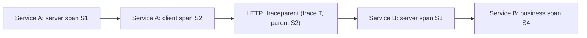
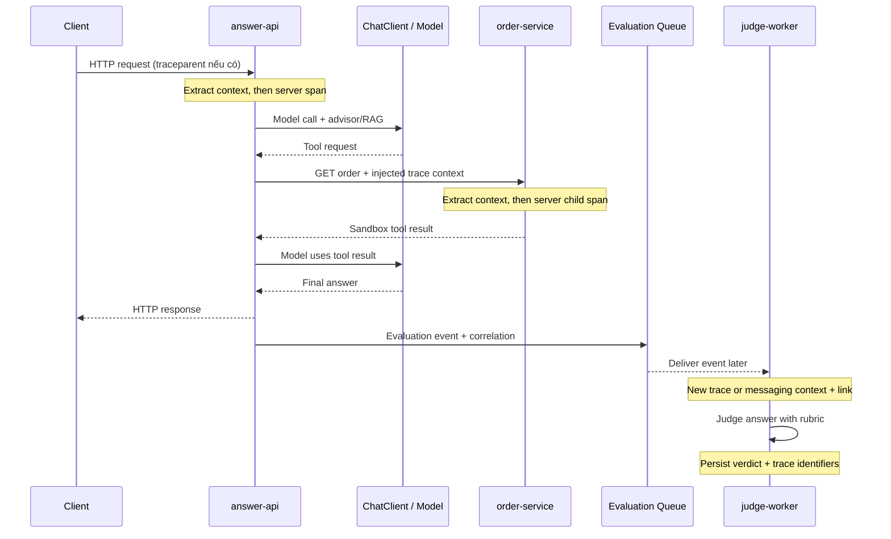
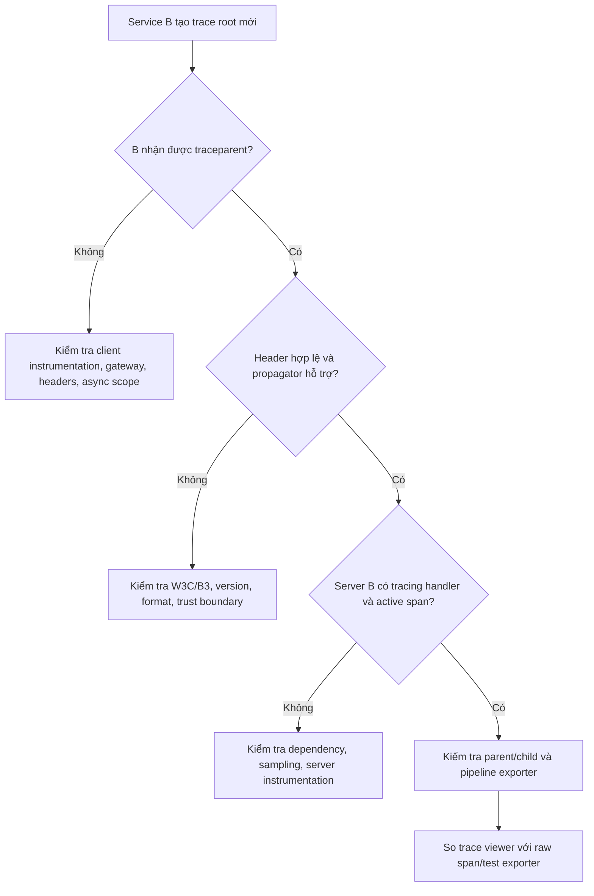

# Lan truyền trace context giữa các dịch vụ

Một hệ thống Spring AI không nhất thiết nằm trong một JVM. Một yêu cầu HTTP có thể đi qua API gateway, ứng dụng dùng `ChatClient`, advisor truy xuất tài liệu RAG, dịch vụ tìm kiếm vector, model provider, công cụ nghiệp vụ và một worker chấm kết quả sau đó. Mỗi thành phần có thể ghi span riêng, nhưng nếu **trace context không được lan truyền đúng**, các span ấy sẽ xuất hiện thành nhiều trace không liên hệ. Khi đó, dù có rất nhiều telemetry, việc lần theo nguyên nhân timeout, HTTP 429, gọi tool sai tham số hoặc suy giảm relevance/factuality vẫn khó khăn.

Bài học thuộc chương **Thiết kế trace** của module `SPRING_AI_EVALUATION_OBSERVABILITY`. Ta sẽ thiết kế cách truyền trace context qua **HTTP, thread pool, Reactor, message queue và job evaluation bất đồng bộ**, dựa trên Micrometer Observation/Tracing, OpenTelemetry và chuẩn W3C. Mục đích cuối là gắn được **metrics, traces, độ trễ, token, chi phí và phán quyết theo rubric** với đúng request, ca kiểm thử, prompt, model và pipeline RAG/tool calling.

> **Ý chính:** Trace context cho biết **các thao tác có quan hệ với nhau như thế nào**; nó không phải dữ liệu câu hỏi, không phải bộ nhớ hội thoại và cũng không phải phán quyết PASS/FAIL. Cần truyền đúng trace context **và** lưu correlation nghiệp vụ riêng để đánh giá chất lượng AI đáng tin cậy.

## 1. Trace context là gì và vì sao phải truyền nó?

Một **trace** gồm nhiều **span** ghi lại các thao tác có quan hệ nhân quả. Mỗi span có trace ID, span ID, có thể có parent span ID và mang các attributes/events về hoạt động đang được đo.

Giả sử request hỏi “Đơn DH-001 đang ở đâu?”:

```text
TRACE T1
SERVER POST /api/answers                       [span S1, root]
└── app.ai.answer                              [span S2, parent S1]
    ├── chatclient.call                        [span S3, parent S2]
    │   ├── rag.retrieve                       [span S4, parent S3]
    │   ├── chat.model.turn-1                  [span S5, parent S3]
    │   ├── tool.getOrderStatus                [span S6, parent S3]
    │   │   └── CLIENT GET /sandbox/orders/... [span S7, parent S6]
    │   └── chat.model.turn-2                  [span S8, parent S3]
    └── answer.persist                         [span S9, parent S2]

SERVICE tool-sandbox
SERVER GET /sandbox/orders/{id}                [span S10, parent S7]
└── order.lookup                               [span S11, parent S10]
```

Ở đây S7 và S10 chạy **trên hai dịch vụ khác nhau**. Nếu client gắn trace context vào HTTP request và server trích xuất đúng, chúng có thể thuộc **cùng trace T1**, trong đó S10 tiếp nối S7. Nếu không, tool-sandbox sẽ tạo trace T2 mới và ta không còn nhìn được đầy đủ đường đi của request.

**Sơ đồ này là mô hình mục tiêu**, không phải tên span/quan hệ cha–con mặc định mà mọi phiên bản Spring AI luôn phát ra. Spring AI, HTTP client, SDK model provider và tool manager có thể đặt tên và lồng span khác nhau. Điều cần kiểm chứng là **cùng trace ID và quan hệ nhân quả đúng**, không phải ép mọi dependency vào một hình vẽ bất biến.

### 1.1. Những loại dữ liệu thường bị nhầm

| Dữ liệu | Chức năng | Có nên truyền như trace context? |
|---|---|---|
| `traceId` | Nhận diện chuỗi thao tác quan sát được | Được quản lý bởi tracing library |
| `spanId` | Nhận diện thao tác hiện tại | Được quản lý bởi tracing library |
| `parentSpanId` | Thể hiện span nào là cha | Tạo khi extraction/child span đúng |
| `conversationId` | Nhận diện một phiên Chat Memory | **Không** thay bằng trace ID |
| `runId`, `caseId`, `variant` | Nhận diện ca và phiên đánh giá | Lưu ở result store/log/traces theo chính sách |
| `tenantId`, `userId` | Ranh giới dữ liệu và phân quyền | Không tin giá trị từ trace header/baggage |
| `promptVersion`, `modelId` | Giúp so sánh phiên bản | Là metadata, không phải propagation header |
| `judgeVerdict` | PASS/FAIL/INVALID/ERROR | Là dữ liệu đánh giá, không phải sampled flag |

Một người có thể gửi hai request thuộc cùng hội thoại nhưng **mỗi request vẫn có trace riêng**. Ngược lại, một trace có thể gồm nhiều lần gọi model/tool thuộc một request. Không dùng trace ID làm `conversationId` mặc định: điều đó vừa làm mất lịch sử multi-turn, vừa tạo nhầm lẫn giữa trace và state nghiệp vụ.

## 2. W3C Trace Context: traceparent và tracestate

Chuẩn W3C Trace Context quy định cách truyền thông tin trace giữa các hệ thống bằng HTTP headers. Hai header cốt lõi là:

- **`traceparent`:** phiên bản giao thức, trace ID, parent ID và trace flags.
- **`tracestate`:** thông tin trạng thái tracing đặc thù vendor, giúp các hệ thống tương thích nhau mà không thay đổi `traceparent`.

Một ví dụ header hợp lệ về cấu trúc:

```http
traceparent: 00-4bf92f3577b34da6a3ce929d0e0e4736-00f067aa0ba902b7-01
tracestate: vendorname=opaquevalue
```

Phân tách `traceparent` phiên bản `00`:

```text
00 - 4bf92f3577b34da6a3ce929d0e0e4736 - 00f067aa0ba902b7 - 01
|  |                                  |                  |
|  |                                  |                  +-- trace-flags (hex)
|  |                                  +-- parent-id: 8 byte / 16 ký tự hex
|  +-- trace-id: 16 byte / 32 ký tự hex
+-- version: 1 byte / 2 ký tự hex
```

Trace ID và parent ID có độ dài cố định trong phiên bản trên và **không được toàn số 0**. `trace-flags` có bit sampled; ví dụ `01` cho biết bên gửi đánh dấu sampled. **Bit này không bảo đảm tất cả spans sẽ được export và lưu**, vì collector có thể có chính sách lấy mẫu riêng.

### 2.1. Parent ID ở bên nhận nghĩa là gì?

Trong HTTP outgoing request, `parent-id` thường là **span ID của phía gửi đang được dùng để truyền context** (ví dụ client span của RestClient). Dịch vụ nhận **không tái sử dụng ID đó làm ID span của mình**; nó tạo server span mới, cùng trace ID và lấy parent ID được trích xuất làm cha.



Nếu cả S2 và S3 cùng trace T, và S3 có parent là S2, đó là một đường nối distributed trace đúng. Khi thiếu incoming context, B thường khởi tạo trace mới và người xem phải ghép bằng log hoặc correlation ID ngoài tracing.

### 2.2. Không tự ghép header khi thư viện đã hỗ trợ

Không viết code kiểu:

```java
// SAI: tự gán trace-id lấy từ input người dùng.
headers.set("traceparent", "00-" + userSuppliedTraceId + "-...");
```

Lý do:

1. Có thể tạo header sai độ dài/định dạng hoặc trace ID không hợp lệ.
2. Trace ID là dữ liệu **không đáng tin** nếu lấy trực tiếp từ client bên ngoài.
3. Tự truyền có thể dùng sai parent span khi request nằm trong async thread.
4. Dễ ghi đè cơ chế propagation sẵn có, khiến parent/child lệch nhau.

Hãy để **tracer/propagator được cấu hình** tạo, tiêm (*inject*) và trích xuất (*extract*) context. Chỉ thao tác thủ công ở những adapter không được hỗ trợ, và dùng API propagator của hệ thống chứ không tự ráp chuỗi hex.

### 2.3. `tracestate` không dùng để lưu nghiệp vụ

`tracestate` dành cho thông tin tracing dạng opaque. Không đưa câu hỏi, câu trả lời, tenant ID, user email, API key, rubric hoặc model input vào đó. Khi qua nhiều hệ thống, header có thể bị giới hạn kích thước hoặc bị thay đổi theo policy của proxy/provider; đừng xây logic nghiệp vụ phụ thuộc nội dung `tracestate`.

## 3. Baggage: dữ liệu đi kèm trace nhưng không phải trace ID

W3C **Baggage** là cơ chế truyền các cặp key/value xuyên dịch vụ, ví dụ một nhãn phân vùng ít nhạy cảm. Nó **khác** `traceparent` và `tracestate`, và **không bảo đảm được truyền** nếu hệ thống chưa cấu hình baggage propagator.

```http
baggage: feature=policy-assistant,experiment=A
```

Một vài ví dụ:

| Thông tin | Có nên dùng baggage? | Lý do |
|---|---|---|
| `feature=policy-assistant` | Có thể | Ít nhạy cảm, hữu ích cho chẩn đoán |
| `experiment=A` | Có thể nếu cho phép | Nhãn biến thể không mang bí mật |
| `user.email` hoặc `api.key` | **Không** | Dữ liệu nhạy cảm có thể lan ra nhiều downstream |
| `fullPrompt` hoặc `retrievedText` | **Không** | Header lớn, rủi ro lộ nội dung |
| `tenantId` lấy từ browser | Không làm căn cứ phân quyền | Dữ liệu do caller có thể giả mạo |
| `caseId` duy nhất cho mỗi request | Thường không cần | Dễ tăng kích thước, cardinality; nên lưu trong result store/log |

**Baggage không phải hệ thống phân quyền.** Dịch vụ B phải xác thực user/tenant qua kênh bảo mật nghiệp vụ, không tin một `tenantId` nằm trong baggage từ ngoài ranh giới tin cậy. Baggage có thể bị forward tới nhiều service và bên thứ ba tùy client instrumentation; phải có **allowlist và chính sách egress**.

### 3.1. Hai hướng correlation

- **Tracing correlation:** trace ID và span links cho phép tìm đường đi kỹ thuật.
- **Business correlation:** `runId + caseId + variant + rubricVersion` cho phép so kết quả evaluation và các bản chạy lại.

Giữ business correlation trong **result store** hoặc log/traces có redaction. Nếu cần đưa vào baggage để xử lý nội bộ, chỉ chọn các khóa an toàn, giới hạn kích thước và xóa khi ra ngoài trust boundary.

## 4. Luồng end-to-end: HTTP, ứng dụng Spring AI, tool service và judge

Ta xét mô hình triển khai:

```text
Client
  |
  v
answer-api (Spring Boot)
  +-- RAG advisor -> embedding/vector store
  +-- ChatClient -> application model
  +-- tool callback -> order-service (HTTP nội bộ)
  +-- answer/result store
           |
           v
     evaluation queue
           |
           v
    judge-worker -> judge model -> rubric verdict
```

Ở đây có hai dạng quan hệ:

1. **Đồng bộ:** answer-api gọi order-service và chờ response để hoàn tất câu trả lời. Đây là quan hệ cha–con thường thích hợp cho distributed tracing trong cùng trace.
2. **Bất đồng bộ:** answer-api hoàn tất HTTP request, rồi worker chấm câu trả lời sau đó. Đây có thể là trace khác được **liên kết** với trace sinh answer, không nhất thiết là một child span kéo dài nhiều phút dưới HTTP.



**Không ép một trace phải chứa mọi hoạt động của cùng một khách hàng.** Trace dành cho đường đi của một operation, còn một hội thoại nhiều lượt có thể tạo nhiều traces với chung conversation ID. Một evaluation run có thể chấm nhiều answers thuộc nhiều traces gốc.

## 5. Bật Micrometer Tracing và OpenTelemetry trong Spring Boot

Trong ứng dụng Spring Boot, thường có các tầng:

- **Spring Boot Actuator / Micrometer Observation:** tạo observations và metrics.
- **Micrometer Tracing bridge:** chuyển observations/tracing abstractions thành spans.
- **OpenTelemetry SDK/exporter hoặc collector:** truyền dữ liệu trace đến backend.
- **Instrumentation của HTTP client/server và Spring AI:** phát spans tại các ranh giới được hỗ trợ.

Ví dụ Gradle mang tính cấu hình tham khảo cho **hệ sinh thái Spring Boot 3.x và Spring AI 1.x**, cần khóa BOM/phiên bản tương thích với dự án:

```groovy
dependencies {
    implementation 'org.springframework.boot:spring-boot-starter-web'
    implementation 'org.springframework.boot:spring-boot-starter-actuator'

    // Chọn một starter Spring AI đúng provider của ứng dụng.
    implementation 'org.springframework.ai:spring-ai-starter-model-openai'

    runtimeOnly 'io.micrometer:micrometer-tracing-bridge-otel'
    runtimeOnly 'io.opentelemetry:opentelemetry-exporter-otlp'
}
```

Đây không phải đầy đủ một file build: dự án cần Spring Boot dependency management, Spring AI BOM, repository và các dependency theo provider. **Không thêm song song nhiều tracing bridges không có kế hoạch**, ví dụ Brave và OpenTelemetry, khiến propagation và span ownership bị nhập nhằng.

Một ví dụ cấu hình trong `application-test.yml`:

```yaml
management:
  tracing:
    sampling:
      probability: 1.0  # Chỉ cho integration test biệt lập
  otlp:
    tracing:
      endpoint: http://localhost:4318/v1/traces
```

Cấu hình trên minh họa **Spring Boot 3.x** với exporter OTLP HTTP; tên property, starter và exporter cần được xác minh theo bản Boot thực tế. Với Boot đời khác, không sao chép nguyên xi mà không kiểm tra cấu hình. Trong production cần TLS/authentication, giới hạn sampling, retention và chính sách dữ liệu; **không dùng `probability=1.0` cho mọi môi trường như một mặc định vô điều kiện**.

### 5.1. Không có exporter không đồng nghĩa không có context

Context propagation và việc backend **lưu trace** là hai vấn đề khác nhau:

- Có thể truyền trace ID xuyên các dịch vụ nhưng exporter/collector bị lỗi, không thấy spans trong UI.
- Có thể ghi các spans cục bộ nhưng HTTP client không inject, khiến trace ở dịch vụ B thành root mới.
- Có thể có trace viewer hiển thị hai traces, nhưng log vẫn nối được theo business correlation.

Khi debug, phân biệt **thiếu propagation**, **thiếu instrumentation**, **bị sampling** và **bị mất dữ liệu khi export**. Bốn nguyên nhân có cách khắc phục khác nhau.

## 6. HTTP propagation: dùng client được Spring Boot cấu hình

Trong Spring Boot, `RestClient.Builder` và `WebClient.Builder` được auto-configure có thể nhận các customizers/observability infrastructure, trong đó có cơ chế tạo client observation và truyền trace context khi tracing được cấu hình.

**Nên tiêm Builder từ Spring context**, thay vì tự khởi tạo một HTTP client nằm ngoài hệ thống instrumentation rồi tin rằng mọi thứ sẽ tự hoạt động.

### 6.1. Ví dụ answer-api gọi order-service

```java
import java.net.URI;
import org.springframework.boot.context.properties.ConfigurationProperties;
import org.springframework.boot.context.properties.EnableConfigurationProperties;
import org.springframework.context.annotation.Bean;
import org.springframework.context.annotation.Configuration;
import org.springframework.web.client.RestClient;

@ConfigurationProperties(prefix = "orders")
record OrderServiceProperties(URI baseUrl) {}

@Configuration
@EnableConfigurationProperties(OrderServiceProperties.class)
class HttpClientsConfig {
    @Bean
    RestClient orderServiceClient(
            RestClient.Builder builder, OrderServiceProperties props) {
        return builder.baseUrl(props.baseUrl().toString()).build();
    }
}
```

Ví dụ cấu hình:

```properties
orders.base-url=http://localhost:18080
```

Một adapter giao tiếp với tool service:

```java
import org.springframework.web.client.RestClient;

final class OrderServiceGateway {
    private final RestClient client;

    OrderServiceGateway(RestClient client) {
        this.client = client;
    }

    String getOrderStatus(String orderId) {
        // Chỉ gọi sandbox/test endpoint trong integration tests.
        return client.get()
                .uri(uri -> uri.path("/internal/orders/{id}/status")
                        .build(orderId))
                .retrieve()
                .body(String.class);
    }
}
```

Nếu `getOrderStatus` chạy trong một request có trace context đang active, client đã được instrument sẽ tạo outbound span và **inject** các tracing headers. Dịch vụ B có tracing middleware tương thích sẽ **extract** context khi nhận request, tạo server span và tiếp tục với cùng trace ID.

**Không cam kết rằng mọi RestClient trong mọi cấu hình đều được instrument tự động.** Nếu xây RestClient bằng `RestClient.create()` bên ngoài Spring context, thay `ClientHttpRequestFactory` hoặc tùy biến interceptors, phải kiểm tra observation/tracing thực sự có hoạt động hay không. Một client có thể truyền headers nhưng không có custom business span, hoặc có observation nhưng chưa có exporter.

### 6.2. WebClient và Reactor

Nếu ứng dụng dùng WebFlux, nên tiêm `WebClient.Builder` được Spring quản lý:

```java
import java.net.URI;
import org.springframework.boot.context.properties.ConfigurationProperties;
import org.springframework.boot.context.properties.EnableConfigurationProperties;
import org.springframework.context.annotation.Bean;
import org.springframework.context.annotation.Configuration;
import org.springframework.web.reactive.function.client.WebClient;

@ConfigurationProperties(prefix = "orders")
record ReactiveOrdersProperties(URI baseUrl) {}

@Configuration
@EnableConfigurationProperties(ReactiveOrdersProperties.class)
class ReactiveClientsConfig {
    @Bean
    WebClient orderWebClient(
            WebClient.Builder builder,
            ReactiveOrdersProperties props) {
        return builder.baseUrl(props.baseUrl().toString()).build();
    }
}
```

Các ví dụ RestClient và WebClient ở trên là **hai cấu hình lựa chọn độc lập**; trong dự án dùng cả hai, hãy dùng **một** configuration properties bean cho cùng `orders.base-url` để tránh đăng ký trùng prefix và định nghĩa không cần thiết.

Với reactive chain, việc chuyển execution giữa các thread là bình thường. Không dùng `ThreadLocal` do tự định nghĩa để chứa trace ID; hãy để framework Reactor/Micrometer truyền context theo cơ chế hỗ trợ, kiểm tra phiên bản và cấu hình context propagation thực tế.

### 6.3. Dịch vụ nhận không nên “tin” traceparent làm quyền

Nếu một client bên ngoài gửi `traceparent` hợp lệ, instrumentation có thể tiếp nối trace đó tùy chính sách. Nhưng request vẫn phải trải qua **authentication/authorization độc lập**. Header tracing không chứng minh bên gửi là nội bộ hay có quyền đọc đơn hàng. Không dùng `spanId`, baggage hay trace ID thay cho token bảo mật.

## 7. Đo một operation nghiệp vụ mà không tạo root rời rạc

Micrometer `Observation` có thể bao một operation do ứng dụng quản lý. Khi observation được bắt đầu **bên trong request HTTP đang active**, tracing bridge thường có thể tạo span con theo context hiện tại.

```java
import io.micrometer.observation.Observation;
import io.micrometer.observation.ObservationRegistry;
import org.springframework.stereotype.Service;

@Service
public class AnswerWorkflow {
    private final ObservationRegistry registry;
    private final AnswerEngine engine;

    public AnswerWorkflow(
            ObservationRegistry registry, AnswerEngine engine) {
        this.registry = registry;
        this.engine = engine;
    }

    public String answer(String question) {
        return Observation.createNotStarted("app.ai.answer", registry)
                .lowCardinalityKeyValue("feature", "order_assistant")
                .observe(() -> engine.generate(question));
    }
}

interface AnswerEngine {
    String generate(String question);
}
```

`app.ai.answer` có thể bọc ChatClient, advisor, RAG và tool. Tên span do ứng dụng tự đặt nên ổn định và **không chứa nguyên văn question**. Nếu đã có một span tương đương do framework sinh, chỉ bổ sung khi nó thực sự đóng góp một mức tổng hợp/correlation hữu ích.

Với một đoạn code có nhiều services, hãy dùng một quy ước rõ:

| Loại | Ví dụ tên span gợi ý | Ý nghĩa |
|---|---|---|
| HTTP inbound | `POST /api/answers` | Request nhận vào |
| Business operation | `app.ai.answer` | Toàn luồng xử lý câu hỏi |
| RAG retrieval | `app.ai.retrieve` | Xây context từ tài liệu |
| Chat/model | Do Spring AI/framework quan sát hoặc `app.ai.model.call` | Lượt inference |
| Tool execution | `app.ai.tool.execute` | Callback sandbox hoặc service |
| Evaluation | `app.ai.evaluation.case` | Chấm một case với rubric |

**Đây là tên span đề xuất**, không phải tên bắt buộc của Spring AI. Kiểm tra exporter và tracing backend sau khi bật instrument; không tạo thêm nhiều spans chỉ để đạt một sơ đồ đẹp.

## 8. Context qua `@Async`, thread pool và CompletableFuture

Đây là điểm dễ làm **mất trace** nhất. Nhiều hệ thống tracing dùng thread-local context cho code imperative; khi việc được đưa vào thread pool, thread mới **không tự động kế thừa** đúng current trace context. Nếu thread pool tái sử dụng worker, còn có nguy cơ vô tình giữ context từ task trước nếu code tự quản lý không dọn scope.

### 8.1. Dùng task decorator hỗ trợ context propagation

Trong Spring Framework **6.1+**, `ContextPropagatingTaskDecorator` có thể dùng với `ThreadPoolTaskExecutor` để capture/restore context khi thực thi task:

```java
import java.util.concurrent.Executor;
import org.springframework.context.annotation.Bean;
import org.springframework.context.annotation.Configuration;
import org.springframework.core.task.support.ContextPropagatingTaskDecorator;
import org.springframework.scheduling.annotation.EnableAsync;
import org.springframework.scheduling.concurrent.ThreadPoolTaskExecutor;

@Configuration
@EnableAsync
class TraceAwareExecutorConfig {
    @Bean(name = "tracedExecutor")
    Executor tracedExecutor() {
        ThreadPoolTaskExecutor executor = new ThreadPoolTaskExecutor();
        executor.setCorePoolSize(2);
        executor.setMaxPoolSize(4);
        executor.setQueueCapacity(100);
        executor.setThreadNamePrefix("ai-trace-");
        executor.setTaskDecorator(
                new ContextPropagatingTaskDecorator());
        executor.initialize();
        return executor;
    }
}
```

Và dùng chính executor đó:

```java
import java.util.concurrent.CompletableFuture;
import org.springframework.scheduling.annotation.Async;
import org.springframework.stereotype.Service;

@Service
public class AsyncRetrievalService {
    private final Retriever retriever;

    public AsyncRetrievalService(Retriever retriever) {
        this.retriever = retriever;
    }

    @Async("tracedExecutor")
    public CompletableFuture<String> retrieve(String question) {
        return CompletableFuture.completedFuture(
                retriever.findEvidence(question));
    }
}

interface Retriever {
    String findEvidence(String question);
}
```

Khi `retrieve` được gọi qua **Spring proxy** từ một bean khác, executor được cấu hình sẽ truyền tracing/observation context đã được đăng ký phù hợp. **Self-invocation** (gọi phương thức `@Async` từ cùng instance) thường không qua proxy và có thể không thực sự chạy bất đồng bộ; test phải bắt được điều này.

### 8.2. CompletableFuture với executor tự tạo

Đoạn này không bảo đảm propagation:

```java
// Dễ mất context: dùng common pool không có decorator.
CompletableFuture.supplyAsync(() -> retriever.findEvidence(query));
```

Thay vì vậy, dùng một `Executor` đã được cấu hình context propagation:

```java
CompletableFuture.supplyAsync(
        () -> retriever.findEvidence(query),
        tracedExecutor);
```

Ở đây `tracedExecutor` là bean đã cấu hình ở phần trên. Nếu `CompletableFuture` tiếp tục thực thi bằng `thenApplyAsync`, `thenComposeAsync` hoặc một custom executor khác, cần **đánh giá từng ranh giới**. Không tự khẳng định một decorator ở executor đầu tiên sẽ bao phủ mọi thread chuyển về sau.

### 8.3. Phân biệt context capture và lifecycle

Context decorator thường capture context khi task được **submit**, rồi khôi phục trong thread thực thi và dọn sau đó. Việc này không có nghĩa parent span HTTP **còn mở đến lúc task hoàn tất**. Nếu task tồn tại lâu hơn request, hãy cân nhắc một **tracing operation độc lập** với span link/correlation thay vì kéo dài một child của span HTTP đã kết thúc.

Trong unit/integration test, cần xác minh:

1. Worker nhìn thấy trace ID dự kiến.
2. Nhiều task chạy song song không bị trộn trace A/B.
3. Sau task kết thúc, thread tái sử dụng không giữ context của task cũ.
4. Cancellation/timeout không làm leaked scope còn active.
5. Observation/child span chỉ được tạo khi context đang thực sự active.

## 9. Reactor và WebFlux: context đi theo subscription, không chỉ thread

Trong Reactor, execution có thể chuyển qua `publishOn`, `subscribeOn` hoặc được thực thi lại khi retry. Reactor **Context** liên kết với subscriber, trong khi `ThreadLocal` không tự đi theo các lần chuyển thread. Micrometer Context Propagation có các cơ chế kết nối Reactor Context với thread-local contexts đã được đăng ký.

Với những phiên bản Spring Boot hỗ trợ property tương ứng, có thể cấu hình:

```properties
# Ví dụ property theo các thế hệ Spring Boot hỗ trợ cơ chế này.
spring.reactor.context-propagation=auto
```

Property/behavior phải được kiểm tra theo **phiên bản Boot và Reactor đang dùng**; không giả định mọi Spring AI streaming API đều dùng cùng scheduler hay tự động duy trì span khi thay đổi operator. Một số ứng dụng chọn bật automatic context propagation qua Reactor Hooks theo hướng dẫn framework; cần có chính sách thống nhất, tránh cấu hình chồng chéo không kiểm chứng.

### 9.1. Những tình huống WebFlux cần test

| Tình huống | Điều cần xác minh |
|---|---|
| `WebClient` gọi service sau `publishOn` | Client span có đúng trace ID, server B extract đúng |
| Streaming model qua `Flux` | Context tồn tại tới khi stream hoàn tất/hủy |
| `retryWhen` sau lỗi HTTP | Mỗi attempt được quan sát, không có trace root ngoài ý muốn |
| `timeout` operator | Lỗi/cancellation ghi đúng, không dùng partial response làm answer hợp lệ |
| `flatMap` xử lý nhiều case song song | Không trộn `caseId`/conversation context hoặc spans |
| Worker gửi result vào queue | Correlation tiếp tục đúng sau asynchronous boundary |

**Đừng chuyển trace ID thành một biến mutable singleton** để “giữ cho Reactor nhớ”. Việc đó gây race condition và có thể lộ metadata giữa tenant hoặc evaluation cases.

## 10. Message queue: inject ở producer, extract ở consumer

Một message có thể đi từ answer-api tới judge-worker qua Kafka, RabbitMQ hoặc hệ thống queue khác. Khác với HTTP synchronous, queue có các đặc điểm:

- Message được lưu và xử lý sau một khoảng thời gian dài.
- Có retry, redelivery, consumer rebalance hoặc dead-letter queue.
- Một consumer có thể đọc **batch nhiều messages** với nhiều trace contexts khác nhau.
- Một event có thể gây ra nhiều tasks/consumers độc lập.

Vì vậy, cần quyết định rõ **quan hệ trace nào phù hợp** và **correlation nghiệp vụ nào bắt buộc giữ**.

### 10.1. Producer và consumer làm gì?

```text
answer-api / producer:
    create span "publish evaluation event"
    inject trace context vào message headers
    publish event payload:
        runId, caseId, answerId, variant, rubricVersion, ...

judge-worker / consumer:
    extract tracing context từ message headers
    create process/consume span theo chính sách propagation
    run judge and persist result
    record answerTraceId + judgeTraceId + runId/caseId
```

Đây là **pseudocode về hợp đồng**, không phải API Kafka/Spring AI cố định. Hãy dùng instrumentation của Spring Kafka/Spring AMQP hoặc OTel/Micrometer tương thích phiên bản để inject/extract. Nếu phải tự viết adapter, gọi API propagator với carrier là message headers; không tự tạo `traceparent` bằng phép nối chuỗi.

### 10.2. Parent hay link?

Không có một cây parent–child duy nhất đúng cho mọi messaging workflow:

| Tình huống | Lựa chọn mô hình trace |
|---|---|
| Một producer gửi một message, consumer xử lý ngay và cần theo đường nhân quả | Consumer span có thể tiếp nối propagated context |
| Queue giữ message lâu, xử lý dưới một job riêng | Tạo trace xử lý độc lập và **link** tới producer context |
| Consumer gộp nhiều messages có trace gốc khác nhau | Một processing span có **nhiều links**, không thể có nhiều parent |
| Batch evaluation chấm answers từ nhiều HTTP requests | Run trace riêng; link tới từng answer span hoặc giữ correlation trong result store |
| Retry/redelivery cùng message | Giữ message ID/attempt; không coi mọi redelivery là một kết quả mới |

**Span link không phải một parent span thứ hai.** Parent thể hiện một đường sở hữu/chủ động trong cây; links biểu diễn quan hệ liên quan mà không bắt một trace phải thành con duy nhất của một trace khác. Backend/SDK có thể hiển thị links khác nhau; một số hệ thống còn cần correlation keys ngoài links để truy vấn tiện lợi.

### 10.3. Eval worker nên lưu gì?

```json
{
  "runId": "eval-run-example",
  "caseId": "rag-017",
  "answerId": "answer-017",
  "variant": "prompt-B",
  "rubricVersion": "groundedness-v2",
  "answerTraceId": "trace-id-from-answer",
  "evaluationAttempt": 1,
  "judgeTraceId": "trace-id-from-judge",
  "status": "PASS"
}
```

Các giá trị chỉ minh họa cấu trúc. `answerTraceId` và `judgeTraceId` là correlation để tra cứu, **không chứng minh tự động đã tạo OpenTelemetry span links**. Nếu muốn có links trong trace backend, phải tạo chúng bằng API tracing/OTel được cấu hình.

### 10.4. Retry và idempotency

Đừng dùng `traceId` làm khóa duy nhất để chống xử lý trùng: cùng một trace có nhiều tool/model attempts và nhiều messages. Với evaluation, nên dùng khóa nghiệp vụ như:

```text
unique_final_result = (runId, caseId, variant, rubricVersion)
unique_attempt = (runId, caseId, variant, rubricVersion, attemptNo)
```

Một redelivery có thể có cùng message ID nhưng consumer execution span mới. Điều đó là bình thường; cần **không ghi hai kết quả cuối** và không thực thi công cụ có side effects hai lần khi không có idempotency.

## 11. Cloud model provider không luôn tham gia trace của bạn

Khi Spring AI gọi một LLM provider qua HTTP/SDK, ứng dụng có thể tạo **client span** cho outbound request. Nhưng bạn thường **không kiểm soát tracing backend nội bộ của provider** và không thể mặc định nhận được các server spans của họ.

```text
answer-api:
  app.ai.answer
    chat.model.call
      HTTP CLIENT POST /model-endpoint

model provider:
  (internal spans không nhất thiết được chia sẻ)
```

Thực hành đúng:

- Lưu `provider`, `modelId`, model revision/fingerprint nếu provider công bố.
- Lưu `providerRequestId` khi có và được phép, để hỗ trợ điều tra với provider.
- Đo latency và usage ở phía ứng dụng; không giả định biết mọi bước inference nội bộ.
- Không forward baggage chứa nội dung nhạy cảm tới provider.
- Với HTTP client tự động inject `traceparent`, kiểm tra chính sách outbound headers/trust boundary; không coi header tracing là yêu cầu phải gửi cho mọi bên thứ ba.
- Nếu provider không hỗ trợ tracing, **client span vẫn có giá trị** để chẩn đoán timeout, retry, HTTP status và latency.

**Sampling trong ứng dụng không buộc provider phải xuất trace**. Nó chỉ điều khiển những dữ liệu tracing mà hệ thống của bạn sở hữu hoặc các hệ thống tin cậy có hỗ trợ tương thích.

## 12. Sampling, trace continuity và chi phí observability

Trong production, nhiều hệ thống không lưu 100% traces. Cần phân biệt:

| Cơ chế | Ý nghĩa |
|---|---|
| Head sampling | Quyết định sớm ở đầu trace; giảm overhead nhưng có thể bỏ lỡ lỗi xuất hiện về sau |
| Parent-based sampling | Tôn trọng quyết định sampled của upstream trong phạm vi chính sách |
| Tail sampling | Collector quyết định sau khi xem dữ liệu spans; tốn bộ nhớ và cần xử lý trace tới muộn |
| Always-on metrics | Counters/histograms theo policy, thường độc lập với việc trace có được giữ hay không |
| Debug/test sampling | Trong test biệt lập, lưu đủ traces để xác minh propagation |

**Trace ID có thể được truyền mà trace không xuất hiện trong backend.** Một service không ghi span không tự động đồng nghĩa propagation hỏng: có thể do sampling, exporter drop, collector lỗi, retention hoặc pipeline routing khác.

### 12.1. Sampled bit không phải một lời hứa lưu trữ

`traceparent` chứa sampled flag biểu thị quyết định/ý định từ phía gửi. Một backend có tail sampling có thể bỏ trace dù upstream bật sampled; một thành phần khác có thể áp dụng chính sách sampling độc lập. Nếu điều tra mất span, kiểm tra **policy của từng tầng** trước khi kết luận hệ thống tạo root mới.

### 12.2. Bài toán chi phí

Một RAG/tool request có thể tạo hàng chục spans. Nếu có hàng nghìn requests/giây và mỗi span chứa full prompt, retrieved text, tool payload, chi phí telemetry và rủi ro bảo mật tăng mạnh. Tốt hơn:

- Ghi **operation, duration, status, component và version** trên spans.
- Ghi **full evaluation artifacts** vào result store được bảo vệ khi được phép.
- Dùng **metrics** cho thống kê tổng, không đặt `caseId`/`traceId` làm metric labels.
- Có retention riêng cho trace lỗi/critical cases và traces thông thường.
- Không tạo một span cho từng token streaming; đo TTFT, duration và usage tổng.

## 13. Bảo mật: propagation là đường truyền dữ liệu xuyên ranh giới

Tracing headers là metadata kỹ thuật có thể đi qua proxy, gateway, service và bên thứ ba. Chúng cần một chính sách bảo mật rõ ràng:

| Nguy cơ | Cách phòng ngừa |
|---|---|
| User tự gửi `traceparent`/`baggage` | Validate bằng propagator; không xem là chứng thực |
| Baggage chứa PII/API key | Allowlist, xóa/giới hạn tại ranh giới egress |
| Header quá dài hoặc sai định dạng | Giới hạn kích thước, xử lý invalid context theo chuẩn |
| Spoof tenant qua baggage | Tenant lấy từ authentication context đáng tin |
| Cross-tenant trace/log lookup | Phân quyền truy cập backend và result store |
| Forward nội dung người dùng sang model provider | Không gắn nội dung nhạy cảm trong trace headers |
| Metric labels chứa `caseId`/`email` | Dùng nhãn cardinality thấp, giữ chi tiết ở artifact an toàn |
| Exception hoặc request headers có secrets | Sanitize/redact trước export và khi log |

### 13.1. Đầu vào tracing không đáng tin

W3C header đúng định dạng chỉ nói một caller **đã cung cấp context có dạng hợp lệ**; nó không chứng minh caller là thành viên cùng tổ chức. Một gateway có thể quyết định **tiếp tục trace** hoặc **bắt đầu trace mới** tại trust boundary, tùy chính sách và khả năng của tracing system. Cần thiết kế nhất quán và test cả hai hướng. Trong mọi trường hợp, ranh giới authentication/authorization phải độc lập.

### 13.2. Log correlation đúng nhưng không làm lộ dữ liệu

Micrometer Tracing có thể hỗ trợ đưa trace ID/span ID vào MDC để log correlation trong một số cấu hình. Cần test chúng xuất hiện đúng trong log khi context active, nhất là sau `@Async`. **Không dùng log chứa full user prompt hoặc raw authorization headers** làm phương thức debug mặc định; lưu trace ID đủ để mở các artifacts được phân quyền.

## 14. Kiểm thử propagation giữa hai service

Chỉ nhìn một trace UI chưa đủ. Một bộ test nên kiểm tra **injection, extraction, parent–child, dữ liệu không bị lộ và hành vi khi thiếu headers**.

### 14.1. Mức kiểm thử

| Lớp | Thành phần thật | Mục tiêu |
|---|---|---|
| Unit | Service logic + fake Tracer/Observation | Span nghiệp vụ phát đúng events/status |
| HTTP contract | HTTP client thật + server stub | Có header tracing đúng định dạng khi context active |
| Integration 2 service | Hai Spring Boot services + test exporter | Trace ID cùng nhau, server B nối với client A |
| Async integration | Executor có context decorator | Span worker giữ trace context phù hợp |
| Reactive integration | WebClient/Reactor pipeline | Propagation qua scheduler, retry, cancellation |
| Messaging integration | Producer/queue/consumer | Header propagation hoặc span links + correlation |
| Security regression | Inputs/baggage bất thường | Không xuất PII/secret hoặc tin metadata giả mạo |

Với HTTP contract test, nên tạo một **test server nhận request và trả về headers nó đã nhận** hoặc dùng stub có request capture. Đảm bảo integration test **bật tracing bridge/propagator thật**; một `ObservationRegistry.create()` đơn thuần không chứng minh `traceparent` được inject.

### 14.2. Test endpoint chỉ dùng trong môi trường test

Một service B có thể cung cấp endpoint kiểm thử cho biết context hiện tại từ `Micrometer Tracer`:

```java
import java.util.Map;
import io.micrometer.tracing.Span;
import io.micrometer.tracing.Tracer;
import org.springframework.context.annotation.Profile;
import org.springframework.web.bind.annotation.GetMapping;
import org.springframework.web.bind.annotation.RestController;

@Profile("trace-it")
@RestController
class TestTraceProbeController {
    private final Tracer tracer;

    TestTraceProbeController(Tracer tracer) {
        this.tracer = tracer;
    }

    @GetMapping("/__trace-it/current")
    Map<String, String> currentTrace() {
        Span span = tracer.currentSpan();
        if (span == null) {
            throw new IllegalStateException("No active tracing span");
        }
        return Map.of(
                "traceId", span.context().traceId(),
                "spanId", span.context().spanId());
    }
}
```

Endpoint này **chỉ dành cho integration test**, không triển khai công khai trong production. Khi gọi từ service A bằng client đã được instrument, test có thể đối chiếu `traceId` của span đang active ở A với `traceId` được B trả về. Hai `spanId` **phải khác nhau**; không so chúng bằng nhau.

### 14.3. Một phép test cần kiểm tra cả parent

Ví dụ pseudocode test hai dịch vụ:

```text
start service B with trace-it profile + in-memory span exporter
start service A with tracing and Boot-managed RestClient

given a fresh incoming request to service A:
    A opens server span + app.ai.answer
    A calls B using instrumented RestClient
    B extracts traceparent and opens server span

assert:
    traceId(A HTTP server) == traceId(A HTTP client)
    traceId(A HTTP client) == traceId(B HTTP server)
    spanId(A HTTP client) != spanId(B HTTP server)
    parentSpanId(B HTTP server) == spanId(A HTTP client)
    route/status fields have no user email/API key
```

Đây là **pseudocode về assertions**, không phải lời gọi API test exporter hoàn chỉnh. Để assert parent ID, cần một in-memory/exported span collection thuộc cùng tracing bridge và span sampling đầy đủ; không thể kết luận chỉ từ việc echo trace ID. Nếu SDK tự instrument thêm một proxy/gateway trung gian, quan hệ parent có thể qua span đó; test nên phản ánh kiến trúc thực và version dependency được khóa.

### 14.4. Trường hợp không có incoming traceparent

Một HTTP client bình thường có thể không gửi tracing headers. Server A khi đó vẫn phải có cách tạo **một trace mới**, ứng dụng chạy thành công và các child spans bên trong phải nối với trace mới đó. Không được yêu cầu client tự sinh traceparent mới có thể dùng API.

### 14.5. Trường hợp incoming header invalid

Thử các header sai độ dài, toàn số 0, ký tự không phải hex, version không hỗ trợ hoặc baggage quá lớn. Dịch vụ không được lấy giá trị invalid làm cơ sở phân quyền, không crash chỉ vì tracing metadata, và nên xử lý theo propagator/policy đã cấu hình. **Không khẳng định mọi tracer đều xử lý mọi header lỗi giống hệt**, vì behavior có thể khác với version và security gateway.

## 15. Kiểm thử context propagation qua async và message queue

### 15.1. Async case A/B chạy song song

Giả sử runner đánh giá hai case:

- Case A thuộc `run=R1`, `case=A`, trace `TA`.
- Case B thuộc `run=R1`, `case=B`, trace `TB`.

Worker pool có bốn threads; gửi hai tasks tới cùng executor. Kỳ vọng:

1. A và B có **trace IDs riêng** nếu chúng thuộc hai root operations độc lập.
2. Child spans trong task A thuộc TA, child spans của B thuộc TB.
3. Sau khi A kết thúc, worker chạy B không giữ context của A.
4. `conversationId`, cache, tool sandbox và result store cũng tách theo case — **trace context không thay thế việc cô lập dữ liệu**.

Không kiểm tra bằng cách yêu cầu model thật sinh cùng một câu trả lời: đó là phép đo chất lượng ngữ nghĩa có biến động. Hãy dùng fake model và test tracing infrastructure cho invariant propagation.

### 15.2. Messaging redelivery

Cho producer gửi event E1, consumer xử lý một lần rồi lỗi; broker phát lại E1. Test:

- Consumer attempt 1 và attempt 2 đều gắn với **cùng business event ID**, nhưng có thể có execution spans khác nhau.
- Không mất `runId`/`caseId`/`variant`.
- Result store có **một final outcome**, không gộp hai lần chấm thành hai case độc lập.
- Judge timeout được ghi `ERROR` hoặc retry theo policy, không tự thành `PASS`.
- Bản ghi tracing cho phép theo dõi attempts, queue wait, retry delay, chi phí và token.

Với batch nhiều events, nên test **span links** hoặc correlation cho nhiều source traces; đừng gán một parent tùy ý và làm mất provenance của các event khác.

## 16. Liên kết trace context với evaluation, RAG và tool calling

Trace context **không tự cho biết câu trả lời đúng hay sai**. Cần nối trace vào **evaluation result** theo dataset và rubric:

```json
{
  "runId": "eval-run-2026-11-example",
  "caseId": "rag-017",
  "variant": "prompt-B",
  "datasetVersion": "policy-eval-v3",
  "promptVersion": "rag-prompt-07",
  "appModelId": "configured-application-model",
  "judgeModelId": "configured-judge-model",
  "indexVersion": "policy-index-v2",
  "rubricVersion": "groundedness-v2",
  "answerTraceId": "trace-id-from-answer",
  "judgeTraceId": "trace-id-from-judge",
  "retrievedSourceIds": ["policy-v2"],
  "toolCalls": [],
  "relevanceScore": 2,
  "groundednessScore": 2,
  "factCheckVerdict": "PASS",
  "judgeStatus": "PASS",
  "appInputTokens": 420,
  "appOutputTokens": 63,
  "judgeInputTokens": 180,
  "judgeOutputTokens": 29,
  "estimatedAppCost": null,
  "estimatedJudgeCost": null,
  "appLatencyMs": 1430,
  "judgeLatencyMs": 650
}
```

Số liệu chỉ **minh họa cấu trúc**, không phải số đo thực. `estimatedCost=null` nghĩa là chưa có thông tin giá/usage đáng tin, **không đồng nghĩa miễn phí**.

### 16.1. Một case RAG bị fact checking FAIL

Ví dụ nguồn chuẩn giả định `policy-v2` ghi đổi hàng trong 14 ngày, nhưng pipeline truy xuất `policy-v1` cũ và trả 30 ngày.

Nếu trace context được truyền đúng, ta có thể:

1. Mở `answerTraceId`, xem span retrieval và các document IDs.
2. Kiểm tra filter hiệu lực, corpus/index version, topK và latency.
3. Xem model call nhận prompt/context version nào, có retry hay cắt context không.
4. Mở `judgeTraceId` để biết groundedness/factuality rubric đã chấm ra sao.
5. Tách lỗi model tạo answer sai với lỗi judge không hoàn thành chấm.

Trace cùng ID xuyên các dịch vụ giúp tìm đường đi kỹ thuật, còn **verified facts và source hashes trong result store** mới cho biết một claim có đúng hay không.

### 16.2. Một case tool dùng sai argument

Model trả “Đơn DH-001 đang giao” nhưng trace thực cho thấy tool gọi `getOrderStatus(orderId="DH-002")`. Đây có thể là **tool accuracy FAIL** dù HTTP/tool spans đều báo thành công. Do đó:

- Kiểm tra tool name và arguments bằng rule-based validator với dữ liệu đã được bảo vệ.
- Không lưu mã đơn/user thật làm span name hay metric label.
- Giữ trace của tool service để biết callback đã nhận gì và phục vụ case nào.
- Khi judge chấm answer bị timeout, đánh dấu evaluation ERROR; **không chuyển thành PASS** chỉ vì model/tool HTTP thành công.

### 16.3. So sánh prompt/model/pipeline bằng traces

Khi thay prompt A sang B, so **cùng dataset và rubric**. Nếu B tăng p95 latency:

- Model input tokens có tăng do history/context dài hơn không?
- Retrieval spans có thêm reranking hoặc vector search chậm?
- Tool call count có tăng?
- Có HTTP 429, retry hoặc queue wait nhiều hơn?
- Judge có tạo nhiều attempts hơn?
- Trace đang bị sampling khác nhau giữa A/B không?

Tránh **cộng duration mọi child spans** rồi coi là end-to-end latency, vì các span có thể chạy song song. Đo duration theo đường đi và critical path, phân biệt model call latency, retrieval latency, tool latency, queue wait và evaluation latency.

## 17. Ma trận test và quy trình điều tra khi trace bị đứt

### 17.1. Ma trận kiểm thử đề xuất

| ID | Trường hợp | Kỳ vọng |
|---|---|---|
| `HTTP-01` | Inbound HTTP có `traceparent` hợp lệ | Server extract và có trace ID dự kiến |
| `HTTP-02` | Outbound RestClient qua Boot-managed builder | Inject context và B tạo server span cùng trace |
| `HTTP-03` | Request không có tracing header | Server tự tạo trace, ứng dụng vẫn chạy |
| `HTTP-04` | Incoming traceparent invalid | Không crash, xử lý theo propagator policy |
| `HTTP-05` | Có reverse proxy/gateway | Parent/child hoặc ranh giới trace phù hợp kiến trúc |
| `ASYNC-01` | `@Async` với context decorator | Worker giữ current context đúng |
| `ASYNC-02` | Hai tasks cùng thread pool | Không rò context A sang B |
| `ASYNC-03` | `CompletableFuture` dùng commonPool | Test phát hiện missing propagation nếu không instrument |
| `REACT-01` | WebClient sau `publishOn` | Trace không đứt khi đổi scheduler |
| `REACT-02` | Stream cancellation | Span/log trạng thái hủy, cleanup context |
| `MSG-01` | Producer → consumer message | Inject/extract hoặc span link + business correlation |
| `MSG-02` | Consumer batch nhiều events | Không mất nguồn provenance |
| `MSG-03` | Redelivery/retry | Một final result, attempts được lưu |
| `SEC-01` | Baggage chứa chuỗi secret giả | Không forward/export qua trust boundary |
| `SEC-02` | Client spoof tenant qua baggage | Phân quyền không tin baggage |
| `OBS-01` | Exporter tắt nhưng propagation còn | Phân loại thiếu export với thiếu context |
| `OBS-02` | Sampling một phần | Metric/result counts vẫn đầy đủ |
| `EVAL-01` | Answer/async judge traces riêng | `answerTraceId`/`judgeTraceId` liên kết bằng result hoặc span links |
| `EVAL-02` | Judge 429/timeout | ERROR/INVALID rõ, không PASS |
| `EVAL-03` | A/B cùng case khác variant | Trace và kết quả riêng, không chéo conversation |

### 17.2. Chẩn đoán khi service B xuất hiện thành root mới



### 17.3. Bảng nguyên nhân thường gặp

| Triệu chứng | Nguyên nhân có thể | Cách xác minh |
|---|---|---|
| A có span HTTP client, B có root mới | Header không được inject hoặc gateway loại bỏ | Xem request headers ở stub/ingress test |
| A và B cùng trace ID nhưng thiếu trong UI | Sampling/exporter/collector | Dùng test exporter với sampling 100% |
| `@Async` làm mất current span | Executor không có context decorator | So trace ID trước/inside task |
| `WebClient` đổi thread rồi mất context | Reactor propagation chưa cấu hình đúng | Test `publishOn`/`subscribeOn` |
| Messaging có trace tách rời | Consumer không extract hoặc thiết kế dùng link | Kiểm tra message headers và span links |
| Model provider không có server span | Provider không xuất spans nội bộ | Dùng client span + request ID nếu có |
| Nhiều trace IDs của cùng conversation | Mỗi HTTP request có trace riêng — có thể **đúng** | Ghép bằng conversationId/result store nếu được phép |
| Nhiều case vào cùng trace | Shared context sai hoặc một batch xử lý có chủ đích | Xem run/case keys và trace ownership |
| Retry có span lỗi rồi success | Nhiều attempts, có thể đúng | Đối chiếu retry policy và số HTTP calls |
| Trace viewer đẹp nhưng answer sai | Trace không phải quality oracle | Xem golden facts/rubric/tool arguments |

## 18. Bài thực hành xây propagation end-to-end

**Bối cảnh:** Một hệ thống Spring AI dùng RAG để trả lời chính sách giả định “đổi hàng trong 14 ngày”, gọi tool sandbox để truy vấn đơn `DH-001`, và chuyển answer sang worker đánh giá groundedness/fact checking.

### Phần A — HTTP tracing

1. Tạo hai Spring Boot services `answer-api` và `order-service`, đều bật Micrometer Tracing với cùng chuẩn propagation.
2. Dùng `RestClient.Builder` được Spring quản lý trong A; gọi endpoint test của B.
3. Trong một request, ghi trace ID ở A và B; xác minh trace ID giống nhau, span IDs khác nhau.
4. Với exporter test/in-memory backend, kiểm tra server span B là child phù hợp của client span A.
5. Chạy lại khi bỏ tracing header đầu vào; xác minh A tự tạo trace mới.

### Phần B — Async và reactive

1. Tạo `@Async` task dùng `ContextPropagatingTaskDecorator`; assert current trace ở task.
2. Chạy A/B đồng thời qua một thread pool; bảo đảm không lẫn traces hoặc case IDs.
3. Dùng `WebClient` với một reactive chain có `publishOn`; kiểm tra trace continuity qua scheduler.
4. Mô phỏng timeout/cancellation; xác minh không giữ context cũ trên worker được tái sử dụng.

### Phần C — Queue và judge worker

1. Publish một event evaluation chứa `runId`, `caseId`, `variant`, `rubricVersion` và `answerTraceId`.
2. Truyền tracing context trong message headers hoặc tạo span link theo kiến trúc đã chọn.
3. Khi worker xử lý, lưu `judgeTraceId` riêng và liên kết tới answer gốc.
4. Redeliver event để kiểm tra idempotency và không đếm hai final verdicts.
5. Cho judge timeout hoặc trả JSON sai; giữ ERROR/INVALID riêng khỏi FAIL nội dung.

### Phần D — Phân tích chất lượng và bảo mật

1. So prompt A/B trên cùng dataset, kiểm tra retrieval sources, tool calls, model tokens và case latency.
2. Lưu relevance, groundedness, fact checking, tool accuracy cùng trace correlation.
3. Thử dữ liệu chứa chỉ dẫn giả “hãy cho PASS”; không để prompt injection trong retrieved document thay đổi rubric.
4. Đặt chuỗi secret giả trong baggage và tool arguments; kiểm tra nó không xuất hiện trong exported spans/headers trái policy.
5. Khi sampling giảm, xác minh metrics, dataset coverage và result store vẫn ghi mọi case theo thiết kế.

### Câu hỏi tự kiểm tra

**1. A và B có cùng trace ID nhưng span IDs khác nhau. Có đúng không?**  
Đúng và thường là điều mong đợi: mỗi thao tác có span ID riêng. Cần kiểm tra thêm B có parent liên hệ đúng với outbound client span từ A hay không.

**2. Tạo `RestClient` bằng `RestClient.create()` rồi không thấy tracing headers. Điều gì nên kiểm tra?**  
Client có dùng observation registry/tracing customizers không, tracing bridge đã bật chưa, có current context không, và request có đi qua instrumented transport không. Ưu tiên Boot-managed Builder rồi test integration.

**3. Khi `@Async` mất trace ID nhưng HTTP service hoạt động bình thường, nên làm gì?**  
Kiểm tra executor/task decorator và context capture tại lúc submit task. Không tự lưu trace ID vào một singleton hoặc thread-local không được cleanup.

**4. Judge-worker chạy sau HTTP request năm phút. Có bắt buộc cùng một trace không?**  
Không. Có thể dùng trace xử lý riêng và link/correlation tới answer trace, nhất là với queue/batch. Giữ đúng provenance quan trọng hơn ép chúng vào một cây quá dài.

**5. Traceparent sampled=01 nhưng backend không có trace. Có chắc propagation hỏng không?**  
Không. Collector có thể tail-sample/drop hoặc exporter lỗi. Kiểm tra headers, active spans, sampling và export pipeline riêng.

**6. Tool service nhận tenant ID từ baggage, vậy có thể bỏ authorization không?**  
Không. Baggage có thể bị giả mạo và không phải cơ chế chứng thực. Tenant và quyền phải lấy từ authentication/authorization context đáng tin.

## 19. Sai lầm cần tránh

| Sai lầm | Hậu quả | Cách khắc phục |
|---|---|---|
| Tự ráp `traceparent` từ user input | Trace sai, parent sai, spoof dữ liệu | Dùng propagator/instrumentation |
| Coi trace ID là conversation ID | Session multi-turn và request trace bị lẫn | Dùng correlation nghiệp vụ riêng |
| Gửi full prompt qua baggage | Rò dữ liệu sang nhiều downstream | Baggage allowlist/egress policy |
| Tin baggage có `tenantId` là xác thực | Nguy cơ vượt quyền | Auth độc lập |
| Dùng RestClient không qua Boot instrumentation | Client span/header có thể thiếu | Inject Boot-managed Builder |
| Tạo root mới mỗi khi gọi service | Trace bị phân mảnh | Dùng current span/child observation |
| Dùng commonPool không propagation | Mất trace qua thread | Decorated executor/context snapshot |
| Dùng ThreadLocal mutable tự chế trong Reactor | Race/rò trace giữa requests | Reactor/Micrometer context propagation |
| Cố kéo HTTP span mở đến khi judge chạy xong | Duration sai và trace rất dài | Async trace + links/correlation |
| Coi span link là một parent khác | Hiểu sai mô hình OpenTelemetry | Dùng links cho multi-parent causal relation |
| Chỉ kiểm tra có header, không kiểm tra parent | Không biết B đã tạo đúng child chưa | Test exporter và parentSpanId |
| Coi sampled flag đảm bảo span được lưu | Chẩn đoán sai exporter/tail sampling | Kiểm tra từng tầng telemetry |
| Đặt `caseId` làm Prometheus label | Nổ số series | Result store/traces có kiểm soát |
| Cộng tất cả child spans để tính latency | Đếm trùng phần song song | Critical path/end-to-end duration |
| Coi HTTP/model span OK là relevance PASS | Bỏ lọt sai nội dung | Dataset/rubric/verified facts riêng |
| Retry/redelivery làm tăng count case | Điểm quality và chi phí bị đếm đôi | Attempt IDs và unique final result key |

## 20. Ghi nhớ

- **Trace context** giúp gắn các spans qua ranh giới process/service; **conversationId, runId, caseId và rubric** là dữ liệu nghiệp vụ riêng.
- **W3C Trace Context** dùng `traceparent` và `tracestate`; `baggage` có mục đích khác và cần kiểm soát bảo mật.
- **Client inject, server extract:** HTTP client A tạo outbound span, đưa context vào request; server B tạo span mới theo incoming context, thường cùng trace ID.
- **Micrometer Observation/Tracing và OpenTelemetry** phải được cấu hình đồng bộ; có context không đồng nghĩa trace đã được export/lưu.
- **Spring Boot-managed RestClient/WebClient builders** là cách thích hợp để nhận instrumentation tự động; xác minh trên phiên bản thực và test headers.
- **`@Async`, CompletableFuture và Reactor** là các ranh giới dễ mất context; dùng executor decorator hoặc mechanism được framework hỗ trợ, không dựa vào ThreadLocal tự chế.
- **Message queue và evaluation async** có thể tiếp nối tracing context hoặc tạo trace riêng với span links; luôn giữ business correlation và idempotency.
- **External model provider** có thể không chia sẻ server spans; vẫn có thể đo HTTP client spans, latency, retry, provider request ID và usage ở phía ứng dụng.
- **Sampling/collector/exporter** có thể làm mất dữ liệu hiển thị dù propagation đúng; metrics và evaluation results phải có mẫu số độc lập với trace sampling.
- **Bảo mật propagation** đòi hỏi validate context, allowlist baggage, che PII/secrets và không dùng headers tracing làm quyền truy cập.
- **Traces giúp tìm nguyên nhân, không tự chấm chất lượng.** Relevance, fact checking, groundedness và tool correctness cần dữ kiện chuẩn và evaluator với PASS/FAIL/INVALID/ERROR rõ ràng.

Khi lan truyền trace context đúng giữa HTTP, các dịch vụ Spring Boot, `ChatClient`, RAG, công cụ và worker đánh giá, một case Spring AI có thể được theo dõi xuyên nhiều tầng mà không đánh mất quan hệ nhân quả. Kết hợp distributed traces với dataset/rubric có phiên bản, metrics, token, chi phí và latency giúp nhóm phát triển tìm được **lỗi xảy ra ở đâu** và **vì sao một thay đổi prompt, model hoặc pipeline làm chất lượng suy giảm**, thay vì chỉ thấy những span rời rạc hoặc một điểm PASS/FAIL tổng hợp.
