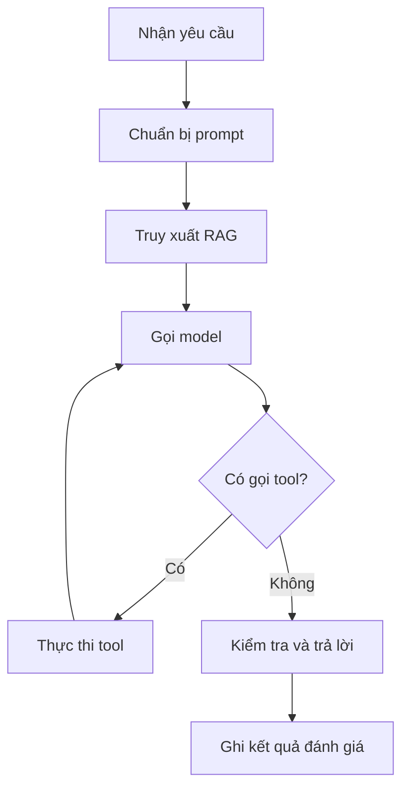

# Giữ đủ bằng chứng điều tra mà không ghi lặp toàn bộ hội thoại

Khi một ứng dụng Spring AI trả lời sai, nguyên nhân có thể nằm ở nhiều chặng: prompt đã thay đổi, model trả kết quả khác, bộ truy xuất chọn nhầm tài liệu, một tool thất bại hoặc dữ liệu đầu vào không còn giống lần chạy trước. Nếu log chỉ ghi `Request failed` thì gần như không có gì để điều tra. Nếu log toàn bộ system prompt, câu hỏi, lịch sử hội thoại, tài liệu RAG và kết quả tool ở mọi chặng thì log nhanh chóng phình to, lặp dữ liệu và có thể làm lộ thông tin nhạy cảm.

Mục tiêu của logging trong ứng dụng AI là giữ lại **bằng chứng đủ để giải thích một lần chạy**: lần chạy nào, đi qua những thành phần nào, sử dụng phiên bản cấu hình nào, nhận kết quả định lượng ra sao và thất bại ở đâu. Nội dung hội thoại chỉ được lưu khi có nhu cầu rõ ràng, theo chính sách riêng và thông qua một kho dữ liệu được bảo vệ. Log vận hành thông thường nên chứa metadata, mã tham chiếu và kết quả đã được chọn lọc.

Sau bài học, bạn có thể:

- Thiết kế một bản ghi bằng chứng dùng chung cho các bước model, RAG và tool.
- Liên kết các sự kiện bằng `request_id`, `trace_id` và mã tham chiếu hội thoại.
- Ghi phiên bản prompt, model, index và tool để so sánh các lần chạy.
- Giữ thông tin cần điều tra mà không sao chép prompt, câu hỏi, câu trả lời hay tài liệu vào mọi log.
- Tách log chẩn đoán khỏi nơi lưu payload cần bảo vệ và kiểm soát truy cập.

## 1. Vì sao cần bằng chứng theo từng lần chạy?

Một câu trả lời không đạt chất lượng chưa chắc là lỗi của model. Ví dụ, người dùng hỏi chính sách hoàn tiền. Ứng dụng truy xuất được ba đoạn tài liệu, gọi model và trả lời rằng khách hàng không được hoàn tiền. Khi điều tra, nhóm phát hiện index đã được cập nhật nhưng một dịch vụ vẫn truy vấn phiên bản index cũ. Nếu chỉ có câu hỏi và câu trả lời, nhóm khó xác định lỗi nằm ở retrieval hay generation. Nếu log lưu mã tài liệu, phiên bản index, điểm tương đồng, phiên bản prompt và model, nhóm có thể khoanh vùng mà không cần ghi lại toàn bộ nội dung tài liệu.

Một lần chạy AI thường có các chặng sau:



Mỗi chặng nên phát ra một sự kiện ngắn, cùng mang mã liên kết của lần chạy. Khi ghép các sự kiện theo mã đó, người vận hành dựng lại được dòng thời gian và biết thành phần nào đã tham gia. Không cần đưa toàn bộ hội thoại vào từng sự kiện.

Hãy phân biệt bốn loại dữ liệu:

| Loại dữ liệu | Vai trò | Ví dụ |
|---|---|---|
| Log sự kiện | Cho biết một việc đã xảy ra và kết quả của nó | `ai.retrieval.completed`, `ai.model.completed` |
| Trace/span | Cho biết thứ tự, quan hệ cha con và thời gian của các lời gọi | Span truy xuất, span gọi model, span gọi tool |
| Metric | Cho biết xu hướng tổng thể trên nhiều yêu cầu | Tỷ lệ lỗi, p95 latency, token trung bình |
| Payload bằng chứng | Nội dung đầu vào/đầu ra cần xem lại trong một số trường hợp | Prompt đã dựng, các chunk được chọn, phản hồi model |

Log và trace giúp tìm đúng lần chạy; metric giúp nhận ra xu hướng; payload có thể giúp tái hiện chính xác nhưng cần kiểm soát nghiêm ngặt hơn. Không nên biến log vận hành thành bản sao của payload.

## 2. Thiết kế bản ghi bằng chứng tối thiểu

Một bản ghi hữu ích cần trả lời được năm câu hỏi: **ai hoặc luồng nào đã chạy, chạy lúc nào, dùng cấu hình nào, đã đi qua những thành phần nào và kết quả ra sao**. Hãy tạo một schema thống nhất cho toàn bộ dịch vụ thay vì để mỗi thành phần tự đặt tên field.

### 2.1. Nhóm định danh và liên kết

| Field | Ý nghĩa | Lưu ý |
|---|---|---|
| `event_id` | Định danh duy nhất của sự kiện | Tạo mới cho mỗi event |
| `event_name` | Tên sự kiện theo quy ước | Ví dụ `ai.model.completed` |
| `timestamp` | Thời điểm phát sinh | Dùng UTC và định dạng nhất quán |
| `request_id` | Liên kết một yêu cầu nghiệp vụ | Giữ nguyên qua các chặng trong cùng request |
| `trace_id`, `span_id` | Liên kết trace và span quan sát | Lấy từ tracing context nếu đã bật tracing |
| `conversation_ref` | Tham chiếu hội thoại đã giả danh hóa | Không ghi ID hội thoại gốc nếu ID đó có thể nhận diện người dùng |
| `turn_index` | Vị trí lượt hiện tại trong hội thoại | Chỉ ghi số thứ tự cần thiết |
| `service`, `environment` | Dịch vụ và môi trường phát sinh | Hữu ích khi có nhiều service hoặc môi trường |

`request_id` và `trace_id` có mục đích khác nhau. Một request nghiệp vụ có thể tạo nhiều span; một hệ thống cũng có thể gọi dịch vụ khác trong cùng trace. Dùng cả hai giúp tìm log theo request và lần theo đường đi phân tán.

Nếu cần liên kết hội thoại qua nhiều request, hãy tạo `conversation_ref` bằng HMAC với khóa bí mật được quản lý riêng. Hash thông thường không đủ bảo vệ các ID có không gian giá trị nhỏ hoặc dễ đoán. Không dùng email, số điện thoại hay ID tài khoản trực tiếp làm correlation key.

### 2.2. Nhóm phiên bản cấu hình

Chất lượng đầu ra có thể thay đổi dù mã nguồn ứng dụng không đổi. Vì vậy, mỗi lần chạy nên ghi các phiên bản ảnh hưởng trực tiếp đến kết quả:

- `prompt_id` và `prompt_version`: định danh prompt và phiên bản đã triển khai.
- `provider`, `model`, `model_deployment`: nhà cung cấp, model và deployment thực tế.
- `generation_config`: chỉ ghi các tham số có ý nghĩa điều tra như temperature, giới hạn token hoặc response format; không đưa nội dung prompt vào field này.
- `retriever`, `embedding_model`, `index_version`: cấu hình truy xuất và phiên bản kho vector.
- `tool_name`, `tool_version`: tool được gọi và phiên bản schema hoặc implementation.
- `application_version`: phiên bản ứng dụng đang chạy.

Không ghi một chuỗi cấu hình không có phiên bản như `latest`. Giá trị đó không giúp xác định cấu hình đã dùng trong quá khứ. Nếu nhà cung cấp không cung cấp phiên bản model bất biến, hãy ghi tên model/deployment mà ứng dụng đã yêu cầu cùng thời điểm gọi và cấu hình đã chọn.

### 2.3. Nhóm bằng chứng theo thành phần

| Thành phần | Nên ghi | Tránh ghi lặp |
|---|---|---|
| Prompt | `prompt_id`, `prompt_version`, template hash hoặc payload reference | Toàn bộ system prompt và lịch sử chat |
| RAG | `index_version`, retriever, `top_k`, chunk/document ID, rank, score, số kết quả | Toàn văn tài liệu và toàn bộ chunk trong mọi log |
| Model | Model/deployment, usage token, finish reason, latency, retry | Lặp prompt và câu trả lời ở log bắt đầu, log kết thúc và từng span |
| Tool | Tên tool, phiên bản, call ID, trạng thái, thời gian, mã lỗi | Toàn bộ arguments và kết quả có dữ liệu nhạy cảm |
| Guardrail | Tên chính sách, quyết định, mã lý do | Nội dung nhạy cảm đã kích hoạt chính sách |
| Evaluation | Tên evaluator, phiên bản, score, verdict | Bản sao đầy đủ của input/output nếu evaluator chỉ cần metadata |

Với RAG, `document_id`, `chunk_id`, `rank`, `score` và `index_version` thường đã đủ để trả lời câu hỏi “retriever đã chọn gì và theo phiên bản nào?”. Nếu cần đọc nội dung chunk, dùng một `evidence_ref` trỏ đến kho lưu trữ có quyền truy cập phù hợp.

Với tool, hãy ghi tên tool và kết quả thực thi. Nếu cần biết arguments có giống lần chạy trước hay không, có thể lưu fingerprint đã được tạo từ dữ liệu chuẩn hóa và đã loại bỏ trường nhạy cảm. Fingerprint chỉ hỗ trợ so sánh; nó không thay thế bản payload cần thiết cho tái hiện.

### 2.4. Nhóm kết quả

Một event hoàn tất nên có các số liệu có thể so sánh:

- `duration_ms` hoặc latency riêng cho retrieval, model và tool.
- `prompt_tokens`, `completion_tokens`, `total_tokens` nếu provider trả usage.
- `finish_reason`, `retry_count` và `status`.
- `estimated_cost` cùng `pricing_version` nếu hệ thống tính chi phí.
- `error_code` và `error_type` đã chuẩn hóa khi thất bại.
- `evaluation_score` và `evaluation_version` nếu đánh giá được thực hiện trong luồng.

Không tự suy ra token usage từ độ dài chuỗi khi provider không trả số liệu. Khi không có dữ liệu, ghi `null` hoặc bỏ field theo schema; đừng ghi số ước lượng như thể đó là số đo thực tế.

## 3. Dùng event ngắn để ghép thành dòng thời gian

Thay vì một log lớn chứa toàn bộ hội thoại ở mọi bước, hãy phát các event nhỏ, có cùng `request_id` và trace context. Ví dụ:

```json
{
  "event_id": "evt-01J...",
  "event_name": "ai.retrieval.completed",
  "timestamp": "2026-11-27T12:30:15.241Z",
  "request_id": "req-7f2...",
  "trace_id": "4bf92f3577b34da6a3ce929d0e0e4736",
  "conversation_ref": "hmac:v3:8d91...",
  "component": "knowledge-retriever",
  "retriever": "support-policy-search",
  "index_version": "support-policy-2026-11-20",
  "top_k": 4,
  "result_count": 3,
  "selected_chunks": [
    {"chunk_id": "refund-12-03", "rank": 1, "score": 0.91},
    {"chunk_id": "refund-08-01", "rank": 2, "score": 0.84},
    {"chunk_id": "refund-09-02", "rank": 3, "score": 0.79}
  ],
  "duration_ms": 38
}
```

Event này cho biết retriever đã chọn ba chunk nào, theo thứ tự và điểm số nào. Nó không chứa câu hỏi hay nội dung chunk. Người có quyền có thể dùng `chunk_id` và `index_version` để tra cứu bản tài liệu tương ứng.

Một request hoàn chỉnh có thể phát các event theo trình tự:

| Event | Thông tin chính |
|---|---|
| `ai.request.started` | request/trace ID, service, environment |
| `ai.prompt.prepared` | prompt ID/version, số message, payload reference nếu có |
| `ai.retrieval.completed` | index version, chunk IDs, scores, duration |
| `ai.tool.completed` | tool, call ID, status, duration, error code |
| `ai.model.completed` | model, token usage, finish reason, duration |
| `ai.evaluation.completed` | evaluator/version, score, verdict |
| `ai.request.completed` | tổng duration, trạng thái và kết quả tổng hợp |
| `ai.request.failed` | chặng lỗi, error code, retry count |

Không phải request nào cũng có RAG, tool hoặc evaluation. Chỉ phát event cho chặng thực sự chạy. Event kết thúc nên được ghi cả khi thành công lẫn thất bại để hệ thống có thể tính tỷ lệ lỗi và thời gian hoàn tất.

## 4. Ghi log có cấu trúc trong Spring Boot và Spring AI

Log có cấu trúc giúp hệ thống log tìm kiếm theo field thay vì phải phân tích một câu văn tự do. Với SLF4J 2.x, có thể dùng fluent logging API để đính kèm key-value. Ví dụ dưới đây chỉ ghi metadata đã chọn lọc:

```java
import org.slf4j.Logger;
import org.slf4j.LoggerFactory;
import org.springframework.stereotype.Component;

@Component
public class AiEvidenceLogger {

    private static final Logger log =
            LoggerFactory.getLogger(AiEvidenceLogger.class);

    public void retrievalCompleted(
            String requestId,
            String indexVersion,
            int topK,
            int resultCount,
            long durationMs) {

        log.atInfo()
                .addKeyValue("event_name", "ai.retrieval.completed")
                .addKeyValue("request_id", requestId)
                .addKeyValue("index_version", indexVersion)
                .addKeyValue("top_k", topK)
                .addKeyValue("result_count", resultCount)
                .addKeyValue("duration_ms", durationMs)
                .log("AI retrieval completed");
    }

    public void modelCompleted(
            String requestId,
            String model,
            Number promptTokens,
            Number completionTokens,
            String finishReason,
            long durationMs) {

        log.atInfo()
                .addKeyValue("event_name", "ai.model.completed")
                .addKeyValue("request_id", requestId)
                .addKeyValue("model", model)
                .addKeyValue("prompt_tokens", promptTokens)
                .addKeyValue("completion_tokens", completionTokens)
                .addKeyValue("finish_reason", finishReason)
                .addKeyValue("duration_ms", durationMs)
                .log("AI model call completed");
    }

    public void modelFailed(
            String requestId,
            String errorCode,
            long durationMs) {

        log.atError()
                .addKeyValue("event_name", "ai.model.failed")
                .addKeyValue("request_id", requestId)
                .addKeyValue("error_code", errorCode)
                .addKeyValue("duration_ms", durationMs)
                .log("AI model call failed");
    }
}
```

Đây là lớp ghi event; `requestId`, `indexVersion` và các số liệu phải được lấy từ context và kết quả thực tế của lần chạy. Hãy tạo `requestId` ở ranh giới nhận request rồi truyền qua các service liên quan. Không tạo một ID mới ở mỗi lớp, vì như vậy các event sẽ không ghép được với nhau.

### 4.1. Giữ metadata từ `ChatResponse`

Khi chỉ gọi `.content()`, ứng dụng nhận nội dung câu trả lời thuận tiện nhưng không giữ lại `ChatResponse` để đọc metadata của lần gọi. Nếu cần token usage hoặc finish reason, hãy lấy `ChatResponse`:

```java
import org.springframework.ai.chat.model.ChatResponse;
import org.springframework.ai.chat.metadata.Usage;
import org.springframework.ai.chat.client.ChatClient;
import org.springframework.stereotype.Service;

@Service
public class AnswerService {

    private final ChatClient chatClient;
    private final AiEvidenceLogger evidenceLogger;

    public AnswerService(
            ChatClient.Builder chatClientBuilder,
            AiEvidenceLogger evidenceLogger) {
        this.chatClient = chatClientBuilder.build();
        this.evidenceLogger = evidenceLogger;
    }

    public String answer(String requestId, String question) {
        long startedAt = System.nanoTime();
        try {
            ChatResponse response = chatClient.prompt()
                    .user(question)
                    .call()
                    .chatResponse();

            long durationMs =
                    (System.nanoTime() - startedAt) / 1_000_000;
            Usage usage = response.getMetadata().getUsage();
            Number promptTokens =
                    usage == null ? null : usage.getPromptTokens();
            Number completionTokens =
                    usage == null ? null : usage.getCompletionTokens();

            evidenceLogger.modelCompleted(
                    requestId,
                    "configured-model-name",
                    promptTokens,
                    completionTokens,
                    response.getResult().getMetadata().getFinishReason(),
                    durationMs);

            return response.getResult().getOutput().getText();
        } catch (RuntimeException exception) {
            long durationMs =
                    (System.nanoTime() - startedAt) / 1_000_000;
            evidenceLogger.modelFailed(
                    requestId,
                    "MODEL_CALL_FAILED",
                    durationMs);
            throw exception;
        }
    }
}
```

Ví dụ tập trung vào việc giữ `ChatResponse` để lấy usage. Tên model nên lấy từ cấu hình model/deployment thực tế của ứng dụng hoặc metadata mà provider trả về; thay `configured-model-name` bằng giá trị đó. Provider có thể không trả usage hoặc finish reason trong một số trường hợp, vì vậy code thực tế cần cho phép các field này vắng mặt. Khi model call ném exception, ví dụ ghi event thất bại với error code đã chuẩn hóa và thời gian đã trôi qua, sau đó giữ nguyên hành vi xử lý exception của ứng dụng. Bộ phân loại lỗi thực tế nên ánh xạ exception sang một tập mã hữu hạn, thay vì đưa nguyên message của exception vào log.

API metadata có thể khác đôi chút giữa các phiên bản Spring AI và provider. Hãy đối chiếu kiểu `ChatResponse`, `Usage` và metadata của provider đang dùng trong dự án trước khi áp dụng nguyên mẫu này. Không nên tự tạo số token hoặc finish reason khi response không cung cấp chúng.

### 4.2. Liên kết log với trace

Nếu ứng dụng đã dùng Micrometer Tracing hoặc OpenTelemetry, hãy để tracing context quản lý `trace_id` và `span_id`. Các log phát sinh trong cùng context nên mang thông tin liên kết tương ứng theo cấu hình logging của Spring Boot. Khi gọi sang service khác, truyền trace context qua cơ chế propagation đã cấu hình.

`request_id` vẫn hữu ích ở tầng nghiệp vụ vì nó có thể được trả về trong response header hoặc dùng để tra cứu ticket hỗ trợ. `trace_id` hữu ích khi lần theo các lời gọi phân tán. Không dùng các ID này làm nhãn metric vì chúng có cardinality rất cao.

## 5. Lưu payload riêng khi thực sự cần tái hiện

Metadata và fingerprint giúp chẩn đoán nhiều vấn đề, nhưng không thể tái hiện chính xác một lần chạy nếu nội dung prompt, tài liệu hoặc phản hồi đã thay đổi. Có những trường hợp cần giữ payload, chẳng hạn điều tra sự cố nghiêm trọng, xác minh một kết quả evaluation hoặc so sánh hành vi model trước và sau nâng cấp.

Khi đó, hãy dùng mô hình hai lớp:

1. **Log vận hành:** ghi metadata, version, mã tài liệu, số liệu và một `evidence_ref` ngẫu nhiên.
2. **Kho payload có kiểm soát:** lưu payload đã được lọc, mã hóa và áp dụng quyền truy cập, thời hạn lưu giữ, audit truy cập riêng.

Ví dụ log chỉ giữ tham chiếu:

```json
{
  "event_name": "ai.request.completed",
  "request_id": "req-7f2...",
  "prompt_id": "support-answer",
  "prompt_version": "18",
  "model": "configured-model-name",
  "evidence_ref": "evd-01J...",
  "duration_ms": 842,
  "total_tokens": 1260,
  "status": "success"
}
```

`evidence_ref` không nên là URL công khai hoặc đường dẫn có thể đoán. Dịch vụ tra cứu phải xác thực người dùng, kiểm tra quyền theo tenant và mục đích truy cập, đồng thời ghi audit log. Payload cần được mã hóa khi lưu và truyền, có thời hạn tự xóa, hỗ trợ yêu cầu xóa dữ liệu và chỉ chứa các trường được phép lưu.

Không bật lưu payload cho tất cả request chỉ để “phòng khi cần”. Có thể áp dụng sampling có kiểm soát cho request thành công, luôn giữ metadata của request lỗi, và tạo capture có thời hạn khi có incident hoặc yêu cầu điều tra được phê duyệt. Sampling không được làm mất những event cần thiết để tính tỷ lệ lỗi hoặc kiểm tra an toàn.

## 6. Bảo vệ dữ liệu ngay trước điểm ghi log

Một khi dữ liệu đã đi vào log tập trung, nhiều hệ thống và nhiều nhóm có thể truy cập nó. Vì vậy, lọc dữ liệu phải xảy ra trước khi gọi logger. Không dựa vào việc che dữ liệu ở dashboard hoặc sau khi log đã được gửi đi.

Áp dụng các nguyên tắc sau:

- **Allowlist field:** chỉ ghi các field đã được xác định trong schema. Không serialize toàn bộ request, response, object của framework hoặc exception context.
- **Redact theo loại dữ liệu:** loại bỏ API key, authorization header, cookie, password, token truy cập, thông tin định danh cá nhân và dữ liệu nghiệp vụ nhạy cảm.
- **Giả danh hóa ID:** dùng mã tham chiếu hoặc HMAC có phiên bản khóa; giới hạn quyền truy cập khóa và có kế hoạch luân chuyển.
- **Chống log injection:** dùng logger có cấu trúc, không ghép input tùy ý vào chuỗi log; giới hạn độ dài và loại bỏ ký tự điều khiển khi cần.
- **Giới hạn quyền và thời hạn:** phân quyền theo vai trò, mã hóa log, đặt retention phù hợp và audit việc truy cập payload.
- **Không bật DEBUG diện rộng ở production:** debug có thể làm lộ request/response do thư viện ghi tự động. Kiểm tra cấu hình log của các client và middleware.

Đặc biệt, không log toàn bộ `ChatRequest`, `ChatResponse`, `Prompt`, `Message`, tool arguments hoặc kết quả truy xuất chỉ vì các object này có sẵn. Chúng có thể chứa nội dung người dùng, dữ liệu từ hệ thống nội bộ hoặc bí mật. Hãy chuyển chúng thành một DTO bằng chứng gồm những field đã được duyệt.

## 7. Chọn mức log và tần suất phù hợp

| Mức log | Nên dùng cho | Ví dụ |
|---|---|---|
| `ERROR` | Request thất bại hoặc hệ thống không thể tiếp tục | Provider timeout, tool lỗi không phục hồi được |
| `WARN` | Kết quả bất thường nhưng luồng vẫn tiếp tục | Retry, fallback model, retrieval không có kết quả |
| `INFO` | Mốc nghiệp vụ quan trọng và kết quả tổng hợp | Request hoàn tất, model call hoàn tất |
| `DEBUG` | Chi tiết phục vụ phát triển hoặc điều tra có thời hạn | Thông tin chẩn đoán đã lọc trong môi trường phù hợp |

Không ghi một dòng `INFO` cho từng token hoặc từng đoạn streaming nếu hệ thống chỉ cần biết tổng thời gian và trạng thái. Với streaming, có thể ghi thời điểm bắt đầu, thời điểm token đầu tiên (`time_to_first_token`), thời điểm hoàn tất, tổng token và trạng thái kết thúc. Chỉ ghi event theo từng chunk khi có nhu cầu điều tra cụ thể.

Giữ log sự kiện có cardinality cao ở hệ thống log/tracing, nhưng dùng nhãn metric có cardinality thấp. Ví dụ, `request_id`, `conversation_ref`, `document_id` và `trace_id` phù hợp để tìm kiếm trong log; chúng không phù hợp làm label Prometheus. Metric nên nhóm theo service, model, operation, status hoặc nhóm lỗi hữu hạn.

## 8. Quy trình điều tra một câu trả lời kém chất lượng

Khi nhận được báo cáo về một câu trả lời sai, hãy điều tra theo trình tự:

1. Tìm `request_id` hoặc `trace_id` từ log, response header hoặc ticket hỗ trợ.
2. Ghép các event theo ID và dựng dòng thời gian: request, retrieval, model, tool, evaluation.
3. Kiểm tra `application_version`, `prompt_version`, model/deployment, `index_version` và phiên bản tool.
4. Kiểm tra bằng chứng retrieval: số kết quả, chunk ID, rank và score. Xác định lỗi xuất hiện trước hay sau retrieval.
5. Kiểm tra token usage, finish reason, latency, retry và lỗi provider để nhận diện giới hạn hoặc timeout.
6. Đối chiếu evaluator score và verdict với phiên bản evaluator. Điểm thấp có thể do model, dữ liệu, prompt hoặc chính tiêu chí đánh giá.
7. Chỉ mở `evidence_ref` nếu metadata chưa đủ và người điều tra có quyền truy cập payload.
8. Ghi kết luận điều tra dưới dạng nguyên nhân, bằng chứng, phiên bản liên quan và hành động khắc phục; tránh sao chép payload nhạy cảm vào ticket.

Ví dụ, nếu nhiều request bắt đầu trả lời kém sau một lần phát hành, hãy nhóm theo `prompt_version`, `model` và `index_version`. Nếu score relevance giảm trong khi model và prompt không đổi, kiểm tra index hoặc retriever trước. Nếu retrieval giữ nguyên nhưng token usage, finish reason hoặc evaluator score thay đổi theo model deployment, tập trung vào model và cấu hình generation. Bằng chứng theo phiên bản giúp so sánh có căn cứ thay vì dựa vào cảm giác.

## 9. Các lỗi thiết kế thường gặp

| Lỗi | Hệ quả | Cách sửa |
|---|---|---|
| Ghi toàn bộ hội thoại ở mọi chặng | Log lớn, lặp dữ liệu và tăng rủi ro lộ thông tin | Ghi event metadata; payload dùng kho riêng khi cần |
| Mỗi service tự tạo correlation ID | Không ghép được các sự kiện | Tạo ID ở ranh giới request và truyền xuyên suốt |
| Chỉ ghi tên model là `latest` | Không xác định được cấu hình lịch sử | Ghi provider, deployment và cấu hình/version thực tế |
| Chỉ log câu trả lời cuối | Không biết lỗi phát sinh ở retrieval, tool hay model | Ghi event theo từng chặng |
| Chỉ ghi exception message nguyên văn | Có thể lộ URL, query hoặc dữ liệu nhạy cảm | Chuẩn hóa `error_code`, `error_type`; giữ stack trace theo chính sách |
| Dùng request ID làm label metric | Tạo cardinality rất cao, gây quá tải hệ thống metric | Để ID trong log/trace; metric dùng nhãn hữu hạn |
| Lưu fingerprint rồi xem đó là bản tái hiện | Không thể khôi phục nội dung chỉ từ fingerprint | Dùng fingerprint để so sánh; payload reference để tra cứu có kiểm soát |
| Bật debug logging toàn bộ thư viện ở production | Có thể phát tán payload ngoài ý muốn | Kiểm tra logger từng package và đặt mức log tối thiểu cần thiết |

## 10. Bài tập thực hành

Một luồng hỏi đáp nội bộ sử dụng Spring AI, RAG và tool `orderLookup`. Một người dùng báo rằng câu trả lời về trạng thái đơn hàng không chính xác. Hiện tại log chỉ có câu hỏi, câu trả lời cuối và dòng `Chat call completed`.

Hãy thiết kế bộ bằng chứng cho request này:

1. Chọn các field định danh và correlation cần có để tìm toàn bộ lần chạy.
2. Xác định metadata cần ghi cho retriever: phiên bản index, chunk ID, rank, score và thời gian.
3. Xác định metadata cho `orderLookup`: tool version, call ID, trạng thái, duration và error code; chỉ ra trường arguments nào cần loại bỏ hoặc giả danh hóa.
4. Xác định metadata cho model: provider, model/deployment, prompt version, token usage, finish reason và latency.
5. Quyết định trường hợp nào cần lưu payload và cách cấp `evidence_ref`.
6. Viết một event `ai.request.completed` dạng JSON không chứa câu hỏi, câu trả lời hay dữ liệu đơn hàng.

**Tiêu chí tự kiểm tra:** một người khác có thể tìm đúng request, biết phiên bản prompt/model/index/tool đã chạy, thấy retrieval chọn chunk nào, biết tool thành công hay thất bại và đo được latency/token usage. Người đó không cần quyền đọc nội dung hội thoại để thực hiện bước điều tra đầu tiên.

## 11. Checklist trước khi đưa logging lên production

- [ ] Mọi event quan trọng dùng schema và tên event thống nhất.
- [ ] `request_id` được tạo một lần và truyền qua các chặng; trace context được propagation.
- [ ] Log ghi phiên bản prompt, model/deployment, index, tool và ứng dụng.
- [ ] Retrieval log có ID, rank, score và version; không chứa toàn văn chunk.
- [ ] Tool log có tên, trạng thái, duration và error code; arguments đã được lọc.
- [ ] Model log có usage và finish reason khi provider cung cấp; không tự bịa số liệu còn thiếu.
- [ ] Dữ liệu nhạy cảm được lọc trước khi ghi log.
- [ ] Payload cần tái hiện được lưu riêng, mã hóa, phân quyền, audit và có retention.
- [ ] Log lỗi vẫn đủ để điều tra; sampling không làm mất sự kiện cần thiết.
- [ ] Metric không dùng ID có cardinality cao làm label.

Một hệ thống logging tốt giữ được mối liên hệ giữa request, trace, phiên bản cấu hình, retrieval, tool, model và kết quả đánh giá. Khi cần xem nội dung gốc, người vận hành đi qua tham chiếu có kiểm soát. Cách tổ chức này giúp điều tra có căn cứ, so sánh chất lượng giữa các phiên bản và hạn chế việc nhân bản dữ liệu hội thoại trong toàn bộ hệ thống log.
