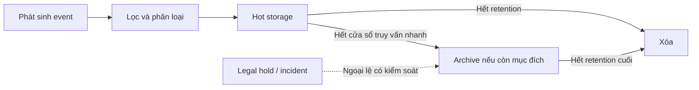

# Đặt mức log và thời hạn lưu phù hợp mục đích sử dụng

Một ứng dụng Spring AI có thể tạo ra nhiều loại dữ liệu quan sát: log về request và lỗi, trace của từng lần gọi model hoặc tool, metric về latency và token, kết quả đánh giá, cùng payload như prompt, câu hỏi, câu trả lời và các đoạn tài liệu RAG. Nếu ghi mọi thứ ở mức `DEBUG` rồi giữ vô thời hạn, chi phí lưu trữ sẽ tăng nhanh và dữ liệu nhạy cảm sẽ tồn tại lâu hơn nhu cầu. Nếu chỉ giữ `ERROR` trong vài giờ, nhóm vận hành có thể mất bằng chứng để tìm nguyên nhân một đợt suy giảm chất lượng.

Chọn mức log và retention cần bắt đầu từ câu hỏi: **ai sẽ dùng dữ liệu này, để đưa ra quyết định nào và cần dữ liệu trong bao lâu?** Log phục vụ xử lý sự cố, audit bảo mật, metric phục vụ theo dõi xu hướng và payload phục vụ tái hiện có mục đích khác nhau. Vì vậy, chúng cần chính sách mức độ chi tiết, quyền truy cập và thời hạn lưu riêng.

Sau bài học, bạn có thể:

- Chọn `ERROR`, `WARN`, `INFO`, `DEBUG` hoặc `TRACE` theo mức độ cần thiết của sự kiện.
- Phân biệt log vận hành, audit log, trace, metric và payload AI để đặt retention riêng.
- Xây dựng vòng đời dữ liệu từ lúc tạo, lưu nóng, lưu lạnh đến xóa.
- Ước tính dung lượng log và điều chỉnh sampling, mức chi tiết hoặc thời hạn lưu.
- Cấu hình mức log và rolling policy cho ứng dụng Spring Boot.
- Thiết kế quy trình bật debug có thời hạn khi điều tra mà vẫn bảo vệ dữ liệu.

## 1. Chọn mức log theo hành động cần thực hiện

Mức log thể hiện độ nghiêm trọng hoặc mức độ chi tiết của một sự kiện. Nó giúp người vận hành lọc thông tin theo tình huống. Mức log không thay thế phân loại dữ liệu: một event `INFO` vẫn có thể chứa dữ liệu nhạy cảm và phải được lọc trước khi ghi.

| Mức | Khi nào dùng | Ví dụ trong ứng dụng Spring AI |
|---|---|---|
| `ERROR` | Một thao tác không hoàn tất và cần xử lý hoặc điều tra | Request thất bại sau khi hết retry; không thể kết nối vector store; tool bắt buộc không thực thi được |
| `WARN` | Có bất thường hoặc suy giảm nhưng luồng vẫn tiếp tục | Provider timeout một lần rồi retry thành công; retrieval không có kết quả; fallback sang model khác |
| `INFO` | Mốc vận hành quan trọng, thường cần theo dõi thường xuyên | Request hoàn tất, model call hoàn tất, số token, trạng thái evaluation tổng hợp |
| `DEBUG` | Chi tiết chẩn đoán dành cho một thành phần hoặc khoảng thời gian cụ thể | Số lượng chunk sau từng bộ lọc, quyết định routing, thông tin cấu hình đã được phép ghi |
| `TRACE` | Dòng sự kiện rất chi tiết, thường chỉ cần trong điều tra hẹp | Các bước nội bộ hoặc sự kiện nhỏ của một thuật toán; chỉ bật ngắn hạn khi có lý do rõ ràng |

Hãy chọn mức dựa trên tác động và khả năng xử lý:

- Nếu request đã thất bại và cần người vận hành can thiệp, ghi `ERROR` cùng mã lỗi, component và correlation ID.
- Nếu hệ thống tự phục hồi bằng retry hoặc fallback, ghi `WARN` để theo dõi độ tin cậy mà không biến mọi lần retry thành lỗi cuối cùng.
- Nếu một request hoàn tất bình thường, ghi `INFO` với trạng thái và số liệu tổng hợp cần cho dashboard.
- Nếu cần tìm hiểu tại sao một retriever chọn kết quả cụ thể, bật `DEBUG` có mục tiêu cho retriever và khoảng thời gian giới hạn.
- Chỉ dùng `TRACE` khi các mức khác không đủ chi tiết và đã xác định cách thu thập, bảo vệ và tắt nó.

Không ghi cùng một exception ở mọi tầng với cùng một stack trace. Tầng có đủ ngữ cảnh để quyết định request đã thất bại nên ghi lỗi cuối cùng; tầng thấp hơn có thể ghi mã kết quả hoặc để exception truyền lên. Với lỗi được xử lý thành công sau retry, event retry thường phù hợp với `WARN`, còn request cuối cùng vẫn có thể hoàn tất ở `INFO`.

## 2. Gắn mức log với loại sự kiện AI

Một chính sách nhất quán giúp các service không tự diễn giải mức log theo cách khác nhau. Bảng dưới đây là gợi ý để bắt đầu; nhóm phát triển cần điều chỉnh theo hợp đồng vận hành của hệ thống.

| Sự kiện | Mức thường dùng | Nội dung nên ghi |
|---|---|---|
| Request bắt đầu/kết thúc | `INFO` | request ID, operation, status, duration |
| Model call thành công | `INFO` hoặc event span | model/deployment, token usage, finish reason, duration |
| Model call retry | `WARN` | provider, mã lỗi, retry count, thời gian chờ |
| Model call thất bại cuối cùng | `ERROR` | provider, error code, duration, trace ID |
| Retrieval không có kết quả | `WARN` nếu bất thường theo nghiệp vụ | retriever, index version, result count |
| Retrieval hoàn tất bình thường | `INFO` hoặc span | index version, top-k, result count, duration |
| Tool không bắt buộc thất bại và có fallback | `WARN` | tool, status, error code, fallback đã dùng |
| Tool bắt buộc thất bại làm hỏng request | `ERROR` ở ranh giới request | tool, call ID, error code, trace ID |
| Evaluation dưới ngưỡng | `WARN` hoặc event metric | evaluator version, score, threshold, dataset/version |
| Thay đổi cấu hình logging | Audit event | actor, logger name, mức cũ/mới, thời điểm, thời hạn |

Một evaluator trả score thấp không nhất thiết là lỗi kỹ thuật. Nếu đó là kết quả kiểm thử offline, có thể lưu như một kết quả evaluation và phát cảnh báo theo ngưỡng của pipeline. Nếu score thấp xuất hiện trên traffic production và cần đội vận hành xử lý, có thể phát `WARN` hoặc tạo alert theo chính sách. Tránh dùng `ERROR` cho mọi kết quả chất lượng thấp vì sẽ làm lẫn lỗi vận hành với tín hiệu chất lượng.

Các quyết định bảo mật như từ chối truy cập, thay đổi quyền hoặc truy cập payload cần audit riêng. Không dựa vào việc một dòng `INFO` hay `WARN` tình cờ tồn tại để đáp ứng yêu cầu audit. Audit event cần có schema, quyền ghi/xóa, đồng bộ thời gian và retention được quản lý riêng.

## 3. Tách dữ liệu quan sát theo mục đích

Không phải mọi dữ liệu được gọi chung là “log” đều cần lưu cùng thời hạn. Với hệ thống AI, nên nhận diện ít nhất năm nhóm:

| Nhóm | Dùng để làm gì? | Đặc điểm retention |
|---|---|---|
| Log vận hành | Tìm lỗi, xác định trạng thái và theo dõi request | Cần truy vấn nhanh trong cửa sổ điều tra thông thường |
| Audit/security log | Xác minh ai đã truy cập hoặc thay đổi điều gì | Theo chính sách bảo mật, hợp đồng và yêu cầu pháp lý; cần chống sửa/xóa trái phép |
| Trace/span | Phân tích đường đi và latency giữa các thành phần | Có thể sampling; giữ trace chi tiết đủ lâu cho điều tra sự cố |
| Metric | Theo dõi xu hướng, SLO, chi phí và chất lượng theo thời gian | Dữ liệu tổng hợp thường hữu ích trong thời gian dài hơn log chi tiết |
| Payload/evidence | Tái hiện prompt, context RAG, tool input/output hoặc model response | Nhạy cảm nhất; chỉ lưu khi có mục đích được duyệt và thời hạn cụ thể |

Ví dụ, để biết p95 latency có tăng trong ba tháng qua hay không, metric tổng hợp là phù hợp. Không cần giữ từng request và toàn bộ prompt trong ba tháng chỉ để vẽ biểu đồ. Để điều tra một request lỗi hôm qua, log và trace chi tiết có thể cần thiết. Để xác minh một payload cụ thể, người điều tra có thể cần `evidence_ref` và quyền truy cập riêng.

## 4. Xác định retention từ mục đích và rủi ro

Retention là thời gian dữ liệu được giữ lại trước khi xóa hoặc chuyển sang trạng thái lưu trữ khác. Không có một con số đúng cho mọi ứng dụng. Hãy xác định retention theo từng loại dữ liệu và ghi rõ lý do.

Với mỗi nhóm dữ liệu, trả lời các câu hỏi:

1. **Mục đích:** dữ liệu hỗ trợ xử lý sự cố, audit, báo cáo, đánh giá chất lượng hay tái hiện?
2. **Cửa sổ điều tra:** đội phụ trách thường phát hiện và xử lý vấn đề sau bao lâu?
3. **Nghĩa vụ:** hợp đồng, chính sách nội bộ, yêu cầu pháp lý hoặc yêu cầu của khách hàng quy định điều gì?
4. **Độ nhạy:** dữ liệu có thể chứa thông tin cá nhân, bí mật kinh doanh, prompt nội bộ, thông tin xác thực hay dữ liệu tenant không?
5. **Chi phí:** dung lượng, truy vấn, bản sao dự phòng và chi phí lưu trữ lạnh là bao nhiêu?
6. **Xóa:** dữ liệu được xóa ở log chính, bản sao, export, cache và backup theo cách nào?

Retention nên đủ dài để đáp ứng mục đích đã xác định, nhưng không kéo dài chỉ vì “có thể sẽ cần”. Khi dữ liệu đã hết mục đích, hệ thống cần xóa hoặc ẩn danh hóa theo quy trình. Nếu có legal hold hoặc điều tra bảo mật đang diễn ra, việc tạm dừng xóa phải được ghi nhận, giới hạn phạm vi và có người chịu trách nhiệm.

### 4.1. Ma trận retention mẫu

Bảng sau chỉ là **ví dụ khởi điểm để thiết kế policy**, không phải tiêu chuẩn bắt buộc hay tư vấn pháp lý. Hãy thay thời hạn bằng kết quả đánh giá rủi ro, yêu cầu của tổ chức và khu vực triển khai.

| Nhóm dữ liệu | Ví dụ thời hạn khởi điểm | Điều kiện và lưu ý |
|---|---:|---|
| Log vận hành đã lọc | 14–30 ngày | Đủ cho phần lớn điều tra sự cố gần đây; điều chỉnh theo chu kỳ phát hiện lỗi |
| Trace chi tiết | 7–14 ngày | Sampling có kiểm soát; giữ trace lỗi quan trọng theo quy trình incident |
| Metric tổng hợp | 13 tháng | Hữu ích cho so sánh theo mùa hoặc theo năm; không chứa ID request |
| Audit/security log | Theo policy bảo mật riêng, ví dụ 90–365 ngày | Phải đối chiếu yêu cầu pháp lý, hợp đồng và khả năng chống sửa đổi |
| Payload hội thoại/evidence | Mặc định không lưu; nếu được duyệt có thể 1–7 ngày | Chỉ lưu phần cần thiết, mã hóa, giới hạn quyền và audit truy cập |
| Debug/trace capture tạm thời | Vài giờ đến tối đa vài ngày | Gắn thời điểm hết hạn và tự động tắt capture |

Thời hạn mẫu không nên được sao chép thẳng vào production. Ví dụ, một hệ thống xử lý dữ liệu sức khỏe hoặc tài chính có thể chịu yêu cầu khác với một công cụ nội bộ ít nhạy cảm. Ngược lại, một nhóm có thể cần giữ metric tổng hợp lâu hơn log chi tiết để phân tích xu hướng mà không giữ dữ liệu nhận diện từng người dùng.

### 4.2. Dữ liệu trong backup và bản sao

Xóa dữ liệu khỏi index log chính chưa chắc đã xóa khỏi hệ thống. Hãy đưa vào policy cả:

- Bản sao replica hoặc vùng lưu trữ dự phòng.
- Snapshot, backup định kỳ và bản export phục vụ phân tích.
- Cache, queue hoặc dead-letter queue có thể chứa payload.
- Bản sao do người dùng tải xuống hoặc đính kèm vào ticket.

Nếu backup không hỗ trợ xóa từng bản ghi, cần ghi rõ thời hạn tồn tại tối đa của backup và cách ngăn dữ liệu hết hạn được phục hồi trở lại hệ thống đang hoạt động. Khi restore, chính sách retention và yêu cầu xóa đã phát sinh vẫn phải được áp dụng.

## 5. Thiết kế vòng đời lưu trữ

Một pipeline lưu trữ thường có các giai đoạn:



**Hot storage** là nơi dữ liệu được truy vấn nhanh, thường dùng cho dashboard và điều tra hằng ngày. **Archive** có chi phí thấp hơn nhưng truy vấn chậm hơn; chỉ chuyển dữ liệu còn mục đích lưu giữ sang archive. Khi hết retention cuối cùng, dữ liệu phải được xóa theo quy trình và có thể cần lưu bằng chứng rằng tác vụ xóa đã chạy thành công.

Không nên archive payload nhạy cảm chỉ vì archive rẻ. Nếu không còn mục đích lưu, xóa an toàn thường phù hợp hơn. Nếu cần giữ một bản evidence cho incident, hãy tách nó khỏi log chung, gắn case ID, người phê duyệt, thời điểm hết hạn và audit trail.

## 6. Ước tính chi phí và điều chỉnh mức chi tiết

Dung lượng log phụ thuộc số event, kích thước trung bình, tốc độ request, thời hạn lưu và số bản sao. Có thể ước tính sơ bộ:

\[
\text{Dung lượng/ngày} = \text{bytes/event} \times \text{events/giây} \times 86\,400
\]

Sau đó nhân với số ngày retention và hệ số replica/overhead; nếu có nén, áp dụng tỷ lệ nén đo được từ dữ liệu thực tế.

Ví dụ, hệ thống phát trung bình 15 event/giây, mỗi event có kích thước 1,5 KB:

\[
1.5\text{ KB} \times 15 \times 86\,400 \approx 1.94\text{ GB/ngày}
\]

Giữ 30 ngày tương đương khoảng 58 GB dữ liệu thô trước khi tính replica, index, metadata, nén và chi phí truy vấn. Nếu một thay đổi làm tăng số event từ 15 lên 60 event/giây, dung lượng tăng gần bốn lần dù traffic nghiệp vụ không đổi. Vì vậy, cần đo event rate và kích thước thực tế sau khi triển khai.

Các biện pháp giảm chi phí nên giữ được khả năng điều tra:

- Ghi một event tổng hợp cho mỗi chặng thay vì log từng token hoặc từng chunk streaming.
- Dùng `INFO` cho các mốc cần theo dõi; giới hạn `DEBUG` và `TRACE` theo package, tenant hoặc khoảng thời gian.
- Sampling trace thành công theo tỷ lệ ổn định; giữ trace lỗi và trace có độ trễ bất thường theo policy.
- Giữ metric tổng hợp thay vì tạo metric label từ `request_id`, `conversation_ref` hoặc `document_id`.
- Không đưa prompt, câu trả lời và tài liệu RAG vào log thường trực; dùng evidence store riêng khi có mục đích.
- Đặt giới hạn kích thước event và loại bỏ field không cần thiết trước khi gửi đến collector.

Sampling cần được thiết kế cẩn thận. Nếu chỉ lấy mẫu ngẫu nhiên request thành công, các lỗi hiếm có thể biến mất khỏi trace. Có thể giữ toàn bộ event lỗi đã lọc ở mức metadata, đồng thời sampling trace thành công. Với tail-based sampling, collector có thể quyết định giữ trace sau khi biết trạng thái và latency; cần tính dung lượng buffer và độ tin cậy của collector.

## 7. Cấu hình mức log trong Spring Boot

Có thể đặt mức log theo package trong `application.yml`. Ví dụ:

```yaml
logging:
  level:
    root: INFO
    com.example.ai: INFO
    com.example.ai.retrieval: WARN
    org.springframework.ai: INFO
    org.springframework.web: WARN
```

Trong ví dụ, ứng dụng giữ thông tin tổng hợp ở `INFO`, còn package retrieval chỉ ghi cảnh báo trở lên trong hoạt động bình thường. Khi cần điều tra retrieval, nhóm vận hành có thể nâng riêng package đó lên `DEBUG` thông qua cơ chế quản trị đã bảo vệ, rồi khôi phục mức cũ khi hết thời hạn.

Không nên đặt toàn bộ `org.springframework` hoặc toàn bộ ứng dụng ở `DEBUG` chỉ để tìm một lỗi trong retriever. Một package rộng có thể bao gồm HTTP client, framework, SDK và các thành phần ghi chi tiết request/response. Hãy kiểm tra log thực tế ở môi trường staging trước khi bật trên production.

### 7.1. Xoay vòng file log với Logback

Nếu ứng dụng ghi log ra file bằng Logback, có thể dùng rolling policy theo thời gian và kích thước. Ví dụ `logback-spring.xml`:

```xml
<configuration>
    <appender name="CONSOLE" class="ch.qos.logback.core.ConsoleAppender">
        <encoder>
            <pattern>%d{yyyy-MM-dd'T'HH:mm:ss.SSSXXX} %-5level [%thread] %logger{36} - %msg%n</pattern>
        </encoder>
    </appender>

    <appender name="ROLLING_FILE"
              class="ch.qos.logback.core.rolling.RollingFileAppender">
        <file>logs/application.log</file>
        <encoder>
            <pattern>%d{yyyy-MM-dd'T'HH:mm:ss.SSSXXX} %-5level [%thread] %logger{36} - %msg%n</pattern>
        </encoder>
        <rollingPolicy class="ch.qos.logback.core.rolling.SizeAndTimeBasedRollingPolicy">
            <fileNamePattern>logs/archive/application.%d{yyyy-MM-dd}.%i.log.gz</fileNamePattern>
            <maxFileSize>100MB</maxFileSize>
            <maxHistory>14</maxHistory>
            <totalSizeCap>5GB</totalSizeCap>
        </rollingPolicy>
    </appender>

    <root level="INFO">
        <appender-ref ref="CONSOLE" />
        <appender-ref ref="ROLLING_FILE" />
    </root>
</configuration>
```

`maxFileSize` giới hạn kích thước mỗi file trước khi tạo file index tiếp theo trong cùng chu kỳ; `maxHistory` giới hạn số chu kỳ thời gian được giữ; `totalSizeCap` giới hạn tổng dung lượng archive theo rolling policy. Các giá trị trong ví dụ chỉ là cấu hình minh họa. `maxHistory` không thay thế policy retention ở object storage, log collector hoặc backup. Nếu triển khai trên container hoặc nền tảng cloud, thường nên gửi log ra stdout/stderr và để agent hoặc nền tảng quản lý lưu trữ, xoay vòng và retention.

Pattern ở trên chỉ minh họa format văn bản. Với production, nên ưu tiên log có cấu trúc và bảo đảm field được lọc trước khi phát ra. Không đưa nội dung prompt hoặc payload vào `%msg`.

## 8. Bật debug có thời hạn và có kiểm soát

Debug có thể giúp giải thích một hành vi khó tái hiện, nhưng cần quy trình bật và tắt rõ ràng. Một quy trình vận hành an toàn có thể gồm:

1. Tạo incident hoặc ticket với lý do cần tăng mức log, component và phạm vi request.
2. Chọn logger hẹp nhất có thể, ví dụ package retriever thay vì root logger.
3. Kiểm tra allowlist và redaction vẫn hoạt động; không cho phép debug vô tình ghi prompt hoặc secret.
4. Đặt thời điểm hết hạn ngay khi bật. Nếu nền tảng không hỗ trợ TTL, tạo nhắc việc và người chịu trách nhiệm khôi phục mức cũ.
5. Theo dõi event rate, dung lượng và dữ liệu phát sinh trong thời gian debug.
6. Khôi phục mức log ban đầu, xác nhận cấu hình đã trở lại và đóng ticket.
7. Xóa debug capture khi hết retention; nếu cần giữ evidence cho incident, chuyển theo quy trình có phê duyệt.

Spring Boot Actuator có endpoint `loggers` để xem và thay đổi mức log khi endpoint này được bật và bảo vệ phù hợp. Chỉ expose endpoint trên management interface cần thiết, yêu cầu xác thực/phân quyền, giới hạn mạng truy cập và audit thay đổi. Không mở endpoint quản lý logger công khai cho Internet. Tên logger, mức cũ, mức mới, người thay đổi và thời điểm hết hạn nên được ghi vào audit event.

Nếu bật debug bằng cấu hình runtime, hãy nhớ rằng việc thay đổi mức log có thể ảnh hưởng đến toàn bộ instance hoặc một nhóm instance. Trong môi trường nhiều replica, cần xác định phạm vi áp dụng và bảo đảm mọi instance được khôi phục. Nếu cấu hình không đồng nhất, một số request có thể tạo log rất chi tiết trong khi số khác thì không, làm cho điều tra thiếu nhất quán.

## 9. Những lỗi thường gặp khi đặt mức log và retention

| Lỗi | Tác động | Cách khắc phục |
|---|---|---|
| Đặt root logger ở `DEBUG` lâu dài | Tăng dung lượng và có thể lộ payload từ thư viện | Giữ root ở mức phù hợp; bật logger cụ thể theo incident |
| Dùng `ERROR` cho mọi kết quả evaluation thấp | Trộn lỗi kỹ thuật với chất lượng model | Lưu score/verdict riêng và cảnh báo theo ngưỡng |
| Mọi loại dữ liệu dùng cùng retention | Payload bị giữ quá lâu hoặc log hết trước cửa sổ điều tra | Đặt policy riêng cho log, trace, metric, audit và payload |
| Chỉ xoay vòng file mà không đặt retention cuối | Archive hoặc backup tiếp tục tích lũy vô hạn | Xác định retention ở collector và storage cuối |
| Sampling tất cả event như nhau | Có thể bỏ sót lỗi hiếm và trace bất thường | Thiết kế sampling theo trạng thái, latency và mục đích |
| Bật debug nhưng quên tắt | Chi phí tăng và phạm vi dữ liệu mở rộng | TTL, owner, audit và xác nhận khôi phục |
| Xóa log chính nhưng quên export/backup | Dữ liệu hết hạn vẫn tồn tại ở bản sao | Bao phủ toàn bộ vòng đời và kiểm tra quy trình xóa |
| Dùng log làm nơi lưu audit duy nhất | Có thể thiếu tính toàn vẹn và kiểm soát truy cập | Dùng audit pipeline riêng với quyền ghi/xóa chặt chẽ |

## 10. Bài tập thực hành

Một dịch vụ Spring AI xử lý 40 request/giây. Mỗi request tạo trung bình 5 event, kích thước trung bình mỗi event là 1,2 KB. Dịch vụ dùng RAG, gọi model và có evaluator chạy trên một tỷ lệ traffic. Nhóm đang giữ tất cả log ở `DEBUG` trong 90 ngày và ghi prompt cùng câu trả lời vào log.

Hãy thiết kế lại policy:

1. Phân loại dữ liệu thành log vận hành, audit/security, trace, metric và payload.
2. Chọn mức log cho request thành công, retry, retrieval rỗng, model thất bại và evaluator dưới ngưỡng.
3. Đề xuất retention cho từng loại và giải thích mục đích của mỗi thời hạn.
4. Tính dung lượng log thô mỗi ngày theo số liệu đã cho, sau đó ước tính tổng dung lượng cho cửa sổ retention 30 ngày.
5. Xác định event nào cần sampling và cách bảo đảm trace lỗi vẫn có thể được điều tra.
6. Thiết kế quy trình bật `DEBUG` cho retriever trong một incident và tự khôi phục sau khi điều tra.
7. Xác định cách xóa payload và bản sao sau khi hết retention.

**Tiêu chí tự kiểm tra:** policy mới giải thích được vì sao mỗi event dùng mức log đó, ai cần truy cập, dữ liệu tồn tại bao lâu, cách xóa ở các bản sao và cách bật debug tạm thời. Người vận hành vẫn có thể theo dõi latency, token, lỗi và chất lượng mà không phải lưu toàn bộ nội dung hội thoại trong log chung.

## 11. Checklist trước khi phát hành

- [ ] Mỗi loại sự kiện có quy tắc chọn `ERROR`, `WARN`, `INFO`, `DEBUG` hoặc `TRACE`.
- [ ] Kết quả evaluation thấp được phân biệt với lỗi kỹ thuật.
- [ ] Log vận hành, audit, trace, metric và payload có retention riêng.
- [ ] Thời hạn retention có mục đích, owner và căn cứ chính sách.
- [ ] Payload nhạy cảm được lọc, mã hóa, phân quyền và giới hạn thời gian lưu.
- [ ] Backup, export, cache và archive nằm trong kế hoạch xóa dữ liệu.
- [ ] Rolling policy và retention ở storage cuối được cấu hình riêng, có kiểm tra.
- [ ] Sampling vẫn giữ được metadata lỗi và các trace cần điều tra.
- [ ] Debug/trace capture có phạm vi hẹp, TTL và người chịu trách nhiệm tắt.
- [ ] Thay đổi mức log và truy cập evidence được audit.
- [ ] Dung lượng và event rate được theo dõi để phát hiện log tăng bất thường.

Chính sách log tốt giúp đội vận hành có đúng mức chi tiết cho từng quyết định và chỉ giữ dữ liệu trong thời gian cần thiết. Khi log level, retention, quyền truy cập và quy trình xóa được thiết kế cùng nhau, hệ thống Spring AI vẫn có thể điều tra sự cố, theo dõi chất lượng và kiểm soát chi phí mà không tích lũy dữ liệu nhạy cảm không cần thiết.
