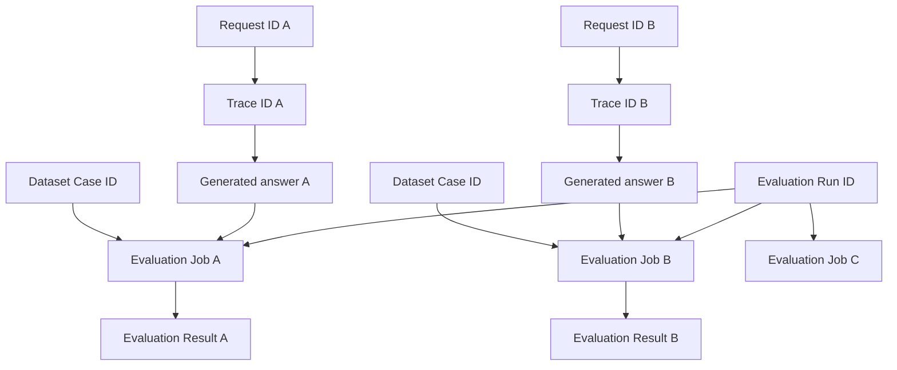

# Liên kết evaluation run ID với request ID hoặc trace ID

## 1. Vì sao cần liên kết các ID?

Trong ứng dụng Spring AI, một request của người dùng có thể tạo câu trả lời, truy xuất tài liệu, gọi tool và sau đó được evaluator chấm bất đồng bộ. Một evaluation run có thể chứa hàng trăm hoặc hàng nghìn evaluation jobs. Khi có lỗi, nhóm vận hành cần đi từ một verdict bất thường tới request đã sinh answer, trace của request, các model/tool operation và lần chạy evaluator tương ứng.

Nếu chỉ lưu một ID, việc điều tra sẽ bị đứt đoạn:

- Request ID giúp tìm request trong log/API gateway nhưng không mô tả toàn bộ quan hệ distributed tracing.
- Trace ID giúp truy vấn một distributed trace nhưng có thể không tồn tại nếu request không được instrument hoặc trace bị unsampled.
- Evaluation run ID gom một tập evaluation jobs theo một lần chạy, dataset hoặc thí nghiệm.
- Evaluation job ID định danh một lần chấm cụ thể cho một answer/case/evaluator.
- Evaluation result ID định danh record kết quả đã lưu.

Bài **“Liên kết evaluation run ID với request ID hoặc trace ID”** thuộc chương **Quan sát tùy chỉnh** của module **SPRING_AI_EVALUATION_OBSERVABILITY**. Module học đánh giá chất lượng ứng dụng Spring AI bằng dataset, tiêu chí relevance, fact checking và kiểm thử luồng RAG hoặc gọi công cụ; đồng thời theo dõi metrics, traces, chi phí và độ trễ để tìm nguyên nhân suy giảm qua các phiên bản prompt, model và pipeline.

Mục tiêu là thiết kế correlation xuyên suốt từ request tới evaluation result, kể cả khi evaluator chạy qua queue và worker riêng, đồng thời giữ đúng semantics của từng loại ID.

## 2. Phân biệt request ID, trace ID, evaluation run ID và job ID

| ID | Phạm vi | Ai tạo | Dùng để |
| --- | --- | --- | --- |
| Request ID | Một request nghiệp vụ/API | API gateway hoặc application | Tra cứu log, hỗ trợ và audit request |
| Trace ID | Một distributed trace | Tracing SDK/instrumentation | Gom các span thuộc cùng trace |
| Span ID | Một operation trong trace | Tracing SDK | Xác định span cha/con |
| Evaluation Run ID | Một lần chạy đánh giá gồm nhiều case/jobs | Evaluation orchestrator | Gom kết quả theo experiment/batch |
| Evaluation Job ID | Một tác vụ chấm cụ thể | Evaluation orchestrator | Retry, lease, state và idempotency |
| Evaluation Result ID | Một record kết quả | Result store/application | Định danh kết quả đã commit |
| Dataset Case ID | Một case trong dataset | Dataset registry | So sánh cùng input qua các run |

Các ID không thay thế lẫn nhau. Một request có thể không tạo evaluation job; một evaluation job có thể được chạy lại trên một answer cũ; một run có thể gồm nhiều request và nhiều job. Một request cũng có thể tạo nhiều trace nếu các operation bất đồng bộ tách thành trace riêng.

Trace ID không phải business identifier. Không dùng trace ID làm khóa chính cho evaluation result hoặc idempotency key. Trace có thể không được lấy mẫu, bị thay đổi qua ranh giới hệ thống hoặc không còn được giữ theo retention.

## 3. Mô hình quan hệ giữa các ID

Một mô hình phổ biến:



Trong ví dụ, run chứa hai jobs; mỗi job tham chiếu answer được tạo bởi một request. Quan hệ thực tế nên được lưu bằng foreign key/reference rõ ràng, không suy ra từ chuỗi ID hoặc timestamp gần nhau.

Nếu một answer được đánh giá nhiều lần bằng rubric khác nhau, có thể có nhiều evaluation jobs cùng tham chiếu một generation artifact. Nếu một request tạo nhiều answer, cần thêm generation artifact ID hoặc response ID để phân biệt.

## 4. Chọn correlation contract trước khi triển khai

Một correlation contract cần trả lời:

1. Ai tạo request ID và có chấp nhận ID do client gửi không?
2. Ai tạo trace ID và cách truyền W3C Trace Context?
3. Evaluation run bắt đầu ở API, scheduler hay experiment orchestrator?
4. Một job đại diện cho một case, một answer hay một evaluator?
5. Khi retry, job ID giữ nguyên hay tạo ID mới?
6. Khi rerun bằng rubric/model mới, run ID và job ID thay đổi ra sao?
7. Metadata nào lưu trong database, message headers, logs và spans?
8. ID nào được phép xuất hiện trong metric labels?
9. Bao lâu giữ correlation metadata và trace data?
10. Cách xử lý request không có trace hoặc trace bị unsampled?

Nên định nghĩa contract trong code/schema và test. Nếu mỗi service tự đặt tên header hoặc ý nghĩa của evaluation ID, correlation sẽ không nhất quán.

## 5. Sinh và xác thực request ID

Request ID thường được tạo ở gateway hoặc service đầu tiên nhận request. Nếu client gửi một ID, không nên tin tưởng vô điều kiện; cần giới hạn chiều dài, ký tự hợp lệ và loại bỏ giá trị có thể gây log injection.

Một lựa chọn là luôn tạo request ID nội bộ và lưu external correlation ID riêng. Ví dụ:

- internal request ID: UUID do service tạo;
- client request reference: giá trị đã validate, nếu nghiệp vụ cần giữ;
- trace ID: lấy từ tracing context sau khi middleware xử lý traceparent.

Không dùng request ID làm trace ID. Hai ID có mục đích và vòng đời khác nhau.

Ví dụ servlet filter tối giản tạo request ID nếu chưa có:

```java
import java.io.IOException;
import java.util.UUID;

import jakarta.servlet.FilterChain;
import jakarta.servlet.ServletException;
import jakarta.servlet.http.HttpServletRequest;
import jakarta.servlet.http.HttpServletResponse;
import org.springframework.stereotype.Component;
import org.springframework.web.filter.OncePerRequestFilter;

@Component
public class RequestCorrelationFilter extends OncePerRequestFilter {

    public static final String ATTRIBUTE = "app.request_id";
    public static final String HEADER = "X-Request-Id";

    @Override
    protected void doFilterInternal(
            HttpServletRequest request,
            HttpServletResponse response,
            FilterChain chain) throws ServletException, IOException {

        String requestId = UUID.randomUUID().toString();
        request.setAttribute(ATTRIBUTE, requestId);
        response.setHeader(HEADER, requestId);
        chain.doFilter(request, response);
    }
}
```

Ví dụ luôn tạo ID nội bộ để minh họa. Nếu hệ thống cần giữ request ID từ gateway, hãy validate và đặt giới hạn rõ; tránh để client tự đặt giá trị tùy ý rồi ghi vào log. Với WebFlux, dùng WebFilter và Reactor Context thay vì servlet filter.

## 6. Lấy trace ID từ tracing context

Trace ID được quản lý bởi tracing SDK. Với Spring Boot có Micrometer Tracing, có thể lấy current span qua Tracer khi đang ở trong request context:

```java
import io.micrometer.tracing.Span;
import io.micrometer.tracing.Tracer;
import org.springframework.stereotype.Component;

@Component
public class TraceContextReader {

    private final Tracer tracer;

    public TraceContextReader(Tracer tracer) {
        this.tracer = tracer;
    }

    public TraceReference currentReference() {
        Span span = tracer.currentSpan();
        if (span == null) {
            return TraceReference.empty();
        }

        return new TraceReference(
                span.context().traceId(),
                span.context().spanId());
    }
}
```

Ví dụ record:

```java
public record TraceReference(
        String traceId,
        String spanId) {

    public static TraceReference empty() {
        return new TraceReference(null, null);
    }
}
```

API cụ thể phụ thuộc Micrometer Tracing bridge và version Spring Boot. Nếu không có current span, trả reference rỗng/null theo schema; không tự tạo trace ID giả. Một request không được sampled vẫn có thể có trace context tùy SDK, nhưng trace backend có thể không lưu trace đó.

## 7. Tạo evaluation run và job ID

Evaluation run ID nên được tạo bởi orchestrator khi bắt đầu một lần chạy có ý nghĩa: ví dụ chạy dataset version cụ thể bằng rubric version cụ thể. Evaluation job ID được tạo cho mỗi tác vụ độc lập trong run.

Một run manifest có thể có:

- run ID;
- experiment ID;
- dataset ID/version/checksum;
- evaluator và rubric version;
- judge model profile/version;
- generation/retrieval version nếu run đánh giá end-to-end;
- started/completed timestamp;
- trigger (manual, schedule, CI, release gate);
- run status.

Một job có thể có:

- job ID;
- run ID;
- dataset case ID;
- generation artifact/answer ID;
- source request ID;
- source trace ID/span ID nếu có;
- evaluator identity;
- config snapshot/checksum;
- attempt count, status và timestamps.

Không tạo run ID mới cho mỗi retry. Retry thuộc cùng job; rerun có chủ ý là job/run mới tùy phạm vi experiment và cần liên kết với run gốc.

## 8. Thiết kế bảng correlation

Một schema tham khảo có thể tách run, job và result:

```sql
CREATE TABLE evaluation_run (
    run_id UUID PRIMARY KEY,
    experiment_id VARCHAR(128),
    dataset_version VARCHAR(128) NOT NULL,
    rubric_version VARCHAR(64) NOT NULL,
    judge_profile VARCHAR(128),
    trigger_type VARCHAR(32) NOT NULL,
    status VARCHAR(32) NOT NULL,
    created_at TIMESTAMPTZ NOT NULL,
    completed_at TIMESTAMPTZ
);

CREATE TABLE evaluation_job (
    job_id UUID PRIMARY KEY,
    run_id UUID NOT NULL REFERENCES evaluation_run(run_id),
    dataset_case_id VARCHAR(128),
    answer_id UUID,
    source_request_id VARCHAR(128),
    source_trace_id VARCHAR(32),
    source_span_id VARCHAR(16),
    evaluator_name VARCHAR(64) NOT NULL,
    config_snapshot_id VARCHAR(128) NOT NULL,
    status VARCHAR(32) NOT NULL,
    attempt_count INTEGER NOT NULL DEFAULT 0,
    created_at TIMESTAMPTZ NOT NULL
);

CREATE TABLE evaluation_result (
    result_id UUID PRIMARY KEY,
    job_id UUID NOT NULL UNIQUE REFERENCES evaluation_job(job_id),
    verdict VARCHAR(32) NOT NULL,
    score NUMERIC(8, 5),
    result_payload JSONB,
    committed_at TIMESTAMPTZ NOT NULL
);

CREATE INDEX idx_eval_job_run
    ON evaluation_job(run_id);

CREATE INDEX idx_eval_job_request
    ON evaluation_job(source_request_id);

CREATE INDEX idx_eval_job_trace
    ON evaluation_job(source_trace_id);
```

Đây là schema minh họa, cần bổ sung index, retention, tenant boundary, access policy và migration. Trace ID có độ dài/format theo tracing system; không nên giả định mọi trace backend dùng cùng một kiểu dữ liệu nếu dữ liệu được import từ nhiều nguồn. Có thể lưu dạng string đã validate.

Nếu một job đánh giá nhiều answer hoặc nhiều evaluator, mô hình cần bảng liên kết riêng thay vì ép vào một source_request_id duy nhất.

## 9. Liên kết trong luồng đồng bộ

Trong request đồng bộ, trace context thường được truyền qua instrumentation của framework. Request span là parent của các operation con như retrieval và ChatModel call.

Nếu evaluator chạy ngay trong cùng request và thực sự là một operation con, có thể tiếp tục trace context hiện tại. Tuy nhiên, evaluator đồng bộ làm tăng request latency và cần được thiết kế rõ.

Ví dụ custom Observation cho một operation evaluation đồng bộ:

```java
import io.micrometer.observation.Observation;
import io.micrometer.observation.ObservationRegistry;

public class EvaluationObservation {

    private final ObservationRegistry registry;

    public EvaluationObservation(ObservationRegistry registry) {
        this.registry = registry;
    }

    public <T> T observe(String evaluator, String runId,
                         java.util.concurrent.Callable<T> action)
            throws Exception {

        Observation observation = Observation
                .createNotStarted("app.ai.evaluation", registry)
                .lowCardinalityKeyValue("evaluator", evaluator)
                .highCardinalityKeyValue("evaluation.run_id", runId);

        observation.start();
        try (Observation.Scope scope = observation.openScope()) {
            return action.call();
        }
        finally {
            observation.stop();
        }
    }
}
```

Đây là ví dụ minh họa về gắn metadata vào Observation; cần xác minh API Micrometer theo dependency đang dùng. Run ID là giá trị duy nhất/ít lặp, vì vậy chỉ đưa vào high-cardinality trace/span metadata nếu cần tìm kiếm; không dùng làm metric tag. Observation được start trước khi mở scope và luôn stop trong finally.

## 10. Liên kết qua ranh giới bất đồng bộ

Khi request đã trả response và evaluation job được xử lý sau đó, request span có thể đã kết thúc. Worker không nên giả vờ rằng job chạy sau nhiều phút vẫn là một child span đồng bộ của request.

Có hai cách phổ biến:

1. **Propagate parent context:** phù hợp công việc ngắn, được dispatch trực tiếp và có quan hệ parent-child hợp lệ theo tracing model.
2. **Start a new trace and add a span link:** phù hợp job được queue, chạy trễ hoặc có thể được gom từ nhiều nguồn; span link giữ quan hệ tới trace nguồn mà không kéo dài parent span đã kết thúc.

Với evaluation worker bất đồng bộ, cách thứ hai thường rõ nghĩa hơn. Job vẫn lưu source trace ID và request ID trong business metadata; worker tạo trace mới và liên kết với trace nguồn nếu SDK hỗ trợ span links.

Không giữ thread-local span của request rồi dùng lại sau khi request kết thúc. Context propagation phải qua cơ chế được hỗ trợ như message headers, Reactor Context hoặc task decorator phù hợp.

## 11. Truyền correlation metadata qua queue

Khi enqueue job, ghi ID vào payload hoặc message headers. Ví dụ payload:

```json
{
  "evaluationRunId": "run-2026-11-27-001",
  "evaluationJobId": "job-00042",
  "datasetCaseId": "case-017",
  "answerId": "answer-91",
  "sourceRequestId": "req-8b0d",
  "sourceTraceId": "4bf92f3577b34da6a3ce929d0e0e4736",
  "sourceSpanId": "00f067aa0ba902b7",
  "configSnapshotId": "eval-config-v4"
}
```

Trace context W3C như traceparent/tracestate nên được propagate qua message headers bằng instrumentation/broker integration. Business IDs như run/job/request nên được truyền riêng trong message metadata hoặc payload có schema version.

Không tự nhét evaluationRunId vào traceparent. W3C Trace Context có định dạng và semantics riêng; dùng header sai định dạng có thể làm tracing SDK bỏ context hoặc tạo trace không liên tục.

Nếu message được retry hoặc redeliver, giữ nguyên evaluationJobId và source correlation references. Mỗi attempt có thể có attempt ID riêng nhưng không tạo job ID mới.

## 12. Dùng span link cho evaluation worker

Khi worker bắt đầu xử lý job, nó tạo span mới. Span có thể được link tới span nguồn nếu có cả trace ID và span ID hợp lệ.

Về mặt khái niệm:

```text
worker_span = start_new_trace_span("evaluation.process")
worker_span.add_link(
    source_trace_id,
    source_span_id,
    attributes = {
        "evaluation.run_id": evaluation_run_id,
        "evaluation.job_id": evaluation_job_id
    }
)
```

Đây là pseudocode để mô tả quan hệ, không phải API Java có thể copy trực tiếp. Cách triển khai thực tế phụ thuộc OpenTelemetry API/SDK hoặc tracing bridge đang dùng. Với OpenTelemetry Java, tạo SpanContext hợp lệ và addLink trước khi start span; cần xử lý trường hợp source context thiếu hoặc invalid.

Span link hữu ích khi:
- job bắt đầu sau một khoảng queue wait;
- một batch job được tạo từ nhiều request;
- worker xử lý độc lập với lifecycle của request;
- không muốn giữ trace cha mở trong thời gian dài.

Nếu một evaluation run tổng hợp nhiều request, có thể link run-level span tới một số trace nguồn hoặc lưu quan hệ đầy đủ trong result store. Không tạo một span có hàng nghìn links nếu backend không hỗ trợ tốt; giữ quan hệ chi tiết trong database và link một tập đại diện khi cần.

## 13. Tương quan một evaluation run với nhiều request

Một run có thể có nhiều jobs từ nhiều request:

- nightly evaluation run đọc golden dataset;
- replay run lấy answer đã lưu từ các request cũ;
- production sampling run chấm một phần traffic;
- release gate run so sánh candidate prompt/model với baseline.

Do đó, không nên gán một trace ID duy nhất cho cả run. Run ID gom công việc ở tầng nghiệp vụ; mỗi job giữ trace/request nguồn riêng.

Nếu run không có request nguồn (ví dụ offline golden dataset), source_request_id và source_trace_id để null. Có thể có run-level orchestration trace riêng, nhưng không tạo request ID giả.

## 14. Tương quan trong streaming và reactive pipeline

Với Spring WebFlux/Reactor, thread có thể thay đổi giữa các operator. ThreadLocal không phải nơi đáng tin cậy để lưu correlation metadata trong reactive pipeline.

Sử dụng:
- Reactor Context để giữ request correlation metadata trong reactive chain;
- Micrometer Context Propagation khi tích hợp ThreadLocal và reactive context;
- instrumentation được hỗ trợ bởi Spring Boot/Micrometer để truyền observation/tracing context;
- message headers khi vượt qua broker.

Không dùng static ThreadLocal tự tạo rồi giả định nó còn đúng sau publishOn/subscribeOn. Với cancellation, đảm bảo context và resource được dọn đúng.

Khi stream hoàn tất, tạo evaluation job từ answer hoàn chỉnh. Nếu stream bị cancel hoặc upstream error, ghi stream status PARTIAL/INTERRUPTED và policy quyết định có đánh giá partial output hay không. Job phải giữ request/trace correlation ngay cả khi không có verdict.

## 15. Gắn correlation vào log có cấu trúc

Structured logs nên chứa các trường có ích:

- timestamp;
- service name/version;
- environment;
- request ID;
- trace ID/span ID nếu có;
- evaluation run ID/job ID;
- evaluator/rubric/judge version;
- attempt number;
- status/error code.

Ví dụ log event:

```json
{
  "event": "evaluation.completed",
  "service": "spring-ai-evaluation",
  "request_id": "req-8b0d",
  "trace_id": "4bf92f3577b34da6a3ce929d0e0e4736",
  "evaluation_run_id": "run-2026-11-27-001",
  "evaluation_job_id": "job-00042",
  "rubric_version": "rag-rubric-v4",
  "attempt": 1,
  "status": "COMPLETED",
  "duration_ms": 842
}
```

Log example không bao gồm prompt, answer hay context. Nếu cần debug payload, dùng artifact reference có kiểm soát và redaction. Không dùng toàn bộ ID làm metric label; structured log phù hợp hơn cho exact lookup.

## 16. Không đưa ID duy nhất vào metric labels

Evaluation run ID, request ID, trace ID, span ID, job ID và case ID thường có cardinality rất cao. Nếu dùng làm Prometheus labels, mỗi giá trị mới có thể tạo time series mới và làm backend tốn memory/storage.

| Thuộc tính | Metric label? | Trace/log/result store |
| --- | --- | --- |
| evaluator type | Có thể, tập giá trị nhỏ | Có |
| rubric version | Có thể nếu số version được kiểm soát | Có |
| model profile | Có thể nếu bounded | Có |
| outcome/status | Có | Có |
| evaluation run ID | Không | Có |
| evaluation job ID | Không | Có |
| request ID | Không | Có |
| trace ID/span ID | Không | Có |
| dataset case ID | Không | Có |

Metric nên trả lời câu hỏi tổng hợp như số job hoàn tất theo evaluator/rubric/status. Exact lookup theo ID nên dùng trace search, log query hoặc database index.

## 17. Truy vấn từ request tới evaluation result

Một quy trình điều tra có thể đi theo hai chiều:

**Từ request tới result:**

1. Tìm request ID trong gateway/application logs.
2. Lấy trace ID/span ID và truy vấn trace backend.
3. Tìm evaluation jobs có source_request_id hoặc source_trace_id tương ứng.
4. Mở evaluation run và config snapshot.
5. Đọc attempt history, judge spans và result record.
6. Đối chiếu rubric, judge model và dataset version.

**Từ result về request:**

1. Mở result ID hoặc job ID.
2. Đọc run ID, source request ID và source trace reference.
3. Truy vấn trace backend nếu trace còn được lưu.
4. Kiểm tra generation/retrieval/tool spans.
5. So sánh answer/context artifact với verdict.

Trace có thể đã hết retention trong khi evaluation result vẫn còn. Vì vậy database cần lưu request ID, trace ID và version metadata đủ lâu để giữ quan hệ, ngay cả khi trace backend xóa span cũ.

## 18. Correlation trong retry và rerun

Retry và rerun phải có semantics rõ:

| Trường | Retry cùng job | Rerun có chủ ý |
| --- | --- | --- |
| Evaluation run ID | Giữ nguyên | Có thể giữ nếu cùng experiment run, hoặc tạo run mới nếu là experiment mới |
| Evaluation job ID | Giữ nguyên | Tạo mới |
| Attempt ID | Tạo mới | Tạo mới |
| Request ID nguồn | Giữ nguyên | Giữ nguyên nếu chấm lại cùng answer |
| Trace ID nguồn | Giữ nguyên reference nguồn | Giữ nguyên reference nguồn |
| Worker trace ID | Mỗi attempt có thể có trace mới | Trace mới |
| Rubric/config snapshot | Giữ nguyên | Có thể khác, phải lưu rõ |

Nếu rerun trên answer cũ bằng rubric mới, giữ source request/trace references nhưng tạo job mới với config snapshot mới. Nếu generation cũng chạy lại, tạo answer ID mới và liên kết request/run tương ứng.

Không tái sử dụng evaluation job ID cho một lần chấm có cấu hình khác vì sẽ phá vỡ idempotency và audit history.

## 19. Bảo mật và trust boundary của correlation headers

Trace context và request ID có thể đến từ client hoặc service bên ngoài. Cần xem chúng là input không đáng tin cho đến khi được xác thực/validate.

- Giới hạn chiều dài và charset của request ID.
- Không cho phép CR/LF hoặc control characters trong log fields.
- Không đưa token, email, account number hoặc dữ liệu nhạy cảm vào baggage.
- Xem xét bỏ qua trace headers từ public client và tạo trace context mới tại trust boundary.
- Chỉ propagate trace context qua service nội bộ được phép.
- Không cho phép caller tự đặt evaluation run ID để truy cập run của tenant khác.
- Kiểm tra tenant ownership khi tra cứu job/result bằng ID.
- Không expose trace ID hoặc job ID như credential; ID không thay thế authorization.
- Redact payload nhạy cảm khỏi log và span attributes.
- Áp dụng retention riêng cho business metadata và trace data.

Correlation giúp tìm dữ liệu; authorization mới quyết định ai được phép đọc dữ liệu đó.

## 20. Kiểm thử correlation contract

Cần có test ở nhiều boundary:

| Test | Assertion |
| --- | --- |
| HTTP request | Có request ID nội bộ và trace context nếu tracing bật |
| Synchronous operation | Child span nằm trong trace request |
| Queue publish | Payload chứa run/job/request references |
| Trace propagation | W3C traceparent được inject/extract đúng qua broker |
| Async worker | Có worker span mới và source link/reference |
| Retry | Job ID/request reference giữ nguyên; attempt ID thay đổi |
| Rerun | Job ID mới, source reference được giữ và config snapshot có thể đổi |
| Unsampled request | Business correlation vẫn tồn tại dù không truy vấn được trace |
| Missing trace | Không tạo trace ID giả; job vẫn xử lý được |
| Tenant boundary | Không đọc được result chỉ bằng ID nếu không có quyền |
| Metrics | Không xuất request/run/job/trace ID làm label |

Integration test nên kiểm tra trace backend hoặc test exporter nhận đúng attributes/links; không chỉ kiểm tra rằng một header tồn tại.

## 21. Dashboard và alert theo correlation

Dashboard tổng hợp nên tập trung vào dimension có cardinality hữu hạn:

- evaluator;
- rubric version;
- judge model profile;
- environment;
- status;
- operation;
- deployment version.

Các panel hữu ích:

- số evaluation runs đang chạy;
- số jobs theo status;
- completed/failed/unknown ratio;
- queue wait và evaluation duration;
- judge latency/error/retry;
- result commit failure;
- số jobs không có source request reference;
- tỷ lệ jobs không có trace reference;
- trace freshness và sampling coverage.

Metric ví dụ do ứng dụng định nghĩa:

```promql
sum by (evaluator, status) (
  rate(app_ai_evaluation_jobs_total[5m])
)
```

```promql
sum(rate(app_ai_evaluation_jobs_missing_source_trace_total[5m]))
/
clamp_min(sum(rate(app_ai_evaluation_jobs_created_total[5m])), 1)
```

Các tên metric cần được định nghĩa và đăng ký trong ứng dụng. Missing trace không nhất thiết là lỗi nếu request không được sampled hoặc run là offline; phân loại theo source type và sampling policy trước khi alert.

## 22. Xử lý khi không tìm được trace

Một evaluation result có request ID nhưng không có trace có thể do:

- tracing không bật ở service nguồn;
- sampler loại trace;
- trace exporter/Collector/backend đang lỗi;
- trace đã hết retention;
- context không được propagate qua queue;
- worker chỉ lưu request ID mà quên source trace reference;
- request được tạo offline hoặc từ dataset.

Quy trình:

1. Kiểm tra result store có source_request_id và source_trace_id không.
2. Kiểm tra sampling policy và trace flags.
3. Kiểm tra exporter/Collector health và freshness tại thời điểm request.
4. Tìm request ID trong structured logs.
5. Kiểm tra broker headers và context propagation.
6. Xác định trace chưa từng được tạo, bị drop hay đã hết retention.
7. Ghi nguyên nhân và cải thiện instrumentation nếu đây là lỗi contract.

Không tạo trace giả sau sự kiện chỉ để lấp chỗ trống. Có thể tạo investigation trace mới và lưu link/reference tới request/job cũ, nhưng phải ghi rõ đó là trace điều tra được tạo sau.

## 23. Lộ trình triển khai theo từng bước

1. **Define identifiers:** thống nhất semantics và format của request/run/job/result/case IDs.
2. **Update data model:** thêm correlation fields và index phù hợp vào job/result store.
3. **Capture request context:** tạo request ID và đọc trace context tại boundary.
4. **Create run/job:** sinh IDs ở orchestrator và lưu manifest/config snapshot.
5. **Propagate to queue:** truyền business metadata và W3C trace headers riêng biệt.
6. **Instrument worker:** tạo worker span, gắn run/job attributes và link tới source trace khi phù hợp.
7. **Log correlation:** cấu hình structured logging với ID fields đã validate.
8. **Protect cardinality:** không xuất unique IDs thành metric labels.
9. **Build lookup path:** hỗ trợ tra cứu hai chiều request ↔ job ↔ result ↔ trace.
10. **Test retries/reruns:** xác minh ID semantics và idempotency.
11. **Validate security:** tenant authorization, redaction và trust boundaries.
12. **Roll out:** deploy schema tương thích, canary và theo dõi missing correlation rate.

Nếu schema hiện tại đã có dữ liệu, thêm field nullable trước, deploy reader/writer tương thích và chỉ backfill khi có nguồn xác thực. Không suy đoán trace ID từ request ID hoặc timestamp.

## 24. Bài tập thực hành

1. **Identifier semantics:** một nightly run đánh giá 1.000 answers từ 1.000 requests. Có bao nhiêu run ID, job ID và request ID?
2. **Trace lifecycle:** vì sao không nên giữ request span mở trong 20 phút chờ evaluation?
3. **Async link:** thiết kế span link từ evaluation worker về trace nguồn.
4. **Queue propagation:** xác định business fields và W3C trace headers cần truyền.
5. **Retry:** retry cùng evaluation job phải giữ những ID nào?
6. **Rerun:** chấm answer cũ bằng rubric mới cần tạo ID nào mới và giữ ID nào?
7. **Unsampled trace:** điều tra request có request ID nhưng không có trace backend record.
8. **Cardinality:** vì sao evaluationRunId không được dùng làm Prometheus label?
9. **Security:** xử lý request ID do public client gửi để tránh log injection và cross-tenant lookup.
10. **Reactive context:** giải thích vì sao ThreadLocal tự tạo có thể mất context khi dùng Reactor.
11. **Database:** thiết kế index cho tra cứu theo run ID, request ID và trace ID.
12. **Observability:** viết dashboard phân biệt job thiếu trace do sampling với job mất context propagation.
13. **Partial streaming:** stream bị cancel nhưng evaluation job vẫn được tạo. Metadata/status nào cần ghi?
14. **Trace retention:** trace đã hết hạn nhưng result còn tồn tại. Cần giữ reference nào?
15. **Contract test:** xây test chứng minh correlation tồn tại từ HTTP request qua broker tới result store.

## Tài liệu tham khảo

- [Spring Boot – Observability](https://docs.spring.io/spring-boot/reference/actuator/observability.html): ObservationRegistry, metrics, tracing và context propagation.
- [Micrometer Tracing](https://docs.micrometer.io/tracing/reference/): Tracer, Span, baggage và tracing bridge.
- [Spring Framework – Observability](https://docs.spring.io/spring-framework/reference/integration/observability.html): Observation API và instrumentation.
- [OpenTelemetry – Context Propagation](https://opentelemetry.io/docs/concepts/context-propagation/): truyền trace context giữa process/service.
- [W3C Trace Context](https://www.w3.org/TR/trace-context/): traceparent và tracestate format.
- [OpenTelemetry – Span Links](https://opentelemetry.io/docs/specs/otel/trace/api/#link): liên kết span với span context khác mà không tạo quan hệ parent-child.
- [OpenTelemetry – Messaging Semantic Conventions](https://opentelemetry.io/docs/specs/semconv/messaging/): attributes và context propagation cho messaging.
- [Prometheus – Metric and Label Naming](https://prometheus.io/docs/practices/naming/): cardinality và label design.

> **Ghi chú triển khai:** Tên field, SQL schema, metric app.ai.* và code ví dụ là thiết kế minh họa. API Micrometer Tracing, Observation và span-link phụ thuộc version Spring Boot, Micrometer, OpenTelemetry bridge và broker instrumentation. Hãy xác minh theo dependency thực tế, giữ business IDs tách khỏi trace context, kiểm thử async propagation và không dùng ID duy nhất làm metric labels. Bài viết là hướng dẫn thiết kế correlation, chưa phải kết quả integration test trên hệ thống thực tế.
