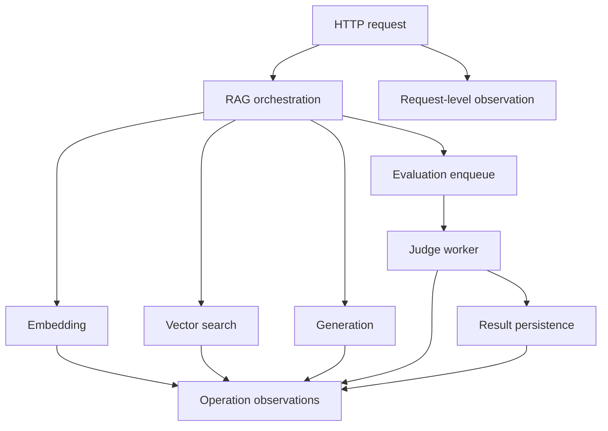

# Kiểm tra overhead của instrumentation bổ sung

## 1. Vì sao phải đo chi phí của instrumentation?

Instrumentation giúp quan sát ứng dụng Spring AI: request đi qua retrieval nào, model nào được gọi, tool nào thất bại, evaluator mất bao lâu và chi phí token thay đổi ra sao. Tuy nhiên, mỗi observation, span, metric, log và lần export đều tiêu tốn tài nguyên.

Một span mới có thể cần đọc clock, tạo object, gắn attributes, duy trì context, ghi vào processor queue và serialize khi export. Một metric label mới có thể tạo thêm hàng nghìn time series. Một custom observation đặt trong vòng lặp từng token có thể tạo lượng span lớn hơn nhiều so với một span ở cấp model operation.

Bài **“Kiểm tra overhead của instrumentation bổ sung”** thuộc chương **Quan sát tùy chỉnh** của module **SPRING_AI_EVALUATION_OBSERVABILITY**. Module học đánh giá chất lượng ứng dụng Spring AI bằng dataset, tiêu chí relevance, fact checking và kiểm thử RAG/tool calling; đồng thời theo dõi metrics, traces, chi phí và độ trễ để tìm nguyên nhân suy giảm qua các phiên bản prompt, model và pipeline.

Mục tiêu là đo được phần chi phí do instrumentation tạo ra, tách nó khỏi chi phí model/provider, xác định điểm instrument hợp lý và đặt ngân sách overhead trước khi triển khai rộng.

## 2. Instrumentation overhead gồm những gì?

Không nên chỉ đo thời gian gọi một API instrumentation. Overhead xuất hiện ở nhiều nơi:

| Nhóm chi phí | Thành phần | Biểu hiện |
| --- | --- | --- |
| CPU | Tạo observation/span, đọc clock, xử lý context, serialize | CPU tăng, throughput giảm |
| Allocation | Span, event, attribute map, string, batch object | Allocation rate và GC tăng |
| Threading | Queue, context propagation, exporter worker | Thread contention, scheduling |
| Network | Export OTLP, TLS, HTTP/gRPC, payload | Egress và network latency tăng |
| Memory | SDK queue, Collector queue, registry series | Heap/direct memory tăng |
| Storage | Log, trace index, metric series, retention | Ingestion/storage cost tăng |
| Cardinality | Nhiều label/tag có giá trị duy nhất | Time series và index tăng nhanh |
| Latency | Synchronous handler/export hoặc lock contention | p95/p99 request tăng |

Instrumentation có thể tăng allocation nhưng không làm p95 tăng đáng kể nếu export bất đồng bộ và heap còn dư. Ngược lại, chỉ một handler đồng bộ chậm cũng có thể kéo latency request tăng mạnh dù số span ít.

Vì vậy, đánh giá cần đo nhiều chiều cùng lúc: latency, throughput, CPU, allocation, GC, memory, network, queue và dữ liệu được backend nhận.

## 3. Phân biệt chi phí tạo observation và chi phí export

Để biết phần nào tạo overhead, tách pipeline thành các chế độ thử nghiệm:

| Chế độ | Instrumentation | Export | Mục đích |
| --- | --- | --- | --- |
| A. Baseline | Tắt custom instrumentation | Không | Mốc tham chiếu |
| B. Local recording | Tạo observation/span | Không gửi ra ngoài hoặc dùng in-memory test exporter | Đo chi phí tạo và ghi nhận |
| C. Async export | Tạo span và gửi qua SDK exporter | Có queue/worker, chưa tính backend đầy đủ | Đo chi phí export phía ứng dụng |
| D. Full pipeline | SDK + Collector + backend | Toàn bộ đường dữ liệu | Đo chi phí thực tế và khả năng chịu tải |
| E. Sampling | Instrumentation đầy đủ, chỉ export tỷ lệ chọn | Có sampling policy | Đo trade-off giữa coverage và overhead |

Các chế độ phải giữ nguyên business logic và workload. Nếu chế độ A bỏ cả bước xử lý nghiệp vụ hoặc thay model call thì kết quả không còn là so sánh overhead instrumentation.

Khi so sánh, cần biết SDK vẫn tạo span nhưng sampler bỏ export hay hoàn toàn không tạo span. Hai trường hợp có chi phí khác nhau.

## 4. Thiết kế benchmark có đối chứng

Một benchmark tốt giữ các yếu tố khác ổn định:

1. Dùng cùng application build, JVM flags, JDK, CPU/memory limit và dataset.
2. Dùng cùng model/provider profile hoặc mock provider có latency cố định nếu chỉ đo phần instrumentation.
3. Giữ request mix, concurrency, payload size và số tool/retrieval operations giống nhau.
4. Warm up JVM để JIT compilation và cache không làm lệch kết quả.
5. Chạy baseline và instrumented theo thứ tự luân phiên hoặc ngẫu nhiên để giảm ảnh hưởng nhiệt độ/tải nền.
6. Lặp lại nhiều vòng, ghi median và phân vị thay vì chỉ lấy một lần chạy.
7. Đo cả khi hệ thống ổn định và khi có burst.
8. Tách test có exporter/backend khỏi test chỉ đo SDK.
9. Lưu version của application, instrumentation, SDK, Collector và sampling policy.
10. Không thay đổi đồng thời prompt, model, retrieval hoặc rubric trong cùng benchmark.

Nên chạy tối thiểu ba loại workload:

- **Light path:** request ngắn, ít span, ít context.
- **Typical path:** RAG với embedding, vector search, generation và một evaluator.
- **Heavy path:** context dài, nhiều retrieved documents, tool calls và evaluation.

Một instrumentation có thể gần như miễn phí với light path nhưng tạo allocation đáng kể trong heavy path.

## 5. Chọn workload đại diện cho Spring AI

Đối với module này, workload nên bao gồm các operation thường gặp:

| Operation | Thành phần cần instrument | Điều cần giữ cố định |
| --- | --- | --- |
| Chat generation | ChatModel observation | Model, prompt, token limit |
| Embedding | EmbeddingModel observation | Số input, dimension, batch size |
| Retrieval | VectorStore/custom retriever | Index, top-k, filter |
| Tool calling | Tool selection/execution | Tool schema, response size |
| Evaluation | Relevancy/FactChecking evaluator | Rubric, judge model, dataset |
| Result persistence | Database operation | Schema, transaction, index |
| Streaming | Stream lifecycle | Token count, first-token latency, cancellation rate |

Nếu dùng provider thật, model latency và network jitter có thể che khuất vài microseconds hoặc milliseconds instrumentation. Để đo chi phí của code instrumentation, dùng fake/mock model có response ổn định; sau đó chạy thêm benchmark tích hợp với provider thật để đánh giá tổng thể.

Không dùng một mock provider để kết luận overhead production cuối cùng. Mock giúp cô lập chi phí, còn full pipeline mới cho thấy tác động end-to-end.

## 6. Các chỉ số phải thu thập

### Latency và throughput

- request p50, p95, p99;
- time-to-first-token và stream duration;
- throughput request/second;
- model/retrieval/evaluator duration;
- queue wait và exporter duration.

### CPU và bộ nhớ

- process CPU và container CPU;
- heap used/committed;
- allocation bytes/second hoặc bytes/request;
- GC count, pause time và allocation pressure;
- direct buffer/native memory;
- số thread và thread contention.

### Telemetry pipeline

- spans created/second;
- spans exported/second;
- events/attributes per span;
- average serialized span size;
- SDK queue utilization và dropped spans;
- Collector accepted/refused/sent/failed;
- backend ingest latency.

### Chi phí lưu trữ và network

- outbound bytes/second;
- export requests/second;
- metric series count;
- log/trace ingestion volume;
- backend storage growth và retention cost.

Không có một metric duy nhất phản ánh toàn bộ instrumentation overhead. Ví dụ, spans exported tăng có thể do request rate tăng chứ không phải instrumentation mỗi request nặng hơn. Luôn chuẩn hóa theo request hoặc operation.

## 7. Công thức tính overhead

Với một metric mà giá trị tăng là xấu (latency, CPU, allocation):

```text
relative_overhead_percent =
    (instrumented_value - baseline_value)
    / baseline_value
    × 100
```

Với throughput, chiều tăng thường là tốt; tính mức suy giảm:

```text
throughput_drop_percent =
    (baseline_throughput - instrumented_throughput)
    / baseline_throughput
    × 100
```

Ví dụ:

| Metric | Baseline | Instrumented | Thay đổi |
| --- | ---: | ---: | ---: |
| API p95 | 180 ms | 188 ms | +4.44% |
| CPU | 42% | 45% | +7.14% |
| Allocation/request | 120 KB | 132 KB | +10% |
| Throughput | 500 req/s | 490 req/s | -2% |
| GC pause p99 | 8 ms | 9 ms | +12.5% |

Các số liệu là ví dụ giả định. Với latency, nên ghi cả absolute delta (8 ms) và relative delta (4.44%). Khi baseline gần 0, phần trăm có thể gây hiểu nhầm; dùng absolute delta và phân vị phù hợp.

Không cộng phần trăm overhead của CPU, latency và allocation thành một con số chung. Chúng có đơn vị và tác động khác nhau.

## 8. Đo overhead ở cấp request và cấp operation

Đo toàn API giúp biết tác động người dùng, nhưng không chỉ ra custom observation nào tốn chi phí.

Có thể phân rã một request:



Đo span count trên mỗi request, số attributes mỗi span và payload bytes. Nếu một request tạo 60 spans trong khi chỉ có 6 operation nghiệp vụ, hãy kiểm tra instrumentation có bị lặp hoặc tạo span quá chi tiết không.

Đừng instrument từng getter, từng token hoặc từng vòng lặp nhỏ nếu không có mục tiêu điều tra rõ ràng. Span nên phản ánh operation có ý nghĩa và thời gian đủ lớn để phân tích.

## 9. Custom Observation trong Spring

Spring Boot thường cung cấp ObservationRegistry đã được cấu hình qua auto-configuration. Có thể inject registry để tạo custom observation cho operation chưa được framework/provider instrument đầy đủ.

Ví dụ instrument một bước retrieval:

```java
import io.micrometer.observation.Observation;
import io.micrometer.observation.ObservationRegistry;
import org.springframework.stereotype.Component;

@Component
public class InstrumentedRetriever {

    private final ObservationRegistry observationRegistry;
    private final VectorSearchService vectorSearchService;

    public InstrumentedRetriever(
            ObservationRegistry observationRegistry,
            VectorSearchService vectorSearchService) {
        this.observationRegistry = observationRegistry;
        this.vectorSearchService = vectorSearchService;
    }

    public SearchResult search(SearchRequest request) {
        Observation observation = Observation
                .createNotStarted("app.ai.retrieval", observationRegistry)
                .lowCardinalityKeyValue("retriever", "knowledge-base");

        observation.start();
        try (Observation.Scope scope = observation.openScope()) {
            return vectorSearchService.search(request);
        }
        finally {
            observation.stop();
        }
    }
}
```

Đây là ví dụ minh họa. Tên service và SearchRequest/SearchResult là kiểu của ứng dụng. Chỉ tạo custom observation nếu operation chưa được instrument tự động hoặc cần thêm một ranh giới nghiệp vụ có ý nghĩa. Nếu framework đã tạo span cho cùng operation, thêm một span nữa có thể làm trace bị trùng và tăng chi phí.

Không gắn câu hỏi, prompt, document content, user ID hoặc request ID vào low-cardinality key. Chỉ thêm metadata có tập giá trị nhỏ và được kiểm soát.

## 10. Chọn span granularity hợp lý

Span quá thô không đủ thông tin để điều tra; span quá nhỏ làm tăng số lượng và chi phí.

| Mức instrument | Ví dụ | Khuyến nghị |
| --- | --- | --- |
| Request | API chat hoặc RAG request | Nên có |
| Model operation | ChatModel call, embedding call | Nên có |
| Retrieval operation | Vector search, reranking | Nên có nếu giúp phân tích |
| Tool execution | Gọi tool có latency/failure riêng | Nên có |
| Evaluation job | Judge call, result persistence | Nên có |
| Mỗi token | Một span cho từng token streaming | Tránh trong phần lớn hệ thống |
| Mỗi attribute access | Span cho getter nhỏ | Không nên |
| Mỗi document | Span cho từng document nếu top-k lớn | Chỉ khi cần điều tra đặc biệt |

Với streaming, dùng một span cho lifecycle của generation/stream và metrics cho token count, time-to-first-token, cancellation. Không tạo span cho từng token nếu không có nhu cầu phân tích đặc biệt.

## 11. Cardinality cũng là một loại overhead

Metric labels có tập giá trị lớn tạo nhiều time series. Ví dụ tag model với vài model profile có cardinality thấp; tag request ID có giá trị mới cho mỗi request.

| Attribute/tag | Nơi phù hợp | Lưu ý |
| --- | --- | --- |
| provider | Metric + span | Tập giá trị nhỏ |
| model_profile | Metric + span | Kiểm soát alias |
| operation | Metric + span | Tập operation hữu hạn |
| outcome | Metric + span | success/error/timeout |
| prompt_version | Span/result store | Metric label chỉ khi tập version được giới hạn |
| trace_id | Trace/log | Không dùng metric label |
| request_id | Log/result store | Không dùng metric label |
| document_id | Trace hoặc secured result reference | Tránh metric label |
| Prompt/response text | Không nên lưu mặc định | Nhạy cảm, payload lớn |

Cardinality tăng làm memory registry, scrape payload, ingestion CPU và storage index tăng. Overhead có thể xuất hiện ở Prometheus/backend dù CPU của application gần như không đổi.

## 12. Đo chi phí của exporter riêng biệt

Exporter có thể chạy bất đồng bộ, nhưng không miễn phí. Nó sử dụng worker threads, queue, serialization, compression, TLS và network.

Thiết kế phép đo theo từng lớp:

1. Tạo span nhưng dùng in-memory exporter.
2. Bật OTLP exporter với Collector local.
3. Bật batch processor và queue như cấu hình gần production.
4. Gửi Collector tới backend thực tế hoặc staging.
5. So sánh CPU, allocation, queue wait, export duration, network bytes và drop.

Nếu exporter bật làm request p95 tăng mạnh, kiểm tra có synchronous processor/handler, forceFlush trên request path, lock contention hoặc queue backpressure hay không.

Không gọi forceFlush sau mỗi request. Flush thường xuyên làm mất lợi ích batching và tăng network overhead. Dùng lifecycle shutdown hoặc cơ chế flush được thiết kế cho batch boundary.

## 13. Sampling: giảm chi phí nhưng vẫn giữ coverage

Sampling có thể giảm lượng trace được export, nhưng không nhất thiết loại bỏ toàn bộ chi phí instrumentation. Head sampler thường quyết định sớm ở lúc tạo trace; SDK vẫn cần một số thao tác tạo context và kiểm tra sampler.

Các lựa chọn:

- **Always-on:** phù hợp local/test hoặc lưu lượng thấp.
- **Parent-based ratio:** giữ quyết định sampling từ trace cha và lấy một tỷ lệ trace mới.
- **Tail sampling:** Collector quyết định giữ trace sau khi quan sát các span; cần bộ nhớ và thời gian chờ để gom đủ trace.
- **Error/latency-biased policy:** ưu tiên trace lỗi hoặc chậm nếu pipeline hỗ trợ.
- **Evaluation sampling:** chọn một phần request để chạy judge; đây là sampling workload đánh giá, khác trace sampling.

Không dùng trace sampling để giảm evaluation jobs nếu hai mục tiêu khác nhau. Một request có thể không được export trace nhưng vẫn cần được evaluator chấm, hoặc ngược lại.

Đo đồng thời coverage và overhead ở các tỷ lệ sampling khác nhau, ví dụ 100%, 25%, 10% và 1%. Kiểm tra lỗi hiếm có còn được giữ đủ để điều tra không.

## 14. Tách instrumentation overhead khỏi model latency

Model provider thường chiếm phần lớn thời gian của request. Nếu đo end-to-end mà không phân rã span, overhead instrumentation có thể bị che khuất.

Ví dụ:

- generation latency: 1.200 ms;
- retrieval: 90 ms;
- custom instrumentation và local processing: 2 ms;
- export async: 4 ms CPU ở worker ngoài request path.

Nếu chỉ nhìn tổng latency 1.292 ms, khó nhận ra phần instrumentation. Dùng controlled mock model có latency ổn định hoặc so sánh hai chế độ trong cùng workload để đo delta.

Ngược lại, không bỏ qua overhead ở tải cao. Một span thêm 0,1 ms có thể nhỏ trên một request nhưng trở thành lượng CPU đáng kể khi có hàng nghìn request/giây.

## 15. Dùng JFR và profiler để tìm allocation/CPU hotspots

Java Flight Recorder (JFR) giúp quan sát CPU samples, allocation, GC, lock contention, thread park và socket activity.

Quy trình:

1. Chạy workload baseline.
2. Thu JFR trong cùng cửa sổ benchmark.
3. Bật custom instrumentation và chạy lại cùng workload.
4. So sánh stack traces xuất hiện trong observation handler, span processor, attribute encoding, exporter và serialization.
5. Tìm allocation tăng ở map/list/string/byte buffer.
6. Kiểm tra lock contention và thread scheduling.
7. Xác nhận bằng một lần chạy lặp lại.

Profiler có overhead riêng. Dùng cùng cấu hình profiling cho baseline và instrumented run, hoặc đo một lượt không profiler để xác nhận kết quả cuối. Không so số liệu có profiler với số liệu không profiler như hai phép đo tương đương.

JFR hữu ích để tìm vị trí tốn tài nguyên; nó không thay thế load test end-to-end.

## 16. Microbenchmark và load test trả lời hai câu hỏi khác nhau

| Phương pháp | Trả lời | Giới hạn |
| --- | --- | --- |
| JMH microbenchmark | Một thao tác tạo observation/attribute tốn bao nhiêu ns/op và allocation/op? | Không đại diện toàn bộ Spring request |
| Integration test | Observation/span có được tạo và export đúng không? | Không đủ tải để đo p99 |
| Load test | Throughput/latency/CPU thay đổi thế nào dưới tải? | Khó cô lập từng method |
| Soak test | Queue, memory và storage tăng theo thời gian không? | Tốn thời gian chạy |
| Production canary | Overhead trên workload thật ra sao? | Cần rollout và rollback an toàn |

Dùng JMH cho đoạn code thuần như tạo observation hoặc xây attribute map. Dùng load test để quyết định có thể triển khai instrumentation trên service thật hay không.

Không benchmark method rất nhỏ bằng một vòng lặp tự viết rồi kết luận; JIT có thể tối ưu bỏ thao tác, dead-code elimination và constant folding làm số liệu sai. Dùng harness phù hợp cho microbenchmark.

## 17. Ví dụ bảng benchmark có kiểm soát

Giả sử chạy cùng workload 200 request/giây, 20 phút, warm-up 5 phút và 3 lần lặp. Kết quả minh họa:

| Chế độ | API p95 | CPU | Allocation/request | Spans/request | Export drops |
| --- | ---: | ---: | ---: | ---: | ---: |
| Baseline | 210 ms | 38% | 105 KB | 0 | 0 |
| Local recording | 212 ms | 39% | 116 KB | 8 | 0 |
| Async OTLP | 214 ms | 41% | 121 KB | 8 | 0 |
| Full Collector | 216 ms | 42% | 121 KB | 8 | 0 |
| Full + 10% sampling | 212 ms | 39% | 113 KB | 8 created / ~0.8 exported | 0 |

Đây là số liệu giả định để minh họa cách đọc bảng. Cần xác định spans/request là created hay exported. Với sampling, hai đại lượng khác nhau.

Nếu API p95 tăng 6 ms nhưng SLO còn dư 100 ms, overhead có thể chấp nhận được; tuy nhiên CPU và allocation cũng cần xem dưới peak load và soak test. Không quyết định chỉ bằng một bảng.

## 18. Đặt instrumentation budget

Một team có thể định nghĩa ngân sách cho instrumentation:

| Chỉ số | Ví dụ budget nội bộ |
| --- | --- |
| API p95 regression | Không quá 2–3% ở workload chuẩn |
| CPU increase | Không quá 5% tương đối |
| Allocation/request | Không tăng quá 10% nếu không có lợi ích rõ |
| Dropped spans | Trong ngân sách đã định, ưu tiên 0 ở tải bình thường |
| Queue utilization | Không tăng liên tục trong steady state |
| Telemetry delivery freshness | Nằm trong cửa sổ vận hành |
| Cardinality | Giữ trong giới hạn backend đã thống nhất |

Đây chỉ là ví dụ, không phải tiêu chuẩn chung. Budget cần xuất phát từ SLO hiện có, capacity, chi phí backend và giá trị điều tra mà instrumentation mang lại.

Một custom span có thể đáng chi phí nếu giúp phát hiện lỗi production khó tái hiện. Ngược lại, hàng chục attributes không được query hoặc sử dụng có thể bỏ đi.

## 19. Phân tích overhead theo từng chiều

Khi kết quả xấu đi, đọc theo symptom:

| Symptom | Khả năng | Hướng điều tra |
| --- | --- | --- |
| CPU tăng, latency ổn định | Serialization/attribute processing | JFR CPU profile |
| Allocation và GC tăng | Nhiều span/event/string | JFR allocation, span count |
| p99 tăng mạnh | Synchronous handler hoặc contention | Thread/lock profile |
| Queue tăng | Exporter chậm hơn producer | Export throughput, backend latency |
| Drops tăng | Queue capacity hoặc backend outage | SDK/Collector queue |
| Backend cost tăng | Cardinality hoặc payload lớn | Series count, bytes/span |
| Chỉ heavy RAG chậm | Context/attributes quá lớn | Payload size và operation count |
| Streaming chậm | Per-token instrumentation hoặc blocking | Stream lifecycle/profile |
| Metrics endpoint nặng | Quá nhiều meter/series | Registry size, scrape payload |

Luôn kiểm tra số request và số operation. Nếu traffic tăng gấp đôi, CPU tăng gấp đôi không nhất thiết là instrumentation regression.

## 20. Dashboard và PromQL minh họa

Metric names dưới đây là ví dụ do ứng dụng hoặc exporter định nghĩa. Cần thay theo registry thực tế.

**CPU process:**

```promql
avg_over_time(process_cpu_usage[5m])
```

**API p95:**

```promql
histogram_quantile(
  0.95,
  sum by (le, service) (
    rate(http_server_requests_seconds_bucket[5m])
  )
)
```

**Allocation rate nếu có JVM allocation metric:**

```promql
rate(jvm_gc_memory_allocated_bytes_total[5m])
```

**Số span export thất bại ở Collector** (tên series tùy phiên bản):

```promql
sum(rate(otelcol_exporter_send_failed_spans[5m]))
```

**Span count trên mỗi request** nếu app có metric tương ứng:

```promql
sum(rate(app_ai_spans_created_total[5m]))
/
clamp_min(sum(rate(http_server_requests_seconds_count[5m])), 1)
```

Dashboard nên hiển thị baseline và instrumented cohort theo application/instrumentation version, nhưng tránh dùng request ID, trace ID hoặc checksum làm labels.

## 21. Kiểm tra overhead trong production bằng canary

Sau khi benchmark staging đạt, rollout theo từng bước:

1. Deploy instrumentation mới trên một nhóm canary nhỏ.
2. Giữ cùng model/prompt/retrieval version nếu mục tiêu là đo instrumentation.
3. So sánh latency, throughput, CPU, allocation, GC và exporter drops với control cohort.
4. Kiểm tra trace coverage, span count và backend ingestion cost.
5. Tăng tỷ lệ nếu overhead nằm trong budget.
6. Rollback instrumentation nếu SLO bị ảnh hưởng hoặc queue/drop vượt ngưỡng.
7. Lưu version và kết quả benchmark để lần sau so sánh.

Nếu traffic canary và control khác phân bố, cần stratify theo operation, model profile, token volume và region. Không kết luận instrumentation chậm chỉ vì canary tình cờ nhận nhiều prompt dài.

## 22. Bảo mật và chất lượng dữ liệu khi tối ưu

Giảm overhead không nên làm mất semantics hoặc đưa dữ liệu nhạy cảm vào nơi không cần thiết.

- Không lưu toàn bộ prompt/completion để tránh tạo attribute lớn.
- Không đưa user/document/request ID vào metric labels.
- Giữ các field cần cho correlation nhưng dùng trace/log có kiểm soát.
- Không xóa span error quan trọng chỉ để giảm volume mà không đánh giá ảnh hưởng điều tra.
- Sampling phải có version và coverage metric.
- Không thay unit/meaning của metric tại chỗ khi tối ưu.
- Kiểm tra redaction trước khi gửi telemetry tới backend bên ngoài.

Một instrumentation nhẹ nhưng ghi sai usage hoặc che mất lỗi sẽ gây hại hơn một instrumentation có overhead nhỏ nhưng đo đúng.

## 23. Checklist hoàn thành phép đo

- [ ] Baseline và instrumented build dùng cùng business logic.
- [ ] JVM, hardware/container limits và workload được giữ ổn định.
- [ ] Có warm-up và nhiều lần lặp.
- [ ] Đo p50/p95/p99, throughput, CPU và allocation.
- [ ] Đo GC, heap, threads và network.
- [ ] Đếm spans/request, attributes/span và payload bytes.
- [ ] Đo SDK queue, exporter, Collector và backend.
- [ ] Tách created spans khỏi sampled/exported spans.
- [ ] Kiểm tra cardinality và storage cost.
- [ ] Có profiling evidence cho hotspot lớn.
- [ ] So sánh với instrumentation budget.
- [ ] Có canary và rollback plan.
- [ ] Lưu application/SDK/Collector/instrumentation versions.

## 24. Bài tập thực hành

1. **Baseline:** thiết kế benchmark cho endpoint RAG với 200 request/giây.
2. **Isolation:** tạo bốn chế độ baseline, local recording, async exporter và full Collector.
3. **Span granularity:** một request tạo 80 spans. Xác định span nào trùng hoặc quá nhỏ.
4. **Observation:** thêm custom Observation quanh retrieval và đo span count.
5. **Cardinality:** dự đoán tác động khi thêm request ID vào metric tag.
6. **Allocation:** JFR cho thấy String/Map allocation tăng sau instrumentation. Đề xuất cách giảm.
7. **Sampling:** so sánh 100%, 25%, 10% sampling về CPU, coverage và storage.
8. **Exporter:** mô phỏng Collector chậm và đo queue/drop.
9. **Streaming:** so sánh một span cho stream lifecycle với một span cho mỗi token.
10. **Microbenchmark:** xác định đoạn code nào phù hợp JMH và đoạn nào phải dùng load test.
11. **Overhead math:** baseline p95 150 ms, instrumented p95 156 ms. Tính absolute và relative overhead.
12. **Budget:** đặt instrumentation budget dựa trên SLO và capacity.
13. **Canary:** thiết kế control/canary cohort để không nhầm khác biệt traffic với overhead.
14. **Profiler:** chọn JFR events để điều tra CPU, allocation và lock contention.
15. **Review:** quyết định bỏ một custom span nếu nó không được sử dụng trong dashboard hay incident runbook.

## Tài liệu tham khảo

- [Spring Boot – Observability](https://docs.spring.io/spring-boot/reference/actuator/observability.html): ObservationRegistry, metrics và tracing integration.
- [Spring Boot – Metrics](https://docs.spring.io/spring-boot/reference/actuator/metrics.html): Micrometer MeterRegistry, meter và exporter.
- [Spring Framework – Observability](https://docs.spring.io/spring-framework/reference/integration/observability.html): Observation API và custom instrumentation.
- [Micrometer Observation – Concepts](https://docs.micrometer.io/micrometer/reference/observation.html): Observation lifecycle, handlers, conventions và context.
- [OpenTelemetry – Trace SDK](https://opentelemetry.io/docs/specs/otel/trace/sdk/): span processor, sampling và exporter behavior.
- [OpenTelemetry Collector – Resiliency](https://opentelemetry.io/docs/collector/resiliency/): queue, retry và exporter pipeline.
- [Java Flight Recorder](https://docs.oracle.com/en/java/javase/21/jfapi/flight-recorder-api.html): profiling CPU, allocation, GC và runtime events.
- [JMH](https://openjdk.org/projects/code-tools/jmh/): microbenchmark harness cho JVM.

> **Ghi chú kiểm chứng:** Các metric app.ai.*, budget, benchmark table và ví dụ Observation trong bài là hướng dẫn minh họa. Tên metric JVM/Collector, cấu hình exporter và API phụ thuộc phiên bản Spring Boot, Micrometer, OpenTelemetry SDK/Collector và JDK. Hãy xác minh API theo dependency thực tế, chạy benchmark có đối chứng trong staging và ghi lại môi trường đo. Bài viết là hướng dẫn đo overhead, chưa phải kết quả benchmark của hệ thống thực tế.
