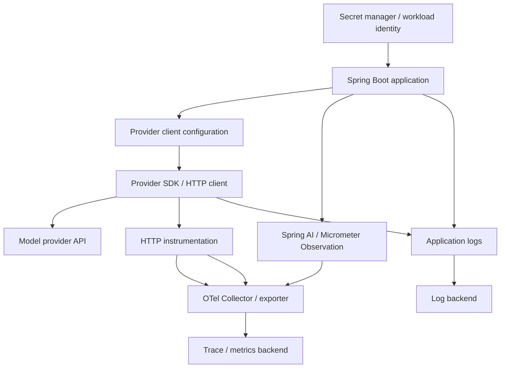
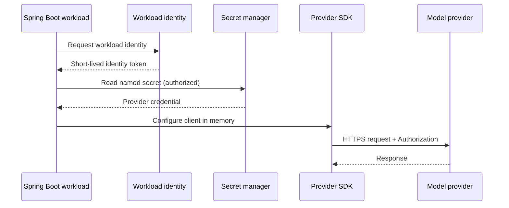
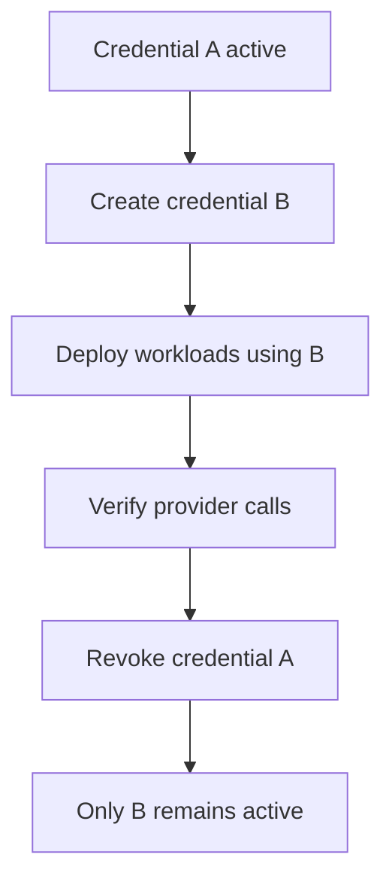

# Giữ khóa API và thông tin xác thực ngoài log hoặc span

Một ứng dụng Spring AI gọi model provider bằng API key, truy cập vector store bằng credential riêng và thực thi tool qua các dịch vụ nội bộ. Khi có lỗi, nhóm phát triển cần trace để biết request đi qua ChatClient, ChatModel, HTTP client và tool callback như thế nào. Nhưng nếu instrumentation ghi toàn bộ HTTP headers, exception message hoặc object cấu hình, API key có thể xuất hiện trong log, span, baggage, metric label, crash dump hoặc dashboard.

**Credential phải được giữ ở tầng xác thực và cấu hình bí mật; telemetry chỉ ghi trạng thái vận hành an toàn.** Một trace cần cho biết provider nào được gọi, operation mất bao lâu, kết quả là timeout hay rate limit và model family nào được dùng. Trace không cần giá trị API key, bearer token, password hay private key để trả lời những câu hỏi đó.

Bài này thuộc chương **Bảo vệ dữ liệu** của module **SPRING_AI_EVALUATION_OBSERVABILITY**. Module học đánh giá chất lượng ứng dụng Spring AI bằng dataset, relevance, fact checking và kiểm thử RAG/tool calling; đồng thời đo metrics, traces, chi phí và độ trễ để tìm nguyên nhân suy giảm giữa các phiên bản prompt, model và pipeline. Bài tập trung vào quản lý vòng đời credentials và ngăn chúng đi vào logs, spans, metrics, baggage hoặc các hệ thống quan sát.

## 1. Mục tiêu học tập

Sau bài này, bạn có thể:

1. Nhận diện API keys, passwords, bearer/refresh tokens, cookies, private keys và các thông tin xác thực khác trong hệ thống Spring AI.
2. Tìm các đường rò rỉ từ cấu hình, HTTP client, SDK, exception, logging, Micrometer, OpenTelemetry và collector.
3. Quản lý credentials bằng secret manager hoặc cơ chế cấp phát phù hợp với môi trường chạy.
4. Phân biệt credential với metadata an toàn có thể ghi vào telemetry.
5. Thiết kế logs, metrics và spans không chứa secret, kể cả khi xảy ra lỗi.
6. Kiểm soát auto-instrumentation, header capture, body capture, baggage và MDC.
7. Thực hiện rotation, revocation và xử lý sự cố khi credential bị lộ.
8. Viết kiểm thử xác nhận secret marker không xuất hiện trong log, span, metric label hay payload export.
9. Duy trì khả năng điều tra provider/model/tool failures mà không cần sao chép credential vào telemetry.

## 2. Credential là gì và thường nằm ở đâu?

Credential là dữ liệu được dùng để xác thực hoặc cấp quyền truy cập. Trong một ứng dụng AI, credential không chỉ là API key của model provider.

| Loại | Ví dụ | Rủi ro khi bị lộ |
|---|---|---|
| **API key** | Key gọi model provider, embedding API hoặc dịch vụ reranker. | Người khác sử dụng quota/tài khoản và phát sinh chi phí. |
| **Bearer/access token** | OAuth access token gửi trong HTTP Authorization header. | Người giữ token có thể truy cập API trong phạm vi quyền của token. |
| **Refresh token** | Token đổi access token mới. | Có thể duy trì quyền truy cập lâu hơn access token. |
| **Password** | Database, vector store, service account hoặc tài khoản quản trị. | Truy cập trái phép vào hệ thống. |
| **Private key** | Khóa ký JWT, client certificate hoặc SSH. | Giả mạo danh tính hoặc giải mã/ký dữ liệu tùy mục đích khóa. |
| **Client secret** | OAuth client secret, webhook signing secret. | Giả mạo client hoặc chữ ký. |
| **Cookie/session token** | Session cookie, CSRF/session credentials. | Chiếm phiên nếu token còn hiệu lực và dùng được. |
| **Cloud credential** | Static access key, service account key. | Truy cập cloud resources theo quyền được cấp. |
| **Database credential** | Username/password, connection string có password. | Đọc, sửa hoặc xóa dữ liệu. |
| **Signed URL/token** | URL truy cập object có chữ ký và thời hạn. | Truy cập tài nguyên cho tới khi token hết hiệu lực hoặc bị thu hồi. |

### 2.1. Không phải mọi metadata đều là credential

Các giá trị sau thường hữu ích cho điều tra và không tự động là credential:

- Tên provider hoặc model family.
- Prompt template ID và pipeline version.
- HTTP status code và error category.
- Finish reason, token counts và latency.
- Tên tool và business outcome đã chuẩn hóa.
- Trace ID và provider request reference, nếu policy cho phép.

Tuy nhiên, một ID có thể nhạy cảm khi nó cho phép tra cứu hồ sơ hoặc truy vấn backend. Phân loại theo **khả năng sử dụng và khả năng liên kết**, không chỉ theo tên field.

### 2.2. Secret có thể nằm trong nhiều dạng dữ liệu

Một connection string có thể chứa password. Một URL có thể có signed query token. Một exception có thể chứa request header. Một object cấu hình có thể in credential trong phương thức toString. Một SDK debug log có thể dump request. Không chỉ tìm chuỗi tên apiKey; cần rà soát mọi object và đường truyền có thể mang giá trị xác thực.

## 3. Sơ đồ đường đi của credential và telemetry

Credential thường được đọc lúc khởi động hoặc lúc tạo client, sau đó được gắn vào request HTTP ở tầng provider SDK. Telemetry có thể được tạo ở tầng model và HTTP client, trong khi log có thể được ghi ở bất kỳ tầng nào.



Sơ đồ có hai luồng khác nhau:

- **Luồng xác thực:** secret manager hoặc workload identity cấp credential cho client để gọi provider/backend.
- **Luồng quan sát:** instrumentation ghi operation, duration, status và các thuộc tính được phép.

Hai luồng có thể đi qua cùng một process, nhưng credential không cần được sao chép sang luồng quan sát. HTTP client vẫn phải gửi Authorization header cho provider; instrumentation phải được cấu hình để không capture hoặc export giá trị header đó.

### 3.1. Các điểm cần kiểm tra

1. Nơi secret được lưu trước khi ứng dụng khởi động.
2. Cách secret được đưa vào process/container.
3. Configuration binding và object toString.
4. Provider SDK, HTTP client và interceptors.
5. Exception handlers và retry logging.
6. MDC, baggage, Observation key-values và span attributes.
7. Auto-instrumentation agent và header/body capture.
8. Collector processors, exporters và backend access.
9. Build logs, CI artifacts, heap dumps và crash reports.

## 4. Nguyên tắc: secret không phải telemetry attribute

Telemetry cần mô tả **hoạt động**, không cần tiết lộ **bằng chứng xác thực**.

| Không ghi | Có thể ghi thay thế |
|---|---|
| API key | provider=provider-a, credential.source=secret-manager. |
| Authorization header | auth.mode=bearer, auth.result=accepted nếu cần. |
| Password | dependency=vector-store, connection.outcome=success. |
| Refresh token | token.exchange.outcome=success, token.expires_in_bucket. |
| Private key | client.auth.mode=mtls, tls.handshake.outcome=success. |
| Signed URL | object.operation=download, object.store=private-bucket. |
| Full connection string | db.system=postgresql, db.pool.name=vector-store. |
| Raw exception có secret | error.type=authentication_failed, error.category=provider_auth. |

Các tên thuộc tính trong bảng là ví dụ nội bộ; nếu dùng OpenTelemetry semantic conventions, hãy đối chiếu key/semantics theo version đang áp dụng. Không tạo thuộc tính credential.value ở high-cardinality chỉ vì nghĩ high-cardinality được phép chứa dữ liệu nhạy cảm.

### 4.1. Low-cardinality và high-cardinality đều phải an toàn

Micrometer phân biệt low/high-cardinality key-values vì chúng được dùng ở những handlers khác nhau. High-cardinality có thể phù hợp cho span attributes, nhưng **không có nghĩa được phép ghi API key, password, token hoặc raw request**. Mọi giá trị trước khi thêm vào Observation/span đều phải qua phân loại và allowlist.

### 4.2. Không ghi secret dạng đã che một phần để thay thế

Ghi sk-****abcd vẫn tiết lộ prefix/suffix và có thể giúp phân biệt hoặc liên kết key. Với credential, mặc định tốt nhất là **không ghi giá trị nào của secret**. Nếu cần biết secret nào đang được dùng, ghi một logical secret reference/version do secret manager quản lý, miễn là reference đó không cho phép truy cập secret.

## 5. Quản lý credential ngoài source code

Không hardcode API keys trong Java, application.yml, Dockerfile, manifest đã commit, script hoặc test fixture. Dùng secret manager, workload identity hoặc cơ chế secret injection được tổ chức phê duyệt.

### 5.1. Thứ tự ưu tiên theo môi trường

| Môi trường | Hướng phù hợp |
|---|---|
| **Local development** | Secret store cá nhân hoặc biến môi trường cục bộ không commit; dùng key riêng, scope và quota thấp. |
| **CI/CD** | Secret store của pipeline với quyền tối thiểu, masking output và thời hạn phù hợp. |
| **Kubernetes/container** | Workload identity hoặc secret manager integration; tránh ghi secret vào image/layer. |
| **Cloud runtime** | Managed identity/service account ngắn hạn khi provider hỗ trợ. |
| **Production** | Secret manager/KMS, IAM theo workload, rotation và audit. |

Static environment variables có thể là bước cải thiện so với hardcode, nhưng không tự động là kho bí mật an toàn: chúng có thể xuất hiện trong process inspection, crash dump, diagnostics hoặc cấu hình triển khai. Ưu tiên cấp phát credential ngắn hạn qua identity khi hệ thống hỗ trợ.

### 5.2. Spring Boot externalized configuration

Spring Boot hỗ trợ nhiều nguồn cấu hình bên ngoài. Có thể tham chiếu một biến môi trường thay vì đặt giá trị key trực tiếp trong repository. Ví dụ minh họa cho starter/provider tương ứng:

```yaml
spring:
  ai:
    openai:
      api-key: ${OPENAI_API_KEY}
```

Tên property phụ thuộc provider starter và version Spring AI. Đây là ví dụ cấu hình tham chiếu; biến môi trường phải được cấp từ môi trường bí mật đã được kiểm soát. Không commit file .env, không bật debug dump environment và không in giá trị khi kiểm tra cấu hình.

### 5.3. Chỉ lưu secret reference trong cấu hình ứng dụng

Một kiến trúc tốt hơn có thể lưu tên secret hoặc resource reference trong cấu hình thường:

```yaml
app:
  ai:
    credential-secret-name: production/support-ai/provider-key
```

Ứng dụng dùng workload identity để đọc secret từ secret manager lúc khởi tạo hoặc theo cơ chế refresh. Giá trị thật không nằm trong Git, image hay manifest. Tên reference vẫn cần được phân loại, nhưng thường ít rủi ro hơn credential thực và không được phép dùng thay authorization.

### 5.4. Không truyền secret qua command-line arguments

Tránh chạy:

```text
java -jar app.jar --provider.api-key=REAL_SECRET
```

Command-line arguments có thể bị hiển thị trong process listing, shell history, deployment logs hoặc diagnostic output. Dùng secret manager/injection mechanism phù hợp và bảo đảm process diagnostics không dump secret.

## 6. Secret manager và workload identity

Secret manager giúp tập trung lưu trữ, phân quyền, audit và rotation. Workload identity cho phép ứng dụng chứng minh danh tính với cloud/platform để lấy quyền cần thiết mà không nhúng static cloud key trong source.

### 6.1. Luồng lấy secret



Credential vẫn cần được giữ an toàn sau khi đọc vào memory. Secret manager không tự ngăn application logs hoặc HTTP instrumentation ghi header. Phải kiểm soát cả nguồn cấp và mọi consumer.

### 6.2. Least privilege

- Một workload chỉ đọc secret của chính nó.
- Dùng identity riêng cho từng service/environment.
- Hạn chế quyền đọc/ghi/rotate secret theo vai trò.
- Tách quyền đọc secret khỏi quyền quản trị secret manager.
- Không dùng chung production key giữa local, CI và staging.
- Không cấp quyền rộng chỉ để khắc phục lỗi permission.

### 6.3. Short-lived credentials

Nếu provider hoặc gateway hỗ trợ token ngắn hạn, ưu tiên token có expiry và scope nhỏ. Ứng dụng cần xử lý refresh/renewal, đồng bộ clock và lỗi cấp phát. Không log token mới/cũ khi debug rotation; chỉ ghi trạng thái refresh và thời gian còn lại theo bucket an toàn.

### 6.4. Không giữ secret trong nhiều bản sao

Tránh sao chép cùng một key vào repository, .env files, CI variables và pipeline artifacts, container image layers, Kubernetes manifests/ConfigMaps/debug output, local developer notes và log/telemetry. Mỗi bản sao bổ sung làm tăng phạm vi phải xoay vòng khi key bị lộ.

## 7. Bảo vệ cấu hình và object Java

Một rủi ro thường gặp là object cấu hình tự sinh toString và in tất cả fields. Nếu class có apiKey, password hoặc clientSecret, việc log object để debug có thể làm lộ secret.

### 7.1. Không log toàn bộ configuration properties

Tránh:

```java
log.info("AI provider configuration: {}", providerProperties);
```

Không biết toString của class, nested objects hoặc thư viện sẽ hiển thị những field nào. Không dump environment variables, system properties hoặc bean configuration chứa credential.

### 7.2. Log trạng thái cấu hình đã chuẩn hóa

Có thể ghi:

```java
log.info(
    "AI provider configured: provider={}, modelFamily={}, credentialSource={}",
    "provider-a",
    "chat-family-x",
    "secret-manager"
);
```

Không log giá trị key, secret name nhạy cảm hoặc endpoint có query chứa token. Nếu cần xác nhận key đã được nạp, chỉ ghi boolean credential.present=true hoặc trạng thái kiểm tra kết nối; không ghi key, prefix/suffix hay hash của nó.

### 7.3. Secret không nên nằm trong record có toString mặc định

Java record tự sinh toString chứa các component. Nếu record có field apiKey, log record có thể in secret. Với cấu hình chứa credential:

- Không log object.
- Không tạo toString hiển thị credential.
- Dùng lớp bao bọc secret với phương thức hiển thị đã che hoặc không hiển thị.
- Hạn chế scope và lifetime của object giữ secret.
- Kiểm tra serialization/debugger/actuator exposure.

Che trong toString là biện pháp phòng vệ phụ; cách tốt hơn là không truyền object credential vào logging APIs.

## 8. Bảo vệ HTTP headers và provider SDK

API key thường được gửi trong HTTP Authorization header hoặc header riêng của provider. HTTP client instrumentation có thể ghi method, URL, status và duration; một số agent/integration có tùy chọn capture headers hoặc body. Cần kiểm tra cấu hình thực tế thay vì giả định mọi header đều tự động bị loại bỏ.

### 8.1. Header nhạy cảm thường gặp

```text
Authorization
Proxy-Authorization
Cookie
Set-Cookie
x-api-key
api-key
client-secret
```

Danh sách này chỉ là điểm khởi đầu. Provider, gateway hoặc service nội bộ có thể dùng header tên khác. Cần lập allowlist cho headers được phép capture và denylist bổ sung cho secrets phổ biến.

### 8.2. Tắt capture headers nhạy cảm

Khi dùng OTel Java agent, HTTP client instrumentation hoặc APM agent:

1. Xác định chính xác agent/library và version.
2. Kiểm tra cấu hình capture request/response headers.
3. Chỉ cho phép các header cần thiết, ví dụ content type hoặc correlation metadata đã duyệt.
4. Không capture Authorization, Cookie, API key hoặc custom secret headers.
5. Kiểm tra cả client và server instrumentation.
6. Test payload export thực tế để xác nhận header không xuất hiện.

Tên property để capture/ignore headers khác nhau giữa agent và version. Không sao chép một property name từ ví dụ cũ mà không đối chiếu tài liệu của agent đang triển khai.

### 8.3. Tắt body capture nếu không có mục đích đã duyệt

Request body của ChatModel có thể chứa prompt, conversation history, retrieved chunks, tool schemas và dữ liệu cá nhân. Response body có thể chứa câu trả lời hoặc dữ liệu provider. Không bật body capture mặc định chỉ để debug. Nếu có use case điều tra đặc biệt, phải có phê duyệt, scope, thời hạn, redaction và quyền truy cập cụ thể.

### 8.4. SDK debug logging

Một số SDK có chế độ verbose/debug để in request/response. Chế độ này có thể in Authorization headers, URL và query parameters, request body/prompt, response body, retry metadata và exception payload. Production không nên bật verbose HTTP wire logging mặc định. Nếu cần chẩn đoán, ưu tiên error category, request reference, status, latency và retry count. Nếu buộc phải bật debug trong một môi trường có kiểm soát, dùng key giả, dữ liệu synthetic, thời gian ngắn và xác minh output trước khi chia sẻ.

## 9. Bảo vệ logs, MDC và exception handling

Credential có thể bị ghi ngoài spans qua application logs. Log framework thường serialize arguments, exception causes và MDC fields; cần xem xét toàn bộ đường ghi.

### 9.1. Không log request/response/configuration objects

Tránh các pattern:

```java
log.debug("Request: {}", request);
log.debug("Headers: {}", headers);
log.error("Provider call failed: {}", exception.getMessage());
log.info("Environment: {}", System.getenv());
```

Các object có thể chứa token hoặc raw payload; exception message có thể chứa URL/header/body; environment dump có thể lộ nhiều secret cùng lúc.

### 9.2. Log error category và status

```java
try {
    providerClient.generate(prompt);
} catch (ProviderAuthenticationException ex) {
    log.warn(
        "AI provider authentication failed: provider={}, errorType={}",
        "provider-a",
        "authentication"
    );
    throw new AiDependencyException("AI provider authentication failed");
}
```

Đây là ví dụ minh họa; loại exception tùy SDK. Mục tiêu là ghi thông tin đủ để phân loại lỗi mà không in exception message chứa request details. Nếu cần stack trace, chỉ ghi ở nơi được phép và phải xác minh exception/cause chain không chứa secret.

### 9.3. MDC chỉ chứa metadata an toàn

MDC có thể tự động được đưa vào logs và một số tracing integrations. Không đưa API key, bearer token, password, cookie, raw prompt, response, tool arguments, Authorization header, full connection string hoặc secret manager response vào MDC. MDC phù hợp hơn với service, feature, operation, request outcome và correlation reference đã được kiểm soát.

### 9.4. Không dùng exception message làm metric label

Exception message có thể chứa secret, URL, user data và vô hạn giá trị khác nhau. Dùng error type/category allowlist như provider_timeout, provider_rate_limited, provider_auth_failed, tool_validation_failed. Điều này vừa giảm cardinality vừa tránh ghi dữ liệu nhạy cảm.

## 10. Bảo vệ Spring AI Observation và OpenTelemetry spans

Spring AI dùng observability integrations dựa trên Spring/Micrometer ở các thành phần được hỗ trợ theo phiên bản. Ứng dụng cũng có thể có custom Observations và OTel auto-instrumentation. Tất cả các nguồn này cần cùng một chính sách secret.

### 10.1. Không thêm credential vào Observation key-values

Tránh:

```java
Observation.createNotStarted("app.ai.model.call", registry)
    .highCardinalityKeyValue("api.key", apiKey)
    .observe(() -> callModel());
```

High-cardinality không phải nơi lưu bí mật. Không thêm credential vào low-cardinality tags, high-cardinality tags, span attributes, span events, exception events, resource attributes hoặc instrumentation scope metadata.

### 10.2. Dùng metadata an toàn

```java
Observation.createNotStarted("app.ai.model.call", registry)
    .lowCardinalityKeyValue("provider", "provider-a")
    .lowCardinalityKeyValue("model.family", "chat-family-x")
    .lowCardinalityKeyValue("credential.source", "secret-manager")
    .lowCardinalityKeyValue("outcome", "success")
    .observe(() -> callModel());
```

Ví dụ này ghi nguồn credential và loại model, không ghi secret reference cụ thể hoặc giá trị key. Chỉ thêm tags nếu chúng có tập giá trị hữu hạn và phục vụ dashboard/alert.

### 10.3. Không đặt credential vào resource attributes

Resource attributes mô tả service/process/deployment. Không gắn API key, service account token, secret path nhạy cảm hoặc private key metadata vào Resource. Giá trị resource có thể được sao chép vào mọi span/metric do process phát ra.

### 10.4. Baggage có thể lan truyền qua nhiều service

Không đưa secrets vào W3C baggage hoặc custom trace context. Baggage có thể được inject vào outbound requests và tiếp tục lan truyền tới các dịch vụ khác. Một credential bị đưa vào baggage có thể bị sao chép rộng hơn dự kiến.

### 10.5. Trace ID không phải credential

Trace ID dùng liên kết spans và không thay thế API key hay quyền truy cập. Tuy nhiên, nếu backend cho phép tìm trace bằng ID và trace chứa dữ liệu nhạy cảm, cần bảo vệ quyền truy cập backend. Không dùng trace ID như access token hoặc bí mật xác thực.

## 11. Bảo vệ metrics và labels

Metrics thường được scrape hoặc export với thời gian lưu dài và quyền truy cập rộng. Không có lý do vận hành hợp lý để đưa credential vào label.

### 11.1. Labels an toàn

```text
provider = provider-a
model.family = chat-family-x
operation = generation
credential.source = secret-manager
auth.result = accepted | rejected | unavailable
outcome = success | error | timeout
```

Giá trị cần được chuẩn hóa và kiểm soát. credential.source chỉ nên mô tả loại nguồn, không phải path/secret name có thể tiết lộ cấu trúc nội bộ.

### 11.2. Labels tuyệt đối không dùng

```text
api.key
authorization
access.token
refresh.token
password
private.key
cookie
connection.string
exception.message
raw.url
```

Không hash secret rồi dùng làm label. Hash vẫn tạo giá trị phân biệt, vẫn có thể hỗ trợ liên kết và không làm giảm cardinality. Nếu cần theo dõi rotation, dùng một version ID không bí mật và có danh mục hữu hạn, không dùng fingerprint của secret nếu không có yêu cầu được phê duyệt.

## 12. Cấu hình Spring Boot và secret injection

### 12.1. Ví dụ tham chiếu biến môi trường

Với starter/provider hỗ trợ property tương ứng, có thể dùng placeholder:

```yaml
spring:
  ai:
    openai:
      api-key: ${OPENAI_API_KEY}
```

Biến môi trường phải được cấp bởi secret injection mechanism. Không commit giá trị thật vào file YAML, không thêm .env vào repository, không in cấu hình sau khi bind và không bật endpoint/config dump công khai.

### 12.2. Ví dụ secret reference từ ứng dụng

Một abstraction nội bộ có thể đọc secret từ manager:

```java
public interface SecretProvider {
    String getRequiredSecret(String secretName);
}
```

Bean cấu hình client (API dưới đây là pseudo-code vì builder phụ thuộc provider SDK):

```java
import org.springframework.beans.factory.annotation.Value;
import org.springframework.context.annotation.Bean;
import org.springframework.context.annotation.Configuration;

@Configuration
public class AiProviderConfiguration {

    @Bean
    ProviderClient providerClient(
        SecretProvider secretProvider,
        @Value("${app.ai.credential-secret-name}") String secretName
    ) {
        String credential =
            secretProvider.getRequiredSecret(secretName);

        // ProviderClient là placeholder cho SDK/client thực tế.
        // Không log credential, builder hoặc object cấu hình.
        return ProviderClient.builder()
            .apiKey(credential)
            .build();
    }
}
```

ProviderClient ở đây là kiểu minh họa, không phải class Spring AI. Trong ứng dụng thật, thay bằng builder của provider adapter đang dùng. Secret được đọc vào memory để tạo client; cần xem SDK có giữ credential trong object lâu dài hay không và không đưa object đó vào logs/metrics.

### 12.3. Tránh secret trong Actuator/configuration endpoints

Không expose endpoint cấu hình/env/beans ra mạng công khai. Nếu cần Actuator cho vận hành, chỉ expose endpoints cần thiết, áp dụng authentication/authorization và xác minh response đã mask các giá trị nhạy cảm. Không dựa vào masking mặc định mà chưa test với đúng Spring Boot version và cấu hình.

### 12.4. Không để CI build log in secret

Trong pipeline:

- Không bật shell tracing khi command có secret.
- Không echo biến môi trường.
- Không đưa key vào Maven/Gradle command-line arguments.
- Không lưu secret trong build artifacts hoặc test reports.
- Masking của CI là lớp bổ sung; không thay việc tránh in secret.
- Dùng credential riêng, scope nhỏ và rotation cho pipeline.

## 13. Rotation, expiry và revocation

Secret an toàn cần vòng đời được quản lý. Tạo key một lần rồi dùng vô thời hạn làm tăng thiệt hại khi key bị lộ.

### 13.1. Rotation là gì?

Rotation là thay credential hiện tại bằng credential mới theo quy trình có kiểm soát. Một chu kỳ thường gồm:

1. Tạo credential mới với scope tối thiểu.
2. Cấp quyền cho workload sử dụng credential mới.
3. Cập nhật secret manager/version reference.
4. Cho application refresh/reload hoặc rollout theo kế hoạch.
5. Kiểm tra kết nối và lỗi xác thực.
6. Thu hồi credential cũ sau khi xác nhận không còn consumer.
7. Ghi audit event và cập nhật inventory.

### 13.2. Tránh downtime khi rotate

Nếu provider cho phép nhiều keys hoạt động song song, có thể triển khai overlap ngắn:



Nếu provider không hỗ trợ overlap hoặc token ngắn hạn, cần quy trình phù hợp với API đó. Không giả định mọi provider cho phép hai keys đồng thời.

### 13.3. Theo dõi rotation bằng metadata an toàn

```text
credential.source = secret-manager
credential.version = v12
credential.refresh.outcome = success
credential.age_bucket = 0-24h
```

Chỉ dùng version ID không bí mật do secret manager cung cấp và không có quyền đọc secret. Không ghi fingerprint/hash của key nếu không cần thiết. Tránh label theo từng secret instance nếu số lượng không được kiểm soát.

### 13.4. Revocation

Revocation là thu hồi quyền sử dụng credential. Khi nghi ngờ lộ, thu hồi hoặc disable key/token ở provider/identity system; tạo credential thay thế nếu service cần tiếp tục hoạt động; kiểm tra logs/audit về hoạt động bất thường; rà soát các bản sao và xác minh workload cũ không còn dùng credential bị thu hồi.

Chỉ xóa secret khỏi file hiện tại không thu hồi credential ở provider.

## 14. Xử lý sự cố khi credential xuất hiện trong log hoặc span

Nếu phát hiện secret đã được export, coi đó là sự cố credential/data exposure. Không chỉ xóa dòng log rồi tiếp tục dùng key cũ.

### 14.1. Trình tự xử lý

1. **Ngăn ghi tiếp:** tắt header/body capture hoặc logging gây lộ; áp dụng filter ở nguồn.
2. **Xác định loại credential:** provider key, OAuth token, database password, private key hay signed URL.
3. **Thu hồi/rotate:** xử lý ở hệ thống cấp credential; ưu tiên giảm thời gian credential còn hiệu lực.
4. **Khoanh vùng:** xác định service, môi trường, khoảng thời gian, backend, exporter, vendor và bản sao.
5. **Kiểm tra truy cập:** xem audit logs, truy vấn trace/log, export/download và quyền người dùng.
6. **Xóa/hạn chế dữ liệu:** theo khả năng backend, backup lifecycle và quy trình tổ chức.
7. **Tìm nguyên nhân gốc:** exception logging, debug SDK, HTTP header capture, MDC, agent config hoặc collector.
8. **Kiểm thử lại:** chạy secret marker tests trên toàn pipeline trước khi bật lại telemetry.

### 14.2. Phân biệt credential leak và metadata exposure

Một provider request ID có thể là metadata hỗ trợ điều tra, còn API key có khả năng xác thực. Cả hai cần phân loại nhưng phản ứng khác nhau. Nếu không chắc một trường có thể dùng để truy cập hay không, tra contract/provider docs và xử lý thận trọng cho tới khi xác minh.

### 14.3. Đừng đưa secret vào ticket/incident report

Khi mô tả sự cố, ghi loại secret và nơi lộ, không dán giá trị; dùng reference/ID của secret manager nếu an toàn; dùng marker đã redacted trong log snippets; hạn chế người nhận và tệp đính kèm; xác nhận screenshot/export không chứa credential.

## 15. Ví dụ Java: telemetry an toàn cho lời gọi model

Ví dụ sau tạo observation cho operation và ghi error category. Nó không đưa API key hoặc request body vào attributes.

```java
import io.micrometer.core.instrument.MeterRegistry;
import io.micrometer.observation.Observation;
import io.micrometer.observation.ObservationRegistry;

public final class ObservedModelGateway {

    private final ObservationRegistry observations;
    private final MeterRegistry meters;
    private final ProviderClient client;

    public ObservedModelGateway(
        ObservationRegistry observations,
        MeterRegistry meters,
        ProviderClient client
    ) {
        this.observations = observations;
        this.meters = meters;
        this.client = client;
    }

    public String generate(String prompt) {
        try {
            return Observation
                .createNotStarted("app.ai.model.generate", observations)
                .lowCardinalityKeyValue("provider", "provider-a")
                .lowCardinalityKeyValue("operation", "generation")
                .observe(() -> client.generate(prompt));
        } catch (ProviderAuthenticationException ex) {
            meters.counter(
                "app.ai.provider.errors",
                "provider", "provider-a",
                "error.type", "authentication"
            ).increment();

            // Không ghi exception message, headers hoặc request.
            throw new AiDependencyException(
                "AI provider authentication failed");
        }
    }
}
```

ProviderClient, ProviderAuthenticationException và AiDependencyException là kiểu placeholder của ứng dụng/SDK, không phải class Spring AI chuẩn. Trong code thật, cần map exception types theo provider. Observation không chứa prompt; tuy nhiên HTTP client instrumentation có thể vẫn thấy body nếu bật capture. Vì vậy phải cấu hình và kiểm thử agent/client độc lập.

## 16. Ví dụ Java: không log object chứa credential

Một cách tổ chức là tách secret reference khỏi metadata vận hành:

```java
public record ProviderRuntimeInfo(
    String provider,
    String modelFamily,
    String credentialSource,
    String credentialVersion
) {}
```

Record này không chứa giá trị credential và có thể được log theo policy:

```java
log.info(
    "Provider ready: provider={}, modelFamily={}, credentialSource={}, credentialVersion={}",
    info.provider(),
    info.modelFamily(),
    info.credentialSource(),
    info.credentialVersion()
);
```

Không thêm apiKey, password hoặc token vào record trên. Nếu class cấu hình bắt buộc phải giữ secret, không log toàn object và không serialize object đó vào actuator, event hoặc trace.

## 17. Kiểm thử không rò rỉ credential

Unit test cho một helper redaction là chưa đủ. Credential có thể xuất hiện từ SDK, HTTP instrumentation agent, exception handler, MDC hoặc collector processor. Cần test ở nhiều tầng.

### 17.1. Secret marker test

Dùng giá trị giả dễ tìm, không dùng key thật:

```text
TEST_API_KEY_DO_NOT_EXPORT_6A91
TEST_BEARER_TOKEN_DO_NOT_EXPORT_7B42
TEST_DB_PASSWORD_DO_NOT_EXPORT_8C53
```

Chạy workflow fixture qua model client giả lập và tool service test. Thu thập application logs, captured spans và span events, metric names/label values, HTTP client/server instrumentation output, MDC/baggage nếu ứng dụng sử dụng, collector/exporter payload trong integration test.

Assertions xác nhận các marker không xuất hiện trong bất kỳ telemetry output nào.

### 17.2. Ma trận test tối thiểu

| Test | Kịch bản | Kỳ vọng |
|---|---|---|
| **SEC01 — Startup config** | Secret được nạp từ secret provider. | Không in secret khi startup/configuration log. |
| **SEC02 — HTTP request** | Client gửi Authorization header. | Header không xuất hiện trong client span/log. |
| **SEC03 — Provider error** | SDK exception chứa header/request details. | Chỉ error category an toàn được ghi. |
| **SEC04 — Observation** | Tạo model/tool Observation. | Không có secret trong low/high-cardinality values. |
| **SEC05 — Baggage/MDC** | Request có metadata caller gửi. | Không propagate credential hoặc PII vào context/log. |
| **SEC06 — Metrics** | Nhiều API keys/requests trong test. | Không tạo label theo key/token. |
| **SEC07 — Auto-agent** | Chạy với đúng OTel/APM agent production. | Không capture secret headers hoặc body. |
| **SEC08 — Collector** | Export telemetry qua processor pipeline. | Secret marker bị loại trước backend. |
| **SEC09 — Rotation** | Chuyển version secret A sang B. | Không log giá trị A/B; client dùng B sau rollout. |
| **SEC10 — Revocation** | Credential bị disable. | Lỗi được phân loại, không log token hoặc request header. |
| **SEC11 — Serialization** | Log/config object có metadata credential. | toString/JSON không hiển thị secret. |
| **SEC12 — CI logs** | Build/test chạy với secret injection. | Không echo secret vào job output/artifacts. |

### 17.3. Test HTTP instrumentation thực tế

Một test cần dùng đúng HTTP client, agent flags và exporter cấu hình trong production. Gửi request đến mock server với Authorization marker, sau đó kiểm tra span được export. Test này mới xác nhận header capture đã tắt hoặc bị lọc; unit test Observation không bao phủ auto-instrumentation.

### 17.4. Test log exception

Tạo exception giả có message chứa marker. Gọi error handler và kiểm tra appender output. Kết quả cần có error category và operation name; marker không được xuất hiện. Nếu stack trace được ghi, kiểm tra cả cause chain và suppressed exceptions.

## 18. Checklist triển khai trong Spring AI

1. **Inventory:** liệt kê mọi credential dùng cho ChatModel, EmbeddingModel, vector store, reranker, tool và database.
2. **Source:** đưa secret ra khỏi source code, image, manifest và test fixture.
3. **Delivery:** dùng secret manager/workload identity hoặc secret injection đã được phê duyệt.
4. **Scope:** cấp quyền tối thiểu, credential riêng theo service/environment.
5. **Configuration:** không log configuration objects, environment variables hoặc secret references nhạy cảm.
6. **HTTP:** không capture Authorization, cookies, API-key headers hoặc raw request/response bodies.
7. **SDK:** tắt verbose wire logging trong production; không dump provider requests.
8. **Logs:** chuẩn hóa error category; kiểm tra exception messages, stack traces và MDC.
9. **Observations:** chỉ thêm provider/model/operation/outcome đã chuẩn hóa; tuyệt đối không thêm secret.
10. **Metrics:** không dùng secret, token, request ID hoặc exception message làm labels.
11. **Context:** không truyền credentials qua baggage hoặc trace headers.
12. **Collector:** allowlist/filter thêm như defense in depth; xác minh mọi exporter.
13. **Rotation:** có quy trình thay mới, kiểm chứng và thu hồi credential cũ.
14. **Incident:** có quy trình revoke, audit, khoanh vùng và xử lý bản sao nếu lộ.
15. **Tests:** chạy secret marker tests với đúng agent/client/exporter production.

## 19. Bài tập thực hành

Một ứng dụng Spring AI có cấu hình và telemetry như sau:

```yaml
spring:
  ai:
    openai:
      api-key: sk-live-example-secret

logging:
  level:
    org.springframework.web.client: DEBUG
```

Một span được export:

```json
{
  "name": "gen_ai.client.operation",
  "attributes": {
    "gen_ai.provider.name": "provider-a",
    "gen_ai.request.model": "chat-family-x",
    "http.request.header.authorization": "Bearer eyJhbGciOi...",
    "app.ai.api_key": "sk-live-example-secret",
    "app.ai.prompt_version": "support-v4"
  },
  "events": [
    {
      "name": "exception",
      "attributes": {
        "exception.message": "401 Unauthorized for key sk-live-example-secret"
      }
    }
  ]
}
```

### Câu hỏi

1. Xác định tất cả vị trí credential bị lộ.
2. Vì sao chỉ xóa app.ai.api_key ở collector chưa đủ?
3. Cần thay đổi cấu hình secret như thế nào?
4. Vì sao DEBUG logging của HTTP client có thể làm lộ thêm dữ liệu?
5. Những span attributes nào có thể giữ lại?
6. Nên ghi lỗi 401 bằng fields nào?
7. Thiết kế 4 secret marker tests cho app logs, HTTP spans, exception events và metrics.
8. Nếu key đã được export, các bước xử lý bắt buộc là gì?
9. Cách theo dõi key rotation mà không ghi key/fingerprint?
10. Vì sao high-cardinality Observation key không phải nơi chứa API key?

### Gợi ý đáp án

**1.** Secret nằm trong application configuration, Authorization header, custom span attribute và exception message. DEBUG logging có thể còn in request headers/body ở application logs.

**2.** Secret đã có thể tồn tại trong app logs, HTTP agent output, collector queues hoặc backend khác trước khi collector filter được áp dụng. Phải ngăn capture tại nguồn và rà soát mọi bản sao.

**3.** Bỏ literal key khỏi YAML/repository; tham chiếu secret manager hoặc biến môi trường được inject an toàn; tách secret theo environment và cấp quyền tối thiểu.

**4.** Wire logging/interceptors có thể in headers, URL, request body và response body; request model chứa prompt và Authorization header chứa credential.

**5.** Có thể giữ provider name, model family/request model, prompt version, operation, duration, status/error category nếu policy cho phép. Không giữ Authorization, API key hoặc exception message chứa key.

**6.** Ví dụ: provider=provider-a, error.type=authentication, outcome=error; không ghi raw header, key hoặc SDK message chưa redaction.

**7.** Gửi marker trong config, Authorization header, exception cause và test metric tags; kiểm tra appender, exported spans/events, HTTP instrumentation payload và metric labels.

**8.** Ngăn ghi tiếp, revoke/rotate key ở provider, khoanh vùng backend/bản sao/người truy cập, kiểm tra audit, xóa/hạn chế dữ liệu theo khả năng và sửa nguyên nhân gốc.

**9.** Ghi secret source, version ID không bí mật, refresh outcome và age bucket. Không ghi key, prefix/suffix hoặc hash/fingerprint.

**10.** High-cardinality chỉ mô tả nơi lưu attribute trong tracing handler; nó không phải phân loại bảo mật. Secret vẫn là secret và không được ghi vào bất kỳ attribute nào.

## 20. Ghi nhớ

API keys, passwords, bearer/refresh tokens, cookies, private keys và signed credentials phải ở trong secret manager hoặc cơ chế cấp phát được kiểm soát, không nằm trong source code, prompt, logs hay telemetry. Trong Spring AI, cần rà soát cả provider SDK, HTTP client headers/body capture, Spring AI/Micrometer Observations, OTel agent, exception handlers, MDC, baggage, collector và backend. Ghi metadata an toàn như provider, model family, operation, error category, duration và credential source; không ghi secret kể cả ở high-cardinality attributes hoặc dạng hash/mask. Có rotation/revocation, quy trình incident và secret marker tests trên đúng đường export production. Nhờ vậy, trace vẫn giải thích được lỗi xác thực, latency và provider behavior mà không trở thành nơi lưu credential.

### Tài liệu tham khảo

- [Spring Boot — Externalized Configuration](https://docs.spring.io/spring-boot/reference/features/external-config.html): nguồn cấu hình bên ngoài và property resolution.
- [Spring Boot — Observability](https://docs.spring.io/spring-boot/reference/actuator/observability.html): metrics, traces và Observation integration.
- [Spring AI — Observability](https://docs.spring.io/spring-ai/reference/observability/index.html): quan sát các thành phần Spring AI theo phiên bản.
- [OpenTelemetry — Handling Sensitive Data](https://opentelemetry.io/docs/security/handling-sensitive-data/): kiểm soát dữ liệu nhạy cảm trong telemetry.
- [OpenTelemetry — Security](https://opentelemetry.io/docs/security/): các cân nhắc bảo mật cho instrumentation và export.
- [OpenTelemetry Collector — Configuration](https://opentelemetry.io/docs/collector/configuration/): cấu hình receivers, processors và exporters.
- [Micrometer — Observation](https://docs.micrometer.io/micrometer/reference/observation.html): lifecycle và handlers của Observation.
- [OWASP — Secrets Management Cheat Sheet](https://cheatsheetseries.owasp.org/cheatsheets/Secrets_Management_Cheat_Sheet.html): lưu trữ, cấp phát, rotation và quản lý secrets.
- [OWASP — Logging Cheat Sheet](https://cheatsheetseries.owasp.org/cheatsheets/Logging_Cheat_Sheet.html): dữ liệu không nên ghi và bảo vệ logs.
- [OWASP — Secrets Management Maturity Model](https://owasp.org/www-project-secrets-management/): thực hành quản lý secrets theo vòng đời.
