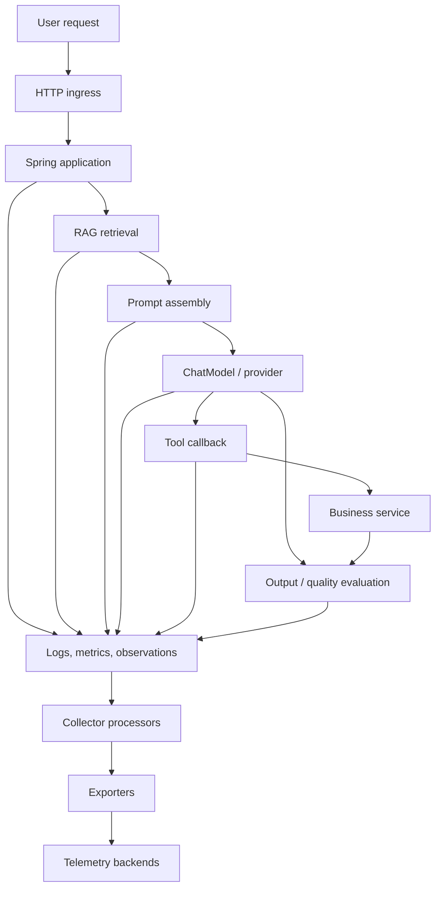

# Che hoặc loại bỏ dữ liệu cá nhân trước khi xuất telemetry

Một câu hỏi gửi tới ứng dụng Spring AI có thể chứa tên, email, số điện thoại, địa chỉ, mã khách hàng hoặc thông tin riêng tư khác. Nội dung đó có thể đi qua API ingress, prompt assembly, RAG retriever, ChatModel, tool callback và evaluator. Nếu instrumentation ghi nguyên câu hỏi vào span, hoặc application logger ghi exception kèm request body, dữ liệu cá nhân sẽ được sao chép sang tracing backend, log platform, collector, dashboard và bản sao lưu.

**Cần quyết định dữ liệu nào được phép đi vào telemetry trước khi export.** Hãy ưu tiên không thu thập nội dung cá nhân khi không cần thiết; nếu có mục đích hợp lệ và được phê duyệt, chỉ giữ dạng đã giảm thiểu hoặc biến đổi phù hợp. Redaction ở collector là lớp bảo vệ bổ sung, không thể thay việc ngăn dữ liệu nhạy cảm bị ghi ở nguồn.

Bài này thuộc chương **Bảo vệ dữ liệu** của module **SPRING_AI_EVALUATION_OBSERVABILITY**. Module học đánh giá chất lượng ứng dụng Spring AI bằng dataset, relevance, fact checking và kiểm thử RAG/tool calling; đồng thời đo metrics, traces, chi phí và độ trễ để phát hiện nguyên nhân suy giảm giữa các phiên bản prompt, model và pipeline. Bài tập trung vào che, loại bỏ hoặc thay thế dữ liệu cá nhân trong logs, metrics, traces và evaluation telemetry.

## 1. Mục tiêu học tập

Sau bài này, bạn có thể:

1. Nhận diện dữ liệu cá nhân có thể xuất hiện trong prompt, response, RAG documents, tool arguments và exception.
2. Phân biệt dữ liệu định danh trực tiếp, định danh gián tiếp và dữ liệu nhạy cảm theo bối cảnh.
3. Thiết kế data minimization và allowlist trước khi tạo telemetry.
4. Phân biệt redaction, masking, tokenization, pseudonymization và anonymization.
5. Chọn nơi xử lý phù hợp: application source, instrumentation, collector processor hay backend.
6. Tránh làm lộ PII qua HTTP URL/headers, span attributes, events, logs, MDC, baggage và metric labels.
7. Thiết kế redaction cho nội dung tự do có false positives/false negatives và giới hạn của regex.
8. Kiểm tra telemetry sau export bằng synthetic markers và test fixtures.
9. Giữ khả năng điều tra latency, retrieval và quality mà không lưu raw conversation hoặc document content.

## 2. Dữ liệu cá nhân có thể xuất hiện ở đâu?

Trong ứng dụng AI, dữ liệu cá nhân không chỉ nằm ở request body. Nó có thể được sao chép vào prompt, tool arguments, model response, exception message hoặc metadata của tài liệu.

| Thành phần | Ví dụ | Rủi ro trong telemetry |
|---|---|---|
| **HTTP ingress** | Tên, email, phone, địa chỉ, IP, session identifier. | URL, request body, access log hoặc HTTP span lưu nguyên dữ liệu. |
| **Conversation history** | Nội dung trao đổi nhiều lượt, thông tin gia đình/sức khỏe/tài chính. | Prompt capture hoặc debug logging lưu toàn bộ lịch sử. |
| **Prompt assembly** | System/user prompt, context và template variables. | Span attributes hoặc SDK wire logs ghi prompt. |
| **RAG retrieval** | Document chunks, source URI, customer-specific records. | Retrieval spans lưu text hoặc document IDs có thể tra cứu. |
| **ChatModel response** | Model lặp lại email, tên hoặc mã giao dịch. | Output capture đưa PII vào trace. |
| **Tool arguments** | Customer ID, order ID, phone, email, address. | Tool span/event ghi nguyên arguments. |
| **Tool result** | Trạng thái giao dịch, thông tin liên hệ hoặc dữ liệu hồ sơ. | Response body và exception chứa business data. |
| **Evaluator** | Gold answer, claim evidence, reference documents. | Evaluation traces/logs mang dữ liệu thật sang hệ thống khác. |
| **Application logs** | Request object, stack trace, validation error. | Logger serialize nội dung cá nhân không dự kiến. |
| **Metrics labels** | User ID, tenant ID, case ID, raw query. | Cardinality cao và tạo chỉ mục tra cứu dữ liệu cá nhân. |

### 2.1. Định danh trực tiếp và gián tiếp

- **Định danh trực tiếp:** email, số điện thoại, số định danh, tên đầy đủ khi gắn với ngữ cảnh nhận diện.
- **Định danh gián tiếp:** mã đơn hàng, mã khách hàng, địa chỉ IP, source document ID, vị trí, timestamp chi tiết hoặc tổ hợp thuộc tính có thể liên kết tới một người.
- **Dữ liệu nhạy cảm theo bối cảnh:** nội dung sức khỏe, tài chính, quan hệ cá nhân, thông tin tài khoản, vị trí chính xác hoặc nội dung hội thoại riêng tư.

Một trường không phải tên người vẫn có thể nhận diện cá nhân khi kết hợp với dữ liệu khác. Vì vậy, không thể quyết định chỉ dựa vào tên cột.

### 2.2. Nội dung tự do khó phân loại hơn field có cấu trúc

Field customerEmail có thể được đánh dấu nhạy cảm ngay trong schema. Nhưng prompt như “Tôi tên Lan, số của tôi là..., tôi đang ở...” có thể chứa nhiều loại PII mà ứng dụng không biết trước. Redaction cho nội dung tự do cần kết hợp data minimization, detector phù hợp và kiểm tra đầu ra; không có một regex đơn lẻ bảo đảm phát hiện mọi trường hợp.

## 3. Vẽ luồng dữ liệu trước khi thiết kế redaction



Sơ đồ cần được đối chiếu với cấu hình thực tế. Một agent có thể tạo HTTP spans trước khi custom Observation của ứng dụng chạy; logger có thể ghi request ở ingress; SDK có thể log body khi debug. Nếu chỉ thêm redaction ở một custom span, các đường khác vẫn có thể xuất PII.

### 3.1. Lập inventory từng tín hiệu

| Tín hiệu | Cần kiểm tra |
|---|---|
| **Metrics** | Tên metric, label keys/values, exemplars, exemplars-to-trace links. |
| **Traces** | Span names, attributes, events, exception events, resource attributes, baggage. |
| **Logs** | Message, structured fields, MDC, stack trace, serialized objects. |
| **Evaluation records** | Case reference, prompt/response, gold data, evidence và source IDs. |
| **HTTP instrumentation** | URL/query, headers, body capture và exception details. |
| **Collector/exporter** | Processor order, routing, retry queue, debug exporter và secondary destinations. |

### 3.2. Xác định trust boundary

Mỗi lần telemetry rời khỏi process, container, account hoặc tổ chức có thể tạo thêm một ranh giới tin cậy. Cần biết dữ liệu có đi qua gateway, collector dùng chung, SaaS vendor, region khác, archive hay backup không. Chỉ kiểm tra span trong IDE là chưa đủ để xác nhận dữ liệu đã an toàn.

## 4. Bắt đầu bằng data minimization

Redaction tốt nhất là không đưa dữ liệu cá nhân vào telemetry nếu câu hỏi vận hành không cần nó. Trước khi thêm một attribute, hãy hỏi: **metric/trace này cần trả lời câu hỏi nào? Giá trị raw có thật sự cần không?**

| Nhu cầu quan sát | Tránh ghi | Thay bằng |
|---|---|---|
| Đo độ trễ endpoint | Full URL có query chứa email/session. | HTTP route template và duration. |
| Theo dõi generation | Raw prompt/response. | Prompt version, model family, finish reason, output length bucket. |
| Theo dõi retrieval | Chunk text và source URI. | Top-k, result count, retrieval outcome, corpus version. |
| Theo dõi tool | Arguments chứa customer/order data. | Tool name, schema version, technical/business outcome. |
| Điều tra lỗi | Full exception message có request content. | Error category, exception class đã duyệt, status code. |
| Đánh giá chất lượng | Gold answer và conversation thật trong span. | Verdict, criterion, rubric version và evaluation run reference. |

### 4.1. Không dùng raw text làm metric label

Không đặt các giá trị sau làm metric labels:

```text
user.email
user.id
customer.id
order.id
document.id
evaluation.case.id
raw.question
prompt
exception.message
provider.request.id
```

Các giá trị này có thể tạo time series riêng cho từng người/request, tăng cardinality và mở đường tra cứu dữ liệu cá nhân. Dùng tập giá trị hữu hạn như feature, operation, outcome, criterion, model.family đã được quản lý.

### 4.2. Hash không làm giảm cardinality

Hash email hoặc customer ID thành một chuỗi khác không làm số lượng giá trị phân biệt giảm đi. Nó có thể vẫn liên kết hoạt động của cùng một người và có thể bị dò nếu input dễ đoán. Hash không phải phương pháp anonymization mặc định.

## 5. Phân biệt redaction, masking và các kỹ thuật liên quan

| Kỹ thuật | Cách hoạt động | Ví dụ với email | Khả năng phục hồi/liên kết |
|---|---|---|---|
| **Redaction** | Xóa hoàn toàn giá trị hoặc đoạn nhạy cảm. | [REDACTED_EMAIL] hoặc bỏ field. | Không phục hồi từ bản đã redacted. |
| **Masking** | Che một phần giá trị. | l***@example.test. | Vẫn lộ một phần, có thể nhận diện trong tập nhỏ. |
| **Tokenization** | Thay bằng token, mapping nằm trong vault/service riêng. | person_ref_7F2. | Có thể tra ngược qua hệ thống mapping được bảo vệ. |
| **Pseudonymization** | Thay định danh bằng mã thay thế có thể liên kết bằng khóa/bảng riêng. | HMAC của canonical email. | Vẫn là dữ liệu có thể liên kết; cần bảo vệ. |
| **Anonymization** | Giảm/loại liên kết để cá nhân không còn nhận diện được trong bối cảnh. | Tổng hợp theo nhóm đủ lớn, loại bỏ thuộc tính hiếm. | Không nên tuyên bố nếu chưa đánh giá tái nhận diện. |

### 5.1. Khi nào nên xóa hoàn toàn?

Redaction hoặc bỏ field là lựa chọn phù hợp khi dữ liệu là password/API key/bearer token; nội dung prompt/response không cần cho câu hỏi vận hành; field có khả năng nhận diện cá nhân nhưng không có nhu cầu liên kết; source document content không cần xuất khỏi hệ thống RAG; hoặc exception message chứa request/response snippets.

### 5.2. Khi nào masking hữu ích?

Masking có thể hỗ trợ giao diện vận hành trong trường hợp người trực cần nhận biết một phần giá trị để đối chiếu, ví dụ bốn ký tự cuối của mã tham chiếu. Tuy nhiên, masking chỉ giảm hiển thị. Phải xét khả năng nhận diện từ phần còn lại và tổ hợp metadata. Không dùng masking làm bằng chứng rằng dữ liệu đã anonymous.

### 5.3. Tokenization và pseudonymization cần quản lý riêng

Nếu cần nối một evaluation case với trace mà không đưa email/order ID vào trace, có thể dùng reference ngẫu nhiên hoặc pseudonymous token. Mapping phải được giữ ở một hệ thống riêng có access control, audit, retention và key management. Người đọc telemetry không nên tự động có quyền giải mã token.

HMAC có thể hữu ích cho correlation ổn định, nhưng khóa phải nằm trong KMS/secret manager; cần key version và quy trình rotation. HMAC value vẫn có thể là dữ liệu cá nhân theo bối cảnh vì nó liên kết các bản ghi.

## 6. Redaction ở đâu: nguồn, instrumentation, collector hay backend?

Không có một lớp duy nhất đủ cho mọi đường rò rỉ. Hãy đặt kiểm soát càng gần nguồn càng tốt và thêm lớp bảo vệ sau đó.

| Lớp | Vai trò | Ưu điểm | Giới hạn |
|---|---|---|---|
| **Application source** | Không tạo attribute/log chứa PII; chuẩn hóa dữ liệu trước Observation. | Ngăn dữ liệu đi vào telemetry ngay từ đầu. | Không kiểm soát hoàn toàn auto-instrumentation/SDK logs. |
| **Instrumentation config** | Tắt body/header capture; cấu hình header allowlist. | Chặn capture tự động ở client/server. | Tên property và khả năng phụ thuộc agent/version. |
| **Collector processor** | Xóa/đổi attributes, lọc spans trước export. | Một lớp bảo vệ tập trung cho pipeline đã đi qua collector. | Không sửa application logs độc lập; dữ liệu đã vào collector queue. |
| **Exporter/backend** | Policy, access control, retention, ingestion filters. | Giới hạn người xem và vòng đời bản ghi. | Dữ liệu đã được nhận; không thay source minimization. |
| **Query/UI** | Mask khi hiển thị hoặc giới hạn field cho dashboard. | Hạn chế lộ trong một view cụ thể. | Raw data vẫn tồn tại và có thể truy vấn/export nơi khác. |

### 6.1. Ưu tiên source-side minimization

Application nên tạo telemetry bằng enum, số đếm, duration, version và outcome đã chuẩn hóa. Không truyền raw prompt/tool arguments vào Observation rồi trông chờ collector tìm PII. Nếu không tạo field, sẽ không có bản sao field đó trong trace.

### 6.2. Instrumentation phải được cấu hình riêng

HTTP agent, SDK debug logging và framework instrumentation có thể hoạt động độc lập với custom code. Cần tắt request/response body capture, chặn headers nhạy cảm và kiểm tra URL query parameters. Cấu hình cụ thể phải lấy từ tài liệu đúng version agent/library đang chạy.

### 6.3. Collector là defense in depth

Collector có thể xóa attributes theo key hoặc biến đổi dữ liệu có cấu trúc trước khi export. Nhưng nếu cùng dữ liệu được ghi vào application log, gửi qua một exporter khác hoặc lưu trong persistent queue, processor cho traces không tự bảo vệ những đường đó. Hãy kiểm tra tất cả pipelines và exporters.

## 7. Redaction cho dữ liệu có cấu trúc

Field có cấu trúc dễ bảo vệ hơn văn bản tự do. Xây schema allowlist để chỉ xuất những field đã được phê duyệt.

### 7.1. Ví dụ schema đầu ra an toàn

```json
{
  "service.name": "support-ai",
  "app.feature": "order-support",
  "app.operation": "refund.lookup",
  "app.outcome": "pending",
  "app.pipeline.version": "rag-v3",
  "app.prompt.version": "support-v4",
  "app.retrieval.result_count": 4,
  "app.evaluation.criterion": "tool-consistency",
  "app.evaluation.verdict": "pass"
}
```

Đây là schema nội bộ minh họa. Nó giữ ngữ cảnh cần cho phân tích nhưng không có email, order ID, prompt text hoặc source document content. Tên key cụ thể cần được đối chiếu convention nội bộ/OTel nếu muốn chuẩn hóa liên hệ.

### 7.2. Allowlist trước, denylist sau

Allowlist chỉ cho phép trường đã biết. Denylist chặn thêm các key nhạy cảm phổ biến như authorization, cookie, email, phone, prompt, document.content. Allowlist giảm rủi ro khi thư viện mới thêm attribute; denylist là lớp dự phòng nếu một trường không mong muốn xuất hiện.

### 7.3. Kiểm tra cả tên và giá trị

Một field có tên error.description hoặc url.full vẫn có thể chứa PII. Ngược lại, PII có thể xuất hiện trong field tên chung như message, exception.message, tool.arguments hoặc db.statement. Cần kiểm tra schema và dữ liệu thực tế, không chỉ match tên key.

## 8. Redaction nội dung tự do: giới hạn của regex

Email, phone và một số ID có định dạng có thể phát hiện bằng pattern. Nhưng nội dung ngôn ngữ tự nhiên có thể chứa tên, địa chỉ, ngày sinh, thông tin sức khỏe hoặc định danh được viết không chuẩn.

### 8.1. Regex chỉ là detector hỗ trợ

Ví dụ pattern email:

```java
private static final Pattern EMAIL = Pattern.compile(
    "(?i)\\b[A-Z0-9._%+-]+@[A-Z0-9.-]+\\.[A-Z]{2,}\\b"
);
```

Đoạn này chỉ minh họa nhận diện email có cấu trúc thông thường. Nó không bao phủ mọi địa chỉ hợp lệ, không xác định chủ sở hữu email, không phát hiện tên/số định danh và có thể nhận diện nhầm chuỗi trong văn bản. Không dùng một pattern như giải pháp DLP hoàn chỉnh.

### 8.2. False positive và false negative

- **False positive:** chuỗi không phải PII bị che nhầm, làm mất dữ liệu vận hành hữu ích.
- **False negative:** PII thật không bị phát hiện và vẫn được export.

Một detector tốt cần được đánh giá trên dữ liệu synthetic đa dạng, các định dạng theo locale, ngôn ngữ, dấu câu, unicode, chuỗi bị chia nhỏ và dữ liệu đã encode. Kết quả detector không nên được coi là tuyệt đối.

### 8.3. Nhiều lớp xử lý cho nội dung tự do

1. Không lưu raw prompt/response nếu không cần.
2. Nếu cần phân tích, dùng bộ phát hiện PII phù hợp với ngôn ngữ và loại dữ liệu.
3. Thay bằng placeholder theo loại, ví dụ [EMAIL], [PHONE], [PERSON].
4. Không ghi bản gốc song song vào exception/log.
5. Kiểm tra output bằng test corpus có synthetic PII.
6. Đánh dấu trạng thái redaction và detector version nếu cần đánh giá chất lượng xử lý.

### 8.4. Không thay mọi số bằng placeholder một cách mù quáng

Số token, HTTP status, latency, top-k và retry count là tín hiệu vận hành. Nếu xóa tất cả chuỗi số, dashboard mất dữ liệu cần thiết. Hãy phân biệt trường có cấu trúc đã được xác định với đoạn văn bản tự do; chỉ redaction nội dung cần bảo vệ.

## 9. Ví dụ Java: redaction text có giới hạn

Ví dụ dưới đây minh họa một utility thay email có định dạng phổ biến bằng placeholder. Nó **không phải bộ phát hiện PII đầy đủ** và không nên được dùng thay cho data minimization/allowlist.

```java
import java.util.regex.Pattern;

public final class BasicTextRedactor {

    private static final Pattern EMAIL = Pattern.compile(
        "(?i)\\b[A-Z0-9._%+-]+@[A-Z0-9.-]+\\.[A-Z]{2,}\\b"
    );

    private BasicTextRedactor() {}

    public static String redactCommonEmails(String input) {
        if (input == null || input.isBlank()) {
            return input;
        }
        return EMAIL.matcher(input).replaceAll("[EMAIL]");
    }
}
```

Ví dụ sử dụng:

```java
String safeExcerpt =
    BasicTextRedactor.redactCommonEmails(untrustedText);
observation.lowCardinalityKeyValue(
    "app.input.contains_email",
    Boolean.toString(!safeExcerpt.equals(untrustedText))
);
```

Trong thực tế, không nên đưa cả safeExcerpt vào metric label hoặc span chỉ vì email đã được thay thế; nội dung còn lại vẫn có thể chứa tên, địa chỉ hoặc thông tin nhạy cảm khác. Nếu mục tiêu chỉ là theo dõi có phát hiện email hay không, ghi boolean/enum là đủ. Với contains_email, hãy cân nhắc dùng tag có tập giá trị hữu hạn và chỉ ghi nếu có mục đích rõ.

### 9.1. Tránh sửa dữ liệu nghiệp vụ gốc

Redaction dành cho bản telemetry nên tạo **bản view riêng**. Không mutate prompt hoặc tool arguments gốc nếu chúng còn cần cho xử lý nghiệp vụ. Không để bản đã redacted vô tình được gửi tới model/tool thay cho dữ liệu đúng; cũng không ghi raw object sau khi tạo bản view.

## 10. Ví dụ Java: chỉ tạo Observation từ dữ liệu an toàn

Một cách dễ kiểm soát là không truyền raw user input vào telemetry API. Dùng enum và giá trị đã chuẩn hóa:

```java
import io.micrometer.observation.Observation;
import io.micrometer.observation.ObservationRegistry;

public final class SafeRequestObservation {

    public enum Feature {
        ORDER_SUPPORT, POLICY_QA
    }

    private final ObservationRegistry registry;

    public SafeRequestObservation(ObservationRegistry registry) {
        this.registry = registry;
    }

    public <T> T observe(
        Feature feature,
        java.util.function.Supplier<T> action
    ) {
        return Observation
            .createNotStarted("app.ai.request", registry)
            .lowCardinalityKeyValue(
                "feature", feature.name().toLowerCase())
            .observe(action);
    }
}
```

Ví dụ này không nhận email, customer ID hay prompt. Observation API cụ thể có thể khác theo dependency version; hãy dùng Micrometer version do Spring Boot quản lý. Cách tạo Observation an toàn không ngăn HTTP agent tự capture body, vì vậy cần kiểm tra instrumentation riêng.

## 11. Xử lý URL, headers và exception

PII có thể xuất hiện ở URL path/query, headers và exception messages.

### 11.1. URL

Tránh log URL đầy đủ nếu query parameters có session, email, token hoặc identifiers. Dùng route template như /customers/{customerId}/chat ở HTTP server instrumentation nếu convention/version hỗ trợ. Với outbound provider calls, chỉ giữ host/service group và operation cần thiết; không giữ signed URL hoặc query string.

### 11.2. Headers

Không capture Authorization, Cookie, Set-Cookie, custom API-key headers hoặc header chứa user identifiers. Chỉ allowlist các header cần cho observability và đã review. Cấu hình capture/ignore phụ thuộc OTel agent, HTTP client instrumentation và version.

### 11.3. Exception messages

SDK exception có thể kèm URL, request snippets, query values hoặc user content. Thay vì log exception.getMessage() nguyên văn, ghi error type/category, status code và operation. Nếu cần stack trace, kiểm tra cause chain/suppressed exceptions và quyền truy cập của backend.

### 11.4. MDC và baggage

Không đưa email, phone, customer ID, raw prompt hoặc source text vào MDC/baggage. MDC được logger tự động gắn vào log; baggage có thể lan truyền qua outbound requests. Chỉ truyền correlation metadata đã được xác thực và phê duyệt.

## 12. Collector redaction và transform

OpenTelemetry Collector có thể dùng processors để lọc hoặc biến đổi attributes trước khi exporter gửi telemetry tới backend. Tên processor, cú pháp và khả năng thay đổi phụ thuộc distribution/version.

### 12.1. Minh họa chính sách collector

```yaml
processors:
  attributes/sensitive:
    actions:
      - key: user.email
        action: delete
      - key: enduser.id
        action: delete
      - key: gen_ai.prompt
        action: delete
      - key: gen_ai.completion
        action: delete

service:
  pipelines:
    traces:
      processors: [memory_limiter, attributes/sensitive, batch]
```

Đây là **mẫu cấu hình minh họa** cho attributes processor; cần kiểm tra tên key thực tế, processor có trong Collector distribution và thứ tự pipeline theo version triển khai. Ví dụ chỉ xóa span attributes có key khớp; nó không tự redaction nội dung bên trong mọi field, span events, logs, metric labels hoặc baggage. Không copy vào production mà chưa test với telemetry fixtures.

### 12.2. Delete hay hash?

Nếu không cần liên kết người dùng, xóa field. Nếu có nhu cầu correlation đã được phê duyệt, cân nhắc pseudonymization/tokenization ở application service có quản lý khóa/mapping. Không mặc định hash tại collector vì processor không nhất thiết có khóa phù hợp, canonicalization ổn định hoặc context cần thiết.

### 12.3. Xử lý cả logs và traces

Một pipeline traces processor không tự bảo vệ logs pipeline. Cần cấu hình và test từng pipeline:

- **Traces:** attributes, events, exception events, resource attributes.
- **Logs:** body, structured attributes, severity text và exception fields.
- **Metrics:** label keys/values, exemplars và resource-to-label conversion.

Nếu collector nhận telemetry rồi ghi vào persistent queue, xác minh dữ liệu đã được lọc trước khi queue persist nếu đó là yêu cầu bảo vệ.

### 12.4. Không coi processor là nơi duy nhất bảo vệ dữ liệu

Processor chỉ xử lý tín hiệu đi qua pipeline tương ứng. Application log file, SDK wire log, crash dump, direct exporter hoặc một collector khác có thể không đi qua processor đó. Hãy inventory mọi đường export và lưu trữ.

## 13. Đo chất lượng redaction

Redaction có thể làm mất dữ liệu hữu ích hoặc để lọt PII. Cần đo chất lượng xử lý bằng dữ liệu test có kiểm soát.

### 13.1. Các chỉ số đánh giá

| Chỉ số | Ý nghĩa |
|---|---|
| **Detection recall** | Tỷ lệ PII trong test corpus được detector nhận diện. |
| **Detection precision** | Tỷ lệ detections thực sự là PII. |
| **Residual PII rate** | Tỷ lệ mẫu output vẫn còn PII đã biết. |
| **Over-redaction rate** | Tỷ lệ nội dung không nhạy cảm bị che nhầm. |
| **Export coverage** | Tỷ lệ telemetry paths đã được kiểm thử. |
| **Redaction failure rate** | Tỷ lệ lỗi xử lý/parse khiến pipeline không redaction theo policy. |

Các metric này cần test dataset có nhãn đáng tin. Không dùng dữ liệu production nhạy cảm làm benchmark nếu chưa có phê duyệt và kiểm soát phù hợp.

### 13.2. Fail closed hay fail open?

Nếu detector/processor lỗi, quyết định có export raw telemetry hay không phải được đặt rõ theo mức rủi ro. Với field nhạy cảm đã biết, không nên fallback sang export raw. Có thể drop event/attribute, route vào quarantine được bảo vệ hoặc phát tín hiệu lỗi redaction không chứa nội dung gốc.

Đổi lại, drop telemetry có thể làm giảm khả năng điều tra. Cần có metric riêng như telemetry.redaction.failures với labels an toàn để biết pipeline đang lỗi mà không lưu PII gây lỗi.

## 14. Kiểm thử PII không bị xuất

Kiểm tra helper redaction chưa đủ. Cần xác minh dữ liệu cuối cùng sau instrumentation, collector và exporter.

### 14.1. Synthetic markers

Dùng dữ liệu giả dễ tìm:

```text
PII_EMAIL_marker.person@example.test
PII_PHONE_0900000000
PII_CUSTOMER_00001234
PII_ADDRESS_123_TEST_STREET
```

Không dùng email, số điện thoại hoặc hồ sơ thật làm marker.

### 14.2. Test matrix

| Test | Vị trí PII đầu vào | Kỳ vọng |
|---|---|---|
| **PII01 — HTTP query** | Query parameter có email/session marker. | Export chỉ route template; không query raw. |
| **PII02 — Prompt** | User prompt có email/phone. | Raw prompt không xuất hiện trong spans/logs. |
| **PII03 — RAG chunk** | Retrieved text chứa customer marker. | Chunk content không được export. |
| **PII04 — Model output** | Response lặp lại PII. | Không capture raw completion. |
| **PII05 — Tool arguments** | Tool nhận customer/order identifiers. | Chỉ tool name và outcome đã chuẩn hóa. |
| **PII06 — Exception** | Error message chứa email/order marker. | Error category an toàn, marker không xuất hiện. |
| **PII07 — MDC/baggage** | Caller gửi metadata có PII. | Field không được đưa vào MDC/baggage. |
| **PII08 — Metrics** | Nhiều user IDs khác nhau. | Không tạo metric labels theo user/case. |
| **PII09 — Collector** | Span event có field nhạy cảm trong fixture. | Processor xóa/biến đổi theo policy trước export. |
| **PII10 — Secondary exporter** | Cùng trace gửi tới hai đích. | Cả hai đích đều không nhận raw PII. |
| **PII11 — Parse failure** | Malformed payload hoặc detector exception. | Fail-closed theo policy, không export raw. |
| **PII12 — Regression** | Nâng agent/SDK/framework version. | Secret/PII markers vẫn vắng mặt ở mọi tín hiệu. |

### 14.3. Kiểm tra toàn bộ export payload

Trong integration test, chạy một request fixture qua ứng dụng và thu thập application log appender output, spans và span events qua in-memory exporter, metric names/labels/exemplars, HTTP client instrumentation output với đúng agent/config, collector output sau processors và mọi exporter đích trong môi trường test.

Quét marker trong payload đã serialize. Kiểm tra cả nested attributes, exception causes và structured log fields. Không chỉ tìm trong span name hoặc top-level fields.

## 15. Bảo vệ evaluation dataset và trace correlation

Đánh giá chất lượng cần query, gold facts, expected outcomes và evidence. Những dữ liệu này có thể chứa PII và cần kho lưu riêng với quyền khác telemetry vận hành.

### 15.1. Tách evaluation store khỏi metrics

Metrics có thể lưu:

```text
criterion = groundedness
verdict = pass
rubric.version = v3
dataset.version = support-regression-v5
```

Evaluation store có kiểm soát có thể lưu case content, claim evidence, source references và adjudication notes theo policy riêng. Không đưa raw case text vào metric labels hoặc span attributes.

### 15.2. Correlation reference

Nếu cần nối trace với evaluation case, dùng opaque reference ngẫu nhiên hoặc mapping được bảo vệ. Không đưa email/customer ID vào trace để tìm case. Trace ID cũng không phải authorization; người có reference chỉ được đọc record nếu backend xác thực và kiểm tra quyền.

### 15.3. Không sao chép PII qua prompt version metadata

Prompt template ID/version nên là giá trị do hệ thống quản lý. Không tạo template name từ câu hỏi người dùng hoặc lưu hash per-prompt làm label; hash vẫn có thể liên kết request và tăng cardinality.

## 16. Lưu ý khi redaction dữ liệu đa ngôn ngữ và đa phương thức

Ứng dụng tiếng Việt có thể nhận tên không dấu/có dấu, số điện thoại có dấu cách, địa chỉ viết tắt, ngày tháng nhiều định dạng và nội dung trộn tiếng Anh. Ứng dụng multimodal còn có thể nhận hình ảnh, âm thanh hoặc OCR/transcription.

- Không giả định detector tiếng Anh nhận diện tốt PII tiếng Việt.
- Kiểm thử số điện thoại có dấu cách, mã vùng, dấu cộng, dấu chấm/gạch và cách viết tự nhiên.
- Tên người/địa danh có thể trùng với từ thông thường; detector cần ngữ cảnh.
- OCR/transcription có thể biến PII trong ảnh/audio thành text ở một bước sau.
- Không log đường dẫn file, signed URL hoặc raw media payload.
- Nếu detector không hỗ trợ modality, không coi media đó đã được redacted.

## 17. Sai lầm thường gặp

1. **Chỉ redaction ở collector:** application logs hoặc direct exporter vẫn có thể chứa PII.
2. **Chỉ xóa key có tên email:** PII có thể nằm trong message, url, exception hoặc tool.arguments.
3. **Dùng regex như DLP hoàn chỉnh:** bỏ sót tên, địa chỉ, nội dung ngôn ngữ tự nhiên và dữ liệu đa phương thức.
4. **Dùng masking rồi gọi là anonymization:** phần còn lại vẫn có thể nhận diện.
5. **Hash định danh và cho rằng đã an toàn:** hash vẫn liên kết records và có thể bị dò.
6. **Đưa user/case ID vào metric labels:** cardinality cao và mở rộng khả năng tra cứu.
7. **Quên span events và exception events:** PII có thể nằm ngoài attributes cấp span.
8. **Quên baggage/MDC:** metadata có thể lan truyền hoặc tự động được ghi vào logs.
9. **Chỉ test helper:** auto-instrumentation có thể capture dữ liệu độc lập.
10. **Không test secondary exporters:** một backend đã redacted nhưng backend khác vẫn nhận raw.
11. **Fail open khi detector lỗi:** raw data có thể đi ra đúng lúc pipeline bảo vệ bị hỏng.
12. **Sửa prompt gốc để redaction:** làm thay đổi hành vi nghiệp vụ hoặc gửi context không đúng cho model.

## 18. Bài tập thực hành

Một ứng dụng Spring AI hỗ trợ tra cứu đơn hàng có pipeline:

```text
POST /chat
  question: "Tôi là Nguyen Van A, email a@example.test, mã đơn ORD-991"
  RAG: lấy chính sách hoàn tiền và một record đơn hàng
  ChatModel: tạo câu trả lời
  Tool: lookupOrder(customerEmail, orderId)
  Evaluator: factual correctness + tool-result consistency
  Telemetry: HTTP spans, model observations, tool spans, application logs
```

Một trace fixture đang chứa:

```json
{
  "name": "app.ai.request",
  "attributes": {
    "http.route": "/chat",
    "user.email": "a@example.test",
    "app.prompt": "Tôi là Nguyen Van A, email a@example.test, mã đơn ORD-991",
    "rag.chunk": "Đơn hàng ORD-991 thuộc khách hàng Nguyen Van A",
    "tool.arguments": "{\"customerEmail\":\"a@example.test\",\"orderId\":\"ORD-991\"}",
    "app.pipeline.version": "rag-v3"
  },
  "events": [
    {
      "name": "exception",
      "attributes": {
        "exception.message": "Lookup failed for a@example.test"
      }
    }
  ]
}
```

### Câu hỏi

1. Liệt kê tất cả vị trí chứa PII hoặc identifier có thể liên kết tới khách hàng.
2. Trường nào có thể giữ nguyên; trường nào cần bỏ hoặc biến đổi?
3. Vì sao http.route hữu ích hơn URL/query đầy đủ?
4. Nên ghi tool telemetry như thế nào để vẫn biết callback lỗi?
5. Vì sao hash email không phải lựa chọn mặc định?
6. Nếu collector xóa user.email nhưng không xử lý span event, điều gì xảy ra?
7. Đề xuất 5 synthetic marker tests.
8. Nếu PII detector timeout, pipeline nên xử lý thế nào?
9. Cách liên kết trace với evaluation case mà không ghi email/order ID?
10. Làm sao kiểm tra auto-instrumentation sau khi nâng version?

### Gợi ý đáp án

**1.** user.email, prompt, RAG chunk, tool arguments và exception message chứa email, tên hoặc order ID. ORD-991 là identifier có thể liên kết với hồ sơ khách hàng.

**2.** Có thể giữ http.route dạng template và app.pipeline.version. Xóa raw email, prompt, chunk và tool arguments khỏi telemetry; chỉ giữ tool name, outcome, duration và verdict đã chuẩn hóa.

**3.** Route template giữ thông tin operation mà không mang query values hoặc path IDs cụ thể. URL đầy đủ có thể chứa session, email hoặc identifiers.

**4.** Ghi tool.name, tool.schema.version, tool.technical_outcome, tool.business_outcome đã chuẩn hóa và duration; không ghi arguments hoặc raw response.

**5.** Hash vẫn tạo liên kết ổn định, không giảm cardinality và email có thể bị dò bằng dictionary. Nếu cần correlation, dùng token/HMAC có quản lý khóa và policy riêng.

**6.** PII vẫn nằm trong event và được export nếu processor chỉ xử lý span attributes. Phải test attributes, events, exception events, logs và mọi pipeline.

**7.** Marker cho email trong prompt, email trong tool args, identifier trong RAG chunk, PII trong exception và URL query/session; kiểm tra toàn bộ export payload.

**8.** Không fallback sang export raw. Drop/quarantine event hoặc chỉ phát error category an toàn theo policy; ghi metric redaction failure không chứa dữ liệu gốc.

**9.** Dùng opaque evaluation reference hoặc mapping store được bảo vệ; trace ID chỉ làm correlation kỹ thuật và không cấp quyền đọc record.

**10.** Chạy integration test với đúng agent/client/exporter version và flags production; gửi synthetic PII marker qua HTTP, kiểm tra spans/events/logs sau export và test mọi exporter đích.

## 19. Ghi nhớ

Che hoặc loại bỏ dữ liệu cá nhân trước khi xuất telemetry bắt đầu từ **data minimization ở nguồn**. Xác định PII trong ingress, conversation, prompt, RAG, model response, tool arguments và exception; không đưa raw content vào metrics/traces/logs khi không cần. Với dữ liệu có cấu trúc, dùng allowlist và bỏ field nhạy cảm; với nội dung tự do, detector/regex chỉ là lớp hỗ trợ, phải đánh giá false positives/false negatives và có chính sách fail-closed. Collector redaction là defense in depth, cần bao phủ attributes, events, logs, metrics và mọi exporter. Kiểm thử bằng synthetic markers trên đúng instrumentation production để giữ khả năng quan sát chất lượng, latency và cost mà không biến telemetry thành bản sao dữ liệu cá nhân.

### Tài liệu tham khảo

- [OpenTelemetry — Handling Sensitive Data](https://opentelemetry.io/docs/security/handling-sensitive-data/): xử lý dữ liệu nhạy cảm trong telemetry.
- [OpenTelemetry — Security](https://opentelemetry.io/docs/security/): các cân nhắc bảo mật của instrumentation và export.
- [OpenTelemetry Collector — Configuration](https://opentelemetry.io/docs/collector/configuration/): receivers, processors, exporters và pipelines.
- [OpenTelemetry Collector Contrib — Attributes Processor](https://github.com/open-telemetry/opentelemetry-collector-contrib/tree/main/processor/attributesprocessor): xóa/đổi attributes; kiểm tra version và distribution.
- [OpenTelemetry Collector Contrib — Transform Processor](https://github.com/open-telemetry/opentelemetry-collector-contrib/tree/main/processor/transformprocessor): biến đổi telemetry bằng OTTL.
- [Micrometer — Observation](https://docs.micrometer.io/micrometer/reference/observation.html): Observation API và cardinality conventions.
- [Spring Boot — Observability](https://docs.spring.io/spring-boot/reference/actuator/observability.html): tích hợp metrics và tracing theo Spring Boot version.
- [Spring AI — Observability](https://docs.spring.io/spring-ai/reference/observability/index.html): observations của thành phần Spring AI.
- [OWASP — Logging Cheat Sheet](https://cheatsheetseries.owasp.org/cheatsheets/Logging_Cheat_Sheet.html): tránh ghi dữ liệu nhạy cảm vào logs.
- [OWASP — User Privacy Protection Cheat Sheet](https://cheatsheetseries.owasp.org/cheatsheets/User_Privacy_Protection_Cheat_Sheet.html): nguyên tắc bảo vệ dữ liệu người dùng.
