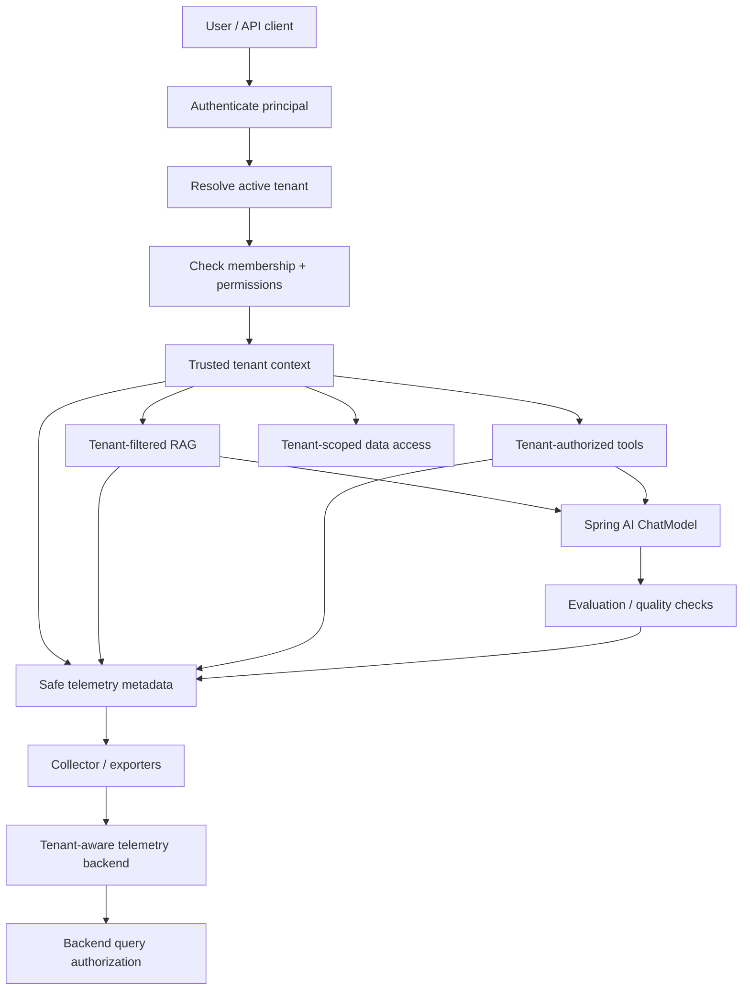

# Cô lập dữ liệu và quyền xem theo tenant

Một nền tảng hỗ trợ nhiều khách hàng có thể dùng chung Spring AI service, ChatModel, vector store, tool backend và observability platform. Tenant A hỏi về hợp đồng của họ; tenant B hỏi về đơn hàng của họ. Nếu truy vấn RAG thiếu bộ lọc tenant, tool callback tin vào tenant ID do model gửi, hoặc dashboard chỉ ẩn dữ liệu bằng một biến lọc giao diện, người dùng của A có thể đọc dữ liệu của B. Cùng rủi ro đó xuất hiện trong traces, logs, evaluation records và các bản export dùng để điều tra.

**Tenant isolation là ranh giới bảo mật xuyên suốt request, dữ liệu nghiệp vụ và telemetry.** Hệ thống phải xác định tenant từ danh tính đã xác thực, kiểm tra quyền thành viên, áp dụng bộ lọc ở nơi dữ liệu được truy cập và buộc backend kiểm tra quyền khi người dùng xem telemetry. Một span attribute chứa tenant reference có thể hỗ trợ phân tích; nó không phải bằng chứng cấp quyền.

Bài này thuộc chương **Bảo vệ dữ liệu** của module **SPRING_AI_EVALUATION_OBSERVABILITY**. Module đánh giá chất lượng ứng dụng Spring AI bằng dataset, relevance, fact checking và kiểm thử RAG/tool calling; đồng thời đo metrics, traces, chi phí và độ trễ để tìm nguyên nhân suy giảm giữa các phiên bản prompt, model và pipeline. Bài tập trung vào cô lập dữ liệu theo tenant trong retrieval, tool execution, storage, evaluation và observability.

## 1. Mục tiêu học tập

Sau bài này, bạn có thể:

1. Phân biệt authentication, tenant resolution, tenant membership và authorization.
2. Xây tenant context từ principal đã xác thực, không tin tenant ID do model hoặc request tùy ý cung cấp.
3. Áp dụng tenant filter trong RAG, vector store, document store và tool callbacks.
4. Chọn mô hình lưu trữ shared table, schema riêng hoặc database riêng theo yêu cầu cô lập.
5. Hiểu vai trò và giới hạn của database Row-Level Security (RLS).
6. Truyền tenant context an toàn qua async/reactive workflows.
7. Thiết kế telemetry có tenant correlation mà không biến span/metric thành cơ chế phân quyền.
8. Cấu hình RBAC/ABAC, tenant-aware query và dashboard cho logs/traces/evaluation records.
9. Kiểm thử truy cập chéo tenant, cache leakage, background jobs và export paths.
10. Điều tra sự cố tenant isolation mà không làm lộ thêm dữ liệu của các tenant khác.

## 2. Tenant isolation là gì?

**Tenant** là một khách hàng, tổ chức, workspace hoặc đơn vị sở hữu dữ liệu và quyền truy cập trong một hệ thống nhiều khách hàng. Một tenant có thể có nhiều người dùng, nhóm, dự án và vai trò. Tenant isolation bảo đảm một principal chỉ truy cập dữ liệu mà họ được phép trong tenant đang hoạt động.

### 2.1. Phân biệt bốn khái niệm

| Khái niệm | Câu hỏi | Ví dụ |
|---|---|---|
| **Authentication** | Ai đang gọi? | JWT đã được xác minh thuộc về user U. |
| **Tenant resolution** | Request đang hoạt động trong tenant nào? | Principal chọn workspace W. |
| **Membership** | User có thuộc hoặc được mời vào tenant đó không? | U là thành viên của W. |
| **Authorization** | User được làm gì trên tài nguyên nào? | U được đọc policy documents nhưng không được hoàn tiền. |

Chỉ biết tenant ID không chứng minh người gọi có quyền vào tenant. Một header X-Tenant-ID do client gửi có thể là lựa chọn tenant mong muốn, nhưng server vẫn phải kiểm tra membership và quyền. Nếu hệ thống có nhiều tenant, tenant được chọn phải được đối chiếu với danh tính đã xác thực trong mỗi request hoặc trong một session context có thời hạn phù hợp.

### 2.2. Cô lập tenant khác với phân quyền theo vai trò

RBAC trả lời user có role nào; tenant isolation giới hạn phạm vi dữ liệu mà role đó áp dụng. Ví dụ, role ADMIN trong tenant A không có nghĩa là admin của tenant B. Cần kết hợp tenant scope với role/permission:

```text
principal = user-17
activeTenant = tenant-A
roles = [TENANT_ADMIN]
permissions = [DOCUMENT_READ, USER_INVITE]
```

Các giá trị trên chỉ minh họa context đã được server xác thực. Không chấp nhận role hoặc tenant do model tự tạo trong tool arguments.

## 3. Threat model: dữ liệu có thể vượt tenant ở đâu?

Các lỗi thường không nằm ở một API duy nhất. Một request có thể an toàn ở HTTP layer nhưng rò rỉ ở cache, retriever, tool, evaluator hoặc trace backend.

| Thành phần | Cách vượt tenant | Tác động |
|---|---|---|
| **Ingress** | Tin tenant header/query do caller tự đặt. | Gọi API trong tenant không thuộc membership. |
| **RAG retrieval** | Search vector store không có tenant/ACL filter. | Lấy chunk của tenant khác vào prompt. |
| **Document ingestion** | Gán sai tenant metadata hoặc dùng shared index không có policy. | Tài liệu được lập chỉ mục sai phạm vi. |
| **Cache** | Cache key không chứa tenant hoặc quyền truy cập. | Trả kết quả của tenant A cho B. |
| **Tool callback** | Dùng tenant ID do model gửi. | Đọc/sửa tài nguyên ngoài quyền. |
| **Database** | Query thiếu tenant predicate hoặc connection reuse sai context. | Đọc/ghi chéo tenant. |
| **Async job** | Tenant context mất khi chuyển thread/queue. | Job chạy với tenant rỗng hoặc tenant cũ. |
| **Evaluation** | Dataset/evaluation record dùng chung mà không có ACL. | Lộ câu hỏi, gold facts và evidence. |
| **Telemetry** | Backend cho phép query trace theo ID mà không kiểm tra tenant. | Người dùng xem trace/log của tenant khác. |
| **Dashboard/export** | Chỉ lọc bằng dashboard variable hoặc CSV không kiểm soát. | Bypass filter và xuất dữ liệu chéo tenant. |

### 3.1. Luồng dữ liệu và ranh giới tin cậy



Trusted tenant context chỉ được tạo sau authentication và membership checks. Các tầng dữ liệu dùng context đó để giới hạn truy cập. Telemetry có thể mang một opaque tenant reference để correlation, nhưng backend vẫn phải xác thực người xem và áp dụng quyền truy vấn độc lập.

## 4. Xây tenant context từ danh tính đáng tin cậy

Nguồn tenant context thường là:

- Claim tenant/workspace trong access token đã được xác minh issuer, audience, signature, expiry và policy.
- Tenant selection từ client, sau đó server kiểm tra membership bằng identity/authorization service.
- Service-to-service identity cùng tenant scope được cấp bởi hệ thống điều phối tin cậy.
- Job message được ký/xác thực, có tenant scope và authorization snapshot phù hợp.

Không lấy tenant context từ prompt, model response hoặc tool arguments; một header tùy ý mà không kiểm tra membership; query parameter chỉ vì client đã gửi; trace baggage chưa được xác minh; cache key hoặc document metadata không có provenance.

### 4.1. Tenant ID trong JWT

Nếu identity provider phát tenant claim, ứng dụng chỉ tin claim sau khi token được xác minh đúng issuer, audience, signature, thời hạn và các policy liên quan. Nếu user có thể thuộc nhiều tenant, claim có thể đại diện tenant đang hoạt động hoặc danh sách membership; server vẫn phải xác minh permission cho operation cụ thể.

Không tự decode JWT payload rồi coi claim là đáng tin. Decode không đồng nghĩa verify chữ ký. Với token opaque, dùng introspection hoặc identity service theo thiết kế.

### 4.2. Client chọn tenant

Một UI có thể gửi tenant mà người dùng muốn chuyển sang. Server nên:

1. Xác thực principal.
2. Đọc tenant selection như một yêu cầu, chưa phải quyền.
3. Kiểm tra membership/role của principal với tenant đó.
4. Tạo tenant context bất biến cho request.
5. Từ chối request nếu không có membership hoặc scope cần thiết.

### 4.3. Tenant context bất biến

Sau khi đã resolve, tenant context không nên bị thay đổi giữa workflow. Nếu một tác vụ thực sự cần truy cập nhiều tenant, đó phải là workflow đặc biệt có quyền cross-tenant được cấp rõ, audit và giới hạn phạm vi; không nên tái sử dụng tenant context thông thường rồi đổi giá trị giữa chừng.

## 5. Kiến trúc cô lập xuyên suốt Spring AI

Một request RAG/tool calling cần dùng cùng tenant scope ở mọi tầng:

1. **Ingress:** xác thực user và resolve tenant.
2. **Application service:** truyền trusted context tới use case.
3. **Retriever/vector store:** filter tenant và document ACL ngay trong truy vấn.
4. **Prompt assembly:** chỉ đưa context đã được kiểm tra quyền vào prompt.
5. **ChatModel:** không để model quyết định tenant hoặc quyền.
6. **Tool callback:** xác thực lại resource access trước khi thực thi.
7. **Database/cache:** tenant-scoped keys và predicates.
8. **Evaluator:** chỉ dùng case/dataset thuộc scope được cấp.
9. **Telemetry:** ghi metadata tối thiểu; backend enforce quyền người xem.

Một tầng bị bỏ sót có thể phá vỡ toàn bộ ranh giới. Ví dụ retrieval đã lọc tenant nhưng cache key chỉ theo query text vẫn có thể trả chunk đã cache từ tenant khác.

## 6. Cô lập dữ liệu RAG và vector store

RAG là một trong những nơi dễ xảy ra cross-tenant leakage nhất vì kết quả retrieval thường được đưa thẳng vào prompt. **Tenant filter và document ACL phải được áp dụng trong truy vấn retrieval trước khi nội dung được trả về.**

### 6.1. Gắn tenant metadata khi ingestion

Mỗi document/chunk cần metadata có provenance đáng tin:

```json
{
  "document_ref": "doc-ref-81",
  "tenant_ref": "tenant-ref-A",
  "corpus_version": "policy-v5",
  "classification": "confidential",
  "acl_group": "support-agents"
}
```

Đây là schema minh họa. Tenant reference và ACL phải được tạo từ nguồn ingestion được xác thực, không lấy từ text trong tài liệu hoặc metadata do model sinh. Khi tài liệu được chuyển tenant, phải có quy trình reindex/reassign và audit.

### 6.2. Filter trước khi trả chunk

Truy vấn vector store phải bao gồm tenant predicate và các ACL filters cần thiết. Ví dụ khái niệm:

```java
TenantContext tenant = tenantContext.requireCurrent();

SearchRequest request = SearchRequest.builder()
    .query(question)
    .topK(5)
    .filterExpression(
        tenantFilter.forTenant(tenant.id())
    )
    .build();

List<Document> results = vectorStore.similaritySearch(request);
```

Đây là ví dụ minh họa; API và cú pháp filter expression thay đổi theo Spring AI release và vector store provider. tenantFilter phải tạo expression bằng builder/escaping an toàn theo adapter, không nối chuỗi từ tenant ID tùy ý. Giá trị tenant lấy từ context đã được server xác minh.

### 6.3. Không filter sau khi retrieval đã trả dữ liệu

Tránh truy vấn top-k toàn hệ thống rồi mới lọc kết quả theo tenant trong Java. Cách đó có thể đưa chunk sai tenant vào logs/traces trước khi bị loại; làm giảm recall của tenant đúng vì top-k bị chiếm bởi dữ liệu tenant khác; tạo side channel qua latency, result counts hoặc ranking; và làm prompt/evaluator vô tình nhận dữ liệu ngoài quyền nếu một nhánh code bỏ qua filter.

Nếu vector database không hỗ trợ metadata filter đáng tin cậy, cân nhắc partition/index/collection riêng hoặc một tầng truy vấn có bảo đảm cô lập.

### 6.4. ACL trên từng tài liệu

Tenant filter chưa đủ nếu tenant có nhiều nhóm và vai trò. Có thể cần thêm owner, group, classification, document_status hoặc policy labels. Backend phải thực thi ACL, không để model tự quyết định chunk nào được xem.

### 6.5. Cache phải có tenant scope

Cache key của retrieval/answer nên bao gồm tenant scope và các yếu tố ảnh hưởng tới quyền:

```text
cacheKey = tenantRef + permissionVersion + corpusVersion + normalizedQuery
```

Đây là ví dụ khái niệm, không phải công thức hash bắt buộc. Nếu permission thay đổi, cache phải được invalidated hoặc key phải đổi theo authorization version. Không cache raw answer dùng chung giữa các tenant chỉ vì prompt text giống nhau.

## 7. Cô lập database: shared table, schema hoặc database riêng

Không có một mô hình duy nhất phù hợp mọi yêu cầu. Lựa chọn phụ thuộc mức cô lập, quy mô, chi phí, vận hành, backup/restore và yêu cầu hợp đồng.

| Mô hình | Cách tổ chức | Ưu điểm | Đánh đổi |
|---|---|---|---|
| **Shared database + shared tables** | Mỗi row có tenant key. | Vận hành và migration tập trung, chi phí thấp. | Phải bảo đảm mọi query/index/cache đều tenant-scoped; tác động lỗi có thể lớn. |
| **Schema per tenant** | Mỗi tenant có schema riêng trong cùng database. | Ranh giới cấu trúc rõ hơn, có thể phân quyền theo schema. | Migration, connection routing và số schema tăng theo tenant. |
| **Database per tenant** | Database riêng cho từng tenant. | Cô lập mạnh hơn, backup/restore và key policy riêng. | Chi phí, connection pools, migrations và vận hành phức tạp. |
| **Hybrid** | Tenant lớn/dữ liệu nhạy cảm dùng dedicated; tenant nhỏ dùng shared. | Cân bằng chi phí và yêu cầu. | Routing, support và kiểm thử phức tạp hơn. |

### 7.1. Shared table cần tenant predicate ở mọi truy vấn

Mọi read/update/delete cần gắn tenant scope. Các unique constraints và indexes cũng phải phản ánh tenant boundary khi identifier chỉ duy nhất trong tenant:

```sql
CREATE TABLE ai_documents (
    tenant_id       VARCHAR(100) NOT NULL,
    document_id     VARCHAR(150) NOT NULL,
    content_ref     VARCHAR(200) NOT NULL,
    classification  VARCHAR(40) NOT NULL,
    PRIMARY KEY (tenant_id, document_id)
);

CREATE INDEX idx_ai_documents_tenant
    ON ai_documents (tenant_id, document_id);
```

Đây là DDL minh họa. Primary key ghép giúp document ID có thể lặp giữa các tenant mà không đụng nhau. Mọi repository method vẫn phải nhận tenant scope; schema/index không tự thêm predicate vào tất cả truy vấn.

### 7.2. Row-Level Security

Database RLS có thể cung cấp một lớp enforcement bổ sung. Ví dụ PostgreSQL minh họa:

```sql
ALTER TABLE ai_documents ENABLE ROW LEVEL SECURITY;

CREATE POLICY tenant_document_policy
ON ai_documents
USING (
    tenant_id = current_setting('app.tenant_id', true)
)
WITH CHECK (
    tenant_id = current_setting('app.tenant_id', true)
);
```

Ứng dụng phải đặt app.tenant_id trong cùng transaction bằng context đã xác thực, ví dụ dùng set_config(..., true) để giá trị chỉ có hiệu lực trong transaction. Không dùng session-level setting trên connection pool mà không reset; connection được tái sử dụng có thể mang tenant cũ sang request sau.

RLS cần được thiết kế và kiểm thử cùng database roles. Table owner, superuser hoặc role có quyền bypass RLS có thể không chịu policy như application role thông thường; cân nhắc FORCE ROW LEVEL SECURITY khi phù hợp và kiểm tra quyền migration/admin riêng. RLS là defense in depth, không thay authorization ở application.

## 8. Cô lập tool calling và business services

Tool arguments do model tạo là dữ liệu đầu vào không đáng tin. Model có thể gửi tenant ID khác, order ID đoán được hoặc resource reference lấy từ prompt injection. Tool handler phải dùng tenant context đã xác thực và kiểm tra resource ownership ở backend.

### 8.1. Không dùng tenant ID do model gửi làm phạm vi quyền

Ví dụ không an toàn:

```json
{
  "tool": "lookupOrder",
  "arguments": {
    "tenantId": "tenant-B",
    "orderId": "ORD-991"
  }
}
```

Nếu handler sử dụng tenantId trong arguments làm query predicate, model có thể điều hướng truy vấn sang tenant khác. Tốt hơn, schema tool không cần expose tenant ID; handler lấy tenant từ trusted context và xác minh order thuộc tenant đó.

### 8.2. Kiểm tra quyền tại tool boundary

```java
public OrderStatus lookupOrder(String orderId) {
    TenantContext tenant = tenantContext.requireCurrent();

    return orderRepository
        .findByTenantIdAndOrderId(tenant.id(), orderId)
        .orElseThrow(OrderNotFoundException::new);
}
```

Ví dụ minh họa repository method. Cần dùng query có tenant predicate ở database, không load theo order ID rồi mới kiểm tra tenant ở memory. Nếu caller có quyền xem order nhưng không có quyền xem payment details, kiểm tra permission chi tiết trước khi trả tool result.

### 8.3. Không tiết lộ sự tồn tại của tài nguyên tenant khác

Khi một order ID không thuộc tenant hiện tại, response bên ngoài thường nên tương đương “không tìm thấy hoặc không được phép” theo policy, tránh xác nhận tài nguyên tồn tại trong tenant khác. Logs nội bộ có thể ghi authorization denial category mà không ghi dữ liệu của tenant kia.

### 8.4. Side effects cần idempotency và audit

Tool thực hiện refund, update hoặc delete phải kiểm tra tenant/resource ownership trước side effect, dùng idempotency key theo tenant scope và ghi audit event theo policy. Không coi tool call success hoặc HTTP 200 là bằng chứng business operation đã thành công.

## 9. Tenant context trong Spring Security và async execution

Trong ứng dụng Spring, principal thường có trong SecurityContext. Nhưng workflow AI có thể đi qua executor, CompletableFuture, scheduler, message queue hoặc Reactor pipeline. Không được giả định context tự truyền qua mọi ranh giới.

### 9.1. Resolve tenant từ principal

```java
public TenantContext resolveTenant(Authentication authentication) {
    if (authentication == null || !authentication.isAuthenticated()) {
        throw new AccessDeniedException("Authenticated principal required");
    }

    String principalId = authentication.getName();
    String requestedTenant = tenantSelection.currentRequestTenant();

    return membershipService
        .requireMembership(principalId, requestedTenant);
}
```

Đây là pseudocode ứng dụng: tenantSelection và membershipService là thành phần nội bộ. requestedTenant chỉ là lựa chọn; requireMembership phải kiểm tra principal có quyền trong tenant đó và trả về context bất biến.

### 9.2. ThreadLocal không tự an toàn cho async

Nếu tự lưu tenant context trong ThreadLocal, phải quản lý set/clear trong try/finally và truyền context qua executor đã được cấu hình. Thread pool tái sử dụng thread; nếu quên clear, request sau có thể kế thừa tenant trước. Với reactive flows, dùng Reactor Context và các integration tương thích thay vì dựa vào ThreadLocal đơn thuần.

### 9.3. Background jobs và message queues

Message cần chứa tenant reference đã được tạo bởi producer tin cậy, job ID, actor/service identity và version của authorization context nếu cần. Consumer phải xác minh nguồn message, kiểm tra job còn hợp lệ và resolve tenant permissions trước khi truy cập dữ liệu. Không coi tenant field trong một message không xác thực là trusted context.

### 9.4. Scheduled jobs

Job chạy toàn hệ thống để tính aggregate cần quyền cross-tenant rõ ràng, output được tổng hợp và audit. Không dùng một service account có quyền toàn bộ tenant cho mọi request thông thường. Nếu job xử lý từng tenant, chạy từng scope riêng và xóa context giữa các lần lặp.

## 10. Cô lập evaluation datasets và kết quả đánh giá

Evaluation records có thể chứa prompt, expected answer, gold facts, retrieved sources, tool arguments và judge rationale. Đây là dữ liệu có thể nhạy cảm như dữ liệu nghiệp vụ gốc.

### 10.1. Dataset phải có tenant scope

Dataset/case có thể được phân loại:

- Shared synthetic benchmark: dữ liệu giả dùng chung, không mang PII/tenant secrets.
- Tenant-specific regression set: case thuộc tenant, có owner và quyền đọc rõ.
- Restricted production-derived set: dữ liệu lấy từ production, cần phê duyệt, minimization và retention riêng.

Không đưa case thật của tenant A vào benchmark dùng chung cho tenant B nếu chưa có cơ sở và kiểm soát chia sẻ phù hợp.

### 10.2. Evaluator phải chạy trong cùng authorization boundary

Evaluator cần đọc evidence/source theo quyền của tenant đang đánh giá. Không dùng admin credentials để truy vấn tất cả tenant rồi chỉ gắn nhãn tenant ở output. Khi chạy batch, partition dataset theo tenant và giới hạn evaluator service account.

### 10.3. Metrics có thể tổng hợp; case detail cần kho riêng

Có thể tổng hợp groundedness/relevance pass rate theo tenant cohort nếu quyền và cardinality cho phép. Claim-level evidence, raw answer và source snippets nên nằm trong evaluation store có tenant-aware authorization, không nằm trong metric labels.

## 11. Tenant metadata trong traces, logs và metrics

Telemetry cần hỗ trợ correlation và điều tra, nhưng tenant metadata có thể nhạy cảm và có cardinality cao. Thiết kế mỗi signal theo mục đích.

### 11.1. Span attributes

Nếu cần trace theo tenant, cân nhắc opaque reference hoặc tenant tier đã được duyệt:

```text
app.tenant.ref = tenant-ref-opaque-7F2
app.feature = order-support
app.operation = rag.retrieve
app.outcome = success
app.pipeline.version = rag-v3
```

app.tenant.ref là key nội bộ minh họa, không phải semantic convention chuẩn. Dùng nó chỉ khi policy cho phép và backend có kiểm soát truy cập. Không đưa email, tên tổ chức hoặc raw tenant ID vào span nếu không cần.

### 11.2. Metrics labels

Không mặc định thêm tenant ID vào mọi metric. Với hàng nghìn tenant, mỗi tenant label có thể làm tăng mạnh số time series, chi phí và khả năng suy ra hoạt động của tenant nhỏ. Ưu tiên aggregate toàn hệ thống, feature, operation, outcome, model family và bounded tenant tier. Nếu có nhu cầu metric per-tenant, phải đặt cardinality budget, access policy và retention rõ.

### 11.3. Logs

Logs có thể cần opaque tenant reference để hỗ trợ incident. Chỉ ghi trường đã được phân loại, dùng structured logging và phân quyền backend theo tenant. Không log raw prompt, document content, tool arguments hoặc identifiers của tenant khác.

### 11.4. Resource attributes không phải tenant context mặc định

Resource mô tả service/process/deployment. Một process phục vụ nhiều tenant thì không nên gắn một tenant ID cố định vào resource. Tenant là thuộc tính theo operation/request, nếu được phép ghi thì đặt ở span/log record phù hợp. Không gắn tenant data vào resource rồi để nó bị copy sang mọi metric/span của process.

### 11.5. Trace ID không phải quyền truy cập

Trace ID chỉ là correlation identifier. Người có trace ID không mặc nhiên có quyền xem trace. Backend phải xác thực người xem, áp dụng tenant-aware query authorization và audit việc truy vấn/export. Không dùng trace ID, baggage hay span attribute làm access token.

## 12. Bảo vệ telemetry backend theo tenant

Một nền tảng observability dùng chung cần kiểm soát truy vấn ở server/backend. Dashboard variable hoặc filter trong query không phải security boundary vì người dùng có thể sửa query, gọi API trực tiếp hoặc export dữ liệu.

### 12.1. Các lớp kiểm soát

1. **Identity:** xác thực người dùng/service account khi truy cập backend.
2. **Tenant membership:** xác định người xem thuộc tenant nào.
3. **Authorization:** cho phép xem loại signal, service, environment và tenant scope cụ thể.
4. **Query enforcement:** áp dụng tenant filter ở backend/gateway, không chỉ trong UI.
5. **Export control:** kiểm tra quyền khi tải CSV/JSON, share links hoặc tạo report.
6. **Audit:** ghi ai truy vấn/export dữ liệu nhạy cảm, khi nào và trong phạm vi nào.

### 12.2. Shared backend và dedicated backend

| Mô hình | Khi phù hợp | Cần kiểm tra |
|---|---|---|
| **Shared backend** | Nhiều tenant, dữ liệu telemetry đã giảm thiểu và backend có tenant-aware authorization thực sự. | Query isolation, label/attribute policy, API/export bypass, tenant routing. |
| **Dedicated tenant namespace/project** | Tenant cần quyền, retention hoặc region riêng. | Identity mapping, isolation giữa project, backup và admin access. |
| **Dedicated backend/account** | Yêu cầu cô lập cao hoặc hợp đồng đặc biệt. | Vận hành, chi phí, upgrades, incident response và cross-account access. |

Chọn mô hình theo threat model và yêu cầu thực tế. Một index riêng không tự bảo đảm an toàn nếu mọi user đều có quyền query mọi index.

### 12.3. Dashboard filter không thay backend authorization

Một dashboard có biến tenant=A chỉ giúp hiển thị tiện hơn. Nếu datasource credential có quyền đọc mọi tenant, user có thể sửa biến thành B hoặc gọi API datasource trực tiếp. Backend/gateway phải ràng buộc query theo identity của người xem.

### 12.4. Trace links và exemplars

Khi metrics liên kết tới trace qua exemplar hoặc log correlation, backend phải giữ nguyên tenant authorization khi người dùng nhấn link. Không tạo deep link công khai chỉ dựa trên trace ID. Kiểm tra cả shared links, alert notifications và incident attachments.

## 13. Collector routing và propagation metadata

Collector có thể route telemetry theo resource/attributes, nhưng các giá trị routing phải đến từ nguồn tin cậy. Không để client tự gửi tenant attribute tùy ý rồi collector chuyển tới namespace của tenant đó.

### 13.1. Xác thực nguồn tenant metadata

- Application resolve tenant sau authentication.
- Chỉ tạo tenant routing metadata từ trusted context.
- Collector/gateway xác thực workload identity hoặc mTLS peer.
- Không cho public client gửi telemetry trực tiếp vào tenant-specific exporter.
- Validate tenant reference theo allowlist/registry khi cần.

### 13.2. Không tin baggage như bằng chứng phân quyền

Baggage có thể được caller kiểm soát hoặc truyền qua các dịch vụ. Nếu cần propagation, chỉ truyền opaque correlation metadata sau khi đã xác thực, giới hạn kích thước và không dùng nó để quyết định quyền truy cập dữ liệu. Downstream service phải xác minh authorization theo cơ chế riêng.

### 13.3. Sampling và tail sampling

Sampling không phải biện pháp cô lập. Tail-sampling collector có thể gom spans từ nhiều request; cần bảo đảm routing, memory limits và decision logic không làm trộn tenant data. Nếu policy sampling theo tenant, dùng trusted metadata và kiểm tra tenant không thể giả mạo để né quota hoặc ép giữ trace.

## 14. Cache, search index và các kênh phụ

Tenant isolation thường bị phá vỡ ở nơi không được xem là database chính:

- **Application cache:** key phải bao gồm tenant và permission/corpus version.
- **Distributed cache:** namespace và TTL không thay thế authorization khi đọc.
- **Search index:** query filter phải được enforce ở backend.
- **Object storage:** signed URL có scope object/tenant và expiry ngắn; không ghi URL vào trace.
- **File exports:** file phải được gắn owner/tenant và kiểm tra quyền khi tải.
- **Message queues:** topic/partition/consumer permissions cần đúng tenant model.
- **Feature stores:** feature lookup phải nhận trusted tenant scope.
- **Evaluation artifacts:** report và attachments phải có access policy tương đương case gốc.

Đừng chỉ test API chính. Một endpoint export, cache hit hoặc background job có thể là đường truy cập chéo tenant dễ bị bỏ quên.

## 15. Ví dụ Java: Observation với tenant reference an toàn

Ví dụ sau giả định ứng dụng đã có một TenantContext bất biến được resolve sau authentication và membership check. Không dùng tenant ID từ prompt/tool arguments.

```java
import io.micrometer.observation.Observation;
import io.micrometer.observation.ObservationRegistry;

public final class TenantAwareObservation {

    private final ObservationRegistry registry;
    private final TenantContextProvider tenantContextProvider;

    public TenantAwareObservation(
        ObservationRegistry registry,
        TenantContextProvider tenantContextProvider
    ) {
        this.registry = registry;
        this.tenantContextProvider = tenantContextProvider;
    }

    public <T> T observeRetrieval(
        java.util.function.Supplier<T> retrieval
    ) {
        TenantContext tenant = tenantContextProvider.requireCurrent();

        return Observation
            .createNotStarted("app.ai.rag.retrieve", registry)
            .lowCardinalityKeyValue("operation", "retrieval")
            .lowCardinalityKeyValue("outcome.scope", "tenant")
            .highCardinalityKeyValue(
                "app.tenant.ref",
                tenant.opaqueReference()
            )
            .observe(retrieval);
    }
}
```

TenantContextProvider, TenantContext và opaqueReference() là abstraction nội bộ minh họa. Dùng high-cardinality attribute chỉ khi trace backend cần tenant correlation và policy cho phép; không sao chép giá trị đó sang metric label. Attribute này không cấp quyền cho người xem trace và không được dùng thay database predicate.

## 16. Ví dụ Java: truy vấn retrieval với trusted tenant scope

```java
public List<Document> retrieve(String query) {
    TenantContext tenant = tenantContextProvider.requireCurrent();
    tenantAuthorization.requirePermission(
        tenant,
        Permission.DOCUMENT_READ
    );

    SearchRequest request = searchRequestFactory.forTenant(
        query,
        tenant.id(),
        5
    );

    return vectorStore.similaritySearch(request);
}
```

SearchRequest và filter factory cần được điều chỉnh theo Spring AI/vector store version. Filter factory chỉ nhận tenant từ trusted context và tạo expression an toàn theo provider. Không cho caller/model truyền một filter expression tùy ý; không tải toàn bộ results rồi lọc ở tầng presentation.

## 17. Ví dụ database RLS và connection pooling

Một ví dụ PostgreSQL minh họa policy tenant:

```sql
ALTER TABLE ai_documents ENABLE ROW LEVEL SECURITY;
ALTER TABLE ai_documents FORCE ROW LEVEL SECURITY;

CREATE POLICY tenant_isolation
ON ai_documents
USING (
    tenant_id = current_setting('app.tenant_id', true)
)
WITH CHECK (
    tenant_id = current_setting('app.tenant_id', true)
);
```

Trong transaction, application đặt tenant từ context đã xác thực:

```sql
SELECT set_config('app.tenant_id', :trusted_tenant_id, true);
```

Tham số phải được bind an toàn và thực hiện trong cùng transaction với các truy vấn dữ liệu. Cờ transaction-local giúp giá trị hết hiệu lực khi transaction kết thúc. Không dùng một session-level setting tồn tại qua connection pool mà không reset.

RLS cần test với chính application database role. Superuser và role có quyền bypass RLS có thể bỏ qua policy; migration/admin connections cần được quản lý riêng. RLS không tự xác thực caller và không biết tenant nào hợp lệ; application vẫn phải resolve tenant và kiểm tra membership.

## 18. Kiểm thử tenant isolation

Test phải chứng minh tenant A không thể đọc, sửa, suy ra hoặc export dữ liệu tenant B qua bất kỳ đường nào.

### 18.1. Test matrix

| Test | Kịch bản | Kỳ vọng |
|---|---|---|
| **TEN01 — Tenant spoofing** | User A gửi header/query tenant B. | Request bị từ chối nếu A không có membership. |
| **TEN02 — RAG filter** | Corpus có marker riêng A và B; A truy vấn. | Kết quả/prompt chỉ chứa marker A. |
| **TEN03 — Document ACL** | User cùng tenant nhưng khác group. | Chỉ tài liệu đúng ACL được retrieval. |
| **TEN04 — Tool arguments** | Model gửi tenant B trong arguments. | Handler bỏ qua field đó và dùng trusted context A. |
| **TEN05 — Database query** | Query tìm record bằng ID của B trong context A. | Không trả record B. |
| **TEN06 — RLS** | App role truy cập row tenant khác. | Database policy chặn. |
| **TEN07 — Cache** | A tạo cache entry, B dùng query giống hệt. | B không nhận cached result của A. |
| **TEN08 — Async context** | A enqueue job rồi thread được tái sử dụng cho B. | Job A giữ scope A; B không kế thừa context A. |
| **TEN09 — Evaluation store** | User A truy vấn case/report B. | Backend authorization từ chối. |
| **TEN10 — Trace query** | User A thử query trace của B bằng trace ID. | Backend không trả trace B. |
| **TEN11 — Dashboard bypass** | A sửa dashboard variable/query thành tenant B. | Backend vẫn áp dụng quyền A. |
| **TEN12 — Export/link** | A tải report hoặc mở shared trace link của B. | Download/deep link bị từ chối. |
| **TEN13 — Secondary exporter** | Telemetry route tới nhiều backend. | Mỗi backend giữ đúng tenant boundary. |
| **TEN14 — Context cleanup** | Request A kết thúc, thread xử lý request B. | Không còn tenant context A. |
| **TEN15 — Background job** | Job thiếu tenant provenance hoặc signature. | Job bị từ chối/quarantine, không chạy cross-tenant. |

### 18.2. Dùng synthetic tenant markers

Dùng dữ liệu giả để dễ tìm:

```text
TENANT_A_PRIVATE_MARKER_71A
TENANT_B_PRIVATE_MARKER_82B
TENANT_A_DOC_REF_A01
TENANT_B_DOC_REF_B02
```

Chạy request RAG, tool, evaluator và export cho cả hai tenant. Quét prompts, model context fixtures, logs, traces, metrics, cache values và exported reports để xác nhận marker không xuất hiện ngoài tenant sở hữu.

### 18.3. Kiểm thử cả negative và positive paths

- Positive: tenant A đọc được tài liệu A mà họ có quyền.
- Negative: tenant A không đọc được tài liệu B.
- Negative: user A không thể giả tenant B bằng header, query, baggage hoặc tool argument.
- Negative: trace ID hoặc dashboard variable không vượt qua backend authorization.
- Regression: nâng Spring AI, vector store adapter, OTel agent hoặc backend không làm mất tenant filters.

## 19. Giám sát và xử lý sự cố cross-tenant

Có thể tạo tín hiệu vận hành cho authorization denials và filter failures mà không ghi nội dung của tenant khác.

Ví dụ metadata an toàn:

```text
app.authorization.outcome = denied
app.authorization.reason = tenant_membership_missing
app.operation = rag.retrieve
app.service = support-ai
```

Không ghi resource ID của tenant khác hoặc prompt khiến lỗi xảy ra. Có thể đếm denial theo operation/error category; tránh metric labels theo user ID hoặc resource ID.

Khi nghi ngờ cross-tenant exposure:

1. Ngăn đường truy cập gây lỗi và tạm dừng export/query liên quan nếu cần.
2. Xác định tenant bị ảnh hưởng, dữ liệu, thời gian, services, indexes và backends.
3. Bảo toàn audit logs và evidence theo quy trình có quyền.
4. Kiểm tra RAG, tool, database, cache, async jobs, evaluation store và telemetry backend.
5. Thu hồi shared links/tokens và sửa quyền truy cập.
6. Xác định dữ liệu nào đã được truy cập/export và ai có quyền xem.
7. Xử lý thông báo theo quy trình tổ chức và quy định áp dụng.
8. Thêm regression tests cho đường lỗi gốc và các đường tương tự.

## 20. Bài tập thực hành

Một nền tảng Spring AI phục vụ tenant A và tenant B. Hai tenant dùng chung vector store, PostgreSQL, Redis cache, model provider và Tempo/Grafana. Một user thuộc tenant A gửi câu hỏi; request chứa header X-Tenant-ID: tenant-B. Model gọi tool lookupOrder với arguments có tenantId=tenant-B. Trace có app.tenant.id=tenant-B; dashboard mặc định lọc tenant A nhưng datasource credential đọc được mọi trace.

### Câu hỏi

1. Xác định từng điểm trust boundary bị vi phạm hoặc có nguy cơ.
2. Server nên xử lý header X-Tenant-ID như thế nào?
3. Vì sao model-generated tenantId không được dùng để truy vấn order?
4. Thiết kế filter cho vector store và document ACL.
5. Nêu một cache key có tenant và permission scope.
6. So sánh shared table, schema per tenant và database per tenant.
7. RLS giúp gì và có giới hạn nào với connection pool?
8. Vì sao trace attribute không thể bảo vệ tenant B?
9. Dashboard filter cần thêm lớp enforcement nào?
10. Đề xuất sáu test cases trước khi đưa hệ thống vào production.

### Gợi ý đáp án

**1.** Ingress tin tenant header, tool tin model arguments, trace nhận tenant không đáng tin và datasource backend không enforce tenant authorization. Shared vector store/database/cache cũng cần xác minh filter.

**2.** Xem header như tenant selection request; xác thực principal và kiểm tra membership với tenant B. Nếu user A không có quyền B, từ chối và giữ tenant context hợp lệ.

**3.** Model output là dữ liệu không đáng tin và có thể bị prompt injection điều khiển. Tool lấy tenant từ authenticated context và query order theo cả tenant ID lẫn order ID.

**4.** Gắn tenant/ACL metadata đáng tin khi ingestion; query vector store phải filter tenant và document permission trước khi trả chunk; chỉ đưa kết quả đã được authorize vào prompt.

**5.** Ví dụ khái niệm: tenant reference + permission version + corpus/index version + normalized query. Không dùng query text raw làm metric label.

**6.** Shared table giảm chi phí nhưng cần predicate/RLS chặt; schema per tenant tăng ranh giới cấu trúc nhưng phức tạp migration; database per tenant cô lập mạnh hơn nhưng tăng vận hành và chi phí.

**7.** RLS enforce row visibility ở database; phải set tenant trong cùng transaction, dùng transaction-local context và tránh session state rò qua pooled connection. Roles có bypass privileges cần được kiểm soát.

**8.** Attribute chỉ là metadata. User có thể sửa query hoặc gọi backend API; authorization phải được enforce ở telemetry backend theo identity của người xem.

**9.** Backend/gateway cần xác thực user, resolve membership, enforce query scope và export permissions, audit truy vấn; UI variable chỉ hỗ trợ trải nghiệm.

**10.** Tenant spoofing, RAG marker isolation, tool argument spoofing, cache separation, RLS cross-tenant query, trace/dashboard query authorization. Có thể bổ sung async context và secondary exporter tests.

## 21. Ghi nhớ

Tenant isolation bắt đầu từ **principal đã xác thực và tenant context được kiểm tra membership**, rồi phải được giữ nhất quán qua RAG, vector store, database, cache, tool callbacks, evaluator, async jobs và telemetry. Không tin tenant ID do model hoặc caller gửi nếu chưa kiểm tra; áp dụng tenant/ACL filters ngay tại nơi dữ liệu được truy cập. Database RLS và dedicated namespaces là lớp hỗ trợ, cần cấu hình đúng roles và connection pooling. Trong observability, tenant reference chỉ phục vụ correlation; RBAC/ABAC và query authorization phải được thực thi ở backend, không dựa vào dashboard variable, trace ID hoặc span attribute. Kiểm thử cross-tenant bằng synthetic markers trên mọi đường đọc, ghi, cache, export và background processing.

### Tài liệu tham khảo

- [Spring Security — Servlet Authentication Architecture](https://docs.spring.io/spring-security/reference/servlet/authentication/architecture.html): principal và SecurityContext.
- [Spring Security — Authorization](https://docs.spring.io/spring-security/reference/servlet/authorization/index.html): authorization trong ứng dụng servlet.
- [Spring Framework — Context Propagation](https://docs.spring.io/spring-framework/reference/integration/observability.html): context và observability integration; kiểm tra theo framework version.
- [Spring AI — Vector Databases](https://docs.spring.io/spring-ai/reference/api/vectordbs.html): vector store abstraction và search filters.
- [Spring AI — Observability](https://docs.spring.io/spring-ai/reference/observability/index.html): observations của thành phần Spring AI.
- [PostgreSQL — Row Security Policies](https://www.postgresql.org/docs/current/ddl-rowsecurity.html): RLS, policy và role behavior.
- [OpenTelemetry — Baggage](https://opentelemetry.io/docs/concepts/signals/baggage/): propagation và cân nhắc khi truyền baggage.
- [OpenTelemetry — Handling Sensitive Data](https://opentelemetry.io/docs/security/handling-sensitive-data/): bảo vệ dữ liệu nhạy cảm trong telemetry.
- [OWASP — Authorization Cheat Sheet](https://cheatsheetseries.owasp.org/cheatsheets/Authorization_Cheat_Sheet.html): kiểm tra quyền ở mọi ranh giới truy cập.
- [OWASP — Multi Tenant Security Cheat Sheet](https://cheatsheetseries.owasp.org/cheatsheets/Multi_Tenant_Security_Cheat_Sheet.html): các rủi ro và biện pháp cô lập multi-tenant.
