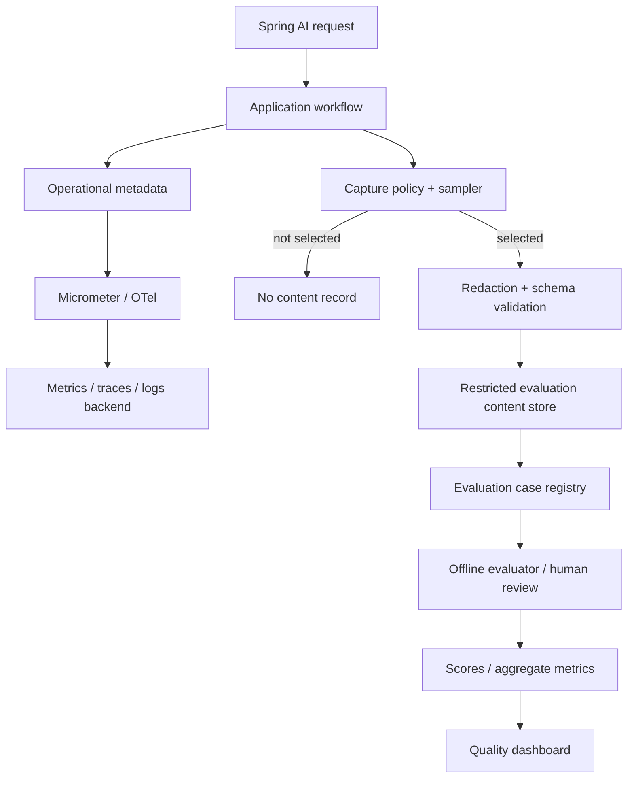

# Kiểm soát ghi nội dung và lấy mẫu dữ liệu đánh giá

Một ứng dụng Spring AI có thể tạo ra nhiều dữ liệu hữu ích cho việc cải thiện chất lượng: câu hỏi người dùng, prompt đã dựng, tài liệu RAG được truy xuất, câu trả lời, tool arguments, kết quả evaluator và trace của toàn bộ workflow. Lưu lại một phần nội dung giúp tái hiện lỗi relevance, groundedness hoặc tool consistency. Tuy nhiên, nếu ghi toàn bộ hội thoại vào logs/traces theo mặc định, hệ thống observability nhanh chóng trở thành một bản sao của dữ liệu nghiệp vụ, chứa PII, tài liệu nội bộ và secrets.

**Ghi nội dung để đánh giá phải là một quyết định có policy, mục đích, phạm vi, người được xem và thời hạn lưu rõ ràng.** Sampling cũng cần được thiết kế để phản ánh đúng traffic hoặc cohort mà nhóm muốn đo. Nếu chỉ lưu những request lỗi, những người dùng khiếu nại hoặc những mẫu dễ lấy, kết quả evaluation sẽ bị lệch và không đại diện cho chất lượng thực tế.

Bài này thuộc chương **Bảo vệ dữ liệu** của module **SPRING_AI_EVALUATION_OBSERVABILITY**. Module đánh giá chất lượng ứng dụng Spring AI bằng dataset, tiêu chí relevance, fact checking và kiểm thử RAG/tool calling; đồng thời đo metrics, traces, chi phí và độ trễ để tìm nguyên nhân suy giảm qua các phiên bản prompt, model và pipeline. Bài tập trung vào kiểm soát content capture và lấy mẫu dữ liệu phục vụ đánh giá chất lượng một cách an toàn, có thể kiểm chứng và tái lập.

## 1. Mục tiêu học tập

Sau bài này, bạn có thể:

1. Phân biệt telemetry metadata, raw content và evaluation records.
2. Xác định mục đích cụ thể trước khi bật ghi prompt, response, retrieved chunks hoặc tool arguments.
3. Thiết kế policy capture theo loại dữ liệu, môi trường, tenant, operation và thời hạn.
4. Phân biệt trace sampling với content sampling và evaluation sampling.
5. Chọn random, deterministic, stratified, event-triggered hoặc adaptive sampling theo câu hỏi đánh giá.
6. Nhận diện selection bias, survivorship bias và sai lệch do lấy mẫu theo lỗi.
7. Dùng sampling probability/weight khi cần ước lượng chất lượng tổng thể.
8. Tách evaluation dataset khỏi logs/traces vận hành và áp dụng quyền truy cập phù hợp.
9. Bảo vệ dữ liệu trước khi persist, đặt retention/deletion và quản lý provenance.
10. Kiểm thử policy bằng synthetic markers, sampling fixtures và audit events.

## 2. Ba loại dữ liệu cần phân biệt

Không phải mọi dữ liệu quan sát đều cần lưu nội dung. Trước khi thiết kế sampling, hãy phân loại mục đích và dạng dữ liệu.

| Loại | Ví dụ | Mục đích | Cách xử lý |
|---|---|---|---|
| **Telemetry metadata** | Operation, duration, status, model family, prompt version, token counts. | Theo dõi vận hành, latency, cost và xu hướng chất lượng. | Có thể thu thập thường xuyên nếu field được duyệt và không chứa định danh không cần thiết. |
| **Raw content** | User prompt, conversation history, retrieved chunk, model completion, tool arguments/results. | Tái hiện một request cụ thể hoặc phân tích lỗi nội dung. | Mặc định không capture; chỉ ghi theo policy và scope rõ. |
| **Evaluation record** | Case reference, redacted input, expected criteria, model output, evidence refs, verdict. | Regression testing, so sánh prompt/model/pipeline và đánh giá chất lượng. | Lưu trong kho evaluation riêng, có quyền, provenance và retention. |

### 2.1. Metadata không tự động an toàn

Metadata như tenant ID, user ID, document ID, provider request ID hoặc URL query vẫn có thể liên kết tới một người hay tài liệu. Phải phân loại cả key lẫn value. Một trace không chứa prompt nhưng có customer ID và document reference vẫn có thể tiết lộ thông tin.

### 2.2. Evaluation record không phải log

Log phục vụ vận hành và điều tra sự cố. Evaluation record phục vụ đo chất lượng trên một tập case có định nghĩa, version và tiêu chí. Nếu trộn hai mục đích, dữ liệu có thể bị giữ lâu hơn cần thiết, người xem quá rộng và kết quả đánh giá khó tái lập.

### 2.3. Trace không phải nơi lưu dataset

Trace mô tả execution path, parent/child spans, duration, status và metadata. Một trace có thể liên kết tới evaluation record bằng opaque case reference, nhưng không nên chứa nguyên conversation, gold answer hoặc source text chỉ để tiện mở lại.

## 3. Vì sao cần kiểm soát content capture?

Ghi nội dung có thể hữu ích, nhưng làm tăng bề mặt rủi ro:

- Prompt/response có thể chứa PII, thông tin tài khoản, dữ liệu sức khỏe/tài chính hoặc secrets.
- Retrieved chunks có thể thuộc tenant khác nếu filter lỗi.
- Tool arguments/results có thể chứa thông tin giao dịch và quyền thao tác.
- Content được sao chép sang collector, vendor, backups, dashboard và incident attachments.
- Một lần export hoặc chia sẻ trace có thể đưa nội dung ra ngoài nhóm ban đầu.
- Raw content có thể làm tăng chi phí lưu trữ và khiến việc xóa theo yêu cầu phức tạp.

Content capture cũng có thể làm thay đổi hành vi hệ thống: payload lớn hơn, exporter chậm, queue đầy và sampling/retention tốn kém. Do đó, policy cần xét cả quyền riêng tư, chất lượng đo lường và độ tin cậy vận hành.

## 4. Định nghĩa mục đích trước khi bật ghi nội dung

Mỗi loại content capture phải gắn với một câu hỏi cụ thể. Không bật lưu prompt/response chỉ vì “có thể cần debug”.

| Câu hỏi cần trả lời | Dữ liệu tối thiểu | Có cần raw content không? |
|---|---|---|
| Model provider có chậm không? | Provider, model family, duration, status, retry count. | Không. |
| Retrieval có trả đủ chunk không? | Top-k, result count, score bucket, corpus version. | Thường không. |
| Relevance có giảm sau prompt release? | Evaluation case, redacted input, output và rubric. | Có thể cần một tập case được duyệt. |
| Model có bịa fact không? | Claim references, evidence references và verdict. | Có thể cần nội dung evidence trong evaluation store riêng. |
| Tool có thực thi đúng không? | Tool name, schema version, outcome và business status. | Thường không cần raw arguments. |
| Vì sao một request cụ thể thất bại? | Trace metadata và error category. | Chỉ khi điều tra được phê duyệt yêu cầu nội dung. |

### 4.1. Viết capture purpose

Một policy tốt nêu:

1. Mục đích và câu hỏi cần trả lời.
2. Thành phần nào được phép capture.
3. Loại trường/nội dung nào bị cấm.
4. Tenant, environment và cohort được áp dụng.
5. Sampling rule và sampling probability.
6. Nơi lưu, người được xem và cách export.
7. Redaction/tokenization trước khi lưu.
8. Retention, deletion và owner phê duyệt.
9. Cách test và audit policy.

### 4.2. Không dùng một policy cho mọi loại nội dung

Prompt, retrieved documents, model output và tool arguments có mức rủi ro khác nhau. Có thể cho phép lưu redacted user prompt trong một evaluation cohort nhưng cấm lưu Authorization header hoặc raw tool arguments ở mọi cohort. Policy cần chi tiết tới field/content class.

## 5. Capture policy: mặc định tắt, bật theo scope

Một cách thiết kế an toàn là tách hai chế độ:

- **Operational mode:** chỉ thu thập metadata đã duyệt, không lưu raw prompt/response.
- **Evaluation capture mode:** ghi một tập nội dung có giới hạn vào evaluation store theo sampling policy, redaction, access control và retention riêng.

### 5.1. Ví dụ policy nội bộ

```yaml
evaluationCapture:
  enabled: true
  environment: production
  purpose: regression-analysis
  content:
    prompt: redacted
    completion: redacted
    retrievedChunks: references-only
    toolArguments: disabled
    toolResults: outcome-only
  sampling:
    strategy: stratified-random
    baselineRate: 0.01
    errorRate: 0.10
  storage:
    destination: restricted-evaluation-store
    retentionDays: 14
  access:
    role: evaluation-reviewer
```

Đây là cấu hình minh họa cho một policy engine nội bộ, không phải property Spring Boot chuẩn. Tỷ lệ, loại content, retention và role phải được owner dữ liệu/security/privacy phê duyệt theo mục đích thực tế. Việc bật capture không có nghĩa mọi request đều được ghi; sampler vẫn phải quyết định từng case.

### 5.2. Policy phải được kiểm tra tại thời điểm capture

Không chỉ kiểm tra flag lúc startup. Nếu tenant rút quyền, môi trường đổi, incident mode kết thúc hoặc retention policy thay đổi, ứng dụng cần áp dụng policy mới theo cơ chế có version và thời điểm hiệu lực. Ghi policy version trong evaluation metadata để biết case được capture theo quy tắc nào.

### 5.3. Fail closed khi policy không xác định

Nếu policy service không phản hồi hoặc policy version không hợp lệ, không tự động fallback sang ghi raw content. Có thể bỏ capture và tiếp tục operation nghiệp vụ, đồng thời ghi metric lỗi policy không chứa nội dung. Nếu capture là yêu cầu bắt buộc cho một controlled evaluation run, hãy fail run có kiểm soát thay vì âm thầm đổi chính sách.

## 6. Phân biệt trace sampling, content sampling và evaluation sampling

Ba khái niệm này liên quan nhưng không giống nhau.

| Loại sampling | Chọn cái gì? | Mục tiêu | Ví dụ |
|---|---|---|---|
| **Trace sampling** | Toàn bộ trace hoặc spans theo trace. | Giảm lượng telemetry vận hành. | Giữ 5% traces theo head sampler. |
| **Content sampling** | Nội dung request/response được phép lưu. | Giới hạn số bản ghi chứa nội dung. | Chọn ngẫu nhiên 1% requests để tạo redacted content record. |
| **Evaluation sampling** | Cases dùng để tính điểm/so sánh chất lượng. | Tạo mẫu đại diện hoặc tập kiểm tra mục tiêu. | Lấy mẫu phân tầng theo language, feature và outcome. |

Một trace được sample không có nghĩa content được phép lưu. Một evaluation case được chọn không có nghĩa raw content phải được đính vào trace. Hãy quyết định độc lập:

1. Trace có được export không?
2. Content có được capture không?
3. Evaluation record có được tạo không?
4. Nếu có, dữ liệu nào được lưu và ở đâu?

### 6.1. Head sampling và tail sampling

- **Head sampling** quyết định sớm khi trace bắt đầu, thường dựa vào tỷ lệ hoặc metadata ban đầu. Nó đơn giản và tiết kiệm tài nguyên nhưng chưa biết request kết thúc thành công hay lỗi.
- **Tail sampling** quyết định sau khi collector đã nhận đủ một phần/toàn bộ trace, có thể giữ traces có lỗi, latency cao hoặc điều kiện cụ thể. Nó cần buffering, memory và routing phù hợp.

Hai cơ chế này là trace sampling. Chúng không thay thế content capture policy và không tự làm redaction.

### 6.2. Sampling trace không đồng nghĩa sampling case

Nếu trace sampler giữ 10% request nhưng evaluator chọn 100% failed cases, evaluation dataset sẽ có phân phối khác traffic. Không dùng trace count làm mẫu số evaluation nếu chưa biết xác suất chọn của từng cohort.

## 7. Các chiến lược lấy mẫu dữ liệu đánh giá

Chọn chiến lược theo mục tiêu đo lường. Có thể kết hợp nhiều cohort nhưng phải giữ nhãn sampling strategy và xác suất chọn.

### 7.1. Simple random sampling

Mỗi request đủ điều kiện có xác suất chọn như nhau. Đây là baseline dễ giải thích và có thể ước lượng tỷ lệ chất lượng tổng thể nếu sample frame đầy đủ và lựa chọn độc lập theo thiết kế.

Ví dụ: chọn ngẫu nhiên 1% requests đủ điều kiện trong tuần. Cần lưu sampling probability p=0.01 và định nghĩa rõ request nào thuộc population.

Ưu điểm:

- Dễ hiểu và dễ tái lập nếu lưu seed/algorithm/version.
- Hạn chế thiên lệch chủ quan của người chọn.
- Phù hợp ước lượng tổng thể khi frame và probability được xác định.

Giới hạn:

- Có thể không đủ mẫu cho lỗi hiếm.
- Cohort nhỏ có thể không có case nào được chọn.
- Nếu capture eligibility khác nhau theo tenant/region, mẫu không còn đại diện population ban đầu.

### 7.2. Deterministic sampling

Dùng hash ổn định trên một identifier đã được pseudonymize để chọn nhất quán:

```text
selected = hash(pseudonymousRequestRef + samplingSalt) mod 100 < 1
```

Ví dụ trên chọn xấp xỉ 1% khi hash phân bố đều. Cùng request reference và salt sẽ cho quyết định ổn định, hữu ích khi retry hoặc nhiều service cần thống nhất capture. Salt/version phải được quản lý; không hash raw email/customer ID để tạo sampling key. Nếu ID có thể đoán hoặc liên kết, hãy pseudonymize trước.

Deterministic sampling giúp tái lập quyết định nhưng không tự bảo đảm mẫu đại diện. Nếu ID được tạo theo thời gian/tenant hoặc có cấu trúc lệch, cần kiểm tra phân bố và dùng hash phù hợp.

### 7.3. Stratified sampling

Chia population thành các strata rồi lấy mẫu trong từng nhóm. Có thể phân tầng theo feature, language/locale, model family hoặc prompt release, retrieval outcome, latency/token-count bucket, tenant tier/data classification nếu policy cho phép và outcome category.

Stratified sampling hữu ích khi cần đủ mẫu ở các nhóm nhỏ. Tuy nhiên, nếu lấy tỷ lệ khác nhau giữa các strata, điểm tổng hợp cần trọng số theo population distribution hoặc sampling probability.

### 7.4. Event-triggered sampling

Chọn request khi có tín hiệu như evaluator verdict fail, retrieval trả zero chunks, tool result không khớp assistant claim, output validator reject, latency vượt ngưỡng hoặc người dùng phản hồi tiêu cực/yêu cầu review.

Chiến lược này hữu ích để tìm nguyên nhân lỗi nhưng **không đại diện chất lượng tổng thể**. Không báo tỷ lệ lỗi trên cohort event-triggered như thể đó là tỷ lệ lỗi của toàn bộ traffic.

### 7.5. Adaptive sampling

Điều chỉnh tỷ lệ lấy mẫu theo tín hiệu vận hành hoặc chất lượng, ví dụ tăng sample rate cho model/prompt release mới hoặc khi error rate tăng. Cần lưu rate thực tế theo thời gian, policy version và điều kiện kích hoạt. Nếu rate thay đổi mà không được ghi lại, các run khó so sánh và điểm tổng hợp có thể sai lệch.

### 7.6. Manual review sampling

Reviewer chọn case để phân tích sâu. Đây là nguồn insight có giá trị nhưng dễ có selection bias: reviewer thường chọn case bất thường, khó hoặc thú vị. Gắn nhãn manual-review và không gộp trực tiếp vào random baseline.

## 8. Thiết kế population và sample frame

Sampling chỉ có ý nghĩa khi biết mình lấy mẫu từ population nào.

### 8.1. Định nghĩa đơn vị lấy mẫu

Có thể chọn request, conversation, turn, workflow hoặc evaluation case. Không trộn đơn vị. Ví dụ một conversation có 20 turns không nên được tính như 20 independent users nếu các turns tương quan. Nếu lấy mẫu theo request nhưng phân tích theo conversation, cần mô tả cách group và điều chỉnh thống kê.

### 8.2. Xác định eligibility

Ví dụ population cho evaluation capture:

```text
eligible =
    production_request
    AND supported_feature
    AND capture_policy_allows
    AND tenant_scope_authorized
    AND not_security_sensitive_operation
```

Điều kiện eligibility phải được áp dụng trước sampling. Không được âm thầm loại những request khó redaction hoặc tenant có error nhiều mà vẫn gọi kết quả là đại diện toàn hệ thống. Nếu loại trừ là bắt buộc vì privacy/security, hãy mô tả population thực tế và giới hạn kết luận.

### 8.3. Tránh survivorship bias

Nếu chỉ lấy mẫu những request hoàn thành thành công và đã có response, bạn sẽ bỏ qua timeouts, crashes, rejected requests và failures ở giữa pipeline. Nếu mục tiêu đo end-to-end quality, sample frame phải bao gồm cả failure paths phù hợp với mục tiêu.

### 8.4. Xử lý duplicate và retry

Một request có thể retry model call hoặc tool call. Cần xác định sampling unit là logical request hay từng attempt. Với logical request, tạo một case record và lưu số attempts/statuses; không để retry làm tăng trọng số của một user/task. Với attempt-level analysis, ghi rõ đây là tập attempts.

## 9. Ước lượng chất lượng và trọng số mẫu

Nếu mọi đơn vị có cùng xác suất được chọn, sample mean/rate đơn giản có thể ước lượng population metric. Nếu xác suất khác nhau, cần dùng sampling weights hoặc báo kết quả riêng theo strata.

### 9.1. Ví dụ tỷ lệ pass

Giả sử population có 10.000 requests. Lấy random sample 1% được 100 cases, trong đó 92 pass. Ước lượng pass rate của population là:

\[
\hat{p} = \frac{92}{100} = 0.92
\]

Kết quả là 92% trên sample và là ước lượng cho population theo sampling design; nó không chứng minh chính xác mọi request đều có pass rate 92%. Cần báo sample size, thời gian, population definition và uncertainty.

### 9.2. Phân tầng với tỷ lệ lấy mẫu khác nhau

Giả sử population gồm:

| Stratum | Population size | Sample size | Pass rate trong mẫu |
|---|---:|---:|---:|
| RAG | 8.000 | 80 | 90% |
| Tool calling | 1.000 | 50 | 80% |
| Summarization | 1.000 | 20 | 95% |

Nếu tính trung bình đơn giản của 150 samples, mỗi stratum được coi như có trọng số bằng nhau theo số mẫu. Điều đó không phản ánh population vì RAG chiếm 80% traffic. Population-weighted estimate:

\[
\hat{p}_{weighted}
= 0.8(0.90) + 0.1(0.80) + 0.1(0.95)
= 0.895
\]

Pass rate ước lượng là 89,5%. Nếu mục tiêu là so sánh feature ngang nhau, có thể báo macro average riêng; đừng nhầm macro average với traffic-weighted result.

### 9.3. Inverse probability weighting

Với mỗi case i có xác suất được chọn p_i, sampling weight cơ bản là:

\[
w_i = \frac{1}{p_i}
\]

Ước lượng weighted mean:

\[
\hat{\mu}_{w} =
\frac{\sum_{i \in sample} w_i y_i}
{\sum_{i \in sample} w_i}
\]

Đây là dạng weighted estimator phổ biến; phương pháp chính xác phụ thuộc sampling design, stratification, clustering và non-response. Nếu một số case không được capture vì detector/policy failure, cần phân tích non-response/eligibility thay vì mặc định weights đã sửa được mọi bias.

### 9.4. Không gán trọng số để che dữ liệu thiếu

Nếu tenant hoặc language group bị thiếu hoàn toàn khỏi sample, không thể tự tạo trọng số để khôi phục kết quả đáng tin. Cần ghi rõ coverage gap, cải thiện sampling frame hoặc giới hạn kết luận.

## 10. Cỡ mẫu và uncertainty

Cỡ mẫu lớn hơn thường giảm sai số ngẫu nhiên nhưng không sửa được bias trong cách chọn. Một triệu samples từ cohort sai vẫn có thể dẫn tới kết luận sai.

### 10.1. Công thức tham khảo cho tỷ lệ

Với random sample đơn giản, ước lượng sơ bộ cỡ mẫu cho tỷ lệ ở mức confidence và margin of error đã chọn:

\[
n_0 = \frac{z^2 p(1-p)}{e^2}
\]

Trong đó z là hệ số theo confidence level, p là tỷ lệ dự kiến (nếu chưa biết thường dùng 0,5 để có cỡ mẫu bảo thủ), e là margin of error mong muốn. Nếu population hữu hạn và sample fraction đáng kể, có thể dùng finite population correction. Với stratified/clustered samples, cần xét design effect. Đây là hướng dẫn thống kê cơ bản, không thay thiết kế nghiên cứu phù hợp.

### 10.2. Báo uncertainty cùng score

Một báo cáo evaluation nên có point estimate, sample size và population size nếu biết, sampling strategy/probability, thời gian và prompt/model/pipeline version, strata/cohort coverage, confidence interval hoặc uncertainty estimate phù hợp, missing data và exclusions.

Không chỉ báo một con số như “relevance = 0,91” mà thiếu sample context.

## 11. Thiết kế evaluation dataset có provenance

Một evaluation case cần cho biết nó đến từ đâu, được chọn bằng policy nào và đã biến đổi ra sao.

### 11.1. Schema case record minh họa

```json
{
  "caseRef": "eval-case-opaque-71",
  "source": {
    "kind": "production-sample",
    "population": "supported-rag-requests",
    "capturedAt": "2026-11-27T10:15:00Z"
  },
  "sampling": {
    "strategy": "stratified-random",
    "stratum": "rag-vi-success",
    "probability": 0.01,
    "policyVersion": "capture-v4"
  },
  "pipeline": {
    "promptVersion": "support-v4",
    "modelFamily": "chat-family-x",
    "retrievalVersion": "rag-v3"
  },
  "content": {
    "redactionStatus": "completed",
    "inputRef": "restricted-content-ref-91",
    "outputRef": "restricted-content-ref-92"
  },
  "evaluation": {
    "rubricVersion": "groundedness-v3",
    "status": "pending"
  }
}
```

Đây là schema nội bộ minh họa. Content refs trỏ tới kho riêng có phân quyền; không phải URL công khai. Không ghi tenant raw ID, email hoặc prompt vào sampling metadata. Timestamp chính xác cũng có thể nhạy cảm; chỉ giữ độ chính xác cần thiết cho mục đích.

### 11.2. Provenance tối thiểu

Nên lưu source kind, population definition, sampling strategy/version, probability hoặc inclusion rule, capture timestamp/bucket, prompt/model/pipeline versions, redaction/detector version, dataset/corpus version, evaluator/rubric version và reviewer/adjudication state.

### 11.3. Tách content store và index metadata

Có thể lưu case metadata trong evaluation database và content đã redacted trong restricted object store. Cả hai phải có cùng case reference, tenant scope, ACL, retention và deletion lifecycle. Không dùng reference khó đoán làm security control; backend vẫn phải kiểm tra quyền.

## 12. Tách evaluation capture khỏi operational telemetry



Operational telemetry được phát theo policy vận hành và chủ yếu dùng metadata. Content capture đi qua policy engine, sampler, redaction và schema validation trước khi vào evaluation store. Evaluator đọc case theo quyền; dashboard chỉ nhận score/aggregate đã được phép.

### 12.1. Không gửi raw content qua trace chỉ để link

Dùng caseRef opaque hoặc correlation ID đã được duyệt để liên kết. Truy vấn content phải đi qua evaluation service kiểm tra identity, tenant, purpose và audit. Trace backend không nên giữ bản sao content.

### 12.2. Tách quyền theo vai trò

| Vai trò | Quyền phù hợp |
|---|---|
| **On-call** | Metrics/traces/logs đã giảm thiểu; content chỉ qua incident workflow được cấp quyền. |
| **Evaluator** | Case và content trong scope dataset được giao; không mặc nhiên xem mọi tenant. |
| **Reviewer** | Xem sample đã được redacted, ghi adjudication theo rubric. |
| **Data steward** | Quản lý purpose, retention, deletion và dataset access. |
| **Platform admin** | Quản trị hạ tầng; nội dung chỉ khi có nhu cầu và audit. |

## 13. Sampling theo lỗi: hữu ích nhưng phải tách cohort

Giữ 100% request có error, timeout hoặc evaluator fail có thể giúp debug. Nhưng nếu gộp các case này vào random baseline, tỷ lệ fail của dataset sẽ cao hơn traffic thật.

### 13.1. Duy trì hai cohort

```text
baseline_random:
  purpose = estimate_population_quality
  selection = random
  rate = 1%

diagnostic_triggered:
  purpose = investigate_failure_modes
  selection = evaluator_fail OR timeout OR tool_mismatch
  rate = up_to_100%
```

Báo cáo baseline dùng cohort random và sampling weights phù hợp. Cohort diagnostic dùng để phân tích nguyên nhân, nhóm lỗi và ưu tiên sửa chữa. Không cộng hai cohort thành một mẫu không phân biệt.

### 13.2. Không để evaluator tự chọn tất cả dữ liệu

Nếu chỉ lưu case mà evaluator đã đánh dấu fail, bạn sẽ không biết evaluator bỏ sót lỗi nào hoặc false-positive bao nhiêu. Giữ một baseline random có cả pass/fail và có thể chạy một phần human review để ước lượng evaluator precision/recall.

### 13.3. Người dùng khiếu nại không đại diện mọi người dùng

Complaint-triggered samples thường tập trung vào người dùng có động lực phản hồi, vấn đề nghiêm trọng hoặc nhóm sử dụng nhiều. Chúng quan trọng cho incident analysis nhưng không thể đại diện toàn bộ population nếu không có thiết kế sampling và weighting riêng.

## 14. Human review và adjudication

Một số tiêu chí như relevance, factual correctness hoặc tone cần human review để hiệu chỉnh evaluator tự động.

### 14.1. Review blind khi phù hợp

Để giảm bias, reviewer có thể không thấy model name, prompt version hoặc score tự động trước khi đánh giá. Khi cần so sánh hai outputs, randomize thứ tự A/B và dùng rubric thống nhất.

### 14.2. Hai reviewer và adjudication

Với tiêu chí quan trọng, có thể chọn một subset để hai reviewer đánh giá độc lập. Bất đồng được adjudicate theo rubric. Lưu reviewer IDs dưới dạng internal references có quyền hạn, không đưa tên/email vào telemetry.

### 14.3. Đo agreement

Tùy loại label, dùng agreement rate hoặc Cohen's kappa/weighted kappa phù hợp. Không diễn giải agreement cao là bằng chứng rubric đúng; hai reviewer có thể cùng hiểu sai tiêu chí. Cần calibration examples và cập nhật rubric version.

### 14.4. Không để reviewer truy cập quá phạm vi

UI review nên hiển thị content đã redacted, chỉ cho dataset/tenant được phân công, hạn chế copy/export và audit hành động. Nếu reviewer cần xem raw content cho một case, phải có elevated access theo workflow riêng, purpose và thời hạn.

## 15. Retention, deletion và lifecycle của evaluation content

Evaluation content có thể được nhân bản trong raw capture, redacted content store, derived dataset, reviewer exports, model judge inputs, reports và backups. Policy phải tính tới toàn bộ lifecycle.

### 15.1. Retention theo mục đích

Không có một thời hạn chung cho mọi loại dữ liệu. Xác định thời hạn riêng cho operational traces, redacted evaluation content, production-derived raw content nếu có, adjudication records, aggregate scores và audit events. Thời hạn phải gắn với purpose và owner.

### 15.2. Xóa bản gốc và bản dẫn xuất

Khi một case cần xóa, kiểm tra content store, case registry, search/index copies, evaluator caches, reviewer exports, report attachments, object versioning, backups và mapping/token vault nếu có. Ghi deletion outcome và phạm vi đã xử lý; không giữ lại raw content trong audit message.

### 15.3. Retention không đồng nghĩa với legal basis

Thời gian lưu ngắn không tự động làm cho việc capture hợp lệ. Tổ chức cần xác định cơ sở xử lý, thông báo/consent khi cần, mục đích tương thích và yêu cầu pháp lý áp dụng trước khi bật production content capture. Đây là quyết định governance/privacy, không phải chỉ một cấu hình kỹ thuật.

## 16. Bảo vệ dữ liệu trước khi lưu

Trước khi persist một case:

1. Xác minh capture policy và purpose.
2. Kiểm tra tenant/authorization scope.
3. Loại bỏ credentials, headers và secrets.
4. Redact PII theo schema/detector phù hợp.
5. Giảm thiểu retrieved content và tool results.
6. Validate schema và kích thước.
7. Tạo opaque case reference.
8. Ghi sampling strategy/probability và policy version.
9. Lưu vào restricted evaluation store.
10. Ghi audit event không chứa content.

### 16.1. Tránh persist trước rồi redaction sau

Nếu raw content đã ghi vào file, queue, database hoặc object storage trước khi redaction, dữ liệu đã tồn tại trong hệ thống. Thứ tự xử lý nên là policy → sampling → redaction/minimization → validation → persist. Nếu cần quarantine cho trường hợp không thể redaction, quarantine phải có quyền và retention riêng; không dùng ordinary logs làm quarantine.

### 16.2. Kích thước và media

Đặt giới hạn kích thước cho prompt, completion, retrieved chunks và attachments. Không lưu raw image/audio/video trong evaluation content nếu mục tiêu chỉ cần OCR/transcript-derived signals. Nếu media cần cho đánh giá, áp dụng policy riêng cho binary data, metadata, access và retention.

## 17. Ví dụ Java: policy và sampling tách khỏi telemetry

Ví dụ sau minh họa cách tách policy decision và sampling decision. Các interface là abstraction nội bộ, không phải API Spring AI chuẩn.

```java
public record CaptureDecision(
    boolean allowed,
    String purpose,
    String policyVersion,
    String reason
) {}

public interface CapturePolicy {
    CaptureDecision evaluate(CaptureContext context);
}

public interface EvaluationSampler {
    SamplingDecision decide(SamplingContext context);
}

public record SamplingDecision(
    boolean selected,
    String strategy,
    double inclusionProbability,
    String stratum
) {}
```

Luồng điều phối:

```java
public Optional<EvaluationCaseRef> capture(
    CaptureContext context,
    AiInteraction interaction
) {
    CaptureDecision policy = capturePolicy.evaluate(context);
    if (!policy.allowed()) {
        return Optional.empty();
    }

    SamplingDecision sample = sampler.decide(
        SamplingContext.from(context, policy)
    );
    if (!sample.selected()) {
        return Optional.empty();
    }

    RedactedInteraction safe =
        redactor.redactAndMinimize(interaction);

    schemaValidator.validate(safe);
    return evaluationStore.save(
        EvaluationRecord.from(policy, sample, safe)
    );
}
```

Đây là pseudocode minh họa. Trong triển khai thực tế, AiInteraction không được log/serialize trong quá trình xử lý; redactor phải xử lý từng content field theo policy; evaluationStore phải enforce tenant ACL, encryption, retention và audit. Nếu policy/sampler/redactor gặp lỗi, không fallback sang persist raw interaction.

## 18. Ví dụ Java: deterministic sampler có probability rõ

```java
import java.nio.charset.StandardCharsets;
import java.security.MessageDigest;
import java.security.NoSuchAlgorithmException;

public final class StableSampler {

    private final byte[] salt;

    public StableSampler(byte[] salt) {
        this.salt = salt.clone();
    }

    public boolean selected(String pseudonymousRequestRef, int rateBasisPoints) {
        if (rateBasisPoints < 0 || rateBasisPoints > 10_000) {
            throw new IllegalArgumentException("Invalid sampling rate");
        }
        if (rateBasisPoints == 0) return false;
        if (rateBasisPoints == 10_000) return true;

        try {
            MessageDigest digest = MessageDigest.getInstance("SHA-256");
            digest.update(salt);
            byte[] hash = digest.digest(
                pseudonymousRequestRef.getBytes(StandardCharsets.UTF_8)
            );

            long value = Integer.toUnsignedLong(
                java.nio.ByteBuffer.wrap(hash).getInt()
            );
            long bucket = value % 10_000;
            return bucket < rateBasisPoints;
        } catch (NoSuchAlgorithmException impossible) {
            throw new IllegalStateException(impossible);
        }
    }
}
```

rateBasisPoints=100 tương ứng 1%. Đây là ví dụ sampler ổn định đơn giản; production cần review hash/bucket mapping, version salt, key management, collision properties và cách tính inclusion probability. Không truyền raw email/customer ID vào sampler; dùng reference pseudonymous được tạo từ nguồn tin cậy. Nếu rate thay đổi theo stratum, lưu rate thực tế và policy version cho từng case.

## 19. Kiểm thử content capture và sampling

Test phải chứng minh cả hai điều: dữ liệu chỉ được capture khi policy cho phép, và mẫu được chọn theo chiến lược đã khai báo.

### 19.1. Content capture tests

| Test | Kịch bản | Kỳ vọng |
|---|---|---|
| **CAP01 — Default off** | Không có capture policy rõ ràng. | Không persist raw content. |
| **CAP02 — Policy denied** | Tenant/operation không được capture. | Không tạo evaluation content record. |
| **CAP03 — Secret marker** | Prompt/header có API key marker giả. | Marker không xuất hiện trong store/logs/traces. |
| **CAP04 — PII redaction** | Prompt có email/phone marker. | Chỉ redacted representation được persist. |
| **CAP05 — RAG content** | Retrieved chunk có marker riêng. | Chỉ source reference/count được lưu theo policy. |
| **CAP06 — Tool arguments** | Arguments có account/customer data. | Arguments bị loại hoặc giảm thiểu theo policy. |
| **CAP07 — Policy outage** | Policy service timeout. | Không fallback sang raw capture. |
| **CAP08 — Redactor failure** | Detector/transform ném exception. | Case bị drop/quarantine theo policy; không persist raw. |
| **CAP09 — Retention** | Case hết hạn. | Content và derived copies được xử lý theo lifecycle. |
| **CAP10 — Access control** | User ngoài evaluation role đọc case. | Backend từ chối và audit. |

### 19.2. Sampling tests

| Test | Kịch bản | Kỳ vọng |
|---|---|---|
| **SMP01 — Random rate** | Sample population lớn với p cố định. | Tỷ lệ quan sát gần kỳ vọng trong tolerance thống kê. |
| **SMP02 — Deterministic repeat** | Cùng pseudonymous reference và salt version. | Quyết định ổn định. |
| **SMP03 — Salt/version change** | Đổi sampling version. | Metadata thể hiện version mới; không âm thầm trộn cohort. |
| **SMP04 — Stratification** | Các feature/locale có population khác nhau. | Mỗi stratum có count/rate được báo riêng. |
| **SMP05 — Triggered cohort** | Lấy 100% evaluator failures. | Cohort gắn nhãn diagnostic, không gộp baseline. |
| **SMP06 — Inclusion probability** | Các strata có rates khác nhau. | Mỗi case lưu đúng p/weight metadata. |
| **SMP07 — Retry deduplication** | Một logical request retry nhiều lần. | Không nhân bản case ngoài sampling unit đã định nghĩa. |
| **SMP08 — Missing cohort** | Một locale/tenant không có sample. | Report hiển thị coverage gap, không suy rộng score. |
| **SMP09 — Adaptive rate** | Tỷ lệ thay đổi theo incident window. | Rate, trigger và policy version được ghi lại. |
| **SMP10 — Reviewer selection** | Reviewer chọn case fail khó. | Manual cohort được phân biệt với random baseline. |

### 19.3. Kiểm tra phân phối mẫu

So sánh sample với population theo những dimension đã được phép: feature, locale, model family, outcome, latency bucket và thời gian. Nếu lệch, kiểm tra eligibility, sampler, retry, missing data và trigger rules. Không thêm raw user/tenant IDs vào metrics để so sánh.

### 19.4. Kiểm thử thống kê không thay kiểm thử privacy

Một sampler có phân bố đúng vẫn có thể capture dữ liệu trái policy. Ngược lại, policy có thể chặn PII tốt nhưng sampling bị lệch. Cần hai bộ assertions độc lập: privacy/content safety và statistical sampling correctness.

## 20. Bài tập thực hành

Một nhóm muốn cải thiện RAG support assistant. Traffic hàng ngày có 100.000 requests:

- 85.000 request RAG thành công.
- 8.000 request tool calling.
- 5.000 request có latency cao.
- 2.000 request evaluator đánh dấu fail.

Nhóm đề xuất lưu 100% prompt/response của evaluator failures, 20% request latency cao và 1% requests còn lại. Các mẫu sẽ được đẩy vào trace backend dùng chung với logs. Reviewer chọn thêm các case “thú vị” từ support tickets. Báo cáo cuối tuần tính pass rate bằng cách lấy trung bình tất cả cases đã lưu.

### Câu hỏi

1. Vì sao cách tính pass rate trên tất cả cases đã lưu bị bias?
2. Nên tách những cohort nào?
3. Làm thế nào ước lượng pass rate theo traffic distribution?
4. Có nên lưu raw prompt/response vào trace backend không? Vì sao?
5. Thiết kế policy capture cho prompt, retrieved chunks, tool arguments và output.
6. Metadata nào cần lưu để tái lập sampling decision?
7. Làm sao xử lý reviewer-selected cases?
8. Nếu redactor timeout, hệ thống nên làm gì?
9. Đề xuất 5 content capture tests và 5 sampling tests.
10. Báo cáo nên hiển thị thông tin gì ngoài pass rate?

### Gợi ý đáp án

**1.** Sample cố ý over-sample latency cao và evaluator failures; các cohort không có cùng inclusion probability. Reviewer-selected cases còn có selection bias. Trung bình không trọng số không đại diện traffic.

**2.** Tách baseline random, latency-triggered, evaluator-failure-triggered và manual-review. Nếu cần, stratify baseline theo feature/locale/model version.

**3.** Dùng random baseline với sampling probability đã biết hoặc weighted estimator theo inverse inclusion probability và population share. Báo riêng các cohort chẩn đoán.

**4.** Không mặc định. Trace chỉ cần metadata và opaque case reference. Content đã redacted nên được lưu trong restricted evaluation store với policy, access và retention riêng.

**5.** Prompt/response chỉ capture khi policy cho phép và đã redacted; retrieved chunks lưu source refs/count thay text; tool arguments mặc định disabled hoặc field allowlist; tool results lưu outcome code.

**6.** Population definition, unit, strategy, stratum, inclusion probability, policy/sampler version, timestamp/bucket, prompt/model/pipeline version và redaction version.

**7.** Gắn manual-review cohort, giữ source/provenance, không gộp vào random baseline nếu không có thiết kế trọng số phù hợp.

**8.** Không persist raw. Drop hoặc quarantine theo policy; ghi error category và redaction failure metric không chứa content.

**9.** Content: default-off, policy denied, secret marker, PII redaction, redactor failure. Sampling: random rate, deterministic repeat, stratification, triggered cohort separation, inclusion probability.

**10.** Sample size, population definition, sampling strategy/rate, confidence interval, cohort coverage, exclusions, missing data, prompt/model/pipeline versions và rubric version.

## 21. Ghi nhớ

Kiểm soát ghi nội dung bắt đầu từ mục đích rõ ràng và policy capture: operational telemetry mặc định dùng metadata; raw prompt, response, RAG chunks và tool payload chỉ được ghi khi có scope, redaction, quyền truy cập và retention phù hợp. Tách content capture khỏi trace sampling và evaluation sampling. Xây baseline random hoặc stratified để ước lượng chất lượng; dùng error/latency/complaint-triggered và manual review cho chẩn đoán, gắn nhãn riêng để tránh selection bias. Lưu population definition, sampling strategy, inclusion probability, policy version và pipeline versions để tái lập. Persist sau policy, minimization, redaction và validation vào evaluation store riêng; kiểm thử privacy và statistical correctness độc lập. Như vậy nhóm vẫn có dữ liệu đủ tốt để cải thiện relevance, fact checking, RAG và tool calling mà không ghi tràn lan nội dung người dùng.

### Tài liệu tham khảo

- [OpenTelemetry — Sampling](https://opentelemetry.io/docs/concepts/sampling/): sampling traces và các lựa chọn head/tail.
- [OpenTelemetry — Handling Sensitive Data](https://opentelemetry.io/docs/security/handling-sensitive-data/): xử lý dữ liệu nhạy cảm trong telemetry.
- [OpenTelemetry Collector — Tail Sampling Processor](https://github.com/open-telemetry/opentelemetry-collector-contrib/tree/main/processor/tailsamplingprocessor): sampling traces theo điều kiện; kiểm tra version triển khai.
- [Micrometer — Observation](https://docs.micrometer.io/micrometer/reference/observation.html): Observation lifecycle và metadata.
- [Spring AI — Observability](https://docs.spring.io/spring-ai/reference/observability/index.html): quan sát thành phần Spring AI theo version.
- [NIST — SP 800-188 De-Identifying Government Datasets](https://csrc.nist.gov/pubs/sp/800/188/final): cân nhắc de-identification và chia sẻ dữ liệu.
- [NIST — Privacy Framework](https://www.nist.gov/privacy-framework): quản trị rủi ro quyền riêng tư.
- [OWASP — Logging Cheat Sheet](https://cheatsheetseries.owasp.org/cheatsheets/Logging_Cheat_Sheet.html): kiểm soát dữ liệu ghi vào logs.
- [OWASP — User Privacy Protection Cheat Sheet](https://cheatsheetseries.owasp.org/cheatsheets/User_Privacy_Protection_Cheat_Sheet.html): bảo vệ dữ liệu người dùng.
- [OpenIntro — Statistics](https://www.openintro.org/book/os/): nền tảng sampling, estimation và uncertainty.
