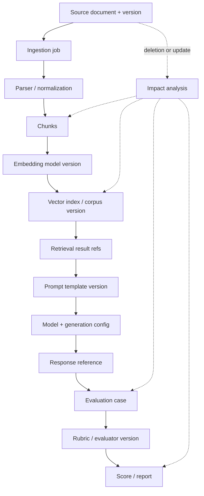
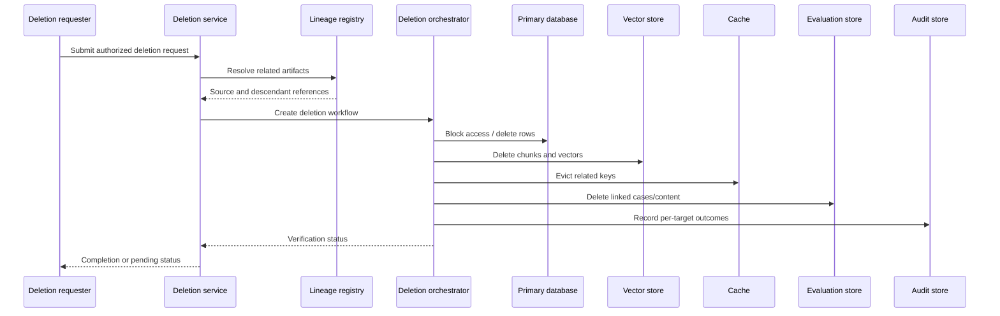

# Thời hạn lưu, xóa và truy vết nguồn gốc dữ liệu

Một request Spring AI có thể tạo ra nhiều bản dữ liệu: request gốc, conversation history, prompt đã ghép, chunks từ RAG, model response, tool arguments/results, logs, spans, evaluation cases, score, report và bản export. Khi cần xóa một hội thoại hoặc một hồ sơ khách hàng, việc xóa row trong bảng request thường chưa đủ. Nội dung có thể vẫn nằm trong vector index, cache, object storage, evaluation dataset, trace backend, file tải xuống hoặc backup.

**Retention, deletion và data lineage phải được thiết kế như một lifecycle xuyên suốt từ nguồn đến mọi bản sao và dữ liệu dẫn xuất.** Mỗi loại dữ liệu cần mục đích, owner, thời hạn lưu, cơ chế xóa và bằng chứng xử lý. Lineage cho biết dữ liệu đến từ đâu, đã qua những bước nào, được dùng trong dataset/evaluation/prompt/model version nào và đang có bản sao ở đâu.

Bài này thuộc chương **Bảo vệ dữ liệu** của module **SPRING_AI_EVALUATION_OBSERVABILITY**. Module đánh giá chất lượng ứng dụng Spring AI bằng dataset, relevance, fact checking và kiểm thử RAG/tool calling; đồng thời đo metrics, traces, chi phí và độ trễ để tìm nguyên nhân suy giảm giữa các phiên bản prompt, model và pipeline. Bài tập trung vào thời hạn lưu, xóa an toàn và truy vết nguồn gốc dữ liệu để vừa bảo vệ thông tin vừa giữ khả năng tái lập kết quả đánh giá.

## 1. Mục tiêu học tập

Sau bài này, bạn có thể:

1. Phân loại dữ liệu Spring AI theo mục đích, độ nhạy cảm và vòng đời.
2. Thiết kế retention schedule riêng cho logs, metrics, traces, prompts, RAG documents, evaluation records và audit events.
3. Phân biệt TTL, logical deletion, physical deletion, anonymization và cryptographic erasure.
4. Lập bản đồ source, copy, cache, index, export, backup và derived data.
5. Xây data lineage/provenance cho documents, chunks, prompts, model calls, evaluation runs và reports.
6. Thiết kế deletion workflow có kiểm soát, retry, tombstone, audit và verification.
7. Xử lý backup, immutable storage, legal hold và dữ liệu đã gửi tới provider bên ngoài.
8. Liên kết evaluation score với dataset, rubric, prompt, model và pipeline versions.
9. Dùng metadata lineage mà không đưa PII/raw content vào telemetry.
10. Kiểm thử retention, deletion propagation và completeness của lineage.

## 2. Vì sao retention và lineage quan trọng với Spring AI?

Một câu hỏi có thể được lưu ở ingress log, conversation database, prompt trace, evaluator input và support ticket. RAG document có thể được chia thành nhiều chunks, embeddings, index records và cache entries. Một model response có thể được dùng lại trong report, benchmark hoặc dataset phiên bản sau.

Nếu không quản lý lifecycle:

- Dữ liệu nhạy cảm tồn tại lâu hơn mục đích ban đầu.
- Yêu cầu xóa không loại bỏ được mọi bản sao.
- Dataset cũ tiếp tục chứa thông tin đã bị xóa ở nguồn.
- Team không biết một score được tạo từ prompt/model/rubric version nào.
- Một vector chunk không thể truy về document nguồn để sửa hoặc xóa.
- Backup restore có thể đưa dữ liệu đã xóa trở lại hệ thống.
- Không thể giải thích ai đã ingest, transform, evaluate hoặc export dữ liệu.

Retention giới hạn thời gian tồn tại. Deletion xử lý việc chấm dứt lưu trữ và truy cập. Lineage mô tả quan hệ nguồn gốc và biến đổi. Ba năng lực này bổ sung cho nhau.

## 3. Phân loại dữ liệu và xác định owner

Không áp dụng một TTL cho mọi thứ. Trước tiên, lập inventory và xác định owner chịu trách nhiệm cho từng nhóm.

| Nhóm dữ liệu | Ví dụ trong Spring AI | Owner thường gặp |
|---|---|---|
| **Operational metadata** | Duration, status, model family, token count, error category. | Service/platform owner. |
| **Logs** | Application messages, exceptions, access events. | Service/security owner. |
| **Traces** | Spans của ChatModel, retriever, tool và HTTP client. | Observability/platform owner. |
| **Conversation content** | User turns, assistant responses, conversation state. | Product/data owner. |
| **RAG source data** | PDF, HTML, knowledge articles, source records. | Content/data owner. |
| **RAG derived data** | Chunks, embeddings, vector records, search indexes. | Search/AI platform owner. |
| **Evaluation data** | Cases, expected answers, gold facts, evidence, labels. | Evaluation/data steward. |
| **Model/prompt artifacts** | Prompt templates, model settings, release metadata. | AI engineering owner. |
| **Reports and exports** | CSV, JSON, dashboards, review attachments. | Report owner/recipient. |
| **Audit/security records** | Access, deletion, policy changes, break-glass. | Security/compliance owner. |
| **Backups and replicas** | Snapshots, WAL/archive, object versions. | Infrastructure/data platform owner. |

### 3.1. Ghi nhận classification và purpose

Mỗi data class nên có tên loại dữ liệu, mô tả, purpose được phép sử dụng, classification, tenant scope, nguồn tạo, owner, nơi lưu chính và các bản sao, retention trigger, cách xử lý khi hết hạn, quyền truy cập và downstream consumers cần được thông báo.

Không suy ra classification chỉ từ tên bảng hoặc tên span. Một field có tên message có thể chứa PII; một document reference có thể liên kết tới tài liệu Restricted.

## 4. Phân biệt retention, TTL và deletion

| Khái niệm | Ý nghĩa | Ví dụ |
|---|---|---|
| **Retention policy** | Quy tắc xác định dữ liệu được giữ bao lâu và vì mục đích gì. | Redacted evaluation case được giữ 30 ngày sau run. |
| **TTL (time to live)** | Thời hạn tự hết hiệu lực/xóa của một record hoặc object theo cơ chế storage. | Cache entry hết hạn sau 15 phút. |
| **Logical deletion** | Đánh dấu không còn được truy cập thông thường. | Đặt deleted timestamp và API không trả record. |
| **Physical deletion** | Xóa dữ liệu khỏi storage theo khả năng của hệ thống. | Xóa object, row và index record. |
| **Anonymization** | Biến đổi dữ liệu để cá nhân không còn nhận diện được trong bối cảnh đã đánh giá. | Loại định danh và tổng hợp theo nhóm đủ lớn. |
| **Cryptographic erasure** | Vô hiệu hóa khóa cần thiết để giải mã dữ liệu đã mã hóa. | Hủy data-encryption key riêng của một dataset. |

TTL hữu ích cho cache và dữ liệu tạm nhưng không thay một deletion workflow có kiểm soát. Logical deletion có thể cần để ngăn truy cập ngay lập tức trong khi physical deletion chạy bất đồng bộ. Anonymization không đồng nghĩa xóa bản gốc. Cryptographic erasure chỉ có tác dụng nếu key scope, encrypted copies và key backups được thiết kế phù hợp.

### 4.1. Xác định thời điểm bắt đầu retention

Retention có thể tính từ thời điểm ingest/capture, conversation kết thúc, evaluation run hoàn tất, dataset version được archive, purpose/hợp đồng kết thúc hoặc audit event được tạo. Phải ghi rõ trigger, timezone và cách xử lý khi run được mở lại. “Giữ 30 ngày” là chưa đủ nếu không biết 30 ngày tính từ lúc nào.

### 4.2. Không có thời hạn chung cho mọi tổ chức

Các thời hạn trong bài chỉ minh họa cách thiết kế. Thời hạn thật phải căn cứ purpose, hợp đồng, quy định áp dụng, data owner, security/privacy review và yêu cầu vận hành. Thời gian lưu ngắn không tự động làm cho việc thu thập hợp lệ; thời gian lưu dài cũng cần lý do và kiểm soát.

## 5. Thiết kế retention schedule

Retention schedule nên phân biệt dữ liệu vận hành, content, evaluation, audit và backup.

| Data class | Trigger minh họa | Retention minh họa | Hành động khi hết hạn |
|---|---|---:|---|
| **Cache entries** | Từ lúc tạo | 15 phút–24 giờ | TTL/eviction. |
| **Operational traces** | Từ lúc ingest | 7–14 ngày | Delete/expire theo backend policy. |
| **Redacted application logs** | Từ lúc ghi | 14–30 ngày | Expire index/objects. |
| **Metrics aggregates** | Từ lúc ghi | 30–90 ngày hoặc theo nhu cầu trend | Downsample/expire. |
| **Production-derived evaluation content** | Từ lúc capture/run kết thúc | 7–30 ngày | Xóa content và derived copies theo policy. |
| **Curated regression dataset** | Từ lúc version được duyệt | Theo vòng đời dự án, review định kỳ | Archive, revalidate hoặc delete. |
| **Prompt/model release metadata** | Từ lúc release | Theo vòng đời audit/reproducibility | Archive metadata; xóa secrets riêng. |
| **Access/deletion audit** | Từ lúc tạo event | Theo policy audit | Archive/expire có kiểm soát. |
| **Backups** | Theo backup cycle | Theo backup policy | Expire snapshot/version; xử lý restore. |

Các con số là ví dụ để minh họa schedule, không phải khuyến nghị pháp lý hay mặc định production.

### 5.1. Retention khác nhau giữa content và metadata

Có thể xóa raw prompt sau khi tạo redacted evaluation case, trong khi giữ score, rubric version và aggregate trend lâu hơn. Tuy nhiên, score vẫn có thể nhạy cảm nếu liên kết được tới người/tenant cụ thể. Cần đánh giá khả năng liên kết và purpose của metadata trước khi quyết định giữ.

### 5.2. Review schedule khi purpose thay đổi

Nếu một evaluation dataset chuyển từ debug nội bộ sang benchmark chia sẻ, purpose và audience đã thay đổi. Cần đánh giá lại cơ sở xử lý khi áp dụng, classification, redaction, access, retention và provenance trước khi tái sử dụng.

## 6. Data lineage và provenance là gì?

**Data lineage** mô tả dữ liệu đến từ đâu, đi qua các bước nào, được biến đổi bởi thành phần/version nào và tạo ra dữ liệu dẫn xuất nào. **Provenance** lưu bằng chứng nguồn gốc và lịch sử xử lý của một artifact hoặc record.

Trong Spring AI, lineage có thể nối:

Source document → ingestion job → chunk → embedding → vector index → retrieval result → prompt context → model response → evaluation case → score/report.

### 6.1. Lineage trả lời những câu hỏi nào?

- Chunk này đến từ document/version nào?
- Document được ingest bởi job và parser version nào?
- Embedding được tạo bằng model/version nào?
- Retrieval query dùng index/corpus version nào?
- Prompt template version nào tạo request?
- Model provider/model identifier và generation settings nào được dùng?
- Tool schema/implementation version nào thực thi?
- Rubric/evaluator version nào tạo score?
- Dataset/report nào chứa case dẫn xuất?
- Khi nguồn bị xóa hoặc sửa, những bản sao nào cần xử lý?

### 6.2. Lineage không phải lưu toàn bộ nội dung

Lineage thường cần opaque references, version IDs, timestamps, operation names và transformation metadata. Không cần lưu prompt, document text hoặc API key trong span chỉ để tạo quan hệ. Một content reference cũng phải được phân quyền; ID khó đoán không phải access control.

### 6.3. Provenance phải có nguồn đáng tin

Metadata nguồn gốc nên được tạo bởi ingestion pipeline, registry hoặc service đã xác thực. Không lấy source document ID, tenant ID, model version hoặc rubric version từ model output nếu chưa kiểm tra. Nếu caller có thể tự khai lineage, báo cáo có thể sai và deletion propagation sẽ bỏ sót.

## 7. Sơ đồ lineage cho RAG và evaluation



Khi document nguồn bị sửa hoặc xóa, lineage giúp tìm chunks, embeddings/index entries, evaluation cases và reports có liên quan. Nếu không có quan hệ lineage, nhóm phải tìm bằng cách quét toàn bộ nội dung hoặc chấp nhận bỏ sót.

## 8. Metadata lineage nên lưu

| Nhóm | Field minh họa | Lưu ý |
|---|---|---|
| **Identity** | artifact reference, parent references, tenant reference | Dùng opaque references; áp dụng access policy. |
| **Source** | source system, source reference, source version | Không nhúng URL có token hoặc raw PII. |
| **Transformation** | operation, component, component version | Ví dụ parser, chunker, redactor, embedding. |
| **Model/prompt** | model family/version, prompt version | Không lưu credential hoặc hidden config secret. |
| **Evaluation** | dataset version, rubric version, evaluator version | Cần để tái lập score. |
| **Time** | created/processed timestamps, valid-from | Chọn độ chính xác cần thiết. |
| **Governance** | purpose, classification, retention policy version | Cho biết điều kiện sử dụng/lưu trữ. |
| **Deletion** | deletion state, tombstone reference, deleted timestamp | Không chứa nội dung đã xóa. |

### 8.1. Dùng content hash đúng mục đích

Hash có thể giúp phát hiện nội dung thay đổi hoặc trùng lặp, nhưng hash của email/document không làm dữ liệu trở thành anonymous. Nếu dùng fingerprint, cân nhắc dictionary attacks, quyền truy cập, keying (ví dụ HMAC khi phù hợp) và retention. Không dùng raw content hash làm metric label.

### 8.2. Version hóa transformation

Parser, chunker, redactor, embedding model, retrieval configuration và evaluator đều có thể thay đổi output. Lưu component/version và configuration reference đã được làm sạch để giải thích vì sao hai lần ingest/evaluation khác nhau.

### 8.3. Lineage không nên phụ thuộc vào một trace duy nhất

Trace retention thường ngắn và sampling có thể bỏ trace. Lineage nghiệp vụ cần tồn tại độc lập trong metadata store phù hợp để truy vết document → chunk → dataset → score ngay cả khi trace đã hết hạn.

## 9. Lineage trong Spring AI workflow

Spring AI cung cấp abstraction cho ChatClient, ChatModel, EmbeddingModel, VectorStore và tools; việc quản lý lineage thường cần application metadata/registry bổ sung. Không giả định framework tự lưu đầy đủ nguồn gốc và lifecycle của mọi artifact.

### 9.1. Ingestion lineage

Khi ingest document, ghi source reference/version, tenant/ACL scope được xác thực, ingestion job ID và thời điểm, parser/chunker version, chunk IDs và quan hệ parent document, embedding model/version và index/corpus version, classification, purpose và retention policy version.

### 9.2. Retrieval lineage

Với mỗi retrieval operation, có thể ghi corpus/index version, retriever version, top-k, result count, filter policy version và opaque source references đã được phép. Không ghi raw chunk text vào telemetry vận hành chỉ để tái hiện retrieval.

### 9.3. Prompt/model lineage

Ghi prompt template ID/version, model provider/family/version (nếu provider cung cấp), generation parameter set/version, tool schema version và pipeline release. Không lưu API key, bearer token hoặc raw secrets trong configuration snapshot.

### 9.4. Evaluation lineage

Mỗi score cần gắn với dataset version, case reference, prompt/model/pipeline version, evaluator/rubric version và run ID. Nếu judge model thay đổi, score có thể thay đổi dù candidate output không đổi; cần lưu judge identity/version và configuration đã làm sạch.

## 10. Thiết kế deletion workflow

Xóa dữ liệu phải là một workflow có thể theo dõi, retry và xác minh, không phải một câu lệnh DELETE đơn lẻ.

1. **Receive:** nhận deletion request hoặc expiry event có requester/source hợp lệ.
2. **Authorize:** xác minh quyền và scope; xác định tenant/subject/artifact.
3. **Resolve lineage:** tìm source, copies, chunks, embeddings, cache, evaluation cases, exports và derived artifacts.
4. **Create tombstone:** ghi marker xóa và trạng thái để ngăn re-ingestion/recreation ngoài ý muốn.
5. **Block access:** logical delete/quarantine ngay để ngăn query trong khi physical deletion chạy.
6. **Propagate:** gửi deletion tasks tới từng storage/index/cache/backend.
7. **Verify:** kiểm tra từng target đã xóa hoặc hết hạn theo policy.
8. **Record:** ghi audit outcome và exceptions không chứa raw content.
9. **Close:** đóng request khi đủ bằng chứng hoặc báo rõ thành phần còn pending/không thể xóa ngay.

### 10.1. Sơ đồ deletion



Sơ đồ là luồng khái niệm. Thực tế có thể có thêm object storage, search indexes, logs/traces, provider-side data, replicas và backups. Deletion orchestrator cần durable queue/state để retry sau lỗi hoặc restart.

### 10.2. Idempotency và retry

Mỗi deletion request nên có opaque request ID và target task ID. Xóa cùng một target nhiều lần phải an toàn. Nếu vector store timeout sau khi đã xóa, retry không được tạo lại record. Mỗi target lưu trạng thái pending, succeeded, not-found, blocked-by-hold hoặc failed-retryable theo schema nội bộ.

### 10.3. Tombstone ngăn dữ liệu quay lại

Nếu source document vẫn còn trong ingestion bucket hoặc event queue, một lần reprocess có thể tạo lại chunks sau khi đã xóa. Tombstone hoặc deletion registry cần được kiểm tra trong ingestion/replay path. Tombstone chỉ giữ metadata tối thiểu cần để ngăn tái tạo; không giữ raw content đã xóa.

## 11. Xóa dữ liệu dẫn xuất của RAG

Một document có thể tạo ra hàng trăm chunks, embeddings và index entries. Deletion cần theo quan hệ parent-child.

### 11.1. Document-to-chunk mapping

Lưu mapping có thể truy vấn:

```text
sourceRef -> ingestionRun -> chunkRefs -> embeddingRefs -> indexVersion
```

Nếu document có version, phân biệt chunks của từng version. Khi document được cập nhật, không để chunks cũ tiếp tục được retrieval nếu policy yêu cầu thay thế.

### 11.2. Xóa vector records

Dùng metadata filter theo source/document reference và tenant scope đã xác thực. Cú pháp xóa phụ thuộc vector store. Không chỉ xóa source row rồi giả định vector index tự cập nhật.

### 11.3. Xóa cache và derived answers

Cache key cần cho phép tìm các entries liên quan tới source/corpus version. Nếu answer cache chứa nội dung được tạo từ document đã xóa, cần invalidate theo dependency hoặc hết hạn theo policy. Cache không có lineage sẽ khó xóa chính xác.

### 11.4. Embedding không phải dữ liệu vô hại

Embedding được sinh từ nội dung nguồn và có thể mang thông tin có thể suy luận/khôi phục trong một số bối cảnh. Không mặc định giữ embedding sau khi xóa document nguồn. Áp dụng retention và access control cho vector records tương ứng.

## 12. Xóa evaluation records và kết quả dẫn xuất

Evaluation dataset có thể sao chép production content thành raw captured requests/responses, redacted cases, gold answers, expected facts, evidence, judge prompts/responses/rationale, human annotations, score tables, regression reports và exported files.

Khi xóa case, phải xác định policy đối với score/aggregate. Một aggregate đã được anonymize và không thể liên kết lại có thể được xử lý khác raw case; nhưng không tự tuyên bố aggregate là anonymous chỉ vì đã bỏ case ID. Nếu report vẫn chứa quote, rare cohort hoặc evidence link, nó vẫn có thể tiết lộ nội dung nguồn.

### 12.1. Giữ lineage nhưng xóa content

Trong một số trường hợp, có thể giữ deletion tombstone, dataset version metadata, policy version và audit evidence trong khi xóa content. Tombstone chỉ nên chứa reference tối thiểu và trạng thái cần thiết để ngăn re-ingestion; phải có retention riêng.

### 12.2. Recompute hay invalidate score?

Nếu source/case bị xóa, đánh giá xem score phụ thuộc trực tiếp vào content đó hay không. Có thể đánh dấu report/version là incomplete, loại case khỏi dataset version mới hoặc recompute aggregate theo policy. Không âm thầm giữ score cũ như thể dataset vẫn đầy đủ.

## 13. Logs, traces, metrics và backup

Không phải storage nào cũng hỗ trợ xóa ngay hoặc xóa theo từng record.

### 13.1. Logs và traces

Backend có thể dùng retention theo index/tenant/time partition thay vì xóa từng span. Nếu có yêu cầu xóa cụ thể, cần kiểm tra API delete, reindex, blocklist/tombstone, compaction và backup behavior của vendor. Nếu không thể xóa ngay, block access và ghi trạng thái pending theo policy; không tuyên bố đã xóa vật lý.

### 13.2. Metrics

Metrics aggregates có thể không giữ raw event nhưng vẫn có tenant labels, exemplars hoặc dimensions liên kết tới subject. Xác định liệu cần xóa series, exemplar, labels hay chỉ áp dụng aggregation/anonymization. Tránh giữ metric label có định danh cá nhân.

### 13.3. Backup và replica

Backup thường có lifecycle riêng. Có thể không sửa từng snapshot bất biến; khi đó phải ghi nhận deletion pending trong backup retention window, hạn chế restore access và chạy deletion replay sau restore. Chính sách backup cần nêu rõ thời hạn, quyền truy cập, encryption và cách xử lý khi restore.

### 13.4. Restore không được hồi sinh dữ liệu đã xóa

Sau khi khôi phục snapshot, chạy deletion registry/tombstone replay trước khi mở lại traffic. Nếu bỏ qua bước này, dữ liệu đã bị xóa ở production có thể xuất hiện trở lại trong database, vector store hoặc evaluation store.

### 13.5. Immutable/WORM storage

Audit hoặc backup có thể dùng immutable retention. Trước khi ghi loại dữ liệu vào WORM, cần xác định liệu nó có thể chứa PII/content và có phù hợp với deletion obligations hay không. Không ghi raw prompt hoặc full request vào immutable audit chỉ để tăng khả năng điều tra.

## 14. Legal hold và ngoại lệ xóa

Legal hold hoặc preservation hold có thể yêu cầu giữ một số dữ liệu trong phạm vi và thời hạn cụ thể. Đây là quyết định của quy trình pháp lý/governance, không nên được suy ra tự động từ lỗi hệ thống.

Một workflow phù hợp cần xác minh yêu cầu hold từ nguồn có thẩm quyền; giới hạn đúng subject, dataset, date range và artifact types; đánh dấu target blocked-by-hold và ngăn xóa trong scope được duyệt; tiếp tục xóa dữ liệu ngoài hold nếu policy cho phép; ghi owner, lý do, ngày bắt đầu, review date và điều kiện release; khi hold được gỡ, đưa target trở lại deletion queue nếu yêu cầu xóa vẫn còn hiệu lực.

Không dùng legal hold làm lý do giữ toàn bộ dữ liệu không liên quan. Access trong thời gian hold vẫn cần least privilege, audit và hạn chế export.

## 15. Dữ liệu gửi tới model provider và bên thứ ba

Khi Spring AI gửi prompt hoặc document context tới model provider, dữ liệu có thể được xử lý/lưu theo hợp đồng và cấu hình provider. Xóa local copy không tự động xóa bản provider đã nhận.

Trước khi gửi content, chỉ dùng provider/endpoint đã được phê duyệt cho data class đó; kiểm tra retention, abuse monitoring, training use và deletion terms theo hợp đồng/cấu hình thực tế; giảm thiểu hoặc redaction dữ liệu trước khi gửi khi phù hợp; dùng request/reference IDs được phép để điều tra; có quy trình gửi deletion request tới provider nếu điều khoản và API hỗ trợ; ghi provider/data processing version hoặc policy reference trong lineage.

Không giả định mọi provider có cùng retention hoặc khả năng xóa. Kiểm tra tài liệu và hợp đồng của provider đang dùng.

## 16. Ví dụ schema lineage và retention metadata

```sql
CREATE TABLE data_artifact (
    artifact_ref       VARCHAR(120) PRIMARY KEY,
    artifact_type      VARCHAR(50) NOT NULL,
    tenant_ref         VARCHAR(120),
    parent_ref         VARCHAR(120),
    source_version     VARCHAR(100),
    transform_name     VARCHAR(100),
    transform_version  VARCHAR(100),
    purpose            VARCHAR(100) NOT NULL,
    classification     VARCHAR(40) NOT NULL,
    retention_policy   VARCHAR(100) NOT NULL,
    created_at         TIMESTAMP NOT NULL,
    expires_at         TIMESTAMP,
    deletion_state     VARCHAR(40) NOT NULL
);

CREATE INDEX idx_artifact_parent
    ON data_artifact (parent_ref);

CREATE INDEX idx_artifact_expiry
    ON data_artifact (expires_at, deletion_state);
```

Đây là schema minh họa; quan hệ lineage thực tế thường là nhiều-nhiều, nên có thể cần bảng edge riêng (parent reference, child reference, relationship). Không dùng raw user IDs hoặc document content trong registry. Cần tenant-aware authorization, retention của chính registry và kiểm soát ai được truy vấn graph.

### 16.1. Bảng quan hệ lineage

```sql
CREATE TABLE artifact_lineage_edge (
    parent_ref       VARCHAR(120) NOT NULL,
    child_ref        VARCHAR(120) NOT NULL,
    relationship     VARCHAR(60) NOT NULL,
    created_at       TIMESTAMP NOT NULL,
    PRIMARY KEY (parent_ref, child_ref, relationship)
);
```

Ví dụ relationship có thể là CHUNKED_FROM, EMBEDDED_FROM, RETRIEVED_FOR, EVALUATED_AS hoặc INCLUDED_IN_REPORT. Tên relationship cần được chuẩn hóa để impact analysis không phụ thuộc chuỗi tùy ý.

## 17. Ví dụ Java: retention policy và expiry

Các class dưới đây là abstraction nội bộ minh họa, không phải API Spring AI chuẩn:

```java
import java.time.Instant;
import java.time.temporal.ChronoUnit;

public record RetentionRule(
    String policyVersion,
    long retentionDays
) {
    public Instant expiresAt(Instant createdAt) {
        return createdAt.plus(retentionDays, ChronoUnit.DAYS);
    }
}

public record ArtifactLifecycle(
    String artifactRef,
    String artifactType,
    String purpose,
    String policyVersion,
    Instant createdAt,
    Instant expiresAt
) {}
```

Trong triển khai thật, rule cần được resolve từ policy registry theo artifact type, purpose, tenant/classification và effective date. Không để caller tự truyền retentionDays để kéo dài thời gian lưu. Cần xử lý timezone/clock skew và phân biệt expiry timestamp với thời điểm deletion đã hoàn tất.

## 18. Ví dụ Java: deletion orchestration có trạng thái

Ví dụ pseudocode:

```java
public DeletionResult deleteArtifact(String artifactRef) {
    DeletionRequest request = deletionRepository
        .createOrGetIdempotentRequest(artifactRef);

    DeletionScope scope = lineageService.resolveDescendants(artifactRef);
    holdPolicy.requireNotBlocked(scope);

    deletionRepository.markPending(request.id(), scope.targets());
    accessControl.blockArtifact(scope);

    for (DeletionTarget target : scope.targets()) {
        try {
            deletionAdapters.forType(target.type())
                .delete(target.reference());
            deletionRepository.markSucceeded(request.id(), target.id());
        } catch (RetryableDeletionException ex) {
            deletionRepository.markRetryableFailure(
                request.id(), target.id(), ex.category()
            );
        }
    }

    return deletionRepository.summarize(request.id());
}
```

Đây là pseudocode, không phải implementation hoàn chỉnh. Production nên xử lý từng target qua durable queue/outbox, không chạy vòng lặp đồng bộ dài trong HTTP request. Error category phải là mã đã chuẩn hóa, không phải exception message chứa dữ liệu. Cần retry policy, dead-letter handling, per-target verification, legal hold, race conditions với ingestion và audit.

### 18.1. Race giữa ingestion và deletion

Một ingestion job đang chạy có thể tạo chunk sau khi deletion service đã liệt kê descendants. Dùng tombstone/version check trong ingestion commit để từ chối tạo artifact thuộc source đã bị xóa. Deletion workflow chỉ đóng khi mọi producer có thể tái tạo dữ liệu đã biết tombstone hoặc đã bị dừng.

## 19. Ví dụ metadata cho Spring AI Observation

Telemetry có thể lưu version references cần cho điều tra mà không lưu nội dung:

```java
Observation.createNotStarted("app.ai.rag.retrieve", observationRegistry)
    .lowCardinalityKeyValue("app.operation", "rag.retrieve")
    .lowCardinalityKeyValue("app.pipeline.version", "rag-v3")
    .lowCardinalityKeyValue("app.prompt.version", "support-v4")
    .lowCardinalityKeyValue("app.corpus.version", "policy-v5")
    .lowCardinalityKeyValue("app.evaluator.version", "groundedness-v3")
    .observe(() -> retrievalService.retrieve(question));
```

Ví dụ dùng custom attributes minh họa. Chỉ dùng low-cardinality values có tập hữu hạn; version có thể tạo nhiều time series nếu mỗi request phát version tùy ý. Không thêm raw prompt, document IDs, user IDs hoặc content hashes làm metric labels. Nếu cần lineage chi tiết, ghi metadata vào artifact registry/evaluation store với quyền và retention riêng. Kiểm tra convention/version của Spring AI và Micrometer trước khi chuẩn hóa key.

## 20. Truy vết nguồn gốc score và tái lập evaluation

Một score chỉ hữu ích khi biết chính xác điều kiện tạo ra nó.

### 20.1. Thành phần cần pin/version

- Dataset version và case reference.
- Source document/corpus version.
- Chunker/embedding/retriever configuration.
- Prompt template version và system instruction reference.
- Model provider/model version và generation settings.
- Tool schema/implementation version.
- Evaluator/judge model version.
- Rubric/criterion version.
- Sampling strategy, inclusion probability và capture policy version.
- Code release/build reference.

### 20.2. Phân biệt reproducibility và retention

Để tái lập một evaluation, có thể cần giữ dataset và artifacts đã được duyệt đủ lâu. Nhưng không có nghĩa phải giữ mọi production conversation vô thời hạn. Dùng curated synthetic/approved datasets, versioned prompt/model metadata và redacted cases để duy trì regression coverage; raw source content có retention riêng.

### 20.3. Provider/model có thể thay đổi dù tên giống nhau

Một alias model có thể trỏ tới revision mới hoặc provider thay đổi serving behavior. Nếu provider cung cấp immutable model revision/request metadata, lưu reference đó theo policy. Nếu không, ghi rõ model alias và thời điểm chạy; đừng tuyên bố tái lập chính xác khi provider không bảo đảm revision bất biến.

## 21. Kiểm thử retention, deletion và lineage

Kiểm thử phải xác nhận dữ liệu không còn truy cập được, các bản sao được xử lý và lineage vẫn đủ để giải thích trạng thái.

| Test | Kịch bản | Kỳ vọng |
|---|---|---|
| **LIFE01 — Expiry** | Artifact vượt expires-at. | Được đưa vào deletion workflow theo policy. |
| **LIFE02 — Logical block** | Deletion bắt đầu. | Query/API không còn trả content. |
| **LIFE03 — Source descendants** | Xóa document nguồn có chunks/embeddings. | Tất cả descendants đã biết được xử lý. |
| **LIFE04 — Vector deletion** | Source document bị xóa. | Vector records/chunks không còn retrieval được. |
| **LIFE05 — Cache invalidation** | Answer cache phụ thuộc document đã xóa. | Cache entry bị evict hoặc hết hạn theo policy. |
| **LIFE06 — Evaluation copies** | Case/report chứa content nguồn. | Content copies và references được xử lý theo policy. |
| **LIFE07 — Tombstone replay** | Ingestion replay sau deletion. | Artifact đã xóa không được tái tạo. |
| **LIFE08 — Retry idempotency** | Deletion task chạy lại. | Không lỗi hoặc tạo lại dữ liệu; trạng thái nhất quán. |
| **LIFE09 — Partial failure** | Một storage target timeout. | Request ở trạng thái pending/retryable, không báo complete. |
| **LIFE10 — Legal hold** | Target nằm trong hold hợp lệ. | Target được block có lý do; dữ liệu ngoài hold vẫn xử lý. |
| **LIFE11 — Backup restore** | Restore snapshot có record đã xóa. | Tombstone replay chạy trước khi mở traffic. |
| **LIFE12 — Provider copy** | Content đã gửi tới model provider. | Trạng thái xử lý provider được ghi; không giả định local delete đã xóa remote copy. |
| **LIFE13 — Lineage completeness** | Tạo document → chunk → index → case → score. | Mọi edge/version bắt buộc được ghi và truy vấn được. |
| **LIFE14 — Score provenance** | So sánh hai evaluation runs. | Dataset, prompt, model, rubric và pipeline versions xác định được. |
| **LIFE15 — Access control** | User không có quyền tra lineage/content. | Backend từ chối và audit. |
| **LIFE16 — Retention policy change** | Policy version mới có hiệu lực. | Artifact được đánh giá theo rule/effective date đúng. |

### 21.1. Synthetic lineage markers

Dùng identifiers giả:

```text
SOURCE_DOC_MARKER_A71
CHUNK_MARKER_B82
EVAL_CASE_MARKER_C93
REPORT_MARKER_D04
```

Tạo pipeline test từ ingest tới evaluation/report. Xóa source document rồi truy vấn từng store, index, cache, dataset và report. Kiểm tra markers không còn được truy cập theo policy và tombstone ngăn ingestion replay.

### 21.2. Kiểm tra lineage bằng graph traversal

Tạo fixture có nhiều nhánh: một document sinh nhiều chunks; chunk được dùng trong nhiều evaluation cases; case xuất hiện trong nhiều reports. Khi xóa source, test phải tìm đủ descendants mà không xóa nhầm artifacts độc lập. Kiểm tra cả cycles hoặc dangling references nếu registry cho phép.

### 21.3. Kiểm tra báo cáo deletion

Một deletion report nên nêu request reference, scope, target count, success/pending/held/failed counts, timestamps, policy version và verification method. Không đưa nội dung đã xóa hoặc PII vào report.

## 22. Bài tập thực hành

Một ứng dụng Spring AI ingest tài liệu chính sách từ object storage, chia chunk, tạo embeddings và lưu vector store. Một phần chunks được dùng trong evaluation dataset; evaluation score được tổng hợp vào report tuần. Logs/traces lưu 14 ngày, evaluation cases lưu 90 ngày và object storage bật versioning. Khách hàng yêu cầu xóa document nguồn.

### Câu hỏi

1. Liệt kê các bản sao và dữ liệu dẫn xuất cần tìm.
2. Vì sao chỉ xóa object gốc không đủ?
3. Thiết kế lineage edges từ document tới report.
4. Nên xử lý vector records, cache và evaluation cases thế nào?
5. Nếu report chỉ chứa aggregate score, cần đánh giá điều gì trước khi giữ?
6. Backup/versioned object có thể được xử lý theo cách nào?
7. Tombstone giúp ngăn vấn đề gì?
8. Nếu một evaluation run đang dùng document trong lúc deletion bắt đầu, cần xử lý race ra sao?
9. Những metadata nào có thể giữ để audit mà không giữ raw content?
10. Đề xuất sáu deletion/lineage regression tests.

### Gợi ý đáp án

**1.** Object versions/replicas, parsed text, chunks, embeddings, vector index entries, retrieval caches, evaluation case inputs/evidence, judge artifacts, reports, exports và backup snapshots.

**2.** Các bản sao được tạo ở nhiều storage và có thể tiếp tục được truy xuất sau khi source đã xóa. Không có cascade tự động xuyên hệ thống nếu chưa thiết kế.

**3.** Source document → ingestion run → chunk → embedding → index entry → retrieval reference → evaluation case → score → report.

**4.** Xóa/disable descendants theo lineage; evict cache; xóa hoặc rebuild evaluation cases/evidence; đánh dấu run/report incomplete hoặc recompute theo policy.

**5.** Kiểm tra score có thể liên kết lại với case/tenant hay không, cohort có nhỏ/hiếm không, report có quote/evidence không và purpose/retention có cho phép giữ aggregate không.

**6.** Expire object versions/snapshots theo khả năng; nếu backup bất biến chưa thể sửa, block restore exposure và replay tombstones sau restore; ghi trạng thái pending cho tới khi hết backup window.

**7.** Ngăn queue replay hoặc ingestion job đang chạy tái tạo chunks/index entries sau khi deletion đã hoàn tất.

**8.** Mark source pending/deleting, ngăn run mới dùng source, hủy hoặc hoàn tất có kiểm soát run đang chạy, kiểm tra commit boundary và xóa outputs đã tạo theo policy.

**9.** Opaque artifact references, deletion request ID, policy version, target type, status, timestamps, actor reference và verification result; không giữ content/hash có thể liên kết nếu không cần.

**10.** Source descendants, vector deletion, cache invalidation, tombstone replay, partial failure retry và lineage graph completeness. Có thể bổ sung backup restore và evaluation report tests.

## 23. Ghi nhớ

Thời hạn lưu, xóa và truy vết nguồn gốc phải bao phủ toàn bộ lifecycle dữ liệu Spring AI: conversation, prompt, RAG source/chunks/embeddings, model/tool outputs, telemetry, evaluation cases, reports, exports và backups. Retention schedule cần purpose, owner, trigger và action rõ; TTL không thay deletion workflow. Lineage nối source/version với transformations và descendants để hỗ trợ impact analysis, reproducibility và deletion propagation. Deletion cần authorize, resolve lineage, tombstone, block access, propagate, retry và verify từng target; backup restore phải replay tombstones trước khi mở traffic. Giữ metadata provenance cần thiết nhưng không giữ raw content vô thời hạn. Nhờ vậy, nhóm có thể giải thích score được tạo từ dataset, prompt, model và rubric nào, đồng thời xử lý yêu cầu xóa có bằng chứng thay vì chỉ xóa một bản ghi nhìn thấy được.

### Tài liệu tham khảo

- [OpenTelemetry — Semantic Conventions](https://opentelemetry.io/docs/specs/semconv/): chuẩn hóa metadata và thuộc tính telemetry.
- [OpenTelemetry — Handling Sensitive Data](https://opentelemetry.io/docs/security/handling-sensitive-data/): bảo vệ dữ liệu nhạy cảm trong logs/traces/metrics.
- [OpenTelemetry Collector — Configuration](https://opentelemetry.io/docs/collector/configuration/): cấu hình pipeline, processor và exporter.
- [Spring AI — Observability](https://docs.spring.io/spring-ai/reference/observability/index.html): quan sát các thành phần Spring AI theo version.
- [Spring AI — Vector Databases](https://docs.spring.io/spring-ai/reference/api/vectordbs.html): vector store abstractions và search operations.
- [NIST — Privacy Framework](https://www.nist.gov/privacy-framework): quản trị rủi ro quyền riêng tư và data lifecycle.
- [NIST — SP 800-88 Rev. 2, Guidelines for Media Sanitization](https://csrc.nist.gov/pubs/sp/800/88/r2/final): khái niệm và quy trình sanitization phương tiện lưu trữ.
- [W3C — PROV Overview](https://www.w3.org/TR/prov-overview/): mô hình provenance và quan hệ nguồn gốc.
- [OWASP — Logging Cheat Sheet](https://cheatsheetseries.owasp.org/cheatsheets/Logging_Cheat_Sheet.html): quản lý logs và dữ liệu không nên ghi.
- [OWASP — Data Protection Cheat Sheet](https://cheatsheetseries.owasp.org/cheatsheets/): hướng dẫn bảo vệ dữ liệu ứng dụng; chọn cheat sheet phù hợp với hệ thống.
