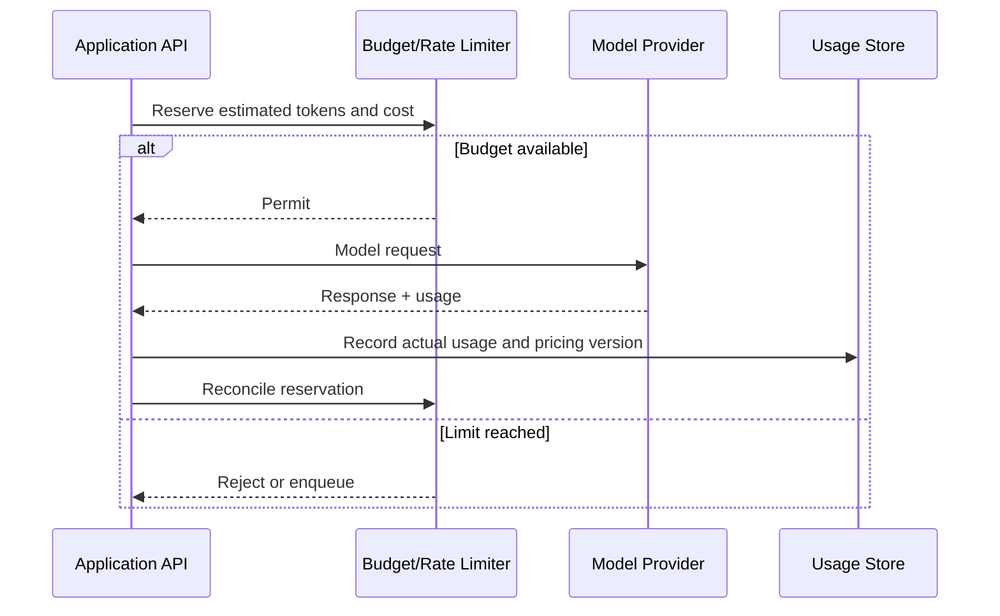

# Giám sát quota, rate limit và tăng chi phí bất thường

Một ứng dụng Spring AI có thể hoạt động bình thường trong môi trường thử nghiệm nhưng gặp lỗi khi traffic tăng: provider trả `429`, hàng đợi request dài lên, retry làm số lần gọi model tăng và hóa đơn tăng nhanh hơn số người dùng. Nếu chỉ theo dõi CPU hoặc tổng số request, nhóm vận hành khó biết hệ thống đang chạm giới hạn RPM, TPM, số request đồng thời hay ngân sách của provider.

Giám sát quota và chi phí cần kết hợp dữ liệu từ ứng dụng, provider và hệ thống billing. Ứng dụng biết request nào gọi model nào, tenant nào sử dụng và token usage thực tế; provider biết giới hạn tài khoản và trạng thái rate limit; billing cho biết chi phí đã được ghi nhận. Không có một nguồn đơn lẻ nào luôn phản ánh đầy đủ cả ba góc nhìn.

Sau bài học, bạn có thể:

- Phân biệt quota, rate limit, concurrency limit và budget.
- Đo request, token, retry, lỗi `429` và mức sử dụng theo provider/model.
- Thiết kế backoff, jitter, queue và concurrency control để tránh retry storm.
- Ước tính chi phí theo usage và bảng giá có phiên bản.
- Phát hiện bất thường bằng tốc độ tiêu thụ, baseline và phân khúc traffic.
- Thiết lập dashboard, cảnh báo và runbook xử lý khi gần chạm giới hạn.

## 1. Hiểu các loại giới hạn

Các nhà cung cấp model có thể áp dụng nhiều loại giới hạn cùng lúc. Tên gọi và cách tính khác nhau giữa provider, model, region, project hoặc deployment. Luôn đối chiếu quota thực tế của tài khoản và API đang sử dụng.

| Loại giới hạn | Đơn vị thường gặp | Ý nghĩa vận hành |
|---|---|---|
| RPM (requests per minute) | Request/phút | Giới hạn số lần gọi trong một cửa sổ thời gian |
| TPM (tokens per minute) | Token/phút | Giới hạn tổng token input và/hoặc output theo cách provider quy định |
| RPD (requests per day) | Request/ngày | Giới hạn số lần gọi trong ngày hoặc chu kỳ billing |
| TPD (tokens per day) | Token/ngày | Giới hạn token trong một ngày hoặc chu kỳ |
| Concurrent requests | Request đồng thời | Giới hạn số request đang được xử lý cùng lúc |
| Context window | Token trong một request | Giới hạn tổng token mà một lần gọi model có thể nhận hoặc sinh |
| Spend/budget limit | Tiền theo kỳ | Ngưỡng ngân sách hoặc giới hạn chi tiêu của project/tài khoản |
| Application rate limit | Request hoặc token theo tenant/user | Giới hạn do chính ứng dụng đặt để chia sẻ tài nguyên công bằng |

Quota và rate limit có liên quan nhưng không đồng nghĩa. Quota thường biểu thị lượng tài nguyên được cấp trong một chu kỳ hoặc mức sử dụng được phép. Rate limit giới hạn tốc độ tiêu thụ tài nguyên trong cửa sổ ngắn. Một hệ thống có thể còn quota theo tháng nhưng vẫn bị từ chối vì đã vượt TPM trong phút hiện tại. Tương tự, budget cảnh báo hoặc giới hạn chi tiêu không nhất thiết đồng bộ tức thời với request API.

Phân biệt thêm ba loại giới hạn:

- **Hard limit:** vượt ngưỡng sẽ bị từ chối hoặc không thể tiếp tục cho đến khi quota được cấp lại hoặc thay đổi.
- **Soft limit:** ngưỡng cảnh báo để nhóm vận hành giảm tốc độ, điều chỉnh model hoặc xin tăng quota.
- **Application limit:** giới hạn do hệ thống tự đặt, ví dụ mỗi tenant tối đa 20 request/phút hoặc tối đa một ngân sách token/ngày.

Không suy luận quota chỉ từ một mã lỗi. `429` thường báo hiệu rate limit hoặc quota, nhưng nguyên nhân cụ thể cần đọc error code, response body đã được lọc và các header giới hạn mà provider cung cấp. Một lỗi billing hoặc quota hết chu kỳ có cách xử lý khác với một burst TPM ngắn.

## 2. Xây dựng mô hình usage cho ứng dụng Spring AI

Mỗi lần gọi model nên tạo được một bản ghi usage có liên kết với request, model và mục đích sử dụng. Một schema tối thiểu có thể gồm:

| Field | Mục đích |
|---|---|
| `request_id` | Tra cứu request trong log/trace; không dùng làm metric label |
| `provider`, `model`, `deployment` | Phân biệt nơi tiêu thụ quota |
| `operation` | Chat, embedding, rerank hoặc tác vụ AI khác |
| `tenant_tier` hoặc `tenant_group` | Phân tích phân bổ tài nguyên theo nhóm có cardinality hữu hạn |
| `prompt_tokens`, `completion_tokens`, `total_tokens` | Đo mức tiêu thụ token thực tế khi provider trả usage |
| `attempt`, `retry_count` | Phân biệt lần gọi đầu và retry |
| `status`, `error_code`, `http_status` | Phân tích kết quả và nguyên nhân thất bại |
| `duration_ms`, `queue_wait_ms` | Đo thời gian xử lý và thời gian chờ |
| `pricing_version`, `estimated_cost` | Tính chi phí theo bảng giá được áp dụng |
| `timestamp`, `environment`, `release_id` | Phân tích theo thời gian và phiên bản triển khai |

Ghi các định danh chi tiết như `request_id`, `trace_id`, `conversation_ref` trong log hoặc trace. Với metrics, chỉ dùng label có tập giá trị hữu hạn như provider, model, operation, environment, status hoặc tenant tier. Nếu tạo label cho từng user hoặc tenant ID, số chuỗi time series có thể tăng theo quy mô người dùng và làm quá tải backend metrics.

### 2.1. Đo request, token và retry

Những metric cơ bản nên có:

| Metric gợi ý | Loại | Dùng để |
|---|---|---|
| `spring.ai.provider.requests` | Counter | Tổng số lần gọi provider theo status |
| `spring.ai.provider.tokens` | DistributionSummary hoặc Counter | Phân phối hoặc tổng token theo chiều input/output |
| `spring.ai.provider.retries` | Counter | Số lần retry do timeout, rate limit hoặc lỗi tạm thời |
| `spring.ai.provider.rate.limited` | Counter | Số response bị rate limit |
| `spring.ai.provider.request.duration` | Timer | Latency của provider call |
| `spring.ai.provider.queue.wait` | Timer | Thời gian request chờ được cấp slot |
| `spring.ai.provider.inflight` | Gauge | Số request đang chạy |
| `spring.ai.cost.estimated` | Counter hoặc DistributionSummary | Chi phí ước tính theo currency và model |

Tên metric là quy ước nội bộ để minh họa. Khi dùng Micrometer, tên metric có thể được chuẩn hóa theo registry và backend. Thống nhất naming convention và đơn vị trước khi tạo dashboard.

### 2.2. Ví dụ ghi usage bằng Micrometer

Ví dụ sau minh họa cách ghi số token, request và rate limit bằng `MeterRegistry`. `promptTokens` và `completionTokens` phải lấy từ usage metadata của response provider; không tự suy ra số token từ số ký tự.

```java
import io.micrometer.core.instrument.MeterRegistry;
import io.micrometer.core.instrument.Tags;
import org.springframework.stereotype.Component;

@Component
public class ProviderUsageMetrics {

    private final MeterRegistry registry;

    public ProviderUsageMetrics(MeterRegistry registry) {
        this.registry = registry;
    }

    public void recordCompleted(
            String provider,
            String model,
            String operation,
            long promptTokens,
            long completionTokens) {

        Tags commonTags = Tags.of(
                "provider", provider,
                "model", model,
                "operation", operation,
                "status", "success");

        registry.counter("spring.ai.provider.requests", commonTags)
                .increment();

        registry.summary("spring.ai.provider.tokens.input",
                "provider", provider, "model", model)
                .record(promptTokens);

        registry.summary("spring.ai.provider.tokens.output",
                "provider", provider, "model", model)
                .record(completionTokens);
    }

    public void recordRateLimited(
            String provider,
            String model,
            String operation) {

        registry.counter("spring.ai.provider.rate.limited",
                "provider", provider,
                "model", model,
                "operation", operation)
                .increment();
    }
}
```

Trong ứng dụng thật, hãy ghi cả request thành công, lỗi provider, timeout và retry. Nếu một request được retry ba lần, metric provider request phản ánh ba lần gọi thực tế; metric request nghiệp vụ chỉ phản ánh một request từ người dùng. Tách hai khái niệm giúp thấy retry đang làm tăng tải và chi phí như thế nào.

Khi dùng Spring AI, có thể lấy usage từ `ChatResponse` metadata nếu provider và phiên bản Spring AI đang dùng trả dữ liệu này. Tên kiểu, getter và khả năng cung cấp usage thay đổi theo phiên bản/provider; hãy kiểm tra API cụ thể của dự án. Nếu provider không trả usage cho một response lỗi hoặc streaming chưa hoàn tất, ghi trạng thái thiếu dữ liệu thay vì giả định bằng 0.

## 3. Đọc tín hiệu rate limit và quota từ provider

Khi một request bị từ chối, cần lưu đủ metadata để phân loại nguyên nhân. Các header có thể có tùy provider:

- Giới hạn request hoặc token cho cửa sổ hiện tại.
- Mức sử dụng còn lại trong cửa sổ.
- Thời điểm hoặc khoảng thời gian reset.
- `Retry-After` chỉ định thời gian nên chờ trước khi thử lại.
- Request ID do provider cấp để hỗ trợ tra cứu phía nhà cung cấp.

Không phải provider nào cũng trả mọi header và tên header không thống nhất. Hãy xây dựng adapter theo provider để đọc những trường được tài liệu chính thức hỗ trợ. Không ghi nguyên response body nếu nó có thể chứa nội dung request hoặc dữ liệu nhạy cảm; chỉ lưu error code, status, các header quota được allowlist và provider request ID.

### 3.1. Phân loại lỗi trước khi retry

| Tình huống | Dấu hiệu thường gặp | Hướng xử lý |
|---|---|---|
| Rate limit ngắn hạn | `429`, error code giới hạn tốc độ, có thể có `Retry-After` | Chờ theo chỉ dẫn, backoff và giới hạn retry |
| Quota cạn theo chu kỳ | `429` hoặc mã quota, reset ở thời điểm xa hơn | Đưa vào queue hoặc giảm tải đến khi reset; xem xét tăng quota |
| Budget/billing exhausted | Error code billing hoặc budget | Dừng request không thiết yếu, kiểm tra budget/account; retry liên tục không giải quyết được |
| Context quá dài | Lỗi input/token limit hoặc request validation | Giảm context, chia nhỏ hoặc chọn model có context window phù hợp |
| Authentication/permission | `401` hoặc `403` | Kiểm tra credential và quyền; không retry tự động như lỗi tạm thời |
| Provider unavailable | `5xx`, connection reset hoặc timeout | Retry có giới hạn, circuit breaker và fallback nếu phù hợp |
| Request không hợp lệ | `400` hoặc lỗi validation | Sửa request; không retry nguyên trạng |

Status code chỉ là một phần của bằng chứng. Cần dùng error code có cấu trúc của provider và phân loại theo hợp đồng API. Một số dịch vụ có thể trả `429` cho nhiều loại quota khác nhau; đừng giả định tất cả đều reset sau một giây.

### 3.2. Theo dõi mức sử dụng quota

Nếu provider cung cấp limit và remaining, có thể tính tỷ lệ sử dụng:

\[
\text{Utilization} = \frac{\text{Limit} - \text{Remaining}}{\text{Limit}} \times 100\%
\]

Ví dụ limit 100.000 token/phút, remaining 15.000 token thì utilization theo cửa sổ hiện tại là 85%. Chỉ tính khi limit và remaining cùng đơn vị, cùng phạm vi và cùng cửa sổ. Nếu provider không cung cấp remaining, ước tính từ usage của ứng dụng và ghi rõ đó là số ước tính.

Không coi một snapshot utilization là dự báo chính xác. Nếu traffic tăng đột ngột, remaining có thể thay đổi ngay sau khi đọc. Dashboard nên hiển thị timestamp, cửa sổ quota và nguồn dữ liệu.

## 4. Điều phối tải và xử lý 429 an toàn

Khi nhiều request cùng gọi một model, chỉ retry từng request một cách độc lập có thể tạo retry storm: càng bị giới hạn thì càng có nhiều request gửi lại, khiến tình trạng xấu hơn. Cần kết hợp rate limiter, queue, giới hạn concurrency và retry policy.

### 4.1. Token bucket và giới hạn theo nhiều chiều

Token bucket là một cách điều tiết tốc độ phổ biến. Bucket có dung lượng tối đa và được nạp token theo tốc độ cố định. Mỗi request lấy một hoặc nhiều token trước khi chạy; nếu không đủ, request chờ hoặc bị từ chối theo chính sách.

Với model API, chi phí của request phụ thuộc độ dài input và output dự kiến. Có thể ước tính số token cần reserve trước khi gọi, sau đó đối soát với usage thực tế khi response hoàn tất. Đây chỉ là cơ chế điều phối nội bộ; quota provider vẫn là nguồn giới hạn cuối cùng.

Nên cân nhắc giới hạn ở các phạm vi:

- Toàn provider/project để tránh tổng tải vượt quota chia sẻ.
- Theo model hoặc deployment vì mỗi model có giới hạn riêng.
- Theo operation như chat, embedding và rerank.
- Theo tenant tier hoặc nhóm nghiệp vụ để bảo đảm công bằng.
- Theo request concurrency để giới hạn số lời gọi đang chạy.

Nếu có nhiều instance ứng dụng, limiter chỉ chạy trong bộ nhớ từng instance sẽ không đảm bảo tổng tải toàn hệ thống. Cần một limiter phân tán hoặc gateway chung nếu quota được chia sẻ giữa các instance. Đồng thời phải tính đến giới hạn của chính kho limiter để nó không trở thành điểm nghẽn.

### 4.2. Backoff và jitter

Khi lỗi là tạm thời và có thể retry, dùng exponential backoff với jitter để các request không cùng thức dậy tại một thời điểm. Công thức full jitter thường dùng:

\[
\text{delay}_n = U(0, \min(\text{cap}, \text{base} \times 2^n))
\]

Trong đó `U(0, x)` là số ngẫu nhiên đều từ 0 đến x, `base` là thời gian chờ ban đầu và `cap` là giới hạn tối đa. Nếu response có `Retry-After`, hãy tôn trọng giá trị đó theo tài liệu provider; có thể thêm jitter nhỏ sau thời gian tối thiểu để tránh đồng loạt retry.

Một retry policy cần có:

- Số lần retry tối đa.
- Deadline tổng của request và timeout mỗi lần gọi.
- Backoff cap và jitter.
- Danh sách lỗi có thể retry; không retry lỗi validation, auth hoặc billing không thể phục hồi.
- Giới hạn số request retry đồng thời.
- Cơ chế ghi retry count và nguyên nhân vào metrics/log.

Với tool có side effect như tạo đơn hàng hoặc hoàn tiền, phải dùng idempotency key hoặc cơ chế chống thực thi lặp trước khi retry. Việc gọi model để sinh văn bản thường ít rủi ro side effect hơn, nhưng vẫn tiêu tốn quota và chi phí ở mỗi lần thử.

### 4.3. Queue, concurrency và circuit breaker

Nếu rate limiter cho phép request chờ, hãy giới hạn độ dài queue và thời gian chờ tối đa. Khi queue đầy, trả lỗi có kiểm soát hoặc dùng fallback đã được phê duyệt. Không giữ request vô thời hạn vì nó có thể hết deadline trước khi được xử lý.

Semaphore hoặc bulkhead giới hạn số lời gọi đồng thời đến một provider/model. Circuit breaker tạm dừng lời gọi khi provider liên tục lỗi, giúp hệ thống không tiếp tục dồn tải vào dependency đang suy giảm. Khi circuit half-open, chỉ cho một số probe nhỏ để kiểm tra phục hồi.

Fallback model có thể duy trì khả năng phục vụ nhưng cần xem xét chất lượng, context window, giá và quota riêng của model dự phòng. Không chuyển toàn bộ traffic sang model rẻ hoặc model dự phòng mà không đo lại quality và usage.

## 5. Tính chi phí theo usage và bảng giá có phiên bản

Chi phí cần được ước tính từ usage thực tế và bảng giá đúng thời điểm. Với model tính giá theo token, công thức đơn giản:

\[
\text{Cost} = \frac{T_{in} \times P_{in}}{10^6} + \frac{T_{out} \times P_{out}}{10^6}
\]

Trong đó:

- (T_{in}): số input token.
- (T_{out}): số output token.
- (P_{in}), (P_{out}): giá trên một triệu token theo currency và pricing version tương ứng.

Một số provider có giá riêng cho cached input, reasoning token, image/audio token, batch request, tool hoặc model variant. Công thức thực tế phải theo bảng giá provider và cách họ tính billable usage. Không giả định mọi token đều cùng một đơn giá.

Ví dụ minh họa: một model có giá giả định 2 USD/triệu input token và 8 USD/triệu output token. Một request dùng 800 input token và 200 output token:

\[
\text{Cost} = \frac{800 \times 2}{1,000,000} + \frac{200 \times 8}{1,000,000} = 0.0032\text{ USD}
\]

Con số này là ước tính theo bảng giá giả định, chưa bao gồm thuế, phí bổ sung, cache hoặc các thành phần billing khác.

### 5.1. Lưu pricing version

Không hard-code một đơn giá vĩnh viễn trong code. Lưu bảng giá với các trường:

| Field | Ý nghĩa |
|---|---|
| `provider`, `model`, `deployment` | Phạm vi giá áp dụng |
| `input_price_per_million` | Giá input token |
| `output_price_per_million` | Giá output token |
| `cached_input_price` | Giá cached token nếu có |
| `currency` | Đơn vị tiền tệ |
| `effective_from`, `effective_to` | Khoảng hiệu lực |
| `pricing_version`, `source_checked_at` | Phiên bản và thời điểm đối chiếu |

Mỗi usage record nên gắn `pricing_version`. Khi provider đổi giá, lịch sử chi phí vẫn có thể tái tính theo bảng giá tại thời điểm request. Nếu dùng giá quy đổi nội bộ hoặc discount theo hợp đồng, cần lưu riêng giá niêm yết và giá thực trả để tránh nhầm lẫn.

### 5.2. Phân biệt chi phí ước tính và billing thực tế

Ứng dụng thường có thể tính ước tính gần thời gian thực từ usage. Billing thực tế của provider có thể cập nhật trễ và bao gồm điều chỉnh, discount, cache, batch, phí công cụ hoặc quy tắc làm tròn. Hãy hiển thị hai chỉ số riêng:

- `estimated_cost`: tính từ usage ứng dụng và pricing version.
- `billed_cost`: lấy từ báo cáo billing chính thức của provider.

Định kỳ đối soát theo ngày hoặc chu kỳ billing. Chênh lệch lớn có thể do usage thiếu, request lỗi vẫn bị tính phí, retry, token loại đặc biệt, model mapping sai hoặc pricing version không đúng.

## 6. Phát hiện tăng chi phí bất thường

Tổng chi phí tăng chưa chắc là bất thường nếu số request hoặc người dùng tăng tương ứng. Cần theo dõi cả chi phí tuyệt đối và chi phí trên mỗi đơn vị công việc.

Các chỉ số nên theo dõi:

- Tổng chi phí theo giờ/ngày/tháng và tốc độ tiêu thụ ngân sách.
- Cost/request, cost/successful task và cost/tenant tier.
- Input token và output token trung bình, p95 và phân phối.
- Retry rate, fallback rate, số lần gọi model trên một request nghiệp vụ.
- Tỷ lệ cache hit nếu provider hoặc ứng dụng có caching.
- Tỷ lệ request không tạo ra kết quả hữu ích nhưng vẫn tiêu thụ token.

### 6.1. Baseline và ngưỡng bất thường

Một cách đơn giản là so sánh giá trị hiện tại với baseline cùng khung giờ hoặc cùng ngày trong tuần. Ví dụ:

\[
\text{Relative change} = \frac{\text{Current} - \text{Baseline}}{\max(\text{Baseline}, \epsilon)} \times 100\%
\]

Trong đó ε là ngưỡng nhỏ để tránh chia cho 0. Chỉ dùng relative change khi baseline đủ lớn; khi baseline thấp, cần thêm ngưỡng tuyệt đối.

Có thể bắt đầu bằng các rule:

- Cost/hour vượt 150% median của các giờ tương đương trong 7 ngày gần nhất và vượt mức tiền tối thiểu.
- Cost/request tăng hơn 30% so với baseline sau khi traffic và model mix đã được tính đến.
- Output tokens p95 tăng mạnh trong khi số request gần như không đổi.
- Retry rate hoặc model calls/business request tăng liên tục.
- Forecast cuối kỳ vượt budget được cấp.

Đây là ngưỡng minh họa. Cần hiệu chỉnh bằng dữ liệu lịch sử, ngày cao điểm, campaign và chu kỳ nghiệp vụ. Không tạo cảnh báo chỉ dựa trên một phần trăm nếu lượng mẫu quá nhỏ.

### 6.2. Những nguyên nhân phổ biến

| Dấu hiệu | Nguyên nhân có thể | Kiểm tra |
|---|---|---|
| Input tokens/request tăng | Prompt dài, lịch sử chat không giới hạn, RAG trả quá nhiều chunk | Prompt version, message count, top-k, context size |
| Output tokens/request tăng | Thiếu max output, prompt yêu cầu giải thích dài, model behavior đổi | Generation config, finish reason, output length |
| Provider calls/request tăng | Retry storm, tool loop, gọi model nhiều vòng | Trace span, retry count, tool call sequence |
| Chi phí tăng dù request không đổi | Model/deployment đắt hơn, pricing đổi, token mix thay đổi | Model mapping, pricing version, billing report |
| Một tenant chiếm phần lớn quota | Burst traffic, batch job, automation lỗi hoặc lạm dụng | Usage theo tenant tier, route và thời điểm |
| Cost tăng cùng error rate | Retry khi lỗi provider, timeout nhưng request vẫn bị tính phí | Provider request ID, retry, timeout và billing reconciliation |
| Embedding cost tăng | Re-index lặp lại, ingest trùng hoặc batch không giới hạn | Job schedule, document count, embedding request rate |

Không kết luận có hành vi lạm dụng chỉ từ một spike. Hãy kiểm tra traffic hợp lệ, lịch batch, release mới và thay đổi bảng giá trước khi khóa tenant hoặc giảm quota.

## 7. Dashboard và cảnh báo quota/cost

Một dashboard hiệu quả nên có các panel sau:

| Panel | Nội dung | Mục tiêu |
|---|---|---|
| Quota utilization | RPM/TPM used, remaining, reset time | Biết còn bao nhiêu capacity trong cửa sổ |
| Provider responses | 2xx, 429, 5xx, timeout theo provider/model | Nhận diện rate limit và lỗi dependency |
| Token consumption | Input/output token theo phút và theo model | Dự báo TPM và cost |
| Concurrency/queue | In-flight, queue depth, wait duration | Phát hiện nghẽn trước khi bị từ chối |
| Retry/fallback | Retry rate, attempts/request, fallback rate | Nhận diện retry storm và model switching |
| Cost | Cost/hour, day-to-date, month-to-date, forecast | Theo dõi burn rate và budget |
| Unit economics | Cost/request, cost/successful task | Biết hiệu quả chi tiêu |
| Tenant distribution | Usage theo tier hoặc nhóm tenant | Phát hiện mất cân bằng tài nguyên |

Hiển thị provider, model, deployment, environment và khoảng thời gian đang xem. Với quota, hiển thị đơn vị, cửa sổ reset và timestamp của lần cập nhật cuối. Nếu quota không có API để đọc remaining, gắn nhãn “ước tính từ usage” trên dashboard.

### 7.1. Ví dụ truy vấn PromQL

Các truy vấn dưới đây giả định exporter đã tạo metric tương ứng. Tên metric thực tế phụ thuộc Micrometer registry và quy tắc đặt tên backend.

Tỷ lệ response rate limited trong 5 phút:

```promql
sum(rate(spring_ai_provider_requests_total{status="rate_limited"}[5m]))
/
clamp_min(sum(rate(spring_ai_provider_requests_total[5m])), 1)
```

Tốc độ input token theo model:

```promql
sum by (model) (
  rate(spring_ai_provider_tokens_input_sum[5m])
)
```

Retry rate:

```promql
sum(rate(spring_ai_provider_retries_total[5m]))
/
clamp_min(sum(rate(spring_ai_provider_requests_total[5m])), 1)
```

Metric từ `DistributionSummary` có thể được xuất thành `_sum` và `_count`; xác nhận tên thực tế qua endpoint metrics hoặc backend trước khi dùng query. Nếu muốn hiển thị token trung bình mỗi request, dùng tỷ lệ tổng token với số request tương ứng trong cùng khoảng thời gian.

### 7.2. Ngưỡng cảnh báo tham khảo

| Mức | Điều kiện ví dụ | Hành động |
|---|---|---|
| Warning | Quota utilization trên 70% trong nhiều cửa sổ liên tiếp | Kiểm tra dự báo traffic và batch job |
| High | Quota utilization trên 85% hoặc 429 bắt đầu tăng | Giảm tốc độ, giới hạn concurrency, kiểm tra retry |
| Critical | Quota trên 95%, 429 kéo dài hoặc budget burn vượt forecast | Ưu tiên traffic quan trọng, tạm dừng tác vụ không thiết yếu, kích hoạt runbook |
| Cost anomaly | Cost/hour vượt baseline và ngưỡng tuyệt đối | Phân tích model, tenant, retry, token và release |
| Budget forecast | Dự báo chi tiêu vượt budget trước cuối kỳ | Thông báo owner, giảm tải hoặc xin điều chỉnh budget |

Không chỉ cảnh báo khi đã nhận 429. Utilization và tốc độ tiêu thụ có thể báo trước sự cố. Ngưỡng 70/85/95% chỉ là ví dụ; quota có thể reset theo rolling window hoặc được provider điều chỉnh, vì vậy phải dùng cửa sổ phù hợp.

## 8. Bảo vệ ngân sách ở tầng ứng dụng

Provider budget thường không thay thế được cơ chế kiểm soát chi phí theo nghiệp vụ. Ứng dụng có thể cần ngân sách riêng cho tenant, feature hoặc loại tác vụ.

Một policy có thể gồm:

- Giới hạn request/phút và token/ngày theo tenant tier.
- Ngân sách chi phí theo tháng cho từng nhóm tính năng.
- Giới hạn số lần gọi model trong một request nghiệp vụ.
- Giới hạn độ dài lịch sử hội thoại và số chunk RAG.
- Giới hạn `max_output_tokens` theo loại tác vụ.
- Dành capacity cho tác vụ ưu tiên cao; trì hoãn hoặc từ chối tác vụ batch khi gần chạm quota.

### 8.1. Reserve và reconcile token

Trước khi gọi model, ứng dụng có thể ước tính token input và reserve một phần budget cho output tối đa. Sau khi response hoàn tất, reconcile reservation bằng usage thực tế. Nếu request thất bại, xử lý reservation theo chính sách provider và dữ liệu billing; không mặc định mọi request lỗi đều không bị tính phí.

Ví dụ luồng:



Reservation phải có TTL để giải phóng nếu worker chết hoặc request timeout. Dùng transaction hoặc cơ chế idempotent để một request retry không trừ budget hai lần ở tầng nghiệp vụ. Mỗi attempt gọi provider vẫn phải được ghi nhận riêng vì có thể phát sinh chi phí.

### 8.2. Công bằng giữa các tenant

Nếu mọi tenant dùng chung một limiter, một tenant có traffic lớn có thể chiếm hết capacity. Có thể kết hợp global limit với per-tier/per-tenant budget. Với tenant có mức ưu tiên cao, dành capacity tối thiểu hoặc hàng đợi riêng. Khi từ chối request, trả lỗi có thể xử lý được như `429` cùng thông tin retry phù hợp ở tầng ứng dụng; không tiết lộ quota nội bộ của tenant khác.

## 9. Runbook xử lý sự cố quota hoặc cost spike

Khi dashboard cảnh báo, xử lý theo thứ tự để giảm thiểu tác động và giữ lại bằng chứng:

1. **Xác nhận tín hiệu:** kiểm tra thời điểm, provider, model, deployment, quota window và mức độ ảnh hưởng.
2. **Phân loại lỗi:** xem status, provider error code, reset time, `Retry-After` và request ID của provider.
3. **Đánh giá traffic:** kiểm tra request rate, token rate, concurrency, queue depth và tenant tier.
4. **Kiểm tra retry:** xác định số attempt trên mỗi request, backoff, timeout và vòng lặp tool/model.
5. **Kiểm tra cost driver:** phân tích input/output token, model mix, pricing version, batch/embedding job và billing report.
6. **Giảm tải có mục tiêu:** trì hoãn batch, giới hạn tenant/route, giảm concurrency hoặc chuyển sang model dự phòng đã được đánh giá.
7. **Bảo vệ chất lượng:** giữ traffic quan trọng và kiểm tra chất lượng fallback; tránh thay model chỉ vì rẻ hơn mà không có đánh giá.
8. **Theo dõi phục hồi:** quan sát 429, queue, latency, usage và cost sau thay đổi.
9. **Đối soát:** so sánh estimated cost với billing thực tế, ghi lại chênh lệch và nguyên nhân.
10. **Phòng ngừa:** cập nhật quota plan, limiter, alert threshold, budget hoặc release gate nếu nguyên nhân đến từ thay đổi ứng dụng.

Nếu quota đã hết theo chu kỳ hoặc billing budget đã cạn, retry liên tục không làm capacity xuất hiện trở lại. Hãy dừng retry, thông báo owner và chọn phương án đã được phê duyệt. Nếu provider có reset time rõ ràng, queue có thể trì hoãn request đến sau reset nhưng phải tôn trọng deadline nghiệp vụ.

## 10. Các lỗi thiết kế thường gặp

| Lỗi | Hệ quả | Cách khắc phục |
|---|---|---|
| Chỉ đếm request mà không đo token | Không dự báo được TPM hoặc cost | Thu thập input/output usage từ response metadata |
| Gộp request nghiệp vụ với provider attempts | Retry làm sai số lượng và unit cost | Tách business request và provider call metrics |
| Retry mọi lỗi `429` ngay lập tức | Retry storm và tiếp tục vượt rate limit | Phân loại error, tôn trọng Retry-After, backoff và cap |
| Chỉ dùng limiter trong từng instance | Tổng tải nhiều replica vẫn vượt quota chung | Dùng gateway hoặc distributed limiter |
| Hard-code giá model | Ước tính lịch sử sai khi giá thay đổi | Quản lý pricing version và effective date |
| Coi estimated cost là hóa đơn | Sai lệch với billing thực tế | Đối soát theo billing export và ghi rõ nguồn |
| Alert chỉ theo phần trăm | Nhiễu khi baseline hoặc sample nhỏ | Kết hợp ngưỡng tuyệt đối, minimum sample và forecast |
| Dùng user/tenant ID làm metric label | Cardinality bùng nổ | Dùng log/trace để truy vết; metric nhóm theo tier |
| Fallback sang model rẻ không kiểm thử | Chất lượng hoặc safety suy giảm | Đánh giá fallback trước và theo dõi riêng |

## 11. Bài tập thực hành

Một dịch vụ hỗ trợ khách hàng có hai model deployment: model chính dùng cho câu trả lời chất lượng cao và model dự phòng có chi phí thấp hơn. Traffic tăng gấp đôi trong một giờ; dashboard báo TPM utilization 92%, rate limit response 4%, retry rate tăng và cost/hour cao gấp 1,8 lần baseline.

Hãy thực hiện các nhiệm vụ:

1. Thiết kế metric cho business request, provider attempts, input/output tokens, 429, retry, concurrency và queue wait.
2. Xác định metadata cần ghi để phân biệt quota theo provider/model/deployment.
3. Đề xuất retry policy có `Retry-After`, exponential backoff, jitter, deadline và max attempts.
4. Thiết kế limiter toàn hệ thống cùng per-tenant tier để bảo đảm fairness.
5. Tính estimated cost/request bằng bảng giá có version và mô tả cách đối soát billing.
6. Đề xuất rule phát hiện cost anomaly, có baseline, ngưỡng tuyệt đối và minimum sample.
7. Viết runbook lựa chọn giữa giảm tải, queue, fallback và tạm dừng batch job.
8. Đưa ra điều kiện để xác nhận hệ thống đã phục hồi và không làm suy giảm chất lượng câu trả lời.

**Tiêu chí tự kiểm tra:** nhóm vận hành có thể biết quota nào đang gần cạn, model/deployment nào gây ra tải, retry có khuếch đại vấn đề không, chi phí tăng do traffic hay do unit cost, tenant nào cần điều tiết và khi nào có thể mở lại traffic bình thường.

## 12. Checklist production

- [ ] Quota được phân loại theo RPM, TPM, concurrency, daily limit và budget.
- [ ] Metric tách business request khỏi provider attempts.
- [ ] Input/output token usage được thu thập khi provider cung cấp.
- [ ] Provider status, error code, Retry-After và reset metadata được ghi có chọn lọc.
- [ ] Metrics labels có cardinality thấp; request/user ID nằm trong log hoặc trace.
- [ ] Retry có backoff, jitter, max attempts và deadline.
- [ ] Queue, concurrency limiter và circuit breaker có giới hạn rõ ràng.
- [ ] Limiter phù hợp với số instance và phạm vi quota được chia sẻ.
- [ ] Cost estimation dùng pricing version, currency và effective date.
- [ ] Estimated cost được đối soát với billing thực tế.
- [ ] Dashboard hiển thị utilization, 429, retry, tokens, queue và cost forecast.
- [ ] Alert kết hợp ngưỡng, baseline, minimum sample và mức độ ảnh hưởng.
- [ ] Có budget theo tenant/feature và chính sách ưu tiên traffic.
- [ ] Fallback model đã được đánh giá chất lượng và giới hạn chi phí.
- [ ] Runbook có owner, hành động giảm tải và tiêu chí phục hồi.

Giám sát quota và chi phí hiệu quả cần nhìn đồng thời tốc độ request, token usage, retry, concurrency, giá model và hành vi theo tenant. Khi các tín hiệu được liên kết bằng metadata phiên bản và request trace, nhóm vận hành có thể phát hiện sớm giới hạn, xác định nguồn tăng chi phí và điều tiết tải mà vẫn giữ chất lượng dịch vụ Spring AI.
