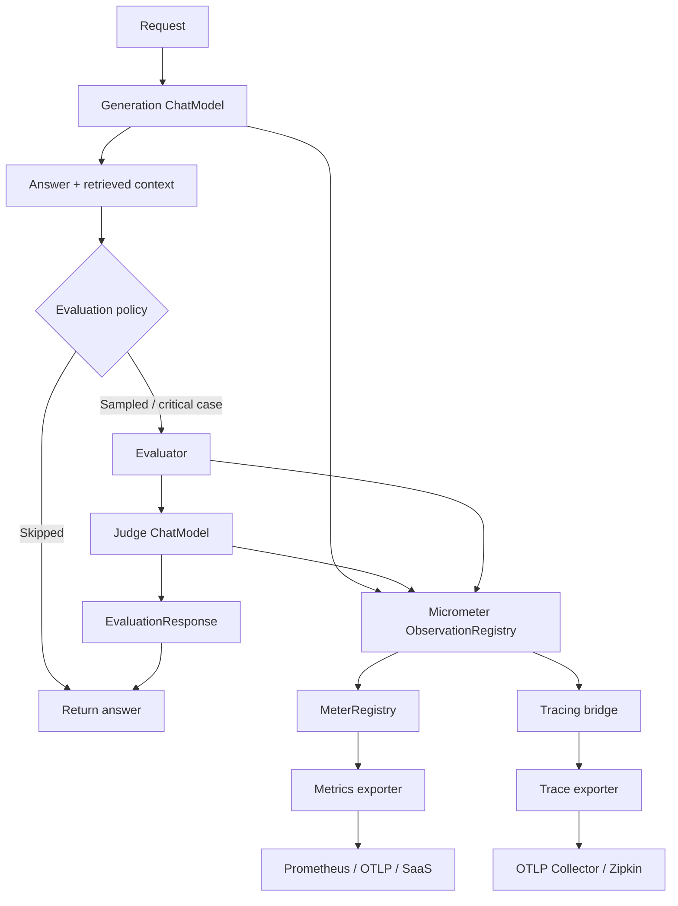
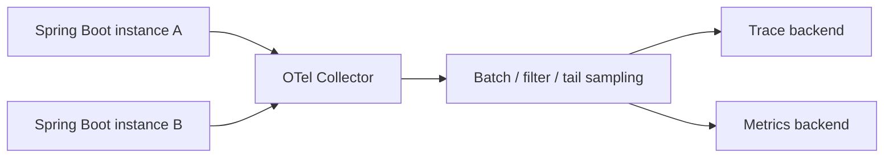

# Quản lý cấu hình exporter, giám khảo và sampling theo môi trường

## 1. Vì sao phải cấu hình observability theo môi trường?

Một ứng dụng Spring AI có thể chạy ở máy lập trình, CI, staging và production. Cùng một luồng RAG nhưng mỗi môi trường có mục tiêu khác nhau:

- **Local/dev:** cần nhìn thấy gần như toàn bộ trace để tìm lỗi nhanh; có thể chạy evaluator trên dữ liệu giả lập.
- **CI/test:** cần kết quả lặp lại được trên bộ dữ liệu chuẩn, không phụ thuộc sampling ngẫu nhiên.
- **Staging:** cần kiểm tra exporter, judge model, quyền truy cập, tải và chi phí trước khi phát hành.
- **Production:** cần telemetry đủ để vận hành, nhưng phải kiểm soát chi phí, tải exporter, cardinality và dữ liệu nhạy cảm.

Nếu dùng một cấu hình chung cho mọi nơi, dev có thể chỉ thu 10% trace nên khó tái hiện lỗi; production có thể gửi 100% trace và làm quá tải backend; judge model có thể được gọi trên mọi request khiến chi phí tăng; hoặc evaluator có thể dùng chung model sinh câu trả lời khiến khó tách chi phí và đánh giá thiên lệch.

Bài **“Quản lý cấu hình exporter, giám khảo và sampling theo môi trường”** thuộc chương **Vận hành** của module **SPRING_AI_EVALUATION_OBSERVABILITY**. Module tập trung đánh giá chất lượng ứng dụng Spring AI bằng dataset, tiêu chí relevance, fact checking và kiểm thử luồng RAG/tool calling; đồng thời đo metrics, traces, chi phí và độ trễ để phát hiện nguyên nhân suy giảm theo phiên bản prompt, model và pipeline.

**Mục tiêu:** cấu hình riêng exporter metrics/traces, chọn judge model cho evaluator, phân biệt các loại sampling, dùng profile môi trường có kiểm soát và xác minh telemetry thực sự tới backend.

## 2. Ba loại sampling thường bị nhầm lẫn

Từ “sampling” xuất hiện ở nhiều lớp, nhưng ba khái niệm dưới đây có mục tiêu khác nhau:

| Loại sampling | Lấy mẫu cái gì? | Cấu hình/vị trí | Ảnh hưởng chính |
| --- | --- | --- | --- |
| **Trace sampling** | Request/trace nào được giữ lại và xuất tới tracing backend | Spring Boot tracing sampler hoặc collector | Chi phí và lượng trace lưu trữ |
| **Evaluation sampling** | Output nào được gửi tới judge model để đánh giá | Logic ứng dụng, dataset runner hoặc policy | Chi phí đánh giá và độ phủ chất lượng |
| **Model generation sampling** | Token tiếp theo được chọn thế nào khi model sinh nội dung | temperature, top_p, top_k tùy model | Độ đa dạng và tính ngẫu nhiên của câu trả lời |

Ví dụ production giữ 5% trace, nhưng evaluator vẫn có thể đánh giá 10% output. Model generation có temperature 0.2 là một cấu hình khác, không có nghĩa ứng dụng chỉ xử lý 20% request.

**Không dùng một tỷ lệ cho cả ba lớp.** Trace sampling không phải evaluation sampling; thay temperature không giảm số request gửi tới judge; giảm evaluator sample rate không tự giảm số trace.

### Metrics không bị giảm theo trace sampling

Spring Boot dùng Micrometer Observation để tạo metrics và traces. Khi trace không được chọn, metric handler vẫn có thể ghi nhận observation theo cấu hình registry; trace sampler quyết định việc xuất span, không phải bộ lọc chung để bỏ mọi metric.

Vì vậy, có thể có metric gen_ai.client.operation ghi nhận toàn bộ số operation hoàn tất, chỉ một phần trace được lưu, một phần output được gửi sang evaluator, và mỗi lần evaluator gọi judge model lại phát sinh một model operation riêng.

Khi đọc dashboard, hãy xem từng pipeline và mẫu số của nó.

## 3. Bức tranh tổng thể: model, evaluator và exporter

Một request RAG có thể đi qua ChatModel sinh câu trả lời, rồi RelevancyEvaluator hoặc FactCheckingEvaluator dùng một ChatModel khác để đánh giá. Cả hai model đều tạo chi phí và độ trễ.



Cần giữ riêng các thông tin:

- generation model: model sinh nội dung;
- judge model: model chấm điểm;
- evaluator: loại kiểm tra như relevance hoặc fact checking;
- environment: local, test, staging hoặc production;
- trace ID: liên kết các span trong một request;
- evaluation status: passed, failed, skipped hoặc error.

Không đưa prompt, transcript, user ID hay trace ID vào metric labels. Các định danh chi tiết thuộc log/trace có kiểm soát truy cập.

## 4. Exporter là gì và có những đường xuất nào?

Micrometer là facade cho metrics. Một MeterRegistry nhận các meter từ ứng dụng; exporter/registry cụ thể quyết định cách chuyển dữ liệu tới hệ thống giám sát.

| Loại dữ liệu | Đường xuất thường gặp | Mô hình truyền |
| --- | --- | --- |
| Metrics | Prometheus registry | Prometheus scrape endpoint của ứng dụng |
| Metrics | OTLP registry/exporter | Ứng dụng push theo chu kỳ tới collector |
| Metrics | Datadog, New Relic, Dynatrace... | Registry tương ứng push theo cấu hình |
| Traces | OpenTelemetry + OTLP | Ứng dụng export spans tới collector |
| Traces | Brave + Zipkin | Ứng dụng export spans tới Zipkin |
| Logs | Logging backend/OTLP logs nếu đã cấu hình | Tùy pipeline logging |

**Metrics exporter và trace exporter là hai cấu hình riêng.** Có Prometheus không tự động có distributed tracing. Có OTLP trace exporter cũng không bảo đảm metrics được gửi cùng endpoint nếu chưa cấu hình registry metrics.

Spring Boot tự cấu hình composite MeterRegistry dựa trên registry có trong classpath. Nếu thêm nhiều registry, một meter có thể được gửi tới nhiều backend. Cần chủ động chọn kiến trúc mong muốn và tránh xuất trùng ngoài ý định.

## 5. Dependency và phiên bản phải đi cùng nhau

Các thành phần phổ biến:

```xml
<dependencies>
    <dependency>
        <groupId>org.springframework.boot</groupId>
        <artifactId>spring-boot-starter-actuator</artifactId>
    </dependency>

    <!-- Chỉ cần nếu dùng Prometheus scrape -->
    <dependency>
        <groupId>io.micrometer</groupId>
        <artifactId>micrometer-registry-prometheus</artifactId>
    </dependency>
</dependencies>
```

Với tracing, Spring Boot hỗ trợ OpenTelemetry/OTLP hoặc Brave/Zipkin thông qua starter và dependency phù hợp. Tên starter, bridge và exporter khác nhau theo major version Spring Boot; cần dùng dependency management/BOM cùng phiên bản đang chạy, không trộn ví dụ Boot 3 với Boot 4.

Tài liệu Spring Boot 4.x hiện hành dùng starter OpenTelemetry và các property exporter dưới namespace management.opentelemetry; các nhánh cũ có thể dùng micrometer-tracing-bridge-otel cùng OTLP exporter. **Không chép property từ tài liệu phiên bản khác mà chưa kiểm tra cấu hình metadata của ứng dụng.**

## 6. Cấu hình Prometheus exporter cho metrics

Prometheus dùng mô hình pull: Prometheus định kỳ scrape endpoint của từng instance. Spring Boot cung cấp endpoint /actuator/prometheus khi có Prometheus registry.

Ví dụ application.properties:

```properties
management.endpoints.web.exposure.include=health,info,prometheus

management.metrics.distribution.percentiles-histogram.gen_ai.client.operation=true
management.metrics.distribution.percentiles-histogram.db.vector.client.operation=true
```

Ví dụ cấu hình scrape trong prometheus.yml:

```yaml
scrape_configs:
  - job_name: spring-ai-service
    metrics_path: /actuator/prometheus
    static_configs:
      - targets:
          - app-host-1:8080
          - app-host-2:8080
```

Các điểm cần nhớ:

- Endpoint Prometheus không nhất thiết được expose mặc định; phải bật rõ ràng.
- Chỉ expose endpoint qua mạng quản trị hoặc lớp xác thực phù hợp.
- Histogram cho phép backend tính percentile có thể tổng hợp; không phải mọi timer đều có bucket nếu chưa cấu hình.
- Metric name trong Micrometer có thể được chuyển sang tên Prometheus với dấu gạch dưới và suffix.
- Dùng MeterRegistry do Spring quản lý để đăng ký meter và áp dụng filter/customizer.

Prometheus phù hợp khi muốn backend tự scrape và giữ quyền điều khiển retention, recording rules và alerting. Với job ngắn hạn hoặc batch kết thúc trước lần scrape tiếp theo, cần xem xét Pushgateway hoặc một cơ chế export khác.

## 7. Cấu hình OTLP exporter cho metrics và traces

OTLP là giao thức trao đổi telemetry giữa ứng dụng và collector/backend. Một triển khai có thể dùng cùng collector nhưng endpoint và property của từng signal cần rõ ràng.

Ví dụ theo cấu hình Spring Boot 4.x hiện hành, metrics OTLP:

```properties
management.otlp.metrics.export.url=https://otel-collector.example:4318/v1/metrics
management.otlp.metrics.export.step=30s
```

Tracing OTLP:

```properties
management.opentelemetry.tracing.export.otlp.endpoint=https://otel-collector.example:4318/v1/traces
management.opentelemetry.tracing.export.otlp.compression=gzip
management.opentelemetry.tracing.export.otlp.timeout=10s
```

Có thể cấu hình header xác thực qua các property headers.* hoặc secret/environment injection tương ứng. **Không commit bearer token, API key, client key hay mật khẩu vào repository.**

Spring Boot 4.x cũng hỗ trợ endpoint OTLP chung cho nhiều signal qua management.opentelemetry.otlp.endpoint; endpoint riêng theo signal có độ ưu tiên cao hơn. Khi dùng HTTP, endpoint chung có thể được nối thêm đường dẫn như v1/traces hoặc v1/metrics. Hãy tránh cấu hình đồng thời endpoint chung và riêng với giá trị mâu thuẫn.

### OTLP Collector làm nhiệm vụ gì?

Collector có thể nhận telemetry từ nhiều instance, xử lý batch, lọc, enrich resource attributes, áp tail sampling cho traces rồi export tới một hoặc nhiều backend. Collector không tự tạo metrics/observations bị thiếu trong ứng dụng; nó chỉ xử lý dữ liệu nhận được.



Cần theo dõi cả exporter queue, export failures, timeout, retry và collector availability. Nếu endpoint sai hoặc credentials hết hạn, ứng dụng có thể vẫn xử lý request nhưng telemetry không tới backend.

## 8. Cấu hình Zipkin khi cần tracing đơn giản

Với Brave/Zipkin, Spring Boot hỗ trợ dependency và property riêng. Ví dụ:

```properties
management.tracing.export.zipkin.endpoint=http://localhost:9411/api/v2/spans
management.tracing.sampling.probability=1.0
```

Cần có starter/dependency Zipkin tương ứng với phiên bản Boot. Trong production, endpoint phải trỏ tới hệ thống có xác thực và kết nối phù hợp; không dùng localhost nếu Zipkin chạy ở một host/container khác.

Zipkin và OTLP là hai lựa chọn exporter/tracer khác nhau. Không bật đồng thời chỉ vì cả hai có trong classpath; nếu thật sự cần dual export, phải định nghĩa rõ backend nào là nguồn chính và chấp nhận chi phí gửi trùng.

## 9. Profile môi trường: cấu hình chung và phần ghi đè

Spring Boot hỗ trợ application.yml cùng các file profile như application-dev.yml, application-staging.yml, application-prod.yml. Các file profile chỉ nên ghi những giá trị khác nhau; cấu hình dùng chung đặt ở file chính.

Ví dụ cấu hình chung:

```yaml
spring:
  application:
    name: spring-ai-evaluation-observability

management:
  observations:
    key-values:
      service: spring-ai-evaluation-observability
  endpoints:
    web:
      exposure:
        include: health,info
  metrics:
    tags:
      application: spring-ai-evaluation-observability
```

management.observations.key-values thêm low-cardinality key-value vào observations. Giá trị môi trường như dev, staging, prod có thể dùng để phân biệt deployment; tránh dùng giá trị biến đổi liên tục như request ID, user ID hoặc prompt.

### Local/dev

```properties
management.tracing.sampling.probability=1.0
management.endpoints.web.exposure.include=health,info,metrics
management.tracing.export.zipkin.endpoint=http://localhost:9411/api/v2/spans

app.evaluation.enabled=true
app.evaluation.sample-rate=1.0
app.evaluation.max-concurrency=2
```

Dev có thể lấy trace 100% và chạy evaluator trên fixture hoặc request thử. Nếu dùng dữ liệu thật, vẫn phải tuân thủ chính sách bảo mật; 100% trace không phải lý do để xuất prompt và response nhạy cảm.

### Staging

```properties
management.tracing.sampling.probability=0.5
management.otlp.metrics.export.url=https://otel-staging.example:4318/v1/metrics
management.opentelemetry.tracing.export.otlp.endpoint=https://otel-staging.example:4318/v1/traces

app.evaluation.enabled=true
app.evaluation.sample-rate=0.25
app.evaluation.max-concurrency=4
```

Staging nên kiểm tra exporter, credentials, latency, model profile, evaluator và cost. Có thể dùng tỷ lệ evaluation cao hơn production để đánh giá bản release, nhưng vẫn cần giới hạn concurrency và quota judge model.

### Production

```properties
management.tracing.sampling.probability=0.05
management.otlp.metrics.export.url=https://otel-prod.example:4318/v1/metrics
management.opentelemetry.tracing.export.otlp.endpoint=https://otel-prod.example:4318/v1/traces

app.evaluation.enabled=true
app.evaluation.sample-rate=0.02
app.evaluation.max-concurrency=8
```

Các con số 0.5, 0.25, 0.05 và 0.02 là **giá trị minh họa**, không phải khuyến nghị áp dụng chung. Tỷ lệ thực tế phụ thuộc lưu lượng, mức độ quan trọng, giá trace backend, ngân sách judge model, SLO và khả năng điều tra lỗi.

Trong production, metrics thường được thu liên tục để theo dõi xu hướng. Trace sampling có thể thấp hơn để kiểm soát dung lượng. Evaluator sampling có thể thấp hơn nữa vì mỗi lần đánh giá là một model call phát sinh thêm latency và chi phí.

## 10. Trace sampling: chọn request nào được lưu span

Spring Boot mặc định lấy mẫu 10% request để hạn chế tải lên trace backend. Property:

```properties
management.tracing.sampling.probability=0.10
```

Giá trị hợp lệ nằm trong khoảng từ 0.0 tới 1.0:

| Giá trị | Ý nghĩa |
| ---: | --- |
| 0.0 | Không lấy trace mới theo sampler tỷ lệ |
| 0.01 | Khoảng 1% trace |
| 0.10 | Khoảng 10% trace |
| 0.50 | Khoảng 50% trace |
| 1.0 | Mọi trace đều được lấy mẫu |

Với OpenTelemetry, Spring Boot còn hỗ trợ sampler như always-on, always-off, trace-id-ratio, parent-based-always-on, parent-based-always-off và parent-based-trace-id-ratio. Sampler parent-based giúp span con theo quyết định của trace cha, tránh một trace bị cắt rời không nhất quán.

**Head sampling** quyết định sớm ở đầu trace. Nếu trace đã bị loại ở đầu, backend không thể khôi phục toàn bộ span của request chỉ vì về sau request gặp lỗi. Nếu yêu cầu giữ tất cả lỗi hoặc trace chậm, có thể cân nhắc tail sampling tại collector; khi đó phải tính chi phí gửi trace từ ứng dụng tới collector và cấu hình giữ đủ dữ liệu để collector ra quyết định.

Trace sampling không phải bộ lọc metrics, và không phải tỷ lệ evaluator.

## 11. Evaluation sampling: chọn output nào được giám khảo chấm

Spring AI có abstraction Evaluator và các implementation như RelevancyEvaluator, FactCheckingEvaluator. Đây là logic đánh giá nội dung, không phải chức năng tự lấy mẫu traffic theo một property chuẩn chung.

Do đó, app.evaluation.sample-rate trong ví dụ là **property do ứng dụng tự định nghĩa**. Ứng dụng phải triển khai policy để quyết định khi nào gọi evaluator.

Một chính sách có thể gồm:

- **Golden dataset/CI:** đánh giá 100% test cases; không lấy mẫu vì cần so sánh release có thể lặp lại.
- **Local/dev:** bật evaluator khi phát triển tính năng hoặc chạy fixture.
- **Staging:** đánh giá phần lớn hoặc một mẫu đủ rộng của traffic giả lập/kiểm thử.
- **Production:** lấy mẫu có phân tầng; bổ sung đánh giá bắt buộc cho một số luồng rủi ro cao hoặc sự kiện cần điều tra.

Không nên chỉ lấy mẫu ngẫu nhiên toàn hệ thống nếu các trường hợp hiếm nhưng quan trọng không bao giờ xuất hiện trong mẫu. Có thể phân tầng theo operation, loại RAG, model version, ngôn ngữ hoặc nhóm rủi ro; các tag dùng cho metrics vẫn phải có cardinality thấp.

### Lấy mẫu xác định để retry không thay đổi quyết định

Nếu dùng số ngẫu nhiên mới mỗi lần retry, cùng một request có thể lúc được đánh giá, lúc bị bỏ qua. Có thể dùng hash ổn định của logical request ID:

```java
public final class EvaluationSampler {

    private static final int BUCKETS = 10_000;

    private EvaluationSampler() {
    }

    public static boolean include(
            String logicalRequestId, double sampleRate) {

        if (logicalRequestId == null || logicalRequestId.isBlank()) {
            throw new IllegalArgumentException(
                    "logicalRequestId không được rỗng");
        }
        if (sampleRate < 0.0 || sampleRate > 1.0) {
            throw new IllegalArgumentException(
                    "sampleRate phải nằm trong [0, 1]");
        }
        if (sampleRate == 0.0) {
            return false;
        }
        if (sampleRate == 1.0) {
            return true;
        }

        int bucket = Math.floorMod(
                logicalRequestId.hashCode(), BUCKETS);

        return bucket < Math.floor(sampleRate * BUCKETS);
    }
}
```

Hash chỉ phục vụ quyết định chọn mẫu, không phải tag metric. Nếu request ID có phân phối lệch hoặc không đủ ngẫu nhiên, dùng một hàm hash ổn định phù hợp hơn và kiểm tra phân bố trên traffic thực.

**Trường hợp quan trọng:** policy có thể trả true cho các case bắt buộc đánh giá bất kể tỷ lệ chung, ví dụ một bộ test chuẩn hoặc nhóm luồng nghiệp vụ đã được phân loại rủi ro. Hãy ghi rõ lý do chọn mẫu để tính coverage.

## 12. Judge model: tách model sinh và model đánh giá

Spring AI Evaluator nhận một EvaluationRequest gồm:

- userText: nội dung yêu cầu của người dùng;
- dataList: context, ví dụ tài liệu RAG đã truy xuất;
- responseContent: câu trả lời cần đánh giá.

RelevancyEvaluator kiểm tra câu trả lời có liên quan tới câu hỏi và context hay không. FactCheckingEvaluator kiểm tra claim có được tài liệu/context hỗ trợ hay không.

Tài liệu Spring AI cho phép truyền ChatClient.Builder vào evaluator. Có thể chọn **judge ChatModel riêng** với model sinh câu trả lời:

```java
import org.springframework.ai.chat.client.ChatClient;
import org.springframework.ai.chat.model.ChatModel;
import org.springframework.ai.evaluation.Evaluator;
import org.springframework.ai.evaluation.RelevancyEvaluator;
import org.springframework.ai.evaluation.FactCheckingEvaluator;
import org.springframework.beans.factory.annotation.Qualifier;
import org.springframework.context.annotation.Bean;
import org.springframework.context.annotation.Configuration;

@Configuration
public class EvaluationConfiguration {

    @Bean
    Evaluator relevancyEvaluator(
            @Qualifier("judgeChatModel") ChatModel judgeModel) {
        return new RelevancyEvaluator(ChatClient.builder(judgeModel));
    }

    @Bean
    Evaluator factCheckingEvaluator(
            @Qualifier("judgeChatModel") ChatModel judgeModel) {
        return new FactCheckingEvaluator(ChatClient.builder(judgeModel));
    }
}
```

Ví dụ giả định ứng dụng đã có bean judgeChatModel được cấu hình riêng. Cách tạo bean cụ thể phụ thuộc provider starter và lựa chọn model của dự án.

Tách judge model giúp:

- theo dõi latency và token usage của judge riêng;
- áp ngân sách và quota riêng;
- đổi judge model mà không đổi model sinh;
- giảm một phần nguy cơ model tự đánh giá output của chính nó.

**Dùng model khác không bảo đảm đánh giá khách quan.** Judge model vẫn có thể thiên lệch, hiểu sai context hoặc không ổn định. Cần benchmark trên dataset có nhãn và audit bằng người khi cần.

## 13. Cấu hình judge model và ngân sách riêng

Không nhất thiết judge phải là model lớn nhất. Một model nhỏ, chuyên cho fact checking hoặc classification có thể tiết kiệm chi phí nếu đạt chất lượng cần thiết trên golden dataset.

Những tham số nên tách:

| Tham số | Generation model | Judge model |
| --- | --- | --- |
| Model ID/profile | Model tạo câu trả lời | Model đánh giá |
| Temperature | Theo mục tiêu sản phẩm | Thường đặt thấp để tăng tính ổn định |
| Max output tokens | Theo độ dài câu trả lời | Đủ cho verdict và rationale |
| Timeout | Theo SLO người dùng | Theo ngân sách evaluator |
| Concurrency | Theo traffic chính | Giới hạn riêng để không chiếm quota |
| Retry | Theo semantics generation | Giới hạn, tránh chấm trùng và tính phí nhiều lần |
| Cost budget | Ngân sách sinh | Ngân sách đánh giá |

Ví dụ property ứng dụng tự định nghĩa:

```properties
app.evaluation.enabled=true
app.evaluation.sample-rate=0.10
app.evaluation.max-concurrency=4
app.evaluation.timeout=15s
app.evaluation.judge-profile=judge-small
```

Các property app.evaluation.* không phải property mặc định của Spring AI. Chúng cần được bind vào ConfigurationProperties hoặc cấu hình ứng dụng tương đương.

Không chỉ đặt giới hạn concurrency trong evaluator. Nên có timeout, queue bound, rate limit và cơ chế xử lý khi judge provider unavailable. Nếu judge lỗi, ghi EVALUATION_ERROR hoặc SKIPPED_PROVIDER_UNAVAILABLE, không gán PASS cho output.

## 14. Quan sát riêng evaluator và judge operation

Khi evaluator gọi ChatModel, built-in ChatModel observation có thể đo operation của judge nếu provider adapter hỗ trợ. Tuy nhiên, ứng dụng vẫn nên có observation ở cấp **một lần đánh giá nghiệp vụ** để biết evaluator bắt đầu/kết thúc và kết quả pass/fail.

```java
import io.micrometer.observation.Observation;
import io.micrometer.observation.ObservationRegistry;

import org.springframework.ai.evaluation.EvaluationRequest;
import org.springframework.ai.evaluation.EvaluationResponse;
import org.springframework.ai.evaluation.Evaluator;
import org.springframework.stereotype.Component;

@Component
public class ObservedEvaluator {

    private final ObservationRegistry observationRegistry;

    public ObservedEvaluator(ObservationRegistry observationRegistry) {
        this.observationRegistry = observationRegistry;
    }

    public EvaluationResponse evaluate(
            Evaluator evaluator,
            EvaluationRequest request,
            String evaluatorName) {

        return Observation.createNotStarted(
                    "app.ai.evaluation", observationRegistry)
                .lowCardinalityKeyValue(
                    "app.ai.evaluator", evaluatorName)
                .observe(() -> evaluator.evaluate(request));
    }
}
```

Tên app.ai.evaluation và key app.ai.evaluator là convention do ứng dụng tự đặt. Giữ evaluatorName trong tập giá trị nhỏ như relevancy hoặc fact_checking; không dùng tên prompt, request ID hay nội dung claim làm low-cardinality tag.

Nếu cần kết quả pass/fail, có thể ghi counter riêng sau khi EvaluationResponse trả về. Không thêm một tag kết quả tùy ý vào meter đã đăng ký với cardinality cao.

Một request production có thể tạo các span:

```text
HTTP request
  ├── RAG generation ChatModel
  ├── app.ai.evaluation (relevancy)
  │     └── judge ChatModel
  └── app.ai.evaluation (fact_checking)
        └── judge ChatModel
```

Nếu evaluator bị sampling out, metric ứng dụng vẫn nên ghi số evaluation được chọn, hoàn tất, lỗi hoặc bỏ qua theo policy.

## 15. Bảo vệ prompt, response, context và secret

Prompt, completion, context RAG và dữ liệu evaluator có thể chứa thông tin cá nhân hoặc bí mật nghiệp vụ. Spring AI không xuất prompt/completion mặc định cho các observation liên quan; việc bật logging nội dung có thể làm lộ dữ liệu.

Ví dụ giữ mặc định tắt:

```properties
spring.ai.chat.observations.log-prompt=false
spring.ai.chat.observations.log-completion=false
spring.ai.chat.client.observations.log-prompt=false
spring.ai.chat.client.observations.log-completion=false
```

Các property này kiểm soát log prompt/completion ở các observation tương ứng; chúng không tắt metrics/tracing nói chung.

Quy tắc vận hành:

- Không ghi API key, bearer token hoặc mật khẩu trong file profile đã commit.
- Dùng secret manager hoặc environment injection cho exporter headers và provider credentials.
- Không đưa prompt, response, retrieved document, claim, transcript hoặc user ID vào metric labels.
- Chỉ lưu trace attributes có cardinality phù hợp và được phép.
- Đặt retention/access control riêng cho trace chứa dữ liệu nghiệp vụ.
- Khi cần debug nội dung, dùng fixture đã khử nhận dạng hoặc quy trình truy cập có audit.
- Không bật log nội dung trên production chỉ để tăng khả năng quan sát.

## 16. Cardinality và tag theo môi trường

Một metric có nhiều tag kết hợp sẽ tạo ra nhiều time series. Ví dụ 10 model × 4 environment × 5 operation × 100.000 user IDs có thể tăng cardinality rất nhanh nếu user ID bị dùng làm tag.

Tag thường phù hợp:

- service;
- environment;
- provider với tập giá trị hữu hạn;
- model_profile với tập model đã kiểm soát;
- operation;
- evaluator;
- outcome.

Thuộc tính nên để ở trace hoặc log có kiểm soát:

- trace ID và request ID;
- user/tenant ID;
- prompt và completion;
- document ID, claim text;
- tool arguments;
- response ID hoặc URL có token.

Spring Boot cho phép thêm common observation key-values qua management.observations.key-values. Các key này trở thành low-cardinality tags của observations; chỉ dùng giá trị ổn định.

Ví dụ:

```properties
management.observations.key-values.service=spring-ai-evaluation-observability
management.observations.key-values.environment=staging
```

Không gắn environment động theo request nếu một instance chỉ chạy trong một environment cố định.

## 17. Context propagation qua async và reactive pipeline

Trace có thể bị đứt khi request chuyển sang thread khác, @Async, scheduler hoặc reactive pipeline. Điều này dễ gặp khi:

- gọi judge model qua executor riêng;
- chạy evaluation sau khi trả response bằng background job;
- stream model response và xử lý chunk trên scheduler khác;
- gửi evaluation event qua queue.

Spring Boot dùng Context Propagation để truyền observation context. Với Reactor có thể bật:

```properties
spring.reactor.context-propagation=auto
```

Với @Async và executor auto-configured, cần cấu hình:

```properties
spring.task.execution.propagate-context=true
```

Nếu tự tạo executor, có thể cần ContextPropagatingTaskDecorator. Hãy kiểm tra trace ID/span parent trong integration test; chỉ nhìn log không có correlation ID chưa đủ để xác định exporter lỗi.

Nếu evaluation chạy bất đồng bộ sau khi HTTP request đã hoàn tất, có thể cần một trace mới liên kết với trace gốc bằng link hoặc correlation ID theo mô hình nghiệp vụ; không giả định span con có thể tiếp tục một trace đã kết thúc ở mọi queue boundary.

## 18. Kiểm chứng cấu hình và xử lý sự cố

Sau khi triển khai, xác minh theo từng tầng:

| Tầng | Câu hỏi | Bằng chứng |
| --- | --- | --- |
| Profile | Instance đang chạy profile nào? | Startup log/config source an toàn |
| Registry | Có MeterRegistry đúng không? | Actuator metrics hoặc registry inspection |
| Observation | Model/evaluator có tạo observation? | Metric name và span |
| Exporter | Endpoint, auth và protocol đúng không? | Export success, không có timeout/401 |
| Backend | Dữ liệu đã tới đúng project/service chưa? | Query theo service/environment |
| Sampling | Tỷ lệ trace thực tế có hợp lý? | Sampled traces / request count |
| Evaluator | Có bao nhiêu output được chọn/chấm? | Selected, completed, skipped, failed |
| Judge | Đang gọi model nào, cost/latency ra sao? | Model operation và usage |
| Privacy | Prompt/context có bị xuất ngoài ý muốn? | Kiểm tra span/log trên fixture nhạy cảm giả lập |

### Kiểm tra Prometheus

Nếu dùng Prometheus, sau khi có request model thật:

```text
GET /actuator/metrics
GET /actuator/metrics/gen_ai.client.operation
GET /actuator/prometheus
```

Actuator metrics endpoint dùng tên meter Micrometer; Prometheus có thể dùng tên đã chuẩn hóa. Endpoint phải được expose và bảo vệ đúng môi trường.

### Kiểm tra trace

Tạo một request có correlation ID, kiểm tra:

- có span HTTP vào ứng dụng;
- có span ChatModel;
- có span vector store/retrieval nếu component được instrumented;
- có span evaluator do ứng dụng tự tạo;
- có span judge ChatModel;
- parent-child relationship và trace ID đúng;
- các span đã tới collector/backend.

Nếu chỉ có metric mà không có span, kiểm tracing exporter, sampling và context propagation. Nếu có HTTP span nhưng không có GenAI span, kiểm provider adapter và Spring AI version.

## 19. Kiểm thử evaluator và judge model

Spring AI có Evaluator, EvaluationRequest, EvaluationResponse, RelevancyEvaluator và FactCheckingEvaluator. Một integration test có thể chạy RAG, lấy context thực tế được truy xuất, rồi đánh giá câu trả lời.

Mẫu khởi tạo evaluator:

```java
RelevancyEvaluator relevancyEvaluator =
        new RelevancyEvaluator(ChatClient.builder(judgeChatModel));

FactCheckingEvaluator factCheckingEvaluator =
        new FactCheckingEvaluator(ChatClient.builder(judgeChatModel));

// retrievedContext là danh sách Content lấy từ kết quả retrieval thực tế.
EvaluationRequest request = new EvaluationRequest(
        question,
        retrievedContext,
        answer);

EvaluationResponse result = relevancyEvaluator.evaluate(request);
assertThat(result.isPass()).isTrue();
```

Ví dụ giả định các biến question, retrievedContext và answer đã được lấy từ luồng RAG; retrievedContext có kiểu dữ liệu Content mà constructor của version đang dùng yêu cầu. Đối chiếu Javadoc trước khi chép vào test thực tế.

Các điều cần kiểm tra:

- judge model bean đúng provider/profile;
- prompt template đúng placeholders;
- context thực tế được truyền vào evaluator;
- output pass/fail có assertion;
- judge timeout/quota được xử lý;
- evaluator call có span/metric riêng;
- test dùng fixture ổn định và không gửi dữ liệu cá nhân.

Judge model có thể chấm sai. Golden dataset cần có nhãn chuẩn hoặc review của người để đo precision/recall của evaluator, không chỉ kiểm tra evaluator có trả về PASS.

## 20. Chi phí của exporter và judge

Mỗi judge call là một model call bổ sung. Nếu một request chạy cả relevance và fact checking, có thể phát sinh hai judge calls ngoài generation call.

Ước tính:

```text
Generation calls/day = 100,000
Evaluation sample rate = 2%
Evaluators per sampled request = 2

Judge calls/day = 100,000 × 0.02 × 2
                = 4,000 calls/day
```

Đây là ví dụ số học giả định. Chi phí thực phụ thuộc judge model, input context length, output tokens, retry và giá provider.

Cần theo dõi riêng:

- generation token usage/cost;
- judge token usage/cost;
- evaluator duration;
- evaluation queue backlog;
- exporter throughput và failed exports;
- trace volume và storage retention.

Không gộp token của judge vào generation token mà không giữ breakdown; nếu không, chi phí chất lượng và chi phí phục vụ người dùng không thể phân tích độc lập.

Trace exporter cũng có chi phí mạng, collector CPU, backend ingestion và storage. Tăng sampling từ 5% lên 100% có thể tăng lượng span nhiều lần, dù số model calls không thay đổi.

## 21. Lỗi thường gặp và cách điều tra

| Hiện tượng | Nguyên nhân có thể | Kiểm tra |
| --- | --- | --- |
| Không có metric Prometheus | Registry thiếu, endpoint chưa expose hoặc scrape sai | Dependency, /actuator/prometheus, scrape target |
| Có metric nhưng không có trace | Tracing exporter, sampler hoặc tracer dependency chưa đúng | Sampling, OTLP/Zipkin endpoint |
| Trace ít hơn request | Trace sampling thấp hoặc context bị mất | Sampling probability, parent propagation |
| Metrics giảm sau khi đổi trace sampling | Có thể registry/filter thay đổi cùng lúc | So meter registry và trace sampler riêng |
| Judge calls tăng đột biến | Sample rate, số evaluator/request hoặc retry đổi | Evaluation policy và attempts |
| Judge dùng model sinh | Qualifier/bean selection sai | Model identity trong trace |
| Không thấy evaluator span | Chưa bọc evaluator bằng Observation | app.ai.evaluation |
| Judge cost không nằm trong dashboard | Query chỉ lọc model generation hoặc provider khác | Phân loại judge model |
| Staging có trace, production không | Secret, endpoint, network hoặc sampling khác | Config effective và exporter errors |
| Trace thiếu span con sau async | Context propagation không bật | Reactor/TaskExecutor propagation |
| Cardinality tăng mạnh | Dùng request/user/model ID làm tag | Meter tags và common key-values |
| Prompt xuất hiện trong backend | Log prompt/completion đã bật ở đâu đó | Property, logger và exporter filters |
| Evaluator PASS quá cao | Judge prompt yếu, model thiên lệch hoặc dataset đơn giản | Human audit và golden set |
| Exporter queue tăng | Collector/backend chậm hoặc mạng lỗi | Export timeout, retry, collector health |

## 22. Playbook triển khai cấu hình theo môi trường

1. **Chốt phiên bản:** xác định Spring Boot, Spring AI BOM, Micrometer, tracing bridge và provider starter.
2. **Chọn backend:** quyết định metrics dùng Prometheus hay OTLP; traces dùng OTLP hay Zipkin.
3. **Cấu hình dependency:** chỉ thêm registry/exporter cần thiết.
4. **Tạo profile:** common config ở application.yml, phần khác biệt ở profile tương ứng.
5. **Tách secrets:** inject endpoint credentials/token từ secret manager.
6. **Cấu hình trace sampling:** chọn theo tải và nhu cầu điều tra; bắt đầu cao ở dev/staging.
7. **Cấu hình evaluation policy:** chọn judge model, sample rate, concurrency, timeout và budget.
8. **Bảo vệ nội dung:** giữ prompt/completion logging tắt; xác minh exporter không nhận dữ liệu ngoài ý muốn.
9. **Kiểm chứng end-to-end:** gọi generation, retrieval, evaluator; xem metric và trace trong backend.
10. **Đo chi phí:** tách generation, judge, exporter và storage.
11. **So sánh profile:** kiểm tra effective configuration của từng môi trường.
12. **Ghi lại thay đổi:** version config, sampling rate, judge model và kết quả test để truy nguyên khi regression.

## 23. Bài tập thực hành

1. **Phân biệt sampling:** trace sampling 5%, evaluation sampling 20%, temperature 0.2. Giải thích ba con số này điều khiển điều gì.
2. **Exporter:** cấu hình Prometheus scrape /actuator/prometheus; nêu dependency và endpoint exposure cần có.
3. **OTLP:** chỉ ra property riêng cho metrics và traces trong Spring Boot 4.x; giải thích tại sao không nên nhầm hai endpoint.
4. **Profile:** thiết kế application-dev, application-staging, application-prod với trace sampling và evaluator sample rate khác nhau.
5. **Judge model:** cấu hình RelevancyEvaluator và FactCheckingEvaluator dùng một judgeChatModel riêng. Vì sao cần kiểm tra qualifier?
6. **Cost:** 80.000 request/ngày, evaluation sampling 1,5%, hai evaluator/request. Tính judge calls/ngày.
7. **Trace volume:** một request tạo trung bình 8 spans, lưu 10% trace trong 1 triệu request. Ước tính số spans được giữ.
8. **Metrics vs traces:** vì sao giảm trace sampling không nên làm giảm counter model operations?
9. **Security:** nêu các trường không nên đưa vào metric tags hoặc prompt logging.
10. **Async propagation:** trace bị đứt khi evaluator chạy trên executor riêng. Hãy nêu property hoặc decorator cần kiểm tra.
11. **Quality:** judge model khác model sinh nhưng vẫn chấm sai. Thiết kế golden dataset/human audit để đo chất lượng evaluator.
12. **Fallback:** judge provider timeout. Nên ghi trạng thái nào, retry ra sao và có nên tự động coi output là PASS không?
13. **PromQL:** viết query đếm số model operations theo provider/model và phân biệt generation với judge.
14. **Release gate:** đề xuất các tiêu chí tối thiểu trước khi tăng sampling/evaluator rate ở production.

## Tài liệu tham khảo

- [Spring AI 2.1.0 – Observability](https://docs.spring.io/spring-ai/reference/observability/index.html): model observations, metrics/traces, low/high-cardinality keys và bảo vệ prompt/completion.
- [Spring AI 2.1.0 – Evaluation Testing](https://docs.spring.io/spring-ai/reference/api/testing.html): Evaluator, EvaluationRequest, EvaluationResponse, RelevancyEvaluator, FactCheckingEvaluator và ví dụ LLM-as-a-judge.
- [Spring Boot – Metrics](https://docs.spring.io/spring-boot/reference/actuator/metrics.html): Micrometer registry, Prometheus scrape, OTLP metrics exporter và histogram.
- [Spring Boot – Tracing](https://docs.spring.io/spring-boot/reference/actuator/tracing.html): OTLP/Zipkin exporter, sampling probability, sampler và custom spans.
- [Spring Boot – Observability](https://docs.spring.io/spring-boot/reference/actuator/observability.html): ObservationRegistry, custom observations, common key-values, ObservationPredicate và context propagation.
- [Spring Boot – Actuator Endpoints](https://docs.spring.io/spring-boot/reference/actuator/endpoints.html): expose và bảo vệ các endpoint quản trị.

> **Ghi chú phiên bản:** Property exporter và dependency thay đổi theo major version Spring Boot. Các ví dụ OTLP trace trong bài theo namespace Spring Boot 4.x hiện hành; hãy đối chiếu đúng reference của BOM đang dùng trước khi triển khai. Các property app.evaluation.*, evaluator sampling, metric app.ai.evaluation và các tỷ lệ môi trường là thiết kế ứng dụng minh họa, không phải mặc định Spring AI. Bài này là hướng dẫn cấu hình; chưa phải kết quả chạy exporter hoặc judge model trên hệ thống thực tế.
