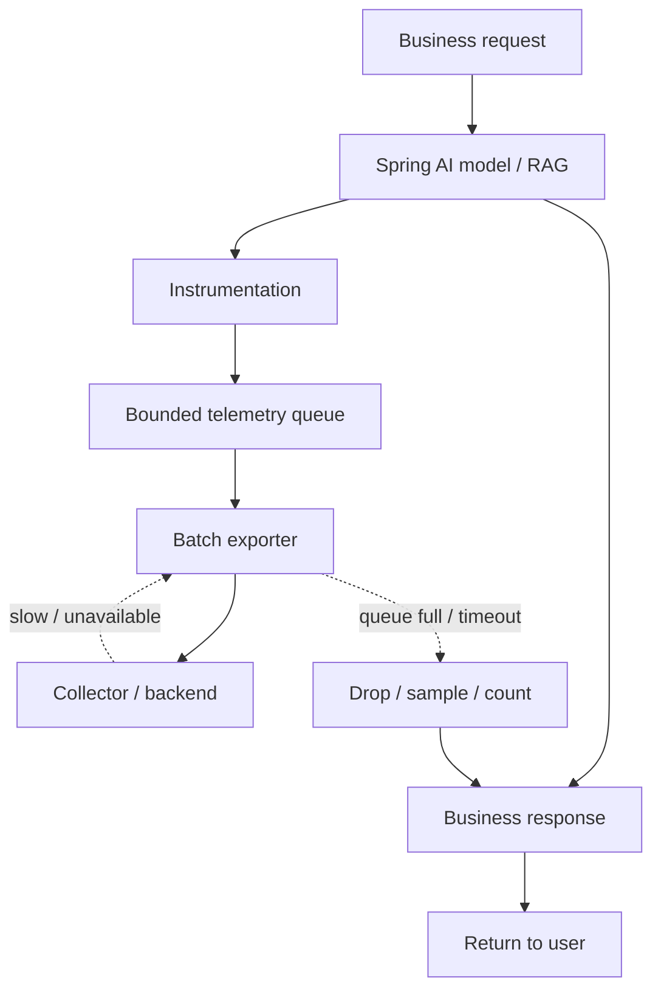

# Giới hạn tác động khi hệ thống telemetry bị chậm hoặc lỗi

## 1. Vì sao telemetry không được làm gián đoạn nghiệp vụ?

Một ứng dụng Spring AI thường tạo nhiều loại telemetry trong một request: metrics của ChatModel, spans của embedding và vector store, trace của retrieval, thông tin evaluator, thời gian gọi provider, token usage và lỗi. Các tín hiệu này giúp nhóm vận hành hiểu hệ thống, nhưng chúng không phải kết quả nghiệp vụ mà người dùng đang chờ.

Hãy hình dung một request RAG:

1. API nhận câu hỏi.
2. EmbeddingModel tạo query vector.
3. VectorStore truy xuất tài liệu.
4. ChatModel tạo câu trả lời.
5. RelevancyEvaluator hoặc FactCheckingEvaluator đánh giá kết quả.
6. Ứng dụng trả câu trả lời cho người dùng.
7. Telemetry được chuyển tới collector và backend.

Nếu collector bị chậm, exporter timeout hoặc mạng bị gián đoạn, ứng dụng có thể gặp tình huống nguy hiểm: thread xử lý request bị giữ lại để gửi span, hàng đợi telemetry tăng không giới hạn, heap cạn, latency tăng và cuối cùng làm request nghiệp vụ thất bại. Một hệ thống giám sát bị lỗi khi đó lại gây ra sự cố lớn hơn mà nó cần quan sát.

Bài **“Giới hạn tác động khi hệ thống telemetry bị chậm hoặc lỗi”** thuộc chương **Vận hành** của module **SPRING_AI_EVALUATION_OBSERVABILITY**. Module học cách đánh giá chất lượng Spring AI bằng dataset, relevance, fact checking và kiểm thử RAG/tool calling; đồng thời đo metrics, traces, chi phí và độ trễ để phát hiện suy giảm qua từng phiên bản prompt, model và pipeline.

**Nguyên tắc thiết kế:** đường gửi telemetry phải có giới hạn thời gian, giới hạn bộ nhớ, chính sách retry và hành vi khi quá tải. Với telemetry vận hành thông thường, request nghiệp vụ không nên phải chờ backend quan sát hoạt động trở lại.

## 2. Phân biệt đường nghiệp vụ và đường telemetry

Đường nghiệp vụ thực hiện công việc người dùng yêu cầu. Đường telemetry thu thập và chuyển các tín hiệu giúp vận hành hệ thống.

| Đường | Ví dụ | Mục tiêu | Khi gặp sự cố |
| --- | --- | --- | --- |
| **Business path** | ChatModel, Retriever, VectorStore, API response | Hoàn thành tác vụ người dùng | Áp dụng timeout/retry/fallback theo nghiệp vụ |
| **Instrumentation** | Micrometer Observation, counters, timers, span creation | Ghi nhận sự kiện tại chỗ | Giữ thao tác nhẹ, không serialize payload lớn |
| **Export path** | OTLP exporter, Prometheus registry, Zipkin reporter | Gửi telemetry ra ngoài | Queue hữu hạn, timeout, drop policy |
| **Collector/backend** | OTel Collector, Prometheus, Tempo, Jaeger | Nhận, xử lý và lưu dữ liệu | Buffer có giới hạn, retry có ngân sách |
| **Evaluation path** | Judge ChatModel, evaluator, scoring pipeline | Đánh giá chất lượng nội dung | Chính sách riêng; không nhầm với export telemetry |

Một observation có thể được tạo ngay trong luồng request, còn export thường được thực hiện qua registry/reporter hoặc batch processor. Không phải mọi thư viện và mọi handler đều có cùng đặc tính đồng bộ/bất đồng bộ; phải kiểm tra implementation thực tế. Tuy nhiên, kiến trúc ứng dụng nên bảo đảm không tự thực hiện HTTP call tới telemetry backend trên critical request path.



Sơ đồ minh họa nguyên tắc cô lập. Trong implementation cụ thể, queue có thể nằm trong OpenTelemetry BatchSpanProcessor, Micrometer registry/exporter hoặc collector; không nhất thiết ứng dụng phải tự viết thêm một queue thứ hai.

## 3. Những lỗi telemetry thường gặp

| Lỗi | Dấu hiệu | Tác động nếu không giới hạn |
| --- | --- | --- |
| Collector chậm | Export duration tăng, batch chưa flush | Queue tăng, bộ nhớ tăng |
| Backend ngừng hoạt động | Connection refused, timeout, HTTP 5xx | Retry dồn dập |
| DNS/TLS lỗi | Không phân giải endpoint hoặc handshake thất bại | Nhiều request export lỗi lặp lại |
| Credential hết hạn | HTTP 401/403 | Exporter liên tục thử lại |
| Queue đầy | Dropped spans/metrics tăng | Mất dữ liệu quan sát |
| Batch quá lớn | Memory spike, payload vượt giới hạn | Export lỗi hoặc GC tăng |
| Cardinality bùng nổ | Số time series tăng nhanh | Backend tốn RAM/CPU |
| Shutdown quá ngắn | Process dừng trước khi flush | Mất batch cuối |
| Sampling quá cao | Span volume tăng đột ngột | Collector/backend quá tải |
| Logging debug quá nhiều | I/O và storage tăng | Ảnh hưởng latency và chi phí |

Không phải mọi lỗi đều nên retry. Lỗi 401 do credential sai không tự hết sau vài lần thử; lỗi 429 có thể cần tôn trọng Retry-After; timeout không chứng minh backend chưa nhận dữ liệu. Retry không giới hạn có thể làm sự cố lan rộng.

## 4. Failure policy: telemetry và nghiệp vụ cần quyết định khác nhau

Với telemetry vận hành thông thường, có thể chọn **fail-open**: nếu export không hoạt động, tiếp tục xử lý request và ghi nhận số liệu drop nếu có thể. Với tác vụ nghiệp vụ bắt buộc phải có audit record, không được dùng cùng chính sách một cách máy móc.

| Dữ liệu | Ví dụ | Chính sách phù hợp |
| --- | --- | --- |
| Operational metrics | Latency, throughput, error counters | Ưu tiên giữ nghiệp vụ hoạt động; mất một phần dữ liệu phải được đo |
| Distributed traces | Span của request RAG | Chấp nhận sampling/drop có giới hạn; không chặn request |
| Debug logs | Log chẩn đoán | Có thể giảm mức log khi backend chậm |
| Evaluation result | Verdict của judge model | Quyết định theo mục đích; không tự coi lỗi judge là PASS |
| Audit/compliance record | Lịch sử phê duyệt, giao dịch bắt buộc | Dùng kho lưu trữ bền vững riêng và quy tắc fail-closed phù hợp |
| Billing usage ledger | Dữ liệu cần đối soát chi phí | Ghi bền vững/idempotent; không dựa riêng vào trace |

**Telemetry không phải audit ledger.** Span có thể bị sampling, retention hoặc drop khi queue đầy. Nếu nghiệp vụ cần chứng minh một sự kiện đã xảy ra, hãy lưu event trong kho dữ liệu bền vững có idempotency và retention riêng; có thể liên kết trace ID nhưng không lấy trace thay bằng chứng.

Tương tự, evaluator là một model call có chi phí và lỗi riêng. Nếu đánh giá chỉ phục vụ monitoring, có thể bỏ qua khi evaluator unavailable theo policy. Nếu evaluator là release gate trong CI, lỗi evaluator nên làm pipeline báo không xác định/failed theo quy định, không biến thành kết quả pass.

## 5. Các lớp bảo vệ theo thứ tự

Một hệ thống chịu lỗi tốt không dựa vào một timeout duy nhất. Hãy đặt giới hạn tại từng lớp:

1. **Request path:** không chờ network export; tránh xử lý payload telemetry lớn.
2. **Queue:** dung lượng hữu hạn; không cho producer thêm vô hạn.
3. **Batch:** giới hạn số span/metric và kích thước payload mỗi lần gửi.
4. **Exporter:** connect/read/export timeout rõ ràng.
5. **Retry:** số lần hữu hạn, backoff và jitter; không retry lỗi vĩnh viễn.
6. **Circuit breaker hoặc cooldown:** tránh gọi endpoint liên tục khi đang lỗi.
7. **Collector:** memory limiter, batch processor, queue và retry exporter.
8. **Backend:** quota, retention, cardinality control và alert.
9. **Shutdown:** giới hạn thời gian flush để process không treo vô hạn.

Mỗi lớp cần metric sức khỏe riêng. Nếu chỉ đo model latency mà không đo queue/export health, nhóm vận hành khó biết telemetry đang bị mất.

## 6. Queue hữu hạn và backpressure

Queue telemetry hấp thụ chênh lệch tốc độ giữa producer và exporter. Queue vô hạn không giải quyết được backend chậm; nó chỉ trì hoãn sự cố tới khi heap đầy.

Một queue nên có:

- capacity tối đa;
- batch size tối đa;
- thời gian chờ tối đa khi lấy batch;
- chính sách khi đầy;
- số lần retry tối đa;
- số liệu queue depth và dropped events.

Với telemetry không bắt buộc, producer nên dùng thao tác không chờ như offer hoặc cơ chế tương đương; khi queue đầy, thực hiện drop/sample policy đã định. Tránh put không timeout trên request thread vì nó có thể biến sự cố telemetry thành backpressure lên nghiệp vụ.

### Ước tính kích thước queue

Một ước tính ban đầu:

```text
queue_capacity =
    peak_events_per_second
    × tolerated_export_outage_seconds
    × safety_factor
```

Ví dụ:

```text
Peak telemetry events       = 250 events/second
Tolerated exporter outage   = 20 seconds
Safety factor               = 1.2

Estimated capacity          = 250 × 20 × 1.2
                            = 6,000 events
```

Đây chỉ là điểm bắt đầu. Cần đo kích thước event trung bình, overhead object trong heap, số span/trace, tốc độ burst và mức heap có thể dành cho telemetry. Nếu mỗi event sau serialization khoảng 2 KB thì 6.000 event đã tương đương khoảng 12 MB payload thô; object overhead và buffer có thể làm mức RAM thực tế cao hơn nhiều.

Đặt capacity theo ngân sách bộ nhớ, không chỉ theo thời gian outage mong muốn. Queue không thể giữ toàn bộ telemetry trong một outage kéo dài vô hạn.

## 7. Drop policy: khi queue đầy thì bỏ dữ liệu nào?

Không phải mọi span đều có giá trị như nhau. Khi hệ thống quá tải, cần chính sách có chủ đích:

| Policy | Hành vi | Ưu/nhược |
| --- | --- | --- |
| Drop newest | Bỏ event mới khi queue đầy | Đơn giản; có thể mất dấu request đang lỗi |
| Drop oldest | Bỏ event cũ để nhận event mới | Giữ tình hình hiện tại; có thể làm trace cũ không đầy đủ |
| Sample before enqueue | Giảm số event trước queue | Giảm tải sớm; cần sampling đúng mục tiêu |
| Priority queue | Ưu tiên một số loại event | Phức tạp, cần giới hạn từng lớp |
| Block producer | Chờ queue trống | Có thể làm request nghiệp vụ chậm/treo |
| Spill to disk | Ghi buffer ra đĩa | Tăng độ bền nhưng có I/O, quota và bảo mật dữ liệu |

Với distributed traces, drop từng span độc lập có thể làm trace thiếu cấu trúc. Tốt hơn là quyết định sampling ở cấp trace hoặc dùng tail sampling tại collector, thay vì ưu tiên tùy tiện từng span. Khi queue đã đầy, drop policy của SDK/exporter thường do implementation quyết định; hãy kiểm tra tài liệu thay vì giả định có thể đổi bằng một property chung.

Với metrics, không nên tạo một queue event cho từng lần tăng counter nếu registry đã tổng hợp theo meter. Metrics có mô hình lưu trữ khác traces; ưu tiên giảm cardinality và export theo chu kỳ.

## 8. Batch và timeout: giới hạn thời gian chờ backend

Batching giảm overhead network nhưng batch quá lớn có thể vượt giới hạn payload, tăng memory hoặc kéo dài flush.

Các tham số cần xem xét:

- maximum queue size;
- maximum export batch size;
- schedule delay/flush interval;
- export timeout;
- connect timeout và read timeout ở transport;
- retry delay và retry limit;
- payload byte limit của collector/backend.

Khi dùng OpenTelemetry BatchSpanProcessor, SDK có các cấu hình queue size, batch size, schedule delay và export timeout. Một số bản SDK hỗ trợ biến môi trường chuẩn như:

```properties
OTEL_BSP_MAX_QUEUE_SIZE=2048
OTEL_BSP_MAX_EXPORT_BATCH_SIZE=512
OTEL_BSP_SCHEDULE_DELAY=5000
OTEL_BSP_EXPORT_TIMEOUT=10000
```

Các giá trị chỉ là ví dụ. Tên và khả năng hỗ trợ cần đối chiếu phiên bản OpenTelemetry SDK/auto-configuration trong ứng dụng. Không mặc định Spring Boot property và OTel SDK environment variable có cùng ưu tiên hoặc luôn được đọc trong mọi cách khởi tạo tracer.

Với Micrometer metrics exporter, cấu hình step và timeout tùy registry. Ví dụ OTLP metrics export có thể đặt chu kỳ push; các property connect/read timeout cần kiểm tra đúng phiên bản Spring Boot và registry đang dùng. **Không copy một property timeout từ exporter khác rồi cho rằng nó đã có hiệu lực.**

## 9. Retry có giới hạn, backoff và jitter

Retry giúp vượt qua lỗi tạm thời, nhưng retry vô hạn có thể làm tăng tải đúng lúc backend đang yếu.

Một policy điển hình:

1. Chỉ retry lỗi có khả năng tạm thời như timeout, connection reset, 429 hoặc 5xx theo quy tắc của exporter.
2. Không retry vô hạn lỗi cấu hình vĩnh viễn như 401/403 hoặc endpoint sai.
3. Giới hạn số lần retry và tổng thời gian retry.
4. Dùng exponential backoff.
5. Thêm jitter để nhiều instance không retry cùng thời điểm.
6. Tôn trọng Retry-After nếu backend trả header phù hợp.
7. Sau khi hết retry budget, drop hoặc đưa vào cơ chế lưu bền vững riêng nếu yêu cầu nghiệp vụ cho phép.

Ví dụ thời gian chờ:

```text
attempt 1: 200 ms + jitter
attempt 2: 400 ms + jitter
attempt 3: 800 ms + jitter
then: stop retrying / drop according to policy
```

Không đặt retry ở mọi tầng cùng lúc. Nếu SDK retry 3 lần, collector retry 5 lần và proxy retry thêm, một event có thể tạo nhiều lần gửi và làm outage nặng hơn. Cần biết retry budget được áp ở exporter, collector hay transport.

Telemetry exporter thường cần ưu tiên **bounded retry** và không chặn producer. Không dùng retry policy của model generation cho telemetry exporter; semantics và hậu quả khác nhau.

## 10. Circuit breaker và cooldown

Nếu exporter liên tục thất bại, circuit breaker có thể ngăn các lần gọi tiếp theo trong một khoảng thời gian:

- **Closed:** gửi bình thường.
- **Open:** tạm dừng gửi sau khi lỗi vượt ngưỡng.
- **Half-open:** cho phép một số lần thử để xác định backend đã phục hồi chưa.

Với exporter SDK có sẵn retry/queue, không nên bọc thêm circuit breaker một cách tùy tiện vì có thể xung đột với cơ chế flush hoặc làm mất batch. Circuit breaker hữu ích hơn ở một service tự gửi telemetry hoặc gọi usage/billing endpoint riêng.

Cooldown nên có thời hạn và có kiểm tra phục hồi. Khi backend hồi phục, exporter tiếp tục gửi batch mới; không cố dồn toàn bộ backlog không giới hạn vào backend vừa phục hồi.

## 11. OpenTelemetry Collector: bảo vệ collector và backend

Collector cũng cần giới hạn bộ nhớ và queue. Một cấu hình minh họa cho Collector dùng memory limiter, batch processor và exporter queue:

```yaml
processors:
  memory_limiter:
    check_interval: 1s
    limit_mib: 512
    spike_limit_mib: 128

  batch:
    send_batch_size: 512
    timeout: 5s

exporters:
  otlp:
    endpoint: telemetry-backend:4317
    sending_queue:
      enabled: true
      queue_size: 2048
    retry_on_failure:
      enabled: true
      initial_interval: 1s
      max_interval: 10s
      max_elapsed_time: 60s

service:
  pipelines:
    traces:
      receivers: [otlp]
      processors: [memory_limiter, batch]
      exporters: [otlp]
```

Đây là ví dụ cấu trúc để giải thích các lớp bảo vệ; schema và tên component/field phải khớp phiên bản Collector và exporter đang cài. Không paste nguyên cấu hình mà chưa chạy validation của Collector.

Memory limiter giúp collector từ chối/giảm nhận dữ liệu khi tiến gần giới hạn bộ nhớ. Batch processor gom dữ liệu. Exporter queue và retry giúp hấp thụ lỗi ngắn hạn, nhưng queue vẫn hữu hạn. Khi queue đầy hoặc retry hết thời gian, dữ liệu có thể bị drop; cần alert trên exporter send failures và queue utilization.

Không đặt memory limit của Collector cao hơn RAM container/VM được cấp. Cần tính thêm overhead của receiver, processor, exporter và Go runtime.

## 12. Sampling để giảm tải khi lưu lượng tăng

Sampling là công cụ giảm volume, nhưng phải phân biệt:

- **Trace sampling:** chọn trace nào được export.
- **Evaluation sampling:** chọn câu trả lời nào được gửi tới judge model.
- **Log sampling:** giảm log lặp hoặc log debug.
- **Metric cardinality control:** giới hạn số time series; đây không phải trace sampling.

Spring Boot có property trace sampling probability, ví dụ:

```properties
management.tracing.sampling.probability=0.10
```

Giá trị 0.10 là ví dụ 10%, không phải khuyến nghị cho mọi hệ thống. Sampling phải có chiến lược parent-based phù hợp để tránh trace con tách khỏi trace cha. Nếu muốn giữ trace lỗi/chậm theo điều kiện, có thể dùng tail sampling ở collector, nhưng cần gửi đủ dữ liệu tới collector và cấp ngân sách queue/memory tương ứng.

Evaluation sampling do ứng dụng định nghĩa. Trong production, có thể lấy mẫu thấp cho traffic thông thường, nhưng giữ 100% bộ golden test và một số luồng rủi ro cao theo policy. Không giảm evaluator sampling trong CI chỉ để làm pipeline nhanh hơn nếu mục tiêu là regression gate đầy đủ.

## 13. Giữ request path nhẹ: không export đồng bộ trong controller

Một anti-pattern là:

```java
// Anti-pattern: request thread gọi trực tiếp telemetry backend.
public Answer handle(Question question) {
    Answer answer = ragService.answer(question);
    telemetryHttpClient.post("/spans", buildSpanPayload());
    return answer;
}
```

Nếu endpoint telemetry timeout 5 giây, người dùng có thể phải chờ thêm 5 giây dù câu trả lời đã sẵn sàng. Nếu backend lỗi, request nghiệp vụ cũng thất bại theo.

Cách tổ chức tốt hơn là để Micrometer/OTel instrumentation ghi nhận tại chỗ và exporter/batch processor xử lý riêng. Nếu ứng dụng cần gửi một sự kiện tùy chỉnh, hãy đẩy vào queue hữu hạn và trả về ngay khi enqueue thành công hoặc drop theo policy.

**Không biến request thread thành exporter worker.** Không gọi forceFlush cho mỗi request; flush đồng bộ có thể tạo latency spike và làm mất lợi ích batching.

## 14. Java: queue hữu hạn cho telemetry tùy chỉnh

Ví dụ sau minh họa một buffer nhỏ cho **sự kiện telemetry do ứng dụng tự định nghĩa**. Không thay thế queue/batch processor của OpenTelemetry hoặc Micrometer.

```java
import java.util.concurrent.ArrayBlockingQueue;
import java.util.concurrent.BlockingQueue;
import java.util.concurrent.atomic.LongAdder;

public final class BoundedTelemetryBuffer<T> {

    private final BlockingQueue<T> queue;
    private final LongAdder dropped = new LongAdder();

    public BoundedTelemetryBuffer(int capacity) {
        if (capacity < 1) {
            throw new IllegalArgumentException("capacity phải dương");
        }
        this.queue = new ArrayBlockingQueue<>(capacity);
    }

    // Không block producer khi queue đầy.
    public boolean offer(T event) {
        if (event == null) {
            throw new IllegalArgumentException("event không được null");
        }

        boolean accepted = queue.offer(event);
        if (!accepted) {
            dropped.increment();
        }
        return accepted;
    }

    // Chỉ worker chuyên trách mới lấy batch.
    public int drainTo(
            java.util.Collection<? super T> batch,
            int maxElements) {
        return queue.drainTo(batch, maxElements);
    }

    public int size() {
        return queue.size();
    }

    public int capacity() {
        return queue.size() + queue.remainingCapacity();
    }

    public long droppedCount() {
        return dropped.sum();
    }
}
```

Ở request path, gọi offer và không chờ network. Worker nền có trách nhiệm gom batch, export với timeout, retry hữu hạn và phân loại lỗi. Nếu offer trả false, hệ thống đã bỏ event; hãy tăng metric drop bằng một meter có sẵn hoặc bộ đếm được scrape độc lập.

Buffer trong ví dụ không tự xử lý shutdown, retry, fairness hay persistence. Nó phù hợp để minh họa nguyên tắc bounded queue, không phải một exporter production hoàn chỉnh. Đừng đưa prompt, transcript, audio bytes hoặc image Base64 vào queue này nếu không có chính sách dữ liệu và giới hạn payload.

Một unit test nhỏ xác nhận queue đầy không block producer:

```java
import static org.junit.jupiter.api.Assertions.*;

import org.junit.jupiter.api.Test;

class BoundedTelemetryBufferTest {

    @Test
    void dropsWhenCapacityIsReached() {
        BoundedTelemetryBuffer<String> buffer =
                new BoundedTelemetryBuffer<>(1);

        assertTrue(buffer.offer("first"));
        assertFalse(buffer.offer("second"));
        assertEquals(1, buffer.size());
        assertEquals(1, buffer.droppedCount());
    }
}
```

Test xác nhận hành vi của buffer mẫu, không kiểm tra exporter SDK hay khả năng backend nhận telemetry.

## 15. Bảo vệ evaluator và judge model khỏi sự cố telemetry

Evaluator có thể phát sinh hai loại hoạt động khác nhau:

1. Ghi observation/metrics cho lần đánh giá.
2. Gọi judge ChatModel để chấm nội dung.

Nếu telemetry exporter lỗi, không nên vì thế làm evaluator hoặc generation thất bại. Nếu judge provider lỗi, đó là lỗi của evaluation path, không phải lỗi exporter.

Một policy phù hợp:

| Tình huống | Hành vi |
| --- | --- |
| Evaluator hoàn thành, exporter lỗi | Giữ verdict nếu có; ghi telemetry drop |
| Evaluator được lấy mẫu nhưng judge timeout | Ghi EVALUATION_ERROR/UNKNOWN; không giả PASS |
| Evaluator queue đầy | Bỏ hoặc hoãn theo policy; tăng skipped counter |
| Production judge budget vượt | Tắt/giảm evaluation sampling có kiểm soát |
| CI golden evaluation lỗi | Đánh dấu pipeline failed/unknown theo release gate |
| Trace không được sample | Vẫn ghi metric evaluation outcome nếu registry hoạt động |

Không dùng một circuit breaker chung cho cả ChatModel generation và judge model nếu hai model có quota, provider hoặc SLO khác nhau. Giữ evaluator concurrency/queue riêng để judge traffic không chiếm hết tài nguyên của request chính.

## 16. Không làm telemetry quá lớn hoặc chứa dữ liệu nhạy cảm

Khi exporter chậm, payload lớn làm queue và memory tăng nhanh. Những trường cần hạn chế:

- prompt và completion đầy đủ;
- retrieved documents hoặc toàn bộ context RAG;
- tool arguments/results;
- transcript, audio payload, image Base64;
- exception message có thể chứa request/URL;
- high-cardinality IDs và labels.

Thay vì lưu toàn bộ nội dung, dùng metadata nhỏ và an toàn như operation, provider, model profile, outcome, duration, token counts khi có, và correlation ID ở trace. Nếu cần nội dung để điều tra, dùng sampling có kiểm soát, redaction, quyền truy cập và retention riêng.

**Không bật prompt logging để giải quyết exporter lỗi.** Logging thêm nội dung làm payload lớn hơn và tăng nguy cơ rò rỉ; nó không khắc phục queue hoặc timeout.

## 17. Metrics theo dõi chính telemetry pipeline

Một hệ thống cần tự giám sát đường xuất telemetry. Các metric gợi ý:

| Metric | Đơn vị | Cảnh báo khi |
| --- | --- | --- |
| telemetry.queue.size | Events | Gần capacity trong thời gian dài |
| telemetry.queue.capacity | Events | Dùng để tính utilization |
| telemetry.queue.dropped | Events | Tăng liên tục hoặc vượt ngưỡng |
| telemetry.export.duration | Seconds | p95 vượt ngân sách |
| telemetry.export.failures | Events | Tăng đột biến |
| telemetry.export.retries | Events | Retry budget bị tiêu thụ |
| telemetry.export.batch.size | Events | Batch quá nhỏ/quá lớn bất thường |
| telemetry.collector.memory | Bytes | Gần memory limit |
| telemetry.collector.queue.utilization | Ratio | Queue exporter gần đầy |
| telemetry.trace.sampled | Traces | So với số request |
| telemetry.evaluation.skipped | Evaluations | Tăng do queue/budget |

Tên metric trên là ví dụ do ứng dụng/collector định nghĩa; không phải tất cả đều được Spring AI tự cung cấp. OpenTelemetry SDK và Collector có các self-telemetry metrics riêng; tên cụ thể phụ thuộc phiên bản và cấu hình.

### PromQL minh họa

Queue utilization:

```promql
telemetry_queue_size
/
telemetry_queue_capacity
```

Tỷ lệ export failure trong 5 phút:

```promql
sum(rate(telemetry_export_failures_total[5m]))
/
clamp_min(sum(rate(telemetry_export_attempts_total[5m])), 1)
```

Tốc độ drop:

```promql
sum by (service, environment) (
  rate(telemetry_queue_dropped_total[5m])
)
```

Cần thay tên metric theo exporter/SDK thực tế. Nếu metric sức khỏe telemetry cũng chỉ được gửi qua chính pipeline đang lỗi, có thể mất luôn cảnh báo. Hãy có một kênh health độc lập phù hợp, ví dụ process metrics tại chỗ, collector self-telemetry hoặc alert ngoài hệ thống.

## 18. Alert và SLO cho telemetry pipeline

Không nên cảnh báo chỉ vì một lần export thất bại. Hãy đặt SLO theo tác động:

- tỷ lệ telemetry export thành công trong cửa sổ thời gian;
- queue utilization dưới ngưỡng;
- dropped spans/metrics trong ngân sách;
- export p95 dưới timeout budget;
- collector memory dưới giới hạn;
- evaluator queue backlog và skipped rate;
- tỷ lệ request nghiệp vụ bị ảnh hưởng bởi telemetry phải bằng 0 theo thiết kế.

Ví dụ ngưỡng vận hành minh họa:

| Chỉ số | Warning | Critical |
| --- | ---: | ---: |
| Queue utilization | > 70% trong 5 phút | > 90% trong 2 phút |
| Export failure ratio | > 1% trong 10 phút | > 5% trong 5 phút |
| Drop rate | > 0.1% | > 1% |
| Collector memory | > 75% limit | > 90% limit |
| Export duration p95 | > 50% timeout budget | Gần timeout budget |
| Business request latency delta | Tăng nhẹ cần điều tra | Vượt SLO nghiệp vụ |

Đây là ví dụ để bắt đầu thiết kế, không phải ngưỡng phổ quát. Hãy chọn ngưỡng theo baseline, throughput, memory budget và yêu cầu retention. Một hệ thống low-volume có thể dùng ngưỡng tuyệt đối; hệ thống high-volume cần nhìn cả tỷ lệ và số lượng tuyệt đối.

## 19. Shutdown và restart: flush có giới hạn

Khi ứng dụng dừng, exporter có thể cố flush dữ liệu còn trong queue. Nếu flush không có deadline, shutdown có thể kéo dài hoặc process bị terminate trước khi hoàn thành.

Cần quyết định:

- thời gian tối đa dành cho graceful shutdown;
- có flush một lần hay nhiều lần;
- xử lý queue còn lại khi deadline hết;
- signal termination và readiness;
- hành vi khi rolling deployment;
- có chấp nhận mất telemetry cuối cùng hay cần buffer bền vững riêng.

Không gọi forceFlush đồng bộ trong mỗi request. Chỉ dùng flush ở lifecycle/shutdown theo cơ chế SDK và deadline đã cấu hình. Nếu cần bảo đảm audit event, ghi vào outbox bền vững trước; đừng dựa vào flush trace cuối cùng.

## 20. Failure drill: kiểm tra hệ thống khi telemetry backend mất kết nối

Nên thực hiện trong môi trường test/staging với dữ liệu giả lập:

1. Gửi một lượng request RAG ổn định và ghi baseline latency/error rate.
2. Tạm dừng collector hoặc chặn kết nối tới exporter.
3. Tiếp tục tạo request và quan sát business latency.
4. Theo dõi queue size, memory, retries và dropped telemetry.
5. Xác nhận request không chờ export đồng bộ.
6. Giữ outage đủ lâu để queue đạt giới hạn đã đặt.
7. Xác nhận drop/backpressure policy hoạt động như thiết kế.
8. Khôi phục collector và xem exporter phục hồi mà không tạo retry storm.
9. Kiểm tra queue được drain trong tốc độ có giới hạn, không làm backend quá tải.
10. Restart một instance trong lúc queue có dữ liệu và xác nhận shutdown deadline.
11. Đối chiếu số request nghiệp vụ với số trace được sample/export; giải thích phần chênh lệch.
12. Lặp lại với judge model unavailable để xác nhận evaluator path được cô lập riêng.

### Tiêu chí pass

- Business request latency/error rate không tăng đáng kể chỉ vì telemetry backend lỗi.
- Queue không vượt capacity và heap không tăng không giới hạn.
- Retry hữu hạn, có backoff/jitter.
- Drop được đếm và cảnh báo qua kênh còn hoạt động.
- Sau khi backend phục hồi, hệ thống không retry storm.
- Evaluator failure không bị ghi nhầm thành verdict pass.
- Audit/billing records bắt buộc vẫn được lưu theo kho bền vững riêng.

Không chạy failure drill trên production nếu chưa có kế hoạch, phạm vi và quyền kiểm soát phù hợp. Bài tập nên bắt đầu ở staging.

## 21. Playbook xử lý sự cố telemetry chậm hoặc lỗi

| Triệu chứng | Nguyên nhân có thể | Hành động |
| --- | --- | --- |
| API latency tăng cùng exporter timeout | Export đang block request thread | Kiểm tra synchronous export và flush |
| Heap tăng dần khi backend ngừng | Queue không giới hạn hoặc batch payload lớn | Giới hạn queue/batch, drop policy |
| Exporter retry liên tục | Retry không có budget hoặc lỗi auth | Giới hạn retry, sửa credentials |
| Queue đầy sau burst | Producer nhanh hơn exporter | Sampling, batch tuning, capacity budget |
| Collector OOM | Thiếu memory limiter hoặc queue quá lớn | Hạ queue/batch, đặt memory limit |
| Backend phục hồi nhưng CPU tăng vọt | Backlog được drain quá nhanh | Giới hạn export throughput |
| Trace thiếu span con | Drop từng span hoặc context propagation lỗi | Kiểm trace-level sampling và propagation |
| Metrics mất sau đổi sampler | Nhầm trace sampling với meter filter | Kiểm registry/filter riêng |
| Judge model bị chậm | Judge traffic tranh quota/tài nguyên | Tách concurrency, queue và budget |
| Không thấy drop alert | Health metric đi cùng pipeline đã lỗi | Dùng kênh self-telemetry độc lập |
| Shutdown kéo dài | Flush không có deadline | Cấu hình graceful shutdown/flush timeout |
| Cost tăng sau outage | Retry hoặc duplicate export/event | Kiểm attempts, idempotency và billing |

Quy trình:

1. Xác định business path có bị ảnh hưởng hay không.
2. Xác định lớp lỗi: instrumentation, SDK queue, exporter, network, collector hay backend.
3. Kiểm queue utilization, export duration, retry và drop.
4. Nếu cần, giảm sampling hoặc tắt telemetry không thiết yếu theo feature flag có kiểm soát.
5. Không tắt metric cảnh báo duy nhất đang giúp theo dõi tình trạng.
6. Khôi phục endpoint/credential và xác nhận exporter hoạt động.
7. Kiểm soát drain backlog.
8. Đối chiếu trace loss và các business/audit record bắt buộc.
9. Ghi nhận nguyên nhân gốc và cập nhật capacity/failure drill.

## 22. Bài tập thực hành

1. **Tách đường:** vẽ request RAG và chỉ ra đâu là business path, instrumentation và export path.
2. **Queue sizing:** hệ thống tạo 400 spans/giây, muốn chịu outage 15 giây, safety factor 1,25. Tính capacity ban đầu và nêu yếu tố memory cần đo.
3. **Drop policy:** khi queue đầy, vì sao không nên block controller thread? So sánh drop newest và drop oldest.
4. **Retry:** thiết kế retry policy cho lỗi timeout, 429, 401 và 5xx. Lỗi nào không nên retry?
5. **OTel batch:** giải thích vai trò max queue size, max export batch size, schedule delay và export timeout.
6. **Collector:** mô tả memory limiter, batch processor và exporter sending queue giúp giới hạn sự cố như thế nào.
7. **Sampling:** trace sampling giảm từ 100% xuống 10%, vì sao metric counters vẫn có thể giữ đầy đủ?
8. **Evaluator:** judge provider timeout trong production. Thiết kế trạng thái evaluation và cách không làm request generation thất bại.
9. **Audit:** vì sao trace không thay thế audit ledger hoặc billing ledger?
10. **Java:** viết test xác nhận BoundedTelemetryBuffer trả false và tăng dropped count khi queue đầy.
11. **PromQL:** viết alert khi queue utilization vượt 90% liên tục hai phút và khi drop rate tăng.
12. **Failure drill:** thiết kế kịch bản chặn OTLP collector trong staging và tiêu chí pass.
13. **Shutdown:** giải thích vì sao không gọi forceFlush cho mỗi request và cần deadline khi graceful shutdown.
14. **Cardinality:** chọn những trường nào nên giữ trong metrics, trace và log khi exporter đang thiếu bộ nhớ.
15. **Recovery:** collector phục hồi sau 60 giây outage. Làm sao drain backlog mà không tạo thêm quá tải?

## Tài liệu tham khảo

- [Spring AI 2.1.0 – Observability](https://docs.spring.io/spring-ai/reference/observability/index.html): model observations, metrics/traces và phạm vi instrumentation.
- [Spring Boot – Observability](https://docs.spring.io/spring-boot/reference/actuator/observability.html): Observation API, MeterRegistry, tracing và context propagation.
- [Spring Boot – Metrics](https://docs.spring.io/spring-boot/reference/actuator/metrics.html): registry, exporter và histogram.
- [Spring Boot – Tracing](https://docs.spring.io/spring-boot/reference/actuator/tracing.html): sampling, exporter và span lifecycle.
- [OpenTelemetry – Batch Span Processor](https://opentelemetry.io/docs/specs/otel/trace/sdk/#batching-processor): queue, batch, schedule delay và export timeout.
- [OpenTelemetry Collector – Resiliency](https://opentelemetry.io/docs/collector/resiliency/): memory limiter, sending queue, retry và xử lý khi backend không khả dụng.
- [OpenTelemetry Collector – Scaling](https://opentelemetry.io/docs/collector/scaling/): thiết kế collector, tải và giới hạn tài nguyên.

> **Ghi chú triển khai:** Các tên metric tự định nghĩa, queue mẫu, ngưỡng alert và cấu hình Collector trong bài là ví dụ thiết kế. Property và khả năng exporter phụ thuộc phiên bản Spring Boot, Micrometer, OpenTelemetry SDK/Collector và registry. Hãy kiểm tra đúng phiên bản đang dùng và xác nhận bằng failure drill. Bài viết là hướng dẫn vận hành, chưa phải kết quả benchmark hoặc thử nghiệm làm gián đoạn collector trên hệ thống thực tế.
