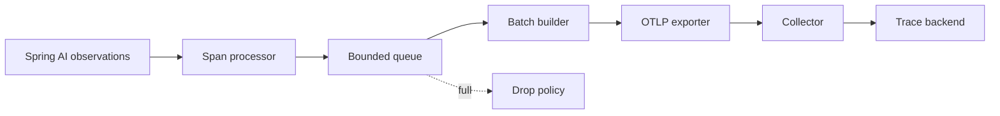

# Hàng đợi, batching và chính sách bỏ dữ liệu khi quá tải

## 1. Vì sao telemetry cần hàng đợi và batching?

Một ứng dụng Spring AI có thể phát hàng trăm hoặc hàng nghìn observation mỗi giây. Một request RAG có thể tạo span cho HTTP, embedding, vector search, ChatModel, tool call và evaluator. Nếu gửi từng span thành một network request riêng, chi phí kết nối và serialization tăng cao. Nếu exporter gửi chậm hơn tốc độ tạo telemetry, dữ liệu tồn đọng trong bộ nhớ.

Hai cơ chế giải quyết hai vấn đề liên quan:

- **Queue** hấp thụ chênh lệch tạm thời giữa tốc độ tạo telemetry và tốc độ export.
- **Batching** gom nhiều telemetry item thành một lần gửi để giảm overhead và tăng hiệu suất truyền.

Hai cơ chế này không làm backend có năng lực vô hạn. Khi tốc độ producer lớn hơn consumer trong thời gian dài, queue cuối cùng sẽ đầy. Hệ thống phải quyết định giữ dữ liệu nào, bỏ dữ liệu nào, giảm tốc độ ở đâu và bảo vệ request nghiệp vụ ra sao.

Bài **“Hàng đợi, batching và chính sách bỏ dữ liệu khi quá tải”** thuộc chương **Vận hành** của module **SPRING_AI_EVALUATION_OBSERVABILITY**. Module học đánh giá chất lượng Spring AI bằng dataset, relevance, fact checking và kiểm thử RAG/tool calling; đồng thời đo metrics, traces, chi phí và độ trễ để tìm nguyên nhân suy giảm qua các phiên bản prompt, model và pipeline.

Sau bài này, bạn có thể thiết kế queue hữu hạn, tính capacity theo event và byte, chọn batch size/flush interval, hiểu backpressure, xây drop policy theo loại telemetry, cấu hình OpenTelemetry SDK/Collector và kiểm thử hệ thống khi tải vượt khả năng export.

## 2. Luồng dữ liệu: producer, queue, batch processor và exporter

Trong pipeline telemetry, các thành phần có vai trò khác nhau:

| Thành phần | Vai trò | Ví dụ |
| --- | --- | --- |
| Producer | Tạo dữ liệu quan sát | Spring AI observation, Micrometer meter, custom event |
| Queue | Giữ dữ liệu đang chờ xử lý | BatchSpanProcessor queue, Collector sending queue |
| Batch processor | Gom item thành lô | Gom 256 spans hoặc flush sau một khoảng thời gian |
| Exporter | Chuyển batch sang backend | OTLP exporter, Zipkin reporter |
| Receiver/backend | Nhận và lưu telemetry | OTel Collector, Tempo, Jaeger, Prometheus |

Một pipeline traces thường có dạng:



Trong OpenTelemetry Java SDK, BatchSpanProcessor quản lý queue và batch cho spans. Với OpenTelemetry Collector, exporter có thể có sending queue và retry policy. Hai queue này nằm ở hai tầng khác nhau: queue phía ứng dụng không thay thế queue ở Collector, và queue Collector không thể khôi phục spans đã bị SDK bỏ trước khi gửi.

Metrics có lifecycle khác traces. Micrometer thường tổng hợp counter, timer và histogram trong registry; registry/exporter đọc hoặc push snapshot theo chu kỳ. Không nên giả định metrics luôn được đưa vào cùng một queue từng-event như spans.

## 3. Queue giải quyết burst, không giải quyết quá tải kéo dài

Giả sử producer phát 1.000 spans/giây, exporter xử lý 1.200 spans/giây. Queue có thể giảm sau burst vì consumer nhanh hơn producer.

Nếu producer phát 1.500 spans/giây trong thời gian dài nhưng exporter chỉ xử lý 1.000 spans/giây, backlog tăng trung bình 500 spans/giây. Với queue capacity 10.000, queue sẽ đầy sau khoảng 20 giây nếu bắt đầu từ rỗng và tốc độ giữ nguyên.

Cần phân biệt:

- **Burst:** tốc độ tăng ngắn hạn, queue có thể hấp thụ.
- **Sustained overload:** tốc độ producer cao hơn consumer lâu dài, queue sẽ đầy.
- **Backend outage:** consumer có thể về 0 trong thời gian outage.
- **Recovery:** backend hoạt động lại nhưng tốc độ drain backlog cũng phải được giới hạn.

Queue chỉ cung cấp thời gian đệm. Muốn giải quyết quá tải kéo dài, cần giảm producer rate, tăng consumer capacity, giảm payload/cardinality, tăng số exporter worker hoặc bỏ bớt telemetry theo policy.

## 4. Little’s Law và cách đọc queue

Trong một hệ thống ổn định, Little’s Law mô tả:

```text
L = λ × W

L = số item trung bình trong hệ thống
λ = throughput trung bình (item/second)
W = thời gian trung bình một item nằm trong hệ thống
```

Ví dụ exporter xử lý 800 spans/giây và một span chờ trung bình 0,25 giây trước khi được gửi:

```text
L = 800 × 0.25 = 200 spans
```

Đây là số item trung bình trong trạng thái ổn định, không phải capacity queue cần đặt. Capacity phải xét burst, outage tolerance, batch behavior, memory budget và headroom.

Nếu queue depth tăng liên tục, W cũng tăng. Khi queue gần đầy, telemetry đã cũ trước khi tới backend; dashboard realtime có thể đang hiển thị dữ liệu trễ nhiều giây hoặc nhiều phút.

## 5. Tính capacity theo tốc độ và thời gian outage

Một công thức sizing đơn giản:

```text
required_capacity =
    peak_producer_rate
    × tolerated_export_outage
    × safety_factor
```

Ví dụ:

```text
Peak producer rate       = 600 spans/second
Outage window            = 15 seconds
Safety factor             = 1.5

Required capacity        = 600 × 15 × 1.5
                         = 13,500 spans
```

Capacity 13.500 spans chỉ là ước tính ban đầu. Nếu queue đang có backlog, phải tính phần capacity còn trống. Nếu backend outage dài hơn 15 giây, queue có thể đầy và bắt đầu drop theo policy.

Một công thức khác cho queue theo byte:

```text
queue_memory_bytes =
    queue_capacity
    × average_serialized_event_bytes
    × overhead_factor
```

Giả sử 13.500 spans, kích thước payload trung bình 1,5 KB và overhead factor 2,5:

```text
13,500 × 1.5 KB × 2.5 = 50,625 KB
                           ≈ 49.4 MiB
```

Đây chỉ là ước lượng. Object trong heap có thể lớn hơn payload serialized do String, map, attribute, reference và allocator overhead. Hãy đo heap thực tế bằng workload đại diện; không đặt queue dựa trên kích thước JSON nén duy nhất.

### Capacity phải có cả giới hạn item và giới hạn byte

Một queue có giới hạn 10.000 events vẫn có thể gây OOM nếu một event chứa context RAG rất lớn. Cần giới hạn payload và attribute count, tránh lưu prompt/document/audio bytes đầy đủ, đồng thời cân nhắc byte budget ở exporter/collector.

## 6. Queue hữu hạn: vì sao không dùng queue vô hạn?

Queue vô hạn biến quá tải thành memory leak có thời gian trì hoãn. Khi backend chậm hoặc ngừng hoạt động, producer vẫn tiếp tục thêm item cho tới khi heap cạn.

Queue hữu hạn buộc hệ thống đưa ra quyết định khi capacity đạt giới hạn:

- từ chối event mới;
- bỏ event cũ;
- giảm sampling;
- ưu tiên một số loại telemetry;
- ghi ra persistent buffer nếu thực sự cần;
- hoặc block producer trong một giới hạn được kiểm soát.

Với telemetry vận hành thông thường, block request thread thường là lựa chọn rủi ro vì nó lan sự cố từ collector sang business path. Với audit event bắt buộc, cần thiết kế durable outbox riêng, không dùng queue trace như nơi lưu trữ bảo đảm.

## 7. Batching: gom dữ liệu để giảm overhead

Batching gom nhiều item thành một request export. Lợi ích:

- giảm số lần mở/gửi request;
- amortize chi phí TLS, HTTP và serialization;
- tận dụng payload lớn hơn hiệu quả;
- giảm overhead xử lý ở collector/backend.

Batch quá nhỏ làm tăng số request và CPU/network overhead. Batch quá lớn làm tăng memory, latency, nguy cơ vượt giới hạn payload và thời gian retry.

Một batch thường được flush khi đạt một trong các điều kiện:

1. số item đạt max export batch size;
2. hết schedule delay hoặc flush interval;
3. queue cần được drain;
4. shutdown gọi flush theo lifecycle;
5. implementation có điều kiện khác theo SDK/exporter.

Batching thường dùng điều kiện **đến trước**: đủ item hoặc hết thời gian. Vì vậy một batch có thể nhỏ khi lưu lượng thấp và đầy khi lưu lượng cao.

## 8. Chọn batch size và flush interval

| Tham số | Quá thấp | Quá cao |
| --- | --- | --- |
| Max batch size | Nhiều request nhỏ, tăng overhead | Payload lớn, memory cao, dễ vượt limit |
| Schedule delay | Export thường xuyên, overhead tăng | Telemetry tới backend chậm |
| Export timeout | Batch dễ thất bại do timeout quá ngắn | Worker bị giữ lâu khi backend treo |
| Queue size | Dễ drop khi burst | Tốn memory và tăng tuổi dữ liệu |
| Concurrent exporters | Throughput thấp | Tăng kết nối, CPU và áp lực backend |

Một điểm khởi đầu để benchmark có thể là batch 256–512 spans và schedule delay 1–5 giây, nhưng đây **không phải giá trị mặc định áp dụng cho mọi SDK**. Hãy kiểm tra default theo phiên bản và đo dưới tải đại diện.

Tối ưu theo ba mục tiêu đồng thời:

- export throughput đủ lớn để backlog không tăng;
- p95 telemetry delivery latency phù hợp nhu cầu vận hành;
- memory và network usage nằm trong ngân sách.

Không tối ưu throughput bằng cách tăng batch vô hạn; latency và memory cũng là chỉ số quan trọng.

## 9. Cấu hình OpenTelemetry BatchSpanProcessor

OpenTelemetry SDK có BatchSpanProcessor để gom spans trước khi export. Một số cấu hình có thể đặt qua environment variables:

```properties
OTEL_BSP_MAX_QUEUE_SIZE=2048
OTEL_BSP_MAX_EXPORT_BATCH_SIZE=512
OTEL_BSP_SCHEDULE_DELAY=5000
OTEL_BSP_EXPORT_TIMEOUT=10000
```

Ý nghĩa:

| Biến | Ý nghĩa |
| --- | --- |
| OTEL_BSP_MAX_QUEUE_SIZE | Số spans tối đa trong queue |
| OTEL_BSP_MAX_EXPORT_BATCH_SIZE | Số spans tối đa trong một batch |
| OTEL_BSP_SCHEDULE_DELAY | Khoảng thời gian scheduler chờ trước khi export batch |
| OTEL_BSP_EXPORT_TIMEOUT | Thời gian tối đa cho một lần export |

Các con số trên là ví dụ. Tên biến, đơn vị và việc auto-configuration có đọc chúng hay không phụ thuộc phiên bản SDK và cách khởi tạo. Không giả định property Spring Boot, Micrometer và OpenTelemetry SDK có cùng namespace.

### Quy tắc batch size

Giữ max export batch size nhỏ hơn hoặc bằng max queue size. Nếu batch size lớn hơn queue capacity, không thể tạo đủ item cho batch. Queue size cũng không nên quá nhỏ so với burst rate.

Với workload có span lớn, có thể cần batch size thấp hơn dù số item chưa cao, vì giới hạn payload theo byte của collector/backend mới là ràng buộc thực tế.

## 10. Queue và batching trong OpenTelemetry Collector

Collector có thể nhận telemetry từ nhiều ứng dụng, batch lại và gửi tới backend. Exporter queue trong Collector hấp thụ sự cố ngắn hạn ở backend đích.

Cấu hình minh họa:

```yaml
processors:
  memory_limiter:
    check_interval: 1s
    limit_mib: 512
    spike_limit_mib: 128
  batch:
    send_batch_size: 512
    timeout: 5s

exporters:
  otlp:
    endpoint: telemetry-backend:4317
    sending_queue:
      enabled: true
      queue_size: 2048
    retry_on_failure:
      enabled: true
      initial_interval: 1s
      max_interval: 10s
      max_elapsed_time: 60s

service:
  pipelines:
    traces:
      receivers: [otlp]
      processors: [memory_limiter, batch]
      exporters: [otlp]
```

Đây là ví dụ cấu trúc; schema component và tên field có thể khác theo phiên bản Collector. Cần chạy validation bằng binary/config checker đúng phiên bản trước khi triển khai.

send_batch_size có thể là ngưỡng gửi batch, còn send_batch_max_size nếu được cấu hình sẽ giới hạn kích thước tối đa; semantics cụ thể cần xem tài liệu processor của release đang dùng. Exporter sending_queue.queue_size có thể được tính theo requests hoặc units tùy exporter/extension; không tự diễn giải thành byte nếu chưa xác minh.

## 11. Backpressure: giảm tốc độ producer ở đâu?

Backpressure là cơ chế điều tiết khi consumer không theo kịp producer. Với telemetry, có nhiều vị trí để áp dụng:

| Vị trí | Cách điều tiết | Lưu ý |
| --- | --- | --- |
| Trước instrumentation | Không tạo event không cần thiết | Giảm payload sớm |
| Sampling | Chỉ tạo/export một phần traces | Nên chọn ở cấp trace |
| SDK queue | Queue hữu hạn, drop khi đầy | Không block request nếu có thể |
| Collector receiver | Refuse/reject khi quá tải | SDK cần xử lý lỗi gửi |
| Collector processor | Filter/drop theo policy | Tránh làm trace mất cấu trúc |
| Exporter queue | Giới hạn backlog khi backend chậm | Theo dõi queue utilization |
| Backend ingestion | Rate limit/quota | Có thể trả 429/5xx |

Không phải mọi tầng đều có thể backpressure ngược tới request một cách an toàn. Với telemetry, thường ưu tiên **load shedding** (bỏ có kiểm soát) hơn là làm chậm business request.

## 12. Chính sách bỏ dữ liệu khi queue đầy

Các chiến lược phổ biến:

| Policy | Cách hoạt động | Ưu điểm | Rủi ro |
| --- | --- | --- | --- |
| Drop newest | Bỏ item mới khi queue đầy | Giữ dữ liệu đã chờ lâu | Có thể mất sự kiện đang xảy ra |
| Drop oldest | Bỏ item cũ để nhận item mới | Ưu tiên tình hình hiện tại | Trace cũ có thể bị thiếu span |
| Drop by priority | Bỏ loại ít quan trọng trước | Giữ telemetry ưu tiên | Phức tạp, cần quota mỗi nhóm |
| Sample before enqueue | Giảm producer rate trước queue | Giảm tải toàn pipeline | Có thể bỏ cả trace hữu ích nếu policy kém |
| Block producer | Chờ queue trống | Không mất ngay item mới | Có thể làm request nghiệp vụ treo |
| Spill to disk | Ghi buffer ra đĩa | Có thể chịu outage lâu hơn | I/O, quota, recovery và bảo mật phức tạp |

OpenTelemetry BatchSpanProcessor có queue hữu hạn; khi queue đầy, spans mới có thể bị drop theo hành vi của SDK. Không nên giả định mọi implementation cho phép chọn drop-oldest/drop-newest qua một property. Nếu cần chính sách ưu tiên phức tạp, phải thiết kế ở tầng ứng dụng/collector và kiểm tra ảnh hưởng tới trace integrity.

### Trace integrity quan trọng hơn ưu tiên một span đơn lẻ

Một trace gồm nhiều span cha-con. Nếu giữ span lỗi nhưng bỏ span cha, người điều tra có thể không biết request nào tạo ra nó. Nếu giữ span con rời rạc, trace có thể mất ngữ cảnh.

Do đó, sampling nên được quyết định ở cấp trace khi có thể. Tail sampling ở collector có thể giữ trace theo latency/error, nhưng cần collector nhận được các span liên quan và giữ chúng đủ lâu để ra quyết định. Khi ứng dụng SDK đã drop một phần spans vì queue đầy, collector không thể phục hồi phần bị mất.

## 13. Drop policy theo loại telemetry

Không phải mọi loại telemetry có cùng giá trị và semantics:

| Loại | Khi quá tải | Lý do |
| --- | --- | --- |
| Debug logs | Giảm sampling hoặc drop log lặp | Có thể tái tạo từ code/test |
| Distributed traces | Sample/drop có kiểm soát ở cấp trace | Giữ trace đại diện và lỗi quan trọng |
| Metrics counters/timers | Giữ aggregation, giảm cardinality | Dữ liệu xu hướng có giá trị cao |
| High-cardinality attributes | Loại bỏ hoặc hạ xuống trace/log | Tránh nổ time series |
| Evaluation details | Giới hạn queue/concurrency và sample | Judge call có chi phí riêng |
| Audit events | Ghi durable store/outbox riêng | Không được drop như telemetry |
| Billing usage events | Ghi bền vững, idempotent | Cần đối soát chi phí |

Metrics có thể vẫn ghi nhận toàn bộ counter trong registry dù trace sampling thấp. Nếu backend metrics quá tải, cần điều chỉnh scrape/export interval, cardinality và retention; không áp drop policy từng observation giống queue spans.

## 14. Giới hạn payload và cardinality trước khi enqueue

Một span có thể chứa hàng chục hoặc hàng trăm attributes. Nếu đưa prompt, completion, context RAG, tool arguments, transcript hoặc Base64 image vào attributes, mỗi span sẽ lớn hơn nhiều.

Khi queue capacity tính theo item, payload lớn khiến byte usage tăng không dự đoán được. Vì vậy:

- không lưu toàn bộ prompt/completion trong telemetry mặc định;
- giới hạn số attributes và độ dài string;
- không đưa user ID, request ID hoặc document ID vào metric labels;
- loại bỏ binary payload;
- chỉ giữ metadata cần điều tra như operation, provider, model profile, duration và outcome;
- đặt giới hạn payload tại exporter/collector nếu hỗ trợ.

Giảm kích thước event thường hiệu quả hơn tăng queue. Queue lớn chỉ giữ nhiều payload nhạy cảm hơn trong bộ nhớ và kéo dài thời gian tới backend.

## 15. Java: bounded queue và thao tác offer không chặn producer

Ví dụ sau minh họa buffer hữu hạn cho **custom telemetry event**. Nó không thay thế BatchSpanProcessor hoặc Micrometer registry.

```java
import java.util.Collection;
import java.util.concurrent.ArrayBlockingQueue;
import java.util.concurrent.BlockingQueue;
import java.util.concurrent.atomic.LongAdder;

public final class TelemetryQueue<T> {

    private final BlockingQueue<T> queue;
    private final LongAdder dropped = new LongAdder();

    public TelemetryQueue(int capacity) {
        if (capacity <= 0) {
            throw new IllegalArgumentException(
                    "capacity phải lớn hơn 0");
        }
        this.queue = new ArrayBlockingQueue<>(capacity);
    }

    public boolean offer(T event) {
        if (event == null) {
            throw new IllegalArgumentException("event không được null");
        }

        boolean accepted = queue.offer(event);
        if (!accepted) {
            dropped.increment();
        }
        return accepted;
    }

    public int drainTo(
            Collection<? super T> batch, int maxElements) {
        if (maxElements <= 0) {
            throw new IllegalArgumentException(
                    "maxElements phải lớn hơn 0");
        }
        return queue.drainTo(batch, maxElements);
    }

    public int size() {
        return queue.size();
    }

    public int remainingCapacity() {
        return queue.remainingCapacity();
    }

    public long droppedCount() {
        return dropped.sum();
    }
}
```

offer trả về ngay, không chờ consumer giải phóng chỗ. Khi queue đầy, counter dropped tăng. Worker riêng có thể dùng drainTo để lấy batch và gọi exporter với timeout.

Buffer này chưa xử lý shutdown, retry, serialization, fairness, queue byte budget hay persistence. Không gọi drainTo rồi thực hiện export đồng bộ trên request thread. Trong hệ thống production, ưu tiên SDK/exporter đã được kiểm chứng; custom queue chỉ phù hợp khi có yêu cầu riêng và được kiểm thử đầy đủ.

## 16. Unit test: xác minh queue đầy thì drop

```java
import static org.junit.jupiter.api.Assertions.*;

import java.util.ArrayList;
import java.util.List;

import org.junit.jupiter.api.Test;

class TelemetryQueueTest {

    @Test
    void dropsNewEventWhenQueueIsFull() {
        TelemetryQueue<String> queue = new TelemetryQueue<>(2);

        assertTrue(queue.offer("span-1"));
        assertTrue(queue.offer("span-2"));
        assertFalse(queue.offer("span-3"));

        assertEquals(2, queue.size());
        assertEquals(0, queue.remainingCapacity());
        assertEquals(1, queue.droppedCount());

        List<String> batch = new ArrayList<>();
        assertEquals(2, queue.drainTo(batch, 10));
        assertEquals(List.of("span-1", "span-2"), batch);
    }
}
```

Test kiểm tra buffer mẫu dùng drop-newest, không kiểm tra OpenTelemetry SDK hoặc Collector. Trong test thực tế nên bổ sung concurrency test, consumer chậm, producer burst, shutdown và kiểm tra dropped metrics.

## 17. Batch worker: flush theo size hoặc thời gian

Một worker nền thường lấy batch khi:

- queue đạt một ngưỡng size;
- hết thời gian flush;
- ứng dụng shutdown;
- hoặc exporter yêu cầu flush.

Pseudo-code:

```java
while (running || !queueIsEmpty()) {
    List<Event> batch = new ArrayList<>(maxBatchSize);

    Event first = queue.poll(flushInterval, MILLISECONDS);
    if (first != null) {
        batch.add(first);
        queue.drainTo(batch, maxBatchSize - 1);
    }

    if (!batch.isEmpty()) {
        exporter.exportWithTimeout(batch, exportTimeout);
    }
}
```

Đây là pseudo-code giải thích lifecycle, không phải một implementation hoàn chỉnh. Cần xử lý interrupt, export failure, retry budget, duplicate delivery, poison event, shutdown deadline và queue saturation. Không tạo một thread riêng cho từng event; dùng worker có giới hạn và lifecycle do ứng dụng quản lý.

## 18. Retry và queue: tránh nhân bản backlog

Khi export batch thất bại, exporter có thể retry. Nhưng retry không giới hạn làm batch cũ chiếm worker và queue tiếp tục tăng. Cần xác định:

- retryable errors;
- retry count hoặc max elapsed time;
- exponential backoff và jitter;
- Retry-After nếu backend trả;
- batch nào được retry toàn bộ;
- exporter có thể gửi thành công nhưng response bị mất hay không;
- cách xử lý duplicate nếu gửi lại cùng batch.

Một timeout không chứng minh backend chưa nhận batch. Nếu backend đã ingest nhưng ACK bị mất, retry có thể tạo duplicate. Với traces, backend thường chấp nhận telemetry trùng ở mức nào đó nhưng không nên dựa vào giả định deduplicate tuyệt đối. Với audit/billing event, phải có event ID và idempotency ở durable store.

Sau khi hết retry budget, exporter phải có hành vi xác định: drop, dead-letter hoặc persistent spool. Không giữ retry vô hạn trong memory queue.

## 19. Persistent queue và spill-to-disk

Persistent queue có thể giúp chịu outage dài hơn memory queue, nhưng làm tăng độ phức tạp:

- dữ liệu cần serialize và ghi đĩa;
- disk quota phải hữu hạn;
- cần mã hóa và quyền truy cập;
- cần xử lý file hỏng và crash giữa chừng;
- cần cleanup và retention;
- cần kiểm soát tốc độ replay để không gây overload khi backend hồi phục.

Persistent queue phù hợp khi giá trị của telemetry đủ cao để trả chi phí vận hành. Không dùng nó làm audit/billing database nếu chưa có semantics durability, transaction và idempotency phù hợp.

Một lựa chọn thường tốt hơn cho sự kiện nghiệp vụ bắt buộc là transactional outbox trong database/message broker. Telemetry traces có thể được sampling/drop; outbox business event có chính sách lưu trữ khác.

## 20. Theo dõi queue, batch và drop bằng metrics

Pipeline phải tự quan sát chính nó. Các metric gợi ý:

| Metric | Ý nghĩa | Đơn vị |
| --- | --- | --- |
| telemetry.queue.size | Số item hiện chờ | events |
| telemetry.queue.capacity | Tổng capacity | events |
| telemetry.queue.utilization | size/capacity | ratio |
| telemetry.queue.dropped | Tổng item bị bỏ | events |
| telemetry.batch.size | Số item mỗi batch | events |
| telemetry.batch.bytes | Payload batch | bytes |
| telemetry.export.duration | Thời gian export | seconds |
| telemetry.export.failures | Lần export thất bại | events |
| telemetry.export.retries | Số lần retry | events |
| telemetry.export.last_success | Thời điểm export thành công gần nhất | timestamp |
| telemetry.collector.memory | Bộ nhớ Collector | bytes |

Tên trên là ví dụ ứng dụng/collector định nghĩa, không phải tất cả metric Spring AI cung cấp sẵn. OpenTelemetry SDK và Collector có self-telemetry metrics riêng; tên cụ thể tùy phiên bản.

### PromQL minh họa

Queue utilization:

```promql
telemetry_queue_size
/
clamp_min(telemetry_queue_capacity, 1)
```

Tốc độ drop trong 5 phút:

```promql
sum by (service, environment) (
  rate(telemetry_queue_dropped_total[5m])
)
```

Batch size trung bình:

```promql
sum(rate(telemetry_batch_size_sum[5m]))
/
clamp_min(sum(rate(telemetry_batch_size_count[5m])), 1)
```

Thời gian export p95 nếu exporter tạo histogram:

```promql
histogram_quantile(
  0.95,
  sum by (le, service) (
    rate(telemetry_export_duration_seconds_bucket[5m])
  )
)
```

Phải thay tên series theo registry thực tế. Nếu health metric của queue cũng được gửi qua chính queue đang đầy, cảnh báo có thể mất. Nên có một kênh self-telemetry độc lập hoặc scrape process/collector metrics riêng.

## 21. Alert khi queue gần đầy và backlog không giảm

Một vài quy tắc cảnh báo minh họa:

```yaml
groups:
  - name: telemetry-overload
    rules:
      - alert: TelemetryQueueNearCapacity
        expr: telemetry_queue_size / clamp_min(telemetry_queue_capacity, 1) > 0.85
        for: 2m
        labels:
          severity: warning

      - alert: TelemetryDropsIncreasing
        expr: rate(telemetry_queue_dropped_total[5m]) > 0
        for: 3m
        labels:
          severity: critical

      - alert: TelemetryExporterNoRecentSuccess
        expr: time() - telemetry_export_last_success_timestamp_seconds > 300
        for: 1m
        labels:
          severity: critical
```

Đây là ví dụ rule; tên metric, label và threshold cần khớp hệ thống. Cảnh báo drop có thể cần điều chỉnh theo volume và ngân sách mất dữ liệu. Queue utilization cao trong vài giây không nhất thiết là sự cố nếu batch sắp được gửi; điều quan trọng là xu hướng kéo dài và drop rate.

## 22. Failure drill: kiểm tra overload và phục hồi

Thực hiện trong staging hoặc môi trường thử nghiệm:

1. Tạo workload ổn định và ghi baseline spans/second, batch size, export latency, queue depth và memory.
2. Tăng producer rate theo từng nấc, ví dụ 1.5×, 2× và 4× baseline.
3. Giảm tốc độ exporter hoặc chặn kết nối tới collector trong thời gian ngắn.
4. Quan sát queue utilization, drop count, exporter retries và business request latency.
5. Xác nhận queue không vượt capacity và memory không tăng vô hạn.
6. Xác nhận drop policy thực thi đúng khi queue đầy.
7. Khôi phục collector và quan sát tốc độ drain backlog.
8. Kiểm tra backend không bị dồn batch quá lớn ngay sau phục hồi.
9. Restart một instance khi queue có dữ liệu và quan sát shutdown deadline.
10. Đối chiếu số request nghiệp vụ với số trace được export; giải thích phần chênh lệch do sampling/drop.
11. Kiểm tra metrics counters vẫn có dữ liệu theo thiết kế.
12. Lặp lại với judge/evaluator traffic để bảo đảm queue đánh giá không tranh tài nguyên business path.

### Tiêu chí pass

- Queue không vượt giới hạn item/byte đã đặt.
- Heap và collector memory nằm trong budget.
- Drop count tăng đúng khi quá tải, không có producer block ngoài ý muốn.
- Exporter retry có giới hạn.
- Sau phục hồi, backlog được drain có kiểm soát.
- Business latency/error rate không vượt SLO chỉ vì telemetry backend chậm.
- Audit/billing event bắt buộc vẫn được lưu ở kho riêng.
- Alert hoạt động ngay cả khi pipeline telemetry chính có vấn đề.

## 23. Playbook xử lý sự cố queue và batching

| Triệu chứng | Nguyên nhân có thể | Hành động |
| --- | --- | --- |
| Queue tăng liên tục | Producer rate lớn hơn exporter throughput | Tăng consumer capacity hoặc giảm producer |
| Queue đầy trong burst ngắn | Capacity thấp hoặc batch flush chậm | Đo burst và điều chỉnh queue/flush |
| Drop tăng dù queue thấp | Drop do sampling/filter hoặc metric sai | Kiểm policy và instrumentation |
| Export p95 cao | Batch lớn, backend chậm hoặc network | So batch size, payload và backend latency |
| Memory tăng khi queue tăng | Event payload lớn hoặc queue quá lớn | Giới hạn attributes/payload và byte budget |
| Collector OOM | Queue/batch vượt RAM | Memory limiter, giảm queue, scale collector |
| Recovery gây CPU spike | Drain backlog quá nhanh | Giới hạn export concurrency/rate |
| Trace thiếu span | Drop từng span hoặc queue overflow | Kiểm trace sampling và processor queue |
| Metrics biến mất | Registry/export step hoặc scrape lỗi | Kiểm registry/exporter độc lập |
| Duplicate telemetry | Retry sau timeout hoặc queue replay | Kiểm batch identity và idempotency |
| Shutdown mất batch | Flush không đủ thời gian | Tăng deadline hợp lý hoặc durable spool |
| Judge traffic làm queue đầy | Evaluation volume không được giới hạn | Tách evaluator queue/concurrency và budget |

Quy trình:

1. Xác định business path có bị ảnh hưởng.
2. Đo producer rate, consumer rate và queue utilization.
3. Kiểm tra batch size, flush interval, payload byte và retry.
4. Xác định queue nằm ở SDK, exporter hay Collector.
5. Giảm sampling hoặc payload trước khi tăng queue vô hạn.
6. Khôi phục backend và drain backlog có giới hạn.
7. Đối chiếu số drop, traces và business records.
8. Cập nhật capacity model và failure drill.

## 24. Bài tập thực hành

1. **Queue sizing:** producer tạo 900 spans/giây, muốn chịu outage 12 giây và safety factor 1,4. Tính capacity ban đầu.
2. **Memory budget:** queue có 15.000 events, payload trung bình 2 KB và overhead factor 3. Ước tính memory thô và giải thích vì sao cần heap measurement.
3. **Little’s Law:** exporter xử lý 1.200 events/giây, thời gian chờ trung bình 0,2 giây. Tính số item trung bình trong hệ thống.
4. **Batch tradeoff:** batch size 64 làm exporter gửi quá nhiều request; batch 4.096 làm payload lớn và latency tăng. Đề xuất cách benchmark.
5. **Queue vs batch:** giải thích queue capacity và max batch size kiểm soát hai vấn đề khác nhau như thế nào.
6. **Drop policy:** so sánh drop-newest, drop-oldest và sampling ở cấp trace. Khi nào trace integrity bị ảnh hưởng?
7. **Metrics vs traces:** vì sao không áp dụng cùng một queue/drop policy cho counter metrics và spans?
8. **Collector:** giải thích vai trò memory limiter, batch processor và exporter sending queue.
9. **Retry:** backend nhận batch nhưng ACK bị mất. Vì sao retry có thể tạo duplicate và xử lý ra sao?
10. **Java:** viết unit test xác nhận queue đầy trả false và tăng dropped count.
11. **PromQL:** viết alert khi queue utilization vượt 85% trong hai phút và drop rate lớn hơn 0.
12. **Payload:** vì sao đưa prompt/context RAG vào span có thể làm queue đầy nhanh hơn?
13. **Persistent queue:** khi nào nên dùng disk spool, khi nào nên dùng transactional outbox?
14. **Recovery:** backend phục hồi sau 90 giây outage. Thiết kế cách drain backlog mà không tạo overload mới.
15. **Capacity review:** chọn queue capacity, batch size, flush interval, retry budget và memory limit cho một service có 2.000 spans/giây.

## Tài liệu tham khảo

- [OpenTelemetry – Batch Span Processor](https://opentelemetry.io/docs/specs/otel/trace/sdk/#batching-processor): queue, batch size, schedule delay và export timeout.
- [OpenTelemetry Java SDK – Configuration](https://opentelemetry.io/docs/languages/java/configuration/): cấu hình SDK và BatchSpanProcessor.
- [OpenTelemetry Collector – Resiliency](https://opentelemetry.io/docs/collector/resiliency/): sending queue, retry, memory limiter và xử lý backend unavailable.
- [OpenTelemetry Collector – Scaling](https://opentelemetry.io/docs/collector/scaling/): scaling, throughput và tài nguyên collector.
- [OpenTelemetry Collector – Batch Processor](https://github.com/open-telemetry/opentelemetry-collector/tree/main/processor/batchprocessor): cấu hình batching và giới hạn batch.
- [Spring Boot – Metrics](https://docs.spring.io/spring-boot/reference/actuator/metrics.html): Micrometer registry, exporter và histogram.
- [Spring Boot – Tracing](https://docs.spring.io/spring-boot/reference/actuator/tracing.html): trace sampling, span processing và exporter.
- [Spring AI 2.1.0 – Observability](https://docs.spring.io/spring-ai/reference/observability/index.html): model observations, metrics/traces và các tín hiệu GenAI.

> **Ghi chú phiên bản và kiểm chứng:** Các biến OTEL_BSP_*, queue/batch settings của Collector, tên metric tự định nghĩa và ví dụ capacity trong bài là cấu hình minh họa. Tên field, default và semantics có thể đổi theo phiên bản OpenTelemetry SDK, Collector, exporter và Spring Boot. Cần xác nhận với release đang triển khai và chạy failure drill trong staging. Bài viết là hướng dẫn thiết kế, chưa phải kết quả benchmark hoặc kiểm thử overload trên hệ thống thực tế.
