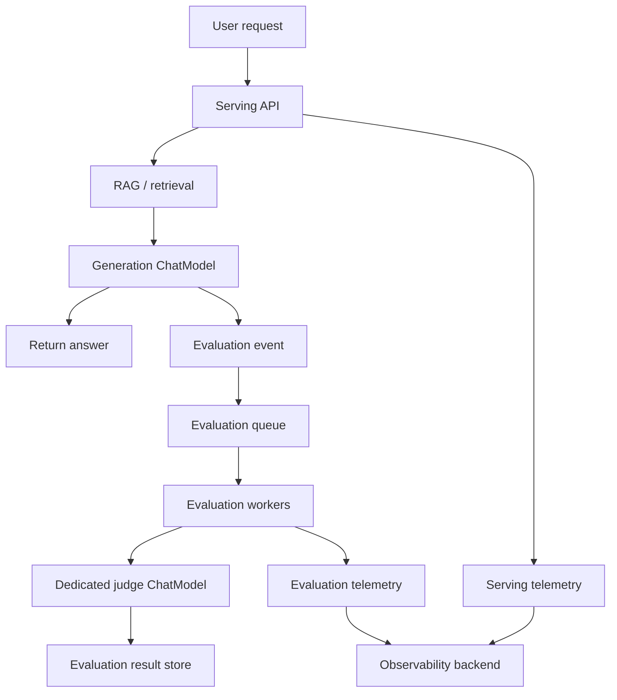

# Tách tài nguyên đánh giá khỏi tài nguyên phục vụ chính

## 1. Vì sao cần cô lập tài nguyên đánh giá?

Một ứng dụng Spring AI có thể vừa phục vụ người dùng vừa đánh giá chất lượng câu trả lời. Luồng phục vụ chính thường gồm embedding query, truy xuất VectorStore, gọi ChatModel và trả response. Luồng đánh giá có thể gọi thêm RelevancyEvaluator, FactCheckingEvaluator hoặc một judge ChatModel để kiểm tra câu trả lời với context đã truy xuất.

Nếu cả hai luồng dùng chung thread pool, connection pool, model deployment, quota hoặc ngân sách CPU, một đợt đánh giá lớn có thể chiếm tài nguyên của request thật. Người dùng thấy latency tăng hoặc timeout dù model phục vụ chính vẫn khỏe. Trường hợp khác, evaluator gửi quá nhiều context dài khiến judge model tiêu thụ token và quota; generation request bị rate limit vì cả hai dùng chung provider account.

Bài **“Tách tài nguyên đánh giá khỏi tài nguyên phục vụ chính”** thuộc chương **Vận hành** của module **SPRING_AI_EVALUATION_OBSERVABILITY**. Module học đánh giá chất lượng ứng dụng Spring AI bằng dataset, tiêu chí relevance, fact checking và kiểm thử RAG/tool calling; đồng thời đo metrics, traces, chi phí và độ trễ để tìm nguyên nhân suy giảm qua các phiên bản prompt, model và pipeline.

Mục tiêu của bài là thiết kế ranh giới tài nguyên cho evaluator/judge, kiểm soát concurrency và quota, tránh để workload đánh giá làm suy giảm dịch vụ chính, đồng thời vẫn giữ khả năng liên kết trace và phân tích chất lượng.

## 2. Hai loại workload có đặc tính khác nhau

| Đặc tính | Phục vụ chính (serving) | Đánh giá (evaluation) |
| --- | --- | --- |
| Người nhận kết quả | Người dùng hoặc hệ thống gọi API | Dashboard chất lượng, release gate, nhóm vận hành |
| Mục tiêu | Trả lời đúng và nhanh theo SLO | Đo chất lượng và phát hiện regression |
| Latency | Thường có deadline chặt | Có thể chạy nền hoặc theo batch |
| Tải | Theo traffic thật, thường có burst | Theo lịch, sample rate hoặc batch dataset |
| Ưu tiên | Cao hơn trong production | Có thể hoãn hoặc giảm khi quá tải |
| Model | Generation ChatModel | Judge ChatModel |
| Quota | Ngân sách phục vụ người dùng | Ngân sách riêng cho judge |
| Retry | Theo semantics request người dùng | Giới hạn để tránh chấm trùng và tăng chi phí |
| Kết quả lỗi | Có thể ảnh hưởng trực tiếp người dùng | Thường ghi UNKNOWN/ERROR, không tự đổi thành PASS |

Không phải mọi đánh giá đều có thể chạy nền. Trong CI, evaluator có thể là release gate và phải hoàn tất trước khi chấp nhận thay đổi. Trong production, phần lớn đánh giá giám sát có thể chạy bất đồng bộ sau khi đã trả câu trả lời. Cần chọn mô hình theo mục đích.

## 3. Kiến trúc tổng thể: serving lane và evaluation lane

Một thiết kế điển hình tách hai luồng tài nguyên:



Serving lane giữ quyền ưu tiên tài nguyên cần thiết để đáp ứng SLO. Evaluation lane nhận một bản ghi tối thiểu cần thiết để chấm, chạy trên worker/concurrency riêng, gọi judge model có quota riêng và lưu verdict độc lập.

Hai luồng vẫn có thể liên kết qua trace ID hoặc evaluation job ID, nhưng không cần dùng chung worker pool hoặc model deployment.

## 4. Ba cấp độ cô lập

Không phải hệ thống nào cũng cần tách thành hai cluster. Chọn mức cô lập theo rủi ro và tải:

| Mức | Cách làm | Cô lập được | Giới hạn |
| --- | --- | --- | --- |
| **Logical isolation** | Bean riêng, model profile riêng, budget/tag riêng | Cấu hình và quan sát | Vẫn dùng chung CPU, heap, GC, network |
| **Process isolation** | Evaluation service/JVM riêng, executor và container riêng | Thread, heap, CPU/memory limit, lifecycle | Có thể vẫn chung node, network hoặc provider quota |
| **Infrastructure isolation** | Node pool, cluster, account/project hoặc deployment riêng | Năng lực compute, quota, network và blast radius tốt hơn | Tốn chi phí và vận hành phức tạp hơn |

### Logical isolation

Phù hợp khi traffic nhỏ và evaluator không chạy nặng. Tối thiểu phải tách generation model bean khỏi judge model bean, đặt executor/queue riêng, giới hạn concurrency và theo dõi chi phí theo role.

### Process isolation

Phù hợp khi evaluator chạy batch hoặc có thể tạo burst lớn. Tách evaluation worker thành deployment riêng giúp giới hạn heap, CPU, restart và autoscaling mà không ảnh hưởng trực tiếp API serving.

### Infrastructure isolation

Phù hợp khi có SLO nghiêm ngặt, quota provider dùng chung dễ bị tranh chấp, dữ liệu đánh giá nhạy cảm hoặc workload evaluation lớn. Có thể dùng provider project/deployment riêng, node pool riêng, database/schema riêng hoặc network policy riêng.

**Tách bean không đồng nghĩa tách CPU.** Nếu cả hai model chạy trong cùng JVM hoặc gọi cùng một provider deployment, tài nguyên vẫn có thể tranh chấp ở tầng thấp hơn.

## 5. Tách generation ChatModel và judge ChatModel

Spring AI cho phép ứng dụng dùng nhiều ChatModel bean. Evaluator nhận ChatClient.Builder, do đó có thể khởi tạo evaluator từ một judge model riêng:

```java
import org.springframework.ai.chat.client.ChatClient;
import org.springframework.ai.chat.model.ChatModel;
import org.springframework.ai.evaluation.Evaluator;
import org.springframework.ai.evaluation.RelevancyEvaluator;
import org.springframework.ai.evaluation.FactCheckingEvaluator;
import org.springframework.beans.factory.annotation.Qualifier;
import org.springframework.context.annotation.Bean;
import org.springframework.context.annotation.Configuration;

@Configuration
public class JudgeEvaluatorConfiguration {

    @Bean("relevancyEvaluator")
    Evaluator relevancyEvaluator(
            @Qualifier("judgeChatModel") ChatModel judgeModel) {
        return new RelevancyEvaluator(ChatClient.builder(judgeModel));
    }

    @Bean("factCheckingEvaluator")
    Evaluator factCheckingEvaluator(
            @Qualifier("judgeChatModel") ChatModel judgeModel) {
        return new FactCheckingEvaluator(ChatClient.builder(judgeModel));
    }
}
```

Đoạn code chỉ cấu hình evaluator từ bean judge model. Cách tạo bean ChatModel cụ thể phụ thuộc provider starter và phiên bản Spring AI của dự án. Cần cấu hình model profile riêng để bảo đảm judge không vô tình trỏ tới generation deployment.

Khi inject model vào service, dùng qualifier rõ ràng:

```java
import org.springframework.ai.chat.model.ChatModel;
import org.springframework.beans.factory.annotation.Qualifier;
import org.springframework.stereotype.Service;

@Service
public class AnswerService {

    private final ChatModel generationModel;

    public AnswerService(
            @Qualifier("generationChatModel") ChatModel generationModel) {
        this.generationModel = generationModel;
    }
}

@Service
public class QualityEvaluationService {

    private final ChatModel judgeModel;

    public QualityEvaluationService(
            @Qualifier("judgeChatModel") ChatModel judgeModel) {
        this.judgeModel = judgeModel;
    }
}
```

Tên bean là quy ước ứng dụng. Nếu auto-configuration tạo bean mặc định, hãy kiểm tra điều kiện cấu hình và tránh có nhiều bean cùng type mà không qualifier/primary rõ ràng.

## 6. Tách model deployment, endpoint và quota khi cần

Hai bean khác nhau nhưng cùng gọi một deployment có thể vẫn tranh quota, concurrency hoặc rate limit. Nếu provider hỗ trợ, hãy cân nhắc:

- model/deployment riêng cho generation và judge;
- provider project hoặc account riêng;
- API key/credential riêng theo role;
- rate limit hoặc quota riêng;
- endpoint/region riêng nếu yêu cầu latency hoặc residency;
- billing tag/cost center riêng.

Không phải provider nào cũng có quota tách theo key hoặc project theo cách giống nhau. Cần kiểm tra quota thực tế: request per minute, tokens per minute, concurrent requests, daily budget và model-specific limits.

Nếu không thể tách quota ở provider, application vẫn cần semaphore/rate limiter cho judge để giữ phần quota còn lại cho serving. Một quota dùng chung cần được phân bổ rõ, ví dụ reserved capacity cho generation và capped capacity cho evaluation.

## 7. Tách executor và queue trong cùng JVM

Một trong những bước quan trọng là không để evaluator dùng chung executor với tác vụ phục vụ chính. Spring có thể khai báo ThreadPoolTaskExecutor riêng:

```java
import java.util.concurrent.ThreadPoolExecutor;

import org.springframework.context.annotation.Bean;
import org.springframework.context.annotation.Configuration;
import org.springframework.scheduling.concurrent.ThreadPoolTaskExecutor;

@Configuration
public class EvaluationExecutorConfiguration {

    @Bean("evaluationExecutor")
    public ThreadPoolTaskExecutor evaluationExecutor() {
        ThreadPoolTaskExecutor executor = new ThreadPoolTaskExecutor();
        executor.setCorePoolSize(2);
        executor.setMaxPoolSize(4);
        executor.setQueueCapacity(100);
        executor.setThreadNamePrefix("evaluation-");
        executor.setRejectedExecutionHandler(
                new ThreadPoolExecutor.AbortPolicy());
        executor.setWaitForTasksToCompleteOnShutdown(true);
        executor.setAwaitTerminationSeconds(10);
        return executor;
    }
}
```

Queue có capacity hữu hạn. Khi queue đầy và worker đã đạt max pool size, executor từ chối task. Application cần bắt rejection và ghi trạng thái evaluation là SKIPPED_CAPACITY hoặc enqueue lại theo policy phù hợp.

Không dùng CallerRunsPolicy một cách vô thức cho evaluation executor. Policy này có thể chạy task bị từ chối ngay trên thread submit; nếu submit xảy ra trong request thread, judge call có thể quay lại critical path và phá vỡ mục tiêu cô lập.

### Async service phải nằm ở bean khác

Bật async ở cấu hình ứng dụng:

```java
import org.springframework.context.annotation.Configuration;
import org.springframework.scheduling.annotation.EnableAsync;

@Configuration
@EnableAsync
public class AsyncExecutionConfiguration {
}
```

```java
import java.util.concurrent.CompletableFuture;

import org.springframework.ai.evaluation.EvaluationRequest;
import org.springframework.ai.evaluation.EvaluationResponse;
import org.springframework.ai.evaluation.Evaluator;
import org.springframework.beans.factory.annotation.Qualifier;
import org.springframework.scheduling.annotation.Async;
import org.springframework.stereotype.Service;

@Service
public class EvaluationJobService {

    private final Evaluator evaluator;

    public EvaluationJobService(
            @Qualifier("relevancyEvaluator") Evaluator evaluator) {
        this.evaluator = evaluator;
    }

    @Async("evaluationExecutor")
    public CompletableFuture<EvaluationResponse> evaluate(
            EvaluationRequest request) {
        EvaluationResponse result = evaluator.evaluate(request);
        return CompletableFuture.completedFuture(result);
    }
}
```

Bật async bằng EnableAsync ở cấu hình ứng dụng. Phương thức async cần được gọi qua Spring proxy từ bean khác; gọi nội bộ trong cùng object (self-invocation) sẽ không đi qua proxy và không chạy trên executor như mong đợi.

Khi executor từ chối task, caller có thể ghi nhận trạng thái bỏ qua theo policy. Ví dụ minh họa:

```java
import org.springframework.core.task.TaskRejectedException;

try {
    evaluationJobService.evaluate(request);
}
catch (TaskRejectedException ex) {
    evaluationStatusStore.markSkipped(jobId, "SKIPPED_CAPACITY");
}
```

Tên `evaluationStatusStore` và `markSkipped` là API của ứng dụng giả định. Nếu method async được gọi qua một abstraction khác hoặc có retry decorator, hãy xác minh nơi rejection được phát sinh và bảo đảm trạng thái job được cập nhật idempotent.

Ở nơi submit, xử lý trường hợp executor từ chối task. Không chờ Future ngay trong controller nếu mục tiêu là trả kết quả generation trước. Với queue trong bộ nhớ, task có thể mất khi process restart; nếu cần độ bền, dùng message broker hoặc transactional outbox.

## 8. Giới hạn concurrency bằng bulkhead

Executor giới hạn số worker, nhưng có thể còn nhiều đường gọi evaluator khác. Bulkhead giới hạn số judge calls đồng thời tại boundary.

Ví dụ dùng Semaphore:

```java
import java.util.concurrent.Semaphore;
import java.util.concurrent.TimeUnit;

public final class JudgeBulkhead {

    private final Semaphore permits;

    public JudgeBulkhead(int maxConcurrentCalls) {
        if (maxConcurrentCalls < 1) {
            throw new IllegalArgumentException(
                    "maxConcurrentCalls phải lớn hơn 0");
        }
        this.permits = new Semaphore(maxConcurrentCalls);
    }

    public <T> T execute(
            java.util.concurrent.Callable<T> operation,
            long waitMillis) throws Exception {

        boolean acquired = permits.tryAcquire(
                waitMillis, TimeUnit.MILLISECONDS);

        if (!acquired) {
            throw new IllegalStateException("JUDGE_CAPACITY_EXHAUSTED");
        }

        try {
            return operation.call();
        }
        finally {
            permits.release();
        }
    }
}
```

Semaphore là bulkhead đơn giản cho một JVM. Nếu chạy nhiều replica, mỗi replica có permits riêng; tổng concurrency có thể là số replica nhân permits. Để giới hạn toàn provider account, cần quota/rate limiter phân tán hoặc giới hạn ở gateway/provider.

Không giữ permit trong lúc chờ một queue dài. Lấy permit ngay trước khi gọi judge và luôn release trong finally.

## 9. Tách connection pool và network budget

Thread pool riêng chưa đủ nếu generation và judge dùng chung HTTP connection pool có giới hạn thấp. Judge batch có thể chiếm hết connection, khiến request generation phải chờ lấy connection.

Khi provider client cho phép cấu hình transport riêng, hãy cân nhắc:

- connection pool riêng cho generation và judge;
- max connections và pending acquire timeout riêng;
- connect/read/response timeout phù hợp;
- keep-alive và connection eviction;
- proxy/egress quota và bandwidth;
- TLS/session overhead khi tách quá nhiều client.

Tên property và cách tạo HTTP client phụ thuộc provider starter và transport (RestClient, WebClient, Reactor Netty hoặc SDK riêng). Không giả định mọi Spring AI provider dùng cùng một connection pool hay cùng property.

Nếu không thể tách connection pool, hãy giữ judge concurrency thấp hơn mức có thể chiếm hết connection và đặt timeout acquire ngắn để task evaluation bị từ chối/hoãn thay vì làm serving chờ lâu.

## 10. Tách CPU, heap và garbage collection

Trong cùng JVM, executor riêng không tạo heap riêng. Judge response lớn, context dài hoặc batch dataset có thể làm tăng allocation, GC pause và heap pressure cho cả API serving.

Các biện pháp:

- giới hạn kích thước context đưa vào judge;
- giới hạn số evaluation jobs đang chạy;
- không giữ toàn bộ dataset hoặc response payload trong memory;
- stream/đọc theo batch nếu API hỗ trợ;
- tránh giữ object graph của request sau khi response đã trả;
- đặt memory limit cho evaluation process nếu tách deployment;
- theo dõi heap, allocation rate, GC pause và direct memory.

Khi evaluator chạy trên cùng JVM và tạo memory pressure, latency của serving vẫn có thể tăng dù thread pool đã tách. Đây là giới hạn quan trọng của logical isolation.

## 11. Tách dữ liệu và truy vấn VectorStore

Evaluator thường cần câu hỏi, câu trả lời và context đã truy xuất. Nếu đánh giá lại bằng cách gọi VectorStore lần nữa, workload evaluation có thể tăng read QPS, làm cache miss hoặc tranh connection với serving.

Có hai hướng:

1. **Evaluate captured context:** lưu danh sách tài liệu/context đã được serving retrieval trả về cùng metadata cần thiết, rồi judge trên snapshot đó. Cách này đánh giá đúng context đã dùng để tạo câu trả lời.
2. **Offline replay:** chạy retrieval lại trên dataset và index snapshot riêng. Cách này phù hợp để đo thay đổi retrieval pipeline, nhưng cần version index và cấu hình retriever.

Không dùng chung một truy vấn retrieval mới rồi kết luận nó là context của câu trả lời cũ. Nếu mục tiêu là fact checking câu trả lời đã sinh, cần chính context đã cung cấp cho model hoặc phải ghi rõ evaluation là replay.

Với dataset lớn, cân nhắc read replica, snapshot index hoặc evaluation namespace riêng. Tránh để batch evaluation tạo tải truy vấn bất ngờ lên VectorStore production.

## 12. Đồng bộ hay bất đồng bộ?

| Cách chạy | Phù hợp | Ảnh hưởng |
| --- | --- | --- |
| Synchronous in request | Luồng rủi ro cao cần verdict trước khi trả kết quả | Tăng latency và phụ thuộc judge availability |
| Async in-process | Monitoring sau response, traffic vừa phải | Queue trong RAM; mất task khi restart |
| Durable queue/broker | Production evaluation, batch và retry | Thêm vận hành nhưng có thể replay |
| Offline CI/batch | Regression test, golden dataset, model comparison | Không ảnh hưởng request thật |
| Scheduled sample | Theo dõi chất lượng traffic theo thời gian | Có độ trễ phát hiện |

Một pattern production phổ biến là trả câu trả lời trước, sau đó phát evaluation event. Event nên chứa request ID, model/prompt version, context snapshot reference, answer reference, dataset/cohort metadata và trace correlation. Không cần copy toàn bộ dữ liệu nhạy cảm vào message nếu có thể truy xuất an toàn từ store.

Nếu evaluator là một phần quyết định cho phép/không cho phép hành động, nó không còn là telemetry hậu kiểm; phải coi là dependency nghiệp vụ và thiết kế SLO/fail policy tương ứng.

## 13. Queue evaluation và chính sách khi quá tải

Queue evaluation phải hữu hạn và có giới hạn thời gian chờ. Một task nằm trong queue lâu có thể không còn hữu ích nếu model/prompt version đã thay đổi hoặc context snapshot hết hạn.

Các trạng thái nên phân biệt:

- QUEUED: đã nhận job;
- RUNNING: worker đang đánh giá;
- COMPLETED: có verdict;
- FAILED: judge/provider lỗi;
- SKIPPED_CAPACITY: queue hoặc concurrency đã đầy;
- EXPIRED: quá deadline;
- CANCELLED: job bị hủy;
- RETRY_SCHEDULED: chờ retry theo policy.

Khi queue đầy, lựa chọn có thể là reject job, giảm sample rate, bỏ job ít ưu tiên hoặc ghi durable queue để xử lý sau. Không block request generation để đợi queue có chỗ.

### Ưu tiên và fairness

Có thể chia evaluation queue theo lớp:

| Lớp | Ví dụ | Chính sách |
| --- | --- | --- |
| Critical | Case rủi ro cao, regression release gate | Reserved capacity, deadline rõ |
| Standard | Traffic sample production | Giới hạn concurrency và rate |
| Batch | Backfill, benchmark, replay dataset lớn | Chạy giờ thấp điểm, có thể pause |
| Debug | Request phục vụ điều tra | TTL ngắn, quota nhỏ |

Nếu chỉ dùng một FIFO queue, batch job lớn có thể đẩy các evaluation quan trọng xuống sau. Nếu dùng priority queue, phải tránh starvation cho lớp thấp bằng quota hoặc weighted scheduling.

## 14. Rate limit và quota: giới hạn theo request lẫn token

Judge model có thể có nhiều loại giới hạn:

- requests per minute (RPM);
- tokens per minute (TPM);
- concurrent requests;
- daily spend;
- context length;
- model-specific quota.

Executor concurrency chỉ giới hạn số request đang chạy, không bảo đảm RPM/TPM. Nếu judge response nhanh, worker có thể phát nhiều request liên tiếp và vượt rate limit.

Cần có rate limiter theo provider/model/account. Khi có 429, tôn trọng Retry-After và backoff; không retry ngay đồng thời trên mọi worker.

Ước tính judge token budget:

```text
judge_calls_per_day =
    eligible_requests_per_day
    × evaluation_sample_rate
    × evaluators_per_request

judge_tokens_per_day =
    judge_calls_per_day
    × average_input_tokens_per_call
    + judge_calls_per_day
    × average_output_tokens_per_call
```

Ví dụ có 200.000 request/ngày, sample rate 1%, hai evaluator cho mỗi request được chọn, trung bình mỗi judge call dùng 2.000 input tokens và 200 output tokens:

```text
Judge calls/day = 200,000 × 0.01 × 2 = 4,000

Input tokens/day = 4,000 × 2,000 = 8,000,000
Output tokens/day = 4,000 × 200 = 800,000
Total judge tokens/day = 8,800,000
```

Đây là ví dụ giả định. Token thực tế phụ thuộc context length, evaluator prompt, retry và model tokenizer. Dùng usage provider-reported để đối chiếu estimate.

## 15. Deadline và timeout riêng cho evaluation

Không nên dùng chung timeout của serving cho judge. Một request API có thể có deadline 2 giây, còn evaluation hậu kiểm có thể chấp nhận hoàn thành trong 30 giây hoặc vài phút.

Cần tách:

- queue wait timeout;
- semaphore acquire timeout;
- HTTP connection acquire timeout;
- connect timeout;
- model response timeout;
- whole evaluation deadline;
- retry budget.

Tổng thời gian phải thỏa deadline. Nếu queue wait đã tiêu thụ phần lớn budget, không nên bắt đầu một judge call chắc chắn không thể hoàn thành đúng hạn.

Khi hết deadline, ghi EXPIRED hoặc TIMEOUT. Không tự gán PASS, cũng không giữ worker mãi để đợi provider.

## 16. Cấu hình tài nguyên theo môi trường

Một ma trận khởi đầu:

| Môi trường | Serving | Evaluation | Cách cô lập |
| --- | --- | --- | --- |
| Local/dev | Một model profile | Judge nhỏ/local hoặc mock | Bean riêng, executor nhỏ |
| CI | Không có traffic người dùng | Chạy toàn bộ golden dataset | Process/job riêng, concurrency cố định |
| Staging | Profile gần production | Sample cao để kiểm release | Deployment hoặc executor riêng |
| Production | SLO và quota ưu tiên | Sample giới hạn, batch ngoài giờ | Worker deployment, quota và queue riêng |

Ví dụ cấu hình ứng dụng tự định nghĩa:

```yaml
app:
  serving:
    model-profile: generation-prod
    max-concurrency: 40
    request-timeout: 3s
  evaluation:
    enabled: true
    model-profile: judge-prod
    max-concurrency: 4
    queue-capacity: 500
    sample-rate: 0.01
    deadline: 45s
    max-retries: 1
```

Các key app.serving.* và app.evaluation.* là property do ứng dụng tự thiết kế, không phải property mặc định của Spring AI. Cần bind bằng ConfigurationProperties và validate giá trị ở startup.

Các số trong ví dụ không phải khuyến nghị dùng trực tiếp. Capacity phải dựa trên throughput, thời gian xử lý, quota và memory budget đo được.

## 17. Đo mức cô lập bằng metrics và traces

Cần theo dõi riêng hai workload:

| Metric | Serving | Evaluation |
| --- | --- | --- |
| Request/call rate | Generation calls/s | Judge calls/s |
| Latency | API/model p50/p95/p99 | Queue wait + judge duration |
| Concurrency | In-flight generation | In-flight evaluation |
| Queue | Serving queue nếu có | Evaluation queue depth |
| Rejection | Request overload/reject | SKIPPED_CAPACITY |
| Token usage | Generation input/output | Judge input/output |
| Cost | Serving cost | Evaluation cost |
| Error | Provider/model error | Judge/evaluator error |
| Resource | CPU/heap/connection use | Worker CPU/heap/connection use |

Tên metric gợi ý do ứng dụng định nghĩa:

- app.ai.serving.calls;
- app.ai.evaluation.calls;
- app.ai.evaluation.queue.size;
- app.ai.evaluation.queue.rejected;
- app.ai.evaluation.queue.wait;
- app.ai.evaluation.duration;
- app.ai.evaluation.tokens;
- app.ai.evaluation.cost.

Không dùng user ID, request ID, prompt, answer hoặc document ID làm metric tags. Dùng một tập label hữu hạn như workload=serving/evaluation, provider, model_profile, operation và outcome.

### Trace correlation

Có thể gắn evaluation job với trace/request gốc qua correlation ID hoặc span link. Khi evaluation chạy bất đồng bộ sau khi request kết thúc, không giả định nó luôn là child span của HTTP request đã đóng. Có thể tạo trace riêng và liên kết bằng span link hoặc correlation attribute theo mô hình tracing.

Trace sampling có thể khiến không phải job nào cũng có trace; metric counters vẫn cần phản ánh tổng số evaluation được chọn, hoàn tất, lỗi và bị bỏ qua.

## 18. Khi nào cần tách process hoặc deployment?

Dấu hiệu logical isolation trong một JVM không còn đủ:

- GC pause hoặc heap pressure tăng khi chạy batch evaluation;
- CPU judge worker làm serving p95/p99 tăng;
- connection pool bị judge calls chiếm hết;
- judge batch khiến provider quota của generation bị 429;
- cần autoscale evaluation theo backlog mà không scale API;
- cần rollout/restart evaluator độc lập;
- evaluator cần thư viện/model hoặc network policy khác;
- dữ liệu đánh giá có quyền truy cập khác dữ liệu serving.

Khi tách deployment:

- serving API và evaluation worker có CPU/memory request-limit riêng;
- evaluation worker scale theo queue depth và oldest-job age;
- model deployment/account có quota riêng nếu provider hỗ trợ;
- database/vector store dùng read replica hoặc snapshot nếu cần;
- network policy chỉ cho worker truy cập judge endpoint và evaluation store cần thiết;
- message broker giữ job bền vững và có dead-letter queue;
- autoscaling có min/max để tránh worker bùng nổ và vượt provider quota.

Không autoscale chỉ theo queue depth mà không đặt max concurrency toàn hệ thống. Nếu 20 replica cùng tăng worker, tổng judge requests có thể vượt quota.

## 19. Chi phí đánh giá phải có ngân sách độc lập

Chi phí evaluator thường bị ẩn trong tổng token usage nếu dashboard chỉ nhóm theo provider/model. Tách cost center theo workload:

- generation;
- relevancy judge;
- fact-checking judge;
- offline benchmark;
- retry;
- embedding/index replay nếu evaluation tạo lại vector.

Theo dõi cost per evaluated request, cost per passed/failed verdict và cost per quality improvement. Không tối ưu sample rate bằng cách giảm đến mức không còn khả năng phát hiện regression.

Có thể đặt ngân sách ngày/tháng cho evaluation. Khi gần ngưỡng, giảm batch/traffic sample theo policy, giữ lại critical evaluation và golden regression suite. Ghi rõ số job bị hoãn/bỏ do budget để không nhầm với chất lượng đã được kiểm chứng.

## 20. Kiểm thử resource isolation

Không chỉ test evaluator trả PASS/FAIL. Cần xác nhận evaluator không lấy mất năng lực phục vụ chính:

1. Chạy serving workload ở mức baseline và đo p95/p99, error rate, CPU, heap.
2. Chạy evaluation workload độc lập và đo tài nguyên của nó.
3. Tăng evaluation concurrency từng nấc.
4. Xác nhận serving latency vẫn trong SLO hoặc xác định ngưỡng gây ảnh hưởng.
5. Làm judge provider chậm/429/timeout và kiểm serving vẫn trả lời.
6. Làm evaluation queue đầy và xác nhận job bị reject/skip theo policy.
7. Xác nhận generation và judge model dùng đúng bean/deployment.
8. Kiểm tra rate limit tổng khi chạy nhiều worker replica.
9. Restart evaluation worker và kiểm job durable được retry/replay đúng.
10. Đối chiếu cost ledger theo workload và retry.
11. Kiểm tra trace correlation không tạo high-cardinality metric.
12. Kiểm tra không có prompt/context nhạy cảm trong log/metric ngoài policy.

### Tiêu chí pass

- Judge timeout không làm request serving thất bại nếu evaluation là hậu kiểm.
- Evaluation queue/concurrency có giới hạn.
- Khi quá tải, job evaluation được skip/defer có trạng thái rõ.
- Generation quota còn phần dự phòng theo policy.
- Serving p95/p99 không vượt SLO do evaluator.
- Restart worker không làm mất job bắt buộc nếu đã chọn durable queue.
- Metrics phân biệt serving và evaluation.
- Cost có thể phân bổ riêng cho generation và judge.

## 21. Playbook khi evaluator ảnh hưởng serving

| Triệu chứng | Nguyên nhân có thể | Hành động |
| --- | --- | --- |
| Serving p95 tăng khi evaluation batch chạy | CPU/GC/connection contention | Giảm concurrency hoặc tách process |
| Generation bị 429 | Judge dùng chung provider quota | Quota riêng, reserve serving capacity |
| Request thread chờ judge | Synchronous evaluation hoặc CallerRunsPolicy | Chuyển async, sửa rejection policy |
| Evaluation queue tăng liên tục | Arrival rate lớn hơn judge throughput | Giảm sample, tăng worker trong quota |
| Judge worker chiếm hết connection | HTTP pool dùng chung | Pool riêng hoặc cap judge concurrency |
| Heap tăng sau batch | Context/output được giữ trong memory | Batch nhỏ, payload limit, process riêng |
| Job mất sau restart | Chỉ dùng in-memory queue | Durable broker/outbox |
| Judge cost tăng đột biến | Retry, context dài, sample rate tăng | Token budget và retry cap |
| Critical evaluation bị đói | Batch chiếm FIFO queue | Priority/fair scheduling |
| Metric không tách generation/judge | Tag/model role thiếu | Thêm workload/model_profile labels |

Quy trình:

1. Xác định serving hay evaluation đang chiếm tài nguyên.
2. Kiểm tra executor, queue, connection pool, CPU/heap và provider quota.
3. Giảm evaluation concurrency/sample rate trước khi thay đổi serving capacity.
4. Tách model deployment hoặc process nếu contention vẫn còn.
5. Đặt lại budget, deadline, queue TTL và retry.
6. Kiểm tra trace/metric theo workload role.
7. Chạy lại load test hỗn hợp để xác nhận SLO.

## 22. Bài tập thực hành

1. **Isolation levels:** phân biệt logical, process và infrastructure isolation. Khi nào mỗi mức đủ dùng?
2. **Model beans:** cấu hình generationChatModel và judgeChatModel bằng qualifier. Vì sao hai bean chưa chắc đã tách quota?
3. **Executor:** cấu hình ThreadPoolTaskExecutor có queue hữu hạn và rejection policy phù hợp cho evaluation.
4. **CallerRuns:** giải thích tại sao CallerRunsPolicy có thể làm judge call quay lại request thread.
5. **Bulkhead:** với 4 permits và 3 replica, concurrency judge tối đa lý thuyết là bao nhiêu nếu mỗi replica có Semaphore riêng?
6. **Quota:** provider giới hạn 60 RPM và 100.000 TPM. Thiết kế rate limiter cho judge khi generation cần reserved capacity.
7. **Queue:** evaluation arrival 5 jobs/s, worker xử lý trung bình 2 jobs/s. Điều gì xảy ra với backlog sau 10 phút?
8. **Async:** vì sao self-invocation không kích hoạt proxy @Async? Nêu cách tổ chức service.
9. **Durability:** khi nào in-memory queue đủ dùng, khi nào cần broker/outbox?
10. **VectorStore:** vì sao captured context phù hợp hơn chạy retrieval lại khi đánh giá câu trả lời cũ?
11. **Memory:** executor riêng nhưng GC vẫn ảnh hưởng serving như thế nào?
12. **Cost:** 300.000 requests/ngày, sample 0,5%, hai evaluators/request, mỗi judge call 1.500 input và 150 output tokens. Tính judge calls và token budget.
13. **Fairness:** thiết kế ưu tiên cho critical, standard và batch evaluation mà không starvation.
14. **Load test:** đề xuất test chứng minh judge provider timeout không ảnh hưởng serving p99.
15. **Dashboard:** thiết kế metrics phân biệt generation, relevancy judge và fact-checking judge.

## Tài liệu tham khảo

- [Spring AI 2.1.0 – Evaluation Testing](https://docs.spring.io/spring-ai/reference/api/testing.html): Evaluator, EvaluationRequest, EvaluationResponse, RelevancyEvaluator và FactCheckingEvaluator.
- [Spring AI 2.1.0 – Chat Models](https://docs.spring.io/spring-ai/reference/api/chatmodel.html): ChatModel, ChatClient và cấu hình model.
- [Spring Boot – Task Execution and Scheduling](https://docs.spring.io/spring-boot/reference/features/task-execution-and-scheduling.html): executor, task scheduling và cấu hình thread pool.
- [Spring Framework – Task Execution and Scheduling](https://docs.spring.io/spring-framework/reference/integration/scheduling.html): TaskExecutor, @Async và async proxy semantics.
- [Resilience4j – Bulkhead](https://resilience4j.readme.io/docs/bulkhead): giới hạn concurrent calls và semaphore/thread-pool bulkhead.
- [Spring Boot – Metrics](https://docs.spring.io/spring-boot/reference/actuator/metrics.html): Micrometer metrics và registry.
- [Spring Boot – Tracing](https://docs.spring.io/spring-boot/reference/actuator/tracing.html): trace context, sampling và exporter.

> **Ghi chú triển khai:** Các tên bean, property app.serving.* / app.evaluation.*, queue, concurrency, quota và deployment profile trong bài là ví dụ thiết kế ứng dụng. Spring AI cung cấp abstraction Evaluator và ChatModel; việc tách deployment, connection pool, rate limit và durable queue phụ thuộc provider, Spring Boot, transport và hạ tầng cụ thể. Các ví dụ chưa được chạy trong dự án hoặc đối chiếu với quota provider thật. Hãy đo bằng workload hỗn hợp và xác nhận bằng load test trước khi áp dụng production.
