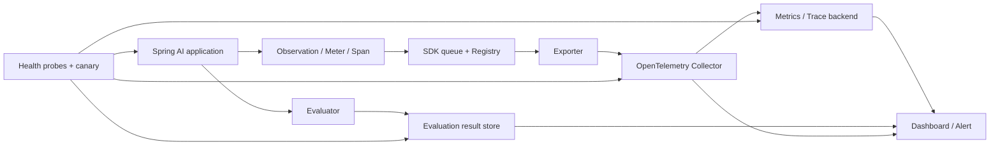

# Theo dõi sức khỏe của collector, registry và kho kết quả

## 1. Vì sao cần theo dõi sức khỏe của cả pipeline?

Một ứng dụng Spring AI có thể gọi ChatModel, EmbeddingModel, VectorStore và evaluator trong cùng một request. Các thành phần này phát sinh metrics, traces và kết quả đánh giá. Dữ liệu quan sát thường đi qua nhiều tầng trước khi xuất hiện trên dashboard:

1. Spring AI và Micrometer tạo observation, meter hoặc span.
2. Registry và SDK giữ, tổng hợp hoặc xếp hàng dữ liệu.
3. Exporter gửi telemetry ra ngoài.
4. OpenTelemetry Collector nhận, xử lý và chuyển tiếp.
5. Backend metrics/traces lưu và lập chỉ mục dữ liệu.
6. Evaluator ghi verdict vào kho kết quả để phục vụ báo cáo, so sánh và release gate.

Nếu chỉ kiểm tra endpoint health của ứng dụng, ta chưa biết Collector có nhận span hay không. Nếu Collector trả HTTP 200, điều đó cũng chưa chứng minh exporter gửi thành công tới backend. Nếu dashboard có metrics nhưng kho kết quả đánh giá không ghi được, nhóm chất lượng vẫn thiếu dữ liệu để phân tích regression.

Bài **“Theo dõi sức khỏe của collector, registry và kho kết quả”** thuộc chương **Vận hành** của module **SPRING_AI_EVALUATION_OBSERVABILITY**. Module học đánh giá chất lượng ứng dụng Spring AI bằng dataset, tiêu chí relevance, fact checking và kiểm thử RAG/tool calling; đồng thời theo dõi metrics, traces, chi phí và độ trễ để phát hiện suy giảm qua các phiên bản prompt, model và pipeline.

Mục tiêu là xây một mô hình health nhiều lớp, biết tín hiệu nào đang hoạt động, dữ liệu có mới không, có bị drop không và kết quả đánh giá đã được lưu bền vững chưa.

## 2. Phân biệt bốn lớp sức khỏe

| Lớp | Thành phần | Câu hỏi cần trả lời |
| --- | --- | --- |
| **Instrumentation/SDK** | ObservationRegistry, MeterRegistry, tracer, batch processor | Ứng dụng có tạo và giữ telemetry không? |
| **Exporter/registry** | Prometheus registry, OTLP exporter, Zipkin reporter | Dữ liệu có được scrape hoặc gửi đi không? |
| **Collector/backend** | OTel Collector, Prometheus, Tempo, Jaeger | Dữ liệu có được nhận, xử lý và lưu không? |
| **Evaluation result store** | Database, object store hoặc search index | Verdict, score và metadata có được ghi/đọc đúng không? |

Các lớp này độc lập tương đối. Ví dụ:

- Spring AI tạo span thành công nhưng BatchSpanProcessor queue đầy và drop span.
- Prometheus registry có meter nhưng Prometheus scrape không tới endpoint.
- Collector nhận span nhưng exporter phía Collector không gửi được tới backend.
- Judge model trả verdict nhưng transaction lưu kết quả bị rollback.
- Database hoạt động nhưng schema migration thiếu cột mới khiến write evaluation fail.

Do đó, một dashboard sức khỏe phải theo dõi cả **availability**, **throughput**, **freshness**, **error/drop**, **capacity** và **durability**.

## 3. Kiến trúc health monitoring end-to-end



Canary là một request hoặc event kiểm tra có kiểm soát. Nó giúp xác nhận luồng dữ liệu thực sự đi qua các tầng, thay vì chỉ kiểm tra một process đang sống.

Nên giữ hai nhóm health riêng:

- **Component health:** từng process, registry, exporter, collector, database có hoạt động không?
- **Data-path health:** một telemetry sample hoặc evaluation result có đi hết đường tới nơi truy vấn được không?

Component health hữu ích để khoanh vùng. Data-path health mới chứng minh đường dữ liệu thực tế hoạt động.

## 4. Liveness, readiness và end-to-end health không giống nhau

Ba loại probe thường bị dùng thay thế nhau:

| Probe | Câu hỏi | Hành động khi fail |
| --- | --- | --- |
| **Liveness** | Process còn sống và không bị kẹt không? | Orchestrator có thể restart |
| **Readiness** | Instance có đủ điều kiện nhận traffic nghiệp vụ không? | Tạm ngừng route traffic tới instance |
| **End-to-end synthetic check** | Dữ liệu có thực sự tới backend/kho kết quả không? | Alert và điều tra pipeline |

Không nên đưa mọi dependency vào liveness. Nếu Collector tạm ngừng và liveness của API fail, orchestrator có thể restart liên tục các instance đang phục vụ request bình thường, làm sự cố lan rộng.

Readiness cũng cần phân loại dependency. Nếu metrics/traces chỉ phục vụ observability, Collector unavailable thường không nên làm API serving mất readiness. Nếu một kho dữ liệu là dependency bắt buộc để hoàn thành nghiệp vụ, readiness có thể cần phản ánh trạng thái đó.

End-to-end check không nên chạy quá thường xuyên hoặc dùng dữ liệu người dùng thật. Có thể chạy từ một canary worker riêng, với timeout và quyền truy cập tối thiểu.

## 5. Kiểm tra sức khỏe OpenTelemetry Collector

Collector có nhiều thành phần: receiver, processor, exporter và extension. Một process có thể đang chạy trong khi pipeline export bị lỗi.

Health check extension cung cấp endpoint để kiểm tra Collector process. Ví dụ cấu hình:

```yaml
extensions:
  health_check:
    endpoint: 127.0.0.1:13133

receivers:
  otlp:
    protocols:
      grpc:
        endpoint: 0.0.0.0:4317
      http:
        endpoint: 0.0.0.0:4318

processors:
  batch:
    timeout: 5s

service:
  extensions: [health_check]
  pipelines:
    traces:
      receivers: [otlp]
      processors: [batch]
      exporters: [debug]
```

Đây là cấu hình minh họa. Pipeline debug exporter chỉ dùng để thử nghiệm; production cần exporter backend phù hợp. Địa chỉ và component phải được kiểm tra theo phiên bản Collector đang chạy.

Health check endpoint thường cho biết extension/process đang phản hồi. Nó **không tự chứng minh** receiver đã nhận telemetry, processor không drop, exporter gửi thành công hoặc backend đã lưu dữ liệu.

Nếu probe đến từ container khác, endpoint cần bind vào interface có thể truy cập và được giới hạn bằng network policy/firewall. Không expose endpoint quản trị Collector ra Internet công khai.

## 6. Theo dõi receiver, processor và exporter riêng

Collector pipeline nên được quan sát theo từng tầng:

| Tầng | Tín hiệu cần xem | Câu hỏi |
| --- | --- | --- |
| Receiver | Accepted/refused spans, metrics hoặc logs | Ứng dụng có gửi dữ liệu tới Collector không? |
| Processor | Processed/dropped items, batch size, memory | Có bị filter, drop hoặc giới hạn tài nguyên không? |
| Exporter | Sent/failed items, queue size, retry | Backend đích có nhận dữ liệu không? |
| Extension | Health endpoint, zPages nếu bật | Collector process có phản hồi không? |

Một số bản Collector cung cấp self-telemetry metrics cho accepted/refused data, exporter sent/failed data và queue utilization. Tên metric và label phụ thuộc phiên bản, distribution và cấu hình; hãy xem series thực tế thay vì hard-code một tên được chép từ bản khác.

Ví dụ cách diễn giải:

- Receiver accepted tăng, exporter sent tăng: dữ liệu đang đi qua pipeline.
- Receiver accepted tăng, exporter failed tăng: Collector nhận được nhưng không chuyển tiếp thành công.
- Receiver refused tăng: Collector hoặc receiver từ chối dữ liệu, có thể do tải hoặc cấu hình.
- Exporter queue tăng kéo dài: backend chậm hơn tốc độ nhận.
- Health endpoint xanh nhưng exporter failed tăng: process sống, data path đang có lỗi.

## 7. Self-telemetry của Collector

Collector có thể xuất metrics về chính nó. Đây là nguồn quan trọng để phát hiện queue tăng, lỗi export, CPU/memory pressure và throughput.

Một cấu hình self-telemetry thay đổi theo release Collector. Một số phiên bản dùng cấu hình metrics address/level; các phiên bản mới có thể dùng readers và exporter cấu hình theo chuẩn telemetry SDK. Vì vậy, không nên sao chép một block service.telemetry từ phiên bản cũ mà chưa xác minh schema.

Các bước triển khai:

1. Kiểm tra tài liệu đúng distribution và phiên bản Collector.
2. Bật self-telemetry metrics ở mức cần thiết.
3. Chọn endpoint nội bộ hoặc exporter phù hợp.
4. Cấu hình Prometheus scrape hoặc OTLP export.
5. Kiểm tra metrics thực tế được expose và có timestamp mới.
6. Alert trên queue, refused/failed exports, memory và export latency.

Không bật mức telemetry chi tiết nhất trên mọi Collector nếu chưa ước tính cardinality và chi phí. Chính hệ thống quan sát cũng có thể tạo tải đáng kể.

## 8. Sức khỏe của MeterRegistry trong Spring Boot

MeterRegistry là nơi Micrometer ghi nhận và tổng hợp meter. Nó không phải Collector và cũng không đồng nghĩa với backend đã nhận dữ liệu.

Một số trường hợp thường gặp:

- **SimpleMeterRegistry:** giữ meter trong bộ nhớ để test hoặc dùng đơn giản; không tự gửi dữ liệu tới Prometheus/OTLP.
- **PrometheusMeterRegistry:** cung cấp dữ liệu để Prometheus scrape.
- **OTLP registry/exporter:** đẩy metrics theo chu kỳ tới endpoint được cấu hình.
- **CompositeMeterRegistry:** chuyển meter tới nhiều registry con; một meter được tạo không chứng minh tất cả registry con đều export thành công.

Endpoint Actuator có thể giúp xem meter tại chỗ. Ví dụ:

```text
GET /actuator/metrics
GET /actuator/metrics/gen_ai.client.operation
GET /actuator/prometheus
```

Tên meter hiển thị qua Actuator và tên series trên Prometheus có thể khác do quy tắc chuẩn hóa. Việc endpoint metrics trả dữ liệu chỉ chứng minh meter có ở instance đó; vẫn cần kiểm tra scrape target hoặc exporter delivery.

### Kiểm tra registry có meter hay không

Có thể kiểm tra ở integration test hoặc startup diagnostic:

```java
import io.micrometer.core.instrument.MeterRegistry;
import org.springframework.stereotype.Component;

@Component
public class RegistryDiagnostics {

    private final MeterRegistry meterRegistry;

    public RegistryDiagnostics(MeterRegistry meterRegistry) {
        this.meterRegistry = meterRegistry;
    }

    public int registeredMeterCount() {
        return meterRegistry.getMeters().size();
    }
}
```

Số meter lớn hơn 0 không chứng minh backend nhận metrics. Nó chỉ là tín hiệu nội bộ rằng registry có meter. Cần kiểm tra thêm exporter/registry type, scrape hoặc push success, và dữ liệu xuất hiện tại backend.

## 9. Kiểm tra Prometheus scrape và OTLP push

Prometheus pull và OTLP push có điểm quan sát khác nhau:

| Cơ chế | Health check phù hợp | Bằng chứng end-to-end |
| --- | --- | --- |
| Prometheus scrape | Target up, scrape duration, scrape errors | Query được series canary mới |
| OTLP metrics push | Export success/failure, exporter timeout | Backend có sample mới theo resource/service |
| OTLP traces | Batch queue, export success/failure | Trace canary truy vấn được trong backend |
| Zipkin reporter | Reporter errors, endpoint availability | Span canary xuất hiện trong Zipkin |

Prometheus có thể scrape thành công nhưng không scrape đúng instance hoặc metric mong muốn. OTLP exporter có thể trả success ở tầng transport nhưng backend xử lý/lưu chậm. Vì vậy cần kiểm tra cả ingestion freshness.

Không coi HTTP 200 từ exporter/collector là bằng chứng duy nhất. Nếu backend có indexing delay, hãy đặt freshness threshold phù hợp với chu kỳ scrape, batch delay và thời gian ingest.

## 10. Theo dõi SDK queue và exporter phía ứng dụng

Ngay cả khi Collector khỏe, SDK queue có thể đầy trước khi spans tới Collector. Với OpenTelemetry BatchSpanProcessor, cần xem:

- queue capacity và queue utilization;
- số span bị drop;
- batch size;
- schedule delay;
- export duration và timeout;
- export failure/retry;
- shutdown flush result.

Với Micrometer registry, cần theo dõi export step, lỗi push và độ trễ. Với Prometheus pull, kiểm tra scrape frequency và thời gian endpoint trả dữ liệu.

Các metric tự telemetry của SDK có thể thay đổi theo phiên bản. Nếu không có metric queue/drop trực tiếp, cần dùng log exporter có kiểm soát, custom instrumentation ở mức phù hợp hoặc kiểm tra SDK diagnostic. Không tự tạo metric giả để biểu diễn trạng thái không đo được.

## 11. Sức khỏe của kho kết quả đánh giá

Kho kết quả có thể là PostgreSQL, MySQL, MongoDB, Redis, object storage hoặc một search index. Nó lưu dữ liệu như:

- evaluation job ID và request correlation;
- dataset/case ID;
- model, prompt và pipeline version;
- evaluator type và judge model;
- verdict, score và rationale đã được kiểm soát;
- thời điểm bắt đầu/kết thúc;
- trạng thái queued/running/completed/failed;
- usage và cost nếu cần phân tích.

Một database connection trả lời thành công câu SELECT 1 chưa chắc đã chứng minh ứng dụng có thể ghi kết quả. Có thể connection pool còn kết nối nhưng role thiếu quyền INSERT, schema migration chưa chạy, transaction bị deadlock hoặc disk đầy.

Nên theo dõi riêng:

- read latency và write latency;
- transaction commit/rollback;
- connection pool active/idle/pending;
- query errors và timeout;
- replication lag nếu dùng read replica;
- disk/storage usage;
- index/partition health;
- queue lag nếu kết quả được ghi bất đồng bộ;
- dead-letter count và retry backlog.

## 12. Read probe và write probe

Một probe đọc nhẹ phù hợp để kiểm tra kết nối và quyền truy vấn. Tuy nhiên, nếu yêu cầu là xác minh đường ghi kết quả, cần một canary write/read có kiểm soát.

| Probe | Kiểm tra được | Không chứng minh được |
| --- | --- | --- |
| TCP connect | Network path tới port | DB authentication/query/write |
| DB ping/SELECT 1 | Kết nối và query cơ bản | Quyền ghi, schema ứng dụng |
| Read representative row | Quyền đọc và query path | Transaction write |
| Canary insert + readback | Đường ghi/đọc end-to-end | Độ bền qua mọi loại failover nếu chưa test |
| Restore drill | Khả năng phục hồi backup | Không thay thế kiểm tra hằng ngày |

Canary write nên dùng namespace/bảng riêng hoặc record có TTL, idempotency key và cleanup. Không ghi record giả vào bảng kết quả nghiệp vụ rồi để chúng bị tính vào báo cáo chất lượng.

Nếu storage có chi phí write cao, chạy probe theo chu kỳ hợp lý và đặt timeout ngắn. Không chạy một transaction lớn trong mỗi health request.

## 13. Spring Boot HealthIndicator cho result store

Spring Boot Actuator hỗ trợ custom HealthIndicator để bổ sung trạng thái dependency. Ví dụ dưới đây dùng một interface probe do ứng dụng định nghĩa:

```java
import java.time.Duration;

public interface EvaluationStoreProbe {
    void verifyReadable(Duration timeout);
}
```

HealthIndicator:

```java
import org.springframework.boot.actuate.health.Health;
import org.springframework.boot.actuate.health.HealthIndicator;
import org.springframework.stereotype.Component;

import java.time.Duration;

@Component("evaluationResultStore")
public class EvaluationResultStoreHealthIndicator
        implements HealthIndicator {

    private final EvaluationStoreProbe probe;

    public EvaluationResultStoreHealthIndicator(
            EvaluationStoreProbe probe) {
        this.probe = probe;
    }

    @Override
    public Health health() {
        try {
            probe.verifyReadable(Duration.ofMillis(300));
            return Health.up()
                    .withDetail("check", "read_probe")
                    .build();
        }
        catch (Exception ex) {
            // Không trả exception message hoặc thông tin kết nối ra endpoint.
            return Health.down()
                    .withDetail("check", "read_probe_failed")
                    .build();
        }
    }
}
```

EvaluationStoreProbe là abstraction của ứng dụng; implementation phải thực sự áp dụng timeout ở driver/query layer. Truyền Duration vào method nhưng không enforce timeout bên dưới thì chưa tạo được giới hạn thời gian.

Nếu cần kiểm tra write path, hãy tạo một probe riêng có canary record, TTL và cleanup. Tránh thực hiện write probe trong mỗi lần Actuator health được gọi vì orchestrator có thể poll rất thường xuyên.

## 14. Tách health group cho liveness và readiness

Có thể tổ chức Actuator health group để phân biệt process state và dependency cần cho traffic. Ví dụ cấu hình:

```properties
management.endpoint.health.probes.enabled=true
management.endpoint.health.group.liveness.include=livenessState
management.endpoint.health.group.readiness.include=readinessState,db,evaluationResultStore
```

Đây là ví dụ property; cần kiểm tra tên HealthIndicator bean và cấu hình group theo phiên bản Spring Boot. Nếu kho kết quả chỉ phục vụ đánh giá nền, không nhất thiết đưa evaluationResultStore vào readiness của API serving. Có thể tạo health group riêng cho evaluation worker.

Ví dụ phân chia:

- API serving readiness: các dependency cần để trả lời người dùng.
- Evaluation worker readiness: judge provider, queue consumer và result store nếu bắt buộc xử lý job.
- Liveness: trạng thái process, không phụ thuộc Collector đang tạm thời unavailable.
- Telemetry pipeline health: dashboard/alert riêng, không nhất thiết điều khiển traffic nghiệp vụ.

Một dependency chỉ nên làm readiness fail khi instance thực sự không thể đảm nhận vai trò của nó.

## 15. Kiểm tra trạng thái registry, exporter và Collector bằng canary

Một canary telemetry nên kiểm tra theo chuỗi:

1. Tạo một counter hoặc span có resource/service name cố định.
2. Gửi qua đúng SDK/exporter đang dùng.
3. Chờ tối đa một freshness window.
4. Truy vấn backend để tìm sample/trace.
5. Ghi kết quả pass/fail và latency của canary.
6. Alert nếu nhiều lần liên tiếp không thấy dữ liệu.

Trace canary có thể có attribute như canary=true trong trace, nhưng không nên dùng ID duy nhất làm metric label. Metric canary nên có số lượng series cố định.

Canary không được gửi prompt hoặc dữ liệu khách hàng. Có thể tạo một span nội bộ hoặc một request giả lập không chứa nội dung nhạy cảm.

Nếu trace sampling đang bật, canary cần được chọn theo policy hoặc gửi qua một pipeline canary riêng; nếu không, canary có thể bị sampler loại và tạo false alarm.

## 16. Đo freshness: dữ liệu mới nhất đã tới backend khi nào?

Availability và freshness là hai thuộc tính khác nhau. Backend có thể đang trả lời truy vấn nhưng dữ liệu mới nhất đã cũ 20 phút.

Các chỉ số cần theo dõi:

- thời gian từ observation creation đến exporter send;
- exporter queue wait;
- Collector processing/export delay;
- backend ingestion/indexing delay;
- thời điểm sample/trace canary cuối cùng xuất hiện;
- độ trễ ghi evaluation job đến khi result query được.

Có thể định nghĩa:

```text
telemetry_freshness_lag =
    backend_visible_timestamp
    - event_observed_timestamp

evaluation_result_lag =
    result_visible_timestamp
    - evaluation_completed_timestamp
```

Cần thống nhất timestamp và clock synchronization. Nếu đồng hồ các máy lệch nhau, phép trừ có thể âm hoặc phóng đại. Ưu tiên timestamp nguồn đáng tin cậy và theo dõi clock skew.

Freshness SLO nên tính đến scrape interval, batch schedule delay, exporter timeout và backend indexing. Không đặt ngưỡng 1 giây nếu pipeline được thiết kế flush mỗi 30 giây.

## 17. SLI và SLO cho từng lớp

| Lớp | SLI | Ví dụ mục tiêu |
| --- | --- | --- |
| Application instrumentation | Tỷ lệ model calls tạo observation mong đợi | Theo operation/provider support |
| SDK/exporter | Export success ratio, dropped spans | Drop nằm trong ngân sách |
| Collector receiver | Accepted/refused ratio | Refused gần 0 trong tải bình thường |
| Collector exporter | Sent/failed ratio, queue utilization | Queue không tăng kéo dài |
| Metrics backend | Scrape success và sample freshness | Dữ liệu mới trong cửa sổ định trước |
| Trace backend | Trace canary visible rate | Canary truy vấn được trong freshness window |
| Evaluation store | Successful write/readback ratio | Kết quả hoàn tất được lưu bền vững |
| Evaluation pipeline | Completed/failed/expired jobs | Backlog và oldest job age nằm trong budget |

Các con số mục tiêu phải dựa trên SLO nghiệp vụ, chi phí và baseline thực tế. Không đặt một ngưỡng chung cho tất cả provider hoặc operation; một adapter không hỗ trợ usage metadata không nên bị coi là telemetry failure chỉ vì thiếu token usage.

## 18. Dashboard cần có những gì?

Một dashboard tổng quan có thể chia thành các khu vực:

| Khu vực | Panel nên có |
| --- | --- |
| Application | Request rate, error rate, latency, model operation count |
| SDK/exporter | Queue utilization, export duration, dropped spans, export failures |
| Collector | Receiver accepted/refused, processor dropped, exporter sent/failed, memory |
| Metrics backend | Target up, scrape duration, sample count, last successful scrape |
| Trace backend | Canary freshness, ingest errors, query availability |
| Evaluation queue | Queue depth, oldest job age, running workers, rejected jobs |
| Result store | Read/write latency, errors, connection pool, replication lag |
| Evaluation outcomes | Completed, failed, skipped, verdict distribution, result lag |

Đừng đặt mọi panel trên một biểu đồ mà không ghi rõ đơn vị và mẫu số. Ví dụ exporter sent spans là throughput, còn successful export requests là số batch; hai đại lượng khác nhau.

## 19. Alerting: phát hiện lỗi trước khi người dùng báo

Một số rule PromQL minh họa:

**Collector target không scrape được:**

```promql
up{job="otel-collector"} == 0
```

**Tỷ lệ exporter send failures tăng** (tên metric cần xác nhận với phiên bản Collector):

```promql
sum(rate(otelcol_exporter_send_failed_spans[5m]))
/
clamp_min(
  sum(rate(otelcol_exporter_sent_spans[5m]))
  + sum(rate(otelcol_exporter_send_failed_spans[5m])),
  1
)
```

**Evaluation result write failure** với metric ứng dụng tự định nghĩa:

```promql
sum(rate(app_evaluation_result_write_failures_total[5m]))
```

**Oldest evaluation job age** với gauge do worker export:

```promql
app_evaluation_queue_oldest_job_age_seconds > 300
```

Tên metric Collector có thể đổi theo phiên bản hoặc distribution; phải kiểm tra /metrics thực tế. Các metric app_evaluation_* là do ứng dụng tự định nghĩa. Alert cần có for duration, severity, owner và runbook; không cảnh báo mọi lỗi đơn lẻ nếu không ảnh hưởng SLO.

## 20. Bảo mật endpoint health và telemetry

Health endpoint và self-telemetry có thể tiết lộ topology, dependency, hostname, queue size hoặc trạng thái backend. Vì vậy:

- chỉ expose endpoint cần thiết;
- giới hạn bằng mạng quản trị, service mesh hoặc authentication;
- không trả connection string, username, password, token hoặc exception message;
- không để Collector health/debug endpoint truy cập công khai;
- không đưa prompt, response, transcript hay document content vào health details;
- tách quyền xem dashboard vận hành và kết quả đánh giá;
- dùng TLS và credential rotation cho exporter/backend;
- giới hạn retention của trace có thuộc tính nghiệp vụ.

Health response nên nói dependency nào không khỏe và loại check nào thất bại, không tiết lộ cách kết nối chi tiết.

## 21. Playbook khi Collector khỏe nhưng không có trace

| Dấu hiệu | Nguyên nhân có thể | Kiểm tra |
| --- | --- | --- |
| Health endpoint trả OK, receiver accepted bằng 0 | App chưa gửi hoặc endpoint sai | SDK endpoint, network, trace sampling |
| Receiver accepted tăng, exporter sent bằng 0 | Processor/filter hoặc exporter lỗi | Pipeline config và exporter metrics |
| Exporter failed tăng | Backend down, auth, TLS hoặc quota | Exporter logs, status code, credentials |
| SDK dropped spans tăng | Batch queue đầy | Queue size, export latency, throughput |
| Exporter sent tăng nhưng backend query rỗng | Backend ingestion/indexing delay hoặc sai tenant | Resource attributes, project, time range |
| Chỉ thiếu span của một model | Adapter không instrumented hoặc operation không được hỗ trợ | Spring AI/provider version |
| Trace thiếu span con | Sampling/context propagation hoặc drop | Parent-based sampler, async context |
| Canary mất nhưng metrics vẫn có | Trace exporter/path riêng bị lỗi | Tracing exporter và trace backend |

Trình tự điều tra:

1. Kiểm tra app có tạo span.
2. Kiểm tra SDK queue/drop.
3. Kiểm tra endpoint và exporter.
4. Kiểm tra Collector receiver/processor/exporter.
5. Kiểm tra backend ingest, tenant và indexing.
6. Kiểm tra query time range và sampling.
7. Khôi phục từng tầng và xác nhận canary mới xuất hiện.

## 22. Playbook khi evaluator trả verdict nhưng kho kết quả không có record

| Dấu hiệu | Nguyên nhân có thể | Kiểm tra |
| --- | --- | --- |
| Judge call thành công, write failure tăng | DB permission, schema hoặc transaction | DB logs, migration, role grants |
| Write thành công nhưng readback không thấy | Read replica lag, cache hoặc query filter | Primary/replica, tenant, time range |
| Queue job completed nhưng result missing | State transition trước commit | Transaction boundary và event ordering |
| Duplicate result | Retry sau timeout, consumer redelivery | Unique key và idempotency |
| Oldest job age tăng | Worker không đủ capacity hoặc judge chậm | Consumer lag, concurrency, quota |
| Connection pool pending tăng | DB quá tải hoặc leak | Pool metrics và query duration |
| Disk/partition đầy | Retention/archival không chạy | Storage capacity, partition maintenance |
| Result payload lỗi | Schema evolution hoặc serialization | Version, migration, compatibility |

Mỗi evaluation job nên có job ID duy nhất và trạng thái chuyển theo transaction rõ ràng. Nếu lưu kết quả qua queue, chỉ đánh dấu completed sau khi result store commit hoặc có một state machine/outbox bảo đảm nhất quán.

## 23. Backup, retention và khả năng phục hồi kho kết quả

Kho kết quả đánh giá là dữ liệu có giá trị cho regression analysis. Cần có:

- backup định kỳ và kiểm tra restore;
- retention theo loại dữ liệu;
- partition theo thời gian hoặc dataset/version nếu phù hợp;
- index phục vụ truy vấn báo cáo;
- schema migration có version;
- idempotency key để chống duplicate;
- archival/export cho kết quả cũ;
- quyền truy cập và audit trail;
- chính sách xóa dữ liệu nhạy cảm.

Không giữ vô thời hạn toàn bộ rationale hoặc raw context nếu không cần. Có thể lưu verdict, score, evaluator version, model version và reference tới artifact đã được quản lý riêng.

Backup thành công chưa chứng minh restore thành công. Hãy chạy restore drill định kỳ và đo Recovery Point Objective (RPO) cùng Recovery Time Objective (RTO).

## 24. Failure drill cho health monitoring

Thực hiện trong staging với dữ liệu giả lập:

1. Tạm dừng Collector nhưng giữ ứng dụng hoạt động.
2. Xác nhận liveness API vẫn healthy nếu telemetry là dependency tùy chọn.
3. Kiểm tra exporter queue/drop và alert.
4. Khôi phục Collector, kiểm tra trace canary xuất hiện.
5. Chặn đường Collector tới backend và xác nhận health process khác với exporter data-path health.
6. Làm Prometheus scrape fail và kiểm tra alert target down.
7. Tạm dừng result store hoặc revoke quyền ghi trong môi trường thử.
8. Xác nhận evaluation worker không đánh dấu completed khi write chưa commit.
9. Khôi phục store và xử lý retry/idempotency.
10. Tạo backlog evaluation và kiểm tra oldest job age.
11. Kiểm tra dashboard freshness và cảnh báo sau phục hồi.
12. Thực hiện restore thử nghiệm từ backup và xác minh truy vấn kết quả.

### Tiêu chí pass

- Health endpoint không báo healthy giả khi data path hỏng mà không có tín hiệu cảnh báo bổ sung.
- Liveness/readiness không tạo restart storm do Collector tùy chọn unavailable.
- Collector accepted/sent/failed/drop được phân biệt.
- Metrics và traces có canary freshness.
- Result store probe có timeout và không lộ secret.
- Evaluation job chỉ completed khi kết quả được lưu theo hợp đồng.
- Retry không tạo duplicate record.
- Backup có thể restore trong RPO/RTO đã đặt.

## 25. Bài tập thực hành

1. **Health layers:** phân biệt SDK queue, MeterRegistry, Collector health endpoint và trace backend.
2. **Liveness/readiness:** vì sao Collector down không nhất thiết làm API serving mất readiness?
3. **Collector:** cấu hình health_check extension và giải thích endpoint này không chứng minh exporter gửi thành công.
4. **Self-telemetry:** chọn metrics receiver accepted/refused, exporter sent/failed và queue utilization.
5. **Registry:** vì sao Actuator /metrics có meter nhưng Prometheus vẫn có thể không có series?
6. **Prometheus:** thiết kế canary metric với series cardinality cố định.
7. **OTLP:** xây trace canary và đo thời gian từ tạo span tới lúc query được ở backend.
8. **Result store:** so sánh SELECT 1 với canary write/readback.
9. **HealthIndicator:** viết custom probe có timeout và không lộ exception message.
10. **Readiness:** quyết định result store có nên nằm trong readiness group của API hay chỉ của evaluation worker.
11. **Freshness:** pipeline flush 10 giây, scrape 15 giây, indexing 20 giây. Đề xuất freshness threshold có headroom.
12. **Alert:** viết cảnh báo exporter failed ratio tăng và evaluation result write failures.
13. **Data integrity:** thiết kế idempotency để retry không tạo duplicate evaluation result.
14. **Backup:** xây RPO/RTO và restore drill cho kho kết quả.
15. **Failure drill:** mô phỏng Collector process healthy nhưng exporter backend unavailable; cần dashboard thể hiện điều gì?

## Tài liệu tham khảo

- [OpenTelemetry Collector – Health Check Extension](https://github.com/open-telemetry/opentelemetry-collector-contrib/tree/main/extension/healthcheckextension): endpoint health của Collector và cấu hình extension.
- [OpenTelemetry Collector – Internal Telemetry](https://opentelemetry.io/docs/collector/internal-telemetry/): self-telemetry metrics và logging của Collector.
- [OpenTelemetry Collector – Resiliency](https://opentelemetry.io/docs/collector/resiliency/): queue, retry, memory limiter và xử lý backend unavailable.
- [Spring Boot – Actuator Health](https://docs.spring.io/spring-boot/reference/actuator/endpoints.html): health endpoint, HealthIndicator và health groups.
- [Spring Boot – Metrics](https://docs.spring.io/spring-boot/reference/actuator/metrics.html): Micrometer MeterRegistry, registry implementations và metrics export.
- [Spring Boot – Observability](https://docs.spring.io/spring-boot/reference/actuator/observability.html): ObservationRegistry, metrics và tracing integration.
- [Prometheus – Jobs and Instances](https://prometheus.io/docs/concepts/jobs_instances/): target health và metric up.
- [Spring AI 2.1.0 – Observability](https://docs.spring.io/spring-ai/reference/observability/index.html): model observations, GenAI metrics/traces và giới hạn theo provider.

> **Ghi chú phiên bản và kiểm chứng:** Tên self-telemetry metrics, cấu hình Collector health extension, registry exporter và Actuator health group có thể thay đổi theo phiên bản. Các metric app_evaluation_* và canary trong bài là thiết kế ứng dụng minh họa. Cần xác minh schema/config bằng đúng release, kiểm tra backend ingestion và chạy failure/restore drill trong staging. Bài viết là hướng dẫn vận hành, chưa phải kết quả kiểm thử trên hệ thống thực tế.
