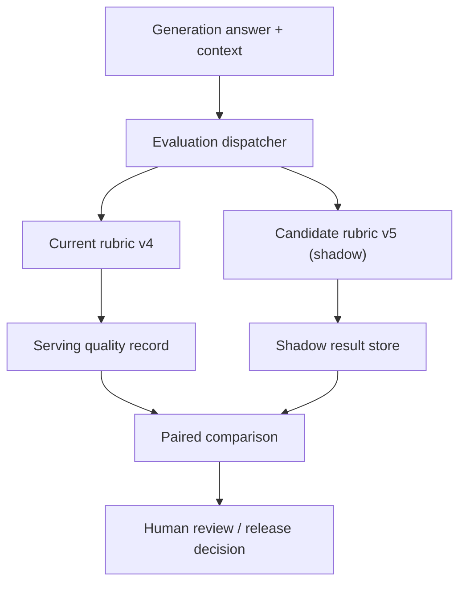

# Triển khai thay đổi instrumentation hoặc rubric theo phiên bản

## 1. Vì sao phải quản lý phiên bản khi thay đổi cách đo và cách chấm?

Một ứng dụng Spring AI có thể thay đổi đồng thời nhiều thành phần: model sinh câu trả lời, prompt, retrieval pipeline, instrumentation, metric schema và rubric mà evaluator dùng để chấm. Nếu tất cả thay đổi cùng lúc mà không ghi phiên bản, dashboard có thể cho thấy chất lượng tăng hoặc giảm nhưng nhóm vận hành không biết nguyên nhân đến từ model, prompt, dữ liệu hay cách đo.

Ví dụ, phiên bản mới thêm thuộc tính phân biệt cached input tokens và uncached input tokens. Nếu dashboard cộng cả hai vào input tokens mà không xác định semantics, số liệu usage có thể bị đếm hai lần. Một rubric mới tăng trọng số fact checking và hạ trọng số relevance; điểm tổng hợp thay đổi dù câu trả lời và judge model không đổi. Nếu chỉ lưu score cuối cùng, không thể tái tạo lý do thay đổi.

Bài **“Triển khai thay đổi instrumentation hoặc rubric theo phiên bản”** thuộc chương **Vận hành** của module **SPRING_AI_EVALUATION_OBSERVABILITY**. Module hướng đến đánh giá chất lượng ứng dụng Spring AI bằng dataset, tiêu chí relevance, fact checking và kiểm thử RAG/tool calling; đồng thời theo dõi metrics, traces, chi phí và độ trễ để phát hiện suy giảm qua các phiên bản prompt, model và pipeline.

Mục tiêu là thiết kế versioning có thể truy nguyên, thay đổi schema telemetry tương thích ngược, thử rubric mới trên cùng dữ liệu, triển khai theo canary/shadow, so sánh đúng cohort và rollback mà không làm mất lịch sử.

## 2. Không dùng một version duy nhất cho mọi thay đổi

Một release ứng dụng có thể chứa nhiều cấu hình và thành phần. Nên tách các trục phiên bản:

| Trục version | Đại diện cho | Ví dụ |
| --- | --- | --- |
| Application version | Bản build/deploy của service | 2.8.1 |
| Instrumentation version | Logic tạo observation/span và mapping metadata | otel-map-3 |
| Telemetry schema version | Tên, kiểu, đơn vị và semantics của field | telemetry-v2 |
| Sampling policy version | Quy tắc chọn trace/evaluation sample | sample-prod-4 |
| Prompt version | Template và system instruction của generation | answer-prompt-12 |
| Rubric version | Tiêu chí, trọng số, threshold và hướng dẫn chấm | rag-rubric-5 |
| Judge profile/version | Provider, model, options và cấu hình judge | judge-small-2026-11 |
| Dataset version | Bộ case và expected labels | rag-golden-2026-11-02 |
| Retrieval/pipeline version | Chunking, embedding, reranker và top-k | retrieval-7 |
| Normalization version | Cách chuẩn hóa usage, score và output | normalize-2 |

Các version này thay đổi độc lập. Một bản deploy có thể nâng application version nhưng giữ nguyên rubric; hoặc triển khai rubric mới bằng config mà không thay code. Nếu gộp tất cả thành một chuỗi release, khó phân tích tác động và khó rollback riêng.

### Version khác revision

- **Version** là định danh có ý nghĩa cho một hợp đồng hoặc bộ hành vi.
- **Revision** là lần chỉnh sửa cụ thể của cấu hình hoặc artifact.
- **Hash/checksum** giúp xác nhận nội dung chính xác, nhưng không thay thế version dễ đọc.

Ví dụ rag-rubric-5 là version nghiệp vụ; SHA-256 của file rubric là checksum chứng minh nội dung file không đổi. Cùng một version nhưng checksum khác nhau là dấu hiệu phát hành sai hoặc tái sử dụng version.

## 3. Bộ version tối thiểu cần lưu trên mỗi evaluation result

Mỗi verdict cần mang đủ thông tin để trả lời: câu trả lời nào được chấm, bằng rubric nào, prompt nào, judge nào và context/dataset nào?

Một record có thể lưu:

- application version và environment;
- instrumentation/telemetry schema version;
- generation provider, model profile và model ID thực tế nếu có;
- generation prompt version;
- retrieval/pipeline version;
- evaluator name và evaluator implementation version;
- rubric version, rubric checksum và threshold set;
- judge provider/model/profile và options liên quan;
- dataset version hoặc evaluation cohort;
- normalization/scoring version;
- sample policy version và lý do job được chọn;
- started/completed timestamp và evaluation status.

Không phải trường nào cũng cần đưa vào Prometheus labels. Các version thường có thể làm low-cardinality dimensions nếu tập giá trị được giới hạn, nhưng job ID, request ID, prompt text, document ID và checksum duy nhất nên nằm trong result store hoặc trace/log có kiểm soát.

### Version manifest

Ví dụ manifest của một evaluation run:

```json
{
  "applicationVersion": "2.8.1",
  "environment": "staging",
  "instrumentationVersion": "otel-map-3",
  "telemetrySchemaVersion": "telemetry-v2",
  "samplingPolicyVersion": "sample-staging-2",
  "generation": {
    "provider": "provider-a",
    "modelProfile": "generation-stable",
    "promptVersion": "answer-prompt-12"
  },
  "retrievalPipelineVersion": "retrieval-7",
  "evaluation": {
    "evaluator": "fact_checking",
    "evaluatorVersion": "spring-ai-adapter-2",
    "rubricVersion": "rag-rubric-5",
    "rubricChecksum": "sha256:example",
    "judgeProfile": "judge-small-2026-11"
  },
  "datasetVersion": "rag-golden-2026-11-02",
  "normalizationVersion": "normalize-2"
}
```

Các giá trị trong manifest là ví dụ. Khi lưu thực tế, checksum phải được tính từ artifact đã phát hành; không dùng chuỗi minh họa.

## 4. Phân biệt instrumentation change và rubric change

Hai thay đổi này phục vụ hai mục tiêu khác nhau:

| Thay đổi | Ví dụ | Điều cần chứng minh |
| --- | --- | --- |
| Instrumentation | Thêm span attribute, sửa usage mapping, đổi metric unit | Dữ liệu đo đúng, schema tương thích, overhead chấp nhận được |
| Rubric | Thêm tiêu chí citation, đổi trọng số, sửa threshold | Điểm phản ánh đúng tiêu chí nghiệp vụ, không tạo regression ngoài ý muốn |
| Prompt evaluator | Sửa hướng dẫn judge hoặc output format | Judge hiểu đúng rubric, kết quả ổn định |
| Judge model | Đổi provider/model | Độ đồng thuận và sai lệch được đo trên benchmark |
| Scoring normalization | Đổi cách quy đổi raw score thành tổng điểm | Kết quả cũ/mới được so sánh theo đúng công thức |

Instrumentation không nên tự thay đổi điểm đánh giá. Rubric không nên âm thầm đổi nghĩa metric telemetry. Nếu một release thay cả hai, cần có manifest cho từng phần để điều tra.

## 5. Version hóa metric và trace schema

Một metric có ít nhất các thuộc tính quan trọng:

- tên;
- kiểu dữ liệu (counter, gauge, histogram);
- đơn vị;
- tập labels/tags;
- semantics của phép đo;
- thời điểm và phạm vi aggregation.

Không đổi semantics của metric tại chỗ mà vẫn giữ nguyên tên. Ví dụ metric app.ai.tokens trước đây đo input + output, nhưng bản mới chỉ đo input tokens; dashboard cũ sẽ diễn giải sai dù series vẫn tồn tại.

### Quy tắc thay đổi tương thích

| Thay đổi | Cách xử lý |
| --- | --- |
| Thêm optional span attribute | Có thể thêm vào schema hiện tại; consumer phải chịu được field thiếu |
| Thêm metric mới | Dùng tên mới, mô tả unit/semantics |
| Đổi unit | Tạo metric mới hoặc versioned name; không đổi đơn vị âm thầm |
| Đổi counter thành gauge | Tạo metric mới vì semantics khác |
| Đổi label set | Đánh giá cardinality và tương thích query |
| Đổi tên attribute | Dual-write trong giai đoạn chuyển tiếp nếu cần |
| Xóa field | Deprecate, đo consumer usage rồi mới loại bỏ |
| Đổi meaning của span name | Dùng operation name mới hoặc version migration có kế hoạch |

Với trace attributes, có thể bổ sung field tùy chọn và giữ nguyên meaning của field cũ. Với metrics, việc đổi label có thể tạo series mới và làm query cũ trả kết quả thiếu. Hãy cập nhật dashboard và alert cùng migration plan.

### Resource attributes và service version

Các thuộc tính resource như service.name, service.version và deployment.environment.name giúp phân biệt instance và release. Đây là metadata ở cấp resource, không phải lý do để đưa mọi request-specific value thành metric tag.

Không dùng request.id, trace.id, prompt hash hoặc document ID làm metric label; cardinality có thể tăng theo số request.

## 6. Thêm field mới theo chiến lược expand-and-contract

Khi schema được consumer sử dụng rộng rãi, không nên đổi producer và consumer cùng một thời điểm mà không có giai đoạn chuyển tiếp.

Một quy trình an toàn:

1. **Expand:** consumer mới chấp nhận cả field cũ và field mới.
2. Deploy consumer có khả năng đọc schema cũ/mới.
3. Deploy producer bắt đầu phát field mới; nếu cần, phát cả field cũ trong giai đoạn dual-write.
4. Kiểm tra tỷ lệ field mới xuất hiện và đối chiếu giá trị.
5. Cập nhật dashboard, alert, query và export contract.
6. Ngừng phát field cũ sau khi consumer đã chuyển.
7. **Contract:** xóa field cũ trong release sau khi xác nhận không còn consumer phụ thuộc.

Ví dụ đổi metric gen_ai.input.tokens thành field nội bộ mới app.ai.usage.input_tokens không nên làm dashboard ngừng đọc series cũ ngay lập tức. Cần giữ mapping hoặc dual-publish trong khoảng thời gian đã định.

Đối với OpenTelemetry semantic conventions, ưu tiên tên và semantics theo convention tương ứng của phiên bản đã chọn. Không tự tạo tên trông giống convention chuẩn nhưng có meaning khác.

## 7. Version hóa rubric như một artifact bất biến

Rubric là hợp đồng đánh giá. Một rubric có thể chứa:

- tên và version;
- mục tiêu đánh giá;
- tiêu chí và định nghĩa;
- thang điểm;
- trọng số;
- threshold pass/fail;
- quy tắc xử lý thiếu context;
- hướng dẫn cho judge;
- ví dụ positive/negative;
- checksum và ngày hiệu lực.

Không chỉnh sửa nội dung rubric đã phát hành rồi giữ nguyên version. Nếu thay đổi trọng số hoặc threshold, tạo version mới. Nếu chỉ sửa typo không ảnh hưởng semantics, vẫn nên ghi revision/changelog và checksum để có thể chứng minh nội dung đã dùng.

### Ví dụ rubric có version

```yaml
rubric:
  id: rag-answer-quality
  version: 5
  effectiveFrom: "2026-11-27"
  scoreRange:
    min: 0
    max: 1
  criteria:
    - id: relevance
      weight: 0.35
      description: "Câu trả lời giải quyết đúng câu hỏi"
    - id: groundedness
      weight: 0.40
      description: "Các claim được hỗ trợ bởi context"
    - id: citation
      weight: 0.15
      description: "Trích dẫn khớp với tài liệu nguồn"
    - id: completeness
      weight: 0.10
      description: "Không bỏ sót thông tin thiết yếu"
  passThreshold: 0.80
  missingContextPolicy: insufficient_evidence
```

Đây là schema ứng dụng minh họa, không phải cấu hình mặc định của Spring AI. Application phải validate weight, score range, threshold và criterion ID trước khi sử dụng.

## 8. Tách raw criterion scores và aggregate score

Nếu chỉ lưu tổng điểm, không thể biết rubric mới thay đổi tiêu chí nào. Nên lưu raw score từng tiêu chí cùng aggregate score và scoring version.

Ví dụ:

```json
{
  "rubricVersion": "rag-rubric-5",
  "scores": {
    "relevance": 0.90,
    "groundedness": 0.80,
    "citation": 0.60,
    "completeness": 1.00
  },
  "weights": {
    "relevance": 0.35,
    "groundedness": 0.40,
    "citation": 0.15,
    "completeness": 0.10
  },
  "aggregateScore": 0.825,
  "passThreshold": 0.80,
  "passed": true,
  "scoringVersion": "weighted-mean-1"
}
```

Điểm tổng trong ví dụ được tính:

```text
0.90 × 0.35
+ 0.80 × 0.40
+ 0.60 × 0.15
+ 1.00 × 0.10
= 0.825
```

Nếu rubric thêm tiêu chí, đổi weight hoặc đổi threshold, không thể so aggregate score cũ/mới mà không xét công thức. Lưu raw criterion scores giúp tái tính aggregate theo một scoring version khác nếu dữ liệu gốc đủ.

Nếu rubric mới thêm một tiêu chí mà kết quả cũ chưa từng đo, không được tự điền score 0 hoặc 1. Cần chạy lại judge trên cùng artifact hoặc đánh dấu tiêu chí là unavailable.

## 9. Version hóa prompt và judge model

Rubric có thể không đổi nhưng prompt judge hoặc model judge thay đổi. Hai thay đổi này cũng ảnh hưởng verdict.

Cần lưu:

- prompt template version và checksum;
- judge model profile;
- provider/model ID thực tế nếu response có;
- model options như temperature, max output tokens và response format;
- evaluator implementation version;
- timeout/retry policy nếu ảnh hưởng kết quả;
- structured output/parser version.

Tên model alias có thể trỏ tới model snapshot khác theo thời gian. Nếu provider không trả immutable model ID, lưu cả configured alias, provider, timestamp và deployment revision do ứng dụng quản lý; không khẳng định alias là model snapshot bất biến.

Đổi judge model cần benchmark riêng. Không gộp thay đổi judge model với rubric thay đổi rồi quy mọi khác biệt điểm số cho rubric.

## 10. Dataset và context snapshot cũng phải có version

Một rubric mới có thể có vẻ tốt hơn chỉ vì dataset thay đổi hoặc retrieval trả về context khác. Để so sánh công bằng, cần version:

- dataset case set;
- expected labels và human adjudication;
- document corpus/index snapshot;
- embedding model/version;
- chunking strategy;
- retrieval top-k, filter và reranker;
- context snapshot hoặc reference bất biến của context đã dùng.

Khi đánh giá câu trả lời đã được sinh, dùng context thực tế đã cung cấp cho model. Nếu chạy retrieval lại trên index mới, đó là một thí nghiệm pipeline mới, không còn là so sánh rubric thuần túy.

Dataset version nên bất biến. Nếu sửa expected answer hoặc nhãn human review, tạo version mới và ghi changelog.

## 11. Lưu evaluation result có provenance

Một result record nên bất biến sau khi hoàn tất; nếu chạy lại, tạo record mới liên kết với run trước. Ví dụ schema SQL minh họa theo PostgreSQL:

```sql
CREATE TABLE evaluation_result (
    evaluation_id UUID PRIMARY KEY,
    logical_request_id VARCHAR(128) NOT NULL,
    created_at TIMESTAMPTZ NOT NULL,
    completed_at TIMESTAMPTZ,
    status VARCHAR(32) NOT NULL,

    application_version VARCHAR(64) NOT NULL,
    instrumentation_version VARCHAR(64),
    telemetry_schema_version VARCHAR(64),

    generation_model_profile VARCHAR(128),
    generation_model_id VARCHAR(128),
    generation_prompt_version VARCHAR(64),
    retrieval_pipeline_version VARCHAR(64),

    evaluator_name VARCHAR(64) NOT NULL,
    evaluator_version VARCHAR(64),
    rubric_version VARCHAR(64) NOT NULL,
    rubric_checksum VARCHAR(96),
    judge_model_profile VARCHAR(128),
    judge_model_id VARCHAR(128),

    dataset_version VARCHAR(128),
    normalization_version VARCHAR(64),
    scoring_version VARCHAR(64),

    aggregate_score NUMERIC(8, 5),
    passed BOOLEAN,
    result_payload JSONB
);
```

Đây là schema tham khảo, cần bổ sung index, retention, access policy và migration theo workload thực tế. Không lưu raw prompt/context trong result_payload nếu không có mục đích, quyền truy cập và retention rõ ràng. Có thể lưu reference tới artifact đã được quản lý an toàn.

### Không ghi đè kết quả cũ

Nếu chạy rubric v5 trên một answer đã được chấm bằng v4:

- giữ nguyên evaluation record v4;
- tạo evaluation record mới cho v5;
- liên kết hai record bằng logical request ID hoặc parent evaluation ID;
- lưu rõ lý do shadow, canary, replay hay production;
- không thay verdict cũ bằng verdict mới.

Nhờ vậy có thể so sánh cùng answer dưới hai rubric mà không làm mất lịch sử.

## 12. Schema compatibility cho result store

Khi thêm field version, áp dụng expand-and-contract:

- thêm column nullable hoặc default có semantics rõ;
- deploy reader chấp nhận null/old rows;
- deploy writer bắt đầu ghi version mới;
- backfill chỉ khi giá trị có thể xác định đáng tin cậy;
- không suy đoán version lịch sử từ application version nếu không có bằng chứng;
- sau thời gian tương thích, cập nhật constraint và bỏ đường đọc cũ.

Không gán rubric_version=latest cho record cũ; latest thay đổi theo thời gian và không cho biết rubric thực sự đã chạy.

Nếu một field lịch sử không thể phục hồi, giữ trạng thái UNKNOWN hoặc null kèm provenance, không bịa version.

## 13. Shadow evaluation: chấm song song nhưng không tác động người dùng

Shadow evaluation chạy rubric/judge mới trên cùng answer và context, nhưng verdict mới chỉ được lưu để so sánh. Kết quả shadow không điều khiển response hoặc hành động nghiệp vụ.



Ưu điểm:

- cùng input nên giảm khác biệt do traffic population;
- rubric mới có thể được kiểm tra trên traffic thật đã được cho phép;
- không làm thay đổi quyết định serving;
- có thể đo judge latency và cost trước rollout.

Nhược điểm là judge calls và chi phí tăng. Cần giới hạn sample, concurrency và retention. Nếu candidate rubric dùng model khác, cần ghi rõ cả rubric version lẫn judge profile để phân biệt tác động.

## 14. Canary rollout: tăng dần tỷ lệ dùng rubric mới

Sau shadow phase, có thể triển khai canary:

1. 1% evaluation jobs dùng rubric mới.
2. So sánh pass rate, criterion score, error rate và judge latency.
3. Tăng lên 5%, 10%, 25% nếu không có regression.
4. Mở rộng theo environment, model profile hoặc use case.
5. Chuyển 100% sau khi đạt release gate và có phương án rollback.

Các tỷ lệ là ví dụ. Chọn sample size theo độ biến động score và mức thay đổi nhỏ nhất cần phát hiện. Với traffic thấp, 1% có thể tạo quá ít mẫu để kết luận.

Nếu dùng hash ổn định của logical request ID, một request có thể giữ cùng cohort qua retry. Tuy nhiên, khi so sánh rubric cũ/mới, paired shadow trên cùng input thường hữu ích hơn chia hai nhóm request độc lập.

## 15. So sánh paired evaluation và cohort evaluation

Hai cách so sánh trả lời câu hỏi khác nhau:

| Cách | Câu hỏi | Rủi ro |
| --- | --- | --- |
| Paired evaluation | Cùng answer/context, rubric hoặc judge nào chấm khác? | Tốn judge calls; có thể có judge order/effect |
| Cohort evaluation | Traffic nhóm A/B có chất lượng khác nhau không? | Hai cohort có thể khác độ khó/ngôn ngữ/use case |
| Golden dataset replay | Trên bộ test cố định, release mới có regression không? | Dataset có thể không đại diện traffic thật |
| Human adjudication | Judge nào gần đánh giá của người hơn? | Tốn thời gian, cần hướng dẫn nhất quán |

Đối với rubric change, paired evaluation thường là bước đầu tốt: giữ nguyên answer/context/dataset, thay một biến cần kiểm tra. Đối với generation prompt/model change, cần chạy cả pipeline vì output khác nhau; dùng cùng input set để so sánh.

Không so pass rate của hai cohort khác phân bố mà không stratify theo use case, ngôn ngữ, model và mức độ khó.

## 16. Đánh giá rubric mới bằng human calibration

LLM-as-a-judge không phải ground truth. Một rubric mới có thể làm judge đồng thuận với chính prompt mới hơn nhưng lệch đánh giá của chuyên gia.

Một quy trình calibration:

1. Chọn tập mẫu đại diện và mẫu khó/biên.
2. Có human label hoặc adjudication theo guideline.
3. Chạy rubric cũ và mới trên cùng sample.
4. Đo agreement giữa judge và human.
5. Xem confusion matrix, false pass và false fail.
6. Phân tích theo criterion, ngôn ngữ, use case và độ dài context.
7. Kiểm tra stability bằng repeated runs trên một subset nếu judge có tính ngẫu nhiên.
8. Ghi quyết định và ngưỡng chấp nhận trước khi rollout.

Các metric có thể gồm accuracy, precision, recall, F1, Cohen’s kappa hoặc Krippendorff’s alpha tùy dạng nhãn và số người chấm. Với score liên tục, có thể xem correlation và calibration error; không dùng một metric duy nhất để kết luận.

## 17. Tách rubric version khỏi scoring implementation

Rubric định nghĩa tiêu chí/weight/threshold. Scoring implementation chuyển raw criterion scores thành aggregate score/pass-fail. Hai thứ có thể thay đổi độc lập.

Ví dụ:

- rubric v5: relevance 0.35, groundedness 0.40, citation 0.15, completeness 0.10;
- scoring v1: weighted mean;
- scoring v2: thiếu criterion bắt buộc thì verdict là insufficient evidence thay vì tính trung bình.

Nếu scoring code đổi mà rubric không đổi, cần lưu scoring_version mới. Nếu rubric đổi nhưng scoring algorithm giữ nguyên, vẫn cần rubric_version mới.

Không ghi đè score lịch sử khi scoring implementation thay đổi. Có thể tạo derived score mới từ raw criterion scores, ghi derived_from_evaluation_id và scoring_version.

## 18. Triển khai instrumentation version mới

Một release instrumentation nên đi qua các bước:

1. Chốt metric/span contract và semantics.
2. Tạo schema version mới nếu meaning hoặc contract thay đổi.
3. Kiểm tra cardinality và payload size.
4. Thêm consumer/dashboard support trước khi producer phát field mới.
5. Chạy contract test trên fixture span/metric.
6. Deploy canary instance.
7. So sánh metric counts, units, missingness và exporter errors.
8. Dual-publish metric cũ/mới nếu rename cần giai đoạn chuyển tiếp.
9. Xác nhận dashboard/alert đọc đúng series.
10. Mở rộng rollout.
11. Deprecate field cũ theo thời hạn đã công bố.
12. Xóa code cũ sau khi consumer không còn phụ thuộc.

### Không thay đổi unit tại chỗ

Ví dụ metric cũ tính milliseconds nhưng bản mới ghi seconds dưới cùng tên. Dashboard có thể lệch 1.000 lần mà không báo lỗi schema. Hãy tạo metric mới với unit rõ, dual-write và chuyển query theo migration plan.

## 19. Triển khai rubric version mới

Một rollout rubric có thể theo các phase:

| Phase | Hoạt động | Exit criteria |
| --- | --- | --- |
| Draft | Định nghĩa tiêu chí, score range, weight, threshold | Spec review xong |
| Offline validation | Golden dataset, human labels, calibration | Không có regression vượt ngưỡng |
| Shadow | Chấm song song trên cùng output/context | Có paired results đủ mẫu |
| Canary | Một phần evaluation jobs dùng rubric mới | Metrics ổn định, cost/latency trong budget |
| General availability | Chuyển mặc định | Release gate đạt |
| Deprecation | Ngừng rubric cũ | Không còn job mới phụ thuộc |
| Archive | Lưu spec, prompt, checksum, benchmark | Có thể truy nguyên lịch sử |

Nếu rubric được dùng để ra quyết định có tác động nghiệp vụ, rollout cần phê duyệt theo quy trình domain owner. Không tự động chuyển default chỉ vì score trung bình tăng; cần kiểm false pass/false fail và nhóm case quan trọng.

## 20. Dashboard và metric cần gắn version thế nào?

Có thể phân tích theo những chiều hữu hạn:

- application version;
- instrumentation version;
- telemetry schema version;
- rubric version;
- judge model profile;
- prompt version;
- retrieval pipeline version;
- dataset/cohort;
- evaluator type;
- environment.

Các chiều này có thể được lưu trong result store và trace resource/span attributes. Với Prometheus, chỉ dùng label có tập giá trị kiểm soát. Không gắn checksum, job ID, trace ID, request ID hoặc dataset case ID làm label.

Metric gợi ý:

| Metric | Ý nghĩa |
| --- | --- |
| app.ai.evaluation.completed | Số evaluation hoàn tất |
| app.ai.evaluation.failed | Số evaluation lỗi |
| app.ai.evaluation.score | Phân bố score |
| app.ai.evaluation.pass | Pass/fail count |
| app.ai.evaluation.duration | Thời gian judge/evaluator |
| app.ai.evaluation.cost | Chi phí theo currency/workload |
| app.ai.instrumentation.missing_usage | Số operation thiếu usage theo kỳ vọng |
| app.ai.telemetry.schema_mismatch | Số event không khớp schema |

Tên metric là convention ứng dụng minh họa, không phải meter Spring AI mặc định. Cần xác định unit, type, labels và aggregation trước khi đăng ký.

## 21. Release gate: quyết định có tiếp tục rollout hay không

Một release gate có thể kiểm tra:

- contract compatibility của metric/span schema;
- tỷ lệ missing usage không tăng ngoài dự kiến;
- exporter failure/drop rate nằm trong budget;
- rubric mới đạt threshold trên golden dataset;
- false pass không vượt ngưỡng cho phép;
- human agreement không suy giảm;
- judge latency/cost nằm trong ngân sách;
- không có cohort quan trọng bị regression;
- result provenance đầy đủ và truy vấn được;
- rollback đã được diễn tập hoặc có thể thực hiện an toàn.

Không dùng pass rate tổng thể làm gate duy nhất. Một rubric có thể tăng pass rate vì chấm dễ hơn, trong khi khả năng phát hiện hallucination giảm.

### Ví dụ policy

```yaml
releaseGate:
  instrumentation:
    schemaContract: required
    maxDroppedSpanRate: 0.001
    maxMissingUsageIncrease: 0.02
  evaluation:
    datasetVersion: rag-golden-2026-11-02
    minHumanAgreement: 0.85
    maxFalsePassIncrease: 0.01
    maxJudgeCostIncrease: 0.15
  rollout:
    canaryPercent: 5
    requireShadowComparison: true
    rollbackOnCriticalRegression: true
```

Đây là policy minh họa. Ngưỡng phải được xác định theo baseline và mức rủi ro của sản phẩm; không dùng các con số mẫu như default chung.

## 22. Rollback instrumentation và rubric

Instrumentation rollback:

- đưa traffic về release/schema trước;
- giữ dashboard có thể đọc cả series cũ và mới trong giai đoạn chuyển tiếp;
- không xóa metric/result lịch sử;
- nếu dual-write đã dừng, kiểm tra consumer còn cần series mới không;
- không đổi ngược semantics của metric mới để giả lập metric cũ.

Rubric rollback:

- chuyển default evaluation policy về rubric version trước;
- giữ các result đã chấm bằng rubric mới và đánh dấu version;
- không rewrite verdict mới thành verdict cũ;
- xử lý job đang chạy theo policy rõ ràng: hoàn tất version đã bắt đầu hoặc hủy và enqueue lại với version mới;
- lưu lý do rollback và phạm vi cohort.

Rollback application code không nhất thiết rollback database schema ngay. Dùng expand-and-contract để code cũ và mới cùng đọc schema trong thời gian chuyển tiếp. Tránh destructive migration khi còn result record cần truy nguyên.

## 23. Playbook điều tra khi score hoặc telemetry đổi đột ngột

| Triệu chứng | Nguyên nhân có thể | Kiểm tra |
| --- | --- | --- |
| Score giảm sau deploy | Prompt, model, retrieval hoặc rubric đổi | Version manifest và paired replay |
| Pass rate tăng bất thường | Threshold giảm hoặc judge prompt dễ hơn | Rubric checksum, scoring version |
| Token usage thay đổi | Instrumentation mapping/unit đổi | Schema version và raw provider metadata |
| Metric biến mất | Rename/tag/schema incompatibility | Registry, exporter và dashboard query |
| Trace volume tăng | Sampling policy hoặc span count đổi | Sampling policy version |
| Judge cost tăng | Sample rate, context length, retries hoặc model đổi | Judge profile, usage và evaluation count |
| Cohort score khác nhau | Population mix thay đổi | Stratify theo use case/language/model |
| Historical result không truy nguyên được | Thiếu version fields | Result schema và release manifest |
| Dual-run disagreement cao | Rubric semantics hoặc judge variance | Criterion-level comparison và human review |

Quy trình:

1. Xác định thời điểm bắt đầu thay đổi.
2. So sánh application/instrumentation/rubric/prompt/model/dataset versions.
3. Kiểm tra raw metadata và schema contract.
4. Chạy replay trên cùng fixture.
5. Tách paired result khỏi cohort result.
6. Đo criterion-level score và human agreement.
7. Kiểm chi phí, latency, missingness và drop.
8. Rollback riêng thành phần gây regression.
9. Ghi incident/change record và cập nhật release gate.

## 24. Bài tập thực hành

1. **Version axes:** một deploy đổi prompt và metric mapping nhưng không đổi judge model. Những version nào cần tăng?
2. **Metric schema:** vì sao không đổi milliseconds thành seconds dưới cùng metric name?
3. **Expand-and-contract:** thiết kế migration thêm field rubric_version vào result store mà vẫn đọc được record cũ.
4. **Rubric immutability:** trọng số citation đổi từ 0.10 lên 0.20. Vì sao cần version mới?
5. **Paired evaluation:** mô tả cách chạy rubric v4 và v5 trên cùng answer/context.
6. **Cohort bias:** pass rate v5 cao hơn v4 nhưng v5 được dùng cho nhiều câu hỏi dễ hơn. Cách điều tra?
7. **Judge drift:** rubric không đổi nhưng provider model alias trỏ tới snapshot mới. Cần ghi nhận gì?
8. **Dataset version:** expected label thay đổi sau human review. Vì sao không sửa dataset version cũ?
9. **Scoring:** rubric có raw criterion scores nhưng aggregate algorithm đổi. Cần version nào?
10. **Instrumentation canary:** triển khai metric mới cho 5% instance. Những tín hiệu nào cần so sánh?
11. **Cardinality:** vì sao checksum, request ID và case ID không nên làm Prometheus labels?
12. **Release gate:** thiết kế gate cho một rubric mới có nguy cơ làm false pass tăng.
13. **Rollback:** một số job đang chạy rubric v5 khi quyết định rollback về v4. Xử lý job đang chạy thế nào?
14. **Human calibration:** chọn metric agreement phù hợp cho nhãn pass/fail và score liên tục.
15. **Provenance:** liệt kê metadata tối thiểu để tái hiện một evaluation result sau sáu tháng.

## Tài liệu tham khảo

- [Spring AI 2.1.0 – Evaluation Testing](https://docs.spring.io/spring-ai/reference/api/testing.html): Evaluator, EvaluationRequest, EvaluationResponse, RelevancyEvaluator và FactCheckingEvaluator.
- [Spring AI 2.1.0 – Observability](https://docs.spring.io/spring-ai/reference/observability/index.html): model observations, GenAI metrics/traces, attributes và cardinality.
- [OpenTelemetry – Semantic Conventions](https://opentelemetry.io/docs/specs/semconv/): quy ước tên, thuộc tính và semantics của telemetry.
- [OpenTelemetry – Resource SDK](https://opentelemetry.io/docs/specs/otel/resource/sdk/): resource attributes gắn với service/process/deployment.
- [Prometheus – Metric and Label Naming](https://prometheus.io/docs/practices/naming/): tên metric, unit và labels.
- [Spring Boot – Actuator Metrics](https://docs.spring.io/spring-boot/reference/actuator/metrics.html): Micrometer registry, meter và exporter.
- [Spring Boot – Externalized Configuration](https://docs.spring.io/spring-boot/reference/features/external-config.html): quản lý cấu hình theo profile và môi trường.

> **Ghi chú triển khai:** Các version ID, manifest, rubric schema, SQL table, metric app.ai.* và release gate trong bài là thiết kế ứng dụng minh họa, không phải schema mặc định của Spring AI. Hãy chốt contract và version policy của dự án, kiểm thử consumer/producer compatibility, giữ artifact bất biến và chạy paired replay trước khi chuyển mặc định. Bài viết là hướng dẫn triển khai, chưa phải kết quả rollout hoặc benchmark trên hệ thống thực tế.
