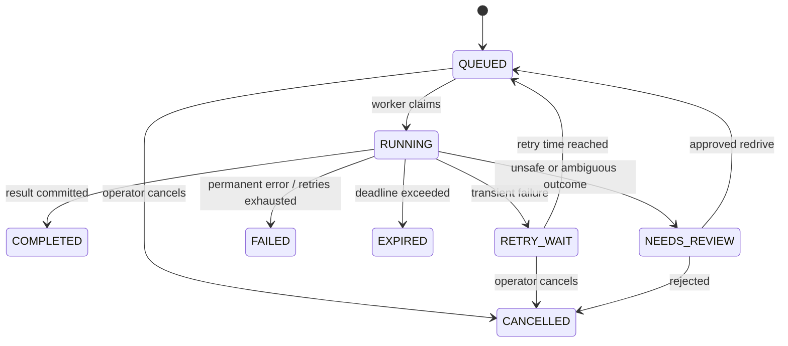
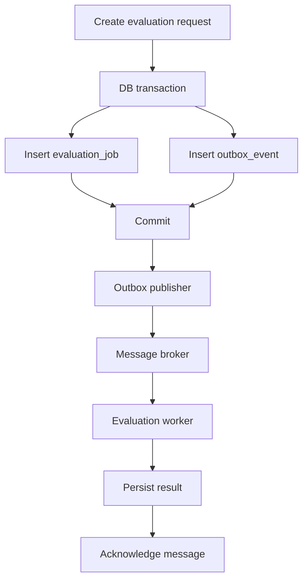

# Hoàn tác cấu hình và phục hồi các lần đánh giá chưa hoàn tất

## 1. Vì sao cần kế hoạch rollback và recovery?

Một pipeline đánh giá Spring AI thường gồm generation, retrieval, evaluator, judge ChatModel, queue, result store và telemetry exporter. Một thay đổi cấu hình có thể làm judge model trả lỗi, rubric mới chấm sai, endpoint OTLP ngừng hoạt động hoặc worker không ghi được kết quả. Nếu không có kế hoạch rollback và phục hồi, các evaluation job đang chạy có thể bị mất, chạy trùng hoặc hoàn tất bằng cấu hình khác với cấu hình đã tạo job.

Ví dụ: một batch gồm 5.000 câu trả lời đang được chấm bằng rubric v4. Sau khi triển khai rubric v5, judge provider bắt đầu timeout. Nhóm vận hành rollback cấu hình active về v4. Nếu worker tự đọc cấu hình mới nhất mỗi lần retry, một nửa batch có thể được chấm bằng v4 và nửa còn lại bằng v5. Báo cáo tổng hợp khi đó không còn cùng một hợp đồng đánh giá.

Bài **“Hoàn tác cấu hình và phục hồi các lần đánh giá chưa hoàn tất”** thuộc chương **Vận hành** của module **SPRING_AI_EVALUATION_OBSERVABILITY**. Module học đánh giá chất lượng ứng dụng Spring AI bằng dataset, tiêu chí relevance, fact checking và kiểm thử RAG/tool calling; đồng thời theo dõi metrics, traces, chi phí và độ trễ để phát hiện suy giảm qua các phiên bản prompt, model và pipeline.

Mục tiêu là rollback cấu hình có kiểm soát, giữ nguyên provenance của job, khôi phục các job bị gián đoạn, tránh duplicate result và bảo đảm báo cáo phản ánh đúng phiên bản đã thực thi.

## 2. Phân biệt rollback cấu hình và phục hồi dữ liệu

Hai hoạt động thường diễn ra cùng lúc nhưng có mục tiêu khác nhau:

| Hoạt động | Câu hỏi | Ví dụ |
| --- | --- | --- |
| Configuration rollback | Cấu hình active nào cần được dùng cho job mới? | Chuyển default rubric từ v5 về v4 |
| Deployment rollback | Bản code nào cần chạy? | Roll back evaluation worker image |
| Job recovery | Job đang dở cần tiếp tục hay chạy lại? | Requeue job có lease hết hạn |
| Result recovery | Kết quả nào đã commit và kết quả nào còn thiếu? | Đối soát batch item và result rows |
| Data restore | Khôi phục dữ liệu bị xóa/hỏng ra sao? | Restore database backup hoặc point-in-time recovery |

Không dùng database restore như thao tác rollback cấu hình thông thường. Restore có thể xóa các result record đã được ghi sau thời điểm backup. Với thay đổi rubric, thường chỉ cần đổi active version pointer hoặc cấu hình phát hành; lịch sử kết quả vẫn được giữ.

Tương tự, rollback worker code không tự động đồng nghĩa với rollback schema database. Schema cần chiến lược tương thích ngược để worker cũ và mới có thể cùng hoạt động trong giai đoạn chuyển tiếp.

## 3. Các nguyên tắc phục hồi cần giữ

Một quy trình recovery an toàn nên tuân theo các nguyên tắc:

1. **Pin version:** job giữ cấu hình và version đã chọn lúc được tạo.
2. **Immutable result:** không ghi đè kết quả đã hoàn tất.
3. **Idempotent persistence:** retry không tạo duplicate result.
4. **Bounded retry:** số lần retry và thời gian retry có giới hạn.
5. **Lease-based ownership:** worker chỉ sở hữu job trong một khoảng thời gian có heartbeat.
6. **Explicit state:** job có trạng thái rõ ràng, không suy ra từ log.
7. **Separate retry and rerun:** retry cùng job giữ nguyên version; rerun chủ ý tạo job mới.
8. **Audit trail:** mọi rollback, cancel, redrive và manual override đều có actor, reason và timestamp.
9. **No false pass:** lỗi hoặc kết quả chưa xác định không được đổi thành PASS.
10. **Reconcile before replay:** đối chiếu result store trước khi chạy lại để tránh chấm trùng.

## 4. Ghim cấu hình vào job ngay khi tạo

Không để worker tự lấy giá trị latest khi bắt đầu hoặc retry một job. Job cần lưu một snapshot cấu hình bất biến hoặc reference tới artifact bất biến.

Một EvaluationConfigSnapshot có thể gồm:

- generation model profile và model ID;
- generation prompt version;
- retrieval pipeline version;
- evaluator name và implementation version;
- rubric version và checksum;
- judge provider, model profile, model ID và options;
- dataset version;
- normalization/scoring version;
- sampling policy version;
- timeout và retry policy version.

Snapshot có thể được lưu dưới dạng JSON có schema version hoặc lưu trong config registry rồi tham chiếu bằng immutable ID/checksum. Không chỉ lưu alias như latest vì alias có thể đổi đích.

### Ví dụ job snapshot

```json
{
  "snapshotId": "cfg-2026-11-27-0042",
  "snapshotChecksum": "sha256:example",
  "applicationVersion": "2.8.1",
  "generationPromptVersion": "answer-v12",
  "retrievalPipelineVersion": "retrieval-v7",
  "evaluatorVersion": "fact-check-v3",
  "rubricVersion": "rag-rubric-v4",
  "judgeProfile": "judge-small-stable",
  "judgeModelId": "provider-model-snapshot-a",
  "datasetVersion": "golden-2026-11",
  "scoringVersion": "weighted-mean-v1",
  "retryPolicyVersion": "judge-retry-v2"
}
```

Các giá trị là ví dụ. Checksum phải được tính từ nội dung canonical đã phát hành. Khi retry, worker đọc snapshot theo snapshotId, không resolve active configuration lần nữa.

## 5. Active configuration và immutable configuration registry

Nên tách hai khái niệm:

- **Active pointer:** chỉ định version hiện đang được dùng để tạo job mới.
- **Immutable artifact:** nội dung rubric, prompt, sampling policy hoặc model profile đã được phát hành.

Ví dụ:

```yaml
evaluation:
  active:
    rubric: rag-rubric-v4
    judgeProfile: judge-small-stable
    prompt: fact-check-prompt-v3
    scoring: weighted-mean-v1
  artifacts:
    rag-rubric-v4:
      checksum: sha256:abc123
      location: config/rubrics/rag-rubric-v4.yml
    rag-rubric-v5:
      checksum: sha256:def456
      location: config/rubrics/rag-rubric-v5.yml
```

Đây là schema ứng dụng minh họa, không phải property mặc định của Spring AI. Khi phát hành, không sửa nội dung artifact v4 tại chỗ. Muốn thay đổi rubric thì tạo v5 và cập nhật active pointer sau khi validation đạt.

Rollback chỉ cần chuyển active pointer về v4 cho job mới. Job đã tạo bằng v5 vẫn giữ snapshot v5 và được xử lý theo quyết định vận hành rõ ràng.

## 6. Quyết định xử lý job đang chạy khi rollback

Rollback không tự trả lời câu hỏi job đang RUNNING phải làm gì. Cần policy theo loại thay đổi:

| Tình huống | Hành động khuyến nghị |
| --- | --- |
| Exporter telemetry lỗi, evaluator vẫn đúng | Tiếp tục job; ghi telemetry degradation riêng |
| Judge provider tạm thời timeout | Retry cùng snapshot trong budget |
| Rubric v5 có lỗi nghiêm trọng về semantics | Pause/cancel job v5; tạo job mới bằng v4 nếu cần kết quả |
| Judge model alias trỏ sai deployment | Pause job, xác minh model identity; không âm thầm đổi model |
| Scoring implementation có bug | Đánh dấu affected results; chạy derived score hoặc rerun có version mới |
| Database tạm unavailable | Retry persistence idempotently; không gọi judge lại nếu output đã lưu tạm an toàn |
| Job vượt deadline | Mark EXPIRED hoặc NEEDS_REVIEW theo policy |

Có thể chọn một trong ba chiến lược cho job đang chạy:

- **Continue pinned:** hoàn tất với snapshot ban đầu.
- **Cancel and requeue:** hủy job cũ có audit reason, tạo job mới với snapshot đã rollback.
- **Quarantine:** giữ job ở trạng thái NEEDS_REVIEW cho đến khi domain owner quyết định.

Không đổi snapshot giữa chừng. Nếu cần chạy lại bằng version khác, tạo job mới và liên kết với job gốc.

## 7. State machine cho evaluation job

Một state machine giúp recovery có căn cứ:



Các trạng thái terminal thường là COMPLETED, FAILED, EXPIRED và CANCELLED. NEEDS_REVIEW có thể là trạng thái chờ quyết định, không tự động được xem là hoàn tất.

Mỗi transition cần ghi:

- trạng thái trước và sau;
- actor (worker/system/operator);
- thời điểm;
- reason/error code;
- attempt number;
- config snapshot ID;
- correlation/job ID.

Không chỉ lưu trạng thái cuối. Lịch sử transition giúp phân tích vì sao một job bị retry, cancel hoặc redrive.

## 8. Mô hình dữ liệu job và result

Một schema quan hệ tối thiểu có thể gồm bảng job, attempt và result. Ví dụ PostgreSQL:

```sql
CREATE TABLE evaluation_job (
    job_id UUID PRIMARY KEY,
    logical_request_id VARCHAR(128) NOT NULL,
    idempotency_key VARCHAR(200) NOT NULL UNIQUE,
    status VARCHAR(32) NOT NULL,
    config_snapshot_id VARCHAR(128) NOT NULL,
    config_checksum VARCHAR(96) NOT NULL,
    attempt_count INTEGER NOT NULL DEFAULT 0,
    max_attempts INTEGER NOT NULL,
    next_attempt_at TIMESTAMPTZ,
    deadline_at TIMESTAMPTZ,
    lease_owner VARCHAR(128),
    lease_expires_at TIMESTAMPTZ,
    heartbeat_at TIMESTAMPTZ,
    created_at TIMESTAMPTZ NOT NULL,
    updated_at TIMESTAMPTZ NOT NULL
);

CREATE TABLE evaluation_attempt (
    attempt_id UUID PRIMARY KEY,
    job_id UUID NOT NULL REFERENCES evaluation_job(job_id),
    attempt_number INTEGER NOT NULL,
    worker_id VARCHAR(128) NOT NULL,
    started_at TIMESTAMPTZ NOT NULL,
    finished_at TIMESTAMPTZ,
    outcome VARCHAR(32),
    error_code VARCHAR(96),
    provider_request_id VARCHAR(200),
    UNIQUE(job_id, attempt_number)
);

CREATE TABLE evaluation_result (
    result_id UUID PRIMARY KEY,
    job_id UUID NOT NULL UNIQUE REFERENCES evaluation_job(job_id),
    config_snapshot_id VARCHAR(128) NOT NULL,
    rubric_version VARCHAR(64) NOT NULL,
    judge_model_id VARCHAR(128),
    result_status VARCHAR(32) NOT NULL,
    aggregate_score NUMERIC(8, 5),
    passed BOOLEAN,
    result_payload JSONB,
    committed_at TIMESTAMPTZ NOT NULL
);
```

Đây là schema tham khảo. Cần thêm index theo status/next_attempt_at/lease_expires_at, partition và retention theo tải thực tế. Nếu hệ thống lưu result ở object store, cần manifest và checksum tương đương.

Unique idempotency key và unique job_id ở result ngăn nhiều result cho cùng một job. Nếu cho phép nhiều evaluator trong một job, khóa unique phải bao gồm evaluator identity/version phù hợp.

## 9. Claim job bằng lease và fencing token

Worker không nên lấy job bằng cách đọc danh sách rồi cập nhật sau mà không khóa, vì hai worker có thể cùng claim một job.

Một pattern PostgreSQL là chọn job đến hạn bằng FOR UPDATE SKIP LOCKED:

```sql
WITH candidate AS (
    SELECT job_id
    FROM evaluation_job
    WHERE status = 'QUEUED'
      AND (next_attempt_at IS NULL OR next_attempt_at <= now())
      AND (deadline_at IS NULL OR deadline_at > now())
    ORDER BY created_at
    FOR UPDATE SKIP LOCKED
    LIMIT 1
)
UPDATE evaluation_job j
SET status = 'RUNNING',
    lease_owner = :worker_id,
    lease_expires_at = now() + interval '30 seconds',
    heartbeat_at = now(),
    attempt_count = attempt_count + 1,
    updated_at = now()
FROM candidate c
WHERE j.job_id = c.job_id
RETURNING j.*;
```

Câu lệnh cần chạy trong transaction. Worker phải kiểm tra row được trả về; không có row nghĩa là hiện không có job phù hợp.

Lease cho phép worker khác phục hồi job khi process chết. Tuy nhiên, lease một mình chưa đủ nếu worker cũ bị pause lâu rồi tiếp tục chạy sau khi lease hết hạn. Fencing token hoặc monotonically increasing attempt number giúp từ chối write của worker cũ.

Ví dụ, result commit chỉ được chấp nhận nếu job vẫn RUNNING và lease_owner/attempt_number khớp worker hiện tại. Không để worker có lease cũ ghi đè kết quả của worker mới.

## 10. Heartbeat và phát hiện job bị treo

Worker cập nhật heartbeat theo chu kỳ ngắn hơn lease duration. Ví dụ lease 30 giây thì heartbeat mỗi 5–10 giây.

Recovery monitor tìm các job RUNNING có lease hết hạn:

```sql
SELECT job_id, lease_owner, lease_expires_at, attempt_count, max_attempts
FROM evaluation_job
WHERE status = 'RUNNING'
  AND lease_expires_at < now()
ORDER BY lease_expires_at
FOR UPDATE SKIP LOCKED;
```

Sau khi khóa row, monitor quyết định:

- attempt còn budget và deadline chưa hết: chuyển RETRY_WAIT hoặc QUEUED;
- attempt hết budget: chuyển FAILED hoặc NEEDS_REVIEW;
- deadline đã hết: chuyển EXPIRED;
- không xác định được remote call đã hoàn tất hay chưa: giữ NEEDS_REVIEW nếu rủi ro duplicate/cost cao.

Heartbeat mất không chứng minh judge call thất bại. Worker có thể đã gửi request và provider đã xử lý nhưng process chết trước khi lưu response. Đây là trường hợp cần idempotency và reconciliation.

Sau khi xác nhận lease đã hết hạn, recovery worker có thể chuyển job về RETRY_WAIT nếu còn retry budget. Việc chuyển trạng thái phải kiểm tra lại lease trong cùng transaction để tránh đụng vào worker vừa gia hạn lease:

```sql
UPDATE evaluation_job
SET status = CASE
        WHEN attempt_count < max_attempts
             AND (deadline_at IS NULL OR deadline_at > now())
        THEN 'RETRY_WAIT'
        WHEN deadline_at IS NOT NULL AND deadline_at <= now()
        THEN 'EXPIRED'
        ELSE 'NEEDS_REVIEW'
    END,
    next_attempt_at = CASE
        WHEN attempt_count < max_attempts
             AND (deadline_at IS NULL OR deadline_at > now())
        THEN now() + interval '10 seconds'
        ELSE NULL
    END,
    lease_owner = NULL,
    lease_expires_at = NULL,
    updated_at = now()
WHERE job_id = :job_id
  AND status = 'RUNNING'
  AND lease_expires_at < now();
```

Đây là ví dụ chuyển trạng thái; production cần ghi job transition/audit event trong cùng transaction và dùng retry policy của job thay vì hard-code khoảng 10 giây.

## 11. Retry cùng job khác với rerun bằng cấu hình mới

Hai hành động cần có semantics riêng:

| Thuộc tính | Retry | Rerun |
| --- | --- | --- |
| Job ID | Giữ nguyên | Tạo mới |
| Idempotency key | Giữ nguyên | Khác |
| Config snapshot | Giữ nguyên | Có thể chọn version mới |
| Attempt count | Tăng | Bắt đầu lại |
| Mục tiêu | Hoàn tất lần chạy đã định | Tạo kết quả đánh giá mới |
| Liên kết lịch sử | Cùng job, nhiều attempts | Parent/origin job ID |

Nếu retry job rubric v4 sau rollback active pointer về v3, job vẫn phải dùng rubric v4 theo snapshot. Nếu muốn đánh giá lại bằng v3, tạo job rerun mới và ghi reason cùng parent job ID.

Không đổi config snapshot chỉ để tái sử dụng job ID. Làm vậy phá vỡ provenance và khiến idempotency key mất ý nghĩa.

## 12. Idempotency khi gọi judge model và ghi result

Một evaluation có thể bị thực hiện nhiều hơn một lần vì timeout, retry, worker restart hoặc message redelivery. Không phải provider nào cũng hỗ trợ idempotency key cho model inference.

Nên phân biệt hai điểm:

1. **Remote model call:** có thể bị gửi lại và phát sinh chi phí trùng nếu response trước đã được provider xử lý nhưng client không nhận được.
2. **Result persistence:** có thể bảo đảm idempotent bằng unique key/transaction trong result store.

Một idempotency key có thể được tạo từ:

```text
idempotency_key =
    hash(
        logical_request_id
        + evaluator_name
        + evaluator_version
        + config_snapshot_checksum
        + input_artifact_version
    )
```

Không dùng prompt text hoặc dữ liệu cá nhân thô làm key. Hash phải dùng canonical serialization và thuật toán ổn định.

Khi result đã tồn tại cho cùng job, worker trả lại result hiện có thay vì ghi row mới. Nếu cần chạy judge lại, tạo job mới với run identity mới.

**Không hứa exactly-once cho remote inference.** Thực tế thường là at-least-once delivery kết hợp idempotent result write và reconciliation. Nếu provider có request id hoặc idempotency support, dùng theo hợp đồng chính thức của provider.

### Commit result và trạng thái job trong cùng transaction

Khi worker đã có verdict, result row và trạng thái COMPLETED nên được commit nguyên tử trong cùng database transaction. Trước khi ghi, kiểm tra job vẫn thuộc lease/attempt hiện tại:

```sql
BEGIN;

SELECT job_id
FROM evaluation_job
WHERE job_id = :job_id
  AND status = 'RUNNING'
  AND lease_owner = :worker_id
  AND attempt_count = :attempt_number
FOR UPDATE;
-- Application must rollback if this query returns no row.

INSERT INTO evaluation_result (
    result_id, job_id, config_snapshot_id, rubric_version,
    judge_model_id, result_status, aggregate_score,
    passed, result_payload, committed_at
)
VALUES (
    :result_id, :job_id, :snapshot_id, :rubric_version,
    :judge_model_id, :result_status, :score,
    :passed, :payload, now()
)
ON CONFLICT (job_id) DO NOTHING
RETURNING result_id;
-- If no row is returned, load the existing result and verify its
-- snapshot/checksum before allowing the job transition below.

UPDATE evaluation_job
SET status = 'COMPLETED',
    lease_owner = NULL,
    lease_expires_at = NULL,
    updated_at = now()
WHERE job_id = :job_id
  AND status = 'RUNNING'
  AND lease_owner = :worker_id
  AND attempt_count = :attempt_number;
-- Application must require exactly one updated row; otherwise rollback.

COMMIT;
```

Đây là transaction sketch cần được triển khai bằng transaction manager/DAO của ứng dụng. Nếu SELECT không trả row hoặc UPDATE không tác động đúng một row, rollback transaction và xử lý như stale worker. Nếu INSERT không trả row do conflict, đọc result hiện có và xác minh snapshot/checksum trước khi cho phép cập nhật trạng thái job; không mặc định mọi conflict đều là kết quả tương đương. Các dòng comment mô tả nhánh kiểm tra do application thực hiện bên trong transaction.

## 13. Checkpoint để tránh gọi lại model không cần thiết

Nếu pipeline có nhiều bước, có thể lưu checkpoint sau từng bước có chi phí:

- INPUT_CAPTURED: input/context snapshot đã lưu;
- GENERATION_COMPLETED: answer đã lưu;
- RETRIEVAL_CAPTURED: context được dùng đã lưu;
- JUDGE_RESPONSE_RECEIVED: raw judge output đã lưu;
- RESULT_NORMALIZED: score/verdict đã chuẩn hóa;
- RESULT_COMMITTED: transaction kết quả đã commit.

Với một evaluator đơn giản chỉ gọi judge một lần, checkpoint có thể ít hơn. Nhưng nếu raw judge response đã được lưu bền vững trước khi worker chết, recovery có thể tiếp tục normalization/persistence mà không gọi model lại.

Không lưu raw response nhạy cảm nếu không cần. Có thể lưu output đã được redact hoặc structured verdict cùng reference bảo mật.

Nếu crash xảy ra sau khi provider hoàn tất nhưng trước khi response được ghi, không có checkpoint để khôi phục; job có thể phải gọi lại hoặc chuyển NEEDS_REVIEW tùy chi phí và policy.

## 14. Transactional outbox và message broker

Nếu API tạo evaluation job và gửi message tới broker, có nguy cơ ghi DB thành công nhưng publish message thất bại, hoặc publish thành công nhưng transaction DB rollback.

Transactional outbox giải quyết bằng cách ghi job và outbox event trong cùng một database transaction:



Publisher có thể gửi lại outbox event nếu ACK publish không rõ. Consumer vì thế vẫn cần idempotency. Worker chỉ ACK message sau khi state/result đã được commit theo hợp đồng.

Không ACK trước khi persist result; nếu worker chết sau ACK nhưng trước DB commit, message đã mất khỏi queue trong khi result chưa có.

## 15. Phục hồi message redelivery và dead-letter queue

Broker thường có semantics at-least-once. Một message có thể được giao lại nếu consumer chết trước ACK hoặc visibility timeout hết.

Consumer nên:

- kiểm tra job ID và state trong DB;
- bỏ qua message nếu job đã COMPLETED/CANCELLED/EXPIRED;
- claim bằng lease/fencing;
- dùng snapshot đã ghim;
- ghi result idempotently;
- ACK sau commit;
- chuyển poison message sang DLQ sau retry budget.

DLQ cần giữ metadata đủ để điều tra: original message ID, job ID, attempt count, first/last failure, error code, config snapshot ID, source topic/queue và timestamp.

Không tự động redrive toàn bộ DLQ mà không phân loại. Một lỗi schema hoặc rubric invalid sẽ lặp lại vô hạn nếu gửi lại nguyên trạng.

## 16. Phục hồi batch có kết quả một phần

Một batch gồm nhiều case không nên chỉ có một trạng thái tổng thể. Mỗi item cần state riêng để biết case nào đã hoàn tất.

Ví dụ:

| Batch item | State | Kết quả |
| --- | --- | --- |
| case-001 | COMPLETED | Score đã commit |
| case-002 | COMPLETED | Score đã commit |
| case-003 | RETRY_WAIT | Judge timeout |
| case-004 | FAILED | Input schema invalid |
| case-005 | QUEUED | Chưa được worker nhận |

Khi phục hồi:

1. Giữ nguyên result của item COMPLETED.
2. Chỉ retry item RETRY_WAIT/QUEUED đủ điều kiện.
3. Không retry FAILED do lỗi vĩnh viễn nếu chưa sửa input.
4. Không tạo duplicate cho result đã commit.
5. Batch aggregate chỉ hoàn tất khi tất cả item ở trạng thái terminal hoặc policy cho phép partial completion.
6. Ghi số completed/failed/skipped/expired và mẫu số chính xác.

Không tính item chưa hoàn tất là fail hoặc pass trong dashboard chất lượng. Hãy hiển thị coverage/completion ratio riêng.

## 17. Thay đổi schema trong lúc rollback

Rollback code worker có thể gặp schema database mới. Vì vậy schema migration nên theo expand-and-contract:

1. Thêm column/table mới theo hướng tương thích.
2. Deploy code có thể đọc schema cũ và mới.
3. Chuyển writer sang schema mới.
4. Kiểm tra dữ liệu và consumer.
5. Chỉ xóa field cũ ở release sau khi không còn code cũ sử dụng.

Nếu rollback binary về version cũ nhưng database đã chạy destructive migration, worker cũ có thể không khởi động. Không thực hiện destructive migration trong cùng rollout với thay đổi rubric/instrumentation nếu chưa có recovery plan.

Result history nên bất biến. Nếu cần sửa dữ liệu sai, tạo correction record hoặc derived record có audit trail thay vì âm thầm update verdict cũ.

## 18. Rollback instrumentation và sampling policy

Instrumentation rollback có thể ảnh hưởng metrics, traces và dashboard:

- metric name hoặc unit mới có thể đã được dashboard sử dụng;
- span attribute mới có thể đã được downstream consumer yêu cầu;
- sampling policy mới có thể làm thay đổi trace volume;
- exporter endpoint mới có thể đang là đường duy nhất tới backend.

Trước khi rollback:

1. Xác định producer và consumer đang chạy schema nào.
2. Kiểm tra dashboard/alert có đọc series mới không.
3. Nếu đổi tên metric, giữ dual-read hoặc dual-write trong thời gian chuyển tiếp.
4. Không đổi unit của metric tại chỗ.
5. Nếu giảm sampling, ghi policy version và giải thích volume thay đổi.
6. Kiểm tra exporter cũ vẫn có endpoint/credential hợp lệ.
7. Theo dõi dropped spans và freshness sau rollback.

Không dùng số trace giảm sau rollback để kết luận request volume giảm; đó có thể chỉ là sampling policy thay đổi.

## 19. Rollback rubric và judge model

Khi rubric hoặc judge model mới có vấn đề:

- chuyển active pointer về artifact đã biết tốt;
- pause job mới nếu chưa xác định version hợp lệ;
- job cũ tiếp tục với snapshot hoặc được cancel/requeue theo policy;
- giữ result của rubric/model mới để điều tra;
- không gán result mới thành result cũ;
- tạo rerun job nếu cần đánh giá lại bằng version trước;
- ghi rõ model alias, model ID, provider, prompt/rubric checksum và timestamp.

Nếu model alias thay đổi đích mà không có immutable snapshot, việc rerun sau rollback có thể không tái tạo được kết quả trước. Hãy lưu model identity thực tế và request metadata provider trả về nếu được phép.

## 20. Rollback cấu hình an toàn theo từng bước

Một playbook rollback tổng quát:

1. **Declare incident:** ghi thời điểm, phạm vi, symptom và người điều phối.
2. **Freeze changes:** tạm dừng rollout hoặc cập nhật config tiếp theo.
3. **Identify last-known-good:** xác định config artifact/version đã được kiểm chứng.
4. **Pin active pointer:** chuyển cấu hình active về version tốt.
5. **Pause affected queue:** tạm dừng nhận job mới nếu job có thể chạy sai semantics.
6. **Classify in-flight jobs:** continue pinned, cancel/requeue hoặc quarantine.
7. **Check compatibility:** xác minh worker code và database schema vẫn tương thích.
8. **Apply rollback:** rollout config/code theo thứ tự đã thử nghiệm.
9. **Verify canary:** chạy một số job kiểm chứng và đọc result end-to-end.
10. **Resume queue:** mở consumer dần, giữ concurrency thấp ban đầu.
11. **Reconcile:** đối chiếu job, attempt, result, DLQ và cost.
12. **Close incident:** lưu audit record, nguyên nhân và follow-up.

Không mở toàn bộ consumer ngay khi backend vừa hồi phục. Tăng concurrency theo nấc để tránh tạo retry storm hoặc vượt quota judge model.

## 21. Kiểm tra sau rollback

Các kiểm tra sau rollback nên bao gồm:

| Lớp | Kiểm tra | Bằng chứng |
| --- | --- | --- |
| Configuration | Active pointer trỏ đúng version | Config snapshot/checksum |
| Worker | Binary và config tương thích | Startup health, worker version |
| Queue | Consumer lag giảm có kiểm soát | Oldest message age, queue depth |
| Job state | Không có RUNNING lease hết hạn kéo dài | State/lease query |
| Judge | Provider/model đúng profile | Provider metadata và trace |
| Result store | Commit/readback hoạt động | Canary result |
| Idempotency | Không có duplicate result | Unique constraint/reconciliation |
| Telemetry | Exporter/collector có freshness | Canary span/metric |
| Cost | Retry và judge usage không bất thường | Usage/cost report |
| Quality | Rubric/dataset version đúng | Evaluation provenance |

Chạy một tập canary cố định gồm pass, fail, insufficient evidence và provider error để xác minh trạng thái không bị gán nhầm.

## 22. Dashboard và alert cho recovery

Metric gợi ý:

| Metric | Ý nghĩa |
| --- | --- |
| app.evaluation.jobs.queued | Số job đang chờ |
| app.evaluation.jobs.running | Số job đang chạy |
| app.evaluation.jobs.completed | Số job hoàn tất |
| app.evaluation.jobs.failed | Số job thất bại |
| app.evaluation.jobs.expired | Số job quá deadline |
| app.evaluation.jobs.needs_review | Job cần can thiệp |
| app.evaluation.jobs.lease_expired | Lease hết hạn |
| app.evaluation.jobs.retry | Số lần retry |
| app.evaluation.jobs.dlq | Message/job trong DLQ |
| app.evaluation.result.duplicate_prevented | Write trùng bị chặn |
| app.evaluation.result.commit_latency | Thời gian commit result |
| app.evaluation.recovery.oldest_age | Tuổi job cũ nhất đang chờ |

Tên metric là convention do ứng dụng định nghĩa, không phải meter mặc định của Spring AI. Labels nên giới hạn theo environment, evaluator, status và model profile đã kiểm soát; không gắn job ID hoặc request ID làm metric label.

PromQL minh họa cho job cũ nhất:

```promql
app_evaluation_recovery_oldest_age_seconds > 600
```

Tỷ lệ retry:

```promql
sum(rate(app_evaluation_jobs_retry_total[5m]))
/
clamp_min(sum(rate(app_evaluation_jobs_started_total[5m])), 1)
```

Tăng DLQ:

```promql
sum by (queue, evaluator) (
  increase(app_evaluation_jobs_dlq_total[15m])
)
```

Cần thay tên metric theo registry thực tế và đặt for duration, severity, owner cùng runbook.

## 23. Runbook phục hồi job chưa hoàn tất

Khi nhận alert job backlog hoặc worker restart:

1. Kiểm tra API serving có còn khỏe không; tránh dừng generation nếu lỗi chỉ nằm ở evaluation.
2. Kiểm tra queue depth, oldest job age và consumer throughput.
3. Xác định job đang QUEUED, RUNNING, RETRY_WAIT, FAILED hay NEEDS_REVIEW.
4. Tìm lease hết hạn và worker owner đã mất.
5. Kiểm tra attempt history và provider request ID nếu có.
6. Kiểm tra result store để xác nhận job đã có result commit hay chưa.
7. Xác minh config snapshot và checksum còn truy cập được.
8. Kiểm tra judge provider quota, endpoint và timeout.
9. Chọn retry cùng job hoặc tạo rerun job mới.
10. Với poison job, chuyển DLQ/NEEDS_REVIEW và giữ nguyên payload an toàn.
11. Resume consumer với concurrency giới hạn.
12. Đối chiếu completed count, duplicate prevented, cost và result freshness.
13. Ghi recovery event cùng operator/reason.

Nếu job đang RUNNING nhưng result đã commit trước khi worker chết, reconciliation phải chuyển job về COMPLETED thay vì gọi judge lại. Đây là lý do result store cần unique job key và transaction/state transition rõ.

## 24. Bài tập thực hành

1. **Config pinning:** job tạo khi rubric v5 active, sau đó rollback active pointer về v4. Job retry phải dùng rubric nào? Vì sao?
2. **State machine:** thiết kế transition hợp lệ cho QUEUED, RUNNING, RETRY_WAIT, FAILED, EXPIRED và NEEDS_REVIEW.
3. **Lease:** worker chết sau khi claim job. Recovery monitor phát hiện và xử lý ra sao?
4. **Fencing token:** vì sao worker cũ có thể ghi result sau khi lease hết hạn? Thiết kế cách từ chối write stale.
5. **Idempotency:** provider đã xử lý request nhưng response timeout. Vì sao không thể bảo đảm exactly-once inference?
6. **Result uniqueness:** tạo unique constraint phù hợp khi một job có nhiều evaluator.
7. **Checkpoint:** lưu checkpoint nào để tránh gọi judge lại sau khi raw response đã nhận?
8. **Outbox:** giải thích vì sao tạo DB job và publish message trực tiếp có thể mất event.
9. **DLQ:** phân biệt transient provider error và poison schema error. Loại nào có thể redrive?
10. **Partial batch:** batch 1.000 case có 970 completed, 20 retryable và 10 invalid. Cách resume?
11. **Rollback schema:** worker version cũ chạy với database schema mới. Cần migration strategy nào?
12. **Rubric rollback:** một số job đã chạy v5, một số chưa chạy. Thiết kế policy tiếp tục/cancel/requeue.
13. **Telemetry rollback:** metric unit thay đổi. Làm sao giữ dashboard và alert tương thích?
14. **Recovery dashboard:** chọn metric để phát hiện lease expired, backlog, duplicate và DLQ.
15. **Cost reconciliation:** tính chi phí có thể phát sinh khi retry model call sau timeout không rõ trạng thái.
16. **Failure drill:** mô phỏng worker crash sau khi nhận judge response nhưng trước khi commit result. Tiêu chí pass là gì?

## Tài liệu tham khảo

- [Spring AI 2.1.0 – Evaluation Testing](https://docs.spring.io/spring-ai/reference/api/testing.html): Evaluator, EvaluationRequest, EvaluationResponse, RelevancyEvaluator và FactCheckingEvaluator.
- [Spring Boot – Externalized Configuration](https://docs.spring.io/spring-boot/reference/features/external-config.html): cấu hình theo profile và nguồn cấu hình.
- [Spring Boot – Task Execution and Scheduling](https://docs.spring.io/spring-boot/reference/features/task-execution-and-scheduling.html): executor và task scheduling.
- [Spring Batch – Restarting a Job](https://docs.spring.io/spring-batch/reference/job/configuring-job.html): job execution, restartability và metadata.
- [Spring Framework – Transaction Management](https://docs.spring.io/spring-framework/reference/data-access/transaction.html): transaction boundary và commit/rollback.
- [OpenTelemetry Collector – Resiliency](https://opentelemetry.io/docs/collector/resiliency/): queue, retry, memory limiter và xử lý backend unavailable.
- [PostgreSQL – SELECT](https://www.postgresql.org/docs/current/sql-select.html): row locking và SKIP LOCKED.
- [PostgreSQL – INSERT](https://www.postgresql.org/docs/current/sql-insert.html): unique constraint và ON CONFLICT.

> **Ghi chú triển khai:** Spring AI cung cấp abstraction evaluator; state machine, durable queue, job lease, config snapshot, outbox, DLQ và recovery workflow trong bài là thiết kế ứng dụng minh họa, không phải tính năng job orchestration tự động của Spring AI. SQL cần điều chỉnh theo database, broker semantics và transaction model thực tế. Hãy kiểm thử crash/retry/reconciliation trong staging trước khi dùng production. Bài viết là hướng dẫn vận hành, chưa phải kết quả chạy recovery drill trên hệ thống thực tế.
