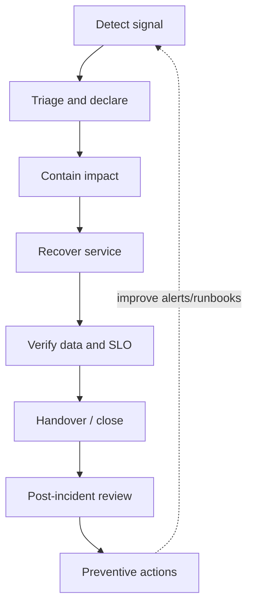

# Chuẩn bị quy trình xử lý sự cố và bàn giao vận hành

## 1. Vì sao ứng dụng Spring AI cần quy trình incident riêng?

Một dịch vụ Spring AI có nhiều thành phần phụ thuộc lẫn nhau: API phục vụ người dùng, ChatModel, EmbeddingModel, VectorStore, retrieval pipeline, tool calling, evaluator, judge model, queue, telemetry exporter, OpenTelemetry Collector và kho kết quả đánh giá. Sự cố ở một thành phần có thể biểu hiện ở thành phần khác.

Ví dụ, người dùng thấy câu trả lời chậm. Nguyên nhân có thể là generation provider tăng latency, VectorStore query chậm, connection pool cạn, evaluator chạy đồng bộ ngoài ý muốn hoặc GC pause do batch đánh giá. Một dashboard chỉ có API p95 không đủ để khoanh vùng. Tương tự, evaluator có thể trả verdict nhưng result store không commit; dashboard chất lượng khi đó thiếu kết quả dù model call thành công.

Bài **“Chuẩn bị quy trình xử lý sự cố và bàn giao vận hành”** thuộc chương **Vận hành** của module **SPRING_AI_EVALUATION_OBSERVABILITY**. Module học đánh giá chất lượng ứng dụng Spring AI bằng dataset, tiêu chí relevance, fact checking và kiểm thử RAG/tool calling; đồng thời theo dõi metrics, traces, chi phí và độ trễ để phát hiện nguyên nhân suy giảm qua từng phiên bản prompt, model và pipeline.

Mục tiêu của bài là xây quy trình ứng phó có thể lặp lại: phát hiện đúng, phân loại mức độ, bảo toàn bằng chứng, giới hạn tác động, phục hồi an toàn, xác minh dữ liệu và bàn giao đầy đủ giữa các ca trực.

## 2. Nguyên tắc xử lý sự cố

Một quy trình tốt phải bảo vệ người dùng, dữ liệu và khả năng điều tra:

1. **Ưu tiên tác động nghiệp vụ:** khôi phục serving và bảo vệ dữ liệu trước khi tối ưu dashboard.
2. **Tách triệu chứng khỏi nguyên nhân:** API timeout là triệu chứng; chưa đủ để kết luận model provider lỗi.
3. **Thay đổi có kiểm soát:** ghi rõ ai thay đổi gì, lúc nào, vì sao và cách rollback.
4. **Giữ provenance:** không thay rubric/model version của job đang chạy giữa chừng.
5. **Không tạo kết quả giả:** lỗi evaluator là ERROR/UNKNOWN, không tự chuyển thành PASS.
6. **Bảo toàn bằng chứng:** lưu timeline, trace IDs, config version, error codes và query liên quan.
7. **Giới hạn retry:** tránh retry storm và phát sinh chi phí model ngoài dự kiến.
8. **Phục hồi có xác minh:** chỉ đóng incident khi kiểm tra được serving, evaluation và data integrity.
9. **Bàn giao rõ ràng:** người nhận phải biết tình trạng hiện tại, rủi ro còn lại và hành động tiếp theo.
10. **Học từ hệ thống:** post-incident review tập trung vào nguyên nhân hệ thống và biện pháp phòng ngừa, không đổ lỗi cá nhân.

Không chạy nhiều thay đổi đồng thời nếu chưa hiểu tác động của từng thay đổi. Nếu buộc phải containment nhanh, ghi lại trạng thái trước/sau để có thể phân tích sau khi dịch vụ ổn định.

## 3. Vòng đời incident

Một incident có thể đi qua các giai đoạn:



| Giai đoạn | Mục tiêu | Đầu ra |
| --- | --- | --- |
| Detect | Nhận biết tín hiệu bất thường | Alert hoặc incident report |
| Triage | Xác định phạm vi và mức độ | Severity, owner, initial hypothesis |
| Contain | Giảm tác động đang diễn ra | Mitigation có kiểm soát |
| Recover | Khôi phục thành phần | Service và worker hoạt động |
| Verify | Xác minh chất lượng và dữ liệu | Evidence phục hồi |
| Handover/close | Chuyển giao hoặc kết thúc | Timeline, unresolved risks, owner |
| Review | Tìm nguyên nhân hệ thống | Action items có owner/deadline |

Incident chưa được giải quyết có thể được bàn giao giữa các ca trực. Bàn giao không đồng nghĩa đóng incident.

## 4. Phân loại severity theo tác động

Severity phải dựa trên tác động thực tế, phạm vi và thời gian, không chỉ dựa vào loại exception.

| Mức | Mô tả | Ví dụ |
| --- | --- | --- |
| **SEV-1 Critical** | Mất dịch vụ diện rộng, rò rỉ dữ liệu nghiêm trọng hoặc integrity bị ảnh hưởng lớn | Hầu hết request RAG thất bại; lộ prompt/context nhạy cảm; verdict bị ghi sai hàng loạt |
| **SEV-2 High** | Suy giảm đáng kể một luồng chính hoặc một nhóm khách hàng | Generation p99 vượt SLO; provider 429 diện rộng; result store không ghi được kết quả quan trọng |
| **SEV-3 Moderate** | Một phần chức năng bị ảnh hưởng, có workaround | Judge model chậm khiến evaluation backlog tăng; trace export lỗi nhưng serving ổn định |
| **SEV-4 Low** | Tác động nhỏ hoặc vấn đề nội bộ chưa ảnh hưởng người dùng | Một dashboard panel thiếu label; một nhóm canary bị trễ |

Các mức trên là policy mẫu. Tổ chức cần điều chỉnh theo SLO, loại dữ liệu và cam kết dịch vụ.

Khi phân loại, xem xét ít nhất:

- tỷ lệ request lỗi và latency so với baseline/SLO;
- số người dùng, tenant, operation hoặc region bị ảnh hưởng;
- generation, retrieval, tool calling hay evaluation bị lỗi;
- có mất/ghi trùng evaluation result hay không;
- có nguy cơ dữ liệu nhạy cảm bị lộ hay không;
- chi phí provider hoặc token usage có tăng bất thường không;
- có workaround an toàn hay không.

Nếu chưa đủ dữ liệu, ghi severity tạm thời và thời điểm đánh giá lại.

## 5. Vai trò trong incident

Với incident lớn, phân công vai trò rõ giúp tránh nhiều người cùng thay đổi hệ thống:

| Vai trò | Trách nhiệm |
| --- | --- |
| Incident Commander (IC) | Điều phối, đặt ưu tiên, quyết định escalation và xác nhận kết thúc |
| Operations Lead | Thực hiện containment, rollback, scaling và recovery |
| Technical Lead/SME | Điều tra Spring AI, provider, retrieval, evaluator hoặc telemetry |
| Communications Lead | Soạn cập nhật cho các bên theo kênh được phê duyệt |
| Scribe | Ghi timeline, quyết định, evidence và action |
| Service Owner | Xác nhận SLO, nghiệp vụ và chấp nhận phục hồi |

Incident nhỏ có thể gộp vai trò, nhưng cần chỉ định một người chịu trách nhiệm quyết định. Người điều tra không nên tự ý gửi thông báo ra khách hàng hoặc bên ngoài nếu chưa có quyền theo quy trình tổ chức.

## 6. Tín hiệu phát hiện và nhóm symptom

Các tín hiệu nên được nhóm theo lớp:

| Lớp | Tín hiệu | Câu hỏi đầu tiên |
| --- | --- | --- |
| Serving API | Request rate, error ratio, p95/p99 | Người dùng có bị ảnh hưởng không? |
| Generation | Model latency, 429/5xx, timeout, token usage | Provider hay adapter có vấn đề? |
| Retrieval | Embedding latency, vector query latency, empty results | Context có được truy xuất đúng không? |
| Tool calling | Tool error, timeout, invalid arguments | Tool backend hay orchestration lỗi? |
| Evaluation | Judge latency, verdict distribution, queue age | Chất lượng bị giảm hay evaluator bị lỗi? |
| Result store | Write/commit errors, pool pending, replication lag | Kết quả có được lưu bền vững? |
| Telemetry | Queue/drop/export failures, collector refused | Có mất khả năng quan sát không? |
| Cost | Tokens, requests, spend, retry rate | Có nguy cơ vượt budget không? |

Alert phải có query, severity, owner và runbook. Một cảnh báo chỉ ghi “AI service unhealthy” mà không cho biết metric, threshold và dashboard liên quan sẽ làm chậm triage.

## 7. Quy trình triage trong 15 phút đầu

Một checklist khởi đầu:

1. Xác nhận alert còn xảy ra hay đã tự phục hồi.
2. Xác định thời điểm bắt đầu và deploy/config change gần nhất.
3. Kiểm tra serving error rate, p95/p99 và request volume.
4. Phân loại operation bị ảnh hưởng: chat, embedding, vector search, tool hay evaluation.
5. So sánh theo provider, model profile, environment và region.
6. Kiểm tra dependency status: provider, VectorStore, database, broker, Collector.
7. Kiểm tra queue depth, oldest job age, retry và drop.
8. Xác định dữ liệu nào có nguy cơ mất, trùng hoặc sai version.
9. Chọn một hypothesis có bằng chứng và một hành động containment nhỏ nhất.
10. Ghi owner, severity, next update time và điều kiện rollback.

Không dành toàn bộ 15 phút đầu để đọc log ngẫu nhiên. Bắt đầu từ symptom và trace/correlation ID đại diện, sau đó mở rộng khi có hypothesis.

## 8. Bảo toàn bằng chứng trước khi thay đổi

Trước khi rollback hoặc restart, nếu điều kiện cho phép hãy lưu:

- incident ID, start time và detected time;
- deployment version, config snapshot ID và checksum;
- prompt/rubric/judge/dataset version;
- sampling policy và exporter endpoint profile (không lưu secret);
- trace IDs và span links của một số request đại diện;
- query/dashboard URL hoặc query text;
- error code, provider request ID và status code;
- queue depth, retry count, drop count;
- job IDs, attempt IDs và trạng thái result store;
- thay đổi đã thực hiện và thời điểm.

Không copy prompt, completion, document context, API key hoặc dữ liệu cá nhân vào incident ticket nếu không có quyền và nhu cầu rõ ràng. Dùng reference có kiểm soát, redacted sample và trace ID thay vì payload nhạy cảm.

Nếu sự cố đang gây mất dữ liệu hoặc rò rỉ, containment có thể phải đi trước việc thu thập đầy đủ. Ghi rõ bằng chứng nào chưa thể thu và lý do.

## 9. Runbook: generation provider chậm hoặc trả lỗi

**Triệu chứng:** API latency tăng, ChatModel timeout/429/5xx, token usage hoặc retry tăng.

Điều tra:

1. So sánh lỗi theo provider, model ID/profile và region.
2. Kiểm tra provider status/quota theo kênh chính thức.
3. So sánh latency của generation với retrieval và tool spans.
4. Kiểm tra connection pool, DNS/TLS và timeout.
5. Xác định retry có làm tăng request volume hay không.
6. Kiểm tra model alias/deployment có vừa thay đổi không.

Containment có thể gồm giảm retry, hạ concurrency, chuyển sang model fallback đã được kiểm chứng hoặc tạm giới hạn operation bị ảnh hưởng. Fallback model cần tương thích về context, output schema, safety và chất lượng; không tự động chuyển sang model bất kỳ chỉ vì endpoint còn sống.

Sau khi provider phục hồi, tăng traffic theo nấc, kiểm tra p95/p99, error ratio, token cost và chất lượng trên canary dataset.

## 10. Runbook: retrieval hoặc VectorStore suy giảm

**Triệu chứng:** câu trả lời thiếu căn cứ, context rỗng, retrieval latency tăng hoặc top-k thay đổi bất thường.

Kiểm tra:

- embedding model/version và dimension;
- index/collection đang được query;
- chunking, filter, top-k và reranker version;
- vector store health, query latency và connection pool;
- tỷ lệ empty result và document count;
- metadata/schema migration gần nhất;
- context snapshot thực tế được generation sử dụng.

Containment có thể chuyển về index/pipeline version đã biết tốt hoặc tạm tắt một filter mới nếu đã xác định nó gây lỗi. Không thay embedding dimension hoặc index mapping tại chỗ nếu chưa có migration tương thích.

Khi phục hồi, chạy golden retrieval cases và fact-checking/relevance evaluation trên cùng dataset. Kiểm tra cả retrieval recall và groundedness, không chỉ HTTP success.

## 11. Runbook: tool calling lỗi

**Triệu chứng:** model chọn tool sai, arguments không hợp lệ, tool backend timeout hoặc tool result không được đưa lại vào context.

Điều tra:

1. Xem trace của tool selection, tool execution và response handoff.
2. Xác định lỗi nằm ở model decision, schema validation hay tool service.
3. Kiểm tra tool name/version và JSON schema.
4. Kiểm tra timeout, retry và idempotency của side-effecting tool.
5. Xác minh tool result có được nối vào conversation đúng thứ tự.
6. Kiểm tra permission/credential đã hết hạn hay không.

Với tool có side effect, không retry mù khi chưa biết lần gọi trước đã thực hiện hành động hay chưa. Dùng idempotency key và đối soát trạng thái nghiệp vụ trước khi redrive.

Nếu cần disable tool, chỉ tắt tool bị ảnh hưởng theo feature flag đã định nghĩa; kiểm tra prompt/model có fallback an toàn và thông báo rõ giới hạn chức năng.

## 12. Runbook: evaluator hoặc judge model suy giảm

**Triệu chứng:** evaluation backlog tăng, judge timeout/429, pass rate thay đổi đột ngột hoặc verdict thiếu ổn định.

Kiểm tra:

- rubric/prompt/judge model version và checksum;
- dataset/context snapshot;
- sample rate và số evaluator trên mỗi request;
- judge concurrency, RPM/TPM quota và retry;
- evaluator timeout, queue wait và oldest job age;
- raw criterion scores và aggregate scoring version;
- tỷ lệ ERROR/UNKNOWN/SKIPPED so với PASS/FAIL.

Nếu judge provider lỗi nhưng evaluation chỉ phục vụ monitoring hậu kiểm, có thể giảm sampling hoặc pause worker theo policy; generation serving vẫn tiếp tục nếu không phụ thuộc judge. Không biến timeout thành PASS.

Nếu rubric mới có lỗi semantics, chuyển active pointer về version tốt cho job mới. Job đang chạy phải continue pinned, cancel/requeue hoặc quarantine theo quyết định có audit. Giữ kết quả đã tạo bằng version lỗi để điều tra; không ghi đè lịch sử.

## 13. Runbook: telemetry exporter hoặc Collector lỗi

**Triệu chứng:** metrics/traces không tới backend, queue tăng, dropped spans hoặc exporter failures.

Phân biệt:

- ứng dụng có tạo observation/span không;
- SDK queue có drop không;
- exporter endpoint/auth/TLS có đúng không;
- Collector receiver có accepted data không;
- processor có filter/drop không;
- exporter phía Collector có gửi được không;
- backend có ingest/index dữ liệu mới không.

Nếu telemetry chỉ phục vụ observability, không để Collector outage làm liveness API fail hoặc chặn request thread. Có thể giảm sampling, giới hạn queue và giữ business path hoạt động. Tuy nhiên cần bảo toàn một kênh health độc lập để biết telemetry đang bị mất.

Sau phục hồi, xác minh canary metric/trace mới xuất hiện; không giả định backlog đã được gửi đủ chỉ vì health endpoint xanh.

## 14. Runbook: result store hoặc evaluation queue lỗi

**Triệu chứng:** job stuck, result write failures, duplicate attempts, DLQ tăng hoặc oldest job age vượt ngưỡng.

Các bước:

1. Kiểm tra database availability, write latency và connection pool.
2. Kiểm tra broker/queue consumer lag và dead-letter count.
3. Đối chiếu job state, attempt history, lease owner và lease expiry.
4. Kiểm tra result row đã commit hay chưa trước khi gọi judge lại.
5. Xác minh config snapshot và checksum của job.
6. Chỉ retry job đủ điều kiện, cùng snapshot và trong retry budget.
7. Chuyển poison input hoặc trạng thái không rõ sang NEEDS_REVIEW/DLQ.
8. Reconcile batch item counts với result records.

Không đánh dấu job COMPLETED trước khi result store commit. Không tạo result mới cho job đã có result cùng identity. Nếu database write lỗi sau khi judge response đã nhận, dùng checkpoint để tiếp tục persistence thay vì gọi judge lại nếu output đã được lưu bền vững.

## 15. Containment: giảm tác động mà không làm mất khả năng phục hồi

Các biện pháp containment thường dùng:

| Biện pháp | Khi phù hợp | Điều phải theo dõi |
| --- | --- | --- |
| Giảm evaluation sample rate | Judge quota/queue quá tải | Coverage và skipped count |
| Pause evaluation consumer | Judge hoặc result store lỗi nghiêm trọng | Queue age, backlog và deadline |
| Hạ judge concurrency | Provider 429 hoặc connection contention | Throughput và oldest job age |
| Tắt evaluator không thiết yếu | Evaluation là hậu kiểm | Job state và policy exception |
| Chuyển model fallback | Generation provider lỗi | Quality, schema compatibility, cost |
| Giảm trace sampling | Collector/backend quá tải | Trace coverage và drop rate |
| Disable tool cụ thể | Tool backend lỗi | Fallback behavior và nghiệp vụ bị giới hạn |
| Rollback rubric/prompt | Regression đã được xác nhận | Version pinning và result provenance |

Các key như app.evaluation.enabled hoặc app.evaluation.sample-rate thường là property do ứng dụng định nghĩa, không phải property mặc định của Spring AI. Chỉ dùng feature flag đã được triển khai và kiểm thử; không thay cấu hình tùy tiện bằng cách sửa trực tiếp file trên production nếu chưa có quy trình change management.

## 16. Rollback an toàn

Trước rollback, xác định đúng thành phần cần quay lại:

- application image;
- prompt template;
- rubric artifact;
- judge model profile;
- retrieval/index version;
- instrumentation/telemetry schema;
- sampling policy;
- database schema hoặc worker contract.

Quy trình:

1. Freeze rollout liên quan.
2. Xác định last-known-good version và checksum.
3. Kiểm tra schema/database tương thích với code cũ.
4. Pin active pointer hoặc deployment về version tốt.
5. Phân loại in-flight evaluation jobs.
6. Không thay config snapshot của job đã tạo.
7. Chạy canary request/evaluation cố định.
8. Mở traffic/consumer theo nấc.
9. Kiểm tra SLO, result integrity, telemetry freshness và cost.
10. Ghi change record và lý do rollback.

Không rollback database bằng cách restore backup nếu chỉ cần đổi active config. Restore có thể xóa dữ liệu hợp lệ phát sinh sau backup. Với schema migration, ưu tiên expand-and-contract và migration có thể tương thích với cả worker cũ/mới.

## 17. Phục hồi evaluation job chưa hoàn tất

Job recovery cần phân biệt:

- QUEUED: chưa được worker nhận;
- RUNNING với lease còn hiệu lực: worker có thể vẫn đang xử lý;
- RUNNING với lease hết hạn: cần reconciliation;
- RETRY_WAIT: tới thời gian retry;
- COMPLETED: result đã commit;
- FAILED: lỗi vĩnh viễn hoặc hết retry budget;
- EXPIRED: quá deadline;
- NEEDS_REVIEW: trạng thái không rõ hoặc cần quyết định thủ công;
- CANCELLED: đã hủy có audit reason.

Trước khi redrive:

1. Kiểm tra result store theo job ID/idempotency key.
2. Xác minh snapshot/rubric/judge version.
3. Kiểm tra provider request ID và checkpoint.
4. Kiểm tra attempt count, deadline và retry budget.
5. Xác nhận lease cũ đã hết và fencing token/attempt number không còn hiệu lực.
6. Retry cùng job nếu chỉ cần tiếp tục lần chạy cũ.
7. Tạo rerun job mới nếu muốn dùng version mới.
8. Ghi audit event cho cancel, retry, redrive và manual override.

Không cam kết exactly-once cho remote model inference. Hãy dùng at-least-once delivery, idempotent result write và reconciliation. Retry sau timeout có thể tạo thêm model call và chi phí nếu provider đã xử lý request trước đó.

## 18. Xác minh phục hồi sau containment hoặc rollback

Incident chỉ nên chuyển sang recovering/resolved khi có bằng chứng:

| Hạng mục | Kiểm tra | Bằng chứng |
| --- | --- | --- |
| Serving | Request rate, error ratio, p95/p99 | SLO trở lại trong ngưỡng |
| Generation | Model call success/latency | Canary request thành công |
| Retrieval | Golden query và context | Context/recall đúng kỳ vọng |
| Tool calling | Tool execution và idempotency | Test case không tạo side effect trùng |
| Evaluation | Judge success, status distribution | Canary verdict hợp lệ |
| Result store | Commit/readback | Result record truy vấn được |
| Queue | Oldest age và backlog | Backlog giảm có kiểm soát |
| Telemetry | Metric/trace canary freshness | Backend truy vấn được dữ liệu mới |
| Quality | Golden dataset và rubric version | Không có regression critical |
| Cost | Token usage/retry | Chi phí ổn định theo budget |

Không chỉ kiểm tra một request thành công. Hãy theo dõi một cửa sổ đủ dài để chắc rằng lỗi không tái diễn và backlog không tiếp tục tăng.

## 19. Escalation và thông tin cần cung cấp

Escalate khi:

- severity tăng hoặc phạm vi ảnh hưởng mở rộng;
- có nguy cơ dữ liệu nhạy cảm bị lộ;
- không xác định được result integrity;
- provider outage/quota vượt quyền xử lý của service team;
- database/broker cần quyền quản trị;
- rollback có nguy cơ phá schema hoặc mất dữ liệu;
- sự cố vượt quá thời gian khôi phục mục tiêu.

Thông tin tối thiểu khi escalation:

- incident ID và severity;
- thời điểm bắt đầu/detected;
- service/environment/region bị ảnh hưởng;
- symptom và business impact;
- các giả thuyết đã kiểm tra;
- trace IDs/job IDs đã redact;
- config/model/rubric version;
- hành động đã thực hiện và kết quả;
- rủi ro còn lại;
- quyết định hoặc quyền hỗ trợ cần có.

Không gửi secret, raw prompt/context hoặc dữ liệu khách hàng qua kênh không được phê duyệt.

## 20. Cập nhật trạng thái incident

Cập nhật nội bộ nên ngắn, có thời điểm và hành động kế tiếp. Ví dụ mẫu:

```text
[INCIDENT UPDATE]
Incident: INC-2026-0042
Severity: SEV-2
Status: INVESTIGATING
Impact: Evaluation jobs đang chậm; serving API chưa thấy vượt SLO.
Since: 10:15 UTC
Evidence: Judge timeout tăng, evaluation queue oldest age 8 phút.
Mitigation: Đã giảm judge concurrency; chưa thay generation profile.
Next action: Đối soát job lease và kiểm tra provider quota.
Next update: 10:45 UTC
Owner: Evaluation Operations
```

Đây là mẫu nội dung để người phụ trách gửi qua kênh nội bộ đã được phê duyệt. Không tự động gửi thông báo tới khách hàng hoặc bên ngoài nếu chưa được ủy quyền.

Tránh các câu như “đã fix” khi mới restart process. Hãy nêu rõ điều đã kiểm chứng, điều còn giả thuyết và thời điểm cập nhật tiếp theo.

## 21. Bàn giao giữa các ca trực

Bàn giao phải cho người nhận đủ thông tin để tiếp tục mà không cần dựng lại toàn bộ lịch sử.

Một handover tốt gồm:

1. Incident ID, severity, status và incident commander hiện tại.
2. Tác động người dùng và phạm vi còn ảnh hưởng.
3. Timeline ngắn và thay đổi gần nhất.
4. Current hypothesis cùng bằng chứng ủng hộ/phản bác.
5. Mitigation đang bật và cách rollback mitigation.
6. Các version application, prompt, rubric, judge, retrieval và telemetry.
7. Queue depth, oldest job age, retry, DLQ và result reconciliation.
8. Trace/query/dashboard reference đã redact.
9. Việc đã hoàn tất và việc chưa hoàn tất.
10. Next actions có owner và deadline.
11. Escalation đang chờ.
12. Thời điểm cập nhật tiếp theo và người nhận đã xác nhận.

Không bàn giao bằng một câu “đang theo dõi”. Phải nêu rõ theo dõi metric nào, ngưỡng nào và ai sẽ hành động khi vượt ngưỡng.

## 22. Mẫu handover record

Có thể dùng mẫu sau trong incident ticket hoặc hệ thống quản lý ca trực:

```yaml
handover:
  incidentId: INC-2026-0042
  severity: SEV-2
  status: MITIGATING
  service: spring-ai-evaluation-observability
  environment: production
  currentOwner: evaluation-ops
  nextOwner: platform-on-call
  updatedAt: "2026-11-27T10:30:00Z"

  impact:
    serving: within_slo
    evaluation: backlog_increasing
    telemetry: traces_delayed
    resultIntegrity: not_confirmed

  versions:
    application: "2.8.1"
    rubric: "rag-rubric-v5"
    judgeProfile: "judge-small-stable"
    retrieval: "retrieval-v7"
    samplingPolicy: "sample-prod-4"

  evidence:
    dashboard: "internal-dashboard-reference"
    traceIds:
      - "redacted-trace-reference"
    jobIds:
      - "redacted-job-reference"

  mitigation:
    action: "judge concurrency reduced"
    enabledAt: "2026-11-27T10:20:00Z"
    rollback: "restore previous concurrency after quota recovery"

  openRisks:
    - "Some jobs have expired leases; reconciliation pending"
    - "Judge provider quota not yet confirmed"

  nextActions:
    - owner: platform-on-call
      action: "reconcile expired evaluation jobs"
      dueAt: "2026-11-27T11:00:00Z"
    - owner: evaluation-ops
      action: "verify result-store write/readback"
      dueAt: "2026-11-27T11:15:00Z"

  nextUpdateAt: "2026-11-27T11:30:00Z"
```

Đây là schema mẫu. Hệ thống thực tế nên validate field bắt buộc, timestamp UTC, owner hợp lệ và không lưu secret. Hãy ghi unknown hoặc not_confirmed khi chưa có bằng chứng, không tự suy đoán trạng thái.

### Xác nhận bàn giao

Người nhận cần xác nhận:

- đã đọc impact và open risks;
- đã nhận quyền điều phối/owner;
- hiểu mitigation hiện tại và cách hoàn tác;
- đồng ý next actions và deadline;
- biết escalation contact/runbook liên quan.

Chỉ chuyển owner sau khi người nhận xác nhận theo quy trình ca trực của tổ chức.

## 23. Post-incident review và action items

Sau khi incident ổn định, tổ chức review để giảm khả năng tái diễn:

- timeline từ detection tới containment/recovery;
- alert có đủ sớm và đủ ngữ cảnh không;
- hypothesis nào đúng/sai;
- thay đổi nào giúp hoặc làm sự cố nặng hơn;
- vì sao queue, quota, exporter hoặc result store vượt giới hạn;
- dữ liệu nào bị drop, duplicate hoặc cần đánh giá lại;
- runbook có thiếu bước hoặc sai owner không;
- SLO, capacity và sampling policy cần điều chỉnh gì.

Một action item tốt có:

- mô tả vấn đề hệ thống;
- hành động cụ thể;
- owner;
- deadline;
- priority;
- cách xác minh hoàn tất;
- liên kết incident/evidence.

Ví dụ: “Thêm alert khi evaluation queue oldest age vượt 5 phút trong 10 phút liên tục; owner Evaluation Platform; xác minh bằng staging load test.” Tốt hơn “cải thiện monitoring”.

Không dùng postmortem để quy trách nhiệm cá nhân. Tập trung vào điều kiện khiến lỗi có thể xảy ra, vì sao guardrail không ngăn được và thay đổi nào giảm rủi ro.

## 24. Chuẩn bị trước khi có incident

Một service readiness pack nên có:

| Tài sản vận hành | Nội dung cần có |
| --- | --- |
| Service map | API, model provider, VectorStore, tools, queue, DB, Collector |
| SLO/SLI | Availability, latency, quality, freshness và cost |
| Dashboard | Serving, retrieval, judge, queue, telemetry và result store |
| Alert | Threshold, severity, owner, runbook |
| Runbooks | Provider, retrieval, tool, evaluator, telemetry, storage |
| Rollback map | Last-known-good version và compatibility |
| Recovery plan | Job state, idempotency, lease, DLQ, reconciliation |
| Access | Quyền cần thiết, break-glass và audit |
| Secrets | Vị trí quản lý và quy trình rotation |
| Backup/restore | RPO/RTO và bằng chứng restore drill |
| Handover template | Incident owner, impact, evidence, risks, next actions |
| Contact/escalation | Nhóm chịu trách nhiệm và đường escalation |

Runbook cần được kiểm tra định kỳ. Một tài liệu có endpoint cũ, model alias không còn tồn tại hoặc dashboard đã xóa có thể làm triage chậm hơn.

## 25. Bài tập thực hành

1. **Severity:** generation p99 vượt SLO 3 lần nhưng chỉ ảnh hưởng một region. Phân loại severity và nêu thông tin cần xác minh.
2. **Triage:** API latency tăng, generation span bình thường nhưng vector query span tăng. Lập 5 bước điều tra tiếp theo.
3. **Evidence:** liệt kê metadata cần lưu trước rollback mà không sao chép prompt/context nhạy cảm.
4. **Provider outage:** judge model trả 429 nhưng generation vẫn khỏe. Thiết kế containment và đánh giá job backlog.
5. **Retrieval regression:** empty result tăng sau index rollout. Chọn rollback nào và cần canary nào?
6. **Tool side effect:** tool call timeout nhưng không biết thao tác đã thực hiện. Vì sao không retry mù?
7. **Telemetry outage:** Collector health xanh nhưng exporter send failures tăng. Dashboard và runbook cần chỉ ra điều gì?
8. **Result store:** judge response đã có nhưng DB commit lỗi. Làm sao phục hồi mà không gọi judge lại nếu có checkpoint?
9. **Job recovery:** worker restart làm lease hết hạn. Thiết kế reconciliation và fencing.
10. **Rollback:** rubric v5 gây false pass. Xử lý job đã chạy và job chưa chạy như thế nào?
11. **Communication:** viết một incident update phân biệt verified facts và current hypothesis.
12. **Handover:** bàn giao incident SEV-2 với queue backlog và result integrity chưa xác nhận. Những field nào bắt buộc?
13. **Postmortem:** alert phát hiện sự cố muộn 20 phút. Xác định action item đo được.
14. **Readiness:** thiết kế service readiness pack cho một ứng dụng Spring AI có RAG và hai evaluator.
15. **Recovery verification:** chọn các bằng chứng cần có trước khi đóng incident.

## Tài liệu tham khảo

- [Google SRE Book – Managing Incidents](https://sre.google/sre-book/managing-incidents/): vai trò incident command, coordination, communication và kiểm soát sự cố.
- [Google SRE Workbook – Incident Response](https://sre.google/workbook/incident-response/): quy trình ứng phó và thực hành incident management.
- [Spring AI 2.1.0 – Observability](https://docs.spring.io/spring-ai/reference/observability/index.html): metrics, traces và model observations.
- [Spring AI 2.1.0 – Evaluation Testing](https://docs.spring.io/spring-ai/reference/api/testing.html): Evaluator, RelevancyEvaluator và FactCheckingEvaluator.
- [Spring Boot – Actuator](https://docs.spring.io/spring-boot/reference/actuator/index.html): health, metrics và endpoint vận hành.
- [OpenTelemetry Collector – Resiliency](https://opentelemetry.io/docs/collector/resiliency/): queue, retry, memory limiter và exporter failure.
- [PostgreSQL – Transaction Management](https://www.postgresql.org/docs/current/tutorial-transactions.html): transaction, commit và rollback.
- [Prometheus – Alerting Rules](https://prometheus.io/docs/prometheus/latest/configuration/alerting_rules/): cấu hình alert và thời gian giữ điều kiện.

> **Ghi chú triển khai:** Severity, role, state, metric, incident ID và handover YAML trong bài là mẫu để tổ chức điều chỉnh. Các tên property, model profile, queue và trạng thái evaluation có thể là quy ước ứng dụng, không phải mặc định của Spring AI. Hãy gắn runbook với dashboard, alert và quyền truy cập thực tế của tổ chức; diễn tập trong staging. Bài viết là hướng dẫn chuẩn bị vận hành, chưa phải kết quả diễn tập incident hoặc kiểm thử disaster recovery trên hệ thống thực tế.
