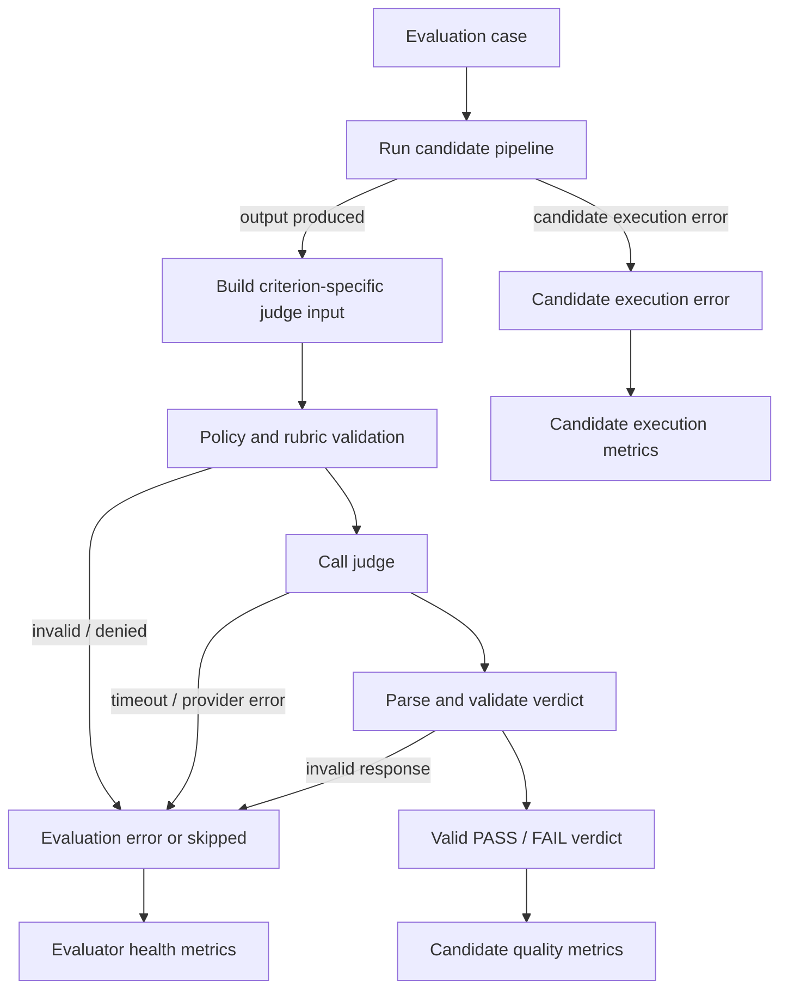
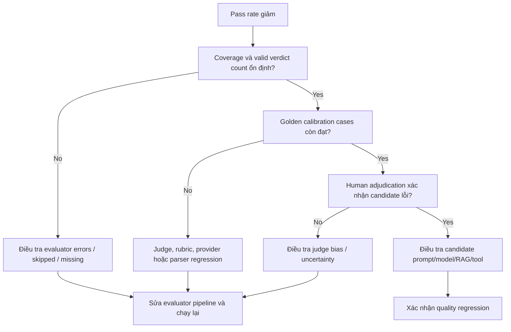

# Giám khảo lỗi bị nhầm thành lỗi chất lượng

Trong pipeline đánh giá Spring AI, câu trả lời của candidate model thường được gửi tới evaluator hoặc LLM-as-a-judge để chấm relevance, groundedness, factual correctness, completeness hay tool-use correctness. Khi kết quả đánh giá thấp, nhóm phát triển có thể kết luận prompt/model vừa suy giảm chất lượng và rollback release. Nhưng nếu judge timeout, provider trả lỗi quota, response không đúng schema, rubric bị cấu hình sai hoặc chính judge chấm thiếu ổn định, điểm thấp đó không phản ánh chất lượng candidate.

**Một lần đánh giá thất bại không đồng nghĩa candidate trả lời kém.** Hệ thống phải phân biệt kết quả đánh giá hợp lệ với lỗi thực thi evaluator, kết quả không đủ bằng chứng và trường hợp bị bỏ qua theo policy. Chỉ verdict hợp lệ mới được đưa vào quality score. Evaluator health cần có metrics, traces, retry policy, calibration set và quy trình human adjudication riêng.

Bài này thuộc chương **Chẩn đoán sự cố** của module **SPRING_AI_EVALUATION_OBSERVABILITY**. Module đánh giá chất lượng ứng dụng Spring AI bằng dataset, tiêu chí relevance, fact checking và kiểm thử RAG/tool calling; đồng thời đo metrics, traces, chi phí và độ trễ để phát hiện nguyên nhân suy giảm qua từng phiên bản prompt, model và pipeline. Bài tập trung vào sự cố giám khảo lỗi bị nhầm thành lỗi chất lượng, giúp nhóm phân biệt lỗi của candidate, lỗi của evaluator và lỗi của hạ tầng đánh giá.

## 1. Mục tiêu học tập

Sau bài này, bạn có thể:

1. Phân biệt candidate-quality failure với evaluator-execution failure.
2. Nhận diện lỗi provider, network, quota, timeout, schema, rubric và judge behavior.
3. Thiết kế trạng thái evaluation rõ ràng thay vì ép mọi trường hợp thành pass/fail.
4. Tách quality metrics khỏi evaluator health metrics.
5. Dùng retry, timeout, circuit breaker và idempotency đúng chỗ.
6. Kiểm tra judge bằng golden/calibration datasets và human labels.
7. Điều tra score thấp bằng trace, rubric version, model version và metadata đã được bảo vệ.
8. Xây dashboard/alert để phát hiện evaluator degradation.
9. Triển khai result model và orchestration pattern bằng Java/Spring AI.
10. Viết regression tests để bảo đảm judge errors không làm sai quality score hoặc release gate.

## 2. Hai hệ thống có thể thất bại: candidate và evaluator

Một evaluation run có ít nhất hai thành phần logic độc lập:

- **Candidate system:** pipeline đang được đánh giá, gồm prompt, model, retrieval, tools và application code.
- **Evaluator system:** thành phần tạo verdict/score, gồm judge model, rubric, prompt chấm điểm, parser, provider adapter và infrastructure.

Candidate có thể trả lời sai trong khi evaluator hoạt động tốt. Ngược lại, candidate có thể trả lời đúng nhưng evaluator không gọi được provider hoặc hiểu sai rubric. Nếu chỉ nhìn một trường score, hai tình huống này rất dễ bị nhập làm một.

| Tình huống | Candidate | Evaluator | Cách diễn giải |
|---|---|---|---|
| **A — Genuine quality failure** | Trả lời không grounded. | Chạy thành công, verdict hợp lệ. | Candidate FAIL theo criterion. |
| **B — Judge unavailable** | Có thể tốt hoặc kém. | Provider timeout/5xx. | Evaluation ERROR; chưa biết quality. |
| **C — Invalid judge output** | Có output. | JSON/schema sai hoặc thiếu verdict. | Evaluation ERROR/INCONCLUSIVE; không suy ra candidate FAIL. |
| **D — Judge misclassification** | Candidate đạt yêu cầu. | Judge trả verdict sai. | Evaluator quality failure; cần calibration/adjudication. |
| **E — Rubric defect** | Candidate có thể đạt. | Rubric mơ hồ/sai version. | Evaluation invalid; sửa rubric và chạy lại. |
| **F — Candidate failure confirmed** | Output không đáp ứng tiêu chí. | Judge được xác thực và verdict có evidence. | Candidate quality regression có bằng chứng. |

### 2.1. Quality score chỉ có ý nghĩa khi evaluator hợp lệ

Một score bằng 0 có thể có nghĩa candidate không đạt, nhưng cũng có thể là parser đã gán default khi judge call thất bại. Không dùng sentinel score để biểu diễn lỗi thực thi. Kết quả chưa được đánh giá phải có trạng thái riêng và không được đưa vào mẫu số quality.

### 2.2. Judge cũng là một hệ thống cần quan sát

Judge có provider, latency, quota, prompt, model version, schema, retry và failure modes. Cần theo dõi evaluator health giống như theo dõi candidate service, nhưng không trộn health metrics với quality metrics.

## 3. Vòng đời một evaluation run

Một luồng đánh giá có thể gồm:

1. Chọn evaluation case và xác minh eligibility.
2. Chạy candidate pipeline.
3. Lưu candidate output/reference theo policy.
4. Chuẩn bị judge input theo criterion và rubric version.
5. Kiểm tra policy, gọi judge provider và nhận response.
6. Parse/validate response.
7. Tạo verdict/score có provenance.
8. Tổng hợp quality metrics và quyết định release gate.

Lỗi ở mỗi bước có ý nghĩa khác nhau. Candidate generation timeout là lỗi candidate execution; judge provider timeout là lỗi evaluator execution; response parse failure là lỗi evaluator protocol; một verdict FAIL hợp lệ là kết quả quality. Cần giữ stage và error category để không nhầm lẫn.



Sơ đồ tách ba loại kết quả: candidate execution, evaluator health và candidate quality. Một candidate không tạo được output có thể được tính trong operational success/error metrics; không tự động gán quality score nếu rubric không định nghĩa cách đánh giá trường hợp đó.

## 4. Phân loại các nhóm lỗi của judge

### 4.1. Lỗi hạ tầng và kết nối

- DNS, TLS, proxy hoặc network failure.
- Connection refused/reset.
- Provider timeout hoặc request deadline exceeded.
- HTTP 5xx hoặc service unavailable.
- Rate limit/quota exhaustion.
- Circuit breaker đang mở.

Đây thường là lỗi evaluator execution. Candidate quality chưa được xác định.

### 4.2. Lỗi xác thực và cấu hình provider

- API key hết hạn, sai scope hoặc bị revoke.
- Sai endpoint/model deployment.
- Region/endpoint không nằm trong allowlist.
- Request vượt payload/token limit.
- Provider account hết quota hoặc billing disabled.

Một số lỗi là permanent cho tới khi cấu hình được sửa. Retry liên tục không giải quyết được invalid credential hoặc endpoint sai.

### 4.3. Lỗi protocol và response

- Response body rỗng hoặc bị truncate.
- JSON không parse được.
- Thiếu field bắt buộc như verdict, score hoặc criterion.
- Score ngoài range hoặc sai kiểu dữ liệu.
- Response không khớp case/criterion đang đánh giá.
- Provider trả refusal hoặc content filter response thay cho verdict.

Đây là lỗi protocol/validation của evaluator, trừ khi rubric đã định nghĩa rõ cách xử lý response refusal. Không tự chuyển thành candidate FAIL.

### 4.4. Lỗi rubric và judge prompt

- Rubric version không tồn tại hoặc không được approve.
- Rubric mâu thuẫn giữa các tiêu chí.
- Prompt chấm điểm yêu cầu JSON nhưng không quy định schema.
- Criterion thiếu evidence requirements.
- Thang điểm và pass threshold không khớp.
- Prompt injection trong candidate/evidence làm judge bỏ qua rubric.

Đây là lỗi cấu hình hoặc evaluator design. Một lần judge chạy thành công về mặt HTTP không chứng minh kết quả hợp lệ.

### 4.5. Lỗi chất lượng của chính judge

- Judge không nhất quán khi chạy lại cùng case.
- Position bias khi so sánh A/B.
- Verbosity bias, self-preference hoặc language bias.
- Judge bỏ qua evidence hoặc bịa lý do.
- Judge hiểu sai criterion hoặc threshold.
- Judge thay đổi behavior sau model/provider revision.

Đây là evaluator-quality issue. Cần calibration/human labels để xác nhận, không quy lỗi cho candidate chỉ dựa vào một judge score.

### 4.6. Candidate quality failure thật

Chỉ xem là candidate quality failure khi candidate output tồn tại, evaluator chạy theo đúng policy/rubric/version, response qua schema validation, verdict được tạo từ bằng chứng phù hợp và evaluator đủ tin cậy trên calibration set. Ví dụ candidate đưa claim không được retrieved evidence hỗ trợ và judge trích đúng evidence để kết luận FAIL.

## 5. Mô hình trạng thái evaluation

Không ép evaluation result vào boolean passed. Dùng trạng thái thể hiện đúng điều đã xảy ra.

| Status | Ý nghĩa | Có đưa vào quality denominator? |
|---|---|---|
| **PASS** | Candidate đạt criterion theo verdict hợp lệ. | Có. |
| **FAIL** | Candidate không đạt criterion theo verdict hợp lệ. | Có. |
| **ERROR** | Evaluation không hoàn tất vì lỗi thực thi/protocol/configuration. | Không. |
| **INCONCLUSIVE** | Có response nhưng evidence hoặc judge confidence không đủ để kết luận. | Không, báo riêng. |
| **SKIPPED** | Case bị bỏ qua theo eligibility/policy hoặc run configuration. | Không. |
| **CANDIDATE_ERROR** | Candidate pipeline không tạo được output hợp lệ. | Không, tính trong execution metrics riêng. |
| **REVIEW_REQUIRED** | Cần human adjudication trước khi dùng kết quả. | Chưa, chờ adjudication. |

### 5.1. Quality rate

Với N verdict hợp lệ:

\[
quality\_pass\_rate = \frac{PASS}{PASS + FAIL}
\]

ERROR, INCONCLUSIVE, SKIPPED và REVIEW_REQUIRED không nằm trong mẫu số. Báo thêm evaluation coverage:

\[
evaluation\_coverage =
\frac{PASS + FAIL}{Eligible\ cases}
\]

Coverage thấp có thể khiến pass rate nhìn đẹp nhưng không đại diện population. Vì vậy luôn hiển thị cả số lượng và coverage.

### 5.2. Không gán score mặc định khi lỗi

Các cách làm sai thường gặp:

- Catch mọi exception rồi trả score 0.
- Parser không đọc được JSON thì gán FAIL.
- Timeout thì giữ score từ lần chạy trước mà không ghi stale.
- Judge trả thiếu verdict thì mặc định FAIL.
- Bỏ qua mọi lỗi nhưng vẫn báo quality score trên tổng eligible cases.

Thay vào đó, lưu status ERROR, error category, stage, attempt count và correlation reference. Chỉ score khi có verdict hợp lệ.

### 5.3. Phân biệt retry với evaluation mới

Retry cùng case/rubric/model là một attempt mới của cùng logical evaluation. Giữ attempt history và idempotency key để không đếm nhiều lần trong denominator. Nếu thay rubric hoặc judge model, đó là một evaluation configuration/version mới và cần run identity mới.

## 6. Decision tree chẩn đoán score thấp

Khi dashboard báo pass rate giảm, đi theo thứ tự:

1. Có đủ số verdict hợp lệ và coverage ổn định không?
2. Evaluator error rate, timeout rate hoặc invalid-response rate có tăng không?
3. Có thay đổi judge provider/model, endpoint, quota, schema hoặc rubric không?
4. Golden/calibration cases có bị chấm lệch cùng thời điểm không?
5. Human review có xác nhận candidate thật sự kém không?
6. Nếu evaluator health ổn và calibration ổn, kiểm tra candidate prompt/model/retrieval/tool changes.



Không rollback candidate chỉ vì một dashboard score giảm nếu coverage hoặc judge calibration cùng lúc suy giảm. Cần xác nhận score được tạo từ verdict hợp lệ.

## 7. Thu thập bằng chứng cho từng evaluation attempt

Một attempt record nên có metadata đủ để tái hiện và phân loại lỗi:

- Evaluation run ID và opaque case reference.
- Criterion và rubric version.
- Candidate pipeline, prompt, model, retrieval và tool versions.
- Judge provider alias, model/version và endpoint policy reference.
- Attempt number, start/end time và timeout budget.
- HTTP status/category, provider request reference nếu được phép.
- Parse/schema validation outcome.
- Evaluation status và normalized error category.
- Retry/circuit breaker decision.
- Correlation/trace reference.
- Calibration/configuration version.

Không lưu raw prompt, candidate answer, evidence hoặc provider body vào metrics labels. Nội dung evaluation nếu cần lưu phải qua content capture policy và store có quyền/retention riêng.

### 7.1. Không dùng raw exception message làm error category

Chuẩn hóa exception thành enum như PROVIDER_TIMEOUT, RATE_LIMITED, AUTHENTICATION_FAILED, INVALID_RESPONSE_SCHEMA, RUBRIC_NOT_FOUND, JUDGE_REFUSAL, POLICY_DENIED hoặc UNKNOWN_EVALUATOR_ERROR. Không lấy message thay đổi theo request làm dimension.

### 7.2. Ghi nhận stage thất bại

Stage provider_call khác response_parse, rubric_resolution hoặc policy_check. Stage giúp xác định thành phần lỗi và tránh đếm mọi lỗi thành provider failure.

## 8. Retry, timeout và circuit breaker

Retry có thể khôi phục lỗi tạm thời, nhưng cũng có thể làm tăng cost, latency và provider throttling.

### 8.1. Lỗi nào nên retry?

| Error category | Hành động gợi ý |
|---|---|
| **Connect timeout / transient network** | Retry giới hạn với exponential backoff và jitter. |
| **HTTP 429** | Tuân thủ Retry-After nếu có; giới hạn attempts và tổng deadline. |
| **HTTP 5xx** | Retry có giới hạn nếu operation idempotent và policy cho phép. |
| **Invalid API key / 401/403** | Không retry liên tục; báo cấu hình/credential error. |
| **Unknown model / invalid endpoint** | Không retry trước khi sửa config. |
| **Malformed JSON/schema** | Có thể một lần repair/retry theo protocol riêng; nếu vẫn lỗi, ERROR. |
| **Rubric missing/invalid** | Không retry provider; sửa rubric/config. |
| **Judge low confidence** | Không coi là transient; chuyển INCONCLUSIVE/REVIEW_REQUIRED. |

### 8.2. Giới hạn tổng thời gian

Đặt timeout cho connection, request và toàn evaluation attempt. Retry budget phải nằm trong run deadline. Không để 3 retries nhân với 60 giây biến một evaluation thành nhiều phút mà dashboard chỉ hiển thị một request.

### 8.3. Circuit breaker

Nếu evaluator provider liên tục lỗi, circuit breaker có thể ngăn gửi thêm request và bảo vệ capacity/cost. Khi circuit open, kết quả là ERROR với category CIRCUIT_OPEN hoặc EVALUATOR_UNAVAILABLE, không phải candidate FAIL.

### 8.4. Fallback judge

Fallback sang judge khác chỉ được thực hiện nếu provider đó đã được duyệt cho data class/purpose, rubric tương thích, output schema được validate và fallback được ghi trong provenance. Không gộp verdict từ hai judge khác nhau như cùng một evaluator version.

### 8.5. Không retry quality FAIL

Nếu judge đã trả verdict FAIL hợp lệ, retry ngẫu nhiên cho tới khi có PASS sẽ tạo bias. Nếu cần đo judge stability, chạy lại theo protocol calibration riêng, lưu mọi attempt và không chọn verdict thuận lợi nhất.

## 9. Kiểm tra response schema và rubric

### 9.1. Schema validation

Một verdict cần xác định criterion, status/verdict, score range, reason code và evidence references theo contract. Validate:

- Response parse thành công.
- Field bắt buộc có mặt và đúng kiểu.
- Score nằm trong range đã định nghĩa.
- Criterion/rubric version khớp request.
- Case/run reference không bị nhầm.
- Evidence references thuộc input đã gửi.
- Không có contradictory fields, ví dụ verdict PASS nhưng score dưới threshold theo rule.

### 9.2. Structured output không bảo đảm đúng ngữ nghĩa

JSON hợp lệ chỉ chứng minh format đúng. Judge vẫn có thể hiểu sai rubric hoặc bịa evidence. Cần semantic validation, calibration và human review trên subset.

### 9.3. Version hóa rubric

Lưu rubric ID/version, effective date, criterion definitions, score scale, pass threshold và examples đã duyệt. Không sửa rubric tại chỗ mà không tăng version; nếu không, kết quả cũ và mới không thể so sánh công bằng.

### 9.4. Rubric change tạo evaluation population mới

Nếu criterion hoặc threshold thay đổi, tạo run mới hoặc segment rõ ràng. Không so sánh score giữa rubric versions như thể cùng một thước đo. Có thể chạy overlap set để đo ảnh hưởng của rubric migration.

## 10. Kiểm tra judge bằng golden và calibration cases

Golden set là tập case có expected judgment đã được xác minh bởi người có chuyên môn hoặc quy trình adjudication đáng tin.

### 10.1. Nội dung calibration set

Bao phủ:

- Rõ ràng pass và rõ ràng fail.
- Case borderline/ambiguous.
- Evidence thiếu hoặc mâu thuẫn.
- Nhiều ngôn ngữ/locale.
- Candidate dài/ngắn, có citation/không citation.
- Prompt injection trong retrieved content.
- Tool success/failure và side-effect outcomes.
- Các model families/prompts được đưa vào production.

### 10.2. Đo agreement

Với label nhị phân, có thể báo accuracy/agreement, precision, recall, false-positive và false-negative rates so với adjudicated labels. Với score ordinal, dùng weighted agreement phù hợp. Không chỉ nhìn accuracy tổng thể; cần breakdown theo criterion, locale, model family và difficulty.

### 10.3. Human adjudication

Khi judge và golden label bất đồng, reviewer kiểm tra case theo rubric version. Ghi quyết định, lý do chuẩn hóa và reviewer reference. Không ghi raw PII vào calibration report. Nếu rubric mơ hồ, sửa rubric và tăng version.

### 10.4. Calibration drift

Chạy golden set định kỳ và trước/sau thay đổi provider/model/rubric/parser. Nếu judge bắt đầu fail golden controls, tạm ngưng dùng verdict cho release gate hoặc chuyển sang REVIEW_REQUIRED cho scope bị ảnh hưởng.

## 11. Đo độ ổn định và thiên lệch của judge

### 11.1. Repeatability

Chạy một subset lặp lại với cùng judge/rubric/config. Đo verdict flip rate, score variance và agreement. Lưu temperature/seed nếu provider hỗ trợ, nhưng không giả định provider đảm bảo deterministic.

### 11.2. Position bias

Với pairwise evaluation, đảo vị trí A/B trên subset. Nếu verdict thay đổi đáng kể theo thứ tự, judge chưa đủ ổn định cho pairwise quality gate.

### 11.3. Verbosity bias

Tạo cặp answer có cùng facts nhưng độ dài khác nhau. Judge không nên đánh giá câu trả lời dài tốt hơn chỉ vì có nhiều chữ. Rubric phải ưu tiên evidence và task success.

### 11.4. Self-preference

So sánh judge verdict trên outputs từ nhiều candidate model families. Nếu judge ưu tiên một phong cách hoặc family, cần human calibration và có thể dùng independent judge hoặc rule-based checks.

### 11.5. Confidence không phải xác suất đúng

Một trường confidence do judge tự khai không chứng minh verdict đúng với xác suất tương ứng. Chỉ dùng confidence sau khi đã calibration trên labeled set; nếu không, coi nó là một tín hiệu mô tả.

## 12. Tách quality metrics khỏi evaluator health metrics

Dashboard nên có ít nhất ba nhóm chỉ số:

| Nhóm | Metrics | Ý nghĩa |
|---|---|---|
| **Candidate execution** | Candidate success rate, generation timeout, retrieval/tool errors, latency. | Candidate pipeline có chạy và tạo output không? |
| **Evaluator health** | Judge availability, provider error rate, timeout, 429, schema invalid rate, retry count, circuit-open count, calibration pass rate. | Hệ thống đánh giá có hoạt động đúng không? |
| **Candidate quality** | Valid verdict count, PASS/FAIL rate, relevance/groundedness score, criterion-level regression. | Candidate output tốt tới đâu theo evaluator đã được xác thực? |

### 12.1. Công thức và denominator

\[
judge\_error\_rate =
\frac{ERROR}{Eligible\ evaluation\ attempts}
\]

\[
valid\_verdict\_rate =
\frac{PASS + FAIL}{Eligible\ evaluation\ cases}
\]

\[
candidate\_pass\_rate =
\frac{PASS}{PASS + FAIL}
\]

Định nghĩa denominator phải thống nhất giữa dashboard và report. Tách attempt-level metrics khỏi logical-case-level metrics để retry không làm tăng số lượng case.

### 12.2. Không trộn lỗi judge vào quality trend

Nếu judge error rate tăng từ 1% lên 35%, pass rate trên valid verdicts vẫn có thể tính được nhưng coverage giảm mạnh. Hiển thị cả hai; không thay ERROR bằng FAIL hoặc bỏ lỗi mà không báo coverage.

### 12.3. Phân đoạn theo version

Breakdown theo candidate prompt/model/pipeline version và judge provider/model/rubric/parser version. Nếu cả candidate lẫn judge thay đổi trong cùng release, không thể quy nguyên nhân score drift nếu thiếu controlled comparison.

## 13. Dashboard và alerting

### 13.1. Dashboard panels gợi ý

- Eligible cases, attempted cases, valid verdicts và coverage.
- PASS/FAIL/ERROR/INCONCLUSIVE/SKIPPED counts.
- Candidate pass rate theo criterion và candidate version.
- Judge error rate theo provider/model/stage/error category.
- p50/p95 judge latency, timeout và retry distribution.
- Schema validation failure rate.
- Golden/calibration set pass rate và verdict flip rate.
- Human adjudication disagreement rate.
- Judge cost/token usage và fallback rate.

### 13.2. Alert cho evaluator health

Alert khi provider timeout/5xx/429 vượt ngưỡng, schema invalid rate tăng, calibration set fail, circuit breaker mở lâu hoặc evaluation coverage giảm. Alert nên ghi judge provider alias, stage, error category và run reference; không chứa prompt/evidence.

### 13.3. Alert cho candidate quality

Chỉ alert quality regression khi số valid verdict đạt sample minimum, coverage đủ, judge calibration đang healthy và comparison dùng cùng/compatible rubric. Nếu các điều kiện này không đạt, phát cảnh báo evaluator health hoặc result inconclusive.

### 13.4. Release gate hai tầng

1. **Evaluator gate:** provider health, schema validity, golden calibration và coverage đạt ngưỡng.
2. **Candidate gate:** quality metrics trên valid verdicts đạt threshold và không có criterion regression nghiêm trọng.

Nếu evaluator gate fail, không kết luận candidate pass hoặc fail từ dữ liệu đó; dừng/hoãn quality gate và điều tra evaluator.

## 14. Trace và log để chẩn đoán evaluator

Một judge span nên có metadata như:

```text
evaluation.run_ref = run-opaque-71
evaluation.criterion = groundedness
evaluation.rubric.version = groundedness-v3
evaluation.status = ERROR
evaluation.stage = response_parse
evaluation.error_category = INVALID_RESPONSE_SCHEMA
judge.provider = approved-provider-a
judge.model_family = judge-family
judge.attempt = 2
judge.latency_ms = 840
candidate.pipeline.version = support-ai-v4
```

Đây là metadata minh họa. Dùng bounded values và opaque references; không gắn raw case ID, prompt, answer, evidence hoặc provider response vào metric labels/span attributes.

### 14.1. Trace cần phân biệt candidate và judge spans

Candidate generation, retrieval/tool calls và judge request nên là spans riêng với parent/child relationships rõ. Khi judge timeout, trace thể hiện candidate đã hoàn tất và judge stage thất bại. Nhờ vậy, người vận hành không nhầm timeout evaluator thành model generation failure.

### 14.2. Log error category, không log raw body

Ghi provider alias, sanitized status, error category, retryability, attempt và correlation reference. Nếu cần diagnostic body, dùng restricted capture policy riêng, redaction và retention; không bật HTTP wire logging đại trà.

## 15. Ví dụ Java: mô hình evaluation result rõ trạng thái

Các kiểu dưới đây là abstraction nội bộ minh họa:

```java
public enum EvaluationStatus {
    PASS,
    FAIL,
    ERROR,
    INCONCLUSIVE,
    SKIPPED,
    CANDIDATE_ERROR,
    REVIEW_REQUIRED
}

public record EvaluationResult(
    String runRef,
    String caseRef,
    String criterion,
    EvaluationStatus status,
    Double score,
    String errorCategory,
    String rubricVersion,
    String judgeVersion,
    int attempts
) {
    public boolean hasValidVerdict() {
        return status == EvaluationStatus.PASS
            || status == EvaluationStatus.FAIL;
    }
}
```

Invariant cần kiểm tra: PASS/FAIL phải có score/verdict hợp lệ; các trạng thái ERROR, SKIPPED, INCONCLUSIVE không có candidate quality score. Có thể dùng sealed result types thay nullable score để compiler giúp enforce invariant.

## 16. Ví dụ Java: phân loại lỗi judge

Không phân loại dựa vào message text. Adapter nên chuyển exception/provider status thành error category:

```java
public enum JudgeErrorCategory {
    CONNECT_TIMEOUT,
    PROVIDER_UNAVAILABLE,
    RATE_LIMITED,
    AUTHENTICATION_FAILED,
    INVALID_ENDPOINT,
    INVALID_RESPONSE_SCHEMA,
    RUBRIC_CONFIGURATION,
    POLICY_DENIED,
    CIRCUIT_OPEN,
    UNKNOWN
}

public record JudgeFailure(
    JudgeErrorCategory category,
    boolean retryable,
    String providerAlias,
    int attempt
) {}
```

Ví dụ policy:

```java
public boolean shouldRetry(JudgeFailure failure) {
    return failure.retryable()
        && failure.attempt() < 3
        && switch (failure.category()) {
            case CONNECT_TIMEOUT, PROVIDER_UNAVAILABLE, RATE_LIMITED -> true;
            default -> false;
        };
}
```

Đây là logic minh họa. Thực tế cần xét Retry-After, deadline, provider-specific throttling, idempotency và budget. Không retry AUTHENTICATION_FAILED, INVALID_ENDPOINT, POLICY_DENIED hoặc rubric configuration errors.

## 17. Ví dụ Java: orchestrate judge mà không biến lỗi thành FAIL

Pseudocode cho một evaluation attempt:

```java
public EvaluationResult evaluate(
    EvaluationCase evaluationCase,
    CandidateOutput candidate,
    JudgeConfiguration config
) {
    try {
        JudgeInput input = judgeInputFactory.create(
            evaluationCase, candidate, config.rubricVersion()
        );
        JudgeResponse response = judgeClient.call(input, config);
        ValidatedVerdict verdict = verdictValidator.validate(
            response, config.rubricVersion()
        );

        return resultFactory.fromValidVerdict(
            evaluationCase, verdict, config
        );
    } catch (JudgeProviderException ex) {
        return resultFactory.error(
            evaluationCase,
            normalize(ex),
            config
        );
    } catch (InvalidJudgeResponseException ex) {
        return resultFactory.error(
            evaluationCase,
            JudgeErrorCategory.INVALID_RESPONSE_SCHEMA,
            config
        );
    }
}
```

Đây là pseudocode để minh họa nguyên tắc. Không catch mọi Throwable rồi tiếp tục như bình thường; unexpected programming errors cần được báo và xử lý theo chính sách ứng dụng. resultFactory.error phải tạo status ERROR, không gán score 0 hoặc verdict FAIL. Nếu candidate generation thất bại, ghi CANDIDATE_ERROR ở stage candidate.

## 18. Ví dụ gọi Spring AI ChatClient cho judge

Spring AI ChatClient có thể gọi một ChatModel được cấu hình riêng cho judge. API chi tiết tùy version/provider:

```java
public JudgeResponse callJudge(
    JudgeInput input,
    ChatClient judgeClient
) {
    String raw = judgeClient.prompt()
        .system(system -> system.text(
            "Use rubric version {rubricVersion}. " +
            "Return JSON with criterion, verdict, score and reasonCode."
        ).param("rubricVersion", input.rubricVersion()))
        .user(user -> user.text(
            "Criterion: {criterion}\nQuestion: {question}\nAnswer: {answer}"
        )
        .param("criterion", input.criterion())
        .param("question", input.question())
        .param("answer", input.candidateAnswer()))
        .call()
        .content();

    return judgeResponseParser.parse(raw);
}
```

Đây là ví dụ minh họa, không phải API contract cố định cho mọi Spring AI release. Trong production, gọi qua adapter có timeout, provider policy, retry/circuit breaker và safe error mapping. Parse thành công chưa đủ; phải validate criterion, rubric, score range và evidence trước khi tạo verdict. Không log raw prompt/response.

## 19. Điều tra một đợt pass rate giảm

Ví dụ dashboard cho thấy pass rate groundedness giảm từ 94% xuống 71% sau deployment. Trước khi rollback candidate:

1. So sánh eligible count, valid verdict count và evaluation coverage trước/sau.
2. Kiểm tra judge error rate, 429, timeout, schema failure và retry distribution.
3. So sánh judge provider/model/rubric/parser versions.
4. Chạy golden set trên judge hiện tại và phiên bản trước.
5. Human review một sample gồm PASS, FAIL, ERROR và borderline cases.
6. Nếu judge health ổn, so sánh candidate outputs theo cùng dataset/rubric.
7. Chỉ xác nhận candidate regression khi valid verdicts và calibration đủ tin cậy.

### 19.1. Ví dụ diễn giải số liệu

| Metric | Trước deployment | Sau deployment |
|---|---:|---:|
| Eligible cases | 1.000 | 1.000 |
| Valid verdicts | 980 | 620 |
| Evaluator errors | 20 | 380 |
| PASS | 921 | 440 |
| FAIL | 59 | 180 |
| Pass rate trên valid verdicts | 93,98% | 70,97% |
| Evaluation coverage | 98% | 62% |

Pass rate giảm mạnh nhưng evaluator errors cũng tăng từ 2% lên 38%. Chưa đủ cơ sở kết luận candidate quality giảm. Cần phân loại 380 lỗi và kiểm tra calibration. Nếu phần lớn là provider timeout sau khi đổi endpoint, đây là evaluator availability incident. Nếu 620 verdicts hợp lệ có calibration tốt và human review xác nhận answer sai, có thể đồng thời tồn tại candidate regression; hai sự cố cần được ghi nhận riêng.

### 19.2. So sánh cùng một cohort

Nếu candidate version mới chỉ được judge đánh giá trên các case dễ hơn hoặc khó hơn, score không thể so sánh trực tiếp. Dùng paired cases/stratified cohorts, giữ sampling metadata và báo missing cases.

## 20. Kiểm thử và regression test matrix

| Test | Kịch bản | Kỳ vọng |
|---|---|---|
| **JERR01 — Provider timeout** | Judge provider timeout. | Result là ERROR, không có quality score. |
| **JERR02 — HTTP 429** | Provider rate limit. | Retry có giới hạn; cuối cùng ERROR nếu hết budget. |
| **JERR03 — HTTP 5xx** | Provider unavailable. | Retry theo policy; không gán FAIL. |
| **JERR04 — Invalid credentials** | Provider trả 401/403. | Không retry liên tục; cấu hình error. |
| **JERR05 — Circuit open** | Circuit breaker đang mở. | ERROR/CIRCUIT_OPEN. |
| **JERR06 — Empty response** | Judge response rỗng. | ERROR/INVALID_RESPONSE. |
| **JERR07 — Invalid JSON** | Response không parse được. | ERROR/INVALID_RESPONSE_SCHEMA. |
| **JERR08 — Missing verdict** | JSON thiếu field bắt buộc. | ERROR, không default FAIL. |
| **JERR09 — Score out of range** | Score ngoài rubric range. | Response bị reject. |
| **JERR10 — Rubric mismatch** | Request và response/rubric version không khớp. | ERROR/CONFIGURATION. |
| **JERR11 — Judge refusal** | Provider trả refusal thay verdict. | INCONCLUSIVE/ERROR theo policy; không candidate FAIL tự động. |
| **JERR12 — Candidate valid fail** | Judge trả FAIL có evidence và schema hợp lệ. | Candidate FAIL. |
| **JERR13 — Golden control fail** | Judge chấm sai golden case. | Evaluator calibration alert. |
| **JERR14 — Verdict instability** | Cùng case chạy lại đổi PASS/FAIL. | Đo flip rate; REVIEW_REQUIRED nếu vượt ngưỡng. |
| **JERR15 — Position bias** | Đảo vị trí A/B làm đổi kết quả. | Phát hiện judge bias. |
| **JERR16 — Retry deduplication** | Một logical case có nhiều attempts. | Chỉ một final verdict được tính vào denominator. |
| **JERR17 — Quality denominator** | Dataset có ERROR/SKIPPED/INCONCLUSIVE. | Chỉ valid PASS/FAIL được tính quality rate; coverage báo riêng. |
| **JERR18 — Provider fallback** | Fallback sang judge khác. | Provider/version được ghi; policy được kiểm tra lại. |
| **JERR19 — Rubric change** | Threshold/rubric version thay đổi. | Tạo run/version mới, không gộp score mù quáng. |
| **JERR20 — Candidate regression** | Candidate sai, judge health/golden set tốt. | FAIL được tính vào candidate quality. |
| **JERR21 — Candidate execution error** | Candidate generation timeout trước judge. | CANDIDATE_ERROR, tách khỏi judge error. |
| **JERR22 — Missing calibration** | Judge version mới chưa được kiểm định. | Không dùng làm release gate cho tới khi policy cho phép. |
| **JERR23 — Human adjudication** | Judge và reviewer bất đồng. | Lưu review outcome và disagreement metric. |
| **JERR24 — Metrics separation** | Provider errors tăng. | Evaluator health alert, không tự kích hoạt candidate quality regression. |

### 20.1. Golden canary trước release

Trước khi dùng judge mới cho production evaluation, chạy một tập golden cases đã được duyệt. Nếu calibration không đạt ngưỡng, chặn rollout judge hoặc chuyển verdict sang review-only. Lặp lại khi đổi model revision, provider endpoint, rubric, parser hoặc prompt judge.

### 20.2. Test không phụ thuộc một judge cố định

Unit tests dùng deterministic fake judge để kiểm tra orchestration/status logic. Integration tests dùng mock HTTP provider để mô phỏng timeout, 429, 5xx, malformed response. Calibration tests mới gọi judge thật theo lịch và budget riêng; không để CI phụ thuộc network/provider availability.

## 21. Bài tập thực hành

Một regression run có 500 eligible cases. Dashboard báo candidate pass rate giảm từ 92% xuống 68%. Cùng lúc judge provider được đổi endpoint, response parser được nâng version và retry count tăng. Có 100 cases không có verdict, nhưng pipeline đang gán score 0 cho mọi case không parse được.

### Câu hỏi

1. Vì sao pass rate hiện tại không đáng tin?
2. Cần tách những trạng thái evaluation nào?
3. Những metadata/version nào phải so sánh?
4. Làm thế nào xác định lỗi do provider, parser hay candidate?
5. Golden set nên được dùng ở thời điểm nào?
6. Retry nào hợp lý và retry nào cần dừng?
7. Thiết kế công thức pass rate và coverage sau khi sửa.
8. Khi nào cần human adjudication?
9. Nên có alert nào cho evaluator health?
10. Release gate phải xử lý thế nào nếu judge calibration fail?

### Gợi ý đáp án

**1.** 100 parse failures bị gán score 0 làm denominator/numerator sai; chúng là evaluator errors, không phải candidate FAIL.

**2.** PASS, FAIL, ERROR, INCONCLUSIVE, SKIPPED, CANDIDATE_ERROR và REVIEW_REQUIRED.

**3.** Provider endpoint/model, rubric version, judge prompt, parser version, timeout/retry config, candidate prompt/model/pipeline và dataset/sampling version.

**4.** Phân tích stage/error category, mock provider response, replay cùng candidate output qua parser cũ/mới và chạy golden set trên endpoint mới.

**5.** Trước rollout judge/parser, sau thay đổi cấu hình và định kỳ trong production để phát hiện calibration drift.

**6.** Retry transient timeout/429/5xx trong deadline và budget. Dừng retry với invalid credentials, endpoint sai, rubric lỗi hoặc policy denied.

**7.** Pass rate = PASS/(PASS+FAIL); coverage = (PASS+FAIL)/eligible cases. ERROR/INCONCLUSIVE/SKIPPED được báo riêng.

**8.** Khi judge và golden labels bất đồng, case borderline, verdict không ổn định hoặc release decision có rủi ro cao.

**9.** Provider timeout/429/5xx, schema invalid rate, calibration fail, circuit open, retry rate và coverage drop.

**10.** Không dùng verdict judge chưa calibrated làm quality gate. Dừng/hoãn evaluation release decision, điều tra judge và chạy lại khi evaluator hợp lệ.

## 22. Ghi nhớ

Judge là một thành phần có thể lỗi và có thể đánh giá sai. Chỉ xem candidate FAIL khi có output, judge thực thi thành công, response hợp schema, rubric/version đúng và evaluator đủ tin cậy. Dùng các trạng thái PASS, FAIL, ERROR, INCONCLUSIVE, SKIPPED, CANDIDATE_ERROR và REVIEW_REQUIRED; không chuyển timeout, malformed JSON hoặc provider error thành score 0. Tách candidate execution, evaluator health và candidate quality metrics; báo cả pass rate lẫn coverage. Retry có giới hạn cho lỗi tạm thời, không retry lỗi cấu hình hoặc quality FAIL; fallback phải có policy và provenance riêng. Golden/calibration sets, repeatability tests và human adjudication giúp phát hiện judge drift/bias. Khi pass rate giảm, kiểm tra evaluator health và calibration trước khi kết luận candidate regression. Như vậy release decision dựa trên verdict hợp lệ, không bị một judge lỗi làm sai lệch chất lượng thực tế.

### Tài liệu tham khảo

- [Spring AI — Chat Client API](https://docs.spring.io/spring-ai/reference/api/chatclient.html): gọi ChatModel qua ChatClient abstraction.
- [Spring AI — Structured Output](https://docs.spring.io/spring-ai/reference/api/structured-output-converter.html): chuyển model output thành cấu trúc và các giới hạn cần validate.
- [Spring AI — Observability](https://docs.spring.io/spring-ai/reference/observability/index.html): quan sát các thành phần Spring AI.
- [OpenTelemetry — Exception Recording](https://opentelemetry.io/docs/specs/semconv/exceptions/exceptions-spans/): ghi nhận exception trong spans.
- [Resilience4j — Retry](https://resilience4j.readme.io/docs/retry): retry policy và giới hạn attempts.
- [Resilience4j — CircuitBreaker](https://resilience4j.readme.io/docs/circuitbreaker): bảo vệ dependency khi lỗi tăng.
- [NIST — AI Risk Management Framework](https://www.nist.gov/itl/ai-risk-management-framework): validity, reliability, measurement và monitoring của hệ thống AI.
- [NIST — AI RMF Playbook](https://airc.nist.gov/AI_RMF_Knowledge_Base/Playbook): gợi ý quản lý, đo lường và giám sát rủi ro AI.
- [OWASP — Top 10 for LLM Applications](https://owasp.org/www-project-top-10-for-large-language-model-applications/): prompt injection và rủi ro khi dùng LLM judge.
- [Google — Rules of Machine Learning](https://developers.google.com/machine-learning/guides/rules-of-ml): đo lường, baseline và quy trình đánh giá thay đổi model.
