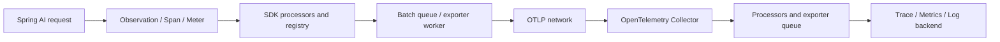

# Telemetry làm tăng độ trễ, tốn bộ nhớ hoặc để lộ dữ liệu

## 1. Nhận diện đúng ba nhóm sự cố

Telemetry giúp quan sát request, model call, retrieval, tool execution, evaluator và result store. Tuy nhiên, instrumentation và pipeline telemetry cũng có thể trở thành nguồn gây sự cố. Ba nhóm phổ biến có triệu chứng và cách xử lý khác nhau:

- **Độ trễ tăng:** request chậm hơn sau khi bật tracing/metrics/logging; p95/p99 tăng; throughput giảm; thread bị block.
- **Bộ nhớ tăng:** heap hoặc native memory tăng liên tục; GC thường xuyên; SDK/Collector queue phình to; process bị OOM.
- **Dữ liệu nhạy cảm bị lộ:** prompt, completion, retrieved document, tool arguments, credential hoặc thông tin người dùng xuất hiện trong trace/log/backend không được phép.

Bài **“Telemetry làm tăng độ trễ, tốn bộ nhớ hoặc để lộ dữ liệu”** thuộc chương **Chẩn đoán sự cố** của module **SPRING_AI_EVALUATION_OBSERVABILITY**. Module học đánh giá chất lượng ứng dụng Spring AI bằng dataset, tiêu chí relevance, fact checking và kiểm thử RAG/tool calling; đồng thời theo dõi metrics, traces, chi phí và độ trễ để tìm nguyên nhân suy giảm qua các phiên bản prompt, model và pipeline.

Mục tiêu là khoanh vùng được chi phí telemetry trong application, SDK, Collector và backend; giảm overhead mà vẫn giữ tín hiệu điều tra cần thiết; đồng thời ngăn dữ liệu nhạy cảm rời khỏi trust boundary.

## 2. Phân biệt telemetry cost với business operation cost

Một request Spring AI có thể mất thời gian ở nhiều nơi:

| Thành phần | Chi phí nghiệp vụ | Chi phí telemetry có thể phát sinh |
| --- | --- | --- |
| ChatModel | Network/provider latency, token generation | Tạo model span, attributes, events, serialize usage |
| EmbeddingModel | Provider latency và embedding compute | Span/metric cho batch và usage |
| VectorStore | Query/index latency | Span, query metadata, document attributes |
| Tool calling | Tool backend và orchestration | Tool spans, argument/result logging |
| Evaluator | Judge latency và scoring | Evaluation spans, score metrics, payload capture |
| Result store | DB transaction/commit | DB spans, SQL attributes, logs |
| HTTP streaming | Token delivery và backpressure | Stream events, per-token spans/logs |
| Export pipeline | Không phải business operation | Queue, batch, serialization, compression, TLS, retry |

Khi API p95 tăng sau khi bật telemetry, chưa thể kết luận exporter là nguyên nhân. Model provider có thể đồng thời chậm, traffic có thể tăng hoặc payload có thể dài hơn. Cần tách thời gian business operation khỏi thời gian handler/export và so sánh với baseline cùng workload.

## 3. Đường đi của dữ liệu telemetry

Một pipeline phổ biến:



Overhead có thể xuất hiện ở từng ranh giới:

- Trong request thread khi tạo observation, đọc clock, gắn attribute hoặc chạy custom handler.
- Trong SDK khi lưu span, batch và context.
- Trong exporter worker khi serialize, nén, mã hóa TLS và gửi network.
- Trong Collector khi xử lý transform, batching, retry và queue.
- Trong backend khi ingest, index, lưu trữ và truy vấn dữ liệu.

Cần xác định chính xác tầng nào đang tăng latency hoặc memory trước khi thay sampling hay xóa instrumentation.

## 4. Bắt đầu bằng baseline và mốc thay đổi

Ghi nhận trước/sau các lần bật instrumentation hoặc nâng SDK/Collector:

- application build và instrumentation version;
- Spring Boot, Micrometer, OpenTelemetry SDK/Collector version;
- exporter protocol, endpoint profile và batch settings;
- sampling policy;
- request rate, concurrency, input/output token volume;
- spans/request, attributes/span và payload bytes;
- API p50/p95/p99, throughput và time-to-first-token;
- heap, RSS, allocation rate, GC pause và thread count;
- SDK/Collector queue utilization, export failure và dropped spans;
- metric series count và backend ingestion volume.

Ghi thời điểm deploy, config change và symptom bắt đầu. So sánh cùng operation, model profile, region và request mix. Nếu request mới có context dài hơn hoặc thêm evaluator, so p95 thô giữa hai cửa sổ có thể gây kết luận sai.

## 5. Triệu chứng: API latency tăng sau khi bật telemetry

Các nguyên nhân thường gặp:

1. Custom ObservationHandler thực hiện I/O đồng bộ.
2. Exporter hoặc processor đồng bộ chạy trên request thread.
3. Gọi forceFlush sau mỗi request.
4. Tạo quá nhiều spans/events/attributes trong vòng lặp.
5. Serialize payload lớn như prompt, completion hoặc document content.
6. Lock contention trong custom registry/handler.
7. Context propagation hoặc MDC copy quá nhiều dữ liệu.
8. Backpressure do queue đầy hoặc exporter bị chậm.
9. Logging đồng bộ ghi payload lớn ra file/network.
10. Histogram hoặc meter registration động gây contention.

Cách khoanh vùng:

- So baseline không có custom handler với local recording.
- So local recording với async export.
- Kiểm tra span processor và observation handlers.
- Dùng JFR để xem CPU, allocation, lock contention và socket waits.
- Tạm loại từng custom attribute/handler trong staging.
- Đo p95/p99 cùng throughput, không chỉ average latency.

Nếu latency tăng chỉ khi backend không khả dụng, nghi ngờ exporter đang block, retry quá nhiều hoặc queue backpressure lan tới request path.

## 6. Tránh I/O và xử lý nặng trong request thread

Observation handlers có thể được gọi trong lifecycle của request. Không thực hiện network call, DB query, file write hoặc serialization payload lớn trực tiếp trong handler.

Ví dụ anti-pattern:

```java
// Anti-pattern: handler chạy trong request lifecycle.
public void onStop(Observation.Context context) {
    auditClient.send(buildLargePayload(context));
    telemetryRepository.save(context);
}
```

Các thao tác này có thể kéo dài request, giữ thread và tạo thêm failure mode. Nếu cần enrich dữ liệu, chỉ đọc metadata rẻ và đã có sẵn trong context. Export nên đi qua pipeline bất đồng bộ có queue giới hạn.

Không gọi forceFlush cho từng request. Flush liên tục làm mất lợi ích batching, tăng network calls và có thể tạo spike CPU. Flush theo lifecycle/shutdown hoặc ranh giới batch được thiết kế rõ.

## 7. Dùng batch exporter nhưng giữ queue có giới hạn

Batching giảm số lần export và amortize chi phí serialization/network. Tuy nhiên, queue không được tăng vô hạn.

Với OpenTelemetry Java SDK, các cấu hình batch span processor thường có những tham số như:

- max queue size;
- max export batch size;
- schedule delay;
- export timeout.

Tên property/environment variable và khả năng cấu hình phụ thuộc phiên bản SDK. Xác minh theo dependency đang dùng trước khi thay đổi.

Ví dụ cấu hình minh họa qua environment:

```yaml
environment:
  OTEL_BSP_MAX_QUEUE_SIZE: "2048"
  OTEL_BSP_MAX_EXPORT_BATCH_SIZE: "512"
  OTEL_BSP_SCHEDULE_DELAY: "5000"
  OTEL_BSP_EXPORT_TIMEOUT: "10000"
```

Đây là giá trị ví dụ, không phải khuyến nghị mặc định. Queue quá nhỏ làm drop span khi burst; queue quá lớn giữ nhiều object trong heap và tăng memory pressure. Batch size lớn có thể tăng throughput nhưng cũng làm payload/export spike lớn hơn.

Chọn queue theo peak span rate, exporter throughput, outage window chấp nhận được và memory budget. Đo dropped spans sau khi thay đổi.

## 8. Triệu chứng: heap hoặc RSS tăng liên tục

Các nguyên nhân cần kiểm tra:

| Nguyên nhân | Dấu hiệu | Hướng xác minh |
| --- | --- | --- |
| SDK span queue quá lớn | Heap tăng khi exporter chậm | Queue utilization và heap histogram |
| Collector queue tích tụ | Collector RSS tăng trong backend outage | Queue size, exporter failures |
| Attribute/payload quá lớn | Span size lớn, allocation cao | JFR allocation, sampled span inspection |
| Cardinality bùng nổ | Registry/backend series tăng | Meter count và unique label values |
| Custom cache không giới hạn | Heap tăng theo request count | Heap dump, retained objects |
| Log buffering | Buffer/file appender tăng | Async appender queue và blocked threads |
| Retry giữ payload | Object sống lâu hơn dự kiến | Heap dump và retry state |
| Native/direct buffer | RSS tăng nhưng heap ổn | Native memory/JVM NMT |

Phân biệt heap với RSS. Heap có thể ổn định trong khi direct buffer, thread stack, native TLS buffer hoặc memory của agent/Collector tăng. Đừng chỉ xem heap dashboard rồi kết luận process memory an toàn.

## 9. Dùng JFR và heap dump để tìm nguồn giữ bộ nhớ

Một quy trình điều tra:

1. Ghi baseline heap/RSS và GC trước khi tăng tải.
2. Chạy workload ổn định, ghi JFR allocation/GC/CPU/lock events.
3. Khi memory tăng, lấy heap histogram hoặc heap dump theo quy trình an toàn.
4. Tìm object thuộc span, attribute map, event list, byte buffer, exporter queue, log event hoặc custom cache.
5. Xem retaining path để xác định ai đang giữ object.
6. Kiểm tra queue có bounded không và consumer có theo kịp producer không.
7. So sánh số object/payload size trên mỗi request.
8. Lặp lại sau khi giảm attribute hoặc queue.

Heap dump có thể chứa prompt, completion, tool arguments, document text hoặc credential. Lưu dump trong vùng kiểm soát, giới hạn quyền truy cập và xóa theo retention; không upload dump vào ticket hoặc dịch vụ bên ngoài tùy tiện.

## 10. Cardinality cao làm tốn bộ nhớ và storage

Metric label với giá trị gần như duy nhất trên mỗi request tạo time series liên tục.

Không dùng các trường sau làm metric labels:

- request ID;
- trace ID hoặc span ID;
- evaluation run/job ID;
- dataset case ID;
- document ID;
- raw prompt, query hoặc tool name động;
- user ID hoặc tenant ID không được giới hạn.

Dùng các dimension có tập giá trị hữu hạn như operation, evaluator type, outcome, provider hoặc model profile đã được kiểm soát. Version label chỉ nên dùng khi số version được giới hạn và có chính sách retention.

Ví dụ custom Micrometer meter filter giới hạn số giá trị tag:

```java
import io.micrometer.core.instrument.config.MeterFilter;
import org.springframework.context.annotation.Bean;
import org.springframework.context.annotation.Configuration;

@Configuration
public class MetricsCardinalityConfiguration {

    @Bean
    MeterFilter modelTagLimit() {
        return MeterFilter.maximumAllowableTags(
                "app.ai",
                "model",
                20,
                MeterFilter.deny());
    }
}
```

Đây là ví dụ cần điều chỉnh theo naming convention và registry thực tế. Khi vượt giới hạn, meter mới bị từ chối theo filter; cần có dashboard/cảnh báo để biết dữ liệu nào không được ghi nhận. Không dùng giới hạn này để che một thiết kế label không phù hợp.

## 11. Triệu chứng: Collector memory tăng hoặc OOM

Collector có thể tăng memory khi:

- backend unavailable và exporter queue tích tụ;
- batch processor giữ nhiều spans;
- retry policy kéo dài;
- transform processor tạo thêm attributes/payload;
- tail sampling giữ trace trong thời gian dài;
- memory limiter đặt quá cao hoặc không được cấu hình;
- nhiều pipeline/receiver cùng xử lý một lượng telemetry lớn.

Cách xử lý:

1. Xác định receiver accepted và exporter sent/failed.
2. Xem queue size và queue capacity.
3. Kiểm tra retry duration và persistent queue/disk quota nếu dùng.
4. Kiểm tra memory limiter và batch settings.
5. Giảm telemetry volume có kiểm soát nếu backend đang outage.
6. Khôi phục backend hoặc chuyển exporter tới endpoint đã xác minh.
7. Theo dõi queue drain và RSS trước khi tăng traffic.

Không tăng memory limit đơn thuần nếu producer tiếp tục nhanh hơn consumer. Việc đó chỉ kéo dài thời gian trước khi OOM.

## 12. Giảm volume bằng sampling đúng mục tiêu

Sampling trace và sampling evaluation giải quyết hai vấn đề khác nhau:

- Trace sampling giảm số trace được export.
- Evaluation sampling giảm số request/case được gửi qua judge.

Không dùng trace sampling để bỏ evaluation job nếu yêu cầu chất lượng vẫn cần chấm. Một request có thể không có trace được lưu nhưng vẫn cần evaluation result.

Các cách giảm trace volume:

- head sampling theo tỷ lệ;
- parent-based sampling;
- tail sampling để giữ trace lỗi/chậm nếu Collector có đủ memory;
- loại bỏ span quá chi tiết hoặc span trùng;
- giảm event/attribute không có giá trị điều tra.

Sau khi thay sampling, đo coverage theo outcome/operation và ghi sampling policy version. Không giảm sampling đến mức mất toàn bộ trace của failure mode quan trọng.

## 13. Triệu chứng: prompt hoặc dữ liệu nhạy cảm xuất hiện trong trace/log

Telemetry có thể vô tình chứa:

- system/user prompt;
- model completion;
- retrieved document/chunk;
- tool arguments và tool result;
- email, phone, account ID, access token;
- HTTP headers/cookies;
- database statement hoặc parameter;
- exception message chứa request/payload;
- baggage hoặc custom attributes do upstream gửi.

Trong hệ thống RAG, retrieved context có thể chứa dữ liệu nội bộ mà người dùng gọi API không được quyền xem. Việc gửi context vào trace backend tạo thêm một nơi lưu trữ và một trust boundary mới.

Coi mọi payload từ model, tool, user và upstream là dữ liệu có thể nhạy cảm. Không bật capture toàn bộ prompt/completion chỉ để debug tiện hơn.

## 14. Xác định đường rò rỉ dữ liệu

Kiểm tra lần lượt các nguồn:

| Nguồn | Cách dữ liệu lọt vào telemetry | Cần kiểm tra |
| --- | --- | --- |
| Auto instrumentation | Model observation ghi request/response content | Capture flags và convention/version |
| Custom span attributes | Developer gắn prompt/document/tool args | Attribute allowlist |
| Span events | Event lưu raw error hoặc tool result | Event payload |
| Baggage | Upstream truyền user/tenant metadata | Baggage propagation policy |
| HTTP instrumentation | Headers, URL query, cookies | Header capture allowlist |
| Exception | Exception message có payload | Error redaction |
| Structured logging | Log toàn request/response object | Logging configuration |
| Collector transform | Dữ liệu bị đổi/giữ không đúng | Processor rules |
| Backend export | Dữ liệu được gửi tới vendor/region ngoài policy | Endpoint, TLS, residency và access |

Collector transform có thể là lớp phòng vệ bổ sung, nhưng nếu dữ liệu đã rời application và tới Collector thì nó đã vượt qua boundary đầu tiên. Với dữ liệu nhạy cảm, ưu tiên loại bỏ/redact trước khi export từ ứng dụng; Collector chỉ là defense in depth.

## 15. Áp dụng allowlist thay vì thu thập mọi thứ

Một span cho evaluation có thể chỉ cần:

- evaluator type;
- rubric version;
- judge model profile;
- evaluation status;
- score summary đã được phê duyệt;
- duration và token usage;
- correlation reference có kiểm soát.

Không cần raw prompt, full completion hoặc retrieved context cho mọi request.

Ví dụ custom observation chỉ ghi metadata an toàn:

```java
Observation observation = Observation
        .createNotStarted("app.ai.evaluation", observationRegistry)
        .lowCardinalityKeyValue("evaluator", safeEvaluatorType)
        .lowCardinalityKeyValue("outcome", safeOutcome)
        .highCardinalityKeyValue("evaluation.run_id", evaluationRunId);

observation.start();
try (Observation.Scope scope = observation.openScope()) {
    return evaluator.evaluate(request);
}
finally {
    observation.stop();
}
```

Ví dụ này chỉ an toàn nếu safeEvaluatorType và safeOutcome đã được chuẩn hóa thành tập giá trị cho phép. Run ID là high-cardinality nên chỉ dùng ở trace/span metadata khi thật sự cần; không chuyển nó thành metric tag. Không thêm input text vào observation context.

## 16. Redaction cần diễn ra trước điểm export

Một chính sách bảo vệ dữ liệu nên có nhiều lớp:

1. **Application allowlist:** chỉ tạo attributes đã được phê duyệt.
2. **Redaction trước export:** xóa hoặc mask header, prompt field, tool args và exception payload trước khi rời process.
3. **Collector defense in depth:** drop/transform field không được phép nếu lỡ lọt qua.
4. **Backend access control:** giới hạn người có thể query trace/log.
5. **Retention:** đặt thời gian lưu theo classification và mục đích.
6. **Egress control:** chỉ gửi tới endpoint/region được phê duyệt.
7. **Audit:** ghi nhận ai truy cập dữ liệu và thay đổi policy.

Regex redaction có thể bỏ sót cấu trúc JSON lồng nhau hoặc dữ liệu được encode. Với payload có schema, nên dùng allowlist field và typed redaction. Với secret, tốt nhất không đưa vào telemetry ngay từ đầu.

Hashing không tự động làm dữ liệu trở nên anonymous. Hash ổn định vẫn có thể liên kết hoạt động giữa các request hoặc bị dò ngược với tập giá trị nhỏ. Chỉ dùng pseudonymous reference khi có mục đích, access policy và retention rõ.

## 17. Kiểm tra headers, baggage và context propagation

Trace context thường cần propagate qua service, nhưng baggage có thể mang key/value tùy ý. Không forward toàn bộ baggage từ public client hoặc tenant không tin cậy.

Thực hành:

- chỉ propagate traceparent/tracestate theo tracing contract;
- allowlist baggage keys cần thiết;
- không đưa token, email, account number hoặc raw tenant metadata vào baggage;
- không capture Authorization, Cookie hoặc Set-Cookie headers;
- không ghi URL query chứa search text hoặc secret;
- giới hạn chiều dài attribute và số event;
- validate request ID và correlation metadata trước khi log.

Nếu cần tenant dimension cho dashboard, dùng tier hoặc tenant class có cardinality giới hạn; dữ liệu tenant cụ thể lưu trong hệ thống có kiểm soát quyền.

## 18. Khẩn cấp khi phát hiện dữ liệu nhạy cảm đã được export

Nếu phát hiện prompt/context/credential nhạy cảm trong backend:

1. Xác định loại dữ liệu, phạm vi thời gian, service và exporter liên quan.
2. Dừng capture hoặc export field gây rò rỉ bằng config/feature flag đã kiểm chứng.
3. Nếu cần, tạm dừng pipeline/endpoint bị ảnh hưởng theo incident procedure.
4. Bảo toàn evidence tối thiểu cần thiết, không nhân bản payload.
5. Xác định backend, Collector, archive và downstream sink nào đã nhận dữ liệu.
6. Giới hạn quyền truy cập ngay và thu hồi credential nếu có secret.
7. Theo retention/deletion process để xóa hoặc quarantine bản sao đã export nếu policy yêu cầu.
8. Đánh giá nghĩa vụ thông báo và escalation theo quy định tổ chức.
9. Xác minh canary trace mới không còn field nhạy cảm.
10. Ghi incident, root cause và preventive actions.

Không chỉ xóa dashboard panel hoặc tắt một query. Dữ liệu có thể còn trong raw storage, index, archive, replica hoặc downstream export. Việc xóa cần theo quy trình của backend và tổ chức, có xác minh phạm vi.

## 19. Ma trận triệu chứng và hướng xử lý

| Triệu chứng | Nguyên nhân thường gặp | Hành động đầu tiên |
| --- | --- | --- |
| API p95 tăng khi telemetry bật | Handler/export đồng bộ, serialize lớn | So baseline/local recording/async export |
| API chỉ chậm khi Collector down | Export blocking hoặc retry trên request thread | Tách export async, bounded queue |
| Heap tăng khi backend chậm | SDK queue lớn, payload retention | Đo queue, giảm payload, giới hạn queue |
| Collector OOM | Queue/retry/tail sampling quá lớn | Kiểm queue capacity, memory limiter |
| Prometheus series tăng nhanh | Dynamic labels/high cardinality | Tìm label có unique values cao |
| GC tăng sau deploy | Nhiều spans/events/attributes | JFR allocation và span count |
| Trace chứa prompt/document | Auto capture/custom attributes | Tắt capture, redact trước export |
| Log có Authorization/Cookie | Header logging không allowlist | Mask/drop headers tại app boundary |
| Baggage lộ tenant/user data | Propagate baggage không kiểm soát | Allowlist hoặc drop baggage |
| Export drop tăng | Backend chậm, queue đầy | Kiểm receiver/exporter throughput |
| Metric endpoint nặng | Registry quá nhiều meter/series | Cardinality cap và meter cleanup |
| RSS tăng, heap ổn định | Direct/native memory hoặc thread stack | NMT, process/container metrics |

## 20. Dùng PromQL và dashboard để khoanh vùng

Tên metric cụ thể phụ thuộc Spring Boot, Micrometer, JVM và Collector version. Các query dưới đây là ví dụ; xác minh series thực tế trước khi đưa vào alert.

**Heap used:**

```promql
sum by (area) (jvm_memory_used_bytes)
```

**Process resident memory:**

```promql
process_resident_memory_bytes
```

**Allocation rate:**

```promql
rate(jvm_gc_memory_allocated_bytes_total[5m])
```

**API p95:**

```promql
histogram_quantile(
  0.95,
  sum by (le, service) (
    rate(http_server_requests_seconds_bucket[5m])
  )
)
```

**Exporter failure rate** (series tùy Collector version):

```promql
sum(rate(otelcol_exporter_send_failed_spans[5m]))
```

**Application custom span count per request:**

```promql
sum(rate(app_ai_spans_created_total[5m]))
/
clamp_min(sum(rate(http_server_requests_seconds_count[5m])), 1)
```

Dashboard nên có:
- API latency/throughput và model/retrieval/evaluator latency;
- heap, RSS, allocation, GC và thread count;
- spans created/exported/dropped;
- SDK/Collector queue utilization;
- metric series count;
- trace payload size;
- privacy canary violations hoặc count của redaction/drop rule;
- application/instrumentation/SDK/Collector version.

Không đưa trace ID, request ID, prompt hash hoặc user ID làm label để xây dashboard chi tiết. Exact lookup dùng logs/traces/result store.

## 21. Quy trình giảm overhead mà vẫn giữ khả năng điều tra

Thực hiện theo thứ tự:

1. Ghi baseline và xác định symptom chính.
2. Tìm handler/attribute/span/metric gây chi phí.
3. Bỏ span trùng và span quá nhỏ.
4. Bỏ raw payload và attribute không được sử dụng.
5. Chuyển I/O ra khỏi request thread.
6. Dùng batch exporter và queue bounded.
7. Giảm cardinality và giới hạn meter/label values.
8. Áp dụng sampling theo mục tiêu, giữ trace lỗi/chậm quan trọng.
9. Giới hạn retry, payload size và queue capacity.
10. Chạy lại cùng workload và so p95/p99, throughput, CPU, allocation, memory và drop.
11. Kiểm tra trace coverage và khả năng điều tra failure mode.
12. Rollout canary và chuẩn bị rollback.

Không tối ưu bằng cách tắt toàn bộ tracing/metrics trong thời gian dài nếu hệ thống cần chúng để đáp ứng SLO hoặc audit. Có thể giảm tạm volume, nhưng phải ghi sampling policy/version và theo dõi phần coverage đã mất.

## 22. Quy trình xác minh sau khi khắc phục

Một fix chỉ được xem là đạt khi các lớp đều được kiểm tra:

| Lớp | Kiểm tra | Điều kiện đạt |
| --- | --- | --- |
| Serving | p95/p99, error rate, throughput | Trở lại trong budget |
| JVM | Heap, RSS, allocation, GC | Ổn định dưới steady/peak load |
| SDK | Queue, export latency, drops | Không tăng liên tục, drop trong budget |
| Collector | Memory, queue, exporter failure | Không OOM, backlog drain được |
| Backend | Ingest freshness và query | Có canary trace/metric mới |
| Privacy | Prompt/secret canary scan | Không còn field cấm |
| Correlation | Request/trace/evaluation IDs | Vẫn điều tra được theo policy |
| Quality | Evaluation coverage/verdict | Không biến lỗi thành PASS hoặc mất case quan trọng |

Chạy cả case bình thường và case lỗi: provider timeout, retrieval empty, tool error, judge failure và stream cancellation. Instrumentation phải giữ đủ thông tin phân loại lỗi nhưng không lưu payload nhạy cảm.

## 23. Runbook xử lý nhanh

Khi alert telemetry overhead hoặc data exposure xuất hiện:

1. Xác định SEV theo tác động người dùng, data integrity và privacy.
2. Ghi application/SDK/Collector version cùng thời điểm thay đổi.
3. Chọn một request/trace/job đại diện đã được redact.
4. Kiểm tra API latency, heap/RSS, queue và exporter failures.
5. Kiểm tra spans/request, attributes/span, metric series và payload size.
6. Với latency: tìm sync handler, lock, forceFlush hoặc serialization lớn.
7. Với memory: kiểm queue, retained payload, cardinality và native memory.
8. Với data exposure: xác định source attribute, baggage/header/log và sink nhận dữ liệu.
9. Contain bằng config/feature flag đã kiểm chứng; không chỉnh nhiều lớp cùng lúc.
10. Nếu có secret, revoke/rotate theo quy trình credential incident.
11. Xác minh redaction tại application boundary và Collector defense-in-depth.
12. Chạy canary, kiểm p95/memory/drop/privacy và correlation.
13. Đối soát dữ liệu đã export, retention và downstream sinks.
14. Ghi incident timeline, evidence, owner và follow-up actions.

Nếu chưa xác định được field nhạy cảm đã tới backend nào, giữ incident ở trạng thái investigating; không kết luận đã xử lý chỉ vì application không export thêm.

## 24. Bài tập thực hành

1. **Latency isolation:** API p95 tăng 12% sau khi thêm ObservationHandler. Thiết kế bốn phép đo để tìm phần chi phí.
2. **Synchronous export:** mô phỏng Collector chậm và chứng minh request thread không bị block.
3. **Queue sizing:** tính queue capacity từ peak span rate và outage window mục tiêu; nêu memory trade-off.
4. **Heap growth:** heap tăng khi backend unavailable. Xác định object và retaining path cần tìm bằng JFR/heap dump.
5. **Native memory:** RSS tăng nhưng heap ổn định. Liệt kê các nguồn native/direct memory cần kiểm tra.
6. **Cardinality:** metric có label request_id làm series tăng theo traffic. Thiết kế lại dimensions.
7. **Collector OOM:** queue và tail sampling cùng tăng. Đề xuất thứ tự containment.
8. **Prompt leakage:** trace có full user prompt và retrieved context. Xác định nguồn capture và các sink đã nhận.
9. **Header leakage:** Authorization xuất hiện trong HTTP span. Thiết kế allowlist và test regression.
10. **Baggage:** public client truyền email trong baggage. Đặt trust boundary và propagation policy.
11. **Redaction:** so sánh redact ở application với redact chỉ tại Collector; phân tích dữ liệu đã vượt boundary nào.
12. **Sampling:** giảm trace sample rate nhưng giữ evaluation coverage. Thiết kế hai policy riêng.
13. **Metric filter:** giới hạn model tag values. Cách phát hiện meter bị deny và tránh che lỗi?
14. **Privacy incident:** viết checklist xử lý khi credential đã xuất hiện trong trace backend.
15. **Recovery:** sau fix, chọn các canary để chứng minh latency, memory, export và privacy đều đạt.

## Tài liệu tham khảo

- [Spring Boot – Observability](https://docs.spring.io/spring-boot/reference/actuator/observability.html): Observation, tracing và context propagation.
- [Spring Boot – Metrics](https://docs.spring.io/spring-boot/reference/actuator/metrics.html): Micrometer registry, meter filters và metrics export.
- [Micrometer Observation](https://docs.micrometer.io/micrometer/reference/observation.html): Observation lifecycle, handlers và conventions.
- [OpenTelemetry Java – Configuration](https://opentelemetry.io/docs/languages/java/configuration/): SDK exporter và BatchSpanProcessor configuration.
- [OpenTelemetry Collector – Resiliency](https://opentelemetry.io/docs/collector/resiliency/): queue, retry và memory limiter.
- [OpenTelemetry Collector – Transform Processor](https://github.com/open-telemetry/opentelemetry-collector-contrib/tree/main/processor/transformprocessor): transform/drop attributes và payload.
- [OpenTelemetry – Data Security](https://opentelemetry.io/docs/security/): bảo vệ dữ liệu telemetry và deployment.
- [Java Flight Recorder](https://docs.oracle.com/en/java/javase/21/jfapi/flight-recorder-api.html): CPU, allocation, GC và runtime profiling.
- [Prometheus – Metric and Label Naming](https://prometheus.io/docs/practices/naming/): metric semantics và cardinality.

> **Ghi chú triển khai:** Metric names, queue settings, capture flags và ví dụ code trong bài phụ thuộc Spring Boot, Micrometer, OpenTelemetry SDK/Collector và backend version. Hãy xác minh property thực tế trước khi áp dụng; các giá trị cấu hình trong bài chỉ là ví dụ. Với dữ liệu nhạy cảm, ưu tiên allowlist và loại bỏ trước export, sau đó dùng Collector/backend controls như defense in depth. Bài viết là hướng dẫn troubleshooting, chưa phải kết quả profiling, load test hoặc privacy audit trên hệ thống thực tế.
