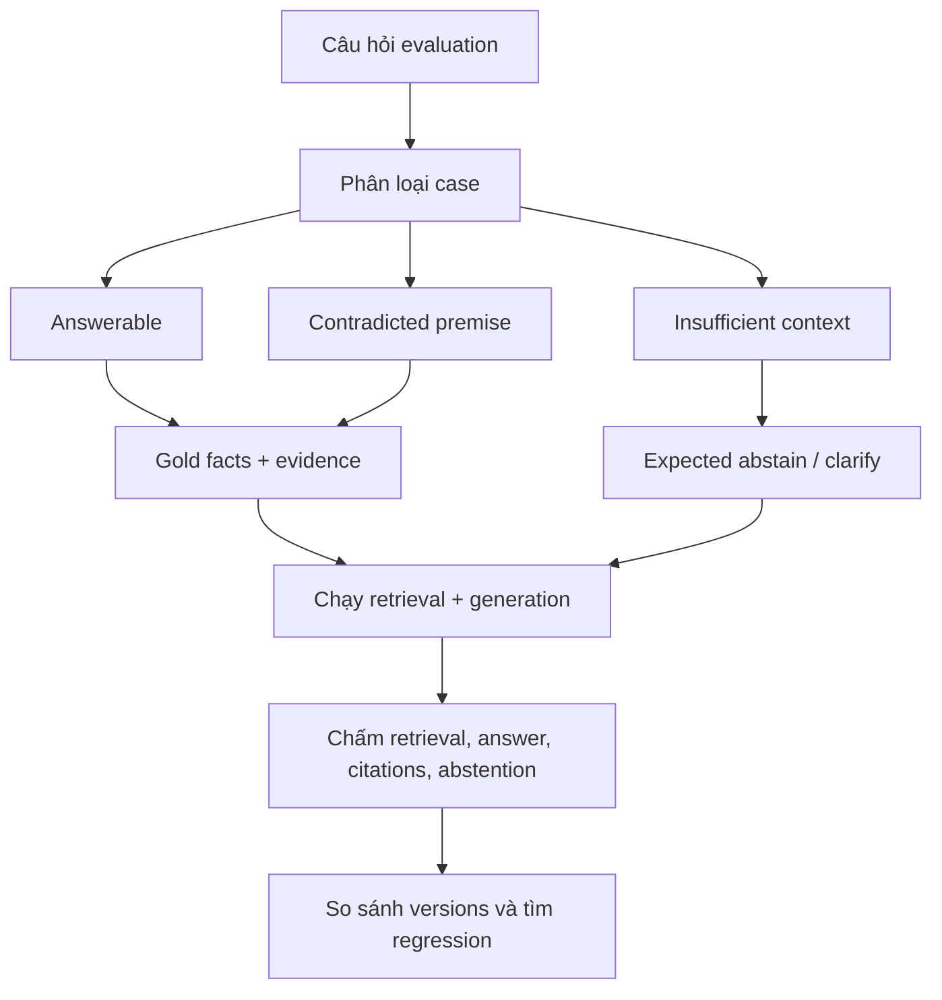

# Tạo bộ dữ liệu nhỏ có ca đúng, sai và thiếu ngữ cảnh

> **Chương:** Thực hành tổng hợp  
> **Module:** `SPRING_AI_EVALUATION_OBSERVABILITY` — đánh giá chất lượng ứng dụng Spring AI bằng tập dữ liệu, tiêu chí relevance, fact checking và kiểm thử luồng RAG hoặc gọi công cụ; đồng thời đo metrics, traces, chi phí và độ trễ để phát hiện nguyên nhân suy giảm qua từng phiên bản prompt, model và pipeline.

## Mục tiêu học tập

Sau bài này, bạn có thể:

1. Thiết kế một dataset nhỏ có cấu trúc để kiểm thử cả retrieval và generation trong ứng dụng RAG.
2. Phân biệt ba nhóm ca: **có đủ bằng chứng để trả lời**, **tiền đề của câu hỏi bị tài liệu bác bỏ**, và **thiếu ngữ cảnh nên phải nói rõ giới hạn hoặc hỏi bổ sung**.
3. Viết gold answer, required facts, forbidden claims và evidence references để người khác có thể kiểm tra lại.
4. Tách dữ liệu chuẩn khỏi output của model để tránh biến câu trả lời đang kiểm thử thành đáp án chuẩn.
5. Tạo candidate outputs đúng và sai để kiểm tra evaluator, fact checker và chính sách abstention.
6. Chấm retrieval relevance/Recall@k, answer correctness, faithfulness, citation support và abstention behavior.
7. Chạy cùng dataset qua các phiên bản corpus, prompt, model và pipeline; lưu kết quả có provenance để tìm regression.

## 1. Vì sao cần một dataset nhỏ trước khi đánh giá toàn pipeline?

Khi mới xây ứng dụng RAG, đội phát triển thường thử vài câu hỏi quen thuộc rồi kết luận hệ thống hoạt động tốt. Cách thử đó bỏ sót những tình huống quan trọng:

- Retriever trả đúng tài liệu nhưng model đọc sai một con số.
- Model trả lời trôi chảy nhưng thêm một điều kiện không có trong nguồn.
- Người dùng đưa ra một tiền đề sai và model đồng ý với họ.
- Corpus không chứa thông tin được hỏi nhưng model vẫn tự điền câu trả lời.
- Citation được gắn vào câu trả lời nhưng tài liệu được trích không hỗ trợ claim.

Một dataset evaluation nhỏ biến các tình huống này thành ca kiểm thử lặp lại được. Dataset phải mô tả **điều gì được biết từ evidence**, **điều gì chưa được biết**, và **hệ thống nên làm gì**.

Trong bài thực hành, ta dùng một quy chế công tác nội bộ hoàn toàn hư cấu của “Công ty Minh Hải”. Tên công ty, chính sách, số tiền và thời hạn đều là dữ liệu mẫu để học; không đại diện cho quy định pháp luật hoặc chính sách của tổ chức có thật.



## 2. Xác định ba nhóm ca trước khi viết câu hỏi

Dataset dùng ba nhãn case type. Chúng mô tả quan hệ giữa câu hỏi và evidence, không phải điểm số của câu trả lời do model sinh ra.

| Nhóm | Ý nghĩa | Hành vi mong đợi |
| --- | --- | --- |
| answerable | Evidence chứa đủ thông tin để trả lời trực tiếp | Trả lời đúng facts cần thiết và dẫn nguồn hỗ trợ |
| contradicted_premise | Câu hỏi chứa một khẳng định/tiền đề bị evidence bác bỏ | Đính chính tiền đề, nêu thông tin đúng và dẫn nguồn |
| insufficient_context | Evidence hiện có không đủ để kết luận | Nói rõ nguồn chưa có thông tin, hỏi bổ sung hoặc từ chối suy đoán |

### “Sai” có hai nghĩa cần tách biệt

Trong một bộ dữ liệu evaluation, “ca sai” có thể được hiểu theo hai cách:

1. **Tiền đề người dùng sai:** ví dụ người dùng hỏi “Mức khách sạn tối đa là 2 triệu đồng đúng không?”, trong khi chính sách ghi 1,2 triệu đồng. Đây là ca contradicted premise; hệ thống tốt phải đính chính.
2. **Câu trả lời model sai:** với một câu hỏi có thể trả lời, ta cố ý đưa candidate answer sai vào evaluator test fixture để kiểm tra fact checking. Candidate answer này không phải gold answer và không được ghi ngược vào dataset chuẩn.

Tách hai khái niệm này giúp tránh nhầm lẫn giữa câu hỏi có tiền đề sai và model sinh ra câu trả lời sai.

### Không dùng “thiếu ngữ cảnh” như một cách nói chung cho mọi lỗi

Nếu tài liệu có thông tin nhưng retriever không tìm ra, đó trước hết là lỗi retrieval. Nếu tài liệu đã được đưa vào context nhưng model bỏ qua, đó là lỗi generation/faithfulness. Chỉ gắn insufficient context khi **evidence được phép sử dụng trong evaluation thực sự không đủ để kết luận**.

## 3. Tạo corpus mẫu có nguồn và phiên bản

Corpus mẫu gồm bốn tài liệu ngắn. Mỗi tài liệu có ID ổn định để dataset tham chiếu; nội dung được lưu riêng với câu hỏi và gold answer.

```json
[
  {
    "documentId": "POL-01",
    "title": "Phụ cấp ăn trong chuyến công tác nội địa",
    "corpusVersion": "policy-demo-v1",
    "content": "Đối với chuyến công tác nội địa, mức phụ cấp ăn tối đa là 350.000 đồng cho mỗi ngày công tác. Mức này là giới hạn tối đa, không phải khoản chi tự động được nhận trong mọi trường hợp."
  },
  {
    "documentId": "POL-02",
    "title": "Thời hạn nộp hồ sơ quyết toán",
    "corpusVersion": "policy-demo-v1",
    "content": "Nhân viên phải nộp hồ sơ quyết toán công tác trong vòng 10 ngày làm việc kể từ ngày kết thúc chuyến công tác."
  },
  {
    "documentId": "POL-03",
    "title": "Giới hạn chi phí khách sạn",
    "corpusVersion": "policy-demo-v1",
    "content": "Đối với chuyến công tác nội địa, chi phí khách sạn được thanh toán tối đa 1.200.000 đồng cho mỗi đêm. Khoản chi vượt giới hạn cần có phê duyệt trước bằng văn bản."
  },
  {
    "documentId": "POL-04",
    "title": "Chứng từ quyết toán",
    "corpusVersion": "policy-demo-v1",
    "content": "Hồ sơ quyết toán cần có hóa đơn hoặc chứng từ hợp lệ tương ứng với khoản chi. Hồ sơ cũng phải ghi rõ thời gian và mục đích chuyến công tác."
  }
]
```

### Vì sao nội dung corpus phải tách riêng?

- Có thể cập nhật chính sách mà không phải viết lại tất cả câu hỏi.
- Có thể thay đổi chunking/embedding/index nhưng giữ nguyên document ID và corpus version.
- Dataset chỉ ra tài liệu nào hỗ trợ từng fact.
- Khi regression xuất hiện, đội phát triển biết evidence nào đã thay đổi.

Trong hệ thống thực tế, mỗi document nên có thêm nguồn gốc, ngày hiệu lực, quyền truy cập, loại tài liệu và checksum/version. Bài thực hành dùng bốn trường tối thiểu để tập trung vào cách tạo ca.

## 4. Thiết kế schema cho một evaluation case

Một case cần đủ dữ liệu để chạy lại và giải thích điểm số:

| Field | Kiểu | Mục đích |
| --- | --- | --- |
| datasetId | string | Tên ổn định của bộ dữ liệu |
| datasetVersion | string | Phiên bản nội dung dataset |
| caseId | string | ID duy nhất của một ca |
| caseType | enum | answerable, contradicted_premise, insufficient_context |
| question | string | Câu hỏi đầu vào |
| evidenceRefs | string array | Các document IDs hỗ trợ hoặc liên quan |
| requiredFacts | string array | Facts bắt buộc để trả lời đúng |
| forbiddenClaims | string array | Claims không được khẳng định |
| goldAnswer | string/null | Câu trả lời tham chiếu hoặc null nếu không đủ căn cứ |
| expectedAction | enum | answer, correct_premise, abstain_or_clarify |
| corpusVersion | string | Phiên bản corpus dùng để tạo case |
| locale | string | Ngôn ngữ kỳ vọng |

### Gold answer không phải prompt mẫu

Gold answer là đáp án tham chiếu đã được người có chuyên môn kiểm tra. Nó không nhất thiết phải là câu chữ duy nhất được chấp nhận. Evaluator nên kiểm tra facts, citations và hành vi mong đợi, thay vì so chuỗi chính xác nếu cách diễn đạt có thể khác nhau.

Với case thiếu ngữ cảnh, goldAnswer có thể là null; thay vào đó, expectedAction và forbiddenClaims mô tả cách ứng dụng cần phản hồi. Nếu muốn có câu mẫu, lưu riêng reference abstention và không coi đó là đáp án factual.

## 5. Bộ dữ liệu mẫu gồm sáu ca

Đây là dataset nhỏ dùng cho smoke test và regression test ban đầu. JSON dưới đây dùng camelCase để ánh xạ trực tiếp với Java records ở phần sau.

```json
[
  {
    "datasetId": "travel-policy-rag",
    "datasetVersion": "1.0.0",
    "caseId": "TRAVEL-001",
    "caseType": "answerable",
    "question": "Mức phụ cấp ăn tối đa cho một ngày công tác nội địa là bao nhiêu?",
    "evidenceRefs": ["POL-01"],
    "requiredFacts": ["350000 VND", "mỗi ngày công tác", "chỉ áp dụng công tác nội địa"],
    "forbiddenClaims": ["được nhận tự động trong mọi trường hợp"],
    "goldAnswer": "Theo quy chế mẫu, mức phụ cấp ăn tối đa cho công tác nội địa là 350.000 đồng mỗi ngày. Đây là mức trần, không có nghĩa mọi chuyến đi đều tự động được nhận khoản tiền này.",
    "expectedAction": "answer",
    "corpusVersion": "policy-demo-v1",
    "locale": "vi-VN"
  },
  {
    "datasetId": "travel-policy-rag",
    "datasetVersion": "1.0.0",
    "caseId": "TRAVEL-002",
    "caseType": "answerable",
    "question": "Sau khi kết thúc chuyến công tác, tôi có bao nhiêu ngày làm việc để nộp hồ sơ quyết toán?",
    "evidenceRefs": ["POL-02"],
    "requiredFacts": ["10 ngày làm việc", "tính từ ngày kết thúc chuyến công tác"],
    "forbiddenClaims": ["15 ngày", "10 ngày theo lịch"],
    "goldAnswer": "Bạn phải nộp hồ sơ trong vòng 10 ngày làm việc kể từ ngày kết thúc chuyến công tác.",
    "expectedAction": "answer",
    "corpusVersion": "policy-demo-v1",
    "locale": "vi-VN"
  },
  {
    "datasetId": "travel-policy-rag",
    "datasetVersion": "1.0.0",
    "caseId": "TRAVEL-003",
    "caseType": "contradicted_premise",
    "question": "Tôi nhớ quy chế cho phép thanh toán khách sạn tối đa 2.000.000 đồng mỗi đêm. Bạn xác nhận giúp tôi nhé?",
    "evidenceRefs": ["POL-03"],
    "requiredFacts": ["1.200.000 VND mỗi đêm", "công tác nội địa", "vượt mức cần phê duyệt trước bằng văn bản"],
    "forbiddenClaims": ["2.000.000 VND là hạn mức tiêu chuẩn", "chi vượt mức luôn được thanh toán"],
    "goldAnswer": "Theo tài liệu hiện có, hạn mức khách sạn cho công tác nội địa là 1.200.000 đồng mỗi đêm. Khoản chi vượt mức cần được phê duyệt trước bằng văn bản; tài liệu không xác nhận mức 2.000.000 đồng là hạn mức tiêu chuẩn.",
    "expectedAction": "correct_premise",
    "corpusVersion": "policy-demo-v1",
    "locale": "vi-VN"
  },
  {
    "datasetId": "travel-policy-rag",
    "datasetVersion": "1.0.0",
    "caseId": "TRAVEL-004",
    "caseType": "answerable",
    "question": "Khi quyết toán công tác, tôi cần chuẩn bị những gì và nộp trong thời hạn nào?",
    "evidenceRefs": ["POL-02", "POL-04"],
    "requiredFacts": ["hóa đơn hoặc chứng từ hợp lệ", "thời gian và mục đích chuyến công tác", "10 ngày làm việc kể từ ngày kết thúc chuyến đi"],
    "forbiddenClaims": ["không cần chứng từ", "10 ngày theo lịch"],
    "goldAnswer": "Hồ sơ cần có hóa đơn hoặc chứng từ hợp lệ tương ứng với khoản chi, đồng thời ghi rõ thời gian và mục đích chuyến công tác. Bạn phải nộp hồ sơ trong vòng 10 ngày làm việc kể từ ngày kết thúc chuyến đi.",
    "expectedAction": "answer",
    "corpusVersion": "policy-demo-v1",
    "locale": "vi-VN"
  },
  {
    "datasetId": "travel-policy-rag",
    "datasetVersion": "1.0.0",
    "caseId": "TRAVEL-005",
    "caseType": "insufficient_context",
    "question": "Mức phụ cấp ăn tối đa khi đi công tác ở nước ngoài là bao nhiêu?",
    "evidenceRefs": ["POL-01"],
    "requiredFacts": [],
    "forbiddenClaims": ["350.000 VND áp dụng cho công tác nước ngoài", "500.000 VND mỗi ngày"],
    "goldAnswer": null,
    "expectedAction": "abstain_or_clarify",
    "corpusVersion": "policy-demo-v1",
    "locale": "vi-VN"
  },
  {
    "datasetId": "travel-policy-rag",
    "datasetVersion": "1.0.0",
    "caseId": "TRAVEL-006",
    "caseType": "insufficient_context",
    "question": "Nếu nộp hồ sơ sau thời hạn 10 ngày làm việc thì có được gia hạn thêm 5 ngày không?",
    "evidenceRefs": ["POL-02"],
    "requiredFacts": [],
    "forbiddenClaims": ["được gia hạn thêm 5 ngày", "bị từ chối tự động"],
    "goldAnswer": null,
    "expectedAction": "abstain_or_clarify",
    "corpusVersion": "policy-demo-v1",
    "locale": "vi-VN"
  }
]
```

### Phân bố sáu ca

| Case | Loại | Evidence | Hành vi kỳ vọng |
| --- | --- | --- | --- |
| TRAVEL-001 | Answerable | POL-01 | Trả lời mức trần và phạm vi |
| TRAVEL-002 | Answerable | POL-02 | Trả lời thời hạn chính xác |
| TRAVEL-003 | Contradicted premise | POL-03 | Đính chính 2 triệu thành 1,2 triệu |
| TRAVEL-004 | Answerable, nhiều nguồn | POL-02, POL-04 | Tổng hợp facts từ hai tài liệu |
| TRAVEL-005 | Insufficient context | POL-01 | Không áp mức nội địa cho quốc tế |
| TRAVEL-006 | Insufficient context | POL-02 | Không tự bịa chính sách gia hạn |

Dataset có ba ca answerable, một ca contradicted premise cần đính chính và hai ca insufficient context. Tập sáu ca đủ để kiểm tra luồng cơ bản, nhưng **không đủ để suy ra chất lượng thống kê của sản phẩm** hoặc đại diện mọi nhóm người dùng.

Với hai ca insufficient context, evidenceRefs là tài liệu liên quan giúp xác định phạm vi mà corpus có đề cập; chúng **không phải bằng chứng hỗ trợ câu trả lời về nội dung còn thiếu**. Khi chấm retrieval, có thể đo việc tìm được tài liệu liên quan này; khi chấm generation, vẫn phải yêu cầu hệ thống không suy diễn vượt quá nguồn.

## 6. Tách gold dataset khỏi candidate outputs

Dataset ở phần trước chỉ chứa câu hỏi, evidence references và đáp án chuẩn. Khi kiểm thử evaluator, tạo một file output fixture riêng hoặc một bảng kết quả riêng. Nhờ đó ta có thể thay đổi candidate answer mà không sửa gold labels.

Ví dụ candidate outputs dùng để kiểm tra fact checker:

```json
[
  {
    "caseId": "TRAVEL-001",
    "candidateAnswer": "Mức phụ cấp ăn tối đa là 350.000 đồng mỗi ngày công tác nội địa; đây là mức trần.",
    "expectedEvaluation": "SUPPORTED"
  },
  {
    "caseId": "TRAVEL-002",
    "candidateAnswer": "Bạn có 15 ngày để nộp hồ sơ sau chuyến đi.",
    "expectedEvaluation": "CONTRADICTED"
  },
  {
    "caseId": "TRAVEL-003",
    "candidateAnswer": "Đúng, hạn mức khách sạn là 2.000.000 đồng mỗi đêm.",
    "expectedEvaluation": "CONTRADICTED"
  },
  {
    "caseId": "TRAVEL-004",
    "candidateAnswer": "Bạn cần hóa đơn hoặc chứng từ hợp lệ, ghi thời gian và mục đích chuyến đi, rồi nộp trong 10 ngày làm việc sau khi kết thúc chuyến.",
    "expectedEvaluation": "SUPPORTED"
  },
  {
    "caseId": "TRAVEL-005",
    "candidateAnswer": "Phụ cấp ăn ở nước ngoài tối đa là 500.000 đồng mỗi ngày.",
    "expectedEvaluation": "UNSUPPORTED"
  },
  {
    "caseId": "TRAVEL-006",
    "candidateAnswer": "Bạn được gia hạn thêm 5 ngày nếu nộp muộn.",
    "expectedEvaluation": "UNSUPPORTED"
  }
]
```

Candidate outputs sai là **fixture có chủ đích** để kiểm tra evaluator, không phải câu trả lời chuẩn. SUPPORTED, CONTRADICTED và UNSUPPORTED mô tả quan hệ của claim với evidence:

- **SUPPORTED:** evidence hỗ trợ claim.
- **CONTRADICTED:** evidence trực tiếp nói ngược claim.
- **UNSUPPORTED:** evidence không đủ để xác nhận hoặc bác bỏ.

Không đồng nhất UNSUPPORTED với CONTRADICTED. Trong hai ca thiếu ngữ cảnh, nguồn không nói mức phụ cấp quốc tế hay chính sách gia hạn; vì vậy không thể kết luận con số 500.000 đồng hoặc ngoại lệ 5 ngày là sai theo chính sách, chỉ có thể nói chúng **không được nguồn hiện có hỗ trợ**.

## 7. Viết required facts và forbidden claims có thể chấm được

Một câu hỏi có thể có nhiều facts cần thiết. Gold answer dạng văn xuôi hữu ích cho người đọc, nhưng evaluator cần các fact units rõ ràng.

Ví dụ TRAVEL-004:

| Fact ID | Fact cần có | Evidence |
| --- | --- | --- |
| F1 | Hồ sơ cần hóa đơn/chứng từ hợp lệ tương ứng khoản chi | POL-04 |
| F2 | Hồ sơ ghi thời gian chuyến đi | POL-04 |
| F3 | Hồ sơ ghi mục đích chuyến đi | POL-04 |
| F4 | Nộp trong 10 ngày làm việc | POL-02 |
| F5 | Thời hạn tính từ ngày kết thúc chuyến đi | POL-02 |

### Quy tắc viết facts

- Một fact nên diễn đạt một mệnh đề có thể xác minh.
- Facts có đơn vị và phạm vi rõ ràng: 350000 VND per domestic travel day.
- Tránh gộp nhiều điều kiện vào một fact dài.
- Gắn mỗi fact với một hoặc nhiều evidence IDs.
- Nếu fact chỉ đúng trong một phạm vi (nội địa, loại nhân viên, thời kỳ), ghi rõ phạm vi.
- Không đưa suy luận ngoài corpus vào gold facts.

### Forbidden claims dùng để bắt lỗi gì?

Forbidden claims hữu ích cho các lỗi dễ xảy ra:

- Sai con số: 15 ngày thay cho 10 ngày làm việc.
- Sai đơn vị: ngày theo lịch thay cho ngày làm việc.
- Sai phạm vi: áp mức nội địa cho quốc tế.
- Biến giới hạn tối đa thành quyền lợi tự động.
- Tự thêm ngoại lệ hoặc quy trình không có trong tài liệu.

Danh sách forbidden claims không thể liệt kê mọi hallucination có thể có. Nó là tập lỗi rủi ro cao đã biết, kết hợp với fact checking tổng quát và human review.

## 8. Đưa dataset vào Java bằng records

Có thể ánh xạ schema JSON thành Java records. Ví dụ dưới đây dùng Jackson để đọc từng dòng JSONL hoặc deserialize JSON array.

```java
import java.util.List;

record EvaluationCase(
        String datasetId,
        String datasetVersion,
        String caseId,
        String caseType,
        String question,
        List<String> evidenceRefs,
        List<String> requiredFacts,
        List<String> forbiddenClaims,
        String goldAnswer,
        String expectedAction,
        String corpusVersion,
        String locale) {}
```

JSON mẫu dùng camelCase để khớp trực tiếp record. Nếu dataset dùng snake_case, cấu hình naming strategy hoặc ánh xạ field tương ứng. Nếu Java version chưa hỗ trợ records, thay bằng class/DTO thông thường. goldAnswer có thể null với insufficient_context.

### Đọc JSONL

Nếu mỗi dòng là một JSON object:

```java
import com.fasterxml.jackson.databind.ObjectMapper;
import java.nio.file.Files;
import java.nio.file.Path;
import java.util.List;

List<EvaluationCase> loadJsonLines(
        Path path, ObjectMapper mapper) throws Exception {

    try (var lines = Files.lines(path)) {
        return lines
                .filter(line -> !line.isBlank())
                .map(line -> {
                    try {
                        return mapper.readValue(
                                line, EvaluationCase.class);
                    } catch (Exception error) {
                        throw new IllegalArgumentException(
                                "Invalid evaluation row", error);
                    }
                })
                .toList();
    }
}
```

JSONL phù hợp khi dataset lớn dần, có thể review từng record và diff thay đổi theo version. Với dataset nhỏ, JSON array cũng thuận tiện. Dù dùng định dạng nào, cần validate schema, unique case IDs và evidence references tồn tại.

## 9. Kiểm tra tính toàn vẹn dataset trước khi chạy model

Một dataset sai cấu trúc sẽ làm kết quả evaluation vô nghĩa. Thực hiện các kiểm tra deterministic trước:

| Kiểm tra | Điều kiện |
| --- | --- |
| ID duy nhất | Không có hai record cùng caseId trong một dataset version |
| Case type hợp lệ | Chỉ nhận enum đã định nghĩa |
| Evidence references | Mọi ID phải tồn tại trong corpus version tương ứng |
| Answerable | goldAnswer không rỗng và có ít nhất một required fact |
| Contradicted premise | Có evidence trực tiếp bác bỏ tiền đề và gold answer đính chính |
| Insufficient context | goldAnswer null hoặc chỉ chứa câu trả lời giới hạn; expected action là abstain/clarify |
| Required facts | Mỗi fact có nguồn hỗ trợ |
| Forbidden claims | Không trùng/đối nghịch với required facts do lỗi soạn dữ liệu |
| Version consistency | Dataset khai báo corpus version dùng để xác minh gold labels |
| Locale | Ngôn ngữ câu hỏi và rubric thống nhất |

### Ví dụ validator

```java
import java.util.HashSet;
import java.util.List;
import java.util.Set;

final class DatasetValidator {
    static void validateDataset(
            List<EvaluationCase> cases,
            Set<String> knownDocumentIds) {

        Set<String> caseIds = new HashSet<>();
        for (EvaluationCase item : cases) {
            if (!caseIds.add(item.caseId())) {
                throw new IllegalArgumentException(
                        "Duplicate caseId: " + item.caseId());
            }

            if (!knownDocumentIds.containsAll(item.evidenceRefs())) {
                throw new IllegalArgumentException(
                        "Unknown evidence reference in " + item.caseId());
            }

            if ("answerable".equals(item.caseType())
                    && (item.goldAnswer() == null
                    || item.goldAnswer().isBlank()
                    || item.requiredFacts().isEmpty())) {
                throw new IllegalArgumentException(
                        "Answerable case needs gold answer and facts");
            }

            if ("insufficient_context".equals(item.caseType())
                    && !"abstain_or_clarify".equals(item.expectedAction())) {
                throw new IllegalArgumentException(
                        "Insufficient context must abstain or clarify");
            }
        }
    }
}
```

Validator trên là ví dụ tối thiểu; kiểm tra contradicted premise cần đối chiếu claim sai với evidence và gold correction. Trong hệ thống thật, nên validate từng fact có evidence reference riêng thay vì chỉ kiểm tra danh sách document ở cấp case.

## 10. Chạy retrieval evaluation riêng với generation evaluation

Một RAG pipeline có thể thất bại ở retrieval hoặc generation. Nếu chỉ chấm câu trả lời cuối, ta khó biết cần sửa retriever, chunking, reranker hay prompt.

### Retrieval evaluation

Với mỗi case, evidenceRefs là các tài liệu cần được tìm thấy để trả lời. Sau retrieval top-k, đo:

```text
Recall@k =
  số evidence IDs kỳ vọng xuất hiện trong top-k
  / tổng số evidence IDs kỳ vọng
```

Ví dụ TRAVEL-004 cần POL-02 và POL-04. Nếu top-3 chỉ có POL-04, Recall@3 = 1/2 = 0,5. Nếu có cả hai, Recall@3 = 1,0.

Có thể bổ sung:

- Precision@k: tỷ lệ kết quả top-k là tài liệu relevant theo nhãn đã review.
- MRR: vị trí của tài liệu relevant đầu tiên.
- nDCG@k: hữu ích khi có graded relevance và nhiều tài liệu.
- ACL correctness: tài liệu bị cấm không được xuất hiện trong kết quả, dù có liên quan nội dung.

Với insufficient_context, cần kiểm tra retriever không tạo cảm giác có bằng chứng cho một chính sách không tồn tại. Tài liệu nội địa có thể được retrieve vì cùng từ khóa phụ cấp ăn, nhưng nó không trả lời được mức công tác quốc tế.

### Generation evaluation

Generation evaluator nhận câu hỏi, evidence thực sự đã được đưa vào model, candidate answer và rubric. Đo:

- Required-fact coverage.
- Claim support/faithfulness.
- Contradiction rate.
- Citation precision và citation recall.
- Correct abstention rate trên insufficient-context cases.
- Completeness và clarity theo rubric.

**Không chấm faithfulness chỉ với evidenceRefs kỳ vọng nếu model không thực sự nhận các tài liệu đó.** Phải lưu/replay retrievedDocumentIds hoặc context manifest của lần chạy. Nếu retriever lấy nhầm tài liệu, generation cần được đánh giá dựa trên context thực tế để xác định model có bịa thêm hay không; retrieval vẫn được chấm riêng với gold evidence.

## 11. Rubric chấm câu trả lời

Một rubric đơn giản có thể dùng thang 0–2 cho từng tiêu chí:

| Tiêu chí | 0 | 1 | 2 |
| --- | --- | --- | --- |
| Fact correctness | Sai facts trọng yếu | Đúng một phần, thiếu/nhầm một chi tiết | Đúng tất cả required facts |
| Faithfulness | Có claim không được hỗ trợ hoặc trái evidence | Phần lớn có căn cứ, còn claim mơ hồ | Mọi factual claim đều được evidence hỗ trợ |
| Citation support | Citation không hỗ trợ claim được trích | Một phần claims có citation đúng | Citation hỗ trợ đúng các claims cần dẫn |
| Scope/qualification | Bỏ điều kiện quan trọng | Có điều kiện nhưng diễn đạt chưa rõ | Nêu đúng phạm vi, đơn vị và điều kiện |
| Abstention behavior | Bịa câu trả lời khi thiếu dữ liệu | Có nêu hạn chế nhưng vẫn suy đoán | Nói rõ thiếu thông tin và hỏi/đề nghị nguồn bổ sung |

Không áp tiêu chí abstention như một điểm phạt cho case answerable. Với contradicted premise, chấm thêm khả năng nhận diện và đính chính tiền đề sai.

### Chấm theo case type

| Case type | Các tiêu chí trọng tâm |
| --- | --- |
| answerable | Required facts, faithfulness, citation support, scope |
| contradicted_premise | Correct premise, fact correctness, không đồng ý với claim sai |
| insufficient_context | Abstention correctness, no unsupported claims, useful clarification |

Điểm tổng hợp nên giữ lại điểm từng tiêu chí. Một điểm trung bình cao có thể che giấu việc hệ thống luôn trả lời bịa trong nhóm insufficient-context nếu nhóm đó có quá ít ca.

## 12. Fact checking và citation checking

Đối với mỗi candidate answer, tách câu trả lời thành atomic claims. Sau đó phân loại từng claim:

| Claim | Evidence relation | Ví dụ |
| --- | --- | --- |
| Supported | Evidence nêu trực tiếp hoặc kéo theo hợp lý | “Hạn nộp là 10 ngày làm việc” với POL-02 |
| Contradicted | Evidence nói ngược lại | “Hạn nộp là 15 ngày” với POL-02 |
| Unsupported | Evidence không đủ để xác nhận hoặc bác bỏ | “Có thể gia hạn thêm 5 ngày” khi corpus không nói ngoại lệ |
| Not applicable | Claim không phải factual claim cần kiểm chứng | “Tôi có thể giúp bạn kiểm tra hồ sơ” |

Citation checking cần xem citation có thực sự hỗ trợ claim ngay trước nó. Việc câu trả lời có gắn POL-02 không đủ để kết luận đúng nếu nội dung claim là 15 ngày.

### Citation precision và recall

```text
Citation precision =
  số citation thực sự hỗ trợ claim được trích
  / tổng số citation được đưa ra

Citation recall =
  số evidence cần thiết đã được trích đúng
  / tổng số evidence cần thiết
```

Định nghĩa có thể được tinh chỉnh theo sản phẩm. Nếu không có citation nào được đưa ra, citation precision được ghi N/A hoặc 0 theo quy ước đã chọn; phải giữ một quy ước nhất quán. Với case insufficient context không có evidence hỗ trợ đáp án, citation recall cho câu trả lời factual là N/A. Với một claim được hỗ trợ bởi nhiều tài liệu, cần xác định citation nào được coi là đủ; không ép câu trả lời phải trích mọi tài liệu nếu một nguồn authoritative đã đủ.

## 13. Đánh giá hành vi abstention khi thiếu ngữ cảnh

Abstention không đơn giản là trả lời “Tôi không biết” cho mọi câu hỏi. Một hệ thống tốt cần:

1. Nói rõ tài liệu hiện có chỉ đề cập phạm vi nào.
2. Không chuyển một quy định nội địa sang quốc tế.
3. Không tự tạo ngoại lệ, mức tiền hoặc thời hạn.
4. Hỏi thông tin còn thiếu hoặc đề nghị người dùng cung cấp chính sách tương ứng.
5. Nếu có một phần trả lời được, tách phần đã xác nhận khỏi phần chưa có căn cứ.

Ví dụ phản hồi phù hợp cho TRAVEL-005:

> Tài liệu hiện có chỉ quy định mức phụ cấp ăn cho công tác nội địa là tối đa 350.000 đồng mỗi ngày. Tôi chưa có tài liệu về mức áp dụng cho công tác nước ngoài. Bạn có thể cung cấp quy chế công tác quốc tế để tôi kiểm tra không?

Ví dụ phản hồi không phù hợp:

> Công tác nước ngoài được hỗ trợ 500.000 đồng mỗi ngày.

Ví dụ thứ hai tạo một con số không có trong corpus. Dù câu trả lời có vẻ hữu ích, nó phải bị đánh dấu UNSUPPORTED.

### Đo abstention

- **Abstention precision:** trong các câu trả lời abstain, tỷ lệ case thực sự thiếu bằng chứng.
- **Abstention recall:** trong các case thiếu bằng chứng, tỷ lệ hệ thống abstain/clarify đúng.
- **Unsupported answer rate:** tỷ lệ case insufficient-context mà hệ thống vẫn khẳng định facts không có nguồn.

Abstention precision thấp có thể cho thấy hệ thống từ chối quá nhiều câu hỏi trả lời được. Abstention recall thấp cho thấy hệ thống đoán khi evidence không đủ.

## 14. Chạy dataset qua một ứng dụng Spring AI

Không nên để file dataset biết chi tiết cách gọi model. Tạo một application facade để mỗi case chạy qua cùng pipeline mà người dùng thật sử dụng:

```java
import java.math.BigDecimal;
import java.util.List;

record TokenUsageSnapshot(
        long inputTokens,
        long outputTokens,
        String usageState,
        BigDecimal estimatedCost,
        String pricingVersion) {}

record RagResult(
        String answer,
        List<String> retrievedDocumentIds,
        List<String> citations,
        String requestId,
        String traceId,
        String modelVersion,
        String promptVersion,
        String pipelineVersion,
        TokenUsageSnapshot usage) {}

interface RagApplication {
    RagResult answer(String question, EvaluationRunContext context);
}

record EvaluationRunContext(
        String datasetId,
        String datasetVersion,
        String caseId,
        String corpusVersion) {}
```

RagApplication là facade của dự án, có thể triển khai bằng Spring AI ChatClient, VectorStore, retriever và tool callbacks. RagResult giữ cả output lẫn retrieved IDs/metadata để evaluator không phải đoán context model đã nhận.

### Evaluation runner

```java
import java.util.ArrayList;
import java.util.List;

record CaseResult(
        String caseId,
        String caseType,
        List<String> retrievedDocumentIds,
        List<String> citations,
        String answer,
        String expectedAction,
        String requestId,
        String traceId,
        TokenUsageSnapshot usage,
        String modelVersion,
        String promptVersion,
        String pipelineVersion) {}

List<CaseResult> runDataset(
        List<EvaluationCase> dataset,
        RagApplication application) {

    List<CaseResult> results = new ArrayList<>();
    for (EvaluationCase item : dataset) {
        EvaluationRunContext context =
                new EvaluationRunContext(
                        item.datasetId(),
                        item.datasetVersion(),
                        item.caseId(),
                        item.corpusVersion());

        RagResult actual =
                application.answer(item.question(), context);

        results.add(new CaseResult(
                item.caseId(),
                item.caseType(),
                actual.retrievedDocumentIds(),
                actual.citations(),
                actual.answer(),
                item.expectedAction(),
                actual.requestId(),
                actual.traceId(),
                actual.usage(),
                actual.modelVersion(),
                actual.promptVersion(),
                actual.pipelineVersion()));
    }
    return results;
}
```

Đây là khung orchestration; trong production, nên chạy các case với concurrency có giới hạn, timeout riêng, retry policy đã định nghĩa và lưu kết quả sau từng case để không mất toàn bộ run nếu một case lỗi. Không dùng concurrency không giới hạn vì dataset nhỏ vẫn có thể gây burst request tới provider.

### Không chạy hai lần chỉ để lấy thêm telemetry

Nếu cần answer, retrieved docs, citations và usage, hãy giữ chúng từ cùng một lần thực thi. Không gọi pipeline một lần để lấy answer rồi gọi lại lần nữa để lấy usage hoặc trace; lần gọi thứ hai có thể cho output khác và tạo chi phí khác.

## 15. Lưu evaluation result có provenance

Một kết quả cần cho biết nó được tạo từ dataset, corpus, prompt, model và pipeline nào:

```json
{
  "runId": "travel-policy-run-2026-11-27-01",
  "datasetId": "travel-policy-rag",
  "datasetVersion": "1.0.0",
  "caseId": "TRAVEL-003",
  "corpusVersion": "policy-demo-v1",
  "indexVersion": "travel-index-v1",
  "promptVersion": "rag-prompt-v4",
  "modelVersion": "model-family-medium",
  "pipelineVersion": "rag-pipeline-v3",
  "retrievedDocumentIds": ["POL-03"],
  "answer": "Hạn mức khách sạn nội địa là 1.200.000 đồng mỗi đêm...",
  "expectedAction": "correct_premise",
  "actualAction": "correct_premise",
  "retrievalRecallAtK": 1.0,
  "factCorrectness": 1.0,
  "faithfulness": 1.0,
  "citationPrecision": 1.0,
  "usageState": "FINAL",
  "inputTokens": 420,
  "outputTokens": 86,
  "cost": 0.000382,
  "durationMs": 1480,
  "traceId": "stored-in-trace-backend"
}
```

Giá trị trên chỉ minh họa format, không phải kết quả chạy thực tế hoặc báo giá provider. Trong log/result store, có thể giữ trace ID để tra cứu; không đưa trace ID thành metric tag. Nếu lưu answer/evidence text, áp dụng quyền truy cập, retention và redaction theo chính sách dữ liệu.

### Các version phải tách biệt

| Version | Điều được thay đổi | Câu hỏi khi so sánh |
| --- | --- | --- |
| Dataset version | Câu hỏi, gold facts, labels | Bộ kiểm thử có thay đổi không? |
| Corpus version | Nội dung nguồn, effective date | Bằng chứng nền có đổi không? |
| Index version | Chunking, embedding, metadata filters | Retriever có tìm đúng evidence hơn không? |
| Prompt version | Instruction, template, output constraints | Model có bám evidence tốt hơn không? |
| Model version | Model/provider/config | Khả năng và latency/cost có thay đổi không? |
| Pipeline version | Retrieval, rerank, tool orchestration | Thay đổi kiến trúc nào gây regression? |
| Evaluator/rubric version | Rule, judge model, scoring criteria | Cách chấm có thay đổi không? |

Nếu dataset và evaluator cùng thay đổi trong một lần release, điểm số trước/sau không còn so sánh trực tiếp. Lưu cả version của rubric và judge model khi dùng LLM-as-a-judge.

## 16. Đọc kết quả và tìm lỗi theo từng tầng

Giả sử một lần chạy có kết quả:

| Case | Recall@5 | Fact correctness | Faithfulness | Expected action | Actual |
| --- | ---: | ---: | ---: | --- | --- |
| TRAVEL-001 | 1,0 | 1,0 | 1,0 | Answer | Answer |
| TRAVEL-002 | 1,0 | 0,0 | 0,0 | Answer | Answer sai 15 ngày |
| TRAVEL-003 | 1,0 | 1,0 | 1,0 | Correct premise | Correct premise |
| TRAVEL-004 | 0,5 | 0,5 | 1,0 | Answer | Thiếu một chứng từ |
| TRAVEL-005 | 0,0 | N/A | N/A | Abstain | Đoán 500.000 đồng |
| TRAVEL-006 | 1,0 | N/A | N/A | Abstain | Hỏi bổ sung đúng |

Đây là số liệu giả định để minh họa cách chẩn đoán:

- TRAVEL-002: retrieval tìm đúng POL-02, nhưng model trả 15 ngày. Lỗi thuộc generation/fact checking hoặc prompt; không phải retrieval.
- TRAVEL-004: retrieval chỉ lấy một trong hai tài liệu. Thiếu evidence có thể giải thích việc câu trả lời thiếu facts; cần kiểm tra top-k, chunking và reranker.
- TRAVEL-005: corpus chỉ có chính sách nội địa nhưng model suy ra mức quốc tế. Đây là lỗi abstention/unsupported answer.
- TRAVEL-006: hệ thống biết tài liệu không nói về gia hạn và hỏi bổ sung; hành vi đúng dù không có gold factual answer.

Không gộp N/A thành 0. Với case thiếu ngữ cảnh, fact correctness theo một gold answer không tồn tại không áp dụng; cần chấm abstention và unsupported answer rate.

### Ma trận lỗi

| Retrieval | Generation | Diễn giải | Hướng điều tra |
| --- | --- | --- | --- |
| Tốt | Tốt | Pipeline hoạt động như kỳ vọng | Theo dõi regression |
| Kém | Tốt trên context nhận được | Có thể thiếu evidence hoặc context sai | Retriever, index, ACL, reranker |
| Tốt | Kém | Evidence đúng nhưng model trả lời sai | Prompt, model, context ordering, fact checker |
| Kém | Kém | Hai tầng cùng có vấn đề hoặc context gây nhiễu | Kiểm tra trace và evidence manifest |
| N/A (insufficient) | Abstain đúng | Hành vi mong đợi | Theo dõi abstention precision/recall |

## 17. Đặt ngưỡng regression và giới hạn của dataset nhỏ

Với sáu ca, một lỗi làm điểm số thay đổi rất mạnh. Dùng dataset này để bắt lỗi chức năng rõ ràng và làm smoke test; không tuyên bố độ chính xác 95% từ một mẫu quá nhỏ.

Ngưỡng ban đầu có thể là:

- Không có case insufficient_context nào được trả lời bằng facts không có nguồn.
- Các case answerable phải retrieve được evidence bắt buộc ở top-k đã chọn.
- Không được chấp nhận candidate output chứa forbidden claim quan trọng.
- Mọi answerable/contradicted case phải có citation hỗ trợ các facts quan trọng.
- Latency/cost phải nằm trong budget kỹ thuật đã thống nhất.

Khi dataset lớn hơn, báo cáo theo nhóm case type và confidence interval nếu cần. Giữ một tập holdout chưa dùng để chỉnh prompt/rubric; nếu liên tục tối ưu trên cùng một bộ ca, hệ thống có thể overfit vào cách hỏi của dataset.

### Mở rộng dataset có kiểm soát

1. Thêm paraphrases cho cùng một fact nhưng không tạo hàng loạt câu gần trùng.
2. Thêm câu hỏi nhiều bước cần ghép hai hoặc nhiều tài liệu.
3. Thêm câu hỏi có tài liệu mâu thuẫn theo thời gian và kiểm tra effective date.
4. Thêm ACL cases: tài liệu có liên quan nhưng người dùng không được phép xem.
5. Thêm câu hỏi mơ hồ cần clarification.
6. Thêm câu hỏi ngoài phạm vi corpus để đo abstention.
7. Thêm negative examples về sai đơn vị, sai phạm vi, nhầm ngày làm việc và ngày theo lịch.
8. Review gold labels bằng con người trước khi đưa vào regression gate.

## 18. Bài thực hành tổng hợp

Bạn nhận một dataset mới cho chính sách hoàn tiền:

| ID | Evidence hiện có | Câu hỏi |
| --- | --- | --- |
| REF-01 | Hoàn tiền vé nội địa trong 7 ngày sau khi yêu cầu được duyệt | “Bao lâu thì tôi nhận được tiền?” |
| REF-02 | Chỉ quy định hoàn tiền vé nội địa | “Vé quốc tế có được hoàn trong 7 ngày không?” |
| REF-03 | Phí đổi vé là 200.000 đồng/lần | “Phí đổi vé là 100.000 đồng đúng không?” |
| REF-04 | Không có thông tin về trường hợp mất hóa đơn | “Mất hóa đơn thì có được hoàn tiền không?” |

**Yêu cầu:**

1. Gán caseType và expectedAction cho từng case.
2. Viết một required fact và một forbidden claim phù hợp cho mỗi case.
3. Chỉ ra case nào cần goldAnswer = null.
4. Tạo một candidate output sai để kiểm thử fact checker.
5. Nêu evidence IDs cần xuất hiện trong top-k cho các case có thể trả lời.
6. Giải thích vì sao case thiếu thông tin vé quốc tế không nên được chấm là contradicted.
7. Đề xuất hai metric để đo khả năng abstention.

### Đáp án gợi ý

1. REF-01: answerable / answer; REF-02: insufficient_context / abstain_or_clarify; REF-03: contradicted_premise / correct_premise; REF-04: insufficient_context / abstain_or_clarify.
2. REF-01 required fact: 7 ngày sau khi yêu cầu được duyệt; forbidden claim: 7 ngày sau ngày mua vé. REF-02 forbidden claim: chính sách nội địa tự động áp dụng cho vé quốc tế. REF-03 required fact: 200.000 đồng/lần; forbidden claim: 100.000 đồng/lần là mức đúng. REF-04 forbidden claim: mất hóa đơn chắc chắn vẫn được hoàn.
3. REF-02 và REF-04 có thể đặt goldAnswer = null, vì corpus không đủ căn cứ để kết luận factual.
4. Candidate sai: “Phí đổi vé là 100.000 đồng mỗi lần.” Expected relation với REF-03 là CONTRADICTED.
5. REF-01 cần REF-01; REF-03 cần REF-03. Hai case insufficient có thể retrieve tài liệu liên quan để xác định phạm vi, nhưng không có evidence đủ để trả lời kết luận được hỏi.
6. Nguồn không nói về vé quốc tế; nó không bác bỏ một mức hoàn tiền cụ thể, chỉ không cung cấp căn cứ. Vì vậy relation là UNSUPPORTED, không phải CONTRADICTED.
7. Dùng abstention recall trên các case thiếu evidence và unsupported-answer rate trên cùng nhóm. Có thể bổ sung abstention precision để phát hiện từ chối quá mức.

## Ghi nhớ

- **Dataset là hợp đồng kiểm thử:** mỗi case cần câu hỏi, loại ca, evidence refs, required facts, forbidden claims, expected action và version.
- **Tách ba trạng thái:** answerable có thể trả lời; contradicted premise cần đính chính; insufficient context phải abstain/clarify.
- **Tách gold data khỏi model outputs:** candidate answer đúng/sai là fixture hoặc kết quả run, không sửa đáp án chuẩn theo output hiện tại.
- **Phân biệt contradicted với unsupported:** tài liệu nói ngược lại là contradicted; tài liệu im lặng là unsupported.
- **Chấm retrieval và generation riêng:** evidence không được retrieve là lỗi retrieval; evidence đã có nhưng câu trả lời sai là lỗi generation/faithfulness.
- **Giữ provenance:** dataset, corpus, index, prompt, model, pipeline và evaluator versions phải được lưu cùng kết quả.
- **Không phóng đại kết quả mẫu nhỏ:** sáu ca phù hợp smoke/regression test ban đầu; cần mở rộng, review gold labels và có holdout trước khi kết luận chất lượng sản phẩm.
