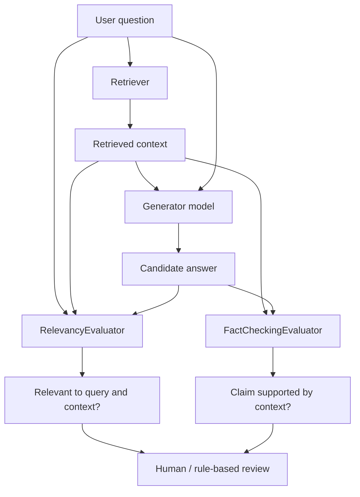

# Chạy RelevancyEvaluator và FactCheckingEvaluator rồi đọc kết quả

> **Chương:** Thực hành tổng hợp  
> **Module:** `SPRING_AI_EVALUATION_OBSERVABILITY` — đánh giá chất lượng ứng dụng Spring AI bằng tập dữ liệu, tiêu chí relevance, fact checking và kiểm thử luồng RAG hoặc gọi công cụ; đồng thời đo metrics, traces, chi phí và độ trễ để phát hiện nguyên nhân suy giảm qua từng phiên bản prompt, model và pipeline.

## Mục tiêu học tập

Sau bài này, bạn có thể:

1. Giải thích hai evaluator tích hợp sẵn của Spring AI kiểm tra những khía cạnh khác nhau.
2. Tạo `EvaluationRequest` đúng với câu hỏi, context đã retrieve và câu trả lời thực tế.
3. Khởi tạo `RelevancyEvaluator` và `FactCheckingEvaluator` bằng `ChatClient.Builder`.
4. Chạy evaluator trên từng case của dataset, đọc `isPass`, feedback, score và metadata.
5. Tách câu trả lời thành atomic claims trước khi fact-check để tìm chính xác claim không được hỗ trợ.
6. Phân biệt claim được hỗ trợ, bị evidence bác bỏ và chưa có evidence; hiểu giới hạn của kết quả boolean pass/fail.
7. Đọc false positive/false negative, kiểm tra judge model và xây regression tests có thể lặp lại.
8. Lưu kết quả evaluation cùng dataset, corpus, prompt, model, pipeline version, usage, cost và trace ID.

## 1. Hai evaluator trả lời hai câu hỏi khác nhau

Một RAG pipeline có thể tạo ra câu trả lời nghe rất hợp lý nhưng vẫn sai. Ta cần đánh giá nhiều chiều thay vì chỉ hỏi model có trả lời đúng một từ khóa hay không.



| Evaluator | Câu hỏi chính | Đầu vào quan trọng | Điều không thể tự chứng minh |
| --- | --- | --- | --- |
| `RelevancyEvaluator` | Câu trả lời có liên quan tới câu hỏi và phù hợp với context được cung cấp không? | User question, retrieved context, response | Tất cả facts đều đúng, đủ và có citation chính xác |
| `FactCheckingEvaluator` | Claim trong câu trả lời có được tài liệu cung cấp hỗ trợ không? | Document/context và claim | Câu trả lời giải quyết đúng ý định người dùng hoặc đủ mọi facts |

Hai evaluator bổ sung cho nhau. Một câu trả lời có thể đúng chủ đề nhưng có con số sai; cũng có thể chứa một claim đúng theo tài liệu nhưng không trả lời câu hỏi người dùng. Vì vậy không dùng một evaluator làm đại diện cho toàn bộ chất lượng RAG.

### Đặt chúng vào đúng chỗ trong pipeline

- Dùng relevance để kiểm tra câu trả lời có đi đúng câu hỏi trong bối cảnh retrieved context hay không.
- Dùng fact checking để xác minh từng claim factual quan trọng với chính context đã được cung cấp.
- Dùng required facts, forbidden claims và expected action từ dataset để kiểm tra độ đầy đủ, tiền đề sai và hành vi abstention.
- Dùng human review cho những case có hậu quả cao hoặc khi judge không chắc chắn.

## 2. API evaluator trong Spring AI

Trong Spring AI, `Evaluator` là một interface có phương thức `evaluate(EvaluationRequest)` và trả về `EvaluationResponse`. `EvaluationRequest` mang câu hỏi, context và nội dung response. Hai evaluator là các implementation dùng một chat model để đưa ra verdict.

Ví dụ trong bài theo API Spring AI **2.1.0**:

- `Evaluator`, `EvaluationRequest` và `EvaluationResponse` thuộc package `org.springframework.ai.evaluation`.
- `RelevancyEvaluator` và `FactCheckingEvaluator` thuộc package `org.springframework.ai.chat.evaluation`.
- Context được truyền dưới dạng danh sách `Document`.

Tên package và constructor đã thay đổi giữa các major/minor line. Nếu dự án đang dùng Spring AI 1.x, hãy kiểm tra API Javadoc đúng version thay vì copy nguyên import của ví dụ 2.1.0.

### Các field trong EvaluationRequest

| Field | Nội dung | Dùng cho |
| --- | --- | --- |
| `userText` | Câu hỏi gốc của người dùng | RelevancyEvaluator |
| `dataList` | Danh sách tài liệu/context đã retrieve | Cả hai evaluator |
| `responseContent` | Câu trả lời hoặc claim cần đánh giá | Cả hai evaluator |

`RelevancyEvaluator` cần cả ba thành phần để đánh giá quan hệ giữa câu hỏi, câu trả lời và context. `FactCheckingEvaluator` tập trung vào tài liệu và claim; có thể dùng constructor hai tham số `EvaluationRequest(dataList, responseContent)`.

### EvaluationResponse

| Thành phần | Cách đọc |
| --- | --- |
| `isPass()` | Verdict pass/fail theo prompt và cách evaluator diễn giải |
| `getFeedback()` | Giải thích ngắn của judge |
| `getScore()` | Score nếu evaluator/version có cung cấp; hiểu theo contract cụ thể |
| `getMetadata()` | Metadata bổ sung từ evaluation |

`isPass` không phải xác suất câu trả lời đúng. Không diễn giải `true` thành “đúng tuyệt đối”, hoặc `false` thành “chắc chắn hallucination”. Đây là verdict do judge model tạo ra từ input và prompt được cấp.

## 3. Chuẩn bị dependency và hai chat clients

Các evaluator gọi chat model để làm judge. Có thể dùng cùng một model với generator trong ví dụ học tập, nhưng production nên cân nhắc model judge riêng để giảm sự phụ thuộc giữa model tạo câu trả lời và model chấm.

Dependency starter cần có:

- Spring AI chat model starter tương ứng provider dùng làm judge.
- Spring AI evaluation API nằm trong module tương ứng của version dự án.
- Jackson/JUnit nếu đọc dataset và viết integration tests.

Không có một dependency tọa độ duy nhất cho mọi provider; chọn starter theo model đang dùng và theo Spring AI BOM/version đã khóa trong dự án.

### Cấu hình ChatClient.Builder

```java
import org.springframework.ai.chat.client.ChatClient;
import org.springframework.ai.chat.evaluation.FactCheckingEvaluator;
import org.springframework.ai.chat.evaluation.RelevancyEvaluator;
import org.springframework.ai.evaluation.EvaluationRequest;
import org.springframework.ai.evaluation.EvaluationResponse;
import org.springframework.ai.document.Document;
import org.springframework.ai.chat.model.ChatModel;
import java.util.List;

final class RagEvaluators {
    private final RelevancyEvaluator relevancy;
    private final FactCheckingEvaluator factChecking;

    RagEvaluators(ChatModel judgeModel) {
        this.relevancy = RelevancyEvaluator.builder()
                .chatClientBuilder(ChatClient.builder(judgeModel))
                .build();

        this.factChecking = FactCheckingEvaluator
                .builder(ChatClient.builder(judgeModel))
                .build();
    }

    EvaluationResponse evaluateRelevancy(
            String question, List<Document> context, String answer) {
        EvaluationRequest request =
                new EvaluationRequest(question, context, answer);
        return relevancy.evaluate(request);
    }

    EvaluationResponse evaluateClaim(
            List<Document> context, String claim) {
        EvaluationRequest request =
                new EvaluationRequest(context, claim);
        return factChecking.evaluate(request);
    }
}
```

Đây là cách khởi tạo theo builder API của Spring AI 2.1.x. `ChatClient.Builder` là builder có thể mutate; nếu ứng dụng cần advisors/default options khác nhau cho hai evaluator, tạo builder riêng hoặc cấu hình từng ChatClient tách biệt. Không để một cấu hình dùng chung vô tình thêm retrieval advisor vào judge request.

### Dùng judge model riêng

```java
import org.springframework.beans.factory.annotation.Qualifier;
import org.springframework.context.annotation.Bean;
import org.springframework.context.annotation.Configuration;

@Configuration
class EvaluationConfiguration {

    @Bean
    RelevancyEvaluator relevancyEvaluator(
            @Qualifier("judgeChatModel") ChatModel judgeModel) {
        return RelevancyEvaluator.builder()
                .chatClientBuilder(ChatClient.builder(judgeModel))
                .build();
    }

    @Bean
    FactCheckingEvaluator factCheckingEvaluator(
            @Qualifier("factCheckChatModel") ChatModel factCheckModel) {
        return FactCheckingEvaluator
                .builder(ChatClient.builder(factCheckModel))
                .build();
    }
}
```

Ví dụ dùng hai model bean để minh họa khả năng chọn judge riêng. Trong dự án thực tế, có thể dùng cùng một model nhưng tách client/configuration, hoặc dùng model fact-check chuyên dụng. Cấu hình bean/provider cụ thể phụ thuộc starter đã chọn.

## 4. RelevancyEvaluator làm gì?

`RelevancyEvaluator` đánh giá câu trả lời có đi đúng câu hỏi và có phù hợp với context được cung cấp hay không. Prompt mặc định yêu cầu judge trả lời YES nếu response phù hợp với context cho query, ngược lại trả lời NO.

Ba đầu vào phải khớp cùng một lần chạy:

1. Câu hỏi gốc người dùng đã hỏi.
2. Những tài liệu thực sự được retriever đưa vào context.
3. Câu trả lời thực tế do generator tạo ra.

Không thay retrieved context bằng toàn bộ corpus hoặc gold evidence khi chấm output đã sinh. Làm vậy sẽ đánh giá câu trả lời trên thông tin mà model có thể chưa từng nhìn thấy.

### Ví dụ với dataset travel-policy-rag

Giả sử case TRAVEL-002 hỏi thời hạn nộp hồ sơ quyết toán. Retriever trả về POL-02:

```java
String question =
        "Sau khi kết thúc chuyến công tác, tôi có bao nhiêu ngày làm việc để nộp hồ sơ quyết toán?";

List<Document> retrievedContext = List.of(
        new Document(
                "Nhân viên phải nộp hồ sơ quyết toán công tác trong vòng "
                + "10 ngày làm việc kể từ ngày kết thúc chuyến công tác."));

String answer =
        "Bạn phải nộp hồ sơ trong vòng 10 ngày làm việc kể từ ngày kết thúc chuyến công tác.";

EvaluationRequest request =
        new EvaluationRequest(question, retrievedContext, answer);

EvaluationResponse result = relevancyEvaluator.evaluate(request);

System.out.println("pass = " + result.isPass());
System.out.println("feedback = " + result.getFeedback());
```

Với answer đúng và context đầy đủ, kỳ vọng judge đánh giá pass. Kết quả thực tế phụ thuộc model judge, prompt và cấu hình; đây là kỳ vọng của test case, không phải output đã chạy từ provider.

### RelevancyEvaluator không phải retrieval metric

RelevancyEvaluator nhận context đã retrieve và câu trả lời. Nó không trực tiếp đo Recall@k hoặc MRR của retriever. Để biết retriever có lấy đúng tài liệu hay không, so retrievedDocumentIds với evidence IDs của dataset và tính retrieval metrics riêng.

Một câu trả lời có thể:

- Liên quan tới câu hỏi nhưng bỏ sót một required fact.
- Dùng đúng context nhưng không trích dẫn claim quan trọng.
- Có vẻ phù hợp với context nhưng thêm một chi tiết chưa được nguồn hỗ trợ.

Do đó cần kết hợp required-fact coverage, fact checking và citation checking.

## 5. FactCheckingEvaluator làm gì?

`FactCheckingEvaluator` đánh giá một claim có được document/context hỗ trợ về mặt factual hay không. Prompt mặc định yêu cầu judge trả lời yes nếu claim được document hỗ trợ và no nếu không.

Trong API 2.1.x:

```java
List<Document> context = List.of(
        new Document(
                "Đối với chuyến công tác nội địa, chi phí khách sạn "
                + "được thanh toán tối đa 1.200.000 đồng cho mỗi đêm. "
                + "Khoản chi vượt giới hạn cần có phê duyệt trước bằng văn bản."));

String claim =
        "Hạn mức khách sạn cho công tác nội địa là 1.200.000 đồng mỗi đêm.";

EvaluationRequest request =
        new EvaluationRequest(context, claim);

EvaluationResponse result =
        factCheckingEvaluator.evaluate(request);

System.out.println("supported = " + result.isPass());
System.out.println("feedback = " + result.getFeedback());
```

Fact checker nối nội dung các document trong `dataList` thành document context để so sánh với claim. Vì vậy cần truyền đúng các tài liệu có liên quan, không nhét toàn bộ corpus vào request nếu chúng chứa thông tin nhiễu hoặc mâu thuẫn.

### Một câu trả lời dài cần được tách thành atomic claims

Không nên đưa một đoạn trả lời dài gồm nhiều facts vào fact checker rồi chỉ đọc một verdict. Ví dụ:

```text
Answer:
  1. Hạn mức khách sạn là 1.200.000 đồng mỗi đêm.
  2. Khoản vượt mức cần phê duyệt trước bằng văn bản.
  3. Công ty sẽ tự động hoàn mọi khoản vượt mức sau chuyến đi.
```

Hai claim đầu được POL-03 hỗ trợ; claim thứ ba không được hỗ trợ và còn mâu thuẫn với yêu cầu phê duyệt trước. Nếu gửi cả đoạn, một verdict fail không chỉ ra claim nào sai. Tách thành ba lần kiểm tra hoặc dùng một claim extractor rồi fact-check từng claim.

### FactCheckingEvaluator không thay thế claim extraction

Evaluator nhận một chuỗi response/claim. Nó không đảm bảo tự tách mọi câu thành các atomic claims có thể kiểm chứng. Pipeline evaluation nên:

1. Tách response thành factual claims.
2. Bỏ qua câu xã giao/ý kiến không cần kiểm chứng factual.
3. Gắn claim với evidence document IDs phù hợp.
4. Chạy fact checker trên từng claim.
5. Lưu verdict và feedback theo claim ID.

## 6. Chạy hai evaluator trên một case

Tạo một service để tránh lặp cách dựng request và để giữ lại kết quả có cấu trúc:

```java
record ClaimResult(
        String claim,
        boolean supported,
        String feedback,
        float score) {}

record EvaluationSummary(
        String caseId,
        boolean relevant,
        String relevancyFeedback,
        List<ClaimResult> claimResults) {}

EvaluationSummary evaluateCase(
        EvaluationCase item,
        List<Document> actualRetrievedContext,
        String candidateAnswer,
        RelevancyEvaluator relevancyEvaluator,
        FactCheckingEvaluator factCheckingEvaluator,
        List<String> atomicClaims) {

    EvaluationResponse relevance =
            relevancyEvaluator.evaluate(
                    new EvaluationRequest(
                            item.question(),
                            actualRetrievedContext,
                            candidateAnswer));

    List<ClaimResult> claimResults = atomicClaims.stream()
            .map(claim -> {
                EvaluationResponse response =
                        factCheckingEvaluator.evaluate(
                                new EvaluationRequest(
                                        actualRetrievedContext, claim));
                return new ClaimResult(
                        claim,
                        response.isPass(),
                        response.getFeedback(),
                        response.getScore());
            })
            .toList();

    return new EvaluationSummary(
            item.caseId(),
            relevance.isPass(),
            relevance.getFeedback(),
            claimResults);
}
```

Đây là khung minh họa. Trong ứng dụng thực tế, thêm timeout, giới hạn concurrency, retry cho lỗi transient và xử lý exception riêng cho mỗi lần gọi judge. Nếu một claim evaluation lỗi, lưu trạng thái EVALUATION_ERROR; không chuyển thành pass hoặc fail factual.

### Vì sao phải lưu context thực tế?

Dataset giữ evidenceRefs kỳ vọng. Lần chạy phải giữ retrievedDocumentIds và chính văn bản context thực tế. Hai tập này phục vụ hai mục đích:

- Gold evidence dùng để chấm retrieval.
- Actual retrieved context dùng để chấm response/claim mà model đã nhìn thấy.

Nếu chỉ lưu IDs nhưng document đã thay đổi, không thể tái lập fact checking. Với evaluation có yêu cầu audit, lưu context snapshot hoặc immutable document version/checksum.

## 7. Chạy trên các ca đúng, sai và thiếu ngữ cảnh

Dùng lại các case trong dataset travel-policy-rag:

| Case | Candidate answer/claim | Relevancy kỳ vọng | Fact checking kỳ vọng |
| --- | --- | --- | --- |
| TRAVEL-001 | “Mức phụ cấp ăn tối đa là 350.000 đồng mỗi ngày công tác nội địa.” | Pass | Supported |
| TRAVEL-002 | “Bạn có 15 ngày để nộp hồ sơ.” | Có thể vẫn on-topic; cần đọc feedback | Không được hỗ trợ; contradicted bởi POL-02 |
| TRAVEL-003 | “Hạn mức khách sạn là 2.000.000 đồng mỗi đêm.” | Có thể bị fail do không phù hợp context | Contradicted bởi POL-03 |
| TRAVEL-004 | “Cần chứng từ hợp lệ, ghi thời gian/mục đích, nộp trong 10 ngày làm việc.” | Pass nếu đủ context POL-02 và POL-04 | Các claims phải được hỗ trợ bởi hai tài liệu |
| TRAVEL-005 | “Phụ cấp ăn quốc tế là 500.000 đồng mỗi ngày.” | Có thể fail do vượt context | Unsupported bởi POL-01; không có chính sách quốc tế |
| TRAVEL-006 | “Được gia hạn thêm 5 ngày nếu nộp muộn.” | Có thể fail do vượt context | Unsupported bởi POL-02; tài liệu không nói về gia hạn |

Các cột là **kỳ vọng theo thiết kế test**, không phải kết quả chạy model judge thực tế. Một judge có thể đánh giá khác; cần lưu output thật rồi đối chiếu với gold labels và review những trường hợp bất đồng.

### Đọc ba kiểu kết quả

**Pass relevance + pass fact checking**

- Câu trả lời phù hợp câu hỏi/context.
- Các claims đã kiểm tra được hỗ trợ.
- Vẫn cần kiểm tra required facts, citation và scope để bảo đảm câu trả lời đầy đủ.

**Pass relevance + fail fact checking**

- Câu trả lời vẫn nói về đúng chủ đề.
- Có ít nhất một claim không được context hỗ trợ hoặc mâu thuẫn với context.
- Điều tra con số, đơn vị, phạm vi, thời hạn và claim bổ sung do model tự suy ra.

**Fail relevance + pass fact checking**

- Claim được kiểm tra có thể đúng theo document.
- Toàn bộ câu trả lời có thể lạc khỏi câu hỏi hoặc không giải quyết ý định người dùng.
- Kiểm tra question understanding, prompt, context selection và answer completeness.

## 8. Đọc feedback và score thay vì chỉ nhìn isPass

`isPass` là tín hiệu nhanh để viết assertion. Khi kết quả fail, `getFeedback()` giúp hiểu judge đang chỉ ra điều gì. `getScore()` và `getMetadata()` có thể cung cấp thông tin bổ sung tùy evaluator/version.

Ví dụ logging kết quả:

```java
void logEvaluation(
        String caseId,
        String evaluatorName,
        EvaluationResponse response) {

    log.info(
            "evaluation case={} evaluator={} pass={} score={} feedback={} metadata={}",
            caseId,
            evaluatorName,
            response.isPass(),
            response.getScore(),
            response.getFeedback(),
            response.getMetadata());
}
```

Không log raw prompt/answer/context trong production chỉ để debug judge. Dùng case ID, run ID, model/version, trace ID và feedback đã được kiểm soát; nếu cần lưu nội dung, áp dụng access control và retention.

### Feedback là chẩn đoán, không phải gold label

Judge có thể đưa ra giải thích nghe hợp lý nhưng sai. Ví dụ context nói “10 ngày làm việc”, judge lại bỏ qua chữ “làm việc” và cho rằng “10 ngày” tương đương 10 ngày theo lịch. Khi feedback xung đột với source:

1. Mở document gốc và actual context snapshot.
2. Kiểm tra claim cụ thể.
3. So với required facts và forbidden claims của dataset.
4. Ghi human adjudication.
5. Điều chỉnh prompt/rubric hoặc judge model sau khi có đủ bằng chứng.

Không tự động sửa gold answer để khớp feedback của evaluator.

## 9. Phân biệt contradicted và unsupported

`FactCheckingEvaluator` trả verdict supported/not supported theo document. Một kết quả fail không tự nói rõ claim bị nguồn bác bỏ hay nguồn đơn giản là không đề cập.

| Evidence relation | Ý nghĩa | Ví dụ |
| --- | --- | --- |
| Supported | Nguồn hỗ trợ claim | POL-02 hỗ trợ “10 ngày làm việc” |
| Contradicted | Nguồn nói ngược claim | POL-02 nói 10 ngày làm việc, claim nói 15 ngày |
| Unsupported | Nguồn không có đủ thông tin để kết luận | POL-02 không nói có được gia hạn 5 ngày không |

Trong dataset:

- TRAVEL-002 với claim “15 ngày” là contradicted.
- TRAVEL-006 với claim “được gia hạn 5 ngày” là unsupported.
- Cả hai có thể cho `isPass() == false`, nhưng nguyên nhân và cách xử lý khác nhau.

Nếu downstream cần ba nhãn, hãy bổ sung một bước phân loại có kiểm soát dựa trên evidence/claim, hoặc lưu human label. Không suy ra contradicted chỉ từ `isPass=false`.

## 10. Fact checking với Bespoke Minicheck

Spring AI hỗ trợ factory `FactCheckingEvaluator.forBespokeMinicheck(ChatClient.Builder)` cho model Bespoke Minicheck. Đây là lựa chọn chuyên biệt cho grounded factuality; có thể chạy qua Ollama nếu đã cấu hình model tương ứng.

```java
FactCheckingEvaluator miniCheck =
        FactCheckingEvaluator.forBespokeMinicheck(
                ChatClient.builder(miniCheckChatModel));

EvaluationResponse result = miniCheck.evaluate(
        new EvaluationRequest(
                List.of(new Document(
                        "Hạn nộp hồ sơ là 10 ngày làm việc.")),
                "Hạn nộp hồ sơ là 15 ngày."));

assert !result.isPass();
```

Model chuyên fact-check có thể giảm chi phí/latency so với dùng một model general-purpose lớn, nhưng không mặc định chính xác hơn trong mọi domain. Cần benchmark với gold claims của chính ứng dụng, bao gồm claim đúng, claim bị bác bỏ, claim thiếu evidence và câu có phủ định/điều kiện.

## 11. Tùy chỉnh prompt của evaluator

`RelevancyEvaluator` cho phép thay prompt template qua builder. Template cần giữ ba placeholders: `query`, `response`, `context`.

```java
import org.springframework.ai.chat.prompt.PromptTemplate;

PromptTemplate relevancyTemplate = new PromptTemplate("""
        Evaluate whether the response addresses the user's question
        and stays within the supplied context.

        Return YES only when the response is on-topic and does not
        introduce unsupported factual details.

        Query:
        {query}

        Response:
        {response}

        Context:
        {context}

        Answer YES or NO:
        """);

RelevancyEvaluator strictRelevancy =
        RelevancyEvaluator.builder()
                .chatClientBuilder(ChatClient.builder(judgeModel))
                .promptTemplate(relevancyTemplate)
                .build();
```

Prompt trên là ví dụ tùy chỉnh để tăng yêu cầu groundedness; nếu dùng nó, evaluator đang đo một tiêu chí chặt hơn prompt mặc định. Hãy version hóa template và giữ nguyên khi so sánh các pipeline. Không đổi prompt judge giữa hai lần chạy rồi kết luận model generator tốt lên.

`FactCheckingEvaluator` builder cũng cho phép tùy chỉnh `evaluationPrompt(String)` với placeholders `document` và `claim`. Prompt nên quy định rõ cách xử lý phủ định, điều kiện, đơn vị, thời hạn và trường hợp nguồn im lặng.

## 12. Viết integration test cho hai evaluator

Evaluator là LLM-as-a-judge nên integration test sẽ gọi model judge thật hoặc local model. Dùng temperature thấp nếu provider hỗ trợ, nhưng vẫn không đảm bảo output deterministic tuyệt đối.

### Test relevance

```java
@Test
void relevantAnswerPasses() {
    String question = "Hạn nộp hồ sơ quyết toán công tác là bao lâu?";
    List<Document> context = List.of(new Document(
            "Nhân viên phải nộp hồ sơ trong vòng 10 ngày làm việc "
            + "kể từ ngày kết thúc chuyến công tác."));
    String answer =
            "Bạn phải nộp hồ sơ trong 10 ngày làm việc sau chuyến đi.";

    EvaluationResponse result = relevancyEvaluator.evaluate(
            new EvaluationRequest(question, context, answer));

    assertThat(result.isPass()).isTrue();
}
```

### Test fact checking: supported và contradicted

```java
@Test
void supportedClaimPassesFactCheck() {
    List<Document> context = List.of(new Document(
            "Hạn nộp hồ sơ là 10 ngày làm việc sau khi kết thúc chuyến đi."));

    EvaluationResponse result = factCheckingEvaluator.evaluate(
            new EvaluationRequest(
                    context,
                    "Hồ sơ phải nộp trong 10 ngày làm việc sau chuyến đi."));

    assertThat(result.isPass()).isTrue();
}

@Test
void contradictedClaimFailsFactCheck() {
    List<Document> context = List.of(new Document(
            "Hạn nộp hồ sơ là 10 ngày làm việc sau khi kết thúc chuyến đi."));

    EvaluationResponse result = factCheckingEvaluator.evaluate(
            new EvaluationRequest(
                    context,
                    "Hồ sơ phải nộp trong 15 ngày sau chuyến đi."));

    assertThat(result.isPass()).isFalse();
}
```

Các test trên là integration tests phụ thuộc model judge. Để CI ổn định, không nên chỉ dựa vào một lần gọi model và một assertion tuyệt đối nếu provider/model có độ biến thiên. Có thể chia:

- Unit tests cho dataset schema, claim extraction, routing và aggregation bằng fake `Evaluator`.
- Integration tests theo lịch hoặc pipeline riêng cho judge model thật.
- Human-reviewed benchmark để theo dõi precision/recall của judge.

### Unit test với fake evaluator

```java
import java.util.Map;

Evaluator alwaysPass = request ->
        new EvaluationResponse(true, "fixture pass", Map.of());

Evaluator alwaysFail = request ->
        new EvaluationResponse(false, "fixture fail", Map.of());

assertThat(alwaysPass.evaluate(
        new EvaluationRequest("question", List.of(), "answer"))
        .isPass()).isTrue();
```

Fake evaluator kiểm tra orchestration/branching mà không tốn API call. Nó không kiểm tra khả năng phán đoán factual của model.

## 13. Đọc kết quả trên sáu case của dataset

Bảng dưới đây là **kết quả minh họa giả định** để luyện cách đọc. Nó không phải log từ một provider thực tế:

| Case | Relevancy | Fact checking | Đọc kết quả |
| --- | --- | --- | --- |
| TRAVEL-001 | Pass | Supported | Trả lời đúng mức phụ cấp nội địa và giữ điều kiện mức trần |
| TRAVEL-002 | Pass hoặc fail tùy judge | Fail | Câu trả lời 15 ngày vẫn nói đúng chủ đề nhưng bị POL-02 bác bỏ |
| TRAVEL-003 | Pass hoặc fail tùy judge | Fail với claim 2 triệu | Phải đính chính tiền đề; POL-03 quy định 1,2 triệu và điều kiện phê duyệt |
| TRAVEL-004 | Pass nếu context đủ | Supported nếu mọi atomic claims đều pass | Cần cả POL-02 và POL-04; kiểm tra đủ facts |
| TRAVEL-005 | Thường fail nếu trả lời số tiền | Fail với claim 500.000 | Nguồn chỉ quy định nội địa; phải abstain/clarify |
| TRAVEL-006 | Thường fail nếu khẳng định gia hạn | Fail với claim 5 ngày | Nguồn không nói ngoại lệ; không được tự suy đoán |

### Ma trận chẩn đoán

| Relevancy | Fact checking | Khả năng xảy ra | Việc cần làm |
| --- | --- | --- | --- |
| Pass | Pass | On-topic và claims đã kiểm tra được hỗ trợ | Kiểm tra required facts/citations/completeness |
| Pass | Fail | On-topic nhưng có claim sai/không được hỗ trợ | Mở feedback, xác định atomic claim fail |
| Fail | Pass | Claim đúng nhưng câu trả lời có thể lạc câu hỏi/không đầy đủ | Kiểm tra intent và answer coverage |
| Fail | Fail | Output có thể lạc đề và không grounded | Xem lại retrieved context, prompt và generator |
| Evaluation error | Bất kỳ | Judge call lỗi hoặc không parse được verdict | Retry theo policy, lưu trạng thái lỗi riêng |

Không coi evaluation error là fail factual. Nếu judge timeout, request bị rate limit hoặc output không hợp lệ, kết quả phải là chưa đánh giá được.

## 14. Đọc false positive và false negative

Để đo chất lượng evaluator, cần một tập candidate claims đã được người review gán nhãn chuẩn:

| Human label | Judge pass | Cách gọi |
| --- | --- | --- |
| Supported | Pass | True positive |
| Supported | Fail | False negative |
| Unsupported/Contradicted | Pass | False positive |
| Unsupported/Contradicted | Fail | True negative |

Từ bảng này, tính:

```text
Precision = TP / (TP + FP)
Recall    = TP / (TP + FN)
F1        = 2 * Precision * Recall / (Precision + Recall)
```

Đối với fact checking, false positive đặc biệt nguy hiểm: judge chấp nhận một claim không được nguồn hỗ trợ. False negative gây thêm công việc review hoặc làm hệ thống từ chối một claim đúng.

Không trộn claim contradicted và unsupported nếu mục tiêu là đo khả năng phân biệt hai trạng thái. FactCheckingEvaluator cung cấp verdict supported/not-supported; muốn phân biệt ba lớp phải có gold labels và evaluator bổ sung.

## 15. Những nguyên nhân làm evaluator chấm sai

| Nguyên nhân | Biểu hiện | Cách kiểm tra |
| --- | --- | --- |
| Context thiếu tài liệu | Claim đúng theo corpus nhưng fail | So actual context manifest với evidence cần thiết |
| Context có tài liệu nhiễu/mâu thuẫn | Judge chọn nhầm câu | Kiểm tra thứ tự, version và effective date |
| Claim quá dài | Một chi tiết sai kéo cả đoạn fail | Tách atomic claims |
| Claim mơ hồ | Judge hiểu khác ý | Viết claim rõ chủ thể, phạm vi, đơn vị và thời điểm |
| Phủ định/ngoại lệ | Bỏ sót “không”, “trừ khi”, “trước bằng văn bản” | Thêm test phủ định và điều kiện |
| Judge model yếu ở domain | Feedback không nhận ra con số/đơn vị | Benchmark với gold labels, thử model khác |
| Prompt judge thay đổi | Điểm trước/sau không còn tương đương | Version hóa evaluation prompt |
| Model temperature/seed thay đổi | Verdict không ổn định | Cố định cấu hình có thể, chạy lặp mẫu |
| Context quá dài | Chi tiết quan trọng bị chìm hoặc vượt context window | Chọn evidence liên quan, chia claims và đo context truncation |

### Đừng để judge nhìn thấy gold answer khi chấm candidate

Nếu prompt fact checker chứa cả gold answer, judge có thể bị dẫn dắt và không còn kiểm tra độc lập claim với source document. Gold answer dùng để so kết quả sau khi judge hoàn thành; context đưa vào judge phải là evidence thật được chọn theo policy evaluation.

## 16. Lưu evaluation result và telemetry

Một kết quả evaluation có ích cho regression cần ghi:

```json
{
  "runId": "travel-policy-eval-2026-11-27-01",
  "datasetId": "travel-policy-rag",
  "datasetVersion": "1.0.0",
  "caseId": "TRAVEL-002",
  "corpusVersion": "policy-demo-v1",
  "promptVersion": "rag-prompt-v4",
  "generatorModel": "generator-model-family",
  "judgeModel": "judge-model-family",
  "evaluator": "FactCheckingEvaluator",
  "evaluatorPromptVersion": "fact-check-v2",
  "claimId": "TRAVEL-002-C1",
  "claim": "Bạn có 15 ngày để nộp hồ sơ.",
  "actualContextDocumentIds": ["POL-02"],
  "pass": false,
  "feedback": "The document states 10 working days, not 15 days.",
  "humanLabel": "CONTRADICTED",
  "usageState": "FINAL",
  "inputTokens": 310,
  "outputTokens": 18,
  "durationMs": 620,
  "traceId": "stored-in-trace-backend"
}
```

Giá trị chỉ minh họa. Với một câu trả lời có nhiều claims, mỗi claim nên có record riêng và liên kết về case/run. Lưu metadata model judge và evaluator prompt để có thể tái lập kết quả.

### Metrics nên theo dõi

- `ai.evaluation.relevancy.pass`
- `ai.evaluation.fact_check.pass`
- `ai.evaluation.fact_check.fail`
- `ai.evaluation.error`
- `ai.evaluation.duration`
- `ai.evaluation.usage.input_tokens`
- `ai.evaluation.usage.output_tokens`
- `ai.evaluation.cost`

Tags nên giới hạn ở evaluator type, provider/model family, outcome và pipeline version có cardinality được kiểm soát. Không dùng raw claim, question, document ID hay trace ID làm metric labels. Trace ID để trong trace/log correlation.

### Chi phí đánh giá cũng là chi phí model

Mỗi lần gọi evaluator là một model call riêng, có latency, token usage và cost. Fact-check từng atomic claim có thể tạo nhiều calls; cân nhắc:

- Gộp claims chỉ khi có thể giữ kết quả theo từng claim một cách rõ ràng.
- Dùng model judge chuyên dụng nếu benchmark cho thấy chất lượng đạt yêu cầu.
- Cache kết quả theo hash của claim + immutable evidence version + evaluator prompt/model version khi semantics cho phép.
- Không tái sử dụng kết quả cache khi document, prompt judge hoặc model version đã đổi.

## 17. Chạy evaluator theo batch với giới hạn

Không gọi judge cho hàng nghìn claims cùng lúc. Dùng concurrency có giới hạn, timeout và retry policy riêng. Một evaluation call bị lỗi phải được ghi là lỗi; không tính vào pass rate như một fail factual.

```java
import java.util.function.Supplier;

record JudgeRunResult(
        String caseId,
        String evaluatorName,
        boolean completed,
        Boolean pass,
        String feedback,
        String errorType) {}

JudgeRunResult runOne(
        String caseId,
        String evaluatorName,
        Supplier<EvaluationResponse> evaluation) {

    try {
        EvaluationResponse response = evaluation.get();
        return new JudgeRunResult(
                caseId,
                evaluatorName,
                true,
                response.isPass(),
                response.getFeedback(),
                null);
    } catch (Exception error) {
        return new JudgeRunResult(
                caseId,
                evaluatorName,
                false,
                null,
                null,
                error.getClass().getSimpleName());
    }
}
```

Đoạn code minh họa ranh giới lưu outcome. Khi triển khai batch, dùng executor/reactive concurrency limit và timeout phù hợp; tránh nuốt exception mà không log correlation IDs. Nếu retry, chỉ retry lỗi transient như network/429/5xx theo policy; lỗi input/schema không nên retry vô hạn.

## 18. Bài thực hành tổng hợp

Bạn có ba candidate outputs cho case TRAVEL-003. Context thực tế chỉ có POL-03:

```text
POL-03:
  Khách sạn công tác nội địa tối đa 1.200.000 đồng mỗi đêm.
  Khoản vượt giới hạn cần được phê duyệt trước bằng văn bản.

A. "Hạn mức khách sạn nội địa là 1.200.000 đồng mỗi đêm."
B. "Hạn mức khách sạn nội địa là 2.000.000 đồng mỗi đêm."
C. "Khoản vượt mức có thể được thanh toán nếu đã được phê duyệt trước bằng văn bản."
```

**Yêu cầu:**

1. Dự đoán kết quả FactCheckingEvaluator cho A, B, C.
2. Giải thích claim nào supported, contradicted và unsupported.
3. Nêu lý do RelevancyEvaluator có thể đánh giá khác FactCheckingEvaluator.
4. Nếu evaluator trả fail cho C, cần kiểm tra điều gì?
5. Viết một test xác minh candidate B không pass fact checking.
6. Nêu metadata cần lưu để so sánh judge model phiên bản mới với phiên bản cũ.

### Đáp án gợi ý

1. A kỳ vọng pass; B kỳ vọng fail; C kỳ vọng pass vì tài liệu nói khoản vượt giới hạn cần phê duyệt trước bằng văn bản.
2. A supported; B contradicted bởi mức trần 1.200.000 đồng; C supported trong phạm vi câu chữ tài liệu.
3. RelevancyEvaluator xem câu trả lời có đáp ứng query và phù hợp context hay không. FactCheckingEvaluator chỉ kiểm tra claim với document; một câu trả lời đúng claim nhưng không trả lời đúng câu hỏi vẫn có thể fail relevance.
4. Kiểm tra context có bị cắt mất câu thứ hai không, claim có bị diễn đạt khác nghĩa không, judge model có hiểu điều kiện “phê duyệt trước” không, và prompt/version có thay đổi không.
5. Dùng `new EvaluationRequest(List.of(new Document(context)), claimB)` rồi assert `isPass()` là false trong integration test với judge đã benchmark.
6. Lưu judge provider/model/version, evaluator type, evaluator prompt version, dataset/corpus version, claim, actual context IDs/snapshot, verdict, feedback, score, usage, cost, duration và trace ID.

## Ghi nhớ

- **RelevancyEvaluator kiểm tra relevance theo câu hỏi và context:** nó không thay thế retrieval metrics hoặc fact completeness.
- **FactCheckingEvaluator kiểm tra claim với document:** tách response thành atomic claims để biết chính xác chi tiết nào fail.
- **Dùng actual retrieved context:** không chấm câu trả lời trên gold evidence mà model chưa nhận.
- **Pass/fail là verdict của judge:** đọc feedback, score và metadata; không coi verdict là chân lý tuyệt đối.
- **Unsupported khác contradicted:** fact checker có thể fail cả hai; cần human labels hoặc bước phân loại bổ sung nếu cần ba trạng thái.
- **Judge cũng cần evaluation:** đo false positives/false negatives trên gold claims và kiểm tra lại khi đổi model/prompt.
- **Lưu provenance và cost:** evaluator là model call riêng; version hóa judge, prompt, dataset, corpus và ghi usage/latency/trace.

## Tài liệu tham khảo

- [Spring AI 2.1.0 — Evaluation Testing](https://docs.spring.io/spring-ai/reference/api/testing.html)
- [Spring AI 2.1.x API — RelevancyEvaluator](https://docs.spring.io/spring-ai/docs/2.1.x/api/org/springframework/ai/chat/evaluation/RelevancyEvaluator.html)
- [Spring AI 2.1.x API — FactCheckingEvaluator](https://docs.spring.io/spring-ai/docs/2.1.x/api/org/springframework/ai/chat/evaluation/FactCheckingEvaluator.html)
- [Spring AI 2.1.x API — EvaluationRequest](https://docs.spring.io/spring-ai/docs/2.1.x/api/org/springframework/ai/evaluation/EvaluationRequest.html)
