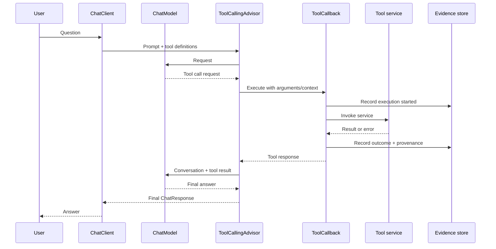

# Kết hợp đánh giá câu trả lời với bằng chứng thực thi công cụ

> **Chương:** Thực hành tổng hợp  
> **Module:** SPRING_AI_EVALUATION_OBSERVABILITY — đánh giá chất lượng ứng dụng Spring AI bằng tập dữ liệu, tiêu chí relevance, fact checking và kiểm thử luồng RAG hoặc gọi công cụ; đồng thời đo metrics, traces, chi phí và độ trễ để phát hiện nguyên nhân suy giảm qua từng phiên bản prompt, model và pipeline.

## Mục tiêu học tập

Sau bài này, bạn có thể:

1. Phân biệt model đề xuất gọi tool, ứng dụng thực sự thực thi tool và câu trả lời cuối của model.
2. Thiết kế bằng chứng thực thi có ID, trạng thái, tham số đã chuẩn hóa, kết quả, nguồn dữ liệu và thời điểm.
3. Ghi nhận tool invocation ngay tại ranh giới ToolCallback, bao gồm cả thành công và lỗi.
4. Liên kết câu trả lời cuối với các evidence IDs mà ứng dụng đã lưu.
5. Kiểm tra tool selection, input arguments, execution status, result provenance và claim support.
6. Xử lý nhiều tool calls, tool errors, returnDirect, yêu cầu xác nhận và thao tác có side effect.
7. Kết hợp deterministic checks với RelevancyEvaluator/FactCheckingEvaluator mà không đánh đồng trace tồn tại với kết quả đúng.
8. Theo dõi tool latency, traces, lỗi và chi phí trong một evaluation run có thể tái lập.

## 1. Vì sao phải đánh giá cả câu trả lời lẫn bằng chứng thực thi tool?

Một ứng dụng Spring AI có thể dùng tool để tra cứu đơn hàng, kiểm tra tồn kho, đọc hồ sơ khách hàng hoặc thực hiện một hành động. Chỉ chấm câu trả lời cuối sẽ bỏ qua những lỗi quan trọng:

- Model nói “tôi đã tra cứu đơn hàng” nhưng không có tool nào thực sự chạy.
- Model gọi đúng tool nhưng truyền sai orderId hoặc sai tenant.
- Tool chạy thành công nhưng trả về dữ liệu cũ, thiếu trường hoặc sai phạm vi.
- Tool trả lỗi; model bỏ qua lỗi rồi tự đoán kết quả.
- Tool tạo side effect, nhưng ứng dụng chỉ ghi nhận câu trả lời mà không xác minh trạng thái sau hành động.
- Model trích dẫn một nguồn không nằm trong kết quả tool thực tế.

Do đó, evaluation cần ít nhất hai nhóm bằng chứng:

1. **Answer evidence:** câu trả lời, các claim được cấu trúc hóa, citations và hành vi trả lời/abstain.
2. **Execution evidence:** tool nào được yêu cầu, tool nào thực sự chạy, input nào đã gửi, kết quả nào được trả về, trạng thái thực thi và nguồn dữ liệu.

Một trace cho biết luồng đã đi qua những span nào. Nó không tự chứng minh claim trong câu trả lời là đúng. Muốn kiểm chứng, cần nối từng claim với kết quả tool có provenance và áp dụng rule phù hợp.

## 2. Phân biệt ba sự kiện trong tool calling loop

Trong Spring AI, ChatClient mặc định dùng ToolCallingAdvisor để quản lý vòng lặp tool calling. Advisor gửi tool definitions cho model; model có thể trả về tool calls; ToolCallingManager tìm ToolCallback tương ứng và thực thi; kết quả được thêm vào conversation history; model tiếp tục cho đến khi tạo final response hoặc luồng kết thúc theo cấu hình.



| Sự kiện | Ý nghĩa | Bằng chứng có thể thu thập |
| --- | --- | --- |
| Tool intent/request | Model đề xuất gọi một tool với arguments | Tool name, tool-call ID nếu provider/API cung cấp, arguments, model response |
| Tool execution | Ứng dụng thực sự gọi callback/service | Invocation ID, request ID, tool name, input, start/end time, status, result/error |
| Final answer | Model hoặc tool trả nội dung cuối cho caller | Answer text, structured claims, citations, model/prompt version |

**Không đồng nhất tool intent với tool execution.** Model có thể đề xuất tool không tồn tại, tool có thể bị từ chối do confirmation, hoặc execution có thể thất bại trước khi tạo kết quả. Chỉ ghi nhận EXECUTED khi callback/service thực sự đã chạy và trả về kết quả.

### Vị trí ghi bằng chứng

- Ghi execution evidence tại ranh giới ToolCallback.call(...), nơi có input và kết quả thực tế.
- Ghi tool intent ở tầng advisor/chat response nếu cần audit cả các yêu cầu không được thực thi.
- Ghi final answer sau khi tool loop hoàn tất.
- Dùng trace ID để liên kết các sự kiện; không dùng trace ID làm bằng chứng nội dung.

## 3. Thiết kế một evidence record có thể kiểm tra lại

Một tool execution evidence record nên chứa:

| Field | Ý nghĩa |
| --- | --- |
| evidenceId | ID bất biến của bản ghi evidence |
| invocationId | ID do ứng dụng sinh cho một lần thực thi |
| requestId | ID của lượt hội thoại/evaluation run |
| toolCallId | ID từ model/provider nếu tầng quan sát có cung cấp; có thể null |
| toolName | Tên tool đã chạy |
| argumentsRef / argumentsHash | Tham chiếu hoặc hash của input đã chuẩn hóa |
| resultRef / resultHash | Tham chiếu hoặc hash của kết quả |
| status | STARTED, SUCCEEDED, FAILED, AWAITING_CONFIRMATION, CANCELLED |
| startedAt, completedAt | Thời điểm bắt đầu và kết thúc |
| durationMs | Thời gian thực thi |
| sourceSystem | Hệ thống nguồn tạo ra dữ liệu |
| sourceVersion / snapshotAt | Phiên bản hoặc thời điểm snapshot |
| tenantScope | Phạm vi tenant/quyền được dùng |
| errorCode | Mã lỗi đã chuẩn hóa nếu thất bại |
| traceId | ID trace để điều tra toàn luồng |

Không nhất thiết lưu raw arguments và raw results trong mọi log. Có thể lưu bản đã redact trong audit store, hoặc lưu nội dung đầy đủ trong kho mã hóa với quyền truy cập và retention riêng; evidence record giữ reference, checksum và metadata cần thiết để xác minh.

Hash không phải biện pháp ẩn danh. Với input có giá trị ít khả năng (ví dụ trạng thái, mã bưu chính hoặc số tài khoản có định dạng đoán được), kẻ khác có thể thử từ điển để khôi phục nội dung. Cân nhắc keyed HMAC, redaction hoặc tokenization thay vì lưu plain hash; quản lý khóa và quyền truy cập riêng.

### Một event bắt đầu và một event kết thúc

Ghi event STARTED trước khi gọi service, sau đó ghi SUCCEEDED hoặc FAILED. Nếu process chết giữa hai event, hệ thống có thể phát hiện invocation chưa có kết quả cuối. Với tool có side effect, trạng thái “không rõ kết quả” phải được xử lý riêng; không được tự retry như thể lần gọi trước chắc chắn chưa chạy.

Ví dụ record:

```json
{
  "evidenceId": "tool-ev-01J...",
  "invocationId": "invoke-01J...",
  "requestId": "req-2026-11-27-0042",
  "toolCallId": null,
  "toolName": "getOrderStatus",
  "status": "SUCCEEDED",
  "argumentsHash": "sha256:...",
  "resultRef": "evidence-store://tool-results/01J...",
  "resultHash": "sha256:...",
  "sourceSystem": "order-service",
  "sourceVersion": "orders-snapshot-v18",
  "snapshotAt": "2026-11-27T14:30:00Z",
  "startedAt": "2026-11-27T14:30:00Z",
  "completedAt": "2026-11-27T14:30:00.084Z",
  "durationMs": 84,
  "tenantScope": "tenant-demo",
  "errorCode": null,
  "traceId": "trace-..."
}
```

Các ID, hash và thời điểm trong JSON chỉ minh họa format; chúng không phải execution logs thực tế.

## 4. Ví dụ nghiệp vụ: tra cứu trạng thái đơn hàng

Ta dùng một service giả lập có tool getOrderStatus. Đây là dữ liệu mẫu, không phải hệ thống đơn hàng có thật.

Người dùng hỏi:

> Đơn hàng DH-8042 đã giao chưa? Nếu đã giao, cho tôi biết thời điểm giao.

Tool nhận input:

```json
{
  "orderId": "DH-8042"
}
```

Tool trả về một result envelope:

```json
{
  "orderId": "DH-8042",
  "status": "DELIVERED",
  "deliveredAt": "2026-11-27T09:15:00+07:00",
  "lastUpdatedAt": "2026-11-27T09:16:12+07:00",
  "sourceSystem": "order-service",
  "sourceVersion": "orders-snapshot-v18",
  "tenantId": "tenant-demo"
}
```

Model có thể diễn đạt:

> Đơn DH-8042 đã được giao lúc 09:15 ngày 27/11/2026.

Evaluation cần xác minh:

1. getOrderStatus có thực sự được gọi không?
2. Input có đúng DH-8042 và đúng tenant không?
3. Execution có status SUCCEEDED không?
4. Kết quả có status=DELIVERED và deliveredAt không?
5. Snapshot có đủ mới theo yêu cầu nghiệp vụ không?
6. Claim trong final answer có khớp giá trị trong evidence không?

Nếu tool trả FAILED, hoặc kết quả không có deliveredAt, model không được tự tạo thời điểm giao.

## 5. Ghi nhận thực thi bằng ToolCallback wrapper

Spring AI biểu diễn một tool bằng interface ToolCallback. Interface cung cấp tool definition, metadata và hai phương thức gọi: call(String toolInput) cùng call(String toolInput, ToolContext toolContext). Ta có thể bọc một callback hiện có để ghi lại input, kết quả và lỗi ngay tại thời điểm thực thi.

Wrapper không thay đổi tool definition hoặc metadata của callback gốc. Nó chỉ bổ sung một ranh giới audit quanh lệnh gọi.

### Các interface dùng trong ví dụ

```java
import java.time.Instant;
import java.util.Map;

record ToolExecutionEvidence(
        String evidenceId,
        String invocationId,
        String requestId,
        String toolName,
        String status,
        String safeArguments,
        String argumentsHash,
        String safeResult,
        String resultHash,
        String sourceSystem,
        String sourceVersion,
        Instant snapshotAt,
        String tenantScope,
        Instant startedAt,
        Instant completedAt,
        long durationMs,
        String errorCode,
        String traceId) {}

interface ToolEvidenceStore {
    void appendStarted(ToolExecutionEvidence event);
    void appendCompleted(ToolExecutionEvidence event);
}

interface EvidenceRedactor {
    String redactArguments(String toolName, String argumentsJson);
    String redactResult(String toolName, String result);
    String hash(String value);
}

interface ToolResultEnvelopeEncoder {
    String encode(String evidenceId, String executionStatus, String rawResult);
}

record ToolResultProvenance(String sourceVersion, Instant snapshotAt) {}

interface ToolResultMetadataExtractor {
    ToolResultProvenance extract(String toolName, String rawResult);
}
```

appendStarted và appendCompleted nên ghi vào kho audit bền vững. Implementation thực tế có thể dùng database append-only, event store hoặc message broker với consumer ghi evidence. Nếu tool có side effect quan trọng, quyết định fail-closed hay fail-open khi audit store không sẵn sàng phải được quy định rõ theo mức rủi ro.

ToolResultMetadataExtractor đọc source version từ result envelope theo schema riêng của từng tool. Nếu service không trả version, có thể lấy snapshot token hoặc ETag từ HTTP/database adapter; không tự gán version cố định để làm cho evidence có vẻ tái lập.

### Wrapper thực thi và lưu kết quả

```java
import java.time.Clock;
import java.time.Duration;
import java.time.Instant;
import java.util.Objects;
import java.util.UUID;

import org.springframework.ai.chat.model.ToolContext;
import org.springframework.ai.tool.ToolCallback;
import org.springframework.ai.tool.definition.ToolDefinition;
import org.springframework.ai.tool.metadata.ToolMetadata;
import org.springframework.ai.tool.execution.ToolExecutionException;

final class AuditedToolCallback implements ToolCallback {
    private final ToolCallback delegate;
    private final ToolEvidenceStore evidenceStore;
    private final EvidenceRedactor redactor;
    private final ToolResultEnvelopeEncoder envelopeEncoder;
    private final ToolResultMetadataExtractor metadataExtractor;
    private final Clock clock;
    private final String sourceSystem;

    AuditedToolCallback(
            ToolCallback delegate,
            ToolEvidenceStore evidenceStore,
            EvidenceRedactor redactor,
            ToolResultEnvelopeEncoder envelopeEncoder,
            ToolResultMetadataExtractor metadataExtractor,
            Clock clock,
            String sourceSystem) {
        this.delegate = delegate;
        this.evidenceStore = evidenceStore;
        this.redactor = redactor;
        this.envelopeEncoder = envelopeEncoder;
        this.metadataExtractor = metadataExtractor;
        this.clock = clock;
        this.sourceSystem = sourceSystem;
    }

    @Override
    public ToolDefinition getToolDefinition() {
        return delegate.getToolDefinition();
    }

    @Override
    public ToolMetadata getToolMetadata() {
        return delegate.getToolMetadata();
    }

    @Override
    public String call(String toolInput) {
        return execute(toolInput, null);
    }

    @Override
    public String call(String toolInput, ToolContext toolContext) {
        return execute(toolInput, toolContext);
    }

    private String execute(String toolInput, ToolContext toolContext) {
        String evidenceId = UUID.randomUUID().toString();
        String invocationId = UUID.randomUUID().toString();
        String requestId = contextValue(toolContext, "requestId");
        String traceId = contextValue(toolContext, "traceId");
        String tenantScope = contextValue(toolContext, "tenantId");
        String toolName = delegate.getToolDefinition().name();

        Instant startedAt = clock.instant();
        String safeArguments =
                redactor.redactArguments(toolName, toolInput);
        String argumentsHash = redactor.hash(toolInput);

        ToolExecutionEvidence started = new ToolExecutionEvidence(
                evidenceId,
                invocationId,
                requestId,
                toolName,
                "STARTED",
                safeArguments,
                argumentsHash,
                null,
                null,
                sourceSystem,
                null,
                null,
                tenantScope,
                startedAt,
                null,
                0,
                null,
                traceId);

        evidenceStore.appendStarted(started);

        String result;
        try {
            result = toolContext == null
                    ? delegate.call(toolInput)
                    : delegate.call(toolInput, toolContext);
            if (result == null) {
                throw new IllegalStateException("Tool returned a null result");
            }
        }
        catch (RuntimeException error) {
            Instant completedAt = clock.instant();
            ToolExecutionEvidence failed = new ToolExecutionEvidence(
                    evidenceId,
                    invocationId,
                    requestId,
                    toolName,
                    "FAILED",
                    safeArguments,
                    argumentsHash,
                    null,
                    null,
                    sourceSystem,
                    null,
                    null,
                    tenantScope,
                    startedAt,
                    completedAt,
                    Duration.between(startedAt, completedAt).toMillis(),
                    error.getClass().getSimpleName(),
                    traceId);

            evidenceStore.appendCompleted(failed);
            if (error instanceof ToolExecutionException toolError) {
                throw toolError;
            }
            throw new ToolExecutionException(
                    delegate.getToolDefinition(), error);
        }

        Instant completedAt = clock.instant();
        String safeResult = redactor.redactResult(toolName, result);
        ToolResultProvenance provenance = Objects.requireNonNull(
                metadataExtractor.extract(toolName, result));
        ToolExecutionEvidence completed = new ToolExecutionEvidence(
                evidenceId,
                invocationId,
                requestId,
                toolName,
                "SUCCEEDED",
                safeArguments,
                argumentsHash,
                safeResult,
                redactor.hash(result),
                sourceSystem,
                provenance.sourceVersion(),
                provenance.snapshotAt(),
                tenantScope,
                startedAt,
                completedAt,
                Duration.between(startedAt, completedAt).toMillis(),
                null,
                traceId);

        evidenceStore.appendCompleted(completed);
        return envelopeEncoder.encode(evidenceId, "SUCCEEDED", result);
    }

    private String contextValue(ToolContext context, String key) {
        if (context == null) {
            return null;
        }
        Object value = context.getContext().get(key);
        return value == null ? null : value.toString();
    }
}
```

Đây là skeleton để minh họa ranh giới ghi evidence. Trong production, bổ sung xử lý khi appendStarted/appendCompleted thất bại, timeout, redaction, giới hạn kích thước payload và mã lỗi đã chuẩn hóa. Nếu ghi STARTED thành công nhưng ghi SUCCEEDED thất bại sau khi service đã thực hiện side effect, outcome phải được xem là chưa xác định cho tới khi đối soát với hệ thống nguồn.

ToolCallback không nhận trực tiếp provider tool-call ID trong chữ ký call(...). Ví dụ sinh invocationId ở ứng dụng và lấy requestId/traceId từ ToolContext. Nếu cần lưu tool-call ID do model phát ra, ghi nó ở tầng ChatResponse/advisor observation và liên kết với invocation bằng request ID, tool name, arguments hash và thứ tự gọi. Không tự tạo một giá trị rồi gọi nó là provider tool-call ID.

### Gắn callback đã audit vào ChatClient

```java
import java.time.Clock;
import java.util.Map;

import org.springframework.ai.chat.client.ChatClient;
import org.springframework.ai.tool.ToolCallback;
import org.springframework.ai.tool.function.FunctionToolCallback;

record OrderLookupRequest(String orderId) {}

ToolCallback rawOrderTool =
        FunctionToolCallback.builder(
                        "getOrderStatus",
                        (OrderLookupRequest request) ->
                                orderService.lookup(request.orderId()))
                .description("Look up the current status of an order")
                .inputType(OrderLookupRequest.class)
                .build();

ToolCallback auditedOrderTool = new AuditedToolCallback(
        rawOrderTool,
        toolEvidenceStore,
        evidenceRedactor,
        toolResultEnvelopeEncoder,
        toolResultMetadataExtractor,
        Clock.systemUTC(),
        "order-service");

String answer = chatClient.prompt()
        .user("Đơn DH-8042 đã giao chưa? Nếu đã giao, cho tôi biết thời điểm.")
        .tools(auditedOrderTool)
        .toolContext(Map.of(
                "requestId", requestId,
                "tenantId", tenantId,
                "traceId", traceId))
        .call()
        .content();
```

ToolResultEnvelopeEncoder phải serialize một envelope có ít nhất evidenceId, executionStatus và result payload. Nhờ đó model nhìn thấy ID do ứng dụng phát hành trong tool response và có thể đưa ID đó vào structured final answer. Nếu tool trả JSON, encoder nên giữ result như JSON node/object thay vì nối chuỗi thủ công; nếu tool trả text, encode đúng JSON escaping.

Ví dụ tool response sau khi bọc:

```json
{
  "evidenceId": "EV-ORDER-001",
  "executionStatus": "SUCCEEDED",
  "result": {
    "orderId": "DH-8042",
    "status": "DELIVERED",
    "deliveredAt": "2026-11-27T09:15:00+07:00",
    "sourceVersion": "orders-snapshot-v18"
  }
}
```

ToolContext là dữ liệu chỉ dùng khi thực thi tool; nó không được gửi cho model như một phần tool schema. Vì vậy tenantId, requestId và các thông tin kiểm soát phải được tạo ở phía ứng dụng. Không lấy tenant hoặc quyền truy cập từ arguments do model tự sinh.

Trong Spring AI 2.x, tool nên được đăng ký rõ ràng dưới dạng ToolCallback hoặc ToolCallbackProvider. Nếu dùng @Tool, có thể chuyển callback được tạo ra qua wrapper tương tự trước khi cung cấp nó cho request.

## 6. Lưu tool result như một evidence snapshot

Một tool result nên có schema rõ ràng, bao gồm trạng thái nghiệp vụ và provenance. Ví dụ:

```java
import java.time.OffsetDateTime;

record OrderStatusResult(
        String orderId,
        String status,
        OffsetDateTime deliveredAt,
        OffsetDateTime lastUpdatedAt,
        String sourceSystem,
        String sourceVersion,
        String tenantId) {}
```

Nếu tool trả về danh sách hoặc nhiều bản ghi, lưu thêm query scope, page/cursor, total count và thông tin completeness. Một kết quả chỉ có 20 dòng đầu không thể được diễn giải thành “không có bản ghi nào khác” nếu tool chưa báo rằng dữ liệu đã đầy đủ.

### Evidence snapshot và source-of-truth

- Giữ sourceSystem, source record/version và snapshotAt.
- Giữ query/filter đã dùng để lấy dữ liệu.
- Giữ tenant/authorization scope đã áp dụng.
- Lưu checksum của snapshot để phát hiện thay đổi.
- Nếu cần kiểm tra lại, dùng immutable result reference hoặc API đọc lại có version.

Một tool response chỉ là bằng chứng về những gì tool đã trả về tại thời điểm đó. Nó không tự chứng minh dữ liệu trong hệ thống nguồn luôn đúng. Với câu hỏi về trạng thái hiện tại, freshness policy phải xác định thời gian snapshot tối đa được chấp nhận.

Xem nội dung tool result là dữ liệu đầu vào chưa được tin cậy. Trang web, ticket, file hoặc trường mô tả trong hệ thống nguồn có thể chứa câu chữ giống chỉ thị dành cho model. Không nâng các câu đó thành system/developer instructions; giữ ranh giới giữa dữ liệu tool và chỉ thị điều khiển ứng dụng.

### Đưa snapshot vào evaluation context

Khi chạy evaluator, dựng một Document từ evidence snapshot đã được xác minh. Content giữ payload đã redact/canonicalize; metadata giữ ID và phạm vi để evaluator lọc đúng request.

```java
import java.util.Map;

import org.springframework.ai.document.Document;

final class ToolEvidenceDocuments {
static Document toEvidenceDocument(
        String evidenceId,
        String requestId,
        String toolName,
        String executionStatus,
        String tenantId,
        String sourceVersion,
        String canonicalResultJson) {

    return new Document(
            evidenceId,
            canonicalResultJson,
            Map.of(
                    "evidence_type", "tool_execution_result",
                    "request_id", requestId,
                    "tool_name", toolName,
                    "execution_status", executionStatus,
                    "tenant_id", tenantId,
                    "source_version", sourceVersion));
}
}
```

Chỉ thêm Document này vào EvaluationRequest sau khi ứng dụng đã xác minh evidence ID và quyền truy cập. Metadata ở đây là metadata evaluator đọc; không nhất thiết gửi toàn bộ metadata audit cho model judge.

## 7. Tạo structured final answer liên kết với evidence

Không để model chỉ viết văn xuôi rồi yêu cầu evaluator suy ra nó dựa trên tool nào. Yêu cầu output có danh sách claims và evidence IDs:

```json
{
  "answer": "Đơn DH-8042 đã được giao lúc 09:15 ngày 27/11/2026.",
  "claims": [
    {
      "claimId": "C1",
      "subject": "DH-8042",
      "predicate": "status",
      "value": "DELIVERED",
      "evidenceIds": ["tool-ev-01J-result"]
    },
    {
      "claimId": "C2",
      "subject": "DH-8042",
      "predicate": "deliveredAt",
      "value": "2026-11-27T09:15:00+07:00",
      "evidenceIds": ["tool-ev-01J-result"]
    }
  ],
  "action": "ANSWER"
}
```

Evidence ID phải do ứng dụng phát hành sau khi ghi nhận tool result. Model chỉ được tham chiếu các IDs mà evaluation harness đưa vào context; không được tự tạo ID rồi xem đó là bằng chứng hợp lệ.

### Claim-to-evidence mapping

| Claim | Fact cần kiểm tra | Evidence |
| --- | --- | --- |
| C1 | status == DELIVERED | Tool result của getOrderStatus |
| C2 | deliveredAt đúng timestamp | Cùng tool result |
| C3 | Đơn thuộc tenant hiện tại | Tenant scope từ ứng dụng/tool context |
| C4 | Snapshot còn đủ mới | snapshotAt/lastUpdatedAt so với freshness policy |

Nếu claim không có evidence ID, evaluator đánh dấu MISSING_EVIDENCE_REFERENCE. Nếu evidence ID tồn tại nhưng không phải tool result của đúng request/tenant, đánh dấu EVIDENCE_SCOPE_MISMATCH.

## 8. Xây dựng rubric đánh giá tool-augmented answer

Đánh giá theo từng tầng:

| Tầng | Tiêu chí | Loại kiểm tra |
| --- | --- | --- |
| Tool selection | Có chọn đúng tool hoặc không gọi tool khi không cần? | LLM judge + business rules |
| Arguments | Tool nhận đúng order ID, tenant, filter và phạm vi? | Deterministic |
| Execution | Callback có chạy? Thành công hay lỗi? | Execution evidence |
| Result quality | Result có đủ trường, đúng schema, đủ dữ liệu và còn mới? | Deterministic + source validation |
| Claim grounding | Mỗi claim có evidence hỗ trợ? | Deterministic cho field có cấu trúc; LLM judge cho ngữ nghĩa |
| Answer relevance | Câu trả lời có giải quyết câu hỏi không? | RelevancyEvaluator |
| Action correctness | Side effect đã thực sự xảy ra và đúng trạng thái? | Read-after-write/transaction evidence |
| Abstention | Khi tool lỗi hoặc thiếu dữ liệu, model có nói rõ giới hạn? | Deterministic + judge |

### Không chấm một tool call chỉ bằng status SUCCEEDED

Tool có thể chạy thành công nhưng vẫn:

- Nhận sai orderId.
- Query sai tenant.
- Trả dữ liệu quá cũ.
- Trả kết quả rỗng do filter sai.
- Trả dữ liệu một phần do pagination.
- Trả trạng thái nghiệp vụ NOT_FOUND dù HTTP/API call thành công.

Vì vậy tách executionStatus (callback có chạy thành công không) khỏi businessStatus (kết quả nghiệp vụ là gì).

## 9. Ví dụ deterministic tool evidence checks

Với structured order claims, có thể kiểm tra trực tiếp các field trong snapshot:

```java
import java.time.Instant;
import java.util.List;

record OrderClaim(
        String claimId,
        String subject,
        String predicate,
        String value,
        List<String> evidenceIds) {}

record ToolEvidenceSnapshot(
        String evidenceId,
        String requestId,
        String toolName,
        String executionStatus,
        String orderId,
        String orderStatus,
        String deliveredAt,
        String tenantId,
        String sourceVersion,
        Instant snapshotAt) {}

record ClaimCheck(
        String claimId,
        boolean supported,
        String reason) {}

final class ToolEvidenceChecks {
static ClaimCheck checkOrderClaim(
        OrderClaim claim,
        ToolEvidenceSnapshot evidence,
        String expectedRequestId,
        String expectedTenantId,
        Instant evaluatedAt,
        java.time.Duration maxEvidenceAge) {

    if (!claim.evidenceIds().contains(evidence.evidenceId())) {
        return new ClaimCheck(
                claim.claimId(), false, "EVIDENCE_ID_NOT_REFERENCED");
    }
    if (!evidence.requestId().equals(expectedRequestId)) {
        return new ClaimCheck(
                claim.claimId(), false, "REQUEST_SCOPE_MISMATCH");
    }
    if (!evidence.tenantId().equals(expectedTenantId)) {
        return new ClaimCheck(
                claim.claimId(), false, "TENANT_SCOPE_MISMATCH");
    }
    if (!claim.subject().equals(evidence.orderId())) {
        return new ClaimCheck(
                claim.claimId(), false, "SUBJECT_MISMATCH");
    }
    if (!"getOrderStatus".equals(evidence.toolName())) {
        return new ClaimCheck(
                claim.claimId(), false, "UNEXPECTED_TOOL_SOURCE");
    }
    if (!"SUCCEEDED".equals(evidence.executionStatus())) {
        return new ClaimCheck(
                claim.claimId(), false, "TOOL_EXECUTION_NOT_SUCCESSFUL");
    }
    if (evidence.snapshotAt() == null
            || evidence.snapshotAt().isAfter(evaluatedAt)
            || java.time.Duration.between(
                    evidence.snapshotAt(), evaluatedAt)
                    .compareTo(maxEvidenceAge) > 0) {
        return new ClaimCheck(
                claim.claimId(), false, "STALE_OR_INVALID_EVIDENCE");
    }

    boolean matches = switch (claim.predicate()) {
        case "status" -> claim.value().equals(evidence.orderStatus());
        case "deliveredAt" -> claim.value().equals(evidence.deliveredAt());
        default -> false;
    };

    return new ClaimCheck(
            claim.claimId(),
            matches,
            matches ? "SUPPORTED_BY_TOOL_RESULT" : "VALUE_MISMATCH");
}
}
```

Đây là ví dụ kiểm tra field chính xác, không phải semantic verifier tổng quát. Trước khi gọi hàm, ứng dụng phải xác minh evidence ID tồn tại trong kho, đọc snapshot đã được bảo vệ toàn vẹn và xác định freshness. Nếu claim là diễn đạt tự do như “đơn đã được giao thành công”, cần kiểm tra mapping predicate hoặc dùng FactCheckingEvaluator trên snapshot.

## 10. Kết hợp với RelevancyEvaluator và FactCheckingEvaluator

Deterministic checks trả lời các câu hỏi có cấu trúc: tool nào chạy, có thành công không, order ID/tenant có đúng không, field có khớp không. LLM judge bổ sung phần ngữ nghĩa:

- RelevancyEvaluator kiểm tra câu trả lời có bám câu hỏi và context tool result không.
- FactCheckingEvaluator kiểm tra atomic claim có được tool result hỗ trợ không.
- Human review xử lý claim mơ hồ, tool result mâu thuẫn hoặc hành động có tác động cao.

Ví dụ:

```java
EvaluationRequest relevancyRequest =
        new EvaluationRequest(
                userQuestion,
                toolEvidenceDocuments,
                finalAnswer);

EvaluationResponse relevance =
        relevancyEvaluator.evaluate(relevancyRequest);

List<EvaluationResponse> claimResults = atomicClaims.stream()
        .map(claim -> factCheckingEvaluator.evaluate(
                new EvaluationRequest(toolEvidenceDocuments, claim)))
        .toList();
```

toolEvidenceDocuments phải được dựng từ execution evidence của đúng request. Không đưa metadata audit nội bộ, secret, access token hoặc tool arguments không cần thiết vào judge context. Chỉ đưa những phần snapshot đã được chọn và redact phù hợp.

### Một kết quả fail cần được phân loại

| Tình huống | Ý nghĩa | Hướng xử lý |
| --- | --- | --- |
| Không có invocation evidence | Tool không chạy hoặc instrumentation bị thiếu | Kiểm tra tool loop và audit wrapper |
| Invocation FAILED | Tool execution thất bại | Model phải nêu giới hạn/abstain |
| Invocation SUCCEEDED, claim sai | Model diễn giải sai tool result hoặc dùng nhầm evidence | Kiểm tra prompt, claim mapping và final answer |
| Claim đúng nhưng relevance fail | Trả lời không giải quyết đúng câu hỏi | Kiểm tra intent và answer composition |
| Tool result cũ | Claim đúng theo snapshot nhưng không còn đúng hiện tại | Áp freshness threshold hoặc đọc lại source |
| Evidence scope mismatch | Result thuộc request/tenant khác | Fail hard gate và điều tra data isolation |
| Evaluator timeout | Chưa có verdict | Ghi EVALUATION_ERROR, không ghi factual fail |

## 11. Nhiều tool calls trong cùng một lượt

Một model response có thể yêu cầu nhiều tool calls, ví dụ lấy trạng thái đơn và lịch sử giao hàng. Mỗi callback invocation cần một evidence record riêng.

Không gộp hai kết quả thành một record nếu:

- Hai tool có source system khác nhau.
- Hai lần gọi có trạng thái/latency khác nhau.
- Một tool thành công còn tool kia thất bại.
- Hai tool trả các snapshot ở thời điểm khác nhau.

Liên kết các evidence record bằng requestId/runId, nhưng giữ invocationId riêng. Nếu model gọi song song, thứ tự hoàn tất có thể khác thứ tự yêu cầu; hãy lưu timestamp/sequence và không suy ra quan hệ nhân quả chỉ từ thứ tự mảng.

### Tool call ID và invocation ID

Provider tool-call ID nhận diện một yêu cầu tool do model phát ra. Invocation ID nhận diện lần callback mà ứng dụng đã thực thi. Trong một số trường hợp, một tool request có thể không được chạy, hoặc execution bị retry. Vì thế hai loại ID có ý nghĩa khác nhau.

Nếu ứng dụng cần liên kết chính xác tool-call ID với callback, dùng advisor/tool execution hook có quyền truy cập model response và execution result, hoặc điều khiển tool loop thủ công. Đừng suy ra provider ID chỉ từ tool name và arguments.

## 12. Tool errors, retry và trạng thái không xác định

Tool có thể thất bại do timeout, rate limit, lỗi xác thực, schema mismatch hoặc lỗi nghiệp vụ. Lưu trạng thái riêng:

| Status | Ý nghĩa |
| --- | --- |
| STARTED | Đã bắt đầu invocation |
| SUCCEEDED | Callback trả kết quả |
| FAILED | Callback ném lỗi hoặc service báo lỗi kỹ thuật |
| BUSINESS_REJECTED | Service thực thi được nhưng từ chối yêu cầu nghiệp vụ |
| AWAITING_CONFIRMATION | Tool cần người xác nhận trước khi chạy |
| CANCELLED | Invocation bị hủy trước khi hoàn tất |
| OUTCOME_UNKNOWN | Không biết side effect đã xảy ra hay chưa |

Spring AI có cơ chế xử lý lỗi tool. Tùy cấu hình, lỗi runtime có thể được chuyển thành tool response gửi lại cho model hoặc được ném ra cho caller. Dù chọn cách nào, audit store phải ghi lại trạng thái lỗi trước khi model diễn giải kết quả.

Trong Spring AI 2.1.x, property `spring.ai.tools.throw-exception-on-error` điều khiển việc ném lỗi tool cho caller. Khi để `false`, exception runtime có thể được chuyển thành nội dung tool error để model tiếp tục; khi bật `true`, lỗi được ném ra cho caller xử lý. Hãy kiểm tra giá trị hiệu lực trong cấu hình triển khai thay vì suy ra trạng thái chỉ từ final answer.

### Retry phải tính tới side effect

- Với read-only lookup, retry có thể an toàn nếu request idempotent và có giới hạn.
- Với write/update/payment/booking, cần idempotency key và cơ chế đối soát.
- Không retry một request timeout như thể chắc chắn service chưa nhận request.
- Không ghi FAILED nếu chưa biết side effect đã xảy ra; dùng OUTCOME_UNKNOWN rồi đọc lại trạng thái nguồn.

## 13. returnDirect và cách đánh giá final output

Mặc định tool result được gửi lại model để model tổng hợp câu trả lời. Với tool có returnDirect=true, Spring AI có thể trả tool result trực tiếp cho caller và bỏ qua vòng model tiếp theo.

Điều này ảnh hưởng evaluation:

- Nếu model tổng hợp final answer, đánh giá nội dung model và claims của nó với tool evidence.
- Nếu tool result được trả trực tiếp, xem result đó là final output và áp dụng schema/business checks phù hợp.
- Không giả định luôn có một final assistant prose sau mỗi tool execution.
- Nếu một batch có nhiều tool calls, returnDirect chỉ được áp dụng khi các tool trong batch đều cho phép direct return.

returnDirect không thay thế evidence recording. Tool callback vẫn phải ghi invocation/result trước khi trả nội dung.

## 14. Side effects cần bằng chứng sau thực thi

Với tool chỉ đọc, tool result snapshot thường là evidence chính. Với tool ghi dữ liệu, “callback trả success” chưa đủ để chứng minh trạng thái cuối cùng đã được lưu đúng.

Ví dụ tool cancelOrder:

1. Model đề xuất hủy đơn DH-8042.
2. Policy layer kiểm tra quyền và yêu cầu confirmation nếu cần.
3. Tool callback gửi lệnh hủy với idempotency key.
4. Service trả operation ID hoặc acknowledgement.
5. Ứng dụng đọc lại trạng thái đơn từ source of truth.
6. Evidence store ghi cả command result và read-after-write verification.

Đánh giá nên tách:

- actionRequested: model muốn làm gì?
- actionAuthorized: policy layer có cho phép không?
- actionExecuted: service có nhận lệnh không?
- actionVerified: trạng thái sau thực thi có khớp mong đợi không?

Không để câu trả lời “Đã hủy đơn” được chấm pass chỉ vì tool trả chuỗi “request accepted”. Nếu chưa có bằng chứng trạng thái đã chuyển sang CANCELLED, câu trả lời cần nói rõ trạng thái đang chờ xác nhận.

### Confirmation là một trạng thái riêng

Spring AI hỗ trợ yêu cầu xác nhận cho tool. Khi ToolCallingManager tạm dừng vì confirmation, tool chưa được thực thi. Lưu AWAITING_CONFIRMATION, decision ID và người/quy trình phê duyệt; sau khi có quyết định, ghi tiếp event cho lần thực thi hoặc event từ chối. Không ghi execution success ở thời điểm model mới yêu cầu tool.

## 15. Quan sát tool calls bằng Micrometer và tracing

Spring AI ghi tool observations với tên spring.ai.tool. Observation đo thời gian hoàn tất tool call và truyền tracing context khi có tracer. Các thuộc tính có thể gồm tool name, tool type, tool-call ID và definition metadata.

Các low-cardinality attributes bao gồm gen_ai.operation.name, gen_ai.system, spring.ai.kind, spring.ai.tool.definition.name và spring.ai.tool.type. High-cardinality attributes có thể gồm tool definition/schema và tool-call ID; arguments/result chỉ được thêm khi bật include-content.

Các thuộc tính arguments/results là high-cardinality và không được xuất mặc định. Nếu bật spring.ai.tools.observations.include-content=true, arguments và result có thể xuất hiện trong span attributes. Chỉ bật khi đã đánh giá rủi ro dữ liệu, quyền truy cập, retention và redaction.

Ví dụ cấu hình cơ bản:

```yaml
spring:
  ai:
    tools:
      observations:
        include-content: false
    chat:
      client:
        observations:
          log-prompt: false
          log-completion: false
      observations:
        log-prompt: false
        log-completion: false
```

### Metric và trace có mục đích khác nhau

| Dữ liệu | Dùng để |
| --- | --- |
| Observation spring.ai.tool | Theo dõi duration của tool call và truyền tracing context; registry có thể xuất metric từ observation |
| Trace/span | Xem tool call nằm ở đâu trong một request, quan hệ với model calls và downstream services |
| Audit evidence store | Xác minh input/result/status/provenance của một lần chạy cụ thể |
| Evaluation result | Chấm claims, relevance, tool selection và action correctness |

Không đưa raw arguments, result text, order ID, tenant ID hoặc trace ID thành metric labels. Các giá trị này có cardinality cao hoặc nhạy cảm. Dùng low-cardinality tags như tool name, provider, outcome và version; lưu correlation IDs trong trace/log/evidence store theo chính sách dữ liệu.

### Metric nên theo dõi

- ai.tool.execution.total — số lần callback thực thi theo tool và outcome.
- ai.tool.execution.duration — thời gian thực thi.
- ai.tool.execution.error — số lần lỗi theo error category.
- ai.tool.execution.outcome_unknown — số invocation chưa xác định kết quả.
- ai.tool.evidence.missing — số final answers thiếu evidence reference.
- ai.tool.claim.unsupported — số claims không được tool evidence hỗ trợ.
- ai.tool.answer.abstention — số case phải abstain sau tool failure/insufficient result.

Tên metric là gợi ý cho ứng dụng; hãy thống nhất convention với Micrometer registry đang dùng.

## 16. Viết bộ dữ liệu evaluation cho tool-augmented flow

Mỗi case nên định nghĩa cả tool expectations lẫn answer expectations:

```json
{
  "datasetId": "order-tool-evaluation",
  "datasetVersion": "1.0.0",
  "caseId": "ORDER-001",
  "question": "Đơn DH-8042 đã giao chưa? Nếu đã giao, cho tôi biết thời điểm.",
  "expectedTool": "getOrderStatus",
  "expectedArguments": {
    "orderId": "DH-8042"
  },
  "expectedTenantScope": "tenant-demo",
  "expectedExecutionStatus": "SUCCEEDED",
  "requiredResultFields": ["orderId", "status", "deliveredAt"],
  "expectedAction": "ANSWER",
  "requiredClaims": ["status", "deliveredAt"],
  "forbiddenClaims": ["đơn đã giao nếu status khác DELIVERED"],
  "freshnessMaxSeconds": 300,
  "corpusVersion": "orders-snapshot-v18"
}
```

Thêm các case âm:

| Case | Tình huống | Hành vi kỳ vọng |
| --- | --- | --- |
| ORDER-001 | Tool trả DELIVERED với timestamp | Trả lời và trích evidence |
| ORDER-002 | Tool trả IN_TRANSIT | Không nói đơn đã giao |
| ORDER-003 | Tool trả NOT_FOUND | Nói không tìm thấy đơn trong phạm vi đã tra cứu |
| ORDER-004 | Tool timeout | Nêu không thể xác minh, không tự đoán |
| ORDER-005 | Tool trả dữ liệu thiếu deliveredAt | Không tự tạo thời điểm giao |
| ORDER-006 | Tool result thuộc tenant khác | Fail hard gate, không tiết lộ dữ liệu |
| ORDER-007 | Tool snapshot quá cũ | Đọc lại hoặc nêu dữ liệu chưa đủ mới |
| ORDER-008 | Model nói đã gọi tool nhưng không có invocation | Fail execution evidence check |

### Tách gold tool behavior khỏi candidate answer

Dataset giữ expected tool, arguments, required result fields và expected action. Tool execution evidence là kết quả thực tế của lần chạy. Candidate answer là output cần chấm. Không sửa expected tool hoặc gold labels để phù hợp với hành vi model đang được kiểm thử.

## 17. Tổng hợp kết quả theo từng tầng

Ví dụ một run giả định:

| Case | Tool execution | Arguments/scope | Result evidence | Answer claims | Verdict |
| --- | --- | --- | --- | --- | --- |
| ORDER-001 | SUCCEEDED | Đúng | DELIVERED, timestamp mới | Đúng | PASS |
| ORDER-002 | SUCCEEDED | Đúng | IN_TRANSIT | Model nói DELIVERED | FAIL: CLAIM_MISMATCH |
| ORDER-003 | SUCCEEDED | Đúng | NOT_FOUND | Model tự bịa trạng thái | FAIL: UNSUPPORTED_CLAIM |
| ORDER-004 | FAILED | Đúng | Không có result snapshot | Model nói đã giao | FAIL: TOOL_ERROR_IGNORED |
| ORDER-005 | SUCCEEDED | Đúng | Thiếu deliveredAt | Model tự thêm thời điểm | FAIL: MISSING_RESULT_FIELD |
| ORDER-006 | SUCCEEDED | Sai tenant | Evidence scope mismatch | Model nêu thông tin | FAIL: TENANT_SCOPE_MISMATCH |
| ORDER-007 | SUCCEEDED | Đúng | Snapshot cũ hơn freshness limit | Model khẳng định trạng thái hiện tại | FAIL: STALE_EVIDENCE |
| ORDER-008 | Không có invocation | Không có | Không có | Model nói đã tra cứu | FAIL: NO_EXECUTION_EVIDENCE |

Các verdict là kết quả kỳ vọng theo rubric minh họa, không phải output từ một model/tool đã chạy thật.

### Phân tích theo ma trận

| Tool evidence | Answer evaluation | Chẩn đoán |
| --- | --- | --- |
| Hợp lệ | Claims đúng, relevant | Tool-augmented flow đạt |
| Hợp lệ | Claim sai | Model diễn giải sai result hoặc gắn nhầm evidence |
| Không có | Model khẳng định đã thực thi | Hallucinated execution claim |
| Failed | Model abstain đúng | Hành vi mong đợi |
| Failed | Model vẫn trả kết luận chắc chắn | Bỏ qua tool error |
| Stale | Model nói “hiện tại” | Không tuân thủ freshness |
| Scope mismatch | Bất kỳ nội dung tiết lộ nào | Vi phạm hard gate về dữ liệu |

## 18. Unit tests và integration tests

### Unit tests cho evidence matching

```java
import java.time.Duration;
import java.time.Instant;
import java.util.List;

import static org.assertj.core.api.Assertions.assertThat;
import org.junit.jupiter.api.Test;

class ToolEvidenceChecksTest {

    @Test
    void supportsDeliveredClaimFromMatchingEvidence() {
        OrderClaim claim = new OrderClaim(
                "C1", "DH-8042", "status", "DELIVERED",
                List.of("EV-1"));

        ToolEvidenceSnapshot evidence = new ToolEvidenceSnapshot(
                "EV-1",
                "REQ-1",
                "getOrderStatus",
                "SUCCEEDED",
                "DH-8042",
                "DELIVERED",
                "2026-11-27T09:15:00+07:00",
                "tenant-demo",
                "orders-v18",
                Instant.parse("2026-11-27T02:16:12Z"));

        ClaimCheck result = ToolEvidenceChecks.checkOrderClaim(
                claim, evidence, "REQ-1", "tenant-demo",
                Instant.parse("2026-11-27T02:16:13Z"), Duration.ofMinutes(5));

        assertThat(result.supported()).isTrue();
    }

    @Test
    void rejectsEvidenceFromAnotherTenant() {
        OrderClaim claim = new OrderClaim(
                "C1", "DH-8042", "status", "DELIVERED",
                List.of("EV-1"));

        ToolEvidenceSnapshot evidence = new ToolEvidenceSnapshot(
                "EV-1", "REQ-1", "getOrderStatus", "SUCCEEDED",
                "DH-8042", "DELIVERED", null,
                "tenant-other", "orders-v18",
                Instant.parse("2026-11-27T02:16:12Z"));

        ClaimCheck result = ToolEvidenceChecks.checkOrderClaim(
                claim, evidence, "REQ-1", "tenant-demo",
                Instant.parse("2026-11-27T02:16:13Z"), Duration.ofMinutes(5));

        assertThat(result.supported()).isFalse();
        assertThat(result.reason()).isEqualTo("TENANT_SCOPE_MISMATCH");
    }

    @Test
    void rejectsClaimWhenToolExecutionFailed() {
        OrderClaim claim = new OrderClaim(
                "C1", "DH-8042", "status", "DELIVERED",
                List.of("EV-1"));

        ToolEvidenceSnapshot evidence = new ToolEvidenceSnapshot(
                "EV-1", "REQ-1", "getOrderStatus", "FAILED",
                "DH-8042", null, null,
                "tenant-demo", null,
                Instant.parse("2026-11-27T02:16:12Z"));

        ClaimCheck result = ToolEvidenceChecks.checkOrderClaim(
                claim, evidence, "REQ-1", "tenant-demo",
                Instant.parse("2026-11-27T02:16:13Z"), Duration.ofMinutes(5));

        assertThat(result.supported()).isFalse();
        assertThat(result.reason())
                .isEqualTo("TOOL_EXECUTION_NOT_SUCCESSFUL");
    }
}
```

Các unit tests kiểm tra logic deterministic mà không gọi LLM hoặc service bên ngoài. Có thể thêm test evidence ID không được claim tham chiếu, request ID sai, status mismatch, snapshot stale và missing timestamp.

### Integration tests cho tool wrapper

Dùng một ToolCallback fake để xác minh wrapper:

- Ghi STARTED trước khi gọi delegate.
- Ghi SUCCEEDED cùng result hash khi delegate trả về.
- Ghi FAILED khi delegate ném exception.
- Chuyển tiếp đúng ToolDefinition, ToolMetadata và ToolContext.
- Không ghi raw secret nếu redactor đã loại bỏ trường nhạy cảm.

Integration test với ChatModel thật nên kiểm tra tool loop có thực thi callback và final response có thể liên kết về evidence. Không chỉ assert nội dung câu trả lời; hãy assert evidence store có invocation đúng request ID, tool name, arguments hash và outcome.

## 19. Những lỗi thiết kế thường gặp

| Lỗi | Hậu quả | Cách khắc phục |
| --- | --- | --- |
| Tin lời model nói đã gọi tool | Có thể đánh giá pass dù không có execution | Dùng callback evidence |
| Chỉ lưu trace ID | Không có input/result để xác minh claim | Lưu evidence snapshot/reference riêng |
| Chỉ lưu success boolean | Không phân biệt business rejection, stale data và partial result | Lưu execution status và business status |
| Chỉ kiểm tra tool name | Có thể gọi đúng tool với sai arguments/tenant | Kiểm tra normalized arguments và scope |
| Dùng result không có version | Không tái lập được lần chạy cũ | Lưu source version/checksum/snapshot time |
| Cho model tự sinh evidence ID | Model có thể bịa reference | Chỉ ứng dụng phát hành evidence IDs |
| Đưa raw tool result vào metric tags | Cardinality cao và lộ dữ liệu | Dùng tags hữu hạn, lưu chi tiết trong evidence store |
| Retry write operation vô điều kiện | Có thể tạo side effect trùng | Idempotency key và reconciliation |
| Ghi success khi mới được confirmation | Audit sai trạng thái | Dùng AWAITING_CONFIRMATION riêng |
| Chấm claim chỉ bằng tool status | Tool chạy thành công nhưng dữ liệu có thể sai/stale | Kiểm tra result schema, provenance, scope và claim |

## 20. Bài thực hành tổng hợp

Một agent nhận câu hỏi “Đơn DH-9001 đã hoàn tiền chưa?”. Trong lần chạy:

- Model đề xuất gọi getRefundStatus.
- Tool callback được gọi với orderId=DH-9001.
- Service trả status=PROCESSING, lastUpdatedAt cách hiện tại 2 phút.
- Final answer nói “Đơn DH-9001 đã hoàn tiền thành công”.
- Answer claim tham chiếu đúng evidence ID của tool result.

**Yêu cầu:**

1. Tool execution có thành công không? Phân biệt execution status và business status.
2. Claim “đã hoàn tiền thành công” có được evidence hỗ trợ không?
3. Verdict nào nên được ghi cho claim?
4. Nếu tool evidence có đúng ID nhưng thuộc tenant khác, xử lý thế nào?
5. Nếu tool timeout sau khi gửi lệnh hoàn tiền, có được retry ngay không?
6. Nêu metadata tối thiểu cần lưu để tái lập evaluation run.

### Đáp án gợi ý

1. Callback/service có thể thực thi thành công, nhưng business status là PROCESSING; hai trạng thái không tương đương.
2. Không. Evidence nói PROCESSING, không nói REFUNDED/COMPLETED.
3. Ghi CLAIM_MISMATCH hoặc CONTRADICTED_BY_TOOL_RESULT; final answer phải được đánh giá fail.
4. Fail hard gate TENANT_SCOPE_MISMATCH, không sử dụng hoặc tiết lộ nội dung evidence đó.
5. Không retry mù quáng. Trạng thái có thể là OUTCOME_UNKNOWN; dùng idempotency key và đọc lại trạng thái nguồn trước khi quyết định.
6. Lưu dataset/case version, request ID, tool name, invocation ID, normalized arguments hash, execution status, result reference/hash, source version, snapshot time, tenant scope, model/prompt/pipeline version, answer claims, evaluator version và trace ID.

## Ghi nhớ

- **Tool intent không phải execution:** model đề xuất gọi tool không chứng minh callback đã chạy.
- **Ghi evidence tại ToolCallback:** lưu invocation, input, result/error, status, duration và provenance.
- **Liên kết claim với evidence ID do ứng dụng phát hành:** model không được tự tạo bằng chứng.
- **Kiểm tra cả execution và business result:** SUCCEEDED không có nghĩa nghiệp vụ đã hoàn tất.
- **Bảo vệ tenant và freshness:** evidence phải thuộc đúng request/scope và còn đủ mới.
- **Side effect cần read-after-write verification:** acknowledgement chưa phải trạng thái cuối.
- **Kết hợp deterministic checks và LLM judge:** code xác minh IDs, status, fields và scope; judge đánh giá relevance/semantic support.
- **Metrics, traces và audit evidence có vai trò riêng:** trace giúp điều tra luồng, evidence chứng minh dữ liệu đã nhận, evaluator chấm câu trả lời.

## Tài liệu tham khảo

- [Spring AI 2.1.0 — Tool Calling](https://docs.spring.io/spring-ai/reference/api/tools.html)
- [Spring AI 2.1.0 — Tool Calling Advisor](https://docs.spring.io/spring-ai/reference/api/tools/tool-calling-advisor.html)
- [Spring AI 2.1.0 — Observability](https://docs.spring.io/spring-ai/reference/observability/index.html)
- [Spring AI 2.1.x API — ToolCallback](https://docs.spring.io/spring-ai/docs/2.1.x/api/org/springframework/ai/tool/ToolCallback.html)
- [Spring AI 2.1.x API — ToolContext](https://docs.spring.io/spring-ai/docs/2.1.x/api/org/springframework/ai/chat/model/ToolContext.html)
- [Spring AI 2.1.x API — ToolExecutionException](https://docs.spring.io/spring-ai/docs/2.1.x/api/org/springframework/ai/tool/execution/ToolExecutionException.html)
- [Spring AI 2.1.x API — ToolCallingAdvisor](https://docs.spring.io/spring-ai/docs/2.1.x/api/org/springframework/ai/chat/client/advisor/ToolCallingAdvisor.html)
