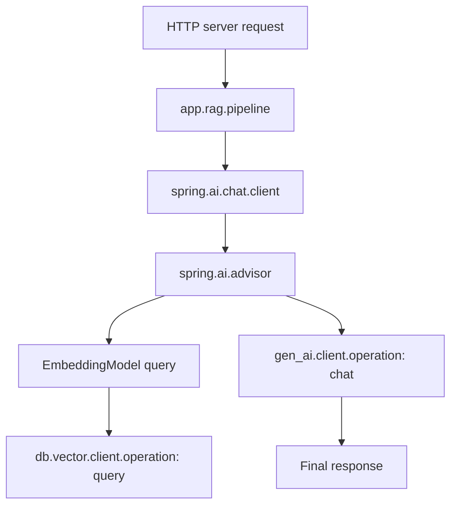

# Bật metric và trace cho một luồng RAG hoặc tool calling

> **Chương:** Thực hành tổng hợp  
> **Module:** SPRING_AI_EVALUATION_OBSERVABILITY — đánh giá chất lượng ứng dụng Spring AI bằng tập dữ liệu, tiêu chí relevance, fact checking và kiểm thử luồng RAG hoặc gọi công cụ; đồng thời đo metrics, traces, chi phí và độ trễ để phát hiện nguyên nhân suy giảm qua từng phiên bản prompt, model và pipeline.

## Mục tiêu học tập

Sau bài này, bạn có thể:

1. Giải thích cách Spring AI tạo Micrometer observations cho ChatClient, ChatModel, Advisor, EmbeddingModel, VectorStore và tool calls.
2. Bật metrics bằng Spring Boot Actuator và xuất metrics qua Prometheus.
3. Bật distributed tracing bằng Micrometer Tracing/OpenTelemetry và gửi spans qua OTLP.
4. Đọc span tree của một request RAG hoặc tool calling và xác định thành phần gây chậm.
5. Phân biệt metric timer, active operation, token usage và trace span.
6. Tạo custom observation cho toàn bộ RAG pipeline và metric cho kết quả nghiệp vụ cần theo dõi.
7. Thiết kế low-cardinality tags, sampling và context propagation phù hợp.
8. Kiểm tra telemetry hoạt động, xây dashboard cơ bản và xử lý các lỗi thường gặp.

## 1. Metrics, traces và logs trả lời các câu hỏi khác nhau

Một ứng dụng Spring AI có thể trả lời chậm vì vector search mất nhiều thời gian, model provider phản hồi chậm, tool service timeout hoặc prompt/context quá lớn. Ba loại telemetry giúp điều tra ở ba mức:

| Loại telemetry | Câu hỏi chính | Ví dụ |
| --- | --- | --- |
| Metrics | Hiện tượng xảy ra bao nhiêu lần, nhanh/chậm ra sao, xu hướng thế nào? | P95 model latency, số token/phút, tỷ lệ tool lỗi |
| Traces | Một request cụ thể đã đi qua những bước nào và mất thời gian ở đâu? | HTTP request → RAG advisor → vector query → chat model |
| Logs | Sự kiện cụ thể nào đã xảy ra và có chi tiết gì cần đọc? | Timeout, lỗi provider, retry, validation failure |

Spring AI dùng Micrometer Observation để phát ra thông tin quan sát cho các thành phần AI. Spring Boot nối các observations với metrics và tracing handlers. Một observation có thể tạo timer/counter và span; vì vậy cùng một operation có thể xuất hiện trong cả dashboard metrics lẫn trace backend.

Metrics thường được tổng hợp theo những nhãn có số giá trị hữu hạn. Traces giữ chi tiết của từng request, bao gồm quan hệ cha/con giữa các spans. Logs ghi thông tin sự kiện và có thể mang `traceId`/`spanId` để tra cứu cùng trace.

### Phạm vi instrumentation có sẵn

Spring AI 2.1.0 có observations cho:

| Thành phần | Observation | Điều cần quan sát |
| --- | --- | --- |
| ChatClient | `spring.ai.chat.client` | Thời gian toàn lần gọi `call()` hoặc `stream()` |
| Advisor | `spring.ai.advisor` | Thời gian từng advisor, gồm cả các advisor bên trong |
| ChatModel | `gen_ai.client.operation` | Thời gian gọi model, provider, model name và token usage |
| EmbeddingModel | `gen_ai.client.operation` | Thời gian tạo embedding và token usage nếu provider hỗ trợ |
| VectorStore | `db.vector.client.operation` | Thời gian query/add/upsert/delete và loại vector database |
| Tool calling | `spring.ai.tool` | Thời gian thực thi tool, tên tool và tracing context |

EmbeddingModel instrumentation hiện phụ thuộc provider. Tài liệu Spring AI 2.1.0 nêu các triển khai được hỗ trợ gồm Mistral AI, Ollama và OpenAI. Nếu provider khác chưa có observation tương ứng, hãy bổ sung custom instrumentation ở ranh giới embedding service.

## 2. Hiểu trace tree của một luồng RAG

Một request RAG thường có nhiều bước. Sơ đồ dưới đây mô tả cấu trúc logic; span cụ thể phụ thuộc advisor, retriever, vector store, model provider và cấu hình ứng dụng.



Ví dụ, một trace có thể cho thấy:

- HTTP server span: 1.8 giây.
- Custom `app.rag.pipeline`: 1.7 giây.
- Vector store query: 90 ms.
- Chat model call: 1.35 giây.
- Phần còn lại: prompt assembly, mapping documents và serialization.

Đây là số liệu minh họa. Khi đọc trace thật, xem thời gian theo quan hệ cha/con và span duration. Không cộng duration của parent với các child spans để tính tổng request: parent thường đã bao gồm thời gian chạy của child.

### Phân biệt thời gian ChatClient và ChatModel

`spring.ai.chat.client` đo toàn bộ lần gọi ChatClient. Nó có thể bao gồm advisor, retrieval, model call và tool call bên trong. `gen_ai.client.operation` đo thời gian thực thi tại ChatModel. Khi ChatClient mất 2 giây nhưng model chỉ mất 1.2 giây, hãy mở trace để xem 800 ms còn lại nằm ở advisor, retrieval hay xử lý ứng dụng.

## 3. Chuẩn bị dependencies

Ví dụ dưới đây giả định ứng dụng dùng Spring Boot 4.2.x và Spring AI 2.1.0. Hãy để Spring Boot dependency management và Spring AI BOM quản lý version đồng bộ.

Với Maven, thêm Actuator, Prometheus registry và OpenTelemetry tracing starter:

```xml
<dependencies>
    <dependency>
        <groupId>org.springframework.boot</groupId>
        <artifactId>spring-boot-starter-actuator</artifactId>
    </dependency>

    <dependency>
        <groupId>org.springframework.boot</groupId>
        <artifactId>spring-boot-starter-opentelemetry</artifactId>
    </dependency>

    <dependency>
        <groupId>io.micrometer</groupId>
        <artifactId>micrometer-registry-prometheus</artifactId>
        <scope>runtime</scope>
    </dependency>
</dependencies>
```

Ứng dụng vẫn cần starter của chat model provider và vector store đang dùng. Ví dụ RAG với `RetrievalAugmentationAdvisor` cần thêm module `spring-ai-rag`:

```xml
<dependency>
    <groupId>org.springframework.ai</groupId>
    <artifactId>spring-ai-rag</artifactId>
</dependency>
```

Nếu dùng một registry khác, có thể thay `micrometer-registry-prometheus` bằng registry Micrometer tương ứng. Spring Boot tự cấu hình registry khi dependency phù hợp có mặt trên classpath. Với OpenTelemetry, Spring Boot 4.2 dùng `spring-boot-starter-opentelemetry` để cấu hình Micrometer Tracing và OTLP trace exporter.

## 4. Cấu hình metrics và tracing

Ta chọn hai đường xuất telemetry:

- Metrics được Prometheus scrape qua `/actuator/prometheus`.
- Traces được gửi tới OpenTelemetry Collector qua OTLP HTTP.

Thêm cấu hình sau vào `application.yml`:

```yaml
spring:
  application:
    name: spring-ai-rag-demo
  ai:
    chat:
      client:
        observations:
          log-prompt: false
          log-completion: false
      observations:
        log-prompt: false
        log-completion: false
    vectorstore:
      observations:
        log-query-response: false
    tools:
      observations:
        include-content: false

management:
  endpoints:
    web:
      exposure:
        include: health,info,metrics,prometheus
  endpoint:
    health:
      probes:
        enabled: true
  tracing:
    sampling:
      probability: 1.0
  opentelemetry:
    resource-attributes:
      service.name: spring-ai-rag-demo
      deployment.environment: local
    tracing:
      export:
        otlp:
          endpoint: http://localhost:4318/v1/traces
```

Giải thích các thiết lập quan trọng:

- `spring.ai.chat.client.observations.*` điều khiển việc ghi prompt/completion ở tầng ChatClient.
- `spring.ai.chat.observations.*` điều khiển việc ghi prompt/completion ở tầng ChatModel.
- `spring.ai.vectorstore.observations.log-query-response` mặc định là `false`; không bật nếu chưa kiểm soát dữ liệu trong documents.
- `spring.ai.tools.observations.include-content` mặc định là `false`; không xuất arguments/result của tool vào spans nếu chưa có quy trình redaction và kiểm soát truy cập.
- `management.tracing.sampling.probability: 1.0` lấy mẫu 100% trace trong môi trường local để dễ quan sát.
- `management.opentelemetry.resource-attributes` đặt tên service và môi trường để phân biệt trace giữa các ứng dụng.
- `management.endpoints.web.exposure.include` mở endpoint Prometheus và metrics. Trong môi trường thật, giới hạn endpoint management trong mạng nội bộ hoặc bảo vệ bằng xác thực/phân quyền.

Không bật ghi prompt, completion, vector query response hoặc tool content chỉ để dashboard có thêm dữ liệu. Các trường này có thể chứa thông tin cá nhân, nội dung nội bộ, access token hoặc dữ liệu nghiệp vụ. Khi cần điều tra một lỗi cụ thể, dùng dữ liệu đã redact và bật trong phạm vi/thời gian được kiểm soát.

### Cấu hình histogram cho P95/P99

Timer mặc định có thể cung cấp count, sum và max. Để tính percentile tổng hợp trên Prometheus, cần bật histogram buckets cho các observation muốn đo:

```properties
management.metrics.distribution.percentiles-histogram.gen_ai.client.operation=true
management.metrics.distribution.percentiles-histogram.db.vector.client.operation=true
management.metrics.distribution.percentiles-histogram.gen_ai.chat.client=true
```

Chỉ bật histogram cho những timer có giá trị vận hành rõ ràng. Histogram tăng số time series và chi phí lưu trữ, nên tránh bật tràn lan.

## 5. Khởi chạy Prometheus và OpenTelemetry Collector

Prometheus scrape metrics từ ứng dụng tại `/actuator/prometheus`. Một cấu hình scrape tối thiểu:

```yaml
scrape_configs:
  - job_name: spring-ai-rag-demo
    metrics_path: /actuator/prometheus
    static_configs:
      - targets:
          - localhost:8080
```

OpenTelemetry Collector nhận OTLP traces trên cổng HTTP 4318. Ví dụ cấu hình rút gọn để xác minh local:

```yaml
receivers:
  otlp:
    protocols:
      http:
        endpoint: 0.0.0.0:4318

exporters:
  debug:
    verbosity: basic

service:
  pipelines:
    traces:
      receivers: [otlp]
      exporters: [debug]
```

`debug` exporter chỉ phù hợp để xác minh local. Trong hệ thống thật, thay bằng exporter tới trace backend mà tổ chức đang vận hành. Collector và backend phải dùng cùng endpoint/protocol với cấu hình ứng dụng.

## 6. Bật tracing cho một luồng RAG

Spring AI tự instrument `VectorStore` và các model được hỗ trợ. Ta chỉ cần cấu hình RAG advisor đúng cách và gọi qua ChatClient.

Ví dụ dùng `RetrievalAugmentationAdvisor` với `VectorStoreDocumentRetriever`:

```java
import org.springframework.ai.chat.client.ChatClient;
import org.springframework.ai.rag.advisor.RetrievalAugmentationAdvisor;
import org.springframework.ai.rag.retrieval.search.VectorStoreDocumentRetriever;
import org.springframework.ai.vectorstore.VectorStore;
import org.springframework.ai.chat.model.ChatModel;
import org.springframework.stereotype.Service;

@Service
class KnowledgeAssistant {
    private final ChatClient chatClient;

    KnowledgeAssistant(ChatModel chatModel, VectorStore vectorStore) {
        var ragAdvisor = RetrievalAugmentationAdvisor.builder()
                .documentRetriever(
                        VectorStoreDocumentRetriever.builder()
                                .vectorStore(vectorStore)
                                .similarityThreshold(0.50)
                                .build())
                .build();

        this.chatClient = ChatClient.builder(chatModel)
                .defaultAdvisors(ragAdvisor)
                .build();
    }

    String answer(String question) {
        return chatClient.prompt()
                .user(question)
                .call()
                .content();
    }
}
```

Khi `answer()` được gọi trong một HTTP request có tracing context, các observations của ChatClient, advisor, embedding model (nếu provider hỗ trợ), vector store và chat model có thể được liên kết trong cùng trace.

### Cách đọc trace RAG

1. Tìm trace theo service name và thời điểm request.
2. Mở root HTTP span để xem tổng latency và trạng thái request.
3. Tìm span `spring.ai.chat.client` để xác định thời gian của toàn lời gọi ChatClient.
4. Mở các span `spring.ai.advisor` để xem advisor nào đang chiếm thời gian.
5. Tìm `db.vector.client.operation` với `db.operation.name=query` để xem vector search.
6. Tìm `gen_ai.client.operation` với `gen_ai.operation.name=chat` để xem model call.
7. So sánh các span con để xác định retrieval, embedding, model hay downstream service là nút thắt.

Một RAG advisor có thể gọi model nhiều lần nếu có query transformation, rewrite hoặc các bước xử lý nâng cao. Đừng mặc định một request RAG chỉ có đúng một chat model span.

## 7. Bật tracing cho một luồng tool calling

Với ChatClient, `ToolCallingAdvisor` được tự đăng ký mặc định để điều khiển tool execution loop. Khi model yêu cầu tool, Spring AI ghi observation `spring.ai.tool`, đo thời gian hoàn tất tool call và truyền tracing context nếu có tracer.

Ví dụ:

```java
import org.springframework.ai.chat.client.ChatClient;
import org.springframework.ai.chat.model.ChatModel;
import org.springframework.ai.tool.ToolCallback;
import org.springframework.ai.tool.function.FunctionToolCallback;
import org.springframework.stereotype.Service;

record OrderRequest(String orderId) {}

@Service
class OrderAssistant {
    private final ChatClient chatClient;
    private final ToolCallback orderStatusTool;

    OrderAssistant(ChatModel chatModel, OrderService orderService) {
        this.chatClient = ChatClient.builder(chatModel).build();
        this.orderStatusTool = FunctionToolCallback.builder(
                        "getOrderStatus",
                        (OrderRequest request) ->
                                orderService.getStatus(request.orderId()))
                .description("Get the current status of an order")
                .inputType(OrderRequest.class)
                .build();
    }

    String answer(String question) {
        return chatClient.prompt()
                .user(question)
                .tools(orderStatusTool)
                .call()
                .content();
    }
}
```

Trong trace, tìm `spring.ai.tool` và các thuộc tính low-cardinality như:

| Attribute | Ý nghĩa |
| --- | --- |
| `gen_ai.operation.name` | `execute_tool` |
| `gen_ai.system` | `spring_ai` |
| `spring.ai.kind` | `tool_call` |
| `spring.ai.tool.definition.name` | Tên tool |
| `spring.ai.tool.type` | Loại tool, mặc định `function` |

Các attributes như tool-call ID, schema, arguments và result có cardinality cao. Arguments/result không được xuất mặc định. Nếu ứng dụng gọi tool bằng `ChatModel` trực tiếp thay vì ChatClient/ToolCallingAdvisor, ứng dụng phải tự điều khiển vòng lặp; đừng kỳ vọng advisor observations tự xuất hiện.

## 8. Tạo custom observation cho toàn pipeline

Observations tích hợp của Spring AI đo từng thành phần. Đôi khi dashboard cần thêm thời gian toàn pipeline theo version hoặc chiến lược retrieval. Ta có thể bọc luồng nghiệp vụ bằng một custom observation.

```java
import java.util.function.Supplier;

import io.micrometer.observation.Observation;
import io.micrometer.observation.ObservationRegistry;
import org.springframework.stereotype.Component;

@Component
class RagPipelineObservation {
    private final ObservationRegistry observationRegistry;

    RagPipelineObservation(ObservationRegistry observationRegistry) {
        this.observationRegistry = observationRegistry;
    }

    <T> T observe(
            String pipelineVersion,
            String retrievalMode,
            String requestId,
            Supplier<T> work) {

        return Observation.createNotStarted(
                        "app.rag.pipeline", observationRegistry)
                .lowCardinalityKeyValue(
                        "rag.pipeline.version", pipelineVersion)
                .lowCardinalityKeyValue(
                        "rag.retrieval.mode", retrievalMode)
                .highCardinalityKeyValue(
                        "app.request.id", requestId)
                .observe(work::get);
    }
}
```

Sử dụng:

```java
String answer = ragPipelineObservation.observe(
        "rag-v3",
        "vector-store",
        requestId,
        () -> knowledgeAssistant.answer(question));
```

`rag.pipeline.version` và `rag.retrieval.mode` có tập giá trị giới hạn nên có thể dùng làm low-cardinality tags. `requestId` là giá trị gần như duy nhất mỗi request nên để high-cardinality, chỉ xuất trong trace. Không đưa nội dung câu hỏi vào tag hoặc span attribute mặc định.

Không bọc lặp lại một operation đã có instrumentation chỉ để tạo thêm timer trùng. Custom observation ở đây có mục đích đo toàn pipeline nghiệp vụ, trong khi Spring AI observations đo các thành phần bên trong.

## 9. Tạo custom metrics cho chất lượng retrieval

Spring AI cung cấp latency và token usage cho các thành phần được instrument. Những chỉ số chất lượng riêng của ứng dụng như retrieval rỗng, số documents được chọn hoặc số lần fallback cần được ghi ở tầng nghiệp vụ.

Ví dụ dùng `MeterRegistry`:

```java
import io.micrometer.core.instrument.Counter;
import io.micrometer.core.instrument.DistributionSummary;
import io.micrometer.core.instrument.MeterRegistry;
import org.springframework.stereotype.Component;

@Component
class RagQualityMetrics {
    private final MeterRegistry registry;

    RagQualityMetrics(MeterRegistry registry) {
        this.registry = registry;
    }

    void recordRetrieval(String strategy, int documentCount) {
        DistributionSummary.builder("app.rag.retrieval.documents")
                .description("Number of documents returned by retrieval")
                .baseUnit("documents")
                .tag("strategy", strategy)
                .register(registry)
                .record(documentCount);

        if (documentCount == 0) {
            Counter.builder("app.rag.retrieval.empty")
                    .description("Retrieval operations returning no documents")
                    .tag("strategy", strategy)
                    .register(registry)
                    .increment();
        }
    }
}
```

Gọi `recordRetrieval()` ngay sau khi retriever trả kết quả. Giá trị `strategy` phải đến từ enum/allowlist do ứng dụng định nghĩa, ví dụ `vector`, `hybrid`, `keyword`; không lấy query, user ID hoặc document ID làm tag.

Có thể mở rộng với các metrics nghiệp vụ:

| Metric gợi ý | Loại | Ý nghĩa |
| --- | --- | --- |
| `app.rag.retrieval.documents` | Distribution summary | Số documents mỗi lần retrieval |
| `app.rag.retrieval.empty` | Counter | Số lần retrieval không trả document |
| `app.rag.answer.abstention` | Counter | Số câu trả lời từ chối vì thiếu evidence |
| `app.rag.evaluation.relevance` | Counter/Timer theo outcome | Số lượt relevance pass/fail |
| `app.rag.evaluation.unsupported_claims` | Counter | Số claims không được evidence hỗ trợ |
| `app.tool.execution.outcome` | Counter | Số tool execution theo tool/outcome |

Chỉ số quality không thay thế evaluation dataset. Metrics cho biết tỷ lệ và xu hướng; dataset/trace giúp xác định case nào gây suy giảm và vì sao.

### Ước tính chi phí từ token usage

Spring AI ghi token usage khi provider trả về số token. Đây là đầu vào để ước tính chi phí; giá thực tế còn phụ thuộc model, cache, batch, region và bảng giá có hiệu lực tại thời điểm gọi.

Với bảng giá quy đổi theo một triệu token:

\[
\text{estimatedCost} =
\frac{\text{inputTokens}\times\text{inputPricePerMillion}
+ \text{outputTokens}\times\text{outputPricePerMillion}}{1\,000\,000}
\]

Tính và ghi chi phí ở tầng ứng dụng với tags có cardinality thấp như model, provider, currency và pricing tier. Lưu thêm `pricingVersion` trong log/evaluation record để có thể tính lại khi bảng giá thay đổi. Không dùng user ID, request ID hoặc raw prompt làm metric labels. Token usage có thể không xuất hiện nếu provider không báo cáo usage; không coi giá trị thiếu là zero-cost.

### Streaming và time-to-first-token

Observation của `ChatClient.stream()` đo thời gian của operation streaming. Nếu trải nghiệm cần phân biệt thời gian chờ token đầu tiên với tổng thời gian stream, hãy ghi thêm custom timer/observation tại subscriber:

- `time_to_first_token`: từ lúc gửi request đến khi nhận chunk đầu tiên.
- `stream_duration`: từ lúc subscribe đến khi stream hoàn tất/hủy.
- `stream_interrupted`: số stream bị cancel hoặc lỗi giữa chừng.

Không suy ra time-to-first-token từ tổng duration của stream.

## 10. Đọc các metrics Spring AI tạo ra

Với Prometheus registry, các base metric names được chuyển thành snake_case và thêm suffix theo loại meter. Một số series quan trọng:

| Prometheus series | Ý nghĩa |
| --- | --- |
| `gen_ai_chat_client_operation_seconds_count` | Số lần ChatClient call/stream hoàn tất |
| `gen_ai_chat_client_operation_seconds_sum` | Tổng thời gian ChatClient operations |
| `gen_ai_chat_client_operation_active_count` | Số ChatClient operations đang chạy |
| `gen_ai_client_operation_seconds_count` | Số model operations hoàn tất |
| `gen_ai_client_operation_seconds_sum` | Tổng thời gian model operations |
| `gen_ai_client_token_usage_total` | Token usage do provider báo cáo |
| `db_vector_client_operation_seconds_count` | Số vector store operations hoàn tất |
| `db_vector_client_operation_seconds_sum` | Tổng thời gian vector store operations |

Các label phổ biến của model metrics gồm:

- `gen_ai_operation_name`: `chat`, `embedding`, `image` hoặc operation tương ứng.
- `gen_ai_system`: provider, ví dụ `openai`.
- `gen_ai_request_model`: model được yêu cầu.
- `gen_ai_response_model`: model thực tế trả kết quả nếu provider báo cáo.
- `gen_ai_token_type`: `input`, `output` hoặc `total`.

Với vector store metrics, các labels gồm `db_operation_name` (`query`, `add`, `upsert`, `delete`), `db_system` và `spring_ai_kind=vector_store`.

Tool calling có observation tên `spring.ai.tool` với low-cardinality attributes gồm tool name và tool type. Observation này đo thời gian thực thi và truyền tracing context. Tên series Prometheus được tạo theo naming convention của registry; kiểm tra `/actuator/metrics` hoặc `/actuator/prometheus` để xác nhận tên và labels thực tế trong phiên bản đang chạy.

`*_seconds_sum` và `*_seconds_count` chỉ tính các operation đã hoàn tất. Active count phản ánh số operation đang chạy tại thời điểm scrape. Nếu muốn tính average latency, lấy rate của sum chia rate của count.

## 11. Viết PromQL cho dashboard

### Average latency của ChatModel theo provider/model

```promql
sum by (gen_ai_system, gen_ai_request_model) (
  rate(gen_ai_client_operation_seconds_sum{
    gen_ai_operation_name="chat"
  }[5m])
)
/
sum by (gen_ai_system, gen_ai_request_model) (
  rate(gen_ai_client_operation_seconds_count{
    gen_ai_operation_name="chat"
  }[5m])
)
```

### Token usage mỗi phút

Không cộng đồng thời `input`, `output` và `total`, vì `total` đã bằng tổng input và output:

```promql
sum by (gen_ai_request_model, gen_ai_token_type) (
  rate(gen_ai_client_token_usage_total{
    gen_ai_token_type!="total"
  }[5m])
) * 60
```

### Average latency của vector store query

```promql
sum by (db_system) (
  rate(db_vector_client_operation_seconds_sum{
    db_operation_name="query"
  }[5m])
)
/
sum by (db_system) (
  rate(db_vector_client_operation_seconds_count{
    db_operation_name="query"
  }[5m])
)
```

### P95 model latency

Trước tiên bật histogram cho `gen_ai.client.operation` theo cấu hình ở phần 4:

```promql
histogram_quantile(
  0.95,
  sum by (le, gen_ai_system) (
    rate(gen_ai_client_operation_seconds_bucket{
      gen_ai_operation_name="chat"
    }[5m])
  )
)
```

Percentile chỉ có ý nghĩa khi registry đã xuất histogram buckets. Nếu chưa bật, đừng suy ra P95 từ `_max` hoặc average.

### P95 latency toàn ChatClient operation

```promql
histogram_quantile(
  0.95,
  sum by (le) (
    rate(gen_ai_chat_client_operation_seconds_bucket[5m])
  )
)
```

P95 ChatClient bao gồm các advisor và công việc bên trong lần gọi. Đọc cùng P95 model/vector query để biết phần latency tăng nằm ở toàn pipeline hay một thành phần cụ thể.

### Tỷ lệ retrieval rỗng

Nếu ứng dụng đã ghi counter `app.rag.retrieval.empty` và DistributionSummary có base name `app.rag.retrieval.documents` cho mọi lần retrieval:

```promql
sum(rate(app_rag_retrieval_empty_total[5m]))
/
sum(rate(app_rag_retrieval_documents_count[5m]))
```

Tên series thực tế của `DistributionSummary` có thể khác theo naming convention/registry. Kiểm tra output `/actuator/prometheus` trước khi sao chép query vào dashboard.

## 12. Thiết kế dashboard cho RAG và tool calling

Một dashboard ban đầu nên có các nhóm panel:

| Nhóm | Panel | Mục đích |
| --- | --- | --- |
| Request | Request rate, error rate, P95/P99 | Biết trải nghiệm toàn request |
| ChatClient | Count, average/P95 latency, active calls | Theo dõi toàn lần gọi AI |
| Model | Latency theo provider/model, token input/output | Phát hiện model chậm hoặc prompt phình to |
| Retrieval | Vector query latency, documents/query, empty retrieval rate | Phát hiện lỗi truy xuất hoặc index |
| Tool calling | Tool latency, lỗi theo tool, số lần gọi/request | Phát hiện downstream service chậm |
| Quality | Relevance pass rate, unsupported claims, abstention rate | Theo dõi chất lượng câu trả lời |
| Runtime | JVM memory, GC, thread/connection pool | Phân biệt lỗi ứng dụng với lỗi AI provider |

Khi dashboard báo P95 tăng, chọn một khoảng thời gian và trace mẫu tương ứng để điều tra. Dashboard chỉ nên trả lời “điều gì đang thay đổi”; trace giúp trả lời “request nào và bước nào gây ra thay đổi”.

## 13. Sampling và chi phí tracing

Spring Boot mặc định lấy mẫu 10% requests. Trong local/dev, có thể đặt `management.tracing.sampling.probability=1.0` để thấy mọi trace. Trong production, chọn tỷ lệ theo lưu lượng, chi phí backend và yêu cầu điều tra.

Khi dùng OpenTelemetry, sampler mặc định là `parent-based-trace-id-ratio`: child span theo quyết định sampled của parent; request không có parent được lấy mẫu theo `management.tracing.sampling.probability`.

Một số nguyên tắc:

- Giữ sampling đồng nhất trên một trace; không tạo child spans rời rạc không liên kết với parent.
- Dùng sampling cao hơn ở staging hoặc trong giai đoạn điều tra có thời hạn.
- Theo dõi trace export failures và queue/backpressure của collector.
- Dùng metrics để theo dõi toàn bộ lưu lượng; đừng dựa vào sampled traces để đếm tổng request.
- Chọn trace mẫu từ các nhóm latency cao hoặc lỗi khi backend hỗ trợ chiến lược sampling tương ứng.

Đừng đặt sampling 100% lâu dài cho hệ thống có lưu lượng lớn nếu chưa đo chi phí ingest và lưu trữ. Trace thường chứa nhiều spans hơn một request thông thường, đặc biệt với tool loop hoặc RAG nhiều bước.

## 14. Cardinality và dữ liệu nhạy cảm

Micrometer phân biệt low-cardinality và high-cardinality key values:

| Loại | Đi đâu? | Ví dụ |
| --- | --- | --- |
| Low cardinality | Metrics và traces | `rag.strategy=vector`, `tool.name=getOrderStatus`, `outcome=success` |
| High cardinality | Traces | Request ID, tool-call ID, conversation ID |

Tránh tạo metric tags từ:

- User ID, email, order ID hoặc session ID.
- Raw prompt, completion, tool arguments hoặc tool result.
- URL có path/query chứa dữ liệu riêng tư.
- Document ID hoặc nội dung retrieval.

Các giá trị có số lượng không giới hạn sẽ tạo rất nhiều time series, làm tăng memory và chi phí metrics backend. Dữ liệu nhạy cảm còn có thể xuất hiện trong span attributes, log và trace export. High cardinality không có nghĩa là an toàn để ghi mọi thứ vào trace.

Spring AI mặc định không xuất prompt/completion, tool arguments/results và vector search response content. Giữ các thiết lập đó ở `false` trong production. Khi cần debug, dùng dữ liệu giả lập hoặc đã redact, quyền truy cập hạn chế và thời hạn bật rõ ràng.

## 15. Context propagation qua HTTP, async và reactive

Trace chỉ hữu ích khi context được truyền qua các ranh giới xử lý.

### HTTP client

Để Spring Boot tự truyền trace context qua HTTP, tạo `RestClient` hoặc `WebClient` từ builder được auto-configure:

```java
import org.springframework.context.annotation.Bean;
import org.springframework.context.annotation.Configuration;
import org.springframework.web.client.RestClient;

@Configuration
class HttpClientConfiguration {
    @Bean
    RestClient orderRestClient(RestClient.Builder builder) {
        return builder
                .baseUrl("http://order-service")
                .build();
    }
}
```

Nếu tự tạo client mà bỏ qua builder được auto-configure, trace propagation có thể không hoạt động. Khi đó downstream service sẽ xuất hiện như một trace độc lập thay vì child span của request ban đầu.

### Reactive và async

Trong reactive pipeline, `ThreadLocal` không tự được khôi phục trong mọi operator. Có thể bật:

```yaml
spring:
  reactor:
    context-propagation: auto
  task:
    execution:
      propagate-context: true
```

Với `AsyncTaskExecutor` tự cấu hình, đăng ký `ContextPropagatingTaskDecorator`:

```java
import org.springframework.context.annotation.Bean;
import org.springframework.context.annotation.Configuration;
import org.springframework.core.task.support.ContextPropagatingTaskDecorator;

@Configuration
class AsyncObservabilityConfiguration {
    @Bean
    ContextPropagatingTaskDecorator contextPropagatingTaskDecorator() {
        return new ContextPropagatingTaskDecorator();
    }
}
```

Chỉ thêm cấu hình này khi ứng dụng thực sự dùng reactive operators hoặc custom async executor. Sau khi bật, kiểm tra trace để chắc chắn spans ở worker thread vẫn nằm dưới trace cha.

## 16. Kiểm tra telemetry hoạt động

Sau khi chạy ứng dụng và gửi ít nhất một request RAG/tool calling:

1. Mở `http://localhost:8080/actuator/health` để kiểm tra ứng dụng.
2. Mở `http://localhost:8080/actuator/metrics` để xem các meter names đang có.
3. Kiểm tra `http://localhost:8080/actuator/metrics/gen_ai.client.operation` và `http://localhost:8080/actuator/metrics/db.vector.client.operation`.
4. Mở `http://localhost:8080/actuator/prometheus`, tìm `gen_ai_client_operation` và `db_vector_client_operation`.
5. Mở trace backend/collector và tìm service `spring-ai-rag-demo`.
6. Gửi một request có retrieval và xác minh trace có ChatClient, Advisor, VectorStore và ChatModel spans phù hợp.
7. Gửi một request cần tool và xác minh có `spring.ai.tool` span.

Tên meter trong `/actuator/metrics` dùng naming convention Micrometer (dấu chấm). Prometheus thường đổi dấu chấm thành dấu gạch dưới và thêm suffix như `_seconds_count`, `_seconds_sum` hoặc `_total`.

### Checklist theo luồng

| Kiểm tra | RAG | Tool calling |
| --- | --- | --- |
| Root HTTP trace tồn tại | Có | Có |
| ChatClient observation | Có | Có |
| ChatModel operation | Có | Có |
| Advisor span | Retrieval advisor | ToolCallingAdvisor |
| VectorStore query span | Có nếu dùng VectorStore | Chỉ có nếu tool thực sự gọi VectorStore |
| Tool observation | Chỉ khi RAG flow có tool | Có khi callback được thực thi qua Spring AI tool loop |
| Token usage | Khi provider báo cáo | Khi provider báo cáo |

Nếu metrics có nhưng trace không có, kiểm tra tracer dependency, sampling và exporter endpoint. Nếu trace có nhưng thiếu vector/tool span, xác nhận request thực sự đi qua component đó và instrumentation/provider đang hỗ trợ.

## 17. Kiểm thử instrumentation trong CI

Không chỉ kiểm tra endpoint trả HTTP 200. Một bài test telemetry nên xác minh ít nhất:

- Sau một request, meter của ChatClient/ChatModel tăng count.
- Khi RAG chạy, meter vector query tăng count.
- Khi tool chạy, tool observation được ghi nhận.
- Lỗi provider hoặc tool tạo error observation.
- Trace context được truyền qua HTTP client đã auto-configure.
- Không có raw prompt, completion, arguments hoặc result trong telemetry khi content logging đang tắt.

Có thể dùng `SimpleMeterRegistry` hoặc test registry phù hợp để kiểm tra custom metrics. Với tracing, dùng test exporter/collector hoặc integration test có backend local. Tránh assert chính xác số lượng spans nếu phiên bản thư viện có thể thêm span nội bộ; hãy kiểm tra các span names/attributes thuộc hợp đồng mà ứng dụng phụ thuộc.

Lưu ý: Spring Boot không tự cấu hình reporting tracing components trong mọi `@SpringBootTest` context. Khi test cần exporter thật, cấu hình test context/dependency rõ ràng thay vì giả định production exporter tự khởi động.

## 18. Đọc trace để xử lý sự cố

| Triệu chứng | Dấu hiệu trong metrics | Điều tra bằng trace |
| --- | --- | --- |
| RAG chậm đột ngột | P95 ChatClient tăng | So sánh vector query và ChatModel spans |
| Model chậm | `gen_ai.client.operation` tăng | Kiểm tra provider/model, HTTP status và retry |
| Retrieval chậm | `db.vector.client.operation` tăng | Kiểm tra vector DB, filter, top-k và network |
| Token tăng | Input token tăng theo model | Kiểm tra số documents, prompt template và history |
| Tool chậm | `spring.ai.tool` duration tăng | Mở tool span và downstream HTTP spans |
| Tool lỗi | Error observations tăng | Kiểm tra exception, timeout, rate limit và retry |
| Trace bị đứt | Metrics vẫn có nhưng thiếu child spans | Kiểm tra context propagation, custom executor và HTTP client builder |
| Retrieval rỗng | Custom empty retrieval counter tăng | Kiểm tra filter, tenant scope, index freshness và similarity threshold |

Một trace bị thiếu child span không nhất thiết có nghĩa operation không chạy. Có thể context bị mất khi chuyển thread, hoặc sampling/exporter không giữ span. Đối chiếu metrics và logs trước khi kết luận.

## 19. Bài thực hành tổng hợp

Bạn có một endpoint `/ask` chạy RAG. Sau khi deploy phiên bản `rag-v4`, dashboard ghi nhận:

- P95 ChatClient latency tăng từ 1.4 giây lên 2.8 giây.
- P95 ChatModel latency gần như giữ nguyên.
- P95 vector query tăng từ 80 ms lên 900 ms.
- Input tokens tăng nhẹ.
- Retrieval empty rate không đổi.

**Yêu cầu:**

1. Thành phần nào nhiều khả năng gây tăng latency?
2. Bạn sẽ mở span nào trước trong trace?
3. Nêu ba yếu tố cần kiểm tra ở vector retrieval.
4. Vì sao không nên tăng sampling lên 100% ngay trên production chỉ để debug?
5. Nếu muốn so sánh `rag-v3` và `rag-v4`, nên thêm tag nào?
6. Vì sao không dùng user ID làm metric tag?

### Đáp án gợi ý

1. Vector retrieval có khả năng là nguyên nhân chính vì ChatModel latency gần như không đổi, còn vector query P95 tăng mạnh.
2. Mở `db.vector.client.operation` với `db.operation.name=query`, sau đó xem parent advisor span để biết retrieval nằm trong pipeline nào.
3. Kiểm tra vector database load/index, metadata filter và tenant scope, top-k/similarity threshold, network hoặc query plan.
4. Sampling 100% làm tăng số spans được gửi và chi phí ingest/storage; dùng tỷ lệ phù hợp, tăng tạm thời trong môi trường staging hoặc một cửa sổ điều tra có kiểm soát.
5. Thêm low-cardinality tag `rag.pipeline.version` với giá trị hữu hạn như `rag-v3`, `rag-v4`.
6. User ID có cardinality rất lớn, làm bùng nổ time series; nếu cần correlation, giữ ID đã được kiểm soát ở trace/log thay vì metric labels.

## Ghi nhớ

- **Spring AI đã instrument nhiều thành phần:** ChatClient, Advisor, ChatModel, EmbeddingModel, VectorStore và tool calls.
- **Actuator/Micrometer xuất metrics:** Prometheus scrape `/actuator/prometheus`; registry có thể được thay theo nền tảng.
- **Micrometer Tracing/OpenTelemetry xuất spans:** dùng trace tree để tìm bước chậm trong một request.
- **ChatClient latency bao gồm các thành phần bên trong:** không cộng duration của parent và child spans.
- **Low cardinality dùng cho metrics:** chỉ dùng nhãn có tập giá trị hữu hạn.
- **High cardinality vẫn cần kiểm soát:** không mặc định đưa prompt, PII, tool arguments hoặc result vào trace.
- **Sampling và context propagation quyết định trace có đầy đủ không:** kiểm tra chúng khi trace bị đứt.
- **Custom observations bổ sung góc nhìn nghiệp vụ:** đo toàn pipeline, retrieval empty rate và evaluation quality theo version.

## Tài liệu tham khảo

- [Spring AI 2.1.0 — Observability](https://docs.spring.io/spring-ai/reference/observability/)
- [Spring AI 2.1.0 — Retrieval Augmented Generation](https://docs.spring.io/spring-ai/reference/api/retrieval-augmented-generation.html)
- [Spring AI 2.1.0 — Tool Calling](https://docs.spring.io/spring-ai/reference/api/tools.html)
- [Spring Boot 4.2 — Actuator Metrics](https://docs.spring.io/spring-boot/reference/actuator/metrics.html)
- [Spring Boot 4.2 — Actuator Observability](https://docs.spring.io/spring-boot/reference/actuator/observability.html)
- [Spring Boot 4.2 — Tracing](https://docs.spring.io/spring-boot/reference/actuator/tracing.html)
- [Micrometer Observation](https://docs.micrometer.io/micrometer/reference/observation.html)
