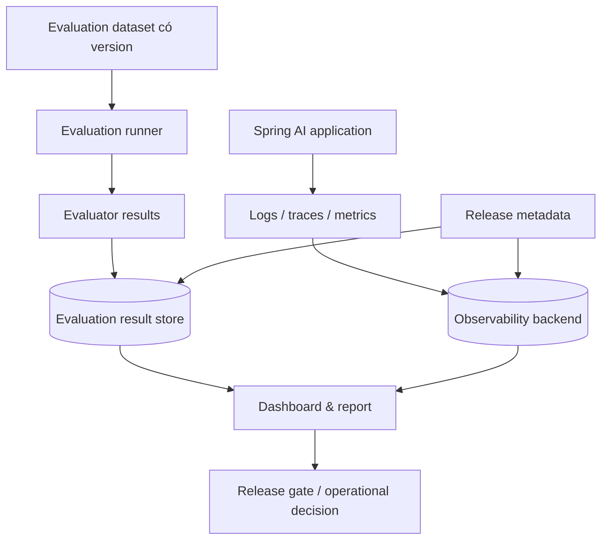

# Xây dựng báo cáo đánh giá cùng dashboard vận hành

Một ứng dụng Spring AI có thể đạt điểm evaluation cao trên bộ dữ liệu kiểm thử nhưng vẫn gặp timeout, tăng chi phí hoặc lỗi tool khi phục vụ người dùng thật. Ngược lại, hệ thống có thể phản hồi rất nhanh và ổn định nhưng câu trả lời lại thiếu căn cứ hoặc không giải quyết đúng câu hỏi. Vì vậy, nhóm phát triển cần nhìn chất lượng AI và tình trạng vận hành trong cùng một bức tranh.

Bài lab này xây dựng một quy trình end-to-end cho trợ lý hỏi đáp chính sách sử dụng Spring AI và RAG. Quy trình thu thập kết quả evaluator từ một dataset có phiên bản, tổng hợp metrics production, đưa dữ liệu lên dashboard và tạo báo cáo so sánh giữa hai phiên bản phát hành. Các ví dụ dùng tên metric và schema minh họa; hãy ánh xạ chúng vào hệ thống lưu trữ, evaluator và phiên bản Spring AI thực tế của dự án.

Sau bài lab, bạn có thể:

- Thiết kế dữ liệu chung để liên kết evaluation run, phiên bản prompt/model/index và release.
- Tính các chỉ số chất lượng từ dataset thay vì chỉ xem một điểm tổng hợp.
- Kết hợp kết quả offline evaluation với metrics và traces production.
- Thiết kế dashboard cho chất lượng, độ tin cậy, latency, token và chi phí.
- Đặt ngưỡng cảnh báo và điều kiện chặn phát hành dựa trên baseline.
- Viết báo cáo phát hành nêu rõ thay đổi, bằng chứng, rủi ro và hành động tiếp theo.

## 1. Bối cảnh và kiến trúc tổng thể

Giả sử nhóm phát triển trợ lý chính sách hỗ trợ khách hàng. Ứng dụng nhận câu hỏi, truy xuất tài liệu chính sách, gọi model và đôi khi gọi tool tra cứu đơn hàng. Mỗi lần thay đổi prompt, model, embedding hoặc index đều có thể ảnh hưởng đến chất lượng và chi phí.

Ta cần trả lời hai nhóm câu hỏi:

- **Trước khi phát hành:** phiên bản ứng viên có trả lời đúng hơn baseline không? Có giảm relevance, groundedness, tool success hoặc tăng chi phí trên bộ kiểm thử không?
- **Sau khi phát hành:** traffic thật có lỗi, latency hoặc chi phí tăng không? Kết quả evaluator trên mẫu production có cho thấy chất lượng suy giảm không?

Kiến trúc dữ liệu tham khảo:



Evaluation result store giữ kết quả theo từng mẫu, từng evaluator và từng lần chạy. Observability backend giữ time series, logs và traces của traffic thật. Dashboard có thể truy vấn hai nguồn dữ liệu để hiển thị cạnh nhau, nhưng phải phân biệt rõ dữ liệu offline với dữ liệu production. Không gộp chúng thành một tỷ lệ duy nhất vì chúng có cách lấy mẫu và phân phối dữ liệu khác nhau.

## 2. Xác định phạm vi đo lường và phiên bản

Trước khi tạo dashboard, hãy thống nhất metadata để biết chính xác một điểm số đến từ lần chạy nào. Mỗi evaluation run cần có tối thiểu:

| Field | Ý nghĩa |
|---|---|
| `evaluation_run_id` | ID duy nhất của lần chạy evaluator |
| `dataset_id`, `dataset_version` | Bộ dữ liệu và phiên bản đã dùng |
| `application_version` | Phiên bản ứng dụng hoặc commit được kiểm thử |
| `prompt_id`, `prompt_version` | Prompt/template được sử dụng |
| `provider`, `model`, `model_deployment` | Model thực tế được cấu hình |
| `embedding_model`, `index_version` | Cấu hình embedding và kho truy xuất |
| `evaluator_name`, `evaluator_version` | Tên và phiên bản evaluator |
| `run_started_at`, `run_completed_at` | Thời điểm chạy |
| `environment`, `release_id` | Môi trường và release liên quan |

Một kết quả theo từng mẫu nên bổ sung `case_id`, `category`, `expected_behavior`, `score`, `verdict`, `latency_ms`, token usage và mã lỗi nếu có. Không dùng nội dung câu hỏi, câu trả lời, `case_id`, `request_id` hay `trace_id` làm label metric có cardinality cao. Các giá trị đó phù hợp với result store hoặc log có kiểm soát.

### 2.1. Phân biệt các phiên bản

Không dùng một trường `version` chung cho mọi thành phần. Prompt, model, dataset, evaluator và index có vòng đời độc lập. Ví dụ:

```json
{
  "release_id": "support-assistant-2026.11.27-rc2",
  "application_version": "git:8d1f2ab",
  "prompt_id": "policy-answer",
  "prompt_version": "24",
  "provider": "configured-provider",
  "model": "configured-model",
  "model_deployment": "support-chat-prod",
  "dataset_id": "policy-qa-regression",
  "dataset_version": "12",
  "evaluator_version": "3",
  "index_version": "policy-index-2026-11-20"
}
```

Metadata trên giúp nhóm xác định liệu một thay đổi điểm số đến từ prompt, model, dữ liệu, evaluator hay index. Nếu evaluator thay đổi cách chấm, không nên so sánh điểm giữa hai phiên bản evaluator như thể thang đo không đổi. Hãy chạy lại baseline bằng evaluator mới hoặc ghi rõ giới hạn so sánh.

## 3. Thiết kế dataset và bộ chỉ số chất lượng

Dataset cần đại diện cho các tình huống quan trọng trong nghiệp vụ. Với trợ lý chính sách, nên có câu hỏi thông thường, câu hỏi cần nhiều tài liệu, câu hỏi thiếu thông tin, câu hỏi ngoài phạm vi, nội dung có thể gây nhầm lẫn và tình huống tool không khả dụng.

Một mẫu dữ liệu có thể có cấu trúc:

```json
{
  "case_id": "refund-014",
  "category": "refund-policy",
  "input": {
    "question": "Khách hàng có thể yêu cầu hoàn tiền trong trường hợp nào?"
  },
  "expected": {
    "key_facts": [
      "Điều kiện hoàn tiền",
      "Thời hạn gửi yêu cầu",
      "Trường hợp ngoại lệ"
    ],
    "required_sources": ["refund-policy-v5"],
    "expected_behavior": "answer_with_citations"
  },
  "tags": ["rag", "policy", "multi_fact"]
}
```

Không nhất thiết mọi case đều cần một câu trả lời mẫu duy nhất. Với câu hỏi mở, có thể đánh giá theo các fact bắt buộc, nguồn được phép, hành vi mong đợi và rubric. Cần review dataset để tránh đưa đáp án hoặc tài liệu đánh giá vào prompt theo cách gây rò rỉ đáp án.

### 3.1. Chọn metric có ý nghĩa

| Nhóm | Metric | Câu hỏi được trả lời |
|---|---|---|
| Chất lượng câu trả lời | Correctness / answer accuracy | Câu trả lời có đáp ứng sự thật hoặc đáp án kỳ vọng không? |
| Liên quan | Relevance | Câu trả lời có giải quyết đúng ý định của câu hỏi không? |
| Có căn cứ | Groundedness / faithfulness | Các khẳng định có được hỗ trợ bởi context được cung cấp không? |
| Truy xuất | Recall@k, hit@k, context relevance | Tài liệu cần thiết có xuất hiện trong top-k không? |
| Tool | Tool success rate, argument validity | Tool có được chọn và thực thi đúng không? |
| An toàn | Policy violation rate, refusal correctness | Hệ thống có tuân thủ chính sách và từ chối đúng lúc không? |
| Vận hành | Error rate, p50/p95/p99 latency, TTFT | Hệ thống có ổn định và đủ nhanh không? |
| Chi phí | Tokens/request, cost/request | Mỗi yêu cầu tiêu tốn bao nhiêu tài nguyên? |

Định nghĩa metric trước khi đo. Ví dụ, `groundedness` có thể là điểm 0–1 từ evaluator dựa trên context, trong khi `answer_accuracy` có thể là verdict đúng/sai theo đáp án hoặc rubric. Không coi hai metric này là một. Với retrieval, Recall@k chỉ tính được khi dataset có nhãn tài liệu hoặc chunk liên quan.

### 3.2. Tổng hợp điểm đúng cách

Với metric dạng điểm trong khoảng 0–1, trung bình mẫu có thể tính:

\[
\bar{x} = \frac{1}{N}\sum_{i=1}^{N}x_i
\]

Tuy nhiên, chỉ số trung bình có thể che giấu nhóm lỗi nghiêm trọng. Báo cáo cần có thêm:

- Số lượng mẫu `N` và số mẫu bị bỏ qua hoặc lỗi evaluator.
- Phân phối điểm: median, p10/p90 hoặc histogram.
- Tỷ lệ đạt ngưỡng theo rubric.
- Kết quả theo category, loại câu hỏi, nguồn dữ liệu và đường đi RAG/tool.
- Ví dụ lỗi đại diện đã được rà soát, không chứa dữ liệu nhạy cảm.

Nếu dùng LLM-as-a-judge, cần theo dõi cả phiên bản judge, rubric và mức độ nhất quán. Với các metric quan trọng, lấy một tập mẫu để con người chấm độc lập và so sánh với evaluator tự động. Một điểm evaluator không phải sự thật tuyệt đối; nó là phép đo theo rubric đã chọn.

## 4. Lưu kết quả evaluation để báo cáo

Có thể lưu metadata run và kết quả từng mẫu trong cơ sở dữ liệu quan hệ. Schema minh họa:

```sql
CREATE TABLE evaluation_run (
    evaluation_run_id VARCHAR(80) PRIMARY KEY,
    release_id VARCHAR(120) NOT NULL,
    dataset_id VARCHAR(120) NOT NULL,
    dataset_version VARCHAR(40) NOT NULL,
    application_version VARCHAR(120) NOT NULL,
    prompt_version VARCHAR(40) NOT NULL,
    model_deployment VARCHAR(120) NOT NULL,
    evaluator_version VARCHAR(40) NOT NULL,
    index_version VARCHAR(120),
    started_at TIMESTAMP NOT NULL,
    completed_at TIMESTAMP,
    status VARCHAR(24) NOT NULL
);

CREATE TABLE evaluation_case_result (
    evaluation_run_id VARCHAR(80) NOT NULL,
    case_id VARCHAR(120) NOT NULL,
    category VARCHAR(80) NOT NULL,
    evaluator_name VARCHAR(80) NOT NULL,
    score DECIMAL(8, 5),
    verdict VARCHAR(24),
    latency_ms BIGINT,
    prompt_tokens INTEGER,
    completion_tokens INTEGER,
    error_code VARCHAR(80),
    PRIMARY KEY (evaluation_run_id, case_id, evaluator_name)
);
```

Schema trên là mô hình khởi đầu. Nếu một case có nhiều lần retry hoặc nhiều lần chấm, hãy thêm `attempt_id` hoặc `result_id` và định nghĩa rõ cách chọn kết quả cuối. Không ghi prompt, response hay toàn văn tài liệu trực tiếp vào bảng tổng hợp nếu không có mục đích lưu payload và chính sách truy cập riêng.

### 4.1. Truy vấn tổng hợp

Ví dụ truy vấn trung bình, tỷ lệ đạt và số mẫu theo evaluator:

```sql
SELECT
    r.evaluation_run_id,
    c.evaluator_name,
    COUNT(*) AS evaluated_cases,
    AVG(c.score) AS average_score,
    PERCENTILE_CONT(0.5) WITHIN GROUP (ORDER BY c.score) AS median_score,
    SUM(CASE WHEN c.verdict = 'PASS' THEN 1 ELSE 0 END) * 1.0
        / NULLIF(COUNT(*), 0) AS pass_rate,
    AVG(c.latency_ms) AS average_latency_ms,
    AVG(COALESCE(c.prompt_tokens, 0) + COALESCE(c.completion_tokens, 0)) AS average_tokens
FROM evaluation_run r
JOIN evaluation_case_result c
  ON c.evaluation_run_id = r.evaluation_run_id
WHERE r.evaluation_run_id = :evaluationRunId
  AND r.status = 'COMPLETED'
GROUP BY r.evaluation_run_id, c.evaluator_name;
```

`PERCENTILE_CONT` có thể khác nhau giữa các hệ quản trị cơ sở dữ liệu. Hãy thay bằng hàm percentile tương ứng. Với dữ liệu production, cần lọc theo khoảng thời gian và phiên bản release; không trộn run đang chạy dở hoặc run lỗi vào kết quả hoàn chỉnh.

Nếu có nhiều evaluator với thang điểm khác nhau, hãy tổng hợp riêng từng evaluator. Chỉ tạo điểm tổng hợp khi đã định nghĩa cách chuẩn hóa, trọng số và cách xử lý missing score. Luôn hiển thị thành phần của điểm tổng hợp để người đọc hiểu nó được tạo ra như thế nào.

## 5. Thu thập metrics vận hành từ ứng dụng Spring AI

Evaluation offline cho biết phiên bản có vượt qua bộ kiểm thử hay không. Metrics production cho biết ứng dụng đang hoạt động thế nào dưới traffic thật. Với Spring Boot, Micrometer cung cấp API để ghi Counter, Timer, Gauge và DistributionSummary, sau đó xuất dữ liệu qua registry tương ứng.

Ví dụ dưới đây ghi số request và latency bằng Micrometer. Các tag được giới hạn ở giá trị hữu hạn như model, operation và status:

```java
import io.micrometer.core.instrument.MeterRegistry;
import io.micrometer.core.instrument.Timer;
import org.springframework.stereotype.Component;

@Component
public class AiRequestMetrics {

    private final MeterRegistry registry;

    public AiRequestMetrics(MeterRegistry registry) {
        this.registry = registry;
    }

    public Timer.Sample start() {
        return Timer.start(registry);
    }

    public void completed(
            Timer.Sample sample,
            String model,
            String status) {

        registry.counter(
                "spring.ai.requests",
                "model", model,
                "operation", "chat",
                "status", status
        ).increment();

        sample.stop(registry.timer(
                "spring.ai.request.duration",
                "model", model,
                "operation", "chat",
                "status", status
        ));
    }

    public void recordTokens(String model, long totalTokens) {
        registry.summary(
                "spring.ai.tokens.per.request",
                "model", model
        ).record(totalTokens);
    }
}
```

Ở nơi xử lý request, gọi `start()` khi bắt đầu và `completed()` trong nhánh kết thúc, bảo đảm cả thành công lẫn thất bại đều được ghi với `status` phù hợp. Token usage nên lấy từ metadata của provider khi có. Nếu provider không trả usage, không tự suy ra số token rồi ghi như số đo chính xác.

Ví dụ trên minh họa API Micrometer; tên metric được backend chuẩn hóa theo registry. Trong production, cấu hình histogram/percentile cho Timer phù hợp backend và SLO. Nếu cần tách metric theo release hoặc prompt version, chỉ dùng các giá trị có tập hữu hạn và đã cân nhắc cardinality. Không thêm `request_id`, `trace_id`, `conversation_id`, câu hỏi hoặc document ID vào tag.

## 6. Xây dựng dashboard có thể hành động

Dashboard không nên chỉ là tập hợp biểu đồ. Mỗi panel cần giúp trả lời một câu hỏi và gợi ý bước điều tra tiếp theo. Có thể dùng Grafana hoặc công cụ tương đương để kết hợp datasource metrics, evaluation database và log/trace backend.

### 6.1. Bố cục dashboard

Một dashboard vận hành và chất lượng có thể chia thành sáu hàng:

| Hàng | Panel | Mục đích |
|---|---|---|
| 1. Release context | Release, prompt, model, index, dataset/evaluator version | Xác định phiên bản đang xem |
| 2. Quality | Correctness, relevance, groundedness, pass rate, sample count | Nhìn chất lượng AI và độ tin cậy của phép đo |
| 3. Retrieval & tools | Recall@k, empty retrieval rate, tool success/failure | Khoanh vùng lỗi truy xuất và hành động |
| 4. Reliability & latency | Request rate, error rate, p50/p95/p99, TTFT | Phát hiện lỗi và suy giảm tốc độ |
| 5. Cost & usage | Tokens/request, cost/request, total cost, retry | Nhìn tác động tài nguyên và chi phí |
| 6. Investigation | Error breakdown, trace links, top regression categories | Đi từ tín hiệu tổng hợp đến bằng chứng |

Trên đầu dashboard, thêm bộ lọc cho `environment`, `service`, `release_id`, `model` và khoảng thời gian. Với dữ liệu evaluation, thêm `dataset_version` và `evaluator_version`. Bộ lọc phải phản ánh đúng datasource: một release production có thể chưa có evaluation run tương ứng hoặc một run offline có thể chưa được triển khai.

### 6.2. Chọn loại biểu đồ

- **Stat panel:** giá trị hiện tại như error rate, pass rate, p95 latency và cost/request.
- **Time series:** request rate, latency, token rate, lỗi và chi phí theo thời gian.
- **Bar chart:** so sánh metric theo release, model, category hoặc tool.
- **Heatmap/histogram:** phân phối latency hoặc điểm evaluator.
- **Table:** các case regression, nhóm lỗi, phiên bản và link đến evidence có quyền truy cập.
- **Trace link:** mở trace theo `trace_id` từ log hoặc exemplar; không hiển thị payload nhạy cảm trực tiếp trong panel.

Luôn hiển thị sample count cùng tỷ lệ. Pass rate 100% trên 5 mẫu không có cùng độ tin cậy với 100% trên 5.000 mẫu. Với tỷ lệ hoặc điểm trung bình, nên hiển thị khoảng tin cậy hoặc ít nhất cảnh báo khi cỡ mẫu quá nhỏ.

### 6.3. Ví dụ truy vấn PromQL

Các truy vấn sau giả định metric đã được xuất với tên và label tương ứng. Tên thực tế có thể khác tùy registry và cấu hình exporter.

Tỷ lệ lỗi trên tổng request trong 5 phút:

```promql
sum(rate(spring_ai_requests_total{status="error"}[5m]))
/
clamp_min(sum(rate(spring_ai_requests_total[5m])), 1)
```

Request throughput theo model:

```promql
sum by (model) (rate(spring_ai_requests_total[5m]))
```

P95 latency nếu Timer xuất histogram bucket:

```promql
histogram_quantile(
  0.95,
  sum by (le, model) (
    rate(spring_ai_request_duration_seconds_bucket[5m])
  )
)
```

Nếu Timer chưa bật histogram bucket, truy vấn `histogram_quantile` sẽ không cho kết quả đúng. Cần cấu hình percentile histogram ở Micrometer/registry và xác nhận metric `_bucket` thực sự tồn tại. Không dùng average latency thay cho p95 khi cần phát hiện đuôi phân phối chậm.

## 7. Đặt ngưỡng cảnh báo và release gate

Dashboard giúp con người quan sát; alert giúp phát hiện khi cần hành động. Ngưỡng nên dựa trên baseline, SLO và tác động nghiệp vụ. Một bộ ngưỡng minh họa:

| Chỉ số | Điều kiện ví dụ | Hành động |
|---|---|---|
| Error rate | Vượt 2% trong 10 phút và có đủ request | Kiểm tra provider, tool, dependency và trace lỗi |
| p95 latency | Vượt SLO đã thống nhất trong 10 phút | Kiểm tra model deployment, retrieval, retry và queue |
| Tool success rate | Giảm hơn 5 điểm phần trăm so với baseline | Kiểm tra schema, timeout và dependency của tool |
| Groundedness | Giảm hơn 0,05 trên cùng dataset/evaluator và cỡ mẫu đạt yêu cầu | Chặn release hoặc yêu cầu review các case regression |
| Correctness pass rate | Có critical case thất bại hoặc giảm vượt ngưỡng | Review dữ liệu, prompt, model và rubric |
| Cost/request | Tăng hơn 20% so với baseline mà không có lý do được duyệt | Kiểm tra token, retry, context size và model routing |

Đây là ngưỡng minh họa, cần hiệu chỉnh theo sản phẩm. Tránh alert trên một mẫu đơn lẻ hoặc một tỷ lệ có denominator quá nhỏ. Dùng điều kiện minimum sample count, cửa sổ thời gian và mức độ nghiêm trọng để giảm cảnh báo giả.

### 7.1. Release gate trước khi triển khai

Một pipeline có thể chặn release nếu một trong các điều kiện sau xảy ra:

1. Critical test case thất bại, ví dụ trả lời sai chính sách có rủi ro cao.
2. Correctness hoặc groundedness giảm vượt ngưỡng so với baseline trên cùng dataset và evaluator version.
3. Tool success hoặc retrieval recall giảm đáng kể.
4. p95 latency hoặc cost/request vượt ngân sách đã duyệt.
5. Có lỗi evaluator, dataset hoặc thiếu mẫu khiến kết quả không đủ tin cậy.

Không nên chỉ kiểm tra điểm trung bình. Một release có thể cải thiện nhiều câu hỏi thông thường nhưng làm hỏng một nhóm tình huống quan trọng. Hãy định nghĩa critical category và regression threshold theo mức độ ảnh hưởng. Nếu thay đổi evaluator hoặc dataset, cần ghi nhận đây là thay đổi phép đo và chạy lại baseline thích hợp.

## 8. So sánh baseline và candidate

Giả sử release hiện tại `R1` và candidate `R2` được đánh giá trên cùng dataset version 12, cùng evaluator version 3. Bảng dưới là số liệu giả lập để minh họa cách đọc kết quả:

| Metric | R1 baseline | R2 candidate | Thay đổi |
|---|---:|---:|---:|
| Correctness pass rate | 0,91 | 0,94 | +3 điểm phần trăm |
| Relevance mean | 0,92 | 0,93 | +0,01 |
| Groundedness mean | 0,95 | 0,89 | -0,06 |
| Tool success rate | 0,98 | 0,98 | Không đổi |
| p95 latency | 1.450 ms | 1.720 ms | +18,6% |
| Average tokens/request | 1.180 | 1.430 | +21,2% |

R2 có correctness tốt hơn nhưng groundedness giảm đáng kể, đồng thời latency và token tăng. Đây là tín hiệu cần điều tra: candidate có thể tạo câu trả lời đúng tình cờ hoặc bổ sung thông tin không được context hỗ trợ; prompt mới có thể dài hơn hoặc model gọi thêm lượt. Không nên kết luận R2 tốt hơn chỉ từ correctness.

Để so sánh có ý nghĩa:

- Dùng cùng dataset version, evaluator version, sampling strategy và điều kiện chạy nếu có thể.
- Giữ metadata model/deployment, prompt, embedding và index rõ ràng.
- So sánh theo category và critical case, không chỉ metric tổng hợp.
- Báo cáo số mẫu, missing result, evaluator error và phân phối điểm.
- Nếu kết quả gần ngưỡng, dùng bootstrap hoặc phương pháp thống kê phù hợp để ước lượng độ bất định.
- Kiểm tra lại một tập regression bằng người đánh giá khi LLM-as-a-judge có thể bị lệch.

Với traffic production, so sánh theo cửa sổ có cùng điều kiện traffic và phân khúc. Không đối chiếu một ngày cao điểm với một ngày thấp điểm mà bỏ qua thay đổi về lượng request, loại câu hỏi hoặc tenant mix.

## 9. Tạo báo cáo đánh giá cho một release

Dashboard phù hợp để theo dõi liên tục. Báo cáo release cần ghi lại kết quả tại một thời điểm để reviewer có thể đọc độc lập và đưa ra quyết định. Một báo cáo ngắn nhưng đủ bằng chứng nên có các phần:

1. **Thông tin release:** release ID, commit, prompt/model/index version, môi trường và thời gian đánh giá.
2. **Phạm vi evaluation:** dataset ID/version, số mẫu, category, evaluator/rubric version và giới hạn dữ liệu.
3. **Kết quả chất lượng:** correctness, relevance, groundedness, retrieval, tool và critical cases.
4. **Kết quả vận hành:** error rate, p50/p95/p99 latency, TTFT, token usage, retry và cost/request.
5. **So sánh baseline:** thay đổi tuyệt đối, thay đổi tương đối, cỡ mẫu và nhóm có regression.
6. **Phân tích:** nguyên nhân có bằng chứng, trace hoặc case tham chiếu đã được kiểm soát quyền truy cập.
7. **Quyết định:** pass, conditional pass hoặc block; người phê duyệt và điều kiện còn lại.
8. **Theo dõi sau release:** dashboard, alert, thời gian canary và tiêu chí rollback.

### 9.1. Mẫu báo cáo release

```markdown
# Evaluation & Operations Report — <release_id>

## Release context
- Application version:
- Prompt version:
- Model/deployment:
- Embedding/index version:
- Dataset/evaluator version:
- Evaluation window:

## Evaluation coverage
- Total cases:
- Passed / failed / skipped:
- Critical categories:
- Known limitations:

## Quality results
- Correctness pass rate:
- Relevance:
- Groundedness:
- Retrieval Recall@k:
- Tool success rate:
- Critical regressions:

## Production readiness
- Error rate:
- p95 latency / TTFT:
- Tokens and cost per request:
- Retry / fallback rate:
- SLO status:

## Baseline comparison
- Improvements:
- Regressions:
- Sample size and uncertainty:

## Decision
- Status: PASS / CONDITIONAL PASS / BLOCK
- Rationale:
- Required actions and owners:
- Canary / rollback criteria:
```

Không để báo cáo chỉ chứa ảnh chụp dashboard. Ghi các giá trị quan trọng, khoảng thời gian, filter và phiên bản datasource để người đọc hiểu số liệu được tạo như thế nào. Link dashboard hoặc trace chỉ là đường dẫn hỗ trợ, báo cáo vẫn phải tự giải thích kết luận.

## 10. Quy trình lab từ dữ liệu đến quyết định phát hành

Thực hiện lần lượt các bước sau trên một môi trường kiểm thử:

### Bước 1: Chuẩn bị dataset có phiên bản

- Tạo dataset `policy-qa-regression` với các category đã xác định.
- Gán `case_id` ổn định và expected behavior cho từng mẫu.
- Ghi rõ nguồn dữ liệu và người review.
- Tạo version mới mỗi khi thay đổi case hoặc expected facts.

### Bước 2: Chạy baseline và candidate

- Chọn một release hiện tại làm baseline.
- Chạy cùng dataset, evaluator và điều kiện model cho candidate.
- Lưu metadata run và kết quả theo từng case.
- Đánh dấu evaluator error, timeout và skipped case riêng biệt.

### Bước 3: Tạo aggregate result

- Tính pass rate, average, median và phân phối score.
- Nhóm theo category, evaluator và critical tag.
- Tính retrieval/tool metric nếu dataset có nhãn phù hợp.
- Tạo bảng so sánh baseline/candidate, không bỏ qua số lượng mẫu.

### Bước 4: Bật observability cho ứng dụng

- Ghi request counter, duration, token usage và trạng thái.
- Bật tracing cho model, retrieval và tool call theo cấu hình phù hợp.
- Liên kết log với trace bằng correlation ID.
- Kiểm tra redaction và không dùng ID request làm metric label.

### Bước 5: Tạo dashboard

- Tạo hàng release context và bộ lọc phiên bản.
- Thêm panel quality từ evaluation result store.
- Thêm panel reliability, latency và cost từ metrics backend.
- Thêm bảng regression và link trace có kiểm soát quyền.
- Kiểm tra từng panel bằng một run đã biết kết quả.

### Bước 6: Đặt alert và release gate

- Định nghĩa SLO cho latency và error rate.
- Định nghĩa ngưỡng quality theo dataset/evaluator version.
- Đặt minimum sample count và điều kiện critical failure.
- Chạy thử alert với dữ liệu giả lập hoặc môi trường staging.

### Bước 7: Viết báo cáo và quyết định

- Tóm tắt cải thiện, regression và giới hạn phép đo.
- Đưa ra quyết định pass, conditional pass hoặc block.
- Gắn owner và deadline cho hành động còn lại.
- Lập kế hoạch canary, theo dõi dashboard và rollback.

## 11. Điều tra khi dashboard cho thấy suy giảm

Dashboard chỉ ra nơi cần xem xét; trace, event và evaluation case cung cấp bằng chứng để tìm nguyên nhân. Có thể dùng bảng định hướng sau:

| Triệu chứng | Kiểm tra trước | Bằng chứng cần xem |
|---|---|---|
| Groundedness giảm, relevance ổn định | Context retrieval, index và prompt template | Case regression, chunk ID, rank/score, prompt version |
| Correctness giảm trên một category | Dataset facts, tài liệu nguồn và rubric | Expected facts, source version, evaluator output |
| p95 tăng nhưng token không đổi | Provider latency, queue, retrieval và network | Trace span duration và retry |
| Token/request tăng | Context size, prompt template, tool loop | Usage metadata, số message, số lần gọi model |
| Tool success giảm | Tool schema, timeout, dependency | Tool call ID, error code, span và deployment |
| Offline evaluation tốt nhưng production xấu | Dataset coverage và phân phối traffic | Production sample, category mix, release metadata |
| Metric tăng đột biến sau deploy | Instrumentation, duplicate event hoặc retry | Event count, code version, trace và scrape behavior |

Khi điều tra, giữ lại `evaluation_run_id`, `case_id` hoặc `trace_id` để tra cứu ở hệ thống tương ứng. Chỉ mở payload khi metadata không đủ và người điều tra có quyền. Ghi nguyên nhân, phạm vi ảnh hưởng và cách khắc phục vào báo cáo incident; không sao chép hội thoại hoặc dữ liệu nhạy cảm vào dashboard.

## 12. Các sai lầm thường gặp

| Sai lầm | Hệ quả | Cách xử lý |
|---|---|---|
| Gộp offline score và production metric thành một điểm | Mất ý nghĩa do khác phân phối và cách lấy mẫu | Hiển thị hai nguồn cạnh nhau, ghi rõ nguồn và cửa sổ |
| Chỉ hiển thị average score | Che giấu nhóm lỗi và outlier | Thêm phân phối, category, pass rate và critical cases |
| Không lưu dataset/evaluator version | Không tái lập hoặc so sánh được kết quả | Gắn version vào mọi evaluation run |
| Dùng trace/request ID làm label | Cardinality tăng mạnh | Để ID trong log/trace; metric dùng tag hữu hạn |
| Cảnh báo khi sample quá ít | Alert nhiễu và quyết định thiếu căn cứ | Thêm minimum sample count và cửa sổ ổn định |
| So sánh model khi index hoặc dataset cũng đổi | Không biết nguyên nhân thay đổi | Ghi mọi phiên bản và thiết kế thí nghiệm tách biệt |
| Chỉ dựa vào LLM judge | Có thể khuếch đại bias hoặc rubric lỗi | Hiệu chuẩn với human review và test evaluator |
| Dashboard không ghi filter/time range | Người đọc hiểu sai kết quả | Lưu filter, datasource, time window và release context |

## 13. Bài tập mở rộng

Hãy dùng một dataset ít nhất 50 case và tạo hai evaluation run cho hai prompt version. Sau đó mô phỏng một release có correctness tăng nhưng groundedness giảm và p95 latency tăng.

Yêu cầu đầu ra:

1. Một bảng metadata cho hai evaluation run.
2. Một bảng aggregate theo evaluator và category, có sample count.
3. Một dashboard có panel quality, retrieval/tool, reliability, latency và cost.
4. Ít nhất hai alert có điều kiện minimum sample hoặc cửa sổ thời gian.
5. Một báo cáo release có baseline comparison, regression, giới hạn phép đo và quyết định.
6. Một hướng dẫn điều tra cho ít nhất một regression có liên kết đến case hoặc trace tham chiếu.

**Tiêu chí hoàn thành:** reviewer có thể xác định release nào được đánh giá, dataset/evaluator version nào đã dùng, chất lượng thay đổi ở đâu, production đang đáp ứng SLO không, chi phí biến động thế nào và vì sao nhóm đưa ra quyết định phát hành. Mọi kết luận phải truy ngược được về aggregate, evaluation case hoặc observability signal phù hợp.

## 14. Checklist trước khi dùng dashboard trong vận hành

- [ ] Evaluation run lưu release, dataset, evaluator, prompt, model và index version.
- [ ] Kết quả theo case được lưu cùng verdict, score và trạng thái lỗi/skipped.
- [ ] Metric có định nghĩa, thang đo, nguồn và quy tắc tổng hợp rõ ràng.
- [ ] Offline evaluation và production observability được phân biệt trên dashboard.
- [ ] Dashboard hiển thị sample count, time range, release context và filter.
- [ ] Quality panel có phân phối và breakdown theo category.
- [ ] Reliability panel có error rate, latency percentile và trạng thái SLO.
- [ ] Cost panel có token usage, retry và cost/request nếu có dữ liệu giá.
- [ ] Alert có ngưỡng, cửa sổ, minimum sample và người nhận xử lý.
- [ ] Release gate bao gồm critical case và regression theo category.
- [ ] Trace/evidence link được bảo vệ; payload không xuất hiện trực tiếp trong dashboard.
- [ ] Báo cáo release ghi rõ baseline, giới hạn phép đo, quyết định và rollback criteria.

Khi báo cáo evaluation và dashboard vận hành dùng chung metadata phiên bản, nhóm phát triển có thể nối kết quả kiểm thử với hành vi production. Báo cáo cho biết candidate có đạt tiêu chí chất lượng hay không; dashboard cho biết hệ thống tiếp tục hoạt động ra sao sau phát hành. Hai nguồn bằng chứng này giúp quyết định phát hành, điều tra regression và ưu tiên cải tiến dựa trên dữ liệu có thể truy vết.
