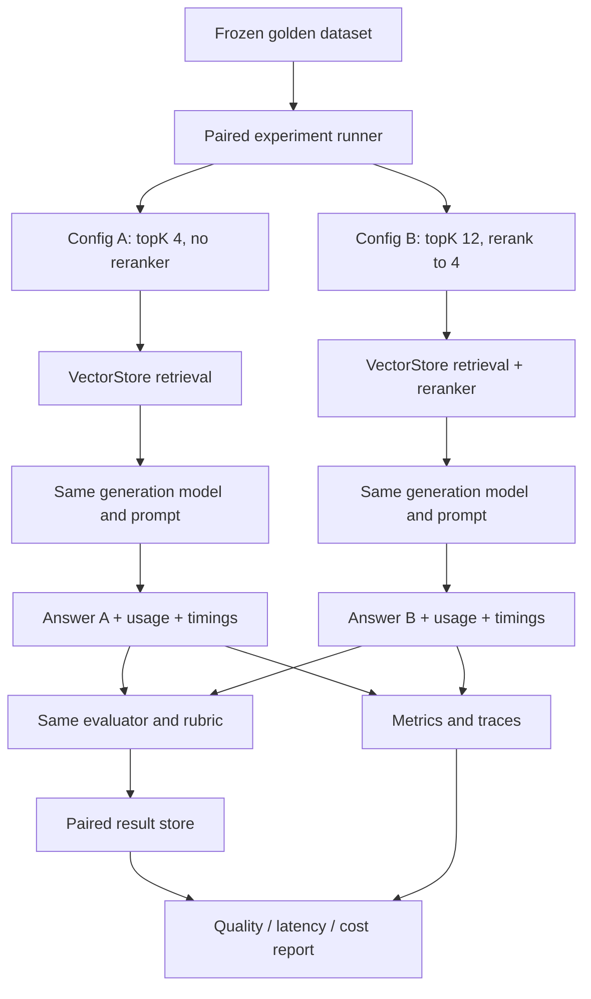

# So sánh hai cấu hình theo chất lượng, độ trễ và chi phí

## 1. Mục tiêu của bài lab

Khi nâng cấp ứng dụng Spring AI, một cấu hình có thể cải thiện chất lượng câu trả lời nhưng làm tăng latency hoặc chi phí. Một cấu hình khác có thể rẻ và nhanh hơn nhưng bỏ sót tài liệu quan trọng, trả lời thiếu căn cứ hoặc gọi tool sai. Vì vậy, quyết định chọn cấu hình cần dựa trên nhiều chiều cùng lúc.

Bài **“So sánh hai cấu hình theo chất lượng, độ trễ và chi phí”** thuộc chương **Thực hành tổng hợp** của module **SPRING_AI_EVALUATION_OBSERVABILITY**. Module học đánh giá chất lượng ứng dụng Spring AI bằng dataset, tiêu chí relevance, fact checking và kiểm thử RAG hoặc tool calling; đồng thời theo dõi metrics, traces, chi phí và độ trễ để phát hiện suy giảm qua các phiên bản prompt, model và pipeline.

Trong lab này, ta so sánh hai cấu hình retrieval cho cùng một ứng dụng RAG:

- **Config A – baseline:** lấy 4 candidates từ VectorStore, không dùng reranker, đưa tối đa 4 documents vào context.
- **Config B – candidate:** lấy 12 candidates, dùng reranker đã pin version, chọn tối đa 4 documents cuối cùng vào context.

Cả hai cấu hình giữ nguyên generation model, prompt, embedding model, index snapshot, context token cap, judge model, rubric và dataset. Do đó, kết quả cho biết tác động của retrieval bundle (candidate top-k + reranker) trong điều kiện thử nghiệm này. Nếu muốn biết riêng tác động của top-k hay reranker, cần thêm một experiment tách biến.

Sau bài lab, bạn có thể:

1. Chuẩn bị dataset và version manifest có thể tái lập.
2. Chạy hai cấu hình trên cùng các case theo paired design.
3. Đánh giá relevance, groundedness/fact checking và pass rate.
4. Đo latency end-to-end, time-to-first-token và latency từng stage.
5. Tính chi phí generation, embedding, reranking và evaluation.
6. Phân tích uncertainty, guardrails và đưa ra quyết định có bằng chứng.

## 2. Câu hỏi thí nghiệm và quyết định cần đưa ra

Viết câu hỏi trước khi chạy:

> Config B với nhiều retrieval candidates và reranker có cải thiện chất lượng RAG đủ lớn để bù cho latency và chi phí tăng thêm hay không?

Định nghĩa trước:

| Thành phần | Định nghĩa trong lab |
| --- | --- |
| Control | Config A |
| Treatment | Config B |
| Population | Bộ golden RAG dataset version cố định |
| Primary quality metric | Tỷ lệ case đạt quality gate: relevance, groundedness và citation correctness khi criterion áp dụng |
| Secondary quality metrics | Relevance score, groundedness score, citation correctness |
| Latency guardrail | API p95 và time-to-first-token |
| Cost guardrail | Serving cost/case và total pipeline cost/case |
| Reliability guardrail | Error rate, evaluation coverage, timeout rate |
| Decision | ACCEPT, REJECT hoặc INCONCLUSIVE |

Không đổi primary metric sau khi đã xem kết quả. Nếu chất lượng có nhiều chiều, không chỉ dùng một aggregate score; báo từng criterion và failure category để tránh che khuất regression.

## 3. Kiến trúc thí nghiệm

Mô hình pipeline:



Runner gắn cùng dataset case ID vào hai kết quả để có thể so sánh theo cặp. Mỗi lần gọi model, retrieval, reranker hoặc evaluator đều cần ghi version và correlation metadata.

Nếu evaluator chạy bất đồng bộ, result store phải liên kết evaluation job với run ID, case ID và answer ID. Không giả định trace của request còn mở khi evaluator bắt đầu.

## 4. Chuẩn bị điều kiện và giới hạn lab

Thực hiện trên local hoặc staging riêng:

- dùng dataset giả lập hoặc đã được phê duyệt;
- pin model ID/profile và provider endpoint;
- giới hạn concurrency, token budget và số lần retry;
- kiểm tra VectorStore index snapshot không thay đổi giữa hai run;
- dùng cùng region/network path;
- giữ prompt, tool schema và output format giống nhau;
- ghi price schedule version;
- không chạy tải lớn trên provider production nếu chưa có quota/cửa sổ được duyệt.

Nếu model/provider chỉ cung cấp alias có thể đổi đích, lưu alias, deployment revision, thời điểm gọi và response metadata. Đánh dấu identity uncertainty nếu không thể xác định model snapshot chính xác.

## 5. Thiết kế golden dataset

Dùng một dataset cố định, ví dụ 200 case, bao phủ nhiều dạng câu hỏi:

| Nhóm case | Số lượng ví dụ | Mục tiêu |
| --- | ---: | --- |
| Câu hỏi có câu trả lời trực tiếp trong tài liệu | 60 | Relevance và groundedness |
| Cần tổng hợp nhiều tài liệu | 40 | Retrieval coverage |
| Cần trích dẫn nguồn | 30 | Citation correctness |
| Thiếu bằng chứng/không có đáp án | 30 | Abstention và false pass |
| Tài liệu mâu thuẫn hoặc lỗi thời | 20 | Fact checking |
| Câu hỏi khó, đa bước | 20 | Failure mode retrieval |

Các con số là thiết kế minh họa; thay bằng phân bố phù hợp sản phẩm. Giữ case IDs, question, corpus/index snapshot, expected facts và human labels bất biến trong suốt experiment.

Một record case có thể gồm:

```json
{
  "caseId": "rag-017",
  "category": "multi_document",
  "language": "vi",
  "question": "Chính sách hoàn tiền áp dụng trong trường hợp nào?",
  "expectedFacts": [
    "Điều kiện hoàn tiền",
    "Thời hạn gửi yêu cầu"
  ],
  "expectedSources": [
    "policy-refund-v3"
  ],
  "expectedBehavior": "grounded_answer",
  "humanReviewed": true
}
```

Không đưa expected answer hoặc expected facts vào prompt generation. Chúng chỉ dùng cho evaluator/human review; nếu vô tình đưa vào context, thí nghiệm bị leakage.

## 6. Định nghĩa Config A và Config B

Ví dụ cấu hình do ứng dụng định nghĩa:

```yaml
app:
  ai:
    experiment:
      id: rag-retrieval-ab-001
      shared:
        generation-model-profile: generation-stable
        generation-prompt-version: answer-v12
        embedding-model-profile: embedding-stable
        index-snapshot: kb-index-2026-11-20
        chunking-version: chunk-v5
        context-token-limit: 6000
        temperature: 0
        max-output-tokens: 800
        judge-model-profile: judge-stable
        rubric-version: rag-rubric-v4
        scoring-version: quality-gate-v2

      configs:
        A:
          retrieval:
            candidate-top-k: 4
            reranker:
              enabled: false
            final-context-top-k: 4

        B:
          retrieval:
            candidate-top-k: 12
            reranker:
              enabled: true
              profile: reranker-stable-v2
            final-context-top-k: 4
```

Đây là namespace property của ứng dụng trong lab, không phải property mặc định của Spring AI. Adapter của ứng dụng ánh xạ các giá trị này vào VectorStore search, reranker và ChatClient/Advisor tương ứng.

Cần xác nhận Config B chỉ thay retrieval bundle. Nếu vô tình thay model, prompt, context limit hoặc judge, kết quả không còn cô lập được treatment đã nêu.

## 7. Version manifest cho từng run

Lưu manifest thực tế trước khi gửi request:

```yaml
experiment:
  id: rag-retrieval-ab-001
  dataset:
    id: rag-golden
    version: "2026-11-20"
    checksum: "sha256:dataset-digest"
  control:
    configId: A
    configChecksum: "sha256:config-a"
  treatment:
    configId: B
    configChecksum: "sha256:config-b"
  shared:
    applicationVersion: "2.8.1"
    generationModelId: "generation-snapshot-17"
    promptVersion: answer-v12
    embeddingModelId: "embedding-snapshot-8"
    indexSnapshot: kb-index-2026-11-20
    judgeModelId: "judge-snapshot-4"
    rubricVersion: rag-rubric-v4
    scoringVersion: quality-gate-v2
    priceScheduleVersion: provider-price-2026-11
  runtime:
    jdk: "21"
    region: staging-a
    concurrency: 5
    retryPolicyVersion: bounded-retry-v2
```

Checksum phải được tính từ canonical artifact đã phát hành. Không dùng giá trị mẫu trong ví dụ như checksum thực. Nếu manifest thay đổi sau khi chạy, tạo manifest/run mới thay vì sửa lịch sử.

## 8. Xác định metric chất lượng

Dùng cùng evaluator và rubric cho cả A và B. Trong lab có thể đánh giá:

- **Relevance:** câu trả lời có trả lời đúng câu hỏi không?
- **Groundedness/fact checking:** các khẳng định có được hỗ trợ bởi retrieved context không?
- **Citation correctness:** nguồn được dẫn có thực sự chứa bằng chứng không?
- **Abstention correctness:** khi context không đủ, hệ thống có từ chối/diễn đạt bất định phù hợp không?

Một quality gate mẫu:

```text
case_pass =
    relevance_score >= 0.80
    AND groundedness_score >= 0.85
    AND (NOT citation_applicable OR citation_correctness >= 0.80)
```

Threshold chỉ là ví dụ; cần được hiệu chỉnh bằng human-labeled calibration set. Nếu một criterion không áp dụng cho case, ghi NOT_APPLICABLE theo schema thay vì gán score 0.

Giữ raw criterion scores, verdict và scoring version. Không chỉ lưu aggregate score vì sau này có thể cần thay đổi weights hoặc threshold.

## 9. Kiểm tra evaluator trước khi chạy toàn bộ dataset

Trước experiment chính:

1. Chọn 20–30 case có human labels.
2. Chạy cùng evaluator/judge model trên các answer đã cố định.
3. Kiểm tra false pass, false fail và disagreement.
4. Xác minh rubric v4, prompt judge và normalization version.
5. Xem raw evaluator output của các case bất thường.
6. Chỉ tiếp tục khi judge đủ ổn định cho mục tiêu thí nghiệm.

Nếu judge model thay đổi giữa A và B, chênh lệch có thể đến từ judge drift. Nếu judge là LLM, cùng input vẫn có thể cho output khác; cố định model/version, temperature và options nếu provider hỗ trợ, nhưng không giả định tính deterministic tuyệt đối.

## 10. Thiết kế paired comparison

Mỗi case được chạy qua cả A và B. Ví dụ:

| Pair key | Case | Config A | Config B |
| --- | --- | --- | --- |
| pair-001 | rag-001 | result-A-001 | result-B-001 |
| pair-002 | rag-002 | result-A-002 | result-B-002 |
| pair-003 | rag-003 | result-A-003 | result-B-003 |

Ưu điểm là cùng câu hỏi và corpus làm control cho chính nó. Độ khó khác nhau giữa các case ít gây nhiễu hơn so với hai nhóm dataset tách biệt.

Randomize thứ tự chạy A/B theo pair để tránh một cấu hình luôn được chạy trước trong lúc provider đang ít tải hơn. Lưu pair key, case ID, config ID, run ID và thứ tự thực thi.

Nếu generation có nondeterminism, có thể chạy nhiều replicate cho từng pair. Lưu replicate ID và không gộp mất dữ liệu raw.

## 11. Chạy baseline và warm-up

Quy trình:

1. Xác minh dataset checksum và index snapshot.
2. Khởi động ứng dụng, model client, connection pool và VectorStore client.
3. Chạy warm-up riêng cho A và B, không tính vào kết quả.
4. Kiểm tra một số case đại diện để xác nhận cấu hình thực tế.
5. Chạy paired quality set với concurrency cố định, ví dụ 5.
6. Ghi response, context references, scores, token usage và stage timings.
7. Không thay config trong lúc run.
8. Chờ evaluation jobs hoàn tất hoặc ghi rõ pending/error.

Warm-up tránh tính JIT, connection establishment và cache cold-start vào steady-state latency. Nếu cold-start là mục tiêu cần đo, tạo một benchmark riêng.

## 12. Đo latency đúng ranh giới

Ghi riêng các khoảng thời gian:

| Metric | Điểm bắt đầu/kết thúc |
| --- | --- |
| API end-to-end | Nhận request đến khi response hoàn tất |
| Time-to-first-token | Nhận request đến token đầu |
| Embedding latency | Gửi embedding request đến response |
| Vector search latency | Bắt đầu query đến kết quả retrieval |
| Reranker latency | Gửi candidate list đến ranking result |
| Generation latency | Gửi model request đến completion |
| Evaluation latency | Bắt đầu judge call đến verdict |
| Queue wait | Enqueue evaluation job đến worker claim |
| Result persistence | Bắt đầu ghi đến commit/readback |

Evaluation hậu kiểm không nên cộng vào API latency nếu nó chạy bất đồng bộ. Báo evaluation latency và queue wait riêng.

Dùng cùng định nghĩa histogram, unit và sampling. Với latency benchmark, 200 case đủ để lab nhỏ quan sát xu hướng nhưng p95 có độ bất định lớn; nên chạy thêm workload tải riêng với ít nhất khoảng 1.000 observations mỗi cấu hình nếu cần ước lượng p95 đáng tin cậy hơn.

## 13. Đo cost theo từng thành phần

Cost/case nên được phân rã:

```text
serving_cost =
    embedding_cost
    + reranker_cost
    + generation_input_cost
    + generation_output_cost
    + tool_cost

evaluation_cost =
    judge_input_cost
    + judge_output_cost
    + evaluator_retry_cost

total_pipeline_cost = serving_cost + evaluation_cost
```

Nếu VectorStore hoặc reranker có chi phí hạ tầng cố định, phân bổ theo quy tắc đã công bố (ví dụ cost per query hoặc cost per 1,000 queries). Không trộn cost của evaluation hậu kiểm vào serving cost mà không ghi rõ.

Lưu:
- input/output tokens theo model;
- embedding tokens hoặc request count;
- reranker request count/candidates;
- judge tokens và retries;
- price schedule version, currency và thời điểm;
- estimated cost và observed spend nếu provider cung cấp invoice/usage.

Giá provider có thể đổi; giữ price schedule version để tái tính normalized cost.

## 14. Tách quality, latency và cost trong result schema

Một result per case nên giữ:

```json
{
  "runId": "run-a-2026-11-27",
  "pairKey": "pair-017",
  "caseId": "rag-017",
  "configId": "B",
  "answerId": "answer-901",
  "requestId": "req-abc",
  "traceId": "4bf92f3577b34da6a3ce929d0e0e4736",
  "versions": {
    "retrieval": "retrieval-bundle-v2",
    "prompt": "answer-v12",
    "generationModel": "generation-snapshot-17",
    "judgeModel": "judge-snapshot-4",
    "rubric": "rag-rubric-v4"
  },
  "quality": {
    "relevance": 0.91,
    "groundedness": 0.88,
    "citationCorrectness": 0.90,
    "verdict": "PASS"
  },
  "latencyMs": {
    "retrieval": 180,
    "reranker": 65,
    "generation": 1240,
    "endToEnd": 1510
  },
  "usage": {
    "inputTokens": 1800,
    "outputTokens": 260,
    "judgeInputTokens": 700,
    "judgeOutputTokens": 90
  },
  "cost": {
    "serving": 0.019,
    "evaluation": 0.003,
    "currency": "USD",
    "priceScheduleVersion": "provider-price-2026-11"
  },
  "status": "COMPLETED"
}
```

Đây là payload minh họa. Trace ID có thể null nếu tracing không bật hoặc trace không được lưu; business result vẫn cần giữ run/case/config references. Không dùng trace ID hoặc request ID làm metric labels.

## 15. Lưu run và case results

Schema SQL tham khảo:

```sql
CREATE TABLE experiment_run (
    run_id UUID PRIMARY KEY,
    experiment_id VARCHAR(128) NOT NULL,
    config_id VARCHAR(32) NOT NULL,
    config_checksum VARCHAR(96) NOT NULL,
    dataset_version VARCHAR(128) NOT NULL,
    dataset_checksum VARCHAR(96) NOT NULL,
    model_id VARCHAR(128) NOT NULL,
    prompt_version VARCHAR(64) NOT NULL,
    rubric_version VARCHAR(64) NOT NULL,
    judge_model_id VARCHAR(128) NOT NULL,
    price_schedule_version VARCHAR(64) NOT NULL,
    status VARCHAR(32) NOT NULL,
    created_at TIMESTAMPTZ NOT NULL,
    completed_at TIMESTAMPTZ
);

CREATE TABLE experiment_case_result (
    run_id UUID NOT NULL REFERENCES experiment_run(run_id),
    case_id VARCHAR(128) NOT NULL,
    pair_key VARCHAR(128) NOT NULL,
    result_status VARCHAR(32) NOT NULL,
    relevance_score NUMERIC(8, 5),
    groundedness_score NUMERIC(8, 5),
    citation_score NUMERIC(8, 5),
    passed BOOLEAN,
    api_latency_ms BIGINT,
    retrieval_latency_ms BIGINT,
    reranker_latency_ms BIGINT,
    generation_latency_ms BIGINT,
    input_tokens BIGINT,
    output_tokens BIGINT,
    serving_cost NUMERIC(18, 8),
    evaluation_cost NUMERIC(18, 8),
    trace_id VARCHAR(32),
    PRIMARY KEY (run_id, case_id)
);
```

Đây là schema đơn giản cho lab. Trong production cần lưu evaluator errors, retry attempts, context artifact references, answer ID, currency, scoring version, tenant scope và audit fields. Giữ result bất biến; rerun tạo run mới.

## 16. Chạy hai cấu hình theo cùng một lịch

Một thứ tự chạy có thể là:

1. Warm-up A và B.
2. Randomize pair order bằng seed đã ghi.
3. Với mỗi case, chạy A/B theo thứ tự đã chọn.
4. Persist output và usage ngay sau mỗi response.
5. Enqueue evaluation jobs bằng cùng judge/rubric.
6. Chờ cả hai result hoặc timeout/deadline.
7. Reconcile missing/error jobs trước khi tính aggregate.
8. Chạy thêm latency load test riêng cho A và B cùng arrival rate/concurrency.

Không chạy A vào buổi sáng và B vào lúc provider đang quá tải buổi chiều nếu có thể tránh. Nếu phải tách thời gian, interleave runs và ghi provider status/region/quota để phân tích.

## 17. Tính quality metrics và paired delta

Giả sử có 196 pairs mà cả A và B đều có verdict hợp lệ. Trong tập paired này:

- Config A có 158 case PASS.
- Config B có 172 case PASS.
- 12 case PASS ở A nhưng FAIL ở B.
- 26 case FAIL ở A nhưng PASS ở B.

Pass rate:

```text
pass_rate_A = 158 / 196 = 80.61%
pass_rate_B = 172 / 196 = 87.76%

paired_pass_delta = 87.76% - 80.61%
                  = +7.14 percentage points
```

Cần báo thêm coverage và lỗi ngoài paired subset. Ví dụ nếu dataset có 200 case, A hoàn tất 198 và B hoàn tất 197, coverage lần lượt là 99% và 98.5%. 196 là số cặp hợp lệ dùng cho paired quality comparison; 2/3 case còn lại không được âm thầm tính thành FAIL hoặc PASS.

Với score liên tục, tính delta theo từng pair:

```text
paired_delta_i = score_B_i - score_A_i
mean_delta = mean(paired_delta_i)
```

Dùng bootstrap trên pair keys để ước lượng confidence interval. Với pass/fail paired data, có thể cân nhắc McNemar test khi giả định và cỡ mẫu phù hợp. Báo effect size và interval, không chỉ p-value.

## 18. Đọc latency và cost trade-off

Ví dụ số liệu giả định:

| Metric | Config A | Config B | Delta |
| --- | ---: | ---: | ---: |
| API p50 | 1.10 s | 1.25 s | +13.6% |
| API p95 | 2.40 s | 2.70 s | +12.5% |
| Time-to-first-token p95 | 0.62 s | 0.70 s | +12.9% |
| Serving cost/case | $0.015 | $0.019 | +26.7% |
| Evaluation cost/case | $0.003 | $0.003 | 0% |
| Total pipeline cost/case | $0.018 | $0.022 | +22.2% |

Config B cải thiện pass rate trên paired subset +7.14 điểm phần trăm, nhưng latency và cost cũng tăng. Các con số này chỉ minh họa cách đọc trade-off, không phải kết quả benchmark thật.

Tính cả absolute delta và relative delta. Nếu B có chất lượng tốt hơn nhưng cost tăng quá budget, có thể thử một cấu hình trung gian như top-k 8 hoặc chỉ rerank các query có retrieval confidence thấp.

## 19. Không để lỗi evaluator làm sai mẫu số

Tách job execution status khỏi quality verdict:

| Job status | Verdict | Ý nghĩa |
| --- | --- | --- |
| COMPLETED | PASS | Đã chấm và đạt |
| COMPLETED | FAIL | Đã chấm và không đạt |
| FAILED | null | Không chấm được do lỗi |
| RETRY_WAIT | null | Đang chờ retry |
| UNKNOWN | null | Chưa xác định được kết quả |
| SKIPPED | null | Bỏ qua theo policy |

Pass rate chỉ tính trên verdict hợp lệ:

```text
pass_rate = PASS / (PASS + FAIL)
coverage = (PASS + FAIL) / eligible_cases
error_rate = FAILED / eligible_cases
```

Báo cả ba. Nếu B có pass rate cao hơn nhưng coverage thấp hơn nhiều, không thể kết luận B tốt hơn chỉ từ pass rate.

## 20. Phân tích theo category và failure mode

Aggregate có thể che mất một nhóm case bị giảm chất lượng. Cắt kết quả theo:

- language;
- case category/difficulty;
- answerability (có/không đủ evidence);
- source count;
- context length;
- citation requirement;
- model/provider;
- retrieval hit count;
- reranker score band.

Ví dụ Config B có thể cải thiện câu hỏi tổng hợp nhiều tài liệu nhưng làm tăng false positive trên case không có bằng chứng. Đây là lý do cần challenge set và abstention metric.

Không tạo quá nhiều subgroup nhỏ đến mức kết quả không còn ý nghĩa thống kê. Ghi sample count và confidence interval cho mỗi subgroup quan trọng.

## 21. Dashboard và truy vấn so sánh

Các dimension phù hợp thường là experiment ID, config ID, evaluator, rubric version, model profile và outcome. Không gắn case ID, request ID hoặc trace ID làm metric label.

Ví dụ metric do ứng dụng định nghĩa:

```promql
sum by (config_id) (
  rate(app_ai_evaluation_cases_passed_total[15m])
)
/
clamp_min(
  sum by (config_id) (
    rate(app_ai_evaluation_cases_completed_total[15m])
  ),
  1
)
```

Latency p95 theo config:

```promql
histogram_quantile(
  0.95,
  sum by (le, config_id) (
    rate(app_ai_request_duration_seconds_bucket[5m])
  )
)
```

Cost/case nên tính từ usage/cost records hoặc histogram/sum đã được thiết kế phù hợp. Không tính bằng cách cộng label giá trị tùy ý hoặc đưa từng request ID vào series.

Dashboard cần hiển thị paired sample count, coverage, pass rate, score delta, p95, cost/case, retry/error và version manifest.

## 22. Decision gate cho nâng cấp

Định nghĩa ngưỡng trước khi chạy. Ví dụ policy minh họa:

| Điều kiện | Ngưỡng ví dụ |
| --- | --- |
| Quality paired pass delta | Tăng ít nhất 3 điểm phần trăm |
| Groundedness | Không giảm quá 0.01 |
| API p95 regression | Không quá 15% |
| Total cost/case | Không tăng quá 25% |
| Evaluation coverage | Ít nhất 98% |
| Critical false pass | Không tăng |
| Data integrity | Không duplicate/missing result không giải thích được |

Với ví dụ ở trên, Config B có quality delta +7.14 pp, API p95 +12.5%, total cost +22.2% và coverage B 98.5%; có thể đạt các guardrail minh họa. Tuy nhiên, chỉ ACCEPT khi confidence interval/uncertainty đủ tốt, không có subgroup critical regression và judge calibration hợp lệ.

Nếu chất lượng tăng nhưng vượt cost/latency budget, có thể REJECT hoặc NEEDS_TUNING. Nếu sample nhỏ hoặc evaluator coverage thấp, chọn INCONCLUSIVE.

Các threshold trong lab không phải tiêu chuẩn chung. Product owner cần chọn theo SLO, budget và mức rủi ro nghiệp vụ.

## 23. Runbook khi kết quả bất thường

- **Quality tăng đột ngột:** kiểm tra dataset checksum, rubric/judge version, leakage của expected facts và scoring code.
- **Latency B tăng mạnh:** phân rã vector search, reranker, generation; kiểm tra candidate count và concurrency.
- **Cost B tăng ngoài dự kiến:** đối soát reranker requests, token usage, retry và price schedule.
- **Coverage thấp:** kiểm tra queue wait, judge 429/timeout, result store và deadline.
- **Trace thiếu:** kiểm tra sampling/exporter nhưng không tự coi result thiếu trace là evaluation failure.
- **A/B không cùng case:** kiểm tra pair keys, dataset filtering và run manifest.
- **Model drift:** xác minh provider model ID/alias, deployment revision và thời điểm chạy.

Không sửa raw result sau khi thấy bất thường. Ghi incident hoặc rerun mới với manifest mới; giữ lịch sử để giải thích quyết định.

## 24. Mẫu báo cáo kết quả

```yaml
experimentReport:
  experimentId: rag-retrieval-ab-001
  datasetVersion: "2026-11-20"
  eligibleCases: 200
  pairedValidCases: 196

  configA:
    candidateTopK: 4
    rerankerEnabled: false
    completed: 198
    pairedPassCount: 158
    pairedPassRate: 0.8061
    apiP95Ms: 2400
    servingCostPerCaseUsd: 0.015
    totalCostPerCaseUsd: 0.018

  configB:
    candidateTopK: 12
    rerankerEnabled: true
    rerankerProfile: reranker-stable-v2
    completed: 197
    pairedPassCount: 172
    pairedPassRate: 0.8776
    apiP95Ms: 2700
    servingCostPerCaseUsd: 0.019
    totalCostPerCaseUsd: 0.022

  comparison:
    pairedPassDeltaPercentagePoints: 7.14
    apiP95RegressionPercent: 12.5
    totalCostRegressionPercent: 22.2
    decision: ACCEPT_PENDING_REVIEW
    limitations:
      - "Illustrative values; replace with measured results"
      - "Confirm confidence interval and subgroup guardrails"
```

Báo cáo thực tế cần thêm confidence intervals, judge calibration, failure counts, price schedule, runtime version, config checksums và link tới artifacts/traces có kiểm soát. ACCEPT_PENDING_REVIEW là trạng thái ví dụ của workflow nội bộ; định nghĩa decision vocabulary thống nhất trong ứng dụng.

## 25. Cleanup và bảo toàn lịch sử

Sau lab:

1. Chờ evaluation jobs kết thúc hoặc ghi trạng thái pending/error.
2. Đối soát run/case results với dataset eligible count.
3. Xác nhận A/B dùng đúng manifest và checksums.
4. Tắt load generator và test-only feature flags.
5. Dọn test resources theo namespace; không xóa golden dataset hoặc immutable result.
6. Giữ run manifest, raw scores, cost/latency records và report.
7. Ghi giới hạn của provider/model identity nếu không pin được snapshot.
8. Lưu decision và người review.
9. Không ghi đè run cũ khi muốn thử top-k hoặc reranker khác; tạo experiment/run mới.

## 26. Bài tập mở rộng

1. **Isolation:** thay riêng top-k trong khi giữ reranker tắt. Thiết kế experiment để tách tác động top-k khỏi reranker.
2. **Prompt comparison:** so prompt v12/v13 trên cùng answer/context để tránh retrieval confounder.
3. **Model comparison:** provider model ID chỉ có alias. Metadata nào cần lưu để diễn giải kết quả?
4. **Paired data:** 20 case A pass/B fail và 35 case A fail/B pass. Tính paired pass delta và nêu kiểm định phù hợp.
5. **Missing results:** A có 200 verdict, B có 180 verdict. Cần báo coverage thế nào?
6. **Latency:** B có p95 tăng 20% nhưng time-to-first-token không đổi. Điều tra stage nào?
7. **Cost:** reranker làm cost tăng nhưng giảm generation output tokens. Tính total pipeline cost.
8. **Judge drift:** judge model được nâng cấp giữa experiment. Thiết kế bridge evaluation.
9. **Subgroup:** B cải thiện tiếng Việt nhưng giảm tiếng Anh. Quyết định rollout ra sao?
10. **Decision gate:** quality tăng 5 pp, latency tăng 30%, cost giảm 10%. Đặt quyết định theo SLO.
11. **Statistical uncertainty:** bootstrap paired differences và báo confidence interval.
12. **Streaming:** so sánh time-to-first-token, inter-token latency và full duration.
13. **Tracing:** liên kết run/case/result với trace mà không tạo metric cardinality cao.
14. **Cost normalization:** tính lại normalized cost khi price schedule thay đổi.
15. **Reproducibility:** lập checklist để một team khác chạy lại experiment sau ba tháng.

## Tài liệu tham khảo

- [Spring AI – Evaluation Testing](https://docs.spring.io/spring-ai/reference/api/testing.html): Evaluator, EvaluationRequest, EvaluationResponse, RelevancyEvaluator và FactCheckingEvaluator.
- [Spring AI – Chat Client](https://docs.spring.io/spring-ai/reference/api/chatclient.html): ChatClient và tích hợp model.
- [Spring AI – Vector Stores](https://docs.spring.io/spring-ai/reference/api/vectordbs.html): VectorStore abstraction và retrieval.
- [Spring AI – Observability](https://docs.spring.io/spring-ai/reference/observability/index.html): model observations, metrics và traces.
- [Micrometer – Histograms and Percentiles](https://docs.micrometer.io/micrometer/reference/concepts/histogram-quantiles.html): latency histograms và percentile aggregation.
- [Prometheus – Histograms](https://prometheus.io/docs/practices/histograms/): histogram query và percentile.
- [NIST/SEMATECH – Statistical Methods](https://www.itl.nist.gov/div898/handbook/): thiết kế thí nghiệm, uncertainty và phân tích dữ liệu.

> **Ghi chú triển khai:** YAML config, metric names, SQL schema và report trong bài là ví dụ do ứng dụng định nghĩa, không phải cấu hình mặc định của Spring AI. API cụ thể phụ thuộc provider, VectorStore, reranker và phiên bản Spring AI/Spring Boot. Hãy pin version, xác minh dataset/checksum, kiểm tra judge calibration và chạy trong local/staging. Các số liệu trong ví dụ là giả định để minh họa phép tính, chưa phải kết quả benchmark trên hệ thống thực tế.
