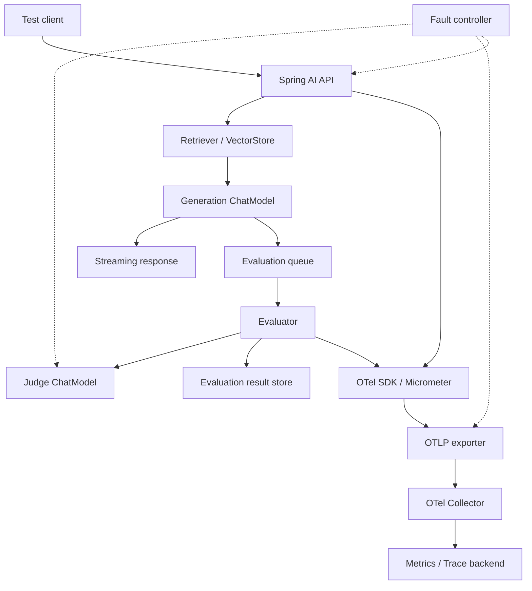

# Mô phỏng lỗi giám khảo, mất exporter và gián đoạn streaming

## 1. Mục tiêu của bài lab

Một ứng dụng Spring AI có thể vẫn trả lời được người dùng trong khi evaluator không chấm được kết quả, telemetry exporter không gửi được span hoặc luồng streaming bị ngắt giữa chừng. Ba sự cố này tác động đến ba phần khác nhau của hệ thống:

- **Judge/evaluator failure:** kết quả đánh giá không có hoặc không đáng tin cậy.
- **Exporter/Collector outage:** ứng dụng có thể vẫn hoạt động nhưng metrics/traces bị trễ hoặc mất.
- **Streaming interruption:** người dùng chỉ nhận được một phần câu trả lời hoặc kết nối bị đóng trước khi hoàn tất.

Bài **“Mô phỏng lỗi giám khảo, mất exporter và gián đoạn streaming”** thuộc chương **Thực hành tổng hợp** của module **SPRING_AI_EVALUATION_OBSERVABILITY**. Module học cách đánh giá chất lượng ứng dụng Spring AI bằng dataset, tiêu chí relevance, fact checking và kiểm thử luồng RAG hoặc gọi công cụ; đồng thời theo dõi metrics, traces, chi phí và độ trễ để tìm nguyên nhân suy giảm qua các phiên bản prompt, model và pipeline.

Sau bài lab, bạn có thể:

1. Tạo môi trường thử nghiệm có serving, retrieval, judge, exporter và result store.
2. Tiêm lỗi có kiểm soát vào judge model và xác minh trạng thái evaluation.
3. Làm gián đoạn đường OTLP để quan sát queue, retry, drop và khả năng phục hồi.
4. Ngắt SSE/streaming ở các thời điểm khác nhau và xác minh cancellation/partial result.
5. Đối chiếu metrics, traces, job state và nội dung trả về.
6. Khôi phục hệ thống mà không tạo verdict PASS giả, duplicate result hoặc retry storm.

## 2. Phạm vi và nguyên tắc an toàn

Thực hiện bài lab trên local hoặc staging riêng, với dữ liệu giả lập. Không chặn provider, Collector, database hay network của production để thử các kịch bản dưới đây.

Trước khi bắt đầu:

- dùng API key thử nghiệm hoặc mock provider;
- không đưa prompt, completion, tài liệu RAG hoặc thông tin cá nhân thật vào fixture;
- giới hạn token, concurrency, thời gian chạy và retry;
- bật fault injection qua profile/test configuration riêng;
- xác nhận cách tắt fault và khôi phục endpoint;
- lưu baseline trước khi gây lỗi;
- xác định owner và cửa sổ thử nghiệm nếu chạy trên staging dùng chung.

**Quy tắc quan trọng:** mỗi lần thử chỉ bật một fault chính. Sau khi ghi nhận kết quả, tắt fault và xác minh phục hồi trước khi chuyển sang kịch bản kế tiếp. Nếu bật nhiều lỗi cùng lúc, khó xác định nguyên nhân của symptom.

## 3. Kiến trúc môi trường lab

Mô hình tham khảo:



Trong lab nhỏ, evaluator có thể chạy cùng ứng dụng để dễ quan sát. Với môi trường gần production, nên tách worker đánh giá khỏi request path. Dù đặt ở đâu, ba fault cần được điều khiển độc lập:

| Fault switch | Thành phần | Tác động mong đợi |
| --- | --- | --- |
| JUDGE_FAULT | Judge endpoint/evaluator adapter | Evaluation ERROR, UNKNOWN hoặc RETRY_WAIT theo lỗi |
| EXPORTER_FAULT | Đường app-to-Collector hoặc Collector-to-backend | Export failure, queue tăng hoặc drop có giới hạn |
| STREAM_FAULT | Generation stream hoặc client connection | Stream error/cancel, partial response nếu đã phát token |

Không nên tạo một switch chung làm hỏng toàn bộ hệ thống. Một fault controller riêng giúp test từng boundary và phục hồi có thứ tự.

## 4. Thành phần cần chuẩn bị

| Thành phần | Vai trò trong lab | Điều cần quan sát |
| --- | --- | --- |
| Spring AI application | Chạy RAG/generation và streaming | API latency, request status, model observations |
| Generation ChatModel | Sinh câu trả lời | Token usage, latency, timeout, stream completion |
| Judge ChatModel | Chấm relevance/fact checking | Judge latency, provider errors, verdict status |
| Evaluator worker/queue | Xử lý đánh giá | Queue depth, retry, rejected/expired jobs |
| Result store | Lưu evaluation result | Commit/readback, duplicate prevention |
| Micrometer/OTel SDK | Tạo metrics và spans | Queue, sampling, dropped spans |
| OTLP exporter | Gửi telemetry | Export attempts, failures, duration |
| OTel Collector | Nhận và chuyển telemetry | Receiver accepted/refused, exporter sent/failed |
| Backend | Lưu traces/metrics | Canary freshness và khả năng query |
| Test client | Gửi request và ngắt stream | First token, received tokens, disconnect time |

Dùng một bộ dữ liệu nhỏ, cố định để so sánh trước/sau. Ví dụ 10 câu hỏi RAG có context giả lập, trong đó có case câu trả lời đúng, thiếu bằng chứng, không liên quan và có citation sai.

## 5. Chuẩn bị baseline và correlation IDs

Trước fault injection, gửi một nhóm request bình thường và ghi:

- request ID/correlation ID;
- trace ID;
- application version;
- prompt, retrieval, evaluator, rubric và judge profile version;
- generation latency và time-to-first-token;
- stream completion status;
- evaluation job ID và result status;
- judge latency và token usage nếu provider trả về;
- exporter success/failure và collector queue;
- result-store commit/readback.

Không đưa request ID hoặc trace ID thành Prometheus label vì cardinality tăng theo từng request. Giữ chúng trong trace, structured log hoặc result store.

Một baseline table:

| Chỉ số | Baseline cần ghi |
| --- | --- |
| Serving success ratio | Tỷ lệ request hoàn tất |
| API p95/p99 | Độ trễ toàn request |
| Time to first token | Thời gian nhận token đầu |
| Stream completion ratio | Tỷ lệ stream có terminal event |
| Judge success ratio | Tỷ lệ evaluator hoàn tất |
| Evaluation queue age | Tuổi job chờ lâu nhất |
| Result write success | Tỷ lệ result commit thành công |
| Export failure/drop | Lỗi và dữ liệu telemetry bị bỏ |
| Trace freshness | Thời gian từ tạo span đến query được |

Baseline là mốc đối chiếu, không phải SLO mặc định. Chọn cửa sổ đo đủ dài để không bị ảnh hưởng bởi một request đơn lẻ.

## 6. Tạo fault controller chỉ dùng trong lab

Có thể tạo một abstraction để bật/tắt lỗi trong test profile. Ví dụ:

```java
public enum FaultMode {
    NONE,
    TIMEOUT,
    RATE_LIMIT,
    SERVER_ERROR,
    MALFORMED_RESPONSE
}
```

Một controller test-only có thể giữ trạng thái:

```java
import java.util.concurrent.atomic.AtomicReference;

import org.springframework.context.annotation.Profile;
import org.springframework.stereotype.Component;

@Component
@Profile("fault-lab")
public class FaultSwitch {

    private final AtomicReference<FaultMode> mode =
            new AtomicReference<>(FaultMode.NONE);

    public FaultMode current() {
        return mode.get();
    }

    public void enable(FaultMode next) {
        mode.set(next);
    }

    public void reset() {
        mode.set(FaultMode.NONE);
    }
}
```

Expose endpoint bật/tắt switch chỉ trong môi trường test và khóa bằng authentication hoặc chỉ bind localhost. Không đóng gói endpoint fault controller trong production artifact nếu không có guard phù hợp.

Trong test tự động, có thể inject fault qua mock HTTP server như WireMock hoặc một fake adapter. Nếu dùng provider thật, fault controller nên nằm ở test proxy để mô phỏng timeout/429/5xx mà không thay đổi production code path.

## 7. Kịch bản A: judge model trả HTTP 429

**Mục tiêu:** xác minh evaluator phản ứng đúng khi judge provider rate limit.

Cách thực hiện:

1. Chạy baseline với JUDGE_FAULT=NONE.
2. Tạo evaluation job mới và xác nhận verdict được lưu.
3. Bật fault RATE_LIMIT cho judge endpoint.
4. Submit một nhóm evaluation jobs nhỏ.
5. Ghi HTTP status, provider request ID, retry count và thời gian chờ.
6. Kiểm tra job state sau khi retry budget còn và sau khi hết.
7. Tắt fault và chờ retry hợp lệ.
8. Xác minh job hoàn tất hoặc giữ trạng thái lỗi đúng policy.

Kết quả mong đợi:

- Serving request đã hoàn tất không bị biến thành lỗi chỉ vì evaluator hậu kiểm bị 429.
- Evaluation không được gán PASS khi judge chưa trả verdict hợp lệ.
- Retry có giới hạn, có backoff và tôn trọng Retry-After nếu provider cung cấp.
- Job giữ nguyên config snapshot, rubric version và judge profile.
- Khi hết retry budget, job chuyển FAILED/NEEDS_REVIEW theo policy; không retry vô hạn.

Không phải mọi 429 đều giống nhau. Một số provider trả quota exhausted dài hạn, số khác trả rate limit tạm thời. Cần phân loại theo response code/body và tài liệu provider; không retry cùng một nhịp trên tất cả worker.

## 8. Kịch bản B: judge model timeout

**Mục tiêu:** mô phỏng judge không trả lời trong thời gian cho phép.

Cách thực hiện:

1. Bật fault TIMEOUT tại mock judge hoặc test proxy.
2. Đặt timeout evaluator nhỏ và đã biết, ví dụ 2 giây trong profile lab.
3. Submit evaluation request.
4. Quan sát worker concurrency, queue depth và judge in-flight count.
5. Chờ timeout và kiểm tra job state/attempt history.
6. Tắt fault.
7. Cho phép retry nếu job còn deadline và retry budget.
8. Kiểm tra result store không có verdict được tạo từ timeout.

Kết quả mong đợi:

- Timeout kết thúc trong ngân sách thời gian đã cấu hình.
- Semaphore/worker permit được release kể cả khi lỗi.
- Job chuyển RETRY_WAIT hoặc FAILED/UNKNOWN theo policy.
- Không lưu một verdict mặc định để thay cho judge response.
- Serving path không chờ judge nếu evaluation chạy hậu kiểm.

Nếu worker dùng future/reactive cancellation, cần kiểm tra timeout có thực sự hủy request tới provider hay chỉ ngừng chờ ở phía ứng dụng. Nếu upstream vẫn tiếp tục xử lý, có thể phát sinh chi phí dù client đã timeout.

## 9. Kịch bản C: judge trả malformed response

**Mục tiêu:** xác minh parser/structured output không biến response sai schema thành verdict hợp lệ.

Ví dụ response giả lập:

```json
{
  "score": "very good",
  "passed": "yes",
  "reason": null
}
```

Nếu hợp đồng yêu cầu score số trong khoảng 0..1, passed kiểu boolean và reason theo schema đã định, response trên phải bị từ chối hoặc chuyển NEEDS_REVIEW.

Các bước:

1. Bật fault MALFORMED_RESPONSE.
2. Submit một evaluation job.
3. Kiểm tra parser/schema validation error.
4. Xác nhận không ghi aggregate score giả.
5. Kiểm tra error code và redacted raw response reference nếu được phép lưu.
6. Tắt fault và chạy lại bằng một job mới hoặc retry theo policy.

Kết quả mong đợi:

- Parser không tự ép chuỗi “yes” thành true nếu schema không cho phép.
- Invalid response không được xem là PASS.
- Có thể phân biệt JUDGE_PROVIDER_ERROR với JUDGE_OUTPUT_INVALID.
- Retry malformed output chỉ thực hiện nếu policy cho phép; nếu prompt/schema sai có tính hệ thống, retry nhiều lần chỉ tăng chi phí.

## 10. Ma trận lỗi judge và trạng thái evaluation

| Fault | Có thể retry? | Trạng thái gợi ý | Không được làm |
| --- | --- | --- | --- |
| HTTP 429 tạm thời | Có, bounded | RETRY_WAIT | Retry đồng loạt vô hạn |
| HTTP 5xx | Có, bounded | RETRY_WAIT | Bỏ qua retry budget |
| Connect/read timeout | Có, bounded | RETRY_WAIT/UNKNOWN | Giả định provider chưa xử lý request |
| HTTP 401/403 | Thường không | FAILED/CONFIG_ERROR | Retry liên tục credential sai |
| Malformed JSON/schema | Theo policy, thường giới hạn | FAILED/NEEDS_REVIEW | Ép kiểu rồi chấm PASS |
| Judge content refusal | Theo domain policy | INSUFFICIENT_EVIDENCE/REVIEW | Coi refusal là điểm 0 hoặc PASS mặc định |
| Result store failure | Retry persistence | PERSISTENCE_RETRY | Gọi judge lại nếu response đã checkpoint |

Phân biệt trạng thái job với verdict. Job FAILED là trạng thái vận hành; verdict FAIL là kết quả đánh giá nội dung. Hai khái niệm không được dùng chung một field.

## 11. Kịch bản D: làm mất đường exporter từ ứng dụng tới Collector

**Mục tiêu:** xác minh ứng dụng không bị treo khi OTLP Collector unavailable.

Trong môi trường local/staging, có thể:

- dừng Collector;
- chặn kết nối app tới OTLP endpoint bằng test proxy;
- cấu hình endpoint sai trong profile lab;
- làm proxy trả connection reset hoặc timeout.

Không sửa endpoint production và không chặn port trên máy dùng chung.

Các bước:

1. Ghi baseline exporter success, queue utilization và trace freshness.
2. Bật EXPORTER_FAULT hoặc dừng Collector test.
3. Gửi request RAG/streaming và tạo evaluation job.
4. Quan sát API latency, queue depth, dropped spans và exporter failures.
5. Giữ outage trong một khoảng ngắn có giới hạn.
6. Xác nhận business request vẫn hoàn tất theo thiết kế.
7. Khôi phục Collector.
8. Theo dõi queue drain, export retry và backend trace freshness.

Kết quả mong đợi:

- Export timeout không block request thread.
- SDK queue có capacity hữu hạn.
- Khi queue đầy, drop theo hành vi đã định và drop counter tăng nếu SDK expose.
- Không có heap tăng không giới hạn.
- Khi Collector phục hồi, exporter hoạt động lại mà không tạo retry storm.
- Trace canary mới xuất hiện trong backend sau freshness window.

## 12. Phân biệt Collector process health và exporter data-path health

Một health endpoint Collector trả OK chỉ chứng minh health extension/process phản hồi. Nó không chứng minh backend nhận được span.

Quan sát ba tầng:

| Tầng | Tín hiệu | Diễn giải |
| --- | --- | --- |
| Application SDK/exporter | Export attempts, failures, queue/drop | App có gửi được không? |
| Collector | Receiver accepted/refused, exporter sent/failed | Collector có nhận và chuyển tiếp không? |
| Backend | Canary trace/metric visible, ingest freshness | Dữ liệu có truy vấn được không? |

Nếu app export success nhưng backend không có trace, kiểm tra Collector receiver, pipeline, exporter và indexing. Nếu Collector health xanh nhưng exporter failed tăng, đây là data-path failure chứ không phải process failure.

## 13. Kịch bản E: làm mất đường Collector tới backend

**Mục tiêu:** phân biệt lỗi app-to-Collector với lỗi Collector-to-backend.

Các bước:

1. Đảm bảo app vẫn gửi được tới Collector.
2. Chặn hoặc dừng backend test, giữ Collector process chạy.
3. Gửi request để tạo spans.
4. Quan sát receiver accepted, exporter failed và Collector sending queue.
5. Kiểm tra memory limiter, retry budget và queue capacity.
6. Khôi phục backend.
7. Theo dõi backlog drain và tốc độ export.
8. Truy vấn trace canary.

Kết quả mong đợi:

- Collector vẫn nhận telemetry nếu receiver còn hoạt động và có capacity.
- Exporter queue tăng nhưng không vượt giới hạn.
- Retry có thời gian hữu hạn.
- Nếu queue đầy, drop được phản ánh qua self-telemetry/log theo phiên bản.
- Backend không bị dồn backlog quá nhanh khi phục hồi.

Nếu collector queue persistent, kiểm tra disk quota và replay behavior. Nếu queue chỉ ở memory, restart Collector trong outage có thể làm mất backlog; cần ghi rõ đây là giới hạn của cấu hình lab.

## 14. Kịch bản F: gián đoạn streaming trước token đầu tiên

**Mục tiêu:** kiểm tra timeout trước khi response stream bắt đầu.

Các bước:

1. Gửi request streaming tới API.
2. Làm generation provider chậm hoặc timeout trước token đầu.
3. Quan sát time-to-first-token và upstream timeout.
4. Kiểm tra HTTP status nếu response chưa được commit.
5. Kiểm tra error event/response body theo hợp đồng API.
6. Khôi phục provider và chạy lại.

Kết quả mong đợi:

- Timeout được trả trong giới hạn đã đặt.
- Không phát sinh terminal event giả như completed.
- Client nhận error response có correlation ID nếu header/body contract hỗ trợ.
- Server giải phóng tài nguyên và không để stream subscription treo.

Nếu server đã gửi response headers thì không thể đổi HTTP status như một response chưa bắt đầu. Vì vậy API streaming cần quy định cách báo lỗi trong stream hoặc đóng kết nối.

## 15. Kịch bản G: ngắt streaming sau khi đã nhận một phần câu trả lời

**Mục tiêu:** mô phỏng client disconnect hoặc provider stream bị đứt giữa chừng.

Có hai biến thể:

- **Client disconnect:** client đóng kết nối khi đã nhận một số token.
- **Upstream disconnect:** provider stream bị reset hoặc phát lỗi sau một phần nội dung.

Thực hiện:

1. Gửi câu hỏi cố định qua SSE.
2. Đợi nhận từ 3 đến 5 token hoặc event.
3. Ngắt client connection hoặc bật upstream disconnect.
4. Ghi số token đã nhận và thời điểm disconnect.
5. Quan sát server cancellation và provider stream termination.
6. Kiểm tra response state có đánh dấu partial/interrupted không.
7. Xác minh không lưu partial answer như câu trả lời hoàn chỉnh.
8. Gửi request mới để kiểm tra instance vẫn phục vụ bình thường.

Kết quả mong đợi:

- Client disconnect tạo cancellation, không bị ghi nhầm thành provider 5xx.
- Upstream disconnect tạo stream error nếu client còn kết nối.
- Nếu kết nối đã đóng, server dừng việc gửi và giải phóng subscription.
- Partial output được đánh dấu rõ.
- Không tự động nối tiếp từ token cuối nếu không có protocol resume/sequence semantics.
- Evaluation không chấm partial answer như full answer trừ khi đây là một test case riêng.

## 16. Ví dụ endpoint SSE với Spring WebFlux

Một endpoint có thể chuyển nội dung ChatClient stream thành Server-Sent Events. Ví dụ khái niệm:

```java
import org.springframework.ai.chat.client.ChatClient;
import org.springframework.http.MediaType;
import org.springframework.http.codec.ServerSentEvent;
import org.springframework.web.bind.annotation.GetMapping;
import org.springframework.web.bind.annotation.RequestParam;
import org.springframework.web.bind.annotation.RestController;
import reactor.core.publisher.Flux;

@RestController
public class StreamingController {

    private final ChatClient chatClient;

    public StreamingController(ChatClient chatClient) {
        this.chatClient = chatClient;
    }

    @GetMapping(
        value = "/api/chat/stream",
        produces = MediaType.TEXT_EVENT_STREAM_VALUE
    )
    public Flux<ServerSentEvent<String>> stream(
            @RequestParam String question) {

        return chatClient.prompt()
                .user(question)
                .stream()
                .content()
                .map(token -> ServerSentEvent.<String>builder()
                        .event("token")
                        .data(token)
                        .build())
                .concatWithValues(
                        ServerSentEvent.<String>builder()
                                .event("done")
                                .data("completed")
                                .build())
                .onErrorResume(error ->
                        Flux.just(
                                ServerSentEvent.<String>builder()
                                        .event("error")
                                        .data("STREAM_INTERRUPTED")
                                        .build()));
    }
}
```

Đây là ví dụ tối giản. API ChatClient stream và kiểu trả về cần khớp phiên bản Spring AI/Spring WebFlux của dự án. Trong production, nên thêm request ID, timeout, authorization, validation, giới hạn số token và xử lý lỗi theo error code nội bộ.

Lưu ý quan trọng:

- onErrorResume chỉ chạy khi stream còn có subscriber và downstream còn có thể nhận event.
- Nếu client đã disconnect, không thể gửi error event tới client; server chỉ có thể ghi nhận cancellation và giải phóng tài nguyên.
- Không phát event done khi stream bị cancel.
- Nếu lỗi xảy ra sau khi đã phát một phần câu trả lời, đánh dấu partial/interrupted thay vì trả một câu trả lời hoàn chỉnh.
- Không retry tự động toàn bộ generation sau khi đã phát token nếu client có thể nhận nội dung trùng. Resume cần protocol riêng có sequence ID và deduplication.

## 17. Ghi nhận cancellation và phân biệt với lỗi

Trong Reactor, doFinally có thể quan sát signal hoàn tất, lỗi hoặc cancel. Ví dụ minh họa:

```java
import reactor.core.publisher.SignalType;

return source
        .doFinally(signal -> {
            if (signal == SignalType.CANCEL) {
                // Increment stream cancellation metric.
            }
            else if (signal == SignalType.ON_ERROR) {
                // Record upstream stream failure.
            }
            else if (signal == SignalType.ON_COMPLETE) {
                // Record normal completion.
            }
        });
```

Không tăng metric provider failure khi signal là CANCEL do client rời đi. Nên phân biệt:

- stream_completed;
- stream_cancelled_by_client;
- stream_failed_upstream;
- stream_timed_out;
- stream_interrupted_after_first_token;
- stream_failed_before_first_token.

Các metric này là convention ứng dụng minh họa. Dùng label có tập giá trị nhỏ như outcome và operation; không gắn câu hỏi, request ID hoặc token content làm label.

## 18. Xử lý partial answer và evaluation status

Một stream bị ngắt có thể đã phát một phần nội dung. Hệ thống cần tách trạng thái transport và trạng thái nghiệp vụ:

| Tình huống | Stream status | Answer status | Evaluation |
| --- | --- | --- | --- |
| Nhận done event | COMPLETED | COMPLETE | Có thể enqueue |
| Client cancel sau vài token | CANCELLED | PARTIAL | Không chấm như answer hoàn chỉnh |
| Provider reset giữa stream | INTERRUPTED | PARTIAL/FAILED | UNKNOWN hoặc skipped theo policy |
| Timeout trước token đầu | TIMED_OUT | EMPTY | Không enqueue answer |
| Parser/output validation fail | FAILED | INVALID | ERROR/NEEDS_REVIEW |

Nếu cần lưu partial output để debug, hãy áp dụng redaction, access control và retention. Không ghi raw partial content vào log mặc định.

## 19. Test streaming bằng curl và client giả lập

Có thể dùng curl để quan sát SSE:

```bash
curl -N --no-buffer \
  "http://localhost:8080/api/chat/stream?question=Explain%20RAG"
```

Ngắt kết nối bằng Ctrl+C sau vài event. Quan sát log server và metric cancellation. Với test tự động, dùng WebTestClient hoặc một HTTP client có thể cancel subscription sau khi nhận số event định trước.

Các assertion cần có:

- event token xuất hiện trước done trong trường hợp bình thường;
- done chỉ xuất hiện khi stream hoàn tất;
- client cancel không tạo done giả;
- upstream error có error event nếu connection còn mở;
- partial answer không được lưu với status COMPLETE;
- request mới sau disconnect vẫn hoạt động.

Test thêm trường hợp client chậm đọc dữ liệu để phát hiện buffer tăng hoặc backpressure không hoạt động.

## 20. Metrics và traces cho ba nhóm fault

Metric gợi ý:

| Metric | Ý nghĩa |
| --- | --- |
| app.ai.judge.calls | Số lần gọi judge |
| app.ai.judge.failures | Judge provider/parser failures |
| app.ai.judge.retries | Số lần retry judge |
| app.ai.evaluation.jobs.unknown | Job không có verdict xác định |
| app.ai.evaluation.queue.age | Tuổi job chờ |
| app.ai.export.failures | Export attempts thất bại |
| app.ai.export.dropped | Telemetry bị bỏ |
| app.ai.stream.first_token | Time-to-first-token |
| app.ai.stream.duration | Thời gian stream |
| app.ai.stream.tokens | Số token/event phát ra |
| app.ai.stream.cancelled | Stream bị client cancel |
| app.ai.stream.interrupted | Upstream stream interruption |
| app.ai.stream.completed | Stream hoàn tất |
| app.ai.result.write_failures | Result store write failures |

Tên metric trên do ứng dụng định nghĩa, không phải tất cả đều có sẵn trong Spring AI. Xác định rõ type, unit, label và aggregation. Không dùng job ID hoặc trace ID làm metric tag.

Trace nên thể hiện các span/operation:

- HTTP request;
- retrieval/embedding;
- ChatModel generation;
- stream lifecycle;
- evaluation enqueue;
- judge model call;
- result persistence;
- telemetry export/collector path nếu được instrumented.

Khi evaluator chạy bất đồng bộ, có thể tạo trace riêng và liên kết với request gốc qua correlation ID/span link. Không giả định evaluation span luôn là child của HTTP span đã kết thúc.

## 21. Kịch bản tổng hợp: ba fault theo thứ tự

Sau khi test riêng từng lỗi, thực hiện bài tổng hợp:

1. Chạy 20 request RAG bình thường và ghi baseline.
2. Bật judge 429 cho các evaluation job mới.
3. Xác nhận serving vẫn trả lời, evaluation queue/retry tăng theo policy.
4. Tắt judge fault và xác nhận job được retry hoặc kết thúc đúng trạng thái.
5. Bật exporter outage trong thời gian ngắn.
6. Gửi request RAG và tạo evaluation job.
7. Xác nhận exporter queue/drop có giới hạn, API không block.
8. Khôi phục Collector và kiểm tra canary trace freshness.
9. Gửi một streaming request.
10. Ngắt client sau vài token.
11. Xác nhận cancellation và partial answer status.
12. Gửi request mới để xác nhận API đã phục vụ bình thường.
13. Đối chiếu request count, evaluation job count, result count và trace count.
14. Ghi rõ chênh lệch do sampling, cancellation, drop hoặc job chưa hoàn tất.
15. Tắt toàn bộ fault switch và xác nhận baseline được phục hồi.

Không chạy ba fault đồng thời ở lần đầu. Chỉ thực hiện chuỗi tổng hợp sau khi đã hiểu riêng từng fault và có thể xác định expected signals.

## 22. Bảng kết quả mong đợi

| Kịch bản | Serving | Evaluation | Telemetry | Streaming |
| --- | --- | --- | --- | --- |
| Judge 429 | Bình thường nếu judge hậu kiểm | RETRY_WAIT/FAILED theo budget | Có thể ghi nhận judge error | Không bị ảnh hưởng |
| Judge timeout | Không chờ judge | Timeout/UNKNOWN, permit được release | Judge failure span/metric nếu export được | Không bị ảnh hưởng |
| Judge malformed output | Bình thường | INVALID/NEEDS_REVIEW | Parser error có phân loại | Không bị ảnh hưởng |
| App-to-Collector outage | Vẫn hoạt động theo thiết kế | Vẫn chạy nếu không phụ thuộc exporter | Queue/drop/failure tăng | Vẫn stream nếu generation khỏe |
| Collector-to-backend outage | Vẫn hoạt động | Vẫn chạy | Collector exporter queue/failure tăng | Vẫn stream |
| Stream timeout trước token | Request lỗi có kiểm soát | Không tạo answer evaluation | Ghi timeout | Không có token/done giả |
| Client cancel giữa stream | Request khác vẫn hoạt động | Partial không chấm như complete | Ghi cancellation | Kết thúc do cancel |
| Upstream reset giữa stream | Request khác vẫn hoạt động | Partial/UNKNOWN | Ghi interruption | Error event nếu connection còn |

Nếu kết quả khác bảng, ghi lại actual behavior, version và evidence. Không sửa expected result chỉ để làm bài lab pass; cần phân tích contract thực tế của SDK/provider.

## 23. Tiêu chí pass tổng thể

<badge color="success">PASS khi tất cả điều kiện bắt buộc đạt</badge>

- Judge error không bị chuyển thành PASS.
- 429/5xx/timeout chỉ retry trong budget đã định.
- Malformed output được validate và phân loại riêng.
- Evaluation hậu kiểm không làm hỏng serving request.
- Exporter outage không block request thread.
- SDK/Collector queue có giới hạn và drop/failure có thể quan sát.
- Collector recovery không tạo retry storm.
- Streaming done event chỉ xuất hiện khi hoàn tất bình thường.
- Client cancellation được phân biệt với upstream failure.
- Partial answer không được lưu thành complete answer.
- Evaluation job/result có idempotency và provenance.
- Sau khi tắt fault, serving, judge, exporter và streaming đều trở lại baseline.
- Không còn fault switch bật hoặc backlog không được xử lý.

## 24. Khôi phục môi trường sau lab

Thực hiện theo thứ tự:

1. Reset JUDGE_FAULT về NONE.
2. Reset EXPORTER_FAULT và khôi phục OTLP endpoint.
3. Reset STREAM_FAULT và khôi phục mock generation provider.
4. Xác nhận toàn bộ worker/consumer hoạt động.
5. Kiểm tra job RETRY_WAIT, NEEDS_REVIEW và DLQ.
6. Reconcile job với result store để tránh gọi judge trùng.
7. Xác nhận Collector queue đã drain hoặc ghi rõ phần telemetry bị drop.
8. Truy vấn canary metric/trace mới.
9. Xóa test data theo retention của lab.
10. Tắt test-only fault profile/controller.
11. Ghi kết quả, version, thời điểm và giới hạn thử nghiệm.
12. Xác nhận không còn endpoint fault injection được expose.

Không xóa result record trước khi đã lưu summary cần thiết cho bài học. Nếu dùng persistent volume hoặc database dùng chung, chỉ dọn đúng namespace/schema lab.

## 25. Mẫu ghi nhận kết quả lab

```yaml
labRun:
  id: e2e-fault-lab-001
  environment: local
  applicationVersion: "2.8.1"
  generationProfile: "generation-test"
  judgeProfile: "judge-test"
  rubricVersion: "rag-rubric-v4"
  datasetVersion: "rag-golden-v1"

scenarios:
  judgeRateLimit:
    injected: true
    observedStatus: RETRY_WAIT
    retryBounded: true
    falsePass: false
  exporterOutage:
    injected: true
    servingUnaffected: true
    queueBounded: true
    dropObserved: true
    recovered: true
  streamDisconnect:
    injected: true
    partialMarked: true
    cancellationObserved: true
    falseDoneEvent: false

reconciliation:
  evaluationJobsCreated: 20
  completed: 18
  failedOrUnknown: 2
  duplicateResults: 0
  unresolvedJobs: 0

cleanup:
  faultSwitchesReset: true
  testDataHandled: true
  collectorRestored: true
  verifiedAt: "2026-11-27T12:00:00Z"
```

Các giá trị là ví dụ minh họa, không phải kết quả chạy thật. Khi thực hiện, điền số liệu thực tế và lưu evidence/query reference phù hợp. Nếu chưa kiểm tra một điều kiện, ghi UNKNOWN thay vì true.

## 26. Bài tập mở rộng

1. **Judge 429:** mô phỏng Retry-After khác nhau và so sánh retry behavior.
2. **Judge timeout:** chứng minh cancellation có truyền tới HTTP client hay chỉ dừng chờ ở worker.
3. **Malformed response:** kiểm tra parser với thiếu field, sai type, score ngoài range và JSON bị cắt.
4. **Result persistence:** làm database unavailable sau khi judge response đã nhận; phục hồi mà không gọi model lại nếu checkpoint đã lưu.
5. **Exporter outage:** làm đầy queue có kiểm soát và đo dropped spans.
6. **Collector outage:** phân biệt receiver accepted với exporter sent/failed.
7. **Recovery:** khôi phục backend khi backlog lớn và giới hạn drain rate.
8. **Streaming:** ngắt trước token đầu, giữa stream và ngay trước done.
9. **Client cancellation:** kiểm tra worker/model subscription có dừng hay vẫn chạy nền.
10. **Partial evaluation:** quyết định chính sách khi answer stream bị ngắt nhưng đã có một phần nội dung.
11. **Correlation:** liên kết request trace với evaluation job chạy bất đồng bộ.
12. **Dashboard:** tạo panel phân biệt judge failures, exporter failures và stream cancellations.
13. **Cost:** ước tính chi phí retry judge khi timeout không rõ provider đã xử lý hay chưa.
14. **Security:** xác minh fault controller không tồn tại hoặc không truy cập được trong production profile.
15. **Incident drill:** viết handover record khi judge đã phục hồi nhưng exporter backlog vẫn đang drain.

## Tài liệu tham khảo

- [Spring AI 2.1.0 – Evaluation Testing](https://docs.spring.io/spring-ai/reference/api/testing.html): Evaluator, EvaluationRequest, EvaluationResponse, RelevancyEvaluator và FactCheckingEvaluator.
- [Spring AI 2.1.0 – Chat Client](https://docs.spring.io/spring-ai/reference/api/chatclient.html): ChatClient API và streaming.
- [Spring AI 2.1.0 – Observability](https://docs.spring.io/spring-ai/reference/observability/index.html): model observations, metrics và traces.
- [Spring Framework – WebFlux](https://docs.spring.io/spring-framework/reference/web/webflux.html): reactive web stack và streaming response.
- [Spring Framework – Reactive Streams](https://docs.spring.io/spring-framework/reference/web/webflux-webclient/client-synchronous.html): WebClient/reactive client behavior và cancellation.
- [OpenTelemetry Collector – Resiliency](https://opentelemetry.io/docs/collector/resiliency/): queue, retry, memory limiter và exporter failure.
- [OpenTelemetry Java – Configuration](https://opentelemetry.io/docs/languages/java/configuration/): SDK exporter và BatchSpanProcessor configuration.
- [Prometheus – Alerting Rules](https://prometheus.io/docs/prometheus/latest/configuration/alerting_rules/): cấu hình alert theo tín hiệu vận hành.

> **Ghi chú triển khai:** Các fault switch, metric app.ai.*, job status và YAML lab report trong bài là ví dụ thiết kế ứng dụng. Tên property, API streaming và cấu hình exporter phụ thuộc phiên bản Spring AI, Spring Boot, WebFlux, OpenTelemetry SDK/Collector và provider. Cần xác nhận API/contract của phiên bản dự án và chạy trong local/staging cô lập. Bài viết là hướng dẫn lab, chưa phải kết quả thực thi fault injection trên hệ thống thực tế.
