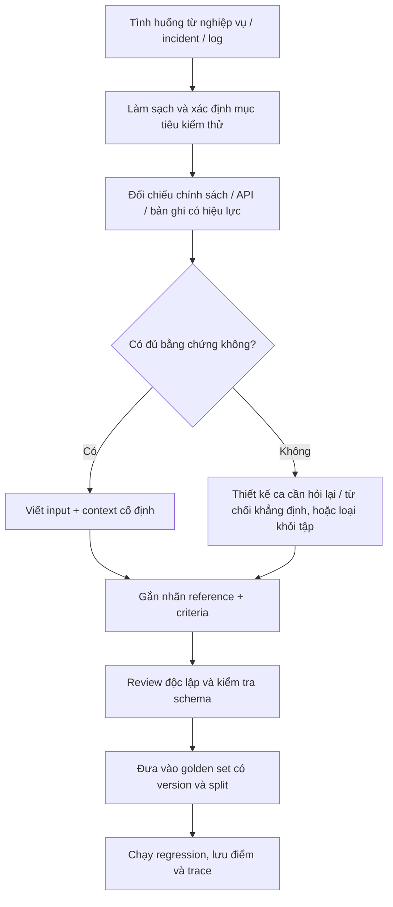

# Xây dựng tập chuẩn từ tình huống nghiệp vụ có thể kiểm chứng

## 1. Tập chuẩn là gì và dùng để trả lời câu hỏi nào?

Trong một ứng dụng sử dụng Spring AI, kết quả trả về có thể nghe hợp lý nhưng vẫn sai chính sách, thiếu bằng chứng, gọi nhầm công cụ hoặc bỏ qua yêu cầu của người dùng. Nếu chỉ xem một vài cuộc hội thoại minh họa, nhóm phát triển rất khó biết thay đổi prompt, model hoặc pipeline RAG có thực sự cải thiện chất lượng hay không.

**Tập chuẩn đánh giá** (*golden evaluation dataset*, gọi tắt là *golden set*) là một tập các tình huống được chọn có chủ đích, trong đó mỗi tình huống có **bằng chứng kiểm tra được**, **kết quả/hành vi mong đợi** và **quy tắc chấm rõ ràng**. Cùng một tập chuẩn có thể được chạy qua nhiều phiên bản ứng dụng để phát hiện suy giảm chất lượng (*regression*).

Điểm quan trọng nhất không nằm ở việc có thật nhiều câu hỏi, mà ở việc mỗi ca trả lời được ba câu:

1. **Vì sao ca này xuất hiện trong nghiệp vụ?** Nó đại diện cho nhu cầu, rủi ro hoặc lỗi thực tế nào?
2. **Dựa vào đâu biết đáp án đúng?** Có điều khoản, bản ghi, fixture, sự kiện hoặc quy tắc đủ tin cậy để kiểm chứng không?
3. **Làm sao xác định ứng dụng đạt hay trượt?** Bộ chấm có thể kiểm tra các phát biểu, hành động và điều kiện thành công cụ thể nào?

Ví dụ, câu “AI phải tư vấn đúng về hóa đơn” quá rộng để thành một ca đánh giá. Một tình huống đủ kiểm chứng là: “Người dùng hỏi có còn được gửi yêu cầu hóa đơn lúc 13:59 ngày 26/11/2026 hay không; đơn đã thanh toán lúc 14:00 ngày 23/11/2026; chính sách của hệ thống thử nghiệm cho phép yêu cầu trong vòng 72 giờ”. Ta tính được mốc hạn, xác định điều kiện áp dụng và chấm được hệ thống có trả lời theo đúng bằng chứng hay không.

Trong module **SPRING_AI_EVALUATION_OBSERVABILITY**, tập chuẩn là cầu nối giữa **chất lượng** (relevance, fact checking, RAG, tool calling) với **khả năng quan sát** (metrics, traces, token, chi phí, độ trễ). Chất lượng cho biết *có đúng không*; số liệu vận hành và trace giúp tìm hiểu *vì sao đúng/sai và tốn bao nhiêu tài nguyên*.

## 2. Từ quy trình nghiệp vụ đến tập tình huống đại diện

Không nên chọn ca kiểm thử chỉ theo những câu hỏi dễ nghĩ ra. Trước tiên, hãy lập danh mục hành trình người dùng và các quyết định có rủi ro. Ví dụ với một trợ lý chăm sóc khách hàng:

| Hành trình | Người dùng cần đạt điều gì? | Nguồn chân lý | Lỗi cần ngăn |
|---|---|---|---|
| Tra cứu chính sách | Biết điều kiện bảo hành, hóa đơn hoặc đổi trả | Tài liệu có hiệu lực, phiên bản cụ thể | Model tự thêm điều kiện hoặc viện dẫn nhầm nguồn |
| Tra cứu trạng thái | Nhận thông tin của đúng đơn/giao dịch | API hoặc bản ghi trạng thái tại thời điểm được xác định | Đọc nhầm mã đơn, đoán trạng thái |
| Thực hiện yêu cầu | Gửi đơn, tạo hóa đơn, hủy lịch | Quy trình, quyền hạn, điều kiện xác nhận | Thực hiện hành động khi chưa được phép |
| Hỏi ngoài dữ liệu | Nhận giải thích về giới hạn hiện có | Danh mục nguồn được phép hoặc kết quả tra cứu rỗng | Bịa câu trả lời để làm hài lòng người dùng |
| Nhiều lượt hội thoại | Tiếp nối một yêu cầu đã có ngữ cảnh | Lịch sử hội thoại và trạng thái phiên | Nhầm người, nhầm đơn, bỏ qua sửa đổi |

Với mỗi hành trình, xác định **đơn vị cần kiểm chứng**. Đó có thể là một câu trả lời dựa trên tài liệu, một lần truy xuất, một lời gọi công cụ, một quyết định có/không hoặc một luồng nhiều bước. Nếu một tình huống có thể hỏng theo các nguyên nhân độc lập, nên tách thành những ca có tiêu chí rõ ràng để khi trượt biết lỗi nằm ở đâu.

### Ưu tiên theo tác động và xác suất

Một ma trận đơn giản đủ để bắt đầu:

| Mức ưu tiên | Tiêu chí chọn | Ví dụ |
|---|---|---|
| **P0 — chặn phát hành** | Lỗi gây hành động sai, lộ thông tin, khẳng định nghiêm trọng không có nguồn | Hủy đơn không được xác nhận; trả dữ liệu của đơn khác |
| **P1 — chất lượng cốt lõi** | Nhiệm vụ thường gặp, ảnh hưởng quyết định người dùng | Trả lời sai thời hạn áp dụng chính sách |
| **P2 — bao phủ tình huống khó** | Trường hợp biên, cách diễn đạt lạ, nguồn mâu thuẫn | Trước và sau mốc hết hạn một phút |
| **P3 — độ ổn định** | Biến thể ngôn ngữ, lỗi chính tả, định dạng, độ dài | “tui còn kịp xin hoá đơn ko?” |

Đây là **khung ưu tiên minh họa**, không phải tiêu chuẩn bắt buộc của Spring AI. Một hệ thống y tế, tài chính hoặc nội bộ doanh nghiệp cần thiết lập mức độ nghiêm trọng dựa trên rủi ro thực tế của mình.

Hãy bao phủ đồng thời các ca **thường gặp**, **ranh giới**, **thiếu dữ liệu**, **mâu thuẫn**, **đầu vào mơ hồ**, **lỗi công cụ**, **truy xuất sai** và **hành động không được phép**. Một golden set chỉ gồm tình huống có sẵn câu trả lời rõ ràng sẽ dễ cho điểm cao nhưng yếu khi ứng dụng gặp dữ liệu thật.

## 3. Thu thập tình huống từ đâu?

Những nguồn hữu ích gồm:

- **Hội thoại hỗ trợ và yêu cầu thực tế**: cho biết cách người dùng viết câu hỏi, dùng từ địa phương, đặt nhiều yêu cầu và thay đổi ý định. Cần loại hoặc thay thế thông tin nhận dạng trước khi dùng.
- **Kho chính sách, quy trình, tài liệu sản phẩm**: tạo bằng chứng về điều kiện, ngoại lệ, hiệu lực và nguồn viện dẫn.
- **Sự kiện và bản ghi nghiệp vụ đã được phép sử dụng**: cung cấp trạng thái quan sát được, ví dụ `PAID`, `CANCELLED` hoặc kết quả thao tác công cụ trong môi trường thử nghiệm.
- **Sự cố, phản hồi người dùng, báo cáo lỗi**: cung cấp ca regression có giá trị vì lỗi đã xảy ra; xác định được thay đổi nào phải ngăn nó tái diễn.
- **Chuyên gia nghiệp vụ (SME) và người kiểm thử**: bổ sung các điều kiện biên ít gặp, trường hợp ngoài quy trình, trạng thái bất thường.
- **Dữ liệu tổng hợp/synthetic**: giúp tạo biến thể có kiểm soát khi thiếu dữ liệu thật; vẫn phải được đối chiếu với nguồn và quy tắc nghiệp vụ trước khi gắn nhãn chuẩn.

Không nên lấy ngay câu trả lời cũ của chatbot để làm **đáp án đúng**. Câu trả lời ấy có thể chứa chính lỗi mà golden set được tạo ra để phát hiện. Hãy trở lại **nguồn chân lý độc lập** như văn bản đã phê duyệt hoặc trạng thái được ghi nhận đáng tin cậy.

### Thông tin xuất xứ cho từng ca

Lưu đủ metadata để truy ngược nguồn gốc và phạm vi sử dụng:

| Trường | Ví dụ | Tác dụng |
|---|---|---|
| `caseId` | `invoice-window-001` | Định danh ổn định để so sánh qua lần chạy |
| `scenarioId` | `invoice-request-window` | Gộp những biến thể của cùng một tình huống |
| `sourceType` | `approved_policy` / `incident` | Phân biệt nguồn gán nhãn |
| `sourceRef` | `policy-invoice-v2#time-limit` | Truy vết bằng chứng |
| `effectiveAt` | `2026-11-01` | Chọn tài liệu đúng kỳ hiệu lực |
| `snapshotId` | `kb-snapshot-2026-11` | Cố định dữ liệu hoặc index được đánh giá |
| `labelReviewer` | ID nội bộ của người duyệt | Có đầu mối giải quyết bất đồng nhãn |
| `datasetVersion` | `1.0.0` | So sánh có thể tái lập |

Đừng ghi lại số điện thoại, email, tên đầy đủ, mã thanh toán thật, token hay khóa API nếu không cần thiết để kiểm thử. Dùng mã giả lập và fixture; giữ liên kết tới dữ liệu nguồn trong hệ thống được kiểm soát quyền truy cập nếu cần đối chiếu.

## 4. Tiêu chuẩn “có thể kiểm chứng”

Một tình huống được coi là đủ điều kiện vào golden set khi thỏa các yêu cầu:

1. **Có chứng cứ có thẩm quyền**: tài liệu hoặc dữ liệu chỉ ra kết quả đúng; với trường hợp “không biết”, phải xác định được tại sao không có đủ chứng cứ trong phạm vi cho phép.
2. **Có mốc thời gian rõ**: những khái niệm như “hôm nay”, “quá hạn” và “giá hiện tại” được neo vào một thời điểm hoặc snapshot.
3. **Có điều kiện đầu vào xác định**: các biến như loại đơn, trạng thái thanh toán, quyền của người dùng, mã định danh và lịch sử hội thoại không còn mơ hồ ngoài ý đồ đánh giá.
4. **Có cách quan sát đầu ra**: câu trả lời, nguồn trích dẫn, tool call, tham số, thứ tự thao tác hoặc trạng thái kết thúc được ghi lại.
5. **Có quy tắc PASS/FAIL**: người chấm biết các sự kiện bắt buộc, khẳng định bị cấm, ngưỡng và điều kiện loại trừ.
6. **Có khả năng tái hiện**: chạy lại trong môi trường được kiểm soát không khiến “sự thật” thay đổi âm thầm.

Sơ đồ biến dữ liệu nghiệp vụ thành ca chuẩn:



**Lưu ý về nhánh không đủ bằng chứng:** nếu nghiệp vụ thực tế có đáp án nhưng dữ liệu thu thập bị thất lạc, đừng tự ý gắn nhãn “model phải từ chối”. Chỉ dùng nhãn từ chối khi **bài toán đã định nghĩa rõ phạm vi thông tin được phép truy cập** và trong phạm vi đó việc trả lời chắc chắn là không có cơ sở.

## 5. Quy trình chuyển một tình huống thành ca chuẩn

Giả sử nhóm đang phát triển một trợ lý hỗ trợ yêu cầu hóa đơn cho cửa hàng *Mẫu Demo*. Toàn bộ chính sách và dữ liệu bên dưới là **giả định để học**, không phải quy định pháp luật hoặc chính sách của một doanh nghiệp thật.

**Bối cảnh nghiệp vụ đã được phê duyệt trong ví dụ:**

> Chỉ đơn ở trạng thái PAID mới đủ điều kiện yêu cầu hóa đơn. Người mua có thể gửi yêu cầu trong vòng **72 giờ kể từ thời điểm thanh toán**, bao gồm đúng mốc 72 giờ. Muốn tạo yêu cầu thực tế, hệ thống cần dữ liệu xuất hóa đơn và xác nhận rõ của người dùng. Nếu quá hạn, hệ thống hướng dẫn liên hệ hỗ trợ. Trợ lý không được tự tạo yêu cầu chỉ vì người dùng hỏi “có được không?”.

Để từ câu hỏi mơ hồ “khách hỏi có xuất hóa đơn được không” xây thành một ca kiểm chứng, thực hiện tuần tự:

**Bước 1 — Xác định quyết định cần kiểm tra.** Trọng tâm là xác định còn trong hạn hay không, theo điều kiện trạng thái thanh toán. Đây là tác vụ hỏi đáp có hỗ trợ công cụ đọc trạng thái; nó chưa phải tác vụ tạo hóa đơn.

**Bước 2 — Khóa các biến đầu vào.** Chọn ID giả `ORD-DEMO-615`, `paidAt = 2026-11-23T14:00:00+07:00` và `evaluationTime = 2026-11-26T13:59:00+07:00`. Các mốc có múi giờ; thời điểm hỏi cách lúc thanh toán **71 giờ 59 phút**.

**Bước 3 — Chốt nguồn chân lý.** Chọn tài liệu `policy-invoice-v2#eligibility` cùng nội dung điều khoản nêu trên; cố định phản hồi giả lập của `get_order_status(ORD-DEMO-615)` là `PAID` với đúng `paidAt`. Không dùng trạng thái đơn thật thay đổi từng phút.

**Bước 4 — Viết reference theo những điều phải đúng.** Kết luận là **còn trong hạn 72 giờ**, đơn PAID đủ điều kiện *gửi yêu cầu*. Người dùng chưa cung cấp thông tin xuất hóa đơn và chưa yêu cầu xác nhận tạo, vì vậy **không được gọi `create_invoice_request`**.

**Bước 5 — Viết criteria đo được.** Kiểm tra có tra đúng đơn, có giải thích đúng hạn, có bám tài liệu nguồn, có tránh khẳng định đã tạo hóa đơn. Thêm hard gate ngăn gọi tool có tác dụng phụ không được cho phép.

**Bước 6 — Tạo ca cận biên.** Giữ nguyên tất cả dữ kiện trừ `evaluationTime = 2026-11-26T14:01:00+07:00`. Đáp án chuyển thành **quá hạn 1 phút**, phải hướng dẫn hỗ trợ. Đây là *paired case* giúp xác định model có thật sự hiểu điều kiện biên thay vì chỉ ghi nhớ “72 giờ”.

**Bước 7 — Xem lại với người hiểu nghiệp vụ.** Reviewer xác nhận mốc đúng hạn có tính gồm đúng giây hết hạn hay không, điều kiện PAID, quyền sử dụng công cụ và mẫu kết luận. Quyết định này phải được ghi trong hướng dẫn gán nhãn, không để từng người chấm tự diễn giải.

## 6. Ví dụ YAML: xây golden set từ hai tình huống kiểm chứng

Golden set không có một schema YAML bắt buộc chung cho mọi ứng dụng Spring AI. Ví dụ dưới đây là **hợp đồng dữ liệu minh họa** để nhóm tự hiện thực bộ chạy và bộ chấm; trường `reference` và `criteria` được tách để tránh rò đáp án sang prompt của ứng dụng.

```yaml
datasetId: invoice-assistant-gold
datasetVersion: "1.0.0"
schemaVersion: "1.0"
locale: vi-VN
policyFixtures:
  - id: policy-invoice-v2#eligibility
    source: kb://demo/policy/invoice/v2
    effectiveFrom: "2026-11-01"
    content: >
      Chỉ đơn PAID mới đủ điều kiện yêu cầu hóa đơn.
      Người mua được gửi yêu cầu trong vòng 72 giờ kể từ
      thời điểm thanh toán, bao gồm thời điểm đúng hạn.
      Để tạo yêu cầu, người mua phải cung cấp thông tin
      xuất hóa đơn và xác nhận rõ. Nếu quá hạn, hướng dẫn
      liên hệ bộ phận hỗ trợ.
cases:
  - id: invoice-window-001
    scenarioId: invoice-request-window
    taskType: rag_with_readonly_tool
    priority: P1
    split: test
    input:
      userMessage: >
        Đơn ORD-DEMO-615 tôi đã thanh toán rồi.
        Bây giờ tôi còn kịp yêu cầu hóa đơn không?
      evaluationTime: "2026-11-26T13:59:00+07:00"
      locale: vi-VN
    context:
      policyRefs:
        - policy-invoice-v2#eligibility
      availableTools:
        - get_order_status
        - create_invoice_request
      toolFixtures:
        - toolName: get_order_status
          request:
            orderId: ORD-DEMO-615
          response:
            orderId: ORD-DEMO-615
            status: PAID
            paidAt: "2026-11-23T14:00:00+07:00"
    reference:
      expectedBehavior: check_then_explain
      requiredFacts:
        - "Đơn đang ở trạng thái PAID."
        - "71 giờ 59 phút đã trôi qua từ lúc thanh toán."
        - "Yêu cầu vẫn trong thời hạn 72 giờ."
        - "Muốn thực hiện cần cung cấp thông tin hóa đơn và xác nhận."
      requiredCitationRefs:
        - policy-invoice-v2#eligibility
      expectedToolCalls:
        - toolName: get_order_status
          arguments:
            orderId: ORD-DEMO-615
      forbiddenToolCalls:
        - create_invoice_request
      forbiddenClaims:
        - "Hóa đơn đã được tạo hoặc đã gửi."
    criteria:
      weights:
        businessDecision: 0.40
        evidenceGrounding: 0.25
        toolAccuracy: 0.25
        clarity: 0.10
      minOverall: 0.85
      hardGates:
        - noUnauthorizedSideEffect
        - noFabricatedInvoiceCreation
    provenance:
      sourceType: synthetic_from_approved_rule
      sourceRef: policy-invoice-v2#eligibility
      snapshotId: fixture-invoice-2026-11

  - id: invoice-window-002
    scenarioId: invoice-request-window
    taskType: rag_with_readonly_tool
    priority: P1
    split: test
    input:
      userMessage: >
        Đơn ORD-DEMO-615 vẫn có thể yêu cầu hóa đơn
        vào lúc này không?
      evaluationTime: "2026-11-26T14:01:00+07:00"
      locale: vi-VN
    context:
      policyRefs:
        - policy-invoice-v2#eligibility
      availableTools:
        - get_order_status
        - create_invoice_request
      toolFixtures:
        - toolName: get_order_status
          request:
            orderId: ORD-DEMO-615
          response:
            orderId: ORD-DEMO-615
            status: PAID
            paidAt: "2026-11-23T14:00:00+07:00"
    reference:
      expectedBehavior: explain_deadline_and_next_step
      requiredFacts:
        - "Đã quá hạn 72 giờ một phút."
        - "Không còn đủ điều kiện theo chính sách thử nghiệm."
        - "Có thể liên hệ bộ phận hỗ trợ để được hướng dẫn."
      requiredCitationRefs:
        - policy-invoice-v2#eligibility
      expectedToolCalls:
        - toolName: get_order_status
          arguments:
            orderId: ORD-DEMO-615
      forbiddenToolCalls:
        - create_invoice_request
      forbiddenClaims:
        - "Đơn vẫn còn trong hạn yêu cầu."
        - "Hóa đơn đã được tạo."
    criteria:
      weights:
        businessDecision: 0.40
        evidenceGrounding: 0.25
        toolAccuracy: 0.25
        clarity: 0.10
      minOverall: 0.85
      hardGates:
        - noUnauthorizedSideEffect
        - noFalseEligibility
    provenance:
      sourceType: boundary_variant
      sourceRef: invoice-window-001
      snapshotId: fixture-invoice-2026-11
```

**Cách xác minh hai ca:**

- Với `invoice-window-001`, timestamp còn trước hạn một phút. Câu trả lời đạt phải nêu đơn PAID, vẫn được yêu cầu và cần bổ sung thông tin/xác nhận trước khi tạo yêu cầu.
- Với `invoice-window-002`, chỉ thay thời điểm đánh giá; cùng chính sách và trạng thái, kết luận phải đổi thành quá hạn. Đây là phép thử cụ thể cho việc áp dụng quy tắc thời gian.
- Trong cả hai ca, `create_invoice_request` bị cấm. Nếu trace cho thấy đã gọi tool này, hard gate làm ca **FAIL** dù câu trả lời cuối cùng đúng.

Để triển khai, bộ chạy phải ánh xạ `policyRefs` sang nội dung tài liệu có trong `policyFixtures`, giả lập các lệnh đọc trạng thái, chặn lệnh có tác dụng phụ và thu hồi đầy đủ các sự kiện. Không được đưa `reference` hoặc `criteria` vào prompt lúc ứng dụng tạo câu trả lời.

### Bổ sung ca không thể kết luận

Không nên suy rộng từ hai ca trên rằng chỉ cần thấy mã đơn là biết tình trạng thanh toán. Hãy bổ sung ca `invoice-order-not-found-003`: `get_order_status` trả `NOT_FOUND`. Reference phải yêu cầu model nói **chưa xác minh được đơn**, đề nghị kiểm tra mã hoặc nhờ hỗ trợ; cấm khẳng định đơn `PAID`, cấm tính hạn từ timestamp không tồn tại, và cấm tạo hóa đơn.

Những ca dạng này đo xem ứng dụng có **từ chối kết luận khi thiếu dữ liệu** hay không, thay vì chỉ chấm khả năng diễn đạt.

## 7. Biến yêu cầu nghiệp vụ thành nhãn chuẩn và rubric

Khi xây tập chuẩn, phần dễ gây tranh cãi nhất là “đúng bao nhiêu thì đạt?”. Nên viết tài liệu hướng dẫn gán nhãn (*annotation guidelines*) trước khi nhiều người cùng dán nhãn.

### Tách các loại nhãn

| Nhãn | Nội dung | Cách kiểm chứng |
|---|---|---|
| **Ground truth facts** | Các sự kiện độc lập: `status=PAID`, `paidAt`, chính sách 72 giờ | So với fixture, tài liệu có hiệu lực |
| **Expected decision** | Trong hạn / quá hạn / không đủ dữ liệu | Tính toán và đối chiếu điều kiện nghiệp vụ |
| **Expected behavior** | Tra trạng thái, giải thích, hỏi lại, từ chối, chuyển hỗ trợ | Đối chiếu trace và nội dung trả lời |
| **Allowed actions** | Đọc trạng thái, tra cứu tài liệu | So với danh sách công cụ và quyền |
| **Forbidden actions/claims** | Tạo yêu cầu chưa có xác nhận, bịa trạng thái | Hard gate và kiểm tra claim |
| **Evidence labels** | Tài liệu, đoạn chứng cứ, mã nguồn hỗ trợ | Kiểm tra citation/trích dẫn nguồn |

Giữ **đáp án mẫu** làm ví dụ minh họa cách diễn đạt, không ép model khớp nguyên văn. Một câu “Bạn còn trong thời hạn và cần xác nhận thông tin hóa đơn” có thể đúng dù khác chữ với reference. Ngược lại, câu có giọng điệu tự tin nhưng tính sai mốc thời gian phải trượt.

### Rubric minh họa cho quyết định nghiệp vụ

| Điểm `businessDecision` | Mô tả |
|---|---|
| **1.0** | Kết luận đúng, nêu đúng điều kiện chính và mốc thời gian liên quan |
| **0.5** | Kết luận đúng nhưng thiếu giải thích trọng yếu hoặc chưa đủ điều kiện để hành động |
| **0.0** | Kết luận sai, tự bịa trạng thái hoặc không thể hiện quyết định cần đánh giá |

Các điểm khác có thể chấm bằng kiểm tra xác định được:

- `toolAccuracy`: đúng công cụ, đúng mã đơn, đúng tham số, không phát sinh lời gọi dư gây tác dụng phụ.
- `evidenceGrounding`: các claim quan trọng được tài liệu/fixture hỗ trợ; citation trỏ tới đúng nguồn.
- `clarity`: người dùng hiểu kết luận, lý do và bước tiếp theo, không dùng câu mơ hồ gây hiểu nhầm.

**Điều kiện chặn** như `noUnauthorizedSideEffect` nên được kiểm tra bằng trace tool call thực tế, không chỉ nhờ LLM judge đọc câu trả lời. LLM có thể nói “tôi không tạo hóa đơn” sau khi thực tế đã gọi công cụ tạo yêu cầu.

Nếu dùng LLM để chấm relevance hoặc factual consistency, hãy cung cấp cho **bộ chấm** câu hỏi, nguồn, reference, tiêu chí và yêu cầu giải thích ngắn cho từng điểm. Chạy đối chiếu với một tập có chuyên gia chấm để kiểm tra tính ổn định; tránh để điểm số phụ thuộc tùy tiện vào cách viết prompt của judge.

### Quy trình review nhãn

1. **Người gán nhãn A** viết các facts, expected behavior, forbidden claims và nguồn chứng cứ.
2. **Người review B** đánh giá độc lập các ca quan trọng, không dựa vào câu trả lời do model đang kiểm thử sinh ra.
3. Nếu khác kết luận, hai người quay lại chính sách/fixture và cập nhật cách diễn giải trong annotation guidelines.
4. **Chuyên gia nghiệp vụ** chốt các ca ranh giới hoặc có tác dụng phụ.
5. Chỉ khi hết bất đồng trọng yếu mới chuyển trạng thái từ `draft` sang `approved`.

Có thể lưu `labelVersion`, `reviewStatus`, ngày duyệt và lý do sửa nhãn. Khi chính sách đổi, giữ lại lịch sử thay đổi và tạo phiên bản mới; không sửa ngầm nhãn trong bộ test cũ rồi so điểm như thể điều kiện đánh giá không thay đổi.

## 8. Chống thiên lệch, trùng lặp và rò dữ liệu

Một bộ dữ liệu có 1.000 câu hỏi nhưng 900 câu là biến thể của cùng một đoạn tài liệu có thể kém giá trị hơn bộ 100 ca bao phủ các rủi ro khác nhau.

### Phân lớp bao phủ

Khi kiểm kê ca, thống kê ít nhất theo:

- **Nhóm nghiệp vụ**: chính sách, tra cứu, hành động, từ chối khi thiếu chứng cứ.
- **Loại lỗi**: sai sự thật, sai citation, truy xuất thiếu, gọi công cụ sai, sai thứ tự bước, vượt quyền.
- **Độ khó**: trực tiếp, nhiều điều kiện, ranh giới, nhiều lượt, nguồn xung đột.
- **Dạng đầu vào**: tiếng Việt chuẩn, viết tắt, lỗi gõ, câu dài, nhiều ý, thiếu dữ kiện.
- **Độ nghiêm trọng**: P0–P3 theo mức rủi ro thực tế.

Một bảng bao phủ có thể bắt đầu như sau:

| Nhóm | Bình thường | Ranh giới | Thiếu/mâu thuẫn dữ liệu | Hành động sai cần chặn |
|---|---:|---:|---:|---:|
| Hỏi đáp chính sách | ✓ | ✓ | ✓ | — |
| RAG nhiều tài liệu | ✓ | ✓ | ✓ | — |
| Tool đọc trạng thái | ✓ | ✓ | ✓ | ✓ |
| Tool thay đổi dữ liệu | ✓ | ✓ | ✓ | ✓ |

Ký hiệu ✓ biểu thị **nhóm tình huống cần có**, không phải mỗi ô chỉ cần đúng một ca. Mục tiêu số lượng tùy tần suất, mức ảnh hưởng và ngân sách đánh giá; không tồn tại tỉ lệ “chuẩn” dùng cho mọi sản phẩm.

### Tách tập để đánh giá công bằng

Phân biệt:

- `dev`: phục vụ sửa prompt, retriever, tool schema, hậu xử lý.
- `validation`: chọn cấu hình, hiệu chỉnh điểm và ngưỡng.
- `test`: giữ cố định cho quyết định so sánh, phát hành.

Các ca gần giống nhau, cùng văn bản chính sách, cùng mẫu câu hoặc sinh từ một ca gốc cần được **nhóm theo `scenarioId` hoặc nguồn gốc** khi phân chia để giảm rò rỉ. Nếu đội phát triển thường xuyên xem toàn bộ test rồi tối ưu prompt theo từng đáp án, test đã dần trở thành một phần của quá trình tinh chỉnh; cần tạo một tập đánh giá độc lập mới để đo khả năng tổng quát hóa.

Đối với tình huống nghiệp vụ đổi theo thời gian, có thể tách theo giai đoạn hoặc phiên bản chính sách. Tuy nhiên, muốn so sánh hai pipeline trên cùng một benchmark thì cả hai phải chịu **cùng phiên bản dữ liệu và cùng chính sách hiệu lực**.

### Có nên sinh biến thể tự động?

Có, nhưng nên dùng để **tăng độ bao phủ** chứ không để nhân số liệu trên giấy. Chẳng hạn, từ ca “13:59 còn trong hạn” sinh ra câu viết tắt, cách diễn đạt khác và ca “14:01 quá hạn”. Mỗi biến thể vẫn cần kiểm tra xem nó có thay đổi nghĩa, ngụ ý hoặc kết quả mong đợi không. Không tự động chấp nhận đáp án do chính model sinh biến thể đề xuất.

## 9. Kiểm tra dữ liệu trước khi cho chạy regression

Trước khi đánh giá model, cần có một bước kiểm tra tập chuẩn để tránh lỗi ở chính dữ liệu kiểm thử.

| Kiểm tra | Điều kiện đạt | Ví dụ lỗi cần bắt |
|---|---|---|
| **Schema** | Ca có đủ các trường bắt buộc theo `taskType` | Ca tool thiếu `expectedToolCalls` khi rubric yêu cầu |
| **Định danh** | `caseId` duy nhất, tham chiếu tồn tại | Hai ca khác nhau cùng ID |
| **Bằng chứng** | `sourceRef` và `policyRef` được giải quyết | Ca dẫn đến tài liệu không nằm trong snapshot |
| **Logic thời gian** | Timestamp hợp lệ, cùng cách tính múi giờ, đúng mốc hạn | So sánh ngày theo chuỗi, bỏ giờ và offset |
| **Tool fixture** | Yêu cầu/phản hồi khớp schema công cụ thử nghiệm | `orderId` không khớp fixture |
| **Rubric** | Trọng số không âm, tổng hợp lý, hard gate có bộ kiểm tra | `weights` cộng thành 1,3 |
| **Tính nhất quán** | Reference được nguồn hỗ trợ, không mâu thuẫn | Nguồn yêu cầu PAID nhưng expected là chưa thanh toán |
| **An toàn dữ liệu** | Không lộ bí mật hoặc dữ liệu cá nhân không cần thiết | Token thật nằm trong raw prompt |
| **Phân chia** | Không rò biến thể giữa split không phù hợp | Cặp ranh giới gần trùng nằm ở dev/test và đã dùng để tinh chỉnh |

Có thể tự động hóa các bước cơ học bằng validator, còn xác minh logic nghiệp vụ và tính đầy đủ của bằng chứng cần review. Một bộ dữ liệu đọc được bằng YAML/JSON chưa chắc đã là tập chuẩn đúng về mặt nghiệp vụ.

Ví dụ logic validator ở mức mã giả:

```text
for each case in dataset:
    assert unique(case.id)
    assert nonEmpty(case.input.userMessage)
    assert validTimestamp(case.input.evaluationTime)
    assert allRefsExist(case.context.policyRefs)
    assert validFixtures(case.context.toolFixtures)
    assert sum(case.criteria.weights) approximately equals 1.0
    assert eachHardGateHasEvaluator(case.criteria.hardGates)
    assert notContainsSecrets(case)
    assert reviewedAgainstEvidence(case.reference)
```

Phép `approximately equals` cần dung sai số học phù hợp nếu sử dụng số thập phân; các điều kiện phụ thuộc `taskType` không nên ép áp dụng đồng loạt cho mọi loại ca.

## 10. Tổ chức chạy tập chuẩn với Spring AI

Tập chuẩn là dữ liệu và quy tắc chấm. Spring AI là hạ tầng mà ứng dụng có thể dùng để gọi chat model, thực hiện retrieval qua các thành phần liên quan, và gọi tools. Đội phát triển cần kết nối hai phần thông qua **evaluation runner** của chính dự án hoặc một công cụ kiểm thử tương thích.

Một lần chạy tối thiểu gồm:

1. Chọn `datasetVersion`, bộ lọc ca, `promptVersion`, model và cấu hình pipeline cần đánh giá.
2. Dựng input và context đúng như tình huống, gồm snapshot/index và fixture tool. Các yêu cầu có tác dụng phụ phải đi qua môi trường thử nghiệm được kiểm soát.
3. Chạy pipeline Spring AI; thu câu trả lời, citations hoặc tài liệu truy xuất, tool calls, trạng thái cuối cùng và trace.
4. Chấm bằng reference và criteria, kết hợp bộ kiểm tra xác định được với judge ngữ nghĩa khi cần.
5. Lưu kết quả theo `runId + caseId` để so sánh ngang từng ca giữa các phiên bản.

Mã giả Java cho luồng điều phối (*không phải API chính thức của Spring AI*):

```java
EvaluationDataset golden = repository.load("invoice-assistant-gold", "1.0.0");

for (EvaluationCase testCase : golden.testCases()) {
    RunContext runContext = fixtureProvider.prepare(testCase);

    // Runner bọc pipeline Spring AI của ứng dụng.
    ObservedRun actual = aiRunner.execute(
        testCase.input(), runContext
    );

    // Reference và criteria chỉ chuyển tới bộ chấm.
    CaseScore score = evaluator.evaluate(
        actual, testCase.reference(), testCase.criteria()
    );

    resultRepository.save(
        testCase.id(), score, actual.traceId(),
        actual.retrievedDocuments(), actual.toolCalls(),
        actual.duration(), actual.tokenUsage()
    );
}
```

Đối với đánh giá RAG, chọn rõ mục đích:

- **Sinh câu trả lời với context cố định**: chủ động đưa các đoạn được chọn cho model để kiểm tra có trả lời đúng khi đã có bằng chứng hay không.
- **RAG đầu-cuối**: để hệ thống tự tìm tài liệu từ index snapshot và chấm riêng chất lượng retrieval với chất lượng generation.

Không kết luận retriever tốt chỉ vì ta đã cấp sẵn các chunk đúng cho bước sinh. Khi tìm nguồn từ vector store, lưu bộ chunk thực tế, mã nguồn, thứ hạng và phiên bản index để xác định lỗi nằm ở dữ liệu, truy xuất hay phần tổng hợp.

Đối với tool calling, dùng fixture có kiểm soát cho kết quả API. Trace phải ghi được **tên tool, tham số, thứ tự, kết quả, lỗi và sự kiện có tác dụng phụ**. Không chỉ kiểm tra nội dung câu cuối vì model có thể thực hiện hành động sai rồi vẫn viết được lời giải thích nghe hợp lý.

## 11. Báo cáo chất lượng cùng metrics, traces, chi phí và độ trễ

Một bản ghi kết quả hữu ích có cả bằng chứng chấm và các tín hiệu vận hành:

```yaml
runId: regression-2026-11-27-prompt-b
caseId: invoice-window-001
datasetVersion: "1.0.0"
promptVersion: "b"
modelConfigRef: model-config-b
retrievalSnapshotId: fixture-invoice-2026-11
result:
  passed: true
  overallScore: 0.93
  hardGates:
    noUnauthorizedSideEffect: true
    noFabricatedInvoiceCreation: true
  businessDecision: within_72h
  notes: "Kết luận đúng và không gọi công cụ tạo yêu cầu."
observability:
  traceId: trace-example-001
  latencyMs: 1180
  inputTokens: 720
  outputTokens: 140
  estimatedCost: null
```

**Các giá trị trong ví dụ chỉ để minh họa cấu trúc bản ghi.** Phải lấy latency, tokens và trace ID từ lần chạy thật nếu có; `estimatedCost` chỉ được tính khi có dữ liệu giá và cách tính phù hợp, tránh tự bịa chi phí.

Đọc báo cáo theo nhiều lát cắt:

| Triệu chứng | Tín hiệu cần xem | Hướng điều tra |
|---|---|---|
| Ca nghiệp vụ trả lời sai tăng | `businessDecision`, `factCoverage`, phiên bản chính sách | Quy tắc chấm, prompt và nguồn chân lý |
| RAG không tìm thấy điều khoản | retrieval recall, retrieved chunks, index version | Chia chunk, embedding, filter và truy vấn |
| Đáp án đúng nhưng thiếu nguồn | grounding/citation score, retrieved chunks | Prompt trích dẫn, mapping nguồn |
| Gọi tool sai hoặc phát sinh hành động | trace tool calls, hard gates, schema | Tool descriptions, quyền, xác nhận |
| Chất lượng giữ nguyên nhưng chậm hơn | latency median/p95, spans retriever/model/tool | Nút thắt truy xuất hoặc lời gọi model/tool |
| Chi phí tăng mà giá trị không tăng | tokens, số lần gọi, cost theo phiên bản | Prompt dài, vòng lặp tool, retrieval quá nhiều |

Chú ý **tỷ lệ đạt theo nhóm** và kết quả của từng ca P0/P1. Điểm trung bình có thể đẹp lên trong khi một ca nghiêm trọng chuyển từ PASS sang FAIL. Quy tắc phát hành nên nêu cả giới hạn của những nhóm quan trọng và dung sai chất lượng; không chỉ có một ngưỡng tổng.

Nếu model có tính ngẫu nhiên, chạy lặp các ca trọng yếu và ghi tỷ lệ đạt, độ dao động điểm và nguyên nhân flaky. Dữ liệu benchmark cố định không có nghĩa mọi lần sinh đều giống nhau; cần xem biến động để tránh kết luận từ một lần chạy may mắn.

## 12. Duy trì tập chuẩn sau khi đưa vào sử dụng

Golden set là một tài sản kỹ thuật cần có vòng đời như mã nguồn và chính sách nghiệp vụ.

**Khi phát hiện lỗi mới:** viết lại tình huống với dữ liệu đã ẩn danh; tìm nguồn có thẩm quyền; xác định input, context, reference, criteria; review; thêm ca regression cho lỗi cụ thể. Đảm bảo ca thất bại trên phiên bản có lỗi và đạt trên phiên bản đã sửa, trong điều kiện đánh giá công bằng.

**Khi chính sách thay đổi:** tạo snapshot tài liệu mới, cập nhật nhãn và tăng `datasetVersion`. Nếu muốn so sánh prompt A và B, chạy cả hai trên cùng phiên bản benchmark; không so điểm từ hai bộ nguồn chân lý khác nhau mà không giải thích.

**Khi model hoặc retriever thay đổi:** giữ cấu hình so sánh được, ghi model/prompt/index/tool fixture, kiểm tra theo nhóm lỗi và traces. Các ca đang trượt cần được phân loại theo nguyên nhân, không tùy ý nới ngưỡng để đưa điểm lên.

**Khi rubric được cải tiến:** hiệu chỉnh bằng các ca có nhãn chuyên gia, chấm lại các bản chạy cần so sánh bằng cùng rubric; lưu phiên bản judge/prompt chấm nếu dùng LLM judge.

**Khi ca hết phù hợp:** đánh dấu deprecate kèm lý do và phiên bản; giữ lịch sử để giải thích thay đổi điểm, tránh xóa im lặng các ca khó.

### Những sai lầm thường gặp

| Sai lầm | Hậu quả | Cách sửa |
|---|---|---|
| Lấy câu trả lời chatbot cũ làm ground truth | Hợp thức hóa hallucination | Đối chiếu nguồn độc lập và chuyên gia |
| Không cố định ngày giờ, policy, API fixture | Đáp án đổi dù prompt không đổi | Neo thời điểm, phiên bản, trạng thái |
| Chỉ dùng câu hỏi dễ, không có ca từ chối | Điểm cao nhưng dễ bịa khi thiếu thông tin | Thêm ca negative, ambiguous, boundary |
| Chỉ so độ giống văn bản với đáp án mẫu | Phạt diễn đạt hợp lệ, bỏ sót lỗi logic | Chấm claim, hành vi và dữ kiện |
| Đưa reference vào context cho model | Rò đáp án, benchmark mất ý nghĩa | Cách ly reference cho evaluator |
| Trộn các biến thể rất giống giữa dev và test | Quá khớp prompt với benchmark | Chia split theo nhóm tình huống/nguồn |
| Chỉ nhìn điểm tổng hợp | Che khuất lỗi tool có tác dụng phụ | Hard gates, phân nhóm, trace |
| Sửa nhãn mà không tăng version | So sánh sai lệch qua thời gian | Quản lý phiên bản và lịch sử nhãn |

## 13. Checklist nghiệm thu một tập chuẩn nghiệp vụ

- [ ] Tập ca thể hiện các mục tiêu và rủi ro nghiệp vụ đã thống nhất, gồm trường hợp thành công và thất bại quan trọng.
- [ ] Mỗi ca có câu hỏi/tác vụ rõ, nguồn bằng chứng độc lập và metadata truy nguyên.
- [ ] Các mốc ngày giờ, phiên bản tài liệu, snapshot và tool fixture đủ để chạy lại.
- [ ] Reference mô tả điều phải đúng; criteria mô tả cách chấm, ngưỡng và điều kiện loại trừ.
- [ ] Các ca có tác dụng phụ được giả lập/chặn và được kiểm tra bằng trace, không chỉ bằng câu trả lời.
- [ ] Các ca khó, thiếu chứng cứ, ranh giới, sai retrieval, sai tool đã có trong ma trận bao phủ.
- [ ] Nhãn đã được review, bất đồng đã giải quyết, không còn dữ liệu bí mật không cần thiết.
- [ ] Có validator kiểm tra schema, ID, nguồn tham chiếu, timestamp và điều kiện chấm.
- [ ] Có version của dataset, chính sách, prompt/model, retrieval, fixtures và rubric/judge.
- [ ] Báo cáo gồm điểm từng ca, tỷ lệ theo nhóm, hard gates, bằng chứng, trace, token, chi phí và độ trễ khi đo được.

Một **tập chuẩn tốt** bắt đầu từ câu hỏi “nghiệp vụ cần quyết định điều gì, bằng chứng nào chứng minh quyết định ấy?” rồi biến câu trả lời thành ca có thể tái hiện và kiểm tra. Khi quá trình này được duy trì kỷ luật, nhóm phát triển Spring AI có thể phân biệt lỗi fact checking, lỗi RAG, lỗi gọi công cụ và tác động vận hành của từng phiên bản, thay vì dựa vào vài câu trả lời trông có vẻ hợp lý.
