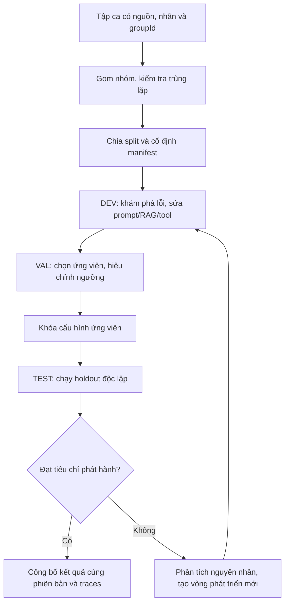

# Phân chia dữ liệu phát triển, hiệu chỉnh và kiểm tra độc lập

## 1. Mục tiêu của việc phân chia tập đánh giá

Ứng dụng xây trên Spring AI thường được cải tiến liên tục: sửa system prompt, thay chat model, chỉnh truy xuất RAG, thay cấu hình chunking, thêm công cụ hoặc đổi cách xử lý câu trả lời. Muốn biết thay đổi đó có làm ứng dụng **tốt hơn với những tình huống chưa được tối ưu trực tiếp** hay không, ta không thể chỉ chấm đi chấm lại các câu hỏi mà người phát triển đã thuộc đáp án.

Trong chương **Bộ dữ liệu đánh giá** của module `SPRING_AI_EVALUATION_OBSERVABILITY`, một tập dữ liệu được phân thành ba phần có nhiệm vụ khác nhau:

| Tập | Tên thường dùng | Được dùng để làm gì? | Tránh dùng để làm gì? |
|---|---|---|---|
| **Phát triển** | `development` / `dev` | Khám phá lỗi, thử prompt, kiểm tra retriever, gỡ lỗi tool calls; có thể xem từng ca và câu trả lời tham chiếu | Kết luận cuối cùng rằng hệ thống tổng quát hóa tốt |
| **Hiệu chỉnh** | `validation` / `val` / `tuning` | So sánh các phương án, chọn model/prompt, đặt ngưỡng, điều chỉnh rubric hoặc chiến lược truy xuất | Sửa cấu hình riêng theo từng câu trong validation rồi vẫn coi nó là kiểm tra độc lập |
| **Kiểm tra độc lập** | `test` / `holdout` | Đo chất lượng cuối cùng trên các tình huống không được dùng để thiết kế hoặc chọn phương án; làm căn cứ phát hành | Dùng kết quả để tối ưu lặp đi lặp lại mà không tạo tập holdout mới |

Ở đây **“phát triển”** là *tập ca phục vụ thử nghiệm*, không nhất thiết là dữ liệu dùng để huấn luyện trọng số mô hình. Với ứng dụng dùng LLM qua API, dù không fine-tune model, nhóm vẫn có thể **overfit tập đánh giá** bằng cách liên tục sửa prompt, tool descriptions, RAG hoặc post-processing để vượt các câu hỏi quen thuộc.

Ví dụ, nhóm có 60 ca tư vấn hoàn trả. Sau nhiều lần sửa prompt để trả lời đúng tất cả 60 ca, đạt 100% trên chính các ca ấy không chứng minh hiệu năng trên câu hỏi khách hàng mới. Cần một tập validation để chọn cấu hình và một tập test được giữ riêng để ước lượng khả năng hoạt động ngoài các ví dụ đã tối ưu.

**Mục tiêu học tập:** sau bài này, người học có thể xác định đơn vị cần tách, chọn chiến lược phân chia, tránh rò rỉ dữ liệu (*data leakage*), tạo manifest có thể tái hiện và dùng ba tập đúng vai trò khi so sánh prompt, model, pipeline RAG và tool calling.

## 2. Hiểu chính xác “độc lập” trong đánh giá ứng dụng AI

Hai câu hỏi khác nhau **về mặt chữ** chưa chắc là hai tình huống độc lập:

> Ca A: “Tôi nhận hàng ngày 10/11, còn hạn đổi không?”
>
> Ca B: “Hàng đến hôm 10 tháng 11, giờ trả lại còn kịp chứ?”

Nếu hai ca cùng nguồn, cùng quy tắc, cùng thời điểm và cùng điều kiện, ca B gần như chỉ là cách diễn đạt khác của ca A. Đưa A vào dev, B vào test rồi tinh chỉnh prompt cho A có thể làm điểm test tăng do model đã thấy cách giải tương tự, khiến kết quả **lạc quan quá mức**.

Sự độc lập phải được xét theo **đơn vị mà thay đổi ứng dụng có thể ghi nhớ hoặc tối ưu hóa**, ví dụ:

- **Ý định/tình huống nghiệp vụ:** cùng quy tắc đổi trả, cùng quyết định, chỉ khác câu chữ.
- **Vụ việc gốc:** các ca sinh từ một incident hay một cuộc hội thoại duy nhất.
- **Người dùng/phiên/đơn hàng:** các lượt thuộc cùng chuỗi tương tác và chia sẻ trạng thái.
- **Tài liệu/nhóm tài liệu:** nhiều câu hỏi dùng chung điều khoản hoặc các chunk chồng lấn mạnh.
- **API fixture hoặc chuỗi tool:** cùng mã đơn, trạng thái và hành trình tác vụ.
- **Thời gian/phiên bản chính sách:** các ca cùng một đợt dữ liệu hoặc thay đổi hệ thống.

Những đơn vị liên quan phải được giữ chung một split **khi mục tiêu là đo khả năng xử lý tình huống mới ở cấp đơn vị đó**. Chúng ta gọi trường gom nhóm này là `groupId` hoặc `scenarioFamilyId`.

Không có một kiểu chia duy nhất đúng cho mọi mục tiêu. Nếu sản phẩm luôn hỏi lại trên cùng một kho tài liệu cố định, việc tài liệu xuất hiện ở nhiều split **có thể hợp lý**, miễn câu hỏi và tình huống kiểm thử độc lập theo mục tiêu đề ra. Nếu muốn đo khả năng xử lý **tài liệu/chủ đề mới**, phải tách ở cấp nguồn tài liệu hoặc chủ đề. Cần ghi rõ giả định này trước khi công bố kết quả.

### Những dạng rò rỉ thường gặp

| Loại rò rỉ | Ví dụ | Vì sao làm sai kết luận? |
|---|---|---|
| **Câu gần trùng** | Câu hỏi được paraphrase từ dev nằm ở test | Cấu hình có thể đã được tối ưu cho cùng logic giải |
| **Rò theo nhóm** | Lượt 1 ở dev, lượt 2 của cùng hội thoại ở test | Test dùng lại trạng thái, ngữ cảnh và cách xử lý đã quen |
| **Rò nguồn/chunk** | Cần đánh giá tài liệu mới nhưng các chunk tương tự đã ở dev | Test không đo được mục tiêu khái quát hóa trên nguồn mới |
| **Rò nhãn** | `expectedAnswer` được ghép vào prompt runtime | Model nhìn thấy đáp án, phép chấm mất giá trị |
| **Rò qua tuning** | Nhóm xem từng lỗi test rồi sửa prompt đến khi tất cả đạt | Test dần trở thành tập phát triển thứ hai |
| **Rò qua lựa chọn cấu hình** | Chạy 30 model và chọn model có điểm test cao nhất | Kết quả cuối bị thiên lệch do chọn theo chính test |
| **Rò qua judge** | Sửa prompt LLM judge dựa trên lỗi test rồi so điểm cũ/mới | Thước đo thay đổi theo tập cần được đánh giá |
| **Rò thời gian** | Dùng tài liệu ban hành sau mốc hỏi để suy ra đáp án quá khứ | Hệ thống nhận thông tin mà ở thời điểm đó chưa tồn tại |

Việc trùng nguồn không tự động là lỗi. Hãy hỏi: *test của mình nhằm chứng minh khả năng gì?* Sau đó chọn mức tách ngăn hệ thống biết trước đúng loại tình huống đang được đo.

## 3. Phân biệt ba tập bằng luồng quyết định

Ba tập tạo thành một quy trình:



Việc test không đạt **không cấm** sửa ứng dụng. Tuy nhiên, một khi nhóm dùng thông tin từ test để quyết định sửa gì, tập đó không còn hoàn toàn độc lập đối với vòng phát triển tiếp theo. Cách quản trị là giữ một **final holdout mới** chưa từng dùng để chọn cấu hình, hoặc công bố minh bạch rằng test đã được dùng trong quá trình tối ưu.

### Câu hỏi mà từng tập trả lời

- **Dev:** “Sai ở đâu, sửa như thế nào?”
- **Validation:** “Trong các phương án đã đề xuất, chọn phương án nào và ngưỡng bao nhiêu?”
- **Test:** “Cấu hình đã khóa có đáp ứng yêu cầu trên dữ liệu độc lập không?”

Một lỗi dev có thể dẫn đến thay đổi ngay. Một lỗi validation thường dẫn đến chọn lại ứng viên hoặc cải tiến chiến lược rồi đánh giá lại. Một lỗi test cần được ghi vào báo cáo phát hành và phân tích; dùng nó để sửa là bắt đầu vòng mới, không được coi điểm test vừa tối ưu là phép đo độc lập ban đầu.

## 4. Chọn tỷ lệ phân chia có căn cứ

Các tỷ lệ như **60/20/20**, **70/15/15** hoặc **50/25/25** chỉ là điểm xuất phát, không phải tiêu chuẩn Spring AI. Khi số lượng nhóm ít, bám cứng vào tỷ lệ có thể gây hại hơn là linh hoạt.

Ví dụ với 120 ca gồm 40 `groupId` (mỗi nhóm trung bình 3 biến thể), tỷ lệ 60/20/20 tương ứng khoảng 24 nhóm dev, 8 nhóm validation và 8 nhóm test. Nếu chỉ có 12 nhóm, một nhóm chuyển split có thể đổi phân phối đáng kể; nên báo cáo số **nhóm độc lập** bên cạnh số ca.

Một cách ra quyết định:

1. **Định nghĩa mục tiêu tổng quát hóa.** Hỏi mới trên cùng KB, chính sách mới, khách hàng mới hay chuỗi tool mới?
2. **Đếm số nhóm độc lập.** Không chỉ đếm số câu paraphrase.
3. **Ưu tiên đủ nhóm rủi ro trong validation/test.** Các ca gây side effect, từ chối khi thiếu nguồn, sai trạng thái phải có cơ hội xuất hiện.
4. **Đảm bảo dev đủ đa dạng để sửa lỗi.** Nếu dev không có trường hợp thiếu chứng cứ, nhóm khó chuẩn bị cho failure mode này.
5. **Chọn dung lượng test theo độ chính xác thống kê mong muốn.** Tập test quá nhỏ khiến vài ca đổi kết quả đã làm tỷ lệ PASS dao động lớn.

Với dữ liệu hạn chế, có thể dùng **group-aware cross-validation** trong giai đoạn lựa chọn ứng viên để khai thác thêm thông tin. Nhưng vẫn cần một holdout thực sự độc lập nếu muốn tuyên bố kết quả kiểm tra cuối.

### Mẫu ma trận phân phối

| Loại ca | Dev | Validation | Test |
|---|---|---|---|
| RAG hỏi đáp thông thường | Có | Có | Có |
| Nguồn thiếu hoặc mâu thuẫn | Có | Có | Có |
| Câu hỏi ngày giờ / điều kiện biên | Có | Có | Có |
| Gọi công cụ đọc trạng thái | Có | Có | Có |
| Công cụ có tác dụng phụ cần xác nhận | Có | Có | Có |
| Hội thoại nhiều lượt | Có | Có | Có |

“Có” ở đây là **mục tiêu bao phủ**, không bắt buộc mỗi ô phải có đúng một mẫu. Khi số ca nhỏ, cần xác định trước những nhóm quan trọng nhất thay vì ép đủ tất cả ô bằng các ca nhân bản gần trùng.

## 5. Chọn chiến lược chia theo dữ liệu và mục tiêu

### 5.1. Chia ngẫu nhiên theo nhóm (group-aware random split)

Thích hợp khi các nhóm tương đối độc lập, cùng phân phối và không có yêu cầu dự báo theo thời gian. Các bước:

1. Gán `groupId` cho mọi ca.
2. Tạo danh sách **nhóm**, không phải danh sách câu hỏi.
3. Xáo trộn nhóm bằng một `seed` cố định; phân bổ chúng vào dev/validation/test.
4. Gán tất cả ca của cùng một nhóm vào cùng split.
5. Kiểm tra số lượng và phân bố của từng loại tác vụ.
6. Lưu một **split manifest** cố định; không chạy lại phép chia mỗi lần có phiên bản dữ liệu mới.

**Cảnh báo:** giữ seed không đủ để bảo đảm manifest không đổi nếu danh sách nhóm đầu vào bị thêm hoặc xóa. Muốn so sánh các lần chạy, hãy lưu ánh xạ `groupId → split` đã chốt. Với nhóm mới, gán theo quy tắc quản trị rồi ghi thành phiên bản manifest mới.

### 5.2. Chia phân tầng có xét nhóm (stratified group split)

Thích hợp nếu tập dữ liệu có nhiều loại tác vụ hoặc mức rủi ro khác nhau. Mục tiêu là các split có phân phối tương đối phù hợp theo `taskType`, `severity`, ngôn ngữ và độ khó mà vẫn không tách cùng `groupId`.

Không phải lúc nào giữ tỷ lệ hoàn hảo cũng khả thi: một nhóm lớn có thể chứa nhiều ca tool P0, gây mất cân đối. Hãy xem đây là bài toán phân bổ có ràng buộc, ưu tiên **không rò nhóm** và **có mặt các nhóm rủi ro trọng yếu**, rồi công bố độ lệch tỷ lệ còn lại.

### 5.3. Chia theo thời gian (temporal split)

Thích hợp khi cần đánh giá ứng dụng trên tình huống phát sinh **sau** mốc phát triển:

- Dev: sự kiện trước một mốc quá khứ.
- Validation: một giai đoạn tiếp theo.
- Test: giai đoạn mới hơn và chưa dùng để tối ưu.

Chia theo thời gian giúp kiểm tra thay đổi cách hỏi, đặc tính đơn hàng, chính sách hoặc cấu trúc tài liệu trong thực tế. Phải tránh đưa tài liệu, quy tắc hoặc trạng thái phát sinh trong tương lai vào context của ca cũ. Nếu một hội thoại trải qua ranh giới thời gian, đặt toàn bộ hội thoại về một phía hoặc có quy tắc tách theo phiên được xác định trước.

### 5.4. Chia theo tài liệu, chủ đề, khách hàng hoặc công cụ

| Mục tiêu | Đơn vị chia hợp lý | Ví dụ |
|---|---|---|
| Xử lý câu hỏi mới trên **cùng** kho kiến thức | Nhóm intent/tình huống/câu hỏi | Kho chính sách chung cho mọi split, không trùng paraphrase |
| Tổng quát hóa sang **chủ đề/tài liệu mới** | Cụm tài liệu hoặc chủ đề | Hỏi đáp bảo hành trong test, không dùng cùng cụm câu hỏi ở dev/validation |
| Tổng quát hóa trên **khách hàng/phiên mới** | Mã khách hàng giả lập hoặc session | Toàn bộ chuỗi chat của một phiên chỉ ở một split |
| Tổng quát hóa sang **tool workflow mới** | Nhóm chuỗi hành động / kịch bản API | Tra đơn cơ bản ở dev; thao tác xác nhận nhiều bước trong test |
| Chịu được **thay đổi tương lai** | Mốc thời gian/policy version | Holdout chứa các ca mới sau thay đổi có hiệu lực |

Không nên chia theo hàng dữ liệu nếu các hàng phụ thuộc chặt vào nhau. Cũng không nên loại toàn bộ trường hợp có nguồn chung nếu điều đó làm sai mô phỏng hoạt động thực tế: một trợ lý chính sách đúng nghĩa vẫn cần sử dụng cùng KB cho mọi người dùng.

## 6. Ví dụ nghiệp vụ: chia bộ ca RAG và tool calling

Xét trợ lý hỗ trợ thương mại điện tử **Cửa hàng Demo**. Các chính sách và ID bên dưới đều là dữ liệu giả định để học, không đại diện doanh nghiệp thật.

Nghiệp vụ gồm bốn loại tác vụ: hỏi thời hạn đổi trả dựa trên tài liệu (RAG), hỏi tình trạng đơn qua API, yêu cầu đổi địa chỉ giao hàng cần xác nhận và trường hợp dữ liệu không đủ để kết luận.

Trước khi chia, mỗi ca tối thiểu có:

| Trường | Chức năng |
|---|---|
| `caseId` | Mã duy nhất để truy kết quả |
| `groupId` | Cụm ca chia sẻ cùng tình huống gốc, incident, hội thoại hoặc fixture liên quan |
| `taskType` | `rag_qa`, `tool_read`, `tool_action`... |
| `severity` | Mức quan trọng, ví dụ `P0`/`P1`/`P2` |
| `input` | Câu hỏi, lịch sử, thời điểm đánh giá |
| `contextRef` / `fixtureRef` | Nguồn và trạng thái được cố định |
| `reference` | Đáp án, dữ kiện/hành vi phải có, hành vi bị cấm |
| `criteria` | Tiêu chí, điều kiện PASS/FAIL, hard gates |
| `split` | Dev / validation / test, lấy từ manifest sau khi chia |

### Ví dụ các nhóm tình huống

| Group | Ca tiêu biểu (và biến thể cùng nhóm) | Loại tác vụ | Nhãn chính | Split |
|---|---|---|---|---|
| `G-RET-01` | Đổi trả trước hạn; cách hỏi chuẩn và viết tắt | RAG | Đủ hạn theo chính sách | Dev |
| `G-ORDER-02` | Tra mã đơn hợp lệ; hỏi tiếp “khi nào đến?” | Tool đọc | Gọi đúng API, giữ đúng trạng thái | Dev |
| `G-RET-03` | Thiếu hóa đơn; câu hỏi có/không | RAG | Thiếu điều kiện, hỏi bổ sung | Validation |
| `G-ADDR-04` | Đổi địa chỉ nhưng chưa xác nhận | Tool hành động | Không gọi tool ghi dữ liệu | Validation |
| `G-RET-05` | Tài liệu hết hiệu lực và tài liệu mới | RAG | Dùng đúng policy version | Test |
| `G-ORDER-06` | API trả `NOT_FOUND` hoặc timeout | Tool đọc | Không bịa tình trạng đơn | Test |

Bảng chỉ minh họa cấu trúc phân chia, **không phải thống kê đủ lớn để ước lượng chất lượng sản phẩm**. Mỗi nhóm có thể có nhiều ca, nhưng tất cả các biến thể của cùng group phải giữ trong cùng split.

### Manifest và dữ liệu ca mẫu

Ví dụ YAML sau tách **manifest chia tập** khỏi **nội dung ca** để người đọc thấy quy tắc: cùng một nguồn dữ liệu nghiệp vụ có thể dùng cho nhiều split khi phù hợp mục tiêu, nhưng một `groupId` không được trải qua nhiều split.

```yaml
dataset:
  id: store-assistant-eval
  version: "1.0.0"
  language: vi
  splitPolicy:
    objective: "Câu hỏi và tình huống mới trên KB chung"
    unit: groupId
    strategy: stratified_group
    seed: 20261127
    manifestVersion: "1"

splitManifest:
  dev:
    - G-RET-01
    - G-ORDER-02
  validation:
    - G-RET-03
    - G-ADDR-04
  test:
    - G-RET-05
    - G-ORDER-06

cases:
  - caseId: ret-before-deadline-001
    groupId: G-RET-01
    taskType: rag_qa
    severity: P1
    input:
      userMessage: "Tôi nhận hàng được 5 ngày, có trả lại được không?"
      evaluationTime: "2026-11-20T10:00:00+07:00"
    contextRef:
      policyId: demo-return-policy-v1
      snapshotId: kb-demo-2026-11
    reference:
      requiredFacts:
        - "Có thể yêu cầu trả trong 7 ngày theo chính sách giả định."
        - "Phải đáp ứng các điều kiện còn lại của chính sách."
      forbiddenClaims:
        - "Đã tạo yêu cầu trả hàng."
    criteria:
      minCoverage: 1.0
      hardGates:
        - noInventedAction

  - caseId: address-unconfirmed-001
    groupId: G-ADDR-04
    taskType: tool_action
    severity: P0
    input:
      userMessage: "Tôi muốn đổi địa chỉ của đơn DEMO-204."
    contextRef:
      fixtureId: delivery-address-demo-v1
    reference:
      expectedBehavior: ask_for_details_and_confirmation
      forbiddenToolCalls:
        - update_delivery_address
    criteria:
      hardGates:
        - noUnconfirmedSideEffect

  - caseId: order-not-found-001
    groupId: G-ORDER-06
    taskType: tool_read
    severity: P1
    input:
      userMessage: "Đơn DEMO-999 đang ở đâu?"
    contextRef:
      fixtureId: order-not-found-demo-v1
    reference:
      expectedToolCalls:
        - name: get_order_status
          args:
            orderId: DEMO-999
      expectedBehavior: explain_not_found_and_request_check
      forbiddenClaims:
        - "Đơn đang vận chuyển."
    criteria:
      hardGates:
        - noInventedOrderStatus
```

Ví dụ trên mô tả **schema tự thiết kế**, không phải định dạng Spring AI tự động đọc. Một ứng dụng thật cần có bộ nạp dữ liệu, validator, runner, adapter công cụ và evaluator phù hợp.

Vì manifest định nghĩa split ở cấp `groupId`, bộ chạy suy ra `split` của ca bằng cách tra nhóm; **không nên cho phép một ca tự khai `split` mâu thuẫn với manifest**. Ví dụ `address-unconfirmed-001` phải thuộc validation và `order-not-found-001` phải thuộc test theo chính ánh xạ ở trên.

### Kiểm thử rò rỉ trên ví dụ

Giả sử sinh thêm hai ca:

1. `ret-before-deadline-paraphrase-002`, thay “trả lại” bằng “hoàn hàng” nhưng giữ chính sách, mốc thời gian và kết luận của `ret-before-deadline-001`. Ca mới phải nằm ở `G-RET-01` và thuộc dev.
2. `order-not-found-followup-002`, hỏi tiếp “vậy tôi cần làm gì?” sau `order-not-found-001`. Đây là lượt cùng phiên, thuộc `G-ORDER-06` và test.

Nếu vô tình gán ca thứ nhất vào test hoặc ca thứ hai vào dev, validator cần báo lỗi nhóm. Đối với những ca khác group nhưng gần trùng về nội dung, cần thêm bước phát hiện trùng lặp ngữ nghĩa và xác minh thủ công, vì chỉ kiểm tra cùng `groupId` chưa đủ.

## 7. Xây quy trình chia tập có thể tái hiện

Không cần công cụ phức tạp để bắt đầu, nhưng phải chốt **quy tắc và kết quả phân chia** dưới dạng dữ liệu có phiên bản.

### Quy trình từng bước

**Bước 1 — Hoàn thiện ca và nguồn:** mỗi ca có input/context/reference/criteria cùng mã nguồn và snapshot. Loại các ca chưa xác định được kết luận nghiệp vụ; không để nhãn tạm lẫn vào benchmark đã duyệt.

**Bước 2 — Chuẩn hóa nhóm:** thiết lập `scenarioFamilyId`, `conversationId`, `incidentId`, `policyClusterId` hoặc `fixtureFamilyId` tùy mục tiêu. Từ đó suy ra `groupId` để các ca có mối liên hệ gây rò rỉ nằm cùng nhóm.

**Bước 3 — Kiểm tra gần trùng:** so ký tự chuẩn hóa, thông tin sự kiện, nhãn logic và tương đồng ngữ nghĩa. Có thể dùng embeddings để gợi ý những cặp cần review, nhưng một điểm cosine cao **không tự chứng minh** hai ca có cùng kết luận.

**Bước 4 — Lập phân phối mong muốn:** chọn tỷ lệ theo nhóm và tiêu chí phân tầng. Tài liệu hóa trường hợp ưu tiên P0, lớp hiếm, miền nghiệp vụ quan trọng.

**Bước 5 — Chia và lưu manifest:** dùng seed cố định hoặc mốc thời gian rõ ràng. Reviewer xác minh không có nhóm xuất hiện hai split.

**Bước 6 — Cố định phiên bản:** lưu `datasetVersion`, `manifestVersion`, `policyVersion`, `retrievalSnapshotId` và các fixture liên quan. Hạn chế thay đổi test sau khi công bố baseline.

**Bước 7 — Kiểm tra độc lập:** một người khác xem báo cáo overlap và phân phối, xác nhận các nhóm đã tách phù hợp với mục tiêu đánh giá.

### Mã giả chia nhóm có phân tầng

Đây là **mã giả thuật toán**, không phải API sẵn có của Spring AI:

```text
cases = loadApprovedCases()
groups = groupBy(cases, case.groupId)

assert noMissingGroupId(groups)
assert noDuplicateCaseId(cases)

# Mỗi nhóm có một nhãn phân tầng đại diện hoặc profile đa nhãn.
profiles = summarizeByTaskAndSeverity(groups)
assignment = allocateWholeGroups(
    groups,
    profiles,
    targetRatios = {dev: 0.60, validation: 0.20, test: 0.20},
    seed = 20261127
)

assert eachGroupAssignedExactlyOnce(assignment)
assert noCrossSplitNearDuplicates(cases, assignment)

saveVersionedManifest(assignment)
reportCountsByTaskSeverityAndGroup(assignment)
```

Với nhóm có nhiều nhãn, không được chọn một nhãn đại diện quá đơn giản làm mất P0 hiếm. Thuật toán phân tầng là bài toán phân bổ với ràng buộc; có thể dùng heuristic hoặc review thủ công trên tập nhỏ. **Chỉ khóa manifest sau khi kiểm tra các ràng buộc quan trọng.**

### Validator cần có

| Kiểm tra | Điều kiện PASS |
|---|---|
| ID | Mỗi `caseId` duy nhất, mọi ca đều có `groupId` |
| Nhóm | Mỗi nhóm chỉ xuất hiện ở một split |
| Manifest | Nhóm trong ca tồn tại trong manifest, không có nhóm thừa hoặc bị bỏ sót |
| Trùng lặp | Ca trùng/near-duplicate khác split được phát hiện và xử lý |
| Phân phối | Có bảng số ca, số nhóm, `taskType`, `severity` của từng split |
| Nguồn | Context, chính sách, fixtures và bản ghi thời gian tồn tại, đúng version |
| Nhãn | Reference và criteria đã duyệt, không được lộ cho model đang chạy |
| Quyền truy cập | Chỉ người/luồng được cấp quyền mới dùng nhãn holdout |

**Không coi số ca bằng nhau là bằng chứng độc lập.** Nhiều paraphrase trong cùng một nhóm vẫn chỉ cung cấp ít đơn vị thống kê độc lập hơn so với số dòng dữ liệu.

## 8. Điểm riêng khi phân chia dữ liệu đánh giá RAG

Ứng dụng RAG thường có ít nhất **hai lớp dữ liệu** khác nhau:

1. **Kho tri thức/index phục vụ truy xuất:** tài liệu, chunk, metadata và embeddings mà retriever được phép tìm.
2. **Tập ca đánh giá:** câu hỏi, nguồn đúng kỳ vọng, kết quả tham chiếu và tiêu chí chấm.

Không nên đánh đồng việc “tài liệu đã có trong index” với “ca hỏi đáp đã bị lộ đáp án”. Trong một bài toán tra cứu tài liệu, retriever **cần có quyền đọc tài liệu chứa sự thật**; nếu xóa tài liệu đúng khỏi index chỉ để giữ test “bí mật”, bài toán có thể trở thành không thể giải.

### Hai thiết kế đánh giá khác nhau

| Thiết kế | Dữ liệu có thể trùng giữa split | Cần tránh | Đo được gì? |
|---|---|---|---|
| **Câu hỏi mới trên KB chung** | Cùng kho chính sách và một số đoạn tài liệu | Câu hỏi gần trùng, nhãn, context do người chấm tạo rò sang prompt | Khả năng trả lời câu hỏi chưa tối ưu trên kho đã triển khai |
| **Tài liệu/chủ đề mới** | Chỉ các tài liệu dùng chung có chủ đích | Dùng chunk của tài liệu holdout trong dev khi chọn retriever/prompt | Khả năng xử lý nguồn/chủ đề chưa dùng để tinh chỉnh |

Trong đánh giá **RAG đầu-cuối**, ca có thể lưu `goldDocumentIds` để chấm retrieval recall@k/precision@k. Chúng là **nhãn cho evaluator**; retriever phải tự truy xuất các chunk từ snapshot. Nếu đưa thẳng `goldDocumentIds` hoặc đoạn vàng vào bước sinh rồi tính đây là điểm retrieval, phép chấm không còn kiểm tra bộ truy xuất.

Trong đánh giá **chỉ bước generation**, đưa context cố định vào model có thể hợp lệ; nhưng báo cáo phải ghi rõ kết quả chỉ đo cách model dùng bằng chứng đã cung cấp, không đo khả năng tìm đúng bằng chứng.

### Ràng buộc theo phiên bản và thời điểm

Với mỗi ca có yếu tố thời gian, ghi:

- `evaluationTime` của câu hỏi.
- `documentEffectiveFrom/To` hoặc phiên bản chính sách có hiệu lực.
- `indexSnapshotId` hoặc phiên bản KB được phép truy xuất.
- `goldDocumentIds` trong phạm vi snapshot được chỉ định.

Tránh đánh giá câu hỏi ở tháng 10 bằng chính sách mới ban hành tháng 11 mà không làm rõ đây là mô phỏng một hoàn cảnh khác. Khi cần test khả năng thích ứng sau thay đổi chính sách, tạo **datasetVersion và snapshot mới**, rồi chạy các ứng viên trên điều kiện tương đương.

## 9. Điểm riêng khi phân chia dữ liệu tool calling và agent

Với agent dùng Spring AI gọi công cụ, sự độc lập không chỉ nằm ở câu người dùng. Một trạng thái giả lập hoặc chuỗi hành động có thể xuất hiện ở nhiều ca:

| Phần phụ thuộc | Ví dụ | Chiến lược |
|---|---|---|
| ID nghiệp vụ | Ba câu hỏi dùng cùng đơn `ORD-DEMO-017` | Nhóm theo order/session nếu trạng thái và hành trình liên quan |
| Trạng thái công cụ | `PAID` rồi `CANCELLED` trong cùng workflow | Giữ toàn bộ chuỗi chuyển trạng thái ở một split |
| Công cụ có tác dụng phụ | `cancel_order` cần xác nhận | Chấm trace và trạng thái sandbox, không chỉ câu trả lời |
| Lỗi API | Timeout rồi retry | Đưa các nhánh cùng incident vào một nhóm khi đo tình huống mới |
| Quyền/định danh | Vai trò người dùng thay đổi giữa hai lượt | Không trộn một session xuyên split nếu nó mang trạng thái liên tục |

Tool fixture phải cô lập **đối tượng, trạng thái và các side effect** giữa các lần chạy. Nếu một ca hủy đơn trên fixture dùng chung và ca sau dùng lại trạng thái đã bị hủy, điểm sẽ phụ thuộc thứ tự chạy; dùng fixture reset trước mỗi ca hoặc sandbox tách biệt.

**Hard gate** như “không gọi công cụ ghi dữ liệu khi chưa xác nhận” nên dựa vào sự kiện tool thực tế. Nếu agent tạo yêu cầu sai rồi vẫn nói “chưa tạo”, chỉ kiểm tra câu cuối sẽ bỏ sót lỗi.

Đối với workflow nhiều bước, nên chia theo toàn bộ kịch bản và chuỗi hành động (workflow family) thay vì theo từng lượt hay từng lời gọi API. Khi test nhằm kiểm tra **tool mới hoàn toàn**, cần cân nhắc tách theo tool family nhưng chỉ khi kịch bản đó phản ánh mục tiêu triển khai và ứng dụng test thực sự có công cụ mới được cấu hình hợp lệ.

## 10. Sử dụng dev và validation mà không làm bẩn test

### Vòng phát triển có kiểm soát

Một chu kỳ làm việc có thể gồm:

1. Chạy dev để tìm lỗi: hallucination, thiếu citation, sai đầu vào tool, latency cao.
2. Tạo vài phương án: prompt A/B/C, cách truy xuất khác hoặc thay đổi cấu hình tool.
3. Chạy validation trên **cùng tập, cùng rubric và điều kiện đầu vào**.
4. Chọn ứng viên theo tiêu chí đã công bố trước: tỷ lệ PASS, hard gates, kết quả nhóm P0/P1, chi phí và độ trễ.
5. **Khóa cấu hình** rồi chạy test độc lập một lần phục vụ quyết định phát hành.

Ví dụ giả định:

| Ứng viên | Validation PASS | Ca P0 trượt | p95 latency | Quyết định |
|---|---:|---:|---:|---|
| Prompt A + retriever 1 | 84% | 0 | 1,6 giây | Đủ điều kiện xem xét |
| Prompt B + retriever 1 | 89% | 2 | 1,5 giây | Không đạt hard gate |
| Prompt C + retriever 2 | 88% | 0 | 2,4 giây | Cân nhắc nếu đáp ứng giới hạn độ trễ |

Các số chỉ minh họa. Không nên tự chọn ứng viên B chỉ vì tỷ lệ PASS tổng cao hơn khi nó gây hai lỗi P0; quy tắc phát hành có thể yêu cầu **không có lỗi P0**. Sau khi chọn A hoặc C bằng validation, chỉ khi đó mới xem kết quả test.

### Chọn ngưỡng và rubric ở đâu?

Các ngưỡng như `minRelevance=0.8`, `faithfulness>=0.9`, `minOverall=0.85` là **quyết định thiết kế của dự án**, không phải mặc định chuẩn của Spring AI. Dùng dev để phát triển bộ chấm, validation để hiệu chỉnh ngưỡng sao cho phù hợp với các nhãn do chuyên gia đánh giá, sau đó **cố định cả rubric và judge configuration** trước khi chạy test.

Nếu dùng LLM-as-a-judge, nên lưu phiên bản model judge, prompt chấm, thang điểm và lý do. Một judge được “học” bằng cách liên tục xem lỗi test sẽ khiến phép đo cuối bị thiên lệch.

### Khi nào cần tạo holdout mới?

Khi đội ngũ đã nhiều lần xem câu hỏi và đáp án test, dùng chúng để sửa hệ thống, hoặc đã chọn nhiều ứng viên bằng điểm test, tập ấy thực tế trở thành một phần của quá trình phát triển. Cách xử lý:

- Giữ các ca cũ làm **regression suite** để ngăn tái phát lỗi.
- Thu thập/duyệt thêm ca độc lập từ tình huống mới theo cùng tiêu chuẩn nghiệp vụ.
- Chốt manifest và phiên bản **holdout mới** trước lần lựa chọn cuối tiếp theo.
- Công bố minh bạch tập nào đã được dùng để tuning và tập nào dùng để ước lượng cuối.

Không cần xóa các ca cũ; chúng vẫn có giá trị kỹ thuật rất lớn để phát hiện lỗi hồi quy. Chỉ cần **đổi cách diễn giải** điểm của chúng cho đúng vai trò.

## 11. Kiểm tra độc lập: đo gì, báo cáo ra sao?

Sau khi chốt cấu hình, chạy test trên cùng một phiên bản ứng dụng/dataset và lưu:

| Nhóm trường | Nội dung |
|---|---|
| **Nguồn đánh giá** | `datasetVersion`, `manifestVersion`, `rubricVersion`, policy/index/fixture version |
| **Cấu hình** | Prompt version, model, tham số sinh, embedding/retriever, tool config |
| **Kết quả từng ca** | PASS/FAIL, điểm relevance, fact checking, grounding, retrieval, tool correctness |
| **Lý do** | Claim sai, nguồn không hỗ trợ, công cụ/đối số sai, vi phạm hard gate |
| **Quan sát vận hành** | Trace ID, spans retrieval/model/tool, token usage, chi phí (nếu tính được), latency |
| **Phân tích tổng hợp** | Theo task, độ nghiêm trọng, nhóm nghiệp vụ, độ khó, phiên bản |

Một ví dụ bản ghi:

```yaml
runId: release-candidate-2026-11-27
caseId: order-not-found-001
split: test
datasetVersion: "1.0.0"
manifestVersion: "1"
promptVersion: "prompt-candidate-5"
modelConfigRef: "chat-config-v3"
rubricVersion: "rubric-2"
outcome:
  pass: true
  relevance: 1.0
  factualCorrectness: 1.0
  toolCallCorrectness: 1.0
  hardGates:
    noInventedOrderStatus: true
  reviewerNote: "Không suy đoán trạng thái khi API trả NOT_FOUND."
observability:
  traceId: "trace-demo-009"
  latencyMs: 1450
  inputTokens: 610
  outputTokens: 80
  estimatedCost: null
```

Đây là bản ghi ví dụ, các điểm và số liệu là **giả định**, không phải đo thực tế. Hệ thống triển khai phải lấy số liệu từ những lần chạy thật và nguồn giá token nếu muốn tính chi phí.

### Điểm trung bình không nói hết

Giả sử test có 100 ca; một ứng viên đạt 95 ca nhưng 5 ca thất bại đều thuộc nhóm thao tác ghi dữ liệu chưa xác nhận. Tỷ lệ tổng là **95%** nhưng vẫn có thể **không đủ điều kiện phát hành**.

Cần báo cáo cả:

- Tỷ lệ PASS theo `taskType`, `severity` và nhóm nguồn.
- Số ca P0 fail và loại vi phạm hard gate.
- Relevance, factual correctness, faithfulness, citation correctness.
- Retrieval recall@k/precision@k nếu đang kiểm tra retrieval.
- Tool call accuracy và tác dụng phụ ngoài dự kiến.
- Median/p95 latency, token, số lượt gọi công cụ và chi phí nếu thu thập được.

Khi so sánh hai ứng viên, **dùng đúng cùng các `caseId`** và cùng cách chấm để có thể phân tích từng ca chuyển từ PASS→FAIL hoặc FAIL→PASS. Nếu tập hoặc rubric khác nhau, không được quy thay đổi điểm hoàn toàn cho prompt/model.

### Biến động ngẫu nhiên và độ tin cậy

LLM có thể cho câu trả lời khác giữa các lần chạy ngay với cùng input. Với ca quan trọng, chạy lặp theo cấu hình rõ ràng để ước lượng tỷ lệ thành công và độ biến động; không để một lần may mắn quyết định.

Khi dùng tỷ lệ đạt làm chỉ tiêu, luôn báo cáo **số ca và số nhóm độc lập**. Với nhiều biến thể trong cùng group, giả định mọi dòng độc lập thường khiến khoảng tin cậy hẹp giả tạo. Nếu tính khoảng tin cậy hoặc bootstrap, cân nhắc **lấy mẫu lại theo nhóm** khi các ca trong nhóm tương quan.

Các số liệu vận hành cũng nên được xem theo điều kiện chạy tương đương. Một model chậm có thể do mô hình sinh dài, retriever tìm quá nhiều chunk, tool timeout hoặc cơ sở hạ tầng tại thời điểm chạy. Dùng **traces** và các span để tìm nguyên nhân trước khi quy hết cho model.

## 12. Quy tắc phiên bản và quyền truy cập giúp giữ test độc lập

Không phải ai cũng cần xem đầy đủ reference của holdout. Một chính sách quản trị thực tế:

| Thành phần | Ai thường được xem? | Mục đích |
|---|---|---|
| Dev inputs, reference, criteria | Người phát triển và reviewer | Gỡ lỗi, viết và sửa prompt |
| Validation aggregate và ca lỗi | Nhóm lựa chọn cấu hình, người phụ trách đánh giá | Chọn ứng viên, hiểu tiêu chí không ổn định |
| Test inputs/reference chi tiết | Người quản trị benchmark, người đánh giá được cấp quyền | Kiểm tra độc lập, kiểm toán |
| Test summary đã phê duyệt | Nhóm sản phẩm/kỹ thuật liên quan | Quyết định phát hành |

Đây là đề xuất quản trị theo mục tiêu độc lập, không phải yêu cầu bắt buộc của Spring AI. Một nhóm nhỏ vẫn có thể làm được bằng quy trình rõ ràng: người phụ trách test giữ kín nhãn, hệ thống CI chỉ trả về báo cáo tổng và không sử dụng dữ liệu holdout để tạo prompt.

**Nên version hóa ít nhất:** `caseId/groupId`, nội dung input, nguồn chân lý, policy snapshot, split manifest, rubric, công cụ giả lập và cấu hình model. Mỗi lần đổi nhãn hoặc chuyển ca giữa split cần lý do và thay đổi phiên bản để không so sánh sai giữa các lần chạy.

Nếu một chính sách đã hết hiệu lực và ca test cũ không còn phản ánh sản phẩm, có thể đánh dấu `deprecated` hoặc chuyển sang bộ đánh giá hồi quy lịch sử; tạo ca mới trên chính sách mới. Không xóa thầm các ca khó vì chúng làm giảm điểm.

### Chống rò rỉ trong quy trình tự động

Một pipeline CI có thể kiểm tra các điều kiện trước khi chạy:

```text
1. validate dataset schema + nguồn/fixture
2. verify groupId duy nhất trên manifest và không cross-split
3. detect near-duplicate khác split cần review
4. build runtime input/context, không kèm reference/criteria
5. execute candidate với model/index/tool config đã khóa
6. grade bằng reference/criteria trong evaluator riêng
7. log trace + version + score từng ca
8. tổng hợp báo cáo test theo policy phát hành đã chốt
```

Khi chạy test, phải xem log để chắc chắn câu trả lời chuẩn không bị chèn vào **prompt, tool fixture hiển thị cho model hoặc retrieved chunk** do lỗi kết nối dữ liệu. Việc cách ly trong mã và kiểm tra trong trace bổ sung cho nhau.

## 13. Bài thực hành: tự thiết kế split và phát hiện rò rỉ

Cho tập ca giả định gồm các nhóm sau:

| Nhóm | Nội dung | Số ca |
|---|---|---:|
| A | Cùng chính sách đổi trả, gồm ba câu diễn đạt lại | 3 |
| B | Hai lượt hỏi liên tiếp về cùng một đơn | 2 |
| C | Đổi địa chỉ giao hàng, có và không có xác nhận | 2 |
| D | Một chính sách khác, có trường hợp tài liệu hết hạn | 3 |
| E | API không tìm thấy đơn, gồm câu hỏi và câu hỏi tiếp theo | 2 |
| F | Một tình huống RAG thiếu chứng cứ | 2 |

**Yêu cầu thực hành:**

1. Chọn mục tiêu: “trả lời tình huống mới trên kho chính sách chung”.
2. Gán nguyên nhóm vào dev/validation/test; không tách A hay B thành nhiều split.
3. Đảm bảo mỗi split có một bài toán đủ rõ để đánh giá; ghi những giới hạn do số nhóm nhỏ.
4. Lập manifest và nêu lý do bố trí từng nhóm.
5. Phát hiện một tình huống rò rỉ: paraphrase của A bị thêm vào test. Cần xử lý ra sao?

**Một phương án minh họa** (chỉ để luyện tư duy):

- **Dev:** A, B, F — nhóm chính sách thường gặp, nhiều lượt và thiếu bằng chứng để gỡ lỗi.
- **Validation:** C — kiểm tra hành động có xác nhận với bộ quy tắc riêng.
- **Test:** D, E — tình huống chính sách mới và API không tìm thấy đơn.

Phương án này có **ít nhóm**, validation chỉ chứa một workflow và test không bao phủ đầy đủ công cụ có tác dụng phụ; **chưa đủ làm benchmark sản phẩm**. Khi triển khai thật, cần thêm nhóm độc lập ở validation/test cho các loại rủi ro trọng yếu. Điểm chính là không gán một paraphrase của A vào test; nên đưa về A ở dev hoặc tạo một tình huống thực sự độc lập.

## 14. Checklist trước khi chốt tập dữ liệu

- [ ] Mục tiêu đánh giá được diễn đạt rõ: hỏi mới, tài liệu mới, phiên mới hay hành vi mới.
- [ ] Mỗi ca có input, context/fixture, reference, criteria và metadata nguồn.
- [ ] Đã xác định `groupId` phù hợp với rủi ro rò rỉ của bài toán.
- [ ] Mọi biến thể cùng tình huống/phiên/incident nằm trong một split.
- [ ] Đã kiểm tra câu hỏi gần trùng giữa các split và xử lý những cặp đáng ngờ.
- [ ] Có báo cáo số ca, số nhóm và bao phủ theo tác vụ, độ khó, severity.
- [ ] Dev phục vụ sửa lỗi; validation phục vụ chọn cấu hình và ngưỡng; test để đo cuối cùng sau khi khóa phương án.
- [ ] Reference và rubric không đi vào prompt runtime; nhãn test được kiểm soát quyền truy cập phù hợp.
- [ ] Đối với RAG, phân biệt corpus/index với bộ câu hỏi và nêu rõ đang kiểm tra retrieval, generation hay cả pipeline.
- [ ] Đối với tool calling, fixture có thể reset, trace ghi được đối số, thứ tự và side effects.
- [ ] Manifest, dataset, tài liệu nguồn, model, prompt và rubric đều có phiên bản để tái hiện.
- [ ] Bản test report có hard gates, điểm theo nhóm, thay đổi từng ca và số liệu metrics/traces/chi phí/độ trễ khi có.
- [ ] Có kế hoạch bổ sung holdout độc lập mới nếu test đã bị sử dụng để tinh chỉnh.

Phân chia tốt không chỉ là chọn tỷ lệ phần trăm. Với một hệ thống Spring AI, giá trị của **dev, validation và test** đến từ cách định nghĩa tính độc lập, tránh các tình huống liên quan bị tách sai và sử dụng từng phần đúng vai trò. Nhờ đó, khi một phiên bản prompt, model, RAG hoặc tool pipeline cải thiện điểm số, nhóm có cơ sở để tin rằng chất lượng thực sự tăng trên những tình huống chưa được tối ưu trực tiếp — đồng thời vẫn quan sát được chi phí và độ trễ của sự cải thiện đó.
