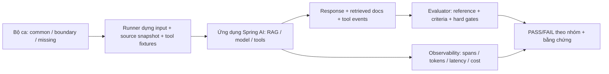

# Bao phủ câu hỏi thường gặp, trường hợp biên và dữ liệu thiếu

## 1. Vì sao phải thiết kế độ bao phủ cho tập dữ liệu đánh giá?

Một trợ lý xây dựng với Spring AI có thể xử lý tốt hàng trăm câu hỏi đơn giản nhưng vẫn gây lỗi nghiêm trọng khi người dùng hỏi đúng lúc hết hạn, không cung cấp đủ mã đơn, tài liệu truy xuất không có câu trả lời hoặc API trả lỗi. Tỷ lệ đúng trung bình cao không bảo đảm hệ thống xử lý tốt các tình huống ít gặp nhưng có rủi ro lớn.

Trong chương **Bộ dữ liệu đánh giá** thuộc module `SPRING_AI_EVALUATION_OBSERVABILITY`, **độ bao phủ** (*evaluation coverage*) mô tả mức độ mà tập ca kiểm thử đại diện cho các nhiệm vụ, điều kiện dữ liệu và loại lỗi ứng dụng phải xử lý. Độ bao phủ tốt giúp kiểm chứng:

- **Câu hỏi thường gặp:** ứng dụng trả lời đúng, liên quan và nhanh đối với nhu cầu phổ biến.
- **Trường hợp biên:** ứng dụng áp dụng đúng quy tắc tại ngưỡng, điểm chuyển trạng thái và điều kiện ngoại lệ.
- **Dữ liệu thiếu hoặc không đáng tin:** ứng dụng không bịa dữ kiện, biết hỏi lại hoặc nói rõ giới hạn khi chưa đủ cơ sở.
- **Hành vi hệ thống:** pipeline RAG tìm được chứng cứ, công cụ được gọi đúng, không phát sinh hành động ngoài quyền hay ý định.

Ba nhóm trên không tách biệt tuyệt đối. Một câu hỏi thường gặp vẫn có thể thiếu mã đơn; một ca biên có thể đồng thời chứa tài liệu mâu thuẫn. Vì vậy cần phân tích **các chiều bao phủ** rồi chọn những tổ hợp đại diện cho rủi ro, thay vì chỉ tạo ba thư mục “normal”, “edge”, “missing”.

> **Phân biệt:** số lượng ca là *quy mô* của tập đánh giá; độ bao phủ là *mức độ đại diện*. Tạo thêm 100 biến thể diễn đạt của một câu hỏi có thể tăng quy mô nhưng gần như không tăng độ bao phủ nghiệp vụ.

## 2. Chọn các chiều bao phủ trước khi viết ca

Trước tiên xác định ứng dụng phục vụ ai, làm những tác vụ gì và phụ thuộc nguồn nào. Với một trợ lý chăm sóc khách hàng dùng Spring AI, có thể lập bảng:

| Chiều | Những giá trị cần cân nhắc | Lỗi có thể phát hiện |
|---|---|---|
| **Mục đích người dùng** | Hỏi chính sách, tìm đơn, tra hạn, yêu cầu cập nhật, hỏi lại | Trả lời lệch ý định, chọn sai công cụ |
| **Tần suất** | Thường gặp, ít gặp nhưng quan trọng | Hệ thống chỉ tốt ở nhóm câu hỏi quen thuộc |
| **Trạng thái nghiệp vụ** | `PAID`, `SHIPPED`, `DELIVERED`, `CANCELLED`, `UNKNOWN` | Suy luận sai dựa trên trạng thái |
| **Điều kiện thời gian/số** | Trước ngưỡng, đúng ngưỡng, sau ngưỡng | Sai dấu `<`, `<=`; nhầm múi giờ |
| **Chất lượng chứng cứ** | Đủ, thiếu một phần, không có, mâu thuẫn, lỗi thời | Hallucination, dẫn sai nguồn |
| **Kết quả công cụ** | Thành công, rỗng, không tìm thấy, timeout, từ chối quyền | Bịa dữ liệu, retry sai, lộ thông tin |
| **Kiểu hội thoại** | Một lượt, nhiều lượt, sửa lại ý định, thiếu tham chiếu | Nhầm ngữ cảnh hoặc mã đơn |
| **Định dạng đầu vào** | Tiếng Việt chuẩn, viết tắt, lỗi gõ, câu dài, JSON | Bỏ sót yêu cầu hoặc parse sai |
| **Rủi ro hành động** | Chỉ đọc, ghi dữ liệu, giao dịch cần xác nhận | Thực hiện side effect trái phép |

Không cần tạo mọi tổ hợp của tất cả các chiều. Nếu mỗi chiều có 4 giá trị và có 8 chiều, phép nhân 4^8 đã cho **65.536** tổ hợp trước khi xét biến thể câu chữ. Thay vào đó:

1. Bao phủ các **luồng phổ biến** bằng tập ca điển hình.
2. Thêm các **ngưỡng quyết định và điều kiện biên** có thể làm thay đổi kết quả.
3. Thêm các **lỗi nguồn, dữ liệu và công cụ** mà ứng dụng có khả năng gặp.
4. Ưu tiên tổ hợp có **tác động lớn** hoặc từng gây sự cố.
5. Dùng phương pháp ghép cặp (*pairwise*) hoặc lựa chọn có chủ đích cho các giao cắt còn thiếu, rồi rà soát thủ công các tổ hợp nguy hiểm.

Một tổ hợp cần kiểm tra kỹ là “người dùng yêu cầu đổi địa chỉ + thiếu xác nhận + công cụ ghi dữ liệu đang khả dụng”; nếu chỉ kiểm tra từng điều kiện riêng, có thể bỏ lỡ lỗi thực hiện hành động chưa được phép.

## 3. Bao phủ câu hỏi thường gặp: đo chất lượng nền

**Ca thường gặp** (*happy path/representative case*) là tình huống có tần suất thực tế cao, đủ thông tin để giải quyết và nằm trong điều kiện vận hành thông thường. Chúng tạo đường cơ sở để biết ứng dụng có thực hiện được các nhiệm vụ chính hay không.

Ví dụ:

| Nhu cầu thường gặp | Đầu vào điển hình | Bằng chứng cần có | Hành vi đúng |
|---|---|---|---|
| Tra cứu đơn | “Đơn DEMO-104 đang ở đâu?” | Kết quả `get_order_status` cho đúng mã đơn | Nêu trạng thái và ETA nếu công cụ có trả |
| Hỏi đổi trả | “Nhận hàng hôm qua, có đổi được không?” | Chính sách có hiệu lực và trạng thái hàng | Trả lời theo điều kiện, dẫn nguồn |
| Tra cứu bảo hành | “Sản phẩm A bảo hành bao lâu?” | Tài liệu đúng mã sản phẩm/phiên bản | Nêu thời hạn được chứng minh, không suy diễn |
| Hỏi tiếp một đơn | “Thế khi nào giao?” | Lịch sử chứa mã đơn vừa hỏi | Dùng đúng tham chiếu hội thoại |
| Yêu cầu định dạng | “Tóm tắt chính sách thành 3 ý” | Tài liệu đủ nội dung | Đúng ý chính, đúng cấu trúc mong muốn |

### Thu thập mẫu điển hình như thế nào?

Nguồn tham khảo có thể gồm yêu cầu đã ẩn danh, FAQ được phê duyệt, số liệu nhóm ý định, báo cáo lỗi và xác nhận của chuyên gia nghiệp vụ. Không lấy thẳng câu trả lời trước đây của chatbot làm đáp án chuẩn; phải kiểm tra với tài liệu hoặc trạng thái thực sự có thẩm quyền.

Nên tạo một số biến thể ngôn ngữ **có kiểm soát** cho mỗi tình huống: “Đơn của tôi tới đâu rồi?”, “Kiểm tra đơn DEMO-104”, “đơn demo104 ship tới đâu”. Nhưng cần giữ hoặc làm rõ thực thể cần tra cứu. Khi một cách hỏi bỏ mất mã đơn, nó đã chuyển sang một loại ca **thiếu đầu vào**, không còn là paraphrase tương đương.

### Đừng chỉ nhìn tỷ lệ PASS ở nhóm phổ biến

Với ca điển hình, nên chấm cả:

- **Relevance:** có giải quyết đúng câu hỏi?
- **Factual correctness:** trạng thái, thời hạn và thông tin có đúng với nguồn?
- **Grounding/citation:** nội dung RAG có được nguồn hỗ trợ?
- **Tool correctness:** gọi đúng công cụ và tham số, dùng đúng kết quả?
- **Latency và cost:** độ trễ/tokens/chi phí có nằm trong mục tiêu vận hành không?

Một câu trả lời đúng nhưng cần sáu lần gọi API dư thừa cho tác vụ đơn giản có thể đạt điểm tính đúng, song cần được đánh dấu về **hiệu năng**. Không dùng độ trễ thấp để thay thế đánh giá đúng/sai về nghiệp vụ.

## 4. Bao phủ trường hợp biên: kiểm tra ngưỡng và nhánh quyết định

**Ca biên** (*boundary case*) nằm gần một điểm mà kết luận hoặc hành vi phải thay đổi. Những ngưỡng này thường đến từ điều kiện thời gian, số lượng, quyền hạn, trạng thái hay giới hạn API.

### 4.1. Ngưỡng số và thời gian

Giả sử chính sách **giả định** của Cửa hàng Demo cho phép yêu cầu trả hàng trong vòng **72 giờ kể từ thời điểm giao**, **bao gồm đúng mốc 72 giờ**, nếu hàng chưa kích hoạt và khách còn hóa đơn.

Cho `deliveredAt = 2026-11-20T10:00:00+07:00`; thời điểm hết hạn là `2026-11-23T10:00:00+07:00`. Tạo tối thiểu bộ ba:

| Ca | `evaluationTime` | Khoảng cách từ khi giao | Kết luận cần chấm |
|---|---|---|---|
| Trước hạn | `2026-11-23T09:59:59+07:00` | 71 giờ 59 phút 59 giây | Trong hạn |
| Đúng hạn | `2026-11-23T10:00:00+07:00` | Đúng 72 giờ | Trong hạn theo quy tắc có tính biên |
| Quá hạn | `2026-11-23T10:00:01+07:00` | 72 giờ 1 giây | Quá hạn |

Đây là cách kiểm tra “ngay trước — tại — ngay sau” ngưỡng (*ε-before / at / ε-after*). Cần chỉ rõ độ phân giải thời gian là **giây** và múi giờ của timestamp. Nếu chính sách tính theo **ngày lịch** thay vì số giờ trôi qua, phải thiết kế ca theo quy tắc ngày lịch tương ứng; không tự suy diễn hai cách tính là tương đương.

Với ngưỡng số khác như số lượng tối đa 5, tạo ca tại 4, 5 và 6. Với giới hạn số tiền, xác định rõ loại tiền, làm tròn, dấu bằng và số chữ số thập phân trước khi sinh ca.

### 4.2. Biên trạng thái và quyền hạn

Không phải mọi nhánh là phép so sánh số:

| Nhánh | Hai ca đối lập | Điều cần quan sát |
|---|---|---|
| Trạng thái | `PAID` / `PENDING` | Điều kiện dựa trên thanh toán có đổi đúng không? |
| Quyền truy cập | Đúng chủ sở hữu / đơn thuộc tài khoản khác | Không lộ dữ liệu khi thiếu quyền |
| Xác nhận hành động | Chưa xác nhận / đã xác nhận hợp lệ | Không gọi tool ghi trước thời điểm được phép |
| Chứng cứ | Có một nguồn hợp lệ / chỉ có nguồn hết hạn | Không viện dẫn sai phiên bản |
| Định dạng | JSON hợp lệ / JSON thiếu trường bắt buộc | Trả lỗi hoặc yêu cầu sửa đúng quy tắc |
| Retrieval | Chunk đúng trong top-k / chunk đúng rơi khỏi top-k | Chẩn đoán lỗi truy xuất |

Các ca “không đủ điều kiện” phải có reference riêng, không thể chỉ đảo boolean mà bỏ qua giải thích của nghiệp vụ.

### 4.3. Ca đối chứng và quan hệ biến hình

Một **cặp đối chứng** giữ nguyên mọi yếu tố trừ **một biến quyết định**. Ví dụ giữ nguyên câu hỏi, chính sách và fixture đơn; chỉ đổi `evaluationTime` từ đúng hạn sang quá hạn. Nếu kết luận vẫn giống nhau, khả năng cao hệ thống đã bỏ qua điều kiện thời gian.

Có thể dùng **kiểm thử biến hình** (*metamorphic testing*) khi nhiều câu trả lời tự nhiên đều hợp lệ: thay đổi cách diễn đạt nhưng không đổi dữ kiện thì **quyết định nghiệp vụ phải giữ nguyên**; đổi một yếu tố như trạng thái từ `PAID` sang `PENDING` thì **quyết định liên quan phải thay đổi**. Quan hệ biến hình nên được viết thành tiêu chí kiểm tra, không chỉ dựa vào sự giống nhau của câu trả lời.

## 5. Phân loại dữ liệu thiếu: cùng “không có” nhưng cách xử lý khác nhau

“Dữ liệu thiếu” không phải một tình trạng duy nhất. Xác định **thiếu ở đâu, tại sao thiếu và hệ thống được phép làm gì tiếp theo** là yêu cầu cốt lõi của golden set.

| Loại thiếu | Ví dụ | Hành vi đúng cần xem xét |
|---|---|---|
| **Thiếu trong yêu cầu người dùng** | “Kiểm tra đơn giúp tôi” không có mã và lịch sử không chứa mã | Hỏi mã đơn trước khi tra |
| **Mơ hồ về thực thể** | “Đơn thứ hai” nhưng lịch sử có ba đơn | Hỏi làm rõ, không chọn ngẫu nhiên |
| **Trường dữ liệu vắng mặt** | API trả `status=DELIVERED` nhưng không có `deliveredAt` | Không tự tính hạn từ thời điểm không có |
| **Không tìm thấy bản ghi** | API trả `NOT_FOUND` | Nói chưa tìm thấy, hướng dẫn kiểm tra mã/quyền |
| **Lỗi tạm thời** | API timeout hoặc `503` | Phân biệt “không tra được” với “không tồn tại”; có thể thử lại theo chính sách |
| **Không có quyền** | API trả `FORBIDDEN` | Không tiết lộ dữ liệu, chỉ hướng dẫn xác thực hợp lệ |
| **Không có chứng cứ trong corpus được phép** | KB không có chính sách bảo hành model X | Nêu chưa đủ nguồn, hỏi thêm hoặc chuyển hỗ trợ |
| **Nguồn mâu thuẫn** | Hai chính sách còn hiệu lực đưa điều kiện khác nhau | Không chọn tùy tiện; dùng thứ tự hiệu lực/thẩm quyền nếu đã định nghĩa, hoặc nêu xung đột |
| **Nguồn lỗi thời** | Chỉ có giá bán tháng trước khi hỏi “giá hôm nay” | Không khẳng định giá hiện tại từ dữ liệu cũ |
| **Retriever bỏ sót nguồn có sẵn** | Tài liệu đúng trong index nhưng không được lấy về | Ghi lỗi retrieval; phần sinh chỉ dùng bằng chứng đã nhận |

Hai trường hợp cuối cần phân biệt kỹ: **nguồn không tồn tại trong tập dữ liệu được phép** khác với **nguồn có tồn tại nhưng retriever không lấy được**. Với RAG đầu-cuối, có thể gắn nhãn `goldDocumentIds` để kiểm tra riêng recall của retriever và hành vi trả lời dựa trên context thực tế.

### Thiếu dữ liệu có thể dẫn đến nhiều hành vi hợp lệ

- **Hỏi lại:** thiếu thông tin có thể được người dùng bổ sung, ví dụ mã đơn, thời điểm hoặc loại sản phẩm.
- **Tra cứu:** dữ liệu có thể lấy từ một công cụ được phép; phải gọi đúng công cụ, không trả lời bằng phỏng đoán.
- **Giải thích giới hạn:** không có nguồn đủ tin cậy hoặc công cụ không sẵn có; nên nói rõ chưa xác minh được.
- **Từ chối một hành động:** thiếu xác nhận hoặc quyền truy cập, đặc biệt với tool có tác dụng phụ.
- **Chuyển hỗ trợ:** quy tắc nghiệp vụ yêu cầu con người xử lý khi dữ liệu mâu thuẫn, ngoài phạm vi hoặc API lỗi kéo dài.

**Không phải cứ từ chối là đúng.** Nếu đã có nguồn đủ để trả lời, việc nói “tôi không biết” là lỗi *over-abstention*. Ngược lại, khi chứng cứ không đủ, một câu trả lời tự tin nhưng bịa số liệu có thể là lỗi nghiêm trọng hơn việc hỏi lại.

### Thiết kế reference cho ca thiếu chứng cứ

Một ca thiếu dữ liệu không nên đặt `expectedAnswer: "Không biết"` rồi chấm khớp chuỗi. Cần mô tả:

1. **Dữ kiện có sẵn:** ví dụ `orderId` có nhưng `deliveredAt` vắng mặt.
2. **Dữ kiện chưa được phép suy ra:** ngày giao hàng, hạn trả hàng, trạng thái thanh toán.
3. **Hành vi được chấp nhận:** kiểm tra công cụ, hỏi làm rõ hoặc giải thích giới hạn tùy khả năng hệ thống.
4. **Khẳng định/hành động bị cấm:** bịa mốc thời gian, gọi tool hoàn trả khi chưa đủ điều kiện.
5. **Điều kiện chấm:** dựa trên bằng chứng và trace thực tế.

## 6. Ma trận bao phủ mẫu cho ứng dụng Spring AI

Giả sử một trợ lý của Cửa hàng Demo trả lời chính sách bằng RAG, tra cứu đơn bằng tool đọc và tạo yêu cầu trả hàng bằng tool ghi sau xác nhận. Đây là **nghiệp vụ giả định để học**, không đại diện cho điều khoản doanh nghiệp hoặc pháp luật thực tế.

| Tác vụ | Thường gặp | Biên | Thiếu/chất lượng chứng cứ kém | Rủi ro/điều kiện chặn |
|---|---|---|---|---|
| Hỏi thời hạn trả hàng qua RAG | Trong hạn và đủ điều kiện | `72h - 1s`, `72h`, `72h + 1s` | Thiếu `deliveredAt`, chính sách hết hạn | Không kết luận chắc khi thiếu mốc |
| Tra cứu trạng thái đơn | API trả `IN_TRANSIT`, ETA | Đổi trạng thái sát thời điểm hỏi | `NOT_FOUND`, timeout, `FORBIDDEN` | Không bịa dữ liệu hoặc lộ đơn khác |
| Tạo yêu cầu trả hàng | Đã cung cấp thông tin và xác nhận | Đủ điều kiện / không đủ điều kiện | Thiếu hóa đơn, thiếu xác nhận | Không thực hiện side effect trái phép |
| Hỏi bảo hành bằng RAG | Tài liệu đúng mã sản phẩm | Phiên bản sản phẩm khác, chính sách đổi | Không có nguồn, hai nguồn mâu thuẫn | Không tự bịa số tháng |
| Hội thoại nhiều lượt | Hỏi tiếp đúng một đơn | Đổi ý, đổi mã ở lượt sau | “Đơn đó” nhưng không có tham chiếu rõ | Không nhầm đơn hay khách hàng |

Ma trận dùng để hỏi **“nhóm nào chưa được kiểm thử?”**, không yêu cầu mọi ô có số ca bằng nhau. Một ca có thể bao phủ nhiều ô; tuy vậy nên gắn nhãn rõ từng chiều để thống kê chính xác.

### Chọn số ca theo tần suất và rủi ro

Nhu cầu phổ biến cần đủ nhiều ca để đo hiệu năng đại diện. Tình huống P0/P1, dù ít gặp, cần số ca và điều kiện chặn riêng để không bị chìm trong điểm trung bình.

Một quy tắc chọn mẫu thực tế:

1. Dùng thống kê nghiệp vụ đã ẩn danh để nhận diện các nhóm câu hỏi nhiều nhất.
2. Yêu cầu chuyên gia liệt kê **những quyết định sai không thể chấp nhận**.
3. Với mỗi quyết định có ngưỡng, thêm ca trước/tại/sau ngưỡng hoặc hai phía của trạng thái.
4. Với mỗi nguồn dữ liệu và công cụ, thêm ca không có kết quả, lỗi tạm thời và thiếu quyền nếu có thể xảy ra.
5. Duyệt bảng nhóm còn trống; bổ sung ca mới theo mức ảnh hưởng.

Không có tỷ lệ “70% normal, 20% edge, 10% missing” đúng cho mọi sản phẩm. Nếu dùng tỷ lệ nội bộ, phải ghi rõ lý do và không để các lỗi nguy hiểm bị pha loãng.

## 7. Ví dụ dữ liệu chuẩn: thường gặp, biên và thiếu dữ liệu

Đoạn YAML sau minh họa **schema do nhóm dự án tự định nghĩa**. Nó không phải định dạng có sẵn mà Spring AI tự hiểu. Runner cần đọc từng ca, dựng context và fixtures, còn evaluator sử dụng reference/criteria để chấm.

Chính sách giả định:

> Hàng chưa kích hoạt và có hóa đơn được phép **gửi yêu cầu trả trong vòng 72 giờ kể từ lúc giao**, bao gồm chính xác thời điểm 72 giờ. Khi người dùng chỉ hỏi về điều kiện, trợ lý không được tự tạo yêu cầu. Việc tạo yêu cầu thật đòi hỏi xác nhận rõ.

```yaml
schemaVersion: "1.0"
datasetId: demo-coverage-eval-v1
scenario: return-eligibility
policy:
  id: demo-return-policy-v1
  source: kb://demo/return-policy/v1
  content: >
    Có thể gửi yêu cầu trả trong vòng 72 giờ kể từ lúc
    giao (bao gồm đúng mốc 72 giờ) nếu hàng chưa kích hoạt
    và có hóa đơn. Tạo yêu cầu cần xác nhận rõ của khách.
cases:
  - caseId: common-return-001
    tags: [common, rag, tool-read]
    input:
      userMessage: >
        Đơn DEMO-314 đã giao, hàng chưa kích hoạt và
        có hóa đơn. Hôm nay tôi có được yêu cầu trả không?
      evaluationTime: "2026-11-21T10:00:00+07:00"
    context:
      policyRefs: [demo-return-policy-v1]
      toolFixture:
        toolName: get_order_status
        arguments: {orderId: DEMO-314}
        result:
          status: DELIVERED
          deliveredAt: "2026-11-20T10:00:00+07:00"
          activated: false
          hasInvoice: true
    reference:
      expectedDecision: eligible
      requiredFacts:
        - "Mới qua 24 giờ kể từ lúc giao."
        - "Đơn đủ điều kiện theo chính sách giả định."
      expectedTool: get_order_status
      forbiddenTool: create_return_request
    criteria:
      hardGates: [noUnsupportedDecision, noUnconfirmedSideEffect]

  - caseId: edge-return-at-limit-002
    tags: [boundary, at-threshold, rag, tool-read]
    input:
      userMessage: >
        Đơn DEMO-314 còn được yêu cầu trả lúc này không?
      evaluationTime: "2026-11-23T10:00:00+07:00"
    context:
      policyRefs: [demo-return-policy-v1]
      toolFixture:
        toolName: get_order_status
        arguments: {orderId: DEMO-314}
        result:
          status: DELIVERED
          deliveredAt: "2026-11-20T10:00:00+07:00"
          activated: false
          hasInvoice: true
    reference:
      expectedDecision: eligible
      requiredFacts:
        - "Đang đúng mốc 72 giờ, vẫn nằm trong hạn."
      forbiddenTool: create_return_request
    criteria:
      hardGates: [correctBoundaryDecision, noUnconfirmedSideEffect]

  - caseId: edge-return-after-limit-003
    tags: [boundary, after-threshold, rag, tool-read]
    input:
      userMessage: "Bây giờ tôi còn trả đơn DEMO-314 được không?"
      evaluationTime: "2026-11-23T10:00:01+07:00"
    context:
      policyRefs: [demo-return-policy-v1]
      toolFixture:
        toolName: get_order_status
        arguments: {orderId: DEMO-314}
        result:
          status: DELIVERED
          deliveredAt: "2026-11-20T10:00:00+07:00"
          activated: false
          hasInvoice: true
    reference:
      expectedDecision: ineligible_after_deadline
      requiredFacts:
        - "Đã vượt 72 giờ một giây."
      forbiddenClaims:
        - "Còn trong thời hạn 72 giờ."
      forbiddenTool: create_return_request
    criteria:
      hardGates: [correctBoundaryDecision, noUnconfirmedSideEffect]

  - caseId: missing-delivered-at-004
    tags: [missing-data, tool-read, insufficient-evidence]
    input:
      userMessage: "Tôi còn hạn trả đơn DEMO-315 không?"
      evaluationTime: "2026-11-23T10:00:00+07:00"
    context:
      policyRefs: [demo-return-policy-v1]
      toolFixture:
        toolName: get_order_status
        arguments: {orderId: DEMO-315}
        result:
          status: DELIVERED
          deliveredAt: null
          activated: false
          hasInvoice: true
    reference:
      expectedBehavior: explain_missing_delivery_time
      requiredFacts:
        - "Không đủ dữ liệu để xác định mốc 72 giờ."
      forbiddenClaims:
        - "Đơn chắc chắn còn hạn."
        - "Đơn chắc chắn quá hạn."
      forbiddenTool: create_return_request
    criteria:
      hardGates: [noInventedDeliveryTime, noUnconfirmedSideEffect]
```

**Cách hiểu bộ ca:**

- `common-return-001` chứng minh hệ thống xử lý được câu hỏi phổ biến khi tất cả dữ kiện rõ ràng.
- `edge-return-at-limit-002` và `edge-return-after-limit-003` chỉ khác mốc thời gian; kết luận **phải chuyển** khi vượt ngưỡng.
- `missing-delivered-at-004` có trạng thái `DELIVERED` nhưng thiếu timestamp; không được suy ra hạn trả dù những điều kiện khác đều thỏa.
- Ở cả bốn ca, người dùng chỉ hỏi về điều kiện; gọi `create_return_request` sẽ vi phạm hard gate.

Các tool fixture trong ví dụ phải được runner chuyển thành phản hồi của công cụ giả lập. Không gọi API đặt hàng/hoàn trả thực khi chạy benchmark. Nếu muốn kiểm tra thêm tình huống trước hạn một giây, bổ sung ca tương tự `edge-return-at-limit-002` với `evaluationTime=2026-11-23T09:59:59+07:00`.

### Ví dụ ca RAG thiếu nguồn

Một loại thiếu khác là câu hỏi có nguồn chưa xác định được:

```yaml
caseId: missing-warranty-source-005
tags: [missing-evidence, rag, abstention]
input:
  userMessage: "Thiết bị Model-X bản 2026 bảo hành bao nhiêu tháng?"
context:
  retrievalMode: frozen
  retrievedDocuments: []
  corpusScope: "Kho tài liệu bảo hành demo đã phê duyệt"
reference:
  expectedBehavior: abstain_or_request_verified_source
  forbiddenClaims:
    - "Khẳng định một số tháng bảo hành khi không có căn cứ."
criteria:
  hardGates:
    - noFabricatedWarrantyDuration
    - explicitEvidenceLimitation
```

Ca này kiểm tra cách **generation** phản ứng khi không có bằng chứng trong context được cấp. Nếu muốn đánh giá **retrieval đầu-cuối**, còn phải xác nhận liệu tài liệu chứa thời hạn có thật sự nằm trong corpus/index hay không: nếu có và retriever bỏ sót, đó là lỗi retrieval cần chấm riêng.

## 8. Viết reference và criteria phù hợp từng nhóm

Để bộ chấm không đánh đồng “nói tự tin” với “trả lời đúng”, mỗi ca nên có ít nhất:

| Thành phần | Ca thường gặp | Ca biên | Ca thiếu dữ liệu |
|---|---|---|---|
| **Reference** | Những dữ kiện và hành vi mong đợi | Kết luận ở hai phía/ngay ngưỡng | Những điều chưa biết và hành vi được phép |
| **Expected evidence** | Chính sách/API đúng | Điều khoản ngưỡng và trạng thái gốc | Bằng chứng thiếu, lỗi API hoặc quyền truy cập |
| **Lỗi nghiêm trọng** | Dẫn sai nguồn, gọi sai đơn | Dùng sai dấu bằng, mốc thời gian | Bịa dữ kiện, tự thực hiện hành động |
| **Hard gate** | Không có khẳng định không hỗ trợ | Quyết định phải đúng tại ngưỡng | Không được khẳng định vượt quá chứng cứ |
| **Observability** | Độ trễ và số token của happy path | Trace cho thấy biến đầu vào đã thay đổi | Trace chỉ rõ nguồn/tool trả rỗng hay lỗi |

Ví dụ về rubric ngắn cho `missing-delivered-at-004`:

- **PASS:** trả lời chưa thể xác minh còn hạn do thiếu thời gian giao; không nói chắc còn/quá hạn; không tạo yêu cầu trả.
- **FAIL:** tự suy đoán ngày giao, nói chắc đủ điều kiện hoặc gọi công cụ tạo yêu cầu.
- **Cần kiểm tra riêng:** có thật fixture đã trả `deliveredAt: null` không, có bị middleware điền giá trị mặc định hay không.

Với ca biên, tính toán thời điểm hết hạn là phép kiểm tra quyết định được (*deterministic check*) nên ưu tiên áp dụng quy tắc thời gian và đối chiếu quyết định. LLM judge có thể hỗ trợ chấm độ rõ ràng và relevance, nhưng không nên là nguồn duy nhất để quyết định đúng/sai về toán học hoặc trạng thái tool.

### Chấm theo mệnh đề, không khớp nguyên văn

Hai câu “Đúng mốc 72 giờ nên vẫn được gửi yêu cầu” và “Chính sách tính cả thời điểm hết hạn, vì vậy bạn còn quyền gửi yêu cầu” diễn đạt khác nhau nhưng có cùng kết luận. Reference nên mô tả **mệnh đề phải có** và **mệnh đề bị cấm**, không ép văn bản sinh phải giống đáp án mẫu từng ký tự.

Với trường hợp thiếu chứng cứ, “Tôi chưa thể xác minh” có thể đúng, nhưng phải liên hệ với **điều gì đang thiếu** và **bước tiếp theo hợp lý**. Đừng để một câu từ chối chung chung được điểm tối đa cho mọi trường hợp.

## 9. Đo độ bao phủ và chỉ ra phần chưa có kiểm thử

Chỉ tiêu đơn giản nhất là tỷ lệ các mục tiêu bao phủ đã có ca:

```text
coverage_rate = số mục tiêu có ít nhất 1 ca hợp lệ
                / tổng số mục tiêu đã xác định
```

Ví dụ đã xác định 20 ô cần kiểm thử trong ma trận tác vụ × điều kiện dữ liệu; 16 ô có ít nhất một ca đã duyệt thì **coverage = 16/20 = 80%**. Đây chỉ là tỷ lệ **ô được chạm tới**, không nói gì về số ca đủ nhiều hay hệ thống đã PASS hay chưa.

Để không bị đánh lừa bởi các ô được chọn quá dễ, báo cáo đồng thời:

| Chỉ tiêu | Trả lời câu hỏi gì? | Giới hạn |
|---|---|---|
| **Scenario coverage** | Bao nhiêu tình huống nghiệp vụ đã có ca? | Không phản ánh trực tiếp mức nguy hiểm |
| **Boundary coverage** | Bao nhiêu ngưỡng có trước/tại/sau? | Không đo chất lượng trừ khi chạy và chấm |
| **Missingness coverage** | Bao nhiêu kiểu thiếu dữ liệu/API failure có ca? | Loại thiếu không giống nhau về rủi ro |
| **Risk coverage** | Các trường hợp P0/P1 bắt buộc có mặt chưa? | Cần danh sách rủi ro được phê duyệt |
| **Pass rate theo nhóm** | Hệ thống xử lý tốt mỗi nhóm đến đâu? | Dễ che khuất lỗi hiếm nếu chỉ lấy trung bình |
| **Hard-gate violation count** | Có bao nhiêu lần vi phạm hành vi không chấp nhận? | Phụ thuộc độ chính xác của bộ ghi trace/chấm |

Tính thêm số **nhóm tình huống độc lập**, không chỉ số câu, để tránh xem hàng chục paraphrase như hàng chục nguồn bằng chứng khác nhau. Nếu cần so sánh giữa các phiên bản, giữ nguyên `caseId` và rubric cho phần benchmark cố định.

### Báo cáo ví dụ (số giả định)

| Nhóm | Số ca | PASS | Lỗi đáng chú ý |
|---|---:|---:|---|
| Thường gặp | 60 | 56 | 4 ca thiếu dẫn nguồn |
| Biên | 20 | 12 | 8 ca xử lý sai ngưỡng |
| Thiếu dữ liệu | 20 | 11 | 9 ca bịa kết luận/không hỏi lại |
| **Tổng** | **100** | **79** | **79% PASS tổng không phản ánh đầy đủ rủi ro** |

Một ứng dụng đạt 79% toàn bộ nhưng chỉ đạt 60% ở ca biên và 55% ở ca thiếu dữ liệu rõ ràng cần ưu tiên sửa hai nhóm sau. Nếu lỗi ca P0 liên quan đến gọi tool ghi trái phép, chính sách phát hành có thể yêu cầu **0 lỗi P0** bất kể điểm trung bình.

## 10. Chạy đánh giá với Spring AI và thu bằng chứng lỗi

Ứng dụng có thể dùng các thành phần Spring AI cho chat model, retrieval và tool calling. Tập ca chuẩn, logic dựng fixtures và rubric được quản lý bởi **bộ chạy đánh giá của dự án** hoặc giải pháp đánh giá tích hợp; YAML minh họa bên trên không tự động được Spring AI diễn giải.

Luồng điển hình:



Chú ý đường dữ liệu: **reference và criteria chỉ tới evaluator**, không được ghép vào prompt hoặc tài liệu được model nhận. Ngay cả ca thiếu nguồn cũng phải chạy với context rỗng/thiếu thật, không được thêm câu “đáp án đúng là từ chối” vào context.

Mã giả minh họa (không phải API chính thức của Spring AI):

```java
for (EvaluationCase c : dataset.approvedCases()) {
    FixtureEnvironment env = fixtures.resetAndPrepare(c.context());
    ObservedRun run = aiRunner.execute(c.input(), env);

    EvaluationScore score = evaluator.grade(
        c.reference(), c.criteria(),
        run.answer(), run.retrievedDocuments(), run.toolEvents()
    );

    reportStore.save(
        c.id(), c.tags(), score,
        run.traceId(), run.latency(), run.tokenUsage()
    );
}
```

Khi ca thất bại, phải lưu đủ dữ liệu để phân tích:

| Trường hợp | Tín hiệu chất lượng | Trace/metric cần xem |
|---|---|---|
| Thường gặp trượt | Relevance/fact coverage/citation | Prompt, tài liệu được lấy, model output, token |
| Ca biên trượt | Quyết định sai dù khác 1 giây hoặc 1 đơn vị | Timestamp đầu vào, nguồn thời gian, kết quả tool, bước xử lý |
| Thiếu nguồn trượt | Claim không có bằng chứng, từ chối sai | Bộ chunk đã truy xuất, metadata source, context gửi tới model |
| Lỗi tool | API `NOT_FOUND` bị diễn giải thành `DELIVERED` | Tên tool, arguments, fixture response và retry |
| Hành động sai | Hard gate `noUnconfirmedSideEffect` FAIL | Lời gọi tool ghi, thứ tự, trạng thái xác nhận |

**Metrics/traces, token, chi phí và độ trễ** hỗ trợ tìm nguyên nhân suy giảm giữa các phiên bản prompt, model hoặc pipeline. Chúng không tự chứng minh câu trả lời đúng. Nếu ca biên bị sai sau khi đổi model nhưng retrieved document vẫn giữ nguyên, nhóm nên xem logic suy luận/thời gian; nếu nguồn đúng bị rơi khỏi top-k sau khi đổi retriever, nên kiểm tra retrieval trước.

### Lưu phiên bản và điều kiện tái hiện

Mỗi lần chạy nên ghi `datasetVersion`, `caseId`, `promptVersion`, model/config, `retrievalIndexVersion`, `toolFixtureVersion`, thời điểm đánh giá, rubric/judge version và trace ID. Những yếu tố này cho phép phân biệt **chất lượng giảm vì thay đổi ứng dụng** với **đáp án đổi vì nguồn dữ liệu hoặc quy tắc chấm đã thay**.

Với model có tính ngẫu nhiên, chạy lặp những ca biên hoặc P0 trọng yếu và báo cáo tỷ lệ PASS/FAIL theo số lần chạy. Một lần may mắn không đủ để kết luận lỗi đã biến mất.

## 11. Bảo vệ tính đại diện khi chia dev, validation và test

Sau khi thiết kế ca, cần giữ nguyên các cặp đối chứng có liên hệ trong cùng một nhóm khi phân chia để hạn chế rò rỉ:

- **Dev:** nhóm ca cho người phát triển khám phá lỗi và sửa prompt/retrieval/tool flow.
- **Validation:** nhóm ca riêng để chọn cấu hình, điều chỉnh ngưỡng và cân nhắc các trade-off.
- **Test:** những nhóm chưa được dùng để tối ưu trực tiếp, phục vụ đánh giá cuối.

Nếu một ca “đúng hạn 72 giờ” nằm ở dev và ca “quá hạn một giây” của **cùng đơn, cùng policy, cùng dữ liệu** nằm ở test, người phát triển có thể đã nhìn thấy phần lớn logic cần để giải test. Muốn đo tổng quát hóa trên tình huống mới, nên gán cả họ ca biên vào cùng `scenarioFamilyId` và cùng split; tạo một họ tình huống độc lập khác cho test.

Ngược lại, nếu mục tiêu là kiểm thử **bộ câu hỏi mới trên một kho chính sách chung** thì việc KB ở dev và test cùng chứa văn bản chính sách không nhất thiết là rò rỉ. Điều phải giữ độc lập là câu hỏi/tình huống hoặc nhóm dữ liệu theo mục tiêu đã công bố.

Đối với dữ liệu thiếu, cần phân tầng hợp lý: đừng để toàn bộ ca `NOT_FOUND` chỉ xuất hiện ở dev rồi test chỉ gồm nguồn đủ. Báo cáo coverage riêng cho từng split để phát hiện khoảng trống; tránh nhân bản cùng một ca thiếu dữ liệu sang nhiều split chỉ để “đủ số lượng”.

## 12. Các lỗi thường gặp khi mở rộng độ bao phủ

| Sai lầm | Vì sao nguy hiểm? | Cách sửa |
|---|---|---|
| Chỉ dùng FAQ dễ trả lời | Điểm đẹp nhưng không đo được ngưỡng và thiếu chứng cứ | Thêm boundary + missingness có chủ đích |
| Sinh nhiều paraphrase nhưng không sinh nhánh logic mới | Quy mô tăng, độ bao phủ không tăng tương xứng | Lập ma trận theo quyết định và điều kiện |
| Ghi “không có dữ liệu” cho mọi lỗi API | Lẫn `NOT_FOUND` với timeout, `FORBIDDEN` | Ghi chính xác kiểu lỗi và expected behavior |
| Dùng giờ hệ thống thay vì giờ đóng băng | Kết quả ca biên thay đổi theo ngày chạy | Cố định timestamp có offset/múi giờ |
| Dùng chính sách không ghi phiên bản | Không tái hiện được đáp án đúng | Lưu source version và hiệu lực |
| Đưa đáp án chuẩn vào context gửi model | Phép đánh giá bị rò | Cách ly reference khỏi runtime |
| Chỉ kiểm tra câu cuối ở ca tool | Bỏ qua tác dụng phụ hoặc tool call sai | Chấm trace và trạng thái fixture |
| Dùng một điểm tổng để quyết định phát hành | Lỗi P0 bị nhiều ca dễ che đi | Hard gates và báo cáo theo nhóm |
| Xem mọi lời từ chối là đúng | Model tránh trả lời cả khi có chứng cứ | Thêm ca có đủ dữ liệu, chấm over-abstention |
| Tách các ca đối chứng cùng nguồn sang split khác | Tăng nguy cơ leakage | Nhóm theo scenario/incident/workflow |

## 13. Bài tập thực hành

Giả sử trợ lý hỗ trợ đơn hàng có công cụ `get_order_status`, `create_return_request` và KB chứa chính sách 72 giờ ở trên. Hãy thiết kế **tối thiểu chín ca**:

1. **Ba ca thường gặp:** hỏi trạng thái đơn hợp lệ, hỏi điều kiện trả trong hạn, hỏi lại thời gian dự kiến giao ở lượt thứ hai.
2. **Ba ca biên:** thời điểm yêu cầu đúng 71h59m59s, 72h00m00s và 72h00m01s sau lúc giao, với các điều kiện khác giống nhau.
3. **Ba ca thiếu dữ liệu:** thiếu mã đơn, API trả `NOT_FOUND` và API trả `DELIVERED` nhưng thiếu `deliveredAt`.

Với từng ca, ghi `input`, `context`, `reference`, `criteria`, `tags`, `scenarioFamilyId`. Sau đó tự kiểm:

- Có ca nào “thiếu” nhưng reference lại chứa một con số mà model không có nguồn để biết?
- Có ca nào bị đánh dấu PASS dù đã gọi `create_return_request` trước khi có xác nhận?
- Ca đúng ngưỡng 72 giờ có được tính trong hạn theo **đúng chính sách giả định** hay không?
- Nếu chỉ một trong ba ca biên đổi kết luận, nguyên nhân có thể nằm ở dấu so sánh, múi giờ hay dữ liệu fixture?
- Các ca kiểm thử liên quan đã được phân vào split theo `scenarioFamilyId` chưa?

**Gợi ý kiểm chứng:** trước khi chạy model, dùng một bộ kiểm tra thời gian và fixture độc lập để xác nhận đáp án mong đợi. Sau đó mới chạy ứng dụng, so từng quyết định và tra trace nếu lỗi.

## 14. Checklist trước khi chốt bộ ca

- [ ] Các tác vụ phổ biến thực sự xuất hiện trong tập đánh giá; không chỉ chọn ví dụ thuận tiện.
- [ ] Có ma trận mục tiêu bao phủ theo tác vụ, rủi ro, chất lượng dữ liệu, trạng thái và loại tương tác.
- [ ] Mỗi quy tắc có ngưỡng quan trọng được kiểm tra ở trước/tại/sau ngưỡng hoặc hai phía của nhánh.
- [ ] Timestamp, múi giờ, độ phân giải và điều kiện có tính bằng ngưỡng được xác định chính xác.
- [ ] Ca thiếu dữ liệu phân biệt thiếu input, thiếu trường, không tìm thấy, timeout, không có quyền và thiếu tài liệu.
- [ ] Reference chỉ ra cả **điều biết được** lẫn **điều không được suy ra**; criteria chấm hành vi đúng với mỗi loại thiếu.
- [ ] RAG có chấm riêng retrieval khi cần; ca thiếu nguồn không che mất lỗi retriever.
- [ ] Tool calling có fixture tái hiện được, trace đầy đủ và hard gate cho side effect chưa được phép.
- [ ] Các ca biên/đối chứng cùng họ có group ID để quản trị và phân chia tránh leakage.
- [ ] Có điểm theo nhóm, tỷ lệ bao phủ, số ca rủi ro cao và số vi phạm hard gate.
- [ ] Có phiên bản dataset, policy, model/prompt, pipeline và rubric để so sánh regression.
- [ ] Metrics, traces, token/chi phí và độ trễ được gắn vào từng kết quả để điều tra nguyên nhân.

**Kết luận:** tập đánh giá có giá trị khi câu hỏi thường gặp chứng minh hệ thống giải quyết được nhu cầu chính, ca biên chứng minh hệ thống thực thi đúng quy tắc và ca thiếu dữ liệu chứng minh hệ thống biết giới hạn của bằng chứng. Kết hợp ba nhóm với kiểm tra retrieval, tool calls và observability giúp phát hiện suy giảm chất lượng của ứng dụng Spring AI mà điểm tổng trung bình dễ bỏ sót.
