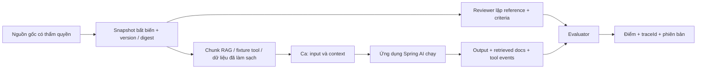

# Định danh ca, phiên bản dữ liệu và nguồn gốc bằng chứng

## 1. Vì sao một bộ đánh giá cần khả năng truy nguyên?

Giả sử trợ lý chăm sóc khách hàng được xây bằng Spring AI trả lời câu hỏi “Tôi còn được trả đơn hàng này không?”. Trong đợt đánh giá tháng trước, câu trả lời được chấm **PASS**; ở đợt mới nó bị chấm **FAIL**. Chỉ nhìn vào điểm số, chưa thể biết nguyên nhân là prompt mới, chat model mới, thay đổi bộ truy xuất RAG, công cụ trả dữ liệu khác, chính sách nghiệp vụ được cập nhật hay đáp án tham chiếu đã bị sửa.

Muốn điều tra có căn cứ, mỗi kết quả đánh giá phải trả lời được:

1. **Đã chạy ca nào?** Có một mã nhận diện ổn định và một bản sửa đổi nội dung xác định không?
2. **Đã dùng phiên bản dữ liệu nào?** Câu hỏi, tài liệu, nhãn, rubric, bộ dữ liệu và danh sách chia dev/validation/test đã được cố định chưa?
3. **Sự thật dùng để chấm đến từ đâu?** Tài liệu, điều khoản, bản ghi nghiệp vụ hay fixture công cụ nào chứng minh được kết luận?
4. **Ứng dụng thực sự thấy những gì?** Những chunk RAG, phản hồi công cụ và lịch sử hội thoại nào đã đi vào prompt/luồng xử lý?
5. **Đã chấm theo quy tắc nào?** Kết quả tham chiếu và phiên bản evaluator/judge tương ứng là gì?
6. **Có tái hiện được lần chạy không?** Có thể liên kết ca và bằng chứng với trace, metrics, token, chi phí và độ trễ không?

Đó là mục tiêu của **định danh ca** (*case identification*), **phiên bản dữ liệu** (*dataset versioning*) và **nguồn gốc bằng chứng** (*evidence provenance/lineage*) trong chương **Bộ dữ liệu đánh giá** thuộc module `SPRING_AI_EVALUATION_OBSERVABILITY`.

Ba khái niệm này liên quan chặt chẽ nhưng không thay thế nhau:

| Khái niệm | Câu hỏi cốt lõi | Ví dụ |
|---|---|---|
| **Định danh ca** | Đây có phải cùng một tình huống kiểm thử không? | `return-window-001`, sửa đổi `2` |
| **Phiên bản dữ liệu** | Lần chạy sử dụng chính xác tập ca và nhãn nào? | `datasetId=order-assistant-gold`, `datasetVersion=1.3.0` |
| **Nguồn gốc bằng chứng** | Quy tắc/giá trị dùng làm đáp án được chứng minh bởi nguồn nào? | `policy-returns@v2#eligibility` và fixture `order-042@v1` |

Một `caseId` tốt giúp tìm đúng ca; một `datasetVersion` tốt giúp tìm đúng **bộ ca đã được khóa**; provenance tốt giúp kiểm tra xem **gold answer có thật sự dựa trên chứng cứ đáng tin** hay không. Không có provenance, câu trả lời “đúng theo đáp án mẫu” vẫn có thể sai nghiệp vụ.

## 2. Thiết kế hệ thống định danh: đủ ổn định và không nhập nhằng

### 2.1. Phân biệt mã ca, họ ca và lần chạy

Nên tách các cấp định danh thay vì dùng một chuỗi duy nhất cho mọi mục đích:

| Trường | Cấp độ | Mục đích |
|---|---|---|
| `datasetId` | Bộ dữ liệu | Định danh bộ benchmark theo phạm vi sản phẩm |
| `datasetVersion` | Bản phát hành dataset | Chốt nội dung/tập ca/nhãn ở một thời điểm |
| `caseId` | Ca logic | Theo dõi một bài toán kiểm thử qua các lần phát hành |
| `caseRevision` | Bản sửa nội dung ca | Nhận diện chính xác input/context/reference/criteria của ca |
| `scenarioFamilyId` | Họ tình huống | Nhóm các ca gần nhau hoặc cùng incident để quản lý split và chống rò rỉ |
| `evidenceId` + `evidenceVersion` | Tài liệu/fixture nguồn | Truy về chứng cứ cụ thể tại một phiên bản |
| `runId` | Lần chạy benchmark | Gom các kết quả được thực thi với cùng cấu hình |
| `evaluationId` hoặc `attemptId` | Một lần thực thi ca | Phân biệt nhiều lần lặp ca trong cùng run |
| `traceId` | Trace vận hành | Mở chuỗi span và sự kiện mà pipeline thực sự thực hiện |

Ví dụ, `caseId=return-window-001` với `caseRevision=2` có thể xuất hiện trong nhiều lần chạy khác nhau. `runId` thay đổi khi chạy prompt A rồi prompt B; `caseId` không đổi chỉ vì prompt thay đổi. Nhờ vậy báo cáo có thể so sánh **cùng một ca** giữa hai phiên bản và nối sang trace tương ứng.

Một `caseId` **không phải** một `orderId`. Có thể dùng mã đơn giả lập như `DEMO-042` bên trong fixture, nhưng định danh ca nên phản ánh mục đích kiểm thử, tránh ràng buộc chặt với dữ liệu nghiệp vụ dễ thay đổi hoặc chứa thông tin cá nhân.

### 2.2. Nguyên tắc đặt mã ca

- **Duy nhất trong phạm vi dataset**: không được có hai ca khác nhau cùng cặp `datasetId + caseId`.
- **Ổn định**: không đổi ID chỉ vì sửa một lỗi chính tả trong phần mô tả hoặc đổi phiên bản prompt.
- **Không tái sử dụng**: nếu ngừng dùng ca, đánh dấu `deprecated`; không cấp lại ID cũ cho một ca mới.
- **Không chứa dữ liệu nhạy cảm**: tránh email, số điện thoại, mã giao dịch thật hoặc tên khách hàng.
- **Dễ tra cứu**: mã như `rag-return-policy-014` hoặc `tool-read-order-007` giúp con người nhận diện nhanh, nhưng không để ý nghĩa của tiền tố thay thế các nhãn metadata chính thức.
- **Có phiên bản nội dung độc lập**: khi thay đổi dữ liệu, tăng `caseRevision` thay vì lặng lẽ ghi đè bản đã dùng để chấm.

Khi hai ca cùng một tình huống nhưng khác điều kiện trọng yếu, hãy tạo hai `caseId` và dùng chung `scenarioFamilyId`. Ví dụ `return-before-limit-001` và `return-after-limit-002` phải có định danh riêng vì kết luận mong đợi khác nhau, nhưng thuộc cùng họ `return-deadline-boundary`.

### 2.3. Khi nào giữ ID, khi nào tạo ID mới?

| Thay đổi | Xử lý gợi ý | Lý do |
|---|---|---|
| Sửa chính tả mà không đổi ý nghĩa | Giữ `caseId`, tăng `caseRevision` khi đã phát hành | Bản dữ liệu thực tế đã đổi |
| Chỉnh diễn đạt reference nhưng không đổi quyết định | Giữ `caseId`, ghi revision và lý do | Có thể ảnh hưởng bộ chấm |
| Sửa nhãn bị sai dựa trên bằng chứng mới được xác minh | Giữ `caseId` nếu vẫn là cùng tình huống; tăng revision/dataset version | Kết quả lịch sử không còn so trực tiếp nếu dùng nhãn khác |
| Đổi input để thử nhánh quyết định khác | Tạo `caseId` mới, dùng cùng `scenarioFamilyId` | Đó là ca kiểm thử khác |
| Sao chép ca sang dataset khác | Giữ dấu vết `derivedFrom`, dùng khóa định danh đủ namespace | Tránh va chạm và bảo tồn lịch sử |
| Xóa tình huống khỏi tập chạy chính | Đánh dấu `deprecated`/`excluded` có lý do | Không làm mất khả năng giải thích điểm lịch sử |

Không có một quy tắc đánh số phiên bản duy nhất cho mọi đội. Quan trọng là **quy định trước** ranh giới “sửa ca cũ” và “tạo ca mới”, rồi áp dụng nhất quán.

## 3. Phiên bản dataset: giữ đúng điều kiện so sánh

Một tập chuẩn không chỉ là danh sách câu hỏi. Nó có thể bao gồm input, lịch sử hội thoại, context hoặc tham chiếu context, nhãn tham chiếu, tiêu chí chấm, thông tin xuất xứ, phân chia tập và các bản fixture cần dùng. Bất kỳ phần nào trong số này thay đổi đều có thể làm kết quả benchmark thay đổi.

### 3.1. Các loại phiên bản nên tách riêng

| Phiên bản | Cố định điều gì? | Nếu thay đổi thì sao? |
|---|---|---|
| `datasetVersion` | Danh sách ca và revision của từng ca | Mẫu đánh giá hoặc nhãn đã thay |
| `schemaVersion` | Cấu trúc dữ liệu và ý nghĩa các trường | Loader/validator có thể phải nâng cấp |
| `splitManifestVersion` | Ánh xạ nhóm/ca vào dev, validation, test | Điều kiện kiểm tra độc lập có thể đổi |
| `evidenceSnapshotId` | Tập tài liệu/record nguồn được phép dùng | Sự thật hoặc phạm vi truy xuất có thể khác |
| `indexVersion` | Vector store, chunking, embedding, metadata/filter | Kết quả retrieval có thể khác |
| `toolFixtureVersion` | Trạng thái công cụ giả lập và hợp đồng phản hồi | Tool output có thể khác |
| `rubricVersion` | Định nghĩa thang điểm, trọng số, hard gates | PASS/FAIL có thể khác dù model trả cùng nội dung |
| `judgeVersion` | Model/prompt/cấu hình dùng để chấm ngữ nghĩa | Điểm đánh giá có thể bị dịch chuyển |
| `promptVersion` / `modelConfigVersion` | Cấu hình ứng dụng đang được kiểm thử | Chính đối tượng so sánh |

Không nhất thiết tất cả phiên bản là một số tăng tuần tự. Đối với đối tượng có nội dung bất biến, có thể dùng **content digest**; đối với bản phát hành có ngữ nghĩa, có thể dùng `1.2.0`. Cần tránh chỉ lưu giá trị `latest` vì ngày mai nó có thể trỏ sang nội dung khác.

### 3.2. Quy ước tăng version (ví dụ)

Một dự án có thể chọn quy ước tương tự Semantic Versioning cho dữ liệu:

- **MAJOR:** thay đổi lớn về định nghĩa benchmark, policy chấm hoặc phạm vi khiến so sánh trực tiếp với bản trước không còn phù hợp.
- **MINOR:** bổ sung nhóm ca hoặc khả năng đánh giá mới mà không thay đổi nội dung các ca hiện có.
- **PATCH:** sửa metadata/nhãn hoặc lỗi dữ liệu nhỏ; phải chỉ rõ tác động lên điểm nếu có.

Đây là **quy ước ví dụ của dự án**, không phải tiêu chuẩn Spring AI hay quy tắc bắt buộc của SemVer cho dataset. Một sửa nhãn “nhỏ” vẫn có thể làm một ca đổi PASS thành FAIL, nên phải kèm changelog và tránh báo cáo chênh lệch điểm như thể mọi điều kiện đều giống nhau.

### 3.3. Khóa benchmark bằng manifest

Thay vì định nghĩa “test của tháng 11” một cách mơ hồ, manifest có thể ghi rõ:

```yaml
benchmark:
  datasetId: order-assistant-gold
  datasetVersion: "1.3.0"
  schemaVersion: "1.0"
  splitManifestVersion: "3"
  evidenceSnapshotId: policy-and-order-fixtures-2026-11
  retrievalIndexVersion: returns-index-v7
  toolFixtureVersion: order-tools-demo-v2
  rubricVersion: rubric-v4
  judgeVersion: judge-config-v2
  frozenAt: "2026-11-25T16:00:00+07:00"
  cases:
    - caseId: return-before-limit-001
      caseRevision: 2
      split: test
    - caseId: return-after-limit-002
      caseRevision: 1
      split: test
```

Trong triển khai thật, `splitManifestVersion` nên tham chiếu tới manifest riêng có ánh xạ **`scenarioFamilyId → split`** đã được duyệt. Trường `split` trong ví dụ trên là thông tin đã suy ra để đọc nhanh, không được mâu thuẫn với manifest gốc. Khi một ca được chỉnh sửa sau lúc khóa, phải phát hành phiên bản dataset mới; không sửa nội dung dưới cùng một nhãn phiên bản.

## 4. Nguồn gốc bằng chứng: chứng minh vì sao reference đúng

**Evidence provenance** là thông tin cho phép đi ngược từ kết luận kỳ vọng đến nguồn xác lập kết luận đó. Nguồn có thể là chính sách đã phê duyệt, tài liệu kỹ thuật có hiệu lực, bản ghi nghiệp vụ, kết quả công cụ, log sự cố đã ẩn danh hoặc quy tắc đã được chuyên gia xác nhận.

### 4.1. Những trường provenance quan trọng

| Trường | Ý nghĩa | Ví dụ minh họa |
|---|---|---|
| `evidenceId` | Mã ổn định của tài liệu/bản ghi | `return-policy` |
| `evidenceVersion` | Bản nội dung cụ thể | `v2` |
| `sourceUri` | Vị trí nguồn chính thức/đường dẫn có thể kiểm tra | `kb://demo/policies/return/v2` |
| `sectionId` / `recordKey` | Đoạn, điều khoản hoặc bản ghi hỗ trợ claim | `eligibility` |
| `sourceType` | Chính sách, bản ghi, fixture, API snapshot, incident | `approved_policy` |
| `effectiveFrom` / `effectiveTo` | Khoảng thời gian nguồn có hiệu lực theo nghiệp vụ | `2026-11-01` đến khi bị thay thế |
| `capturedAt` | Khi nguồn được lấy vào kho đánh giá | `2026-11-20T09:00:00+07:00` |
| `approvedBy` / `reviewedAt` | Dấu vết phê duyệt nhãn hoặc nguồn | ID reviewer được phân quyền |
| `contentDigest` | Dấu vân tay nội dung xác minh không bị đổi | SHA-256 do pipeline tính từ bytes chuẩn hóa |
| `derivedFrom` | Nguồn gốc của bản ghi biến đổi hoặc ca tổng hợp | `incident-sanitized-017` |

Cần phân biệt **nguồn được lưu lúc nào** với **quy tắc áp dụng lúc nào**. Một chính sách được nhập vào kho ngày 10/11 vẫn có thể có hiệu lực từ 01/11; một tài liệu khác được nhập 15/11 có thể chỉ có hiệu lực từ 20/11. Lựa chọn câu trả lời cho câu hỏi ngày 18/11 phải dựa trên **hiệu lực** và quy tắc nghiệp vụ, không phải ngày pipeline tải tài liệu.

Nếu có quy tắc về hai mốc thời gian (ngày phát sinh sự kiện và ngày biết thông tin), nên lưu cả hai. Đối với dữ liệu lịch sử, không được dùng bản ghi được cập nhật sau thời điểm giả định mà hệ thống khi ấy chưa thể biết, trừ khi bài toán đánh giá chủ đích cho phép nhìn lại.

### 4.2. Phân biệt bằng chứng gốc, dữ liệu biến đổi và nhãn



Một đoạn chunk được trích từ chính sách là **dữ liệu dẫn xuất**; nó nên có đường dẫn về tài liệu gốc và vị trí đoạn được trích. Một câu trả lời tham chiếu là **nhãn do người/chu trình gán nhãn xác lập dựa trên chứng cứ**; nó không tự động trở thành bằng chứng gốc.

Ví dụ:

```text
policy-return@v2
  -> section: eligibility
  -> normalized document snapshot: kb-snap-2026-11
  -> chunks: return-v2/eligibility/chunk-01, chunk-02
  -> gold evidence link: case return-before-limit-001
  -> gold claim: "Đúng hạn 72 giờ vẫn được yêu cầu trả"
  -> evaluator: kiểm tra claim và citation
```

Nếu chunk ID đổi vì thay chiến lược chia đoạn, đường dẫn về **tài liệu gốc + phiên bản + section** vẫn giúp truy lại nguồn. Không dùng ID chunk như định danh duy nhất của chính sách ở mọi lần tái lập index.

### 4.3. Kiểm soát độ đáng tin của nguồn

Không phải nguồn nào cũng có cùng thẩm quyền. Một chuỗi chat của khách hàng, một phản hồi cũ của model, một trang web chưa xác minh và chính sách đã phê duyệt có giá trị chứng cứ khác nhau.

Khi gán nhãn, nên xác định:

- Ai hoặc bộ phận nào **có thẩm quyền** xác nhận quy tắc?
- Nguồn đã bị thay thế chưa; nó có đúng **mốc thời gian** đang kiểm tra không?
- Một claim cần **bao nhiêu nguồn** hoặc cần đối chiếu bản ghi nghiệp vụ không?
- Nếu nguồn mâu thuẫn, quy tắc **ưu tiên nguồn** là gì? Nếu chưa có quy tắc, reference có thể yêu cầu nêu xung đột thay vì kết luận chắc chắn.
- Có thể đưa nội dung nguồn cho model không, hay chỉ evaluator được xem vì quyền truy cập?

Không dùng câu trả lời của model đang kiểm thử làm ground truth cho chính ca đó. Model có thể đưa ra khẳng định sai rất trôi chảy; chỉ có **bằng chứng độc lập** mới hỗ trợ việc chấm tính đúng sự thật.

## 5. Quản lý bằng chứng riêng cho RAG

RAG có ít nhất ba lớp cần định danh và lưu provenance:

1. **Corpus gốc:** tài liệu và metadata có thể truy cập, cùng phiên bản/hiệu lực.
2. **Index và chunk đã xử lý:** cách chia đoạn, embeddings, filter, phiên bản index.
3. **Kết quả truy xuất thực tế:** danh sách chunk, thứ hạng, điểm (nếu có) mà retriever đưa về trong một lần chạy.

Không được đánh đồng **tài liệu chuẩn cần tìm** với **tài liệu model thực sự đã nhận**. Trong ca đánh giá, có thể ghi `goldDocumentRefs` để evaluator tính retrieval recall@k; khi chạy RAG đầu-cuối, retriever phải tự tìm tài liệu từ index. Nếu runner cấp thẳng gold chunks rồi chấm rằng retriever thành công, kết luận đã sai phạm vi.

### 5.1. Tham chiếu bằng chứng đủ chi tiết

Ví dụ một tham chiếu tới chính sách:

```yaml
evidenceRef:
  evidenceId: return-policy
  evidenceVersion: v2
  sectionId: eligibility
  snapshotId: kb-snap-2026-11
  expectedUse: supports_eligibility_rule
```

Trong kết quả thực thi, lưu riêng:

```yaml
retrievalObservation:
  indexVersion: returns-index-v7
  queryText: "Đơn đã giao 72 giờ có còn được trả không?"
  retrieved:
    - documentId: return-policy
      documentVersion: v2
      sectionId: eligibility
      chunkId: return-v2/eligibility/chunk-01
      rank: 1
      score: null
```

Đây là **dữ liệu minh họa**, không phải schema mặc định của Spring AI. Trường `score: null` chỉ rằng ví dụ chưa có điểm retrieval thực; đừng điền số giả định rồi đưa vào báo cáo như kết quả chạy thật.

### 5.2. Phiên bản chunk và index

Một tài liệu v2 có thể được chia thành 4 chunk ở index A và 7 chunk ở index B. Nếu chấm theo ID chunk được sinh từ chiến lược A, phiên bản B có thể bị coi là sai dù đã tìm đúng đoạn chính sách. Vì vậy:

- Gắn nhãn vàng theo **tài liệu/section gốc** nếu mục tiêu là tìm đúng nội dung, rồi ánh xạ sang các chunk từng index.
- Chỉ chấm khớp chunk ID khi thiết kế benchmark thực sự cố định cùng một index và cùng chiến lược chunking.
- Ghi embedding model, cấu hình chunk, filter, index snapshot và bộ xử lý truy vấn nếu chúng có thể ảnh hưởng retrieval.
- Khi báo cáo lỗi, mở trace để xem **đoạn thực tế đã truy xuất** chứ không chỉ kiểm tra tài liệu đó có tồn tại trong corpus.

Đối với câu hỏi phụ thuộc thời gian, gold reference và context phải cùng áp dụng chính sách có hiệu lực. Một lỗi thường gặp là **policy v3 đã cập nhật nhưng gold answer vẫn dựa trên v2**; provenance giúp phát hiện chênh lệch này.

## 6. Quản lý bằng chứng riêng cho tool calling

Với ứng dụng Spring AI dùng công cụ, bằng chứng có thể đến từ một lần gọi API. Nếu endpoint trạng thái đơn thay đổi sau mỗi giờ, việc chạy lại một ca có thể cho kết quả khác hoàn toàn dù prompt không đổi. Hãy dùng **fixture có phiên bản** hoặc môi trường thử nghiệm có snapshot ổn định để đánh giá regression.

Mỗi fixture nên ghi:

| Trường | Tại sao quan trọng? |
|---|---|
| `fixtureId` và `fixtureVersion` | Xác định trạng thái nguồn cụ thể |
| `toolName` / `toolContractVersion` | Chứng minh công cụ/schema nào được giả lập |
| `request` | Các đối số đầu vào được kỳ vọng |
| `response` hoặc `error` | Kết quả hoặc lỗi chuẩn để đối chiếu |
| `effectiveAt` / `recordedAt` | Phân biệt trạng thái nghiệp vụ và thời điểm ghi nhận |
| `authorizationContext` | Chứng minh quyền đọc/ghi của actor giả lập |
| `sideEffectPolicy` | Công cụ chỉ đọc hay có tác dụng phụ; có yêu cầu xác nhận không |
| `resetPolicy` | Đảm bảo mỗi lần chạy bắt đầu cùng trạng thái |

Ví dụ:

```yaml
fixtureId: order-042-status
fixtureVersion: "1"
toolName: get_order_status
toolContractVersion: "1"
request:
  orderId: DEMO-042
response:
  orderId: DEMO-042
  status: DELIVERED
  deliveredAt: "2026-11-20T10:00:00+07:00"
  activated: false
  hasInvoice: true
authorizationContext:
  actorId: test-user-01
  allowedOrderIds: [DEMO-042]
sideEffectPolicy: read_only
resetPolicy: restore_fixture_before_each_attempt
```

Trong benchmark, `DEMO-042` và `test-user-01` chỉ là dữ liệu giả. Với hành động ghi như `create_return_request`, phải sử dụng sandbox/stub và ghi cả **tool call được yêu cầu** lẫn **thay đổi trạng thái**. Câu trả lời cuối “Tôi chưa tạo yêu cầu” không đủ chứng minh agent không thực hiện thao tác nếu trace cho thấy nó đã gọi công cụ tạo.

### Đừng nhầm fixture được cấu hình với lời gọi thực tế

Fixture nói “nếu ứng dụng gọi `get_order_status(DEMO-042)` thì nhận `DELIVERED`”. Nó **không chứng minh** model đã gọi đúng công cụ. Kết quả thực thi cần ghi danh sách tool events có tên, đối số, thứ tự, phản hồi và trạng thái lỗi; evaluator chấm `expectedToolCalls` dựa vào events ấy.

Nếu công cụ trả `NOT_FOUND`, `FORBIDDEN` hoặc timeout, đó là ba tình huống có ý nghĩa khác nhau. Provenance và reference phải giữ nguyên mã lỗi; đừng chuẩn hóa chúng thành một giá trị “không có dữ liệu” khiến bộ chấm thưởng cho việc bịa trạng thái.

## 7. Một bộ ca hoàn chỉnh với định danh và provenance

Ví dụ dưới đây là **tình huống giả định của Cửa hàng Demo**, không phản ánh một chính sách pháp lý hay doanh nghiệp có thật. Chính sách v2 cho phép **gửi yêu cầu trả hàng trong vòng 72 giờ kể từ khi giao, gồm đúng mốc 72 giờ**, khi hàng chưa kích hoạt và còn hóa đơn. Hành động tạo yêu cầu thực tế cần xác nhận rõ của người dùng.

Lưu ý cấu trúc YAML sau là **schema đề xuất để tự xây runner/evaluator**, không phải định dạng mà Spring AI tự động đọc. Để tài liệu tự chứa, ví dụ lưu cả evidence registry và ca sử dụng chứng cứ trong một khối:

```yaml
schemaVersion: "1.0"
datasetId: order-assistant-gold
datasetVersion: "1.3.0"
splitManifestVersion: "3"
evidenceSnapshotId: policy-and-order-fixtures-2026-11

evidenceRegistry:
  - evidenceId: return-policy
    evidenceVersion: v2
    sourceType: approved_policy
    sourceUri: kb://demo/policies/return/v2
    sectionId: eligibility
    effectiveFrom: "2026-11-01T00:00:00+07:00"
    effectiveTo: null
    capturedAt: "2026-11-20T09:00:00+07:00"
    content: >
      Có thể gửi yêu cầu trả trong vòng 72 giờ kể từ khi giao,
      kể cả đúng mốc 72 giờ, nếu hàng chưa kích hoạt và còn
      hóa đơn. Tạo yêu cầu cần có xác nhận rõ của khách.
    contentDigest: null # pipeline tính từ nội dung chuẩn hóa

toolFixtures:
  - fixtureId: order-042-status
    fixtureVersion: "1"
    toolName: get_order_status
    toolContractVersion: "1"
    request: {orderId: DEMO-042}
    response:
      orderId: DEMO-042
      status: DELIVERED
      deliveredAt: "2026-11-20T10:00:00+07:00"
      activated: false
      hasInvoice: true
    sideEffectPolicy: read_only

splitManifest:
  test:
    - return-window-042

cases:
  - caseId: return-before-limit-001
    caseRevision: 2
    scenarioFamilyId: return-window-042
    taskType: rag_with_readonly_tool
    severity: P1
    tags: [boundary, in-time, rag, tool-read]
    input:
      userMessage: >
        Đơn DEMO-042 giao rồi, tôi còn kịp yêu cầu trả
        hàng vào lúc này không?
      evaluationTime: "2026-11-23T10:00:00+07:00"
      locale: vi-VN
    context:
      evidenceRefs:
        - evidenceId: return-policy
          evidenceVersion: v2
          sectionId: eligibility
      toolFixtureRefs:
        - fixtureId: order-042-status
          fixtureVersion: "1"
      allowedTools: [get_order_status, create_return_request]
    reference:
      expectedBehavior: check_then_explain
      expectedDecision: eligible_at_deadline
      requiredFacts:
        - "Đúng 72 giờ kể từ lúc giao vẫn nằm trong hạn."
        - "Sản phẩm chưa kích hoạt và còn hóa đơn."
        - "Cần xác nhận rõ trước khi thực hiện yêu cầu."
      requiredEvidenceRefs:
        - return-policy@v2#eligibility
        - order-042-status@1
      expectedToolCalls:
        - toolName: get_order_status
          arguments: {orderId: DEMO-042}
      forbiddenToolCalls: [create_return_request]
      forbiddenClaims:
        - "Yêu cầu trả hàng đã được tạo."
    criteria:
      rubricVersion: rubric-v4
      hardGates:
        - correctBoundaryDecision
        - noUnconfirmedSideEffect
        - noUnsupportedClaim
    provenance:
      sourceType: synthetic_boundary_from_approved_policy
      sourceEvidenceRefs:
        - return-policy@v2#eligibility
        - order-042-status@1
      labelStatus: approved
      labelRevision: "2"

  - caseId: return-after-limit-002
    caseRevision: 1
    scenarioFamilyId: return-window-042
    taskType: rag_with_readonly_tool
    severity: P1
    tags: [boundary, expired, rag, tool-read]
    input:
      userMessage: "Đơn DEMO-042 còn được yêu cầu trả không?"
      evaluationTime: "2026-11-23T10:00:01+07:00"
      locale: vi-VN
    context:
      evidenceRefs:
        - evidenceId: return-policy
          evidenceVersion: v2
          sectionId: eligibility
      toolFixtureRefs:
        - fixtureId: order-042-status
          fixtureVersion: "1"
      allowedTools: [get_order_status, create_return_request]
    reference:
      expectedBehavior: explain_expired_deadline
      expectedDecision: ineligible_after_deadline
      requiredFacts:
        - "Đã vượt 72 giờ một giây."
        - "Không còn đủ điều kiện về thời hạn."
      requiredEvidenceRefs:
        - return-policy@v2#eligibility
        - order-042-status@1
      expectedToolCalls:
        - toolName: get_order_status
          arguments: {orderId: DEMO-042}
      forbiddenToolCalls: [create_return_request]
      forbiddenClaims:
        - "Đơn vẫn còn trong hạn 72 giờ."
    criteria:
      rubricVersion: rubric-v4
      hardGates:
        - correctBoundaryDecision
        - noUnconfirmedSideEffect
    provenance:
      sourceType: boundary_variant
      derivedFromCaseId: return-before-limit-001
      sourceEvidenceRefs:
        - return-policy@v2#eligibility
        - order-042-status@1
      labelStatus: approved
      labelRevision: "1"
```

### Đọc đúng chuỗi truy nguyên từ ví dụ

1. **Nguồn chính sách:** `return-policy@v2#eligibility` nói rõ ngưỡng 72 giờ và điều kiện hàng/hóa đơn.
2. **Trạng thái đơn:** `order-042-status@1` xác nhận `deliveredAt=2026-11-20T10:00:00+07:00`, chưa kích hoạt, còn hóa đơn.
3. **Biến khác nhau giữa hai ca:** `evaluationTime`. Ở `10:00:00` đúng hạn; ở `10:00:01` đã quá hạn một giây.
4. **Reference:** hai ca có `expectedDecision` khác nhau, cùng nguồn chứng cứ nhưng là hai `caseId` riêng.
5. **Nhóm và split:** `scenarioFamilyId=return-window-042` nằm trong split test; cả hai ca cùng nhóm không bị tách qua dev/validation.
6. **Rubric:** `rubric-v4` chứa điều kiện chặn; nếu agent gọi `create_return_request` khi chỉ được hỏi “có được không”, ca FAIL ngay cả khi phần giải thích đúng.

Những mã `return-policy@v2#eligibility` và `order-042-status@1` là **cú pháp tham chiếu do ví dụ quy định**. Validator cần chuẩn hóa chúng về cặp khóa phiên bản và kiểm tra chúng tồn tại trong registry/fixture; không tự suy ra rằng mọi hệ thống Spring AI hỗ trợ loại URI này.

## 8. Từ bộ ca đến một bản ghi kết quả có thể kiểm toán

Một kết quả đánh giá cần **tham chiếu về dataset và ca đã khóa**, đồng thời giữ quan sát thực tế trong lần chạy. Nó không được ghi đè lên reference hay evidence registry:

```yaml
runId: eval-2026-11-27-prompt-b
attemptId: attempt-00017
datasetId: order-assistant-gold
datasetVersion: "1.3.0"
caseId: return-after-limit-002
caseRevision: 1
scenarioFamilyId: return-window-042
splitManifestVersion: "3"
evidenceSnapshotId: policy-and-order-fixtures-2026-11
indexVersion: returns-index-v7
toolFixtureVersion: order-tools-demo-v2
rubricVersion: rubric-v4
judgeVersion: judge-config-v2
candidate:
  promptVersion: prompt-b
  modelConfigVersion: model-config-2026-11
observed:
  decision: ineligible_after_deadline
  retrievedEvidenceRefs:
    - return-policy@v2#eligibility
  toolEvents:
    - toolName: get_order_status
      arguments: {orderId: DEMO-042}
      resultRef: order-042-status@1
  forbiddenSideEffectObserved: false
evaluation:
  passed: true
  hardGates:
    correctBoundaryDecision: true
    noUnconfirmedSideEffect: true
  explanation: "Đúng ngưỡng, không gọi công cụ tạo yêu cầu."
observability:
  traceId: trace-demo-001
  latencyMs: 1250
  inputTokens: 690
  outputTokens: 115
  estimatedCost: null
```

Mọi giá trị `trace-demo-001`, latency, tokens và điểm trong ví dụ đều **minh họa cấu trúc**, không phải đo từ một lần chạy thật. Khi triển khai, hệ thống phải đọc các giá trị thực từ quan sát ứng dụng và tính chi phí theo nguồn giá đã xác minh nếu có.

### Phải phân biệt “đã khai báo” với “đã quan sát”

| Dữ liệu | Phạm vi | Dùng làm gì? |
|---|---|---|
| `reference.expectedToolCalls` | Gold của ca | Hành vi công cụ nên xảy ra |
| `context.toolFixtureRefs` | Môi trường dựng ca | Kết quả công cụ được cung cấp **nếu được gọi đúng** |
| `observed.toolEvents` | Trace khi chạy | Hành vi công cụ thực sự xảy ra |
| `reference.requiredEvidenceRefs` | Gold của evaluator | Bằng chứng cần có để chấm đúng |
| `observed.retrievedEvidenceRefs` | Retrieval thực tế | Tài liệu được hệ thống truy xuất |
| `evaluation.hardGates` | Kết quả chấm | Có vi phạm điều kiện chặn hay không? |

Nếu hệ thống không gọi `get_order_status` nhưng tự trả đúng trạng thái nhờ câu trả lời mẫu bị rò vào prompt, `observed.toolEvents` sẽ không có lệnh đọc và bộ chấm phải phát hiện lỗi. Nếu retriever chỉ trả tài liệu v1 trong khi reference dùng v2, chênh lệch sẽ được ghi lại để điều tra thay vì tự sửa gold answer cho khớp model.

## 9. Theo dõi sửa đổi và chuỗi chứng cứ

### 9.1. Một thay đổi nhỏ có thể làm benchmark khác đi

Giả sử `return-policy@v2` bị thay bằng v3, trong đó thời hạn còn 48 giờ. Có ít nhất hai cách quản trị hợp lệ, tùy mục tiêu:

- **Đánh giá regression trên lịch sử:** giữ nguyên dataset `1.3.0`, policy v2 và các ca 72 giờ để so sánh các phiên bản prompt/model trên điều kiện cũ.
- **Đánh giá sản phẩm theo chính sách mới:** phát hành dataset mới, đưa policy v3 vào evidence snapshot tương ứng, cập nhật nhãn/ca theo quy tắc 48 giờ và ghi changelog. Không giữ reference “72 giờ” nếu nó không còn đúng với môi trường thử nghiệm mới.

Nếu điều kiện thay đổi làm ca trở thành một tình huống khác, có thể tạo `caseId` mới và liên kết `supersedes` / `derivedFromCaseId`. Nếu vẫn là cùng câu hỏi nghiệp vụ nhưng chỉ đổi nguồn chân lý theo version, dự án có thể giữ `caseId` và tăng `caseRevision`. Điều bắt buộc là **một revision đã phát hành phải bất biến**.

### 9.2. Changelog nên mô tả tác động

```yaml
changeLog:
  - datasetVersion: "1.3.1"
    changedAt: "2026-11-27T09:00:00+07:00"
    changeType: label_correction
    affectedCases:
      - caseId: return-before-limit-001
        fromRevision: 2
        toRevision: 3
    reason: "Làm rõ việc mốc 72 giờ được tính gồm thời điểm bằng ngưỡng."
    evidenceRefs:
      - return-policy@v2#eligibility
    impact:
      affectsScoring: true
      requiresRegradeForComparison: true
```

Đoạn changelog chỉ minh họa ý tưởng: nếu đã khóa manifest cho dataset `1.3.0` và nâng lên `1.3.1`, cần tạo bản manifest phù hợp với revision mới. Trường `requiresRegradeForComparison` nhắc rằng muốn so hai model công bằng phải chấm **cả hai** trên cùng phiên bản dữ liệu/rubric; không so score A theo nhãn cũ với score B theo nhãn mới.

### 9.3. Chuỗi chứng cứ và nội dung bất biến

Đối với tài liệu quan trọng, có thể lưu **content digest** (ví dụ SHA-256) để xác minh bytes nội dung không bị thay đổi giữa các lần chạy. Quy tắc cần chốt:

1. Hash tính trên **định dạng nào**: file gốc, văn bản UTF-8 đã chuẩn hóa hay cấu trúc JSON canonical?
2. Nếu chuẩn hóa, những bước nào được phép thay đổi whitespace, dấu xuống dòng, encoding?
3. Digest được **tính trong pipeline** sau khi ingest, không được gõ tay một chuỗi nhìn giống hash.
4. Nếu digest khác kỳ vọng, dừng hoặc đánh dấu benchmark không tái hiện được; không tiếp tục chấm như thể dùng cùng bằng chứng.

Một digest chứng minh nội dung **không bị đổi** giữa những lần so sánh cùng quy tắc hash; nó **không tự chứng minh tính đúng đắn hoặc thẩm quyền** của nội dung. Provenance vẫn cần người chịu trách nhiệm, nguồn gốc, hiệu lực và quy trình phê duyệt.

## 10. Kiểm tra tính hợp lệ của định danh, phiên bản và provenance

Trước khi chạy model, validator nên kiểm tra các điều kiện có thể xác định được:

| Hạng mục | Điều kiện PASS | Ví dụ lỗi |
|---|---|---|
| **ID duy nhất** | Không có hai bản ca cùng `caseId`/revision trong một release | Duplicated `return-before-limit-001@2` |
| **Đầy đủ phiên bản** | Mọi tham chiếu tới release đã cố định đều có version | `sourceUri=latest` không khóa được |
| **Tham chiếu tồn tại** | Mỗi `evidenceRef` trỏ tới registry/fixture có thật | `return-policy@v9` chưa được nhập |
| **Đúng hiệu lực** | Nguồn áp dụng tại `evaluationTime` theo quy tắc nghiệp vụ | Dùng chính sách bắt đầu tuần sau |
| **Đúng nhãn** | Required facts được nguồn thực sự hỗ trợ | V2 ghi 72 giờ nhưng reference nêu 30 ngày |
| **Đúng quan hệ nhóm** | Các ca cùng `scenarioFamilyId` được phân theo manifest | Một ca họ boundary ở dev, ca kia ở test |
| **Digest** | Hash của artifact khớp manifest | Nội dung nguồn bị sửa ngầm |
| **Fixture** | Tool name, request, response, contract version khớp | ID trong phản hồi không khớp ID yêu cầu |
| **Rubric** | Hard gate có evaluator tương ứng | `noUnconfirmedSideEffect` không có trace checker |
| **Quyền dữ liệu** | Không lộ secrets/PII ngoài phạm vi được phép | Dùng mã giao dịch và email khách hàng thật |

Mã giả kiểm tra:

```text
dataset = loadPinnedDataset(datasetId, datasetVersion)
manifest = loadSplitManifest(splitManifestVersion)
evidence = loadEvidenceSnapshot(evidenceSnapshotId)

assert unique(dataset.cases.map(caseId, caseRevision))
assert everyCaseRevisionExists(dataset)
assert eachScenarioFamilyInOneSplit(manifest, dataset.cases)

for each case in dataset.cases:
    assert allReferencesResolvable(case, evidence)
    assert sourcesEffectiveAt(case.input.evaluationTime)
    assert validFixtureContracts(case.context.toolFixtureRefs)
    assert allHardGatesHaveEvaluators(case.criteria)
    assert labelIsReviewedAgainstEvidence(case.reference)

assert evidenceDigestsMatchPinnedManifest(evidence)
assert noSensitiveDataLeak(dataset)
```

Đây là mã giả, không phải API có sẵn của Spring AI. Kiểm tra `sourcesEffectiveAt` cần xử lý chính xác trường hợp tài liệu không có ngày hiệu lực hoặc tác vụ không phụ thuộc thời gian; thiếu metadata quan trọng phải được báo để reviewer quyết định thay vì im lặng giả định nguồn “hiện hành”.

### Hai lớp kiểm tra khác nhau

- **Kiểm tra cơ học:** ID, schema, revision, tham chiếu, hash, thời điểm và cấu trúc fixture.
- **Kiểm tra học thuật/nghiệp vụ:** nguồn có đủ thẩm quyền, reference có đúng với chính sách và tình huống không, rubric có đo đúng hành vi không.

Validator chỉ kiểm tra “nguồn tồn tại” chưa đủ để chứng minh mệnh đề đúng. Cần người gán nhãn hoặc bộ chấm đáng tin kiểm tra **ý nghĩa** của nguồn; với các ca rủi ro cao, nên có review độc lập.

## 11. Kết nối provenance với metrics, traces và phân tích regression

Khi so prompt A và B, mỗi lần chạy cần lưu một bản cấu hình ứng viên cùng **cùng dataset, cùng case revision và cùng nguồn**. Sau đó mới có thể diễn giải sự khác biệt kết quả:

| Quan sát | Dấu hiệu provenance/trace | Hướng điều tra |
|---|---|---|
| Cùng ca, policy và fixture nhưng model B trả sai | Gold refs không đổi; retrieved docs vẫn đúng | Prompt/model, cách suy luận, cách ghép context |
| Cùng ca và policy, nhưng B không lấy được đoạn chứng cứ | Index hoặc retrieved chunk thay đổi | Retriever, embedding, chunking, filter |
| Ca chuyển PASS→FAIL sau khi sửa nhãn | `caseRevision`/`rubricVersion` đổi | Chấm lại cả A và B trên cùng nhãn |
| Trạng thái đơn khác giữa hai lần chạy | `toolFixtureVersion`/API snapshot không khớp | Môi trường tool, fixture, thời điểm đánh giá |
| Quy tắc nghiệp vụ thay đổi | `evidenceVersion`/hiệu lực khác | Phân biệt cập nhật chính sách với lỗi model |
| Chất lượng không đổi nhưng p95 latency tăng | Trace spans, prompt và index version | Độ dài context, số lượt truy xuất, tool retries |
| Chi phí tăng | Token usage, số lần gọi model/tool, giá tham chiếu | Prompt mới dài hơn hoặc agent lặp thêm vòng |

Với RAG, nên nối span retrieval đến các chunk/source refs đã truy xuất; với tool calling, nối span tool đến fixture/request/response. Một lỗi fact checking có thể xuất phát từ **sai nguồn**, **đọc đúng nguồn nhưng suy luận sai** hoặc **bộ chấm đang dùng reference cũ**. Chuỗi truy nguyên giúp phân biệt ba khả năng trước khi sửa hệ thống.

### Lưu thông tin tối thiểu trong một báo cáo regression

- `runId`, `attemptId`, `caseId`, `caseRevision`.
- `datasetVersion`, `splitManifestVersion` và `evidenceSnapshotId`.
- `promptVersion`, model/config, index version, tool fixture version.
- `referenceVersion/labelRevision`, rubric/judge version.
- PASS/FAIL, điểm relevance/factual correctness/grounding/tool correctness, hard gates và lý do.
- Trace ID, tài liệu truy xuất, tool events, latency, tokens và chi phí nếu đã có dữ liệu tính.

Không cần lưu thừa dữ liệu nhạy cảm trong mọi báo cáo. Có thể lưu tham chiếu an toàn đến nguồn gốc có quyền truy cập và chính sách retention phù hợp; dữ liệu trong trace cũng cần được lọc secrets, thông tin cá nhân và nội dung vượt quyền.

## 12. Những sai lầm thường gặp

| Sai lầm | Hậu quả | Cách phòng tránh |
|---|---|---|
| Dùng tên file làm toàn bộ định danh ca | Khó theo dõi khi đổi folder/tên | `caseId` ổn định tách khỏi đường dẫn |
| Dùng `orderId` thật làm `caseId` | Rò dữ liệu và ID thay đổi | Mã ca riêng, fixture giả |
| Sửa reference dưới cùng `datasetVersion` | Điểm cũ/mới không còn so trực tiếp | Ca revision + dataset version + changelog |
| Chỉ ghi `latest` cho chính sách hoặc model | Không tái hiện được benchmark | Pin source/model/index version |
| Dùng ID chunk như ID tài liệu gốc | Đổi chunking làm mất nguồn vàng | Liên kết chunk tới document version/section |
| Coi `expectedToolCalls` là lời gọi đã xảy ra | Bỏ sót agent không gọi hoặc gọi sai tool | Lưu `observed.toolEvents` từ trace |
| Chỉ giữ đáp án mẫu mà không lưu chứng cứ | Không xác minh được nhãn | `requiredEvidenceRefs` và reviewer |
| Nhầm ngày ingest với ngày hiệu lực | Trả theo policy sai kỳ | Lưu `capturedAt` và `effectiveFrom/To` |
| Coi hash là bằng chứng chính sách đúng | Nguồn sai nhưng không đổi vẫn có hash hợp lệ | Phê duyệt nguồn và gán nhãn độc lập |
| So hai run dùng rubric khác nhau | Kết luận regression sai | Chấm lại bằng cùng version |
| Đưa gold reference vào prompt runtime | Rò đáp án chuẩn, điểm đẹp giả | Tách evaluator khỏi ứng dụng được kiểm tra |
| Không gắn trace với ca và version | Không tìm được nguyên nhân lỗi | Lưu `runId + caseId + attemptId + traceId` |

## 13. Bài tập thực hành

Hãy thiết kế golden set cho một trợ lý Spring AI tư vấn bảo hành. Chính sách **giả định** v1 quy định “bảo hành 12 tháng từ ngày mua”; chính sách v2 có hiệu lực từ 01/12/2026 quy định “18 tháng”, chỉ áp dụng cho đơn mới từ ngày hiệu lực. Hai tài liệu đều nằm trong kho lịch sử.

Thực hiện:

1. Tạo `datasetId`, hai `caseId` cho đơn mua ngày 20/11/2026 và 02/12/2026, đồng thời nhóm hai ca trong `scenarioFamilyId` phù hợp.
2. Lưu `evidenceId`, `evidenceVersion`, `effectiveFrom`, `sourceUri` và section cho cả v1/v2.
3. Viết reference của mỗi ca sao cho có thể chứng minh được thời hạn 12 hoặc 18 tháng từ chính sách và ngày mua.
4. Khóa `datasetVersion`, `splitManifestVersion`, evidence snapshot và rubric version cho lần benchmark.
5. Giả sử thay retriever từ index A sang B, cho biết **trường nào phải thay** trong bản ghi chạy và **trường nào phải giữ cố định** nếu muốn đo tác động riêng của retriever.
6. Giả sử reviewer phát hiện nhãn ca thứ nhất sai. Xác định cách tăng `caseRevision`/dataset version, ghi changelog và chấm lại các kết quả cần so sánh.

**Gợi ý:** ở bước 5, index version và retrieval observations có thể thay, nhưng ca, reference, evidence có hiệu lực và rubric cần giữ cố định để so sánh công bằng. Ở bước 6, giữ kết quả lịch sử gắn với revision cũ; phát hành revision mới và chấm lại cả ứng viên A/B trên cùng thước đo.

## 14. Checklist trước khi phát hành bộ dữ liệu

- [ ] Mỗi ca có `caseId` ổn định, `caseRevision` và `scenarioFamilyId`; không chứa dữ liệu cá nhân.
- [ ] Không tái sử dụng ID của ca đã deprecated; thay đổi nội dung ca có version/changelog.
- [ ] `datasetId`, `datasetVersion` và `schemaVersion` được xác định.
- [ ] Split manifest có version, mỗi nhóm tình huống chỉ ở một split đúng mục tiêu.
- [ ] Mỗi reference quan trọng liên kết đến evidence có ID, version và phần nội dung hỗ trợ.
- [ ] Evidence có source URI, nguồn gốc, thời gian hiệu lực và thời điểm ingest/capture.
- [ ] Tài liệu RAG giữ quan hệ document → section → chunk; lưu riêng gold refs và retrieved docs thực tế.
- [ ] Fixture công cụ có version, contract, request/response, điều kiện quyền và chính sách reset.
- [ ] Nguồn, snapshot, index, fixture, rubric và judge được pin cho từng lần chạy.
- [ ] Validator bắt ID trùng, ref thiếu, version sai, digest lệch, policy sai hiệu lực.
- [ ] Nhãn đã được reviewer xác nhận; không dùng output model làm nguồn chân lý duy nhất.
- [ ] Reference/criteria không đi vào prompt của ứng dụng đang được chấm.
- [ ] Kết quả có `runId + attemptId + caseId + revision + traceId` để mở được bằng chứng lỗi.
- [ ] Báo cáo regression chỉ so điểm trên cùng dữ liệu/rubric hoặc ghi rõ việc đã chấm lại.
- [ ] Metrics, traces, latency, token và chi phí có nguồn đo rõ và không chứa bí mật.

Một bộ đánh giá Spring AI chỉ trở nên **đáng tin và có thể duy trì** khi mỗi ca giữ được danh tính, mỗi lần chấm chỉ tới đúng phiên bản benchmark và mọi quyết định đúng/sai truy ngược được về bằng chứng. Nhờ đó, khi đổi prompt, model, RAG hay công cụ, nhóm có thể phân biệt suy giảm chất lượng thực sự với thay đổi dữ liệu hoặc tiêu chí chấm, đồng thời điều tra được chi phí và độ trễ của từng lựa chọn.
