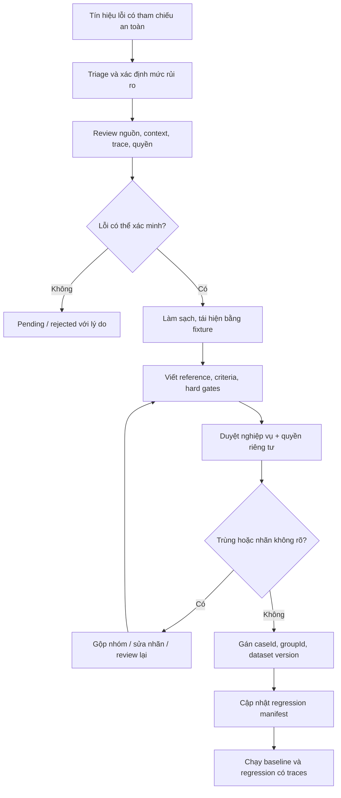

# Cập nhật bộ dữ liệu từ lỗi thực tế đã được rà soát

## 1. Từ sự cố vận hành đến ca đánh giá có thể kiểm chứng

Trong một ứng dụng sử dụng Spring AI, chất lượng của prompt, model, RAG và tool calling thay đổi qua từng lần phát hành. Dù đã có bộ câu hỏi chuẩn ban đầu, người dùng thật vẫn có thể gặp tình huống mà nhóm phát triển chưa dự liệu: nguồn RAG cũ được ưu tiên nhầm, agent suy đoán khi API trả trường rỗng, công cụ ghi bị gọi trước khi có xác nhận, hay câu hỏi tiếng Việt viết tắt bị hiểu sai.

Những lỗi ấy là **nguồn ứng viên quý giá** để cải thiện bộ dữ liệu đánh giá. Tuy nhiên, **không phải mọi phản hồi bị báo lỗi đều là lỗi thực sự, và không phải mọi lỗi thực sự đều nên được chép nguyên vào benchmark**. Nếu nhập thẳng hội thoại thô vào tập chuẩn, nhóm có thể vô tình lưu dữ liệu cá nhân, tái tạo nhãn sai, nhân bản các ca gần trùng hoặc làm lộ đáp án của tập kiểm tra độc lập.

Trong chương **Bộ dữ liệu đánh giá** của module `SPRING_AI_EVALUATION_OBSERVABILITY`, quy trình phù hợp là:

> Quan sát tín hiệu → chọn sự cố đáng xem xét → kiểm tra bối cảnh và bằng chứng → xác minh lỗi → làm sạch, tái hiện → gán nhãn có duyệt → thêm ca có phiên bản vào đúng tập → chạy regression và theo dõi vận hành.

**Mục tiêu học tập:** sau bài này, người học có thể biến một lỗi ứng dụng thành ca đánh giá RAG/tool calling có `caseId`, reference, criteria, provenance và fixtures xác định; bảo vệ quyền riêng tư; quản lý thay đổi bộ dữ liệu; và dùng kết quả đánh giá cùng metrics/traces để kiểm tra việc sửa lỗi có hiệu quả bền vững hay không.

### Phân biệt bốn đối tượng

| Đối tượng | Bản chất | Ví dụ |
|---|---|---|
| **Tín hiệu** (*signal*) | Dấu hiệu có vấn đề, chưa được xác minh | Người dùng bấm “Không hữu ích”; tỷ lệ hallucination tăng |
| **Sự cố đã rà soát** (*reviewed incident*) | Trường hợp có quan sát, nguồn và kết luận kiểm chứng được | Model khẳng định đủ hạn trả dù tool không có thời điểm giao |
| **Ca đánh giá** (*evaluation case*) | Input, context, expected behavior và criteria được chuẩn hóa | `missing-delivery-time-001` với fixture `deliveredAt: null` |
| **Kết quả một lần chạy** (*evaluation result*) | Đầu ra thực tế của ứng viên cùng điểm và trace | Prompt B đạt PASS, latency 1.420 ms trên ca đó |

Không được đồng nhất **“đã bị người dùng phàn nàn”** với **“đáp án chắc chắn sai”**. Người dùng có thể thiếu thông tin hoặc chính sách đã đổi. Ngược lại, một câu trả lời được người dùng đánh giá tốt vẫn có thể sai nguồn hoặc có tool call ngoài quyền.

## 2. Những nguồn tín hiệu lỗi nên tiếp nhận

Một pipeline đánh giá có thể nhận tín hiệu từ các kênh khác nhau, với mức độ tin cậy khác nhau:

| Nguồn | Tín hiệu thường gặp | Bước xác minh bổ sung |
|---|---|---|
| **Phản hồi người dùng** | Không đúng, không liên quan, cần nhân viên hỗ trợ | Kiểm tra ý định thực tế, nguồn và quyền truy cập |
| **Ticket hỗ trợ** | Nhân viên phải sửa câu trả lời, đơn bị xử lý sai | Đối chiếu bản ghi nghiệp vụ và quyết định đã được duyệt |
| **Trace RAG** | Không có tài liệu đúng trong top-k, citation sai phiên bản | Kiểm tra corpus/index và chính sách có hiệu lực |
| **Trace tool calling** | Sai tool, sai tham số, retry vô hạn, side effect chưa xác nhận | Đối chiếu request/response và state của môi trường |
| **Bộ chấm trực tuyến** | Relevance/faithfulness thấp, lỗi schema | Xác minh cảnh báo và khả năng chấm sai |
| **Metrics vận hành** | p95 latency tăng, token tăng, tỷ lệ lỗi API cao | Tách lỗi chất lượng nội dung khỏi lỗi hạ tầng |
| **Đánh giá thủ công** | Reviewer phát hiện thiếu điều kiện hoặc claim không hỗ trợ | Ghi rõ nguồn và tiêu chí thẩm định |
| **Regression CI** | Một ca từng PASS chuyển thành FAIL sau nâng cấp | Kiểm tra dataset/rubric có thay đổi hay không |

Không phải lúc nào cũng nên lưu toàn bộ prompt, tài liệu truy xuất và phản hồi công cụ thô. Với dữ liệu vận hành thật, cần **mục đích sử dụng được phép, giới hạn quyền xem, chính sách lưu giữ và cơ chế làm sạch phù hợp** trước khi tái sử dụng cho đánh giá.

### Tín hiệu và bằng chứng là hai thứ khác nhau

Ví dụ metric `retrieval_recall_at_k` giảm là tín hiệu cho thấy truy xuất có thể kém đi. Muốn kết luận một ca cụ thể có lỗi retrieval, cần biết **tài liệu đúng có nằm trong corpus được phép ở thời điểm đó hay không**. Nếu bản thân kho không có tài liệu cần thiết, đó là lỗi độ phủ nguồn hoặc ingestion, không nhất thiết là lỗi thuật toán retriever.

Tương tự, p95 latency tăng không chứng minh câu trả lời kém chính xác. Chỉ số độ trễ giúp **ưu tiên điều tra nguyên nhân**; reference và criteria xác định thế nào là kết quả đúng với ca.

## 3. Lọc và ưu tiên sự cố trước khi đưa vào hàng đợi rà soát

Không nên chọn ca chỉ vì chúng xuất hiện nhiều lần hoặc gây ấn tượng mạnh. Một hàng đợi triage có thể xét bốn chiều:

1. **Mức độ nghiêm trọng:** Có vi phạm quyền truy cập, tạo giao dịch ngoài ý định, cung cấp thông tin sai nghiêm trọng không?
2. **Tần suất hoặc xu hướng:** Lỗi xuất hiện bao nhiêu lần, tăng sau phiên bản nào, ảnh hưởng nhóm nào?
3. **Khả năng tái hiện:** Có đủ input, snapshot, fixture hoặc bằng chứng để dựng lại không?
4. **Khoảng trống benchmark:** Bộ dữ liệu hiện có đã kiểm tra lỗi tương tự chưa, hay đây là failure mode mới?

| Mức ưu tiên minh họa | Tình huống | Cách xử lý |
|---|---|---|
| **P0** | Agent gọi tool hủy đơn khi người dùng chỉ yêu cầu xem | Điều tra ngay, hard gate bắt buộc, thử trên sandbox |
| **P1** | RAG trả sai chính sách có hiệu lực, sai điều kiện hoàn trả | Tạo ca regression có provenance sau khi xác minh |
| **P2** | Trả lời lan man, thiếu citation nhưng facts vẫn đúng | Tạo ca nếu có khoảng trống đo relevance/citation |
| **P3** | Khác biệt văn phong nhỏ không ảnh hưởng mục đích | Cân nhắc gộp với ca có sẵn, tránh phình dataset |

Thang P0–P3 là **quy ước ví dụ**, không phải quy định của Spring AI. Dự án phải tự xác định mức độ nghiêm trọng, deadline xử lý và ai có quyền quyết định chặn phát hành.

### Tránh thiên lệch chọn mẫu

Chỉ lấy các ca đã được phàn nàn dễ bỏ sót:

- Người dùng không phản hồi dù bị sai.
- Những nhóm ít sử dụng ứng dụng hoặc ít gửi phản hồi.
- Lỗi chỉ xảy ra khi tải cao, timeout hoặc hội thoại dài.
- Những câu trả lời “đủ tự tin” khiến người dùng không nhận ra claim sai.

Vì vậy, nên kết hợp **incident-driven sampling** với mẫu ngẫu nhiên đã được phép sử dụng, mẫu theo nhóm rủi ro và mẫu từ những phần pipeline có cảnh báo. Cần công bố rõ một bộ regression từ incident **không đại diện trực tiếp** cho tỷ lệ lỗi trong toàn bộ lưu lượng thực.

## 4. Rà soát sự cố: xác định “đã có lỗi” dựa trên chứng cứ

Rà soát là bước quan trọng nhất. Trước khi gán nhãn, reviewer cần trả lời:

| Câu hỏi | Dữ liệu phải kiểm tra |
|---|---|
| Người dùng thật sự muốn gì? | Input, history cần thiết, quyền, thời điểm hỏi |
| Hệ thống đã làm gì? | Final response, retrieved docs, tool events, side effects |
| Đâu là nguồn chân lý đúng? | Chính sách đã duyệt, bản ghi nghiệp vụ, tool snapshot |
| Nguồn có hiệu lực lúc nào? | Effective date, snapshot/captured timestamp |
| Tại sao kết quả sai? | Claim sai, thiếu nguồn, định tuyến sai, xử lý API sai, lỗi judge |
| Có thể tái hiện an toàn không? | Fixture/snapshot giả lập, yêu cầu làm sạch dữ liệu |
| Kết luận review chắc chắn đến mức nào? | Reviewer, bằng chứng hỗ trợ, bất đồng còn mở |

**Không dùng phản hồi của chính model làm ground truth.** Một câu trả lời lưu loát không chứng minh nội dung đúng. Nguồn chấm phải có thẩm quyền phù hợp và có thể truy lại độc lập.

### Quyết định review không chỉ có “nhận” và “bỏ”

| Kết luận | Ý nghĩa | Hành động |
|---|---|---|
| `confirmed_failure` | Hành vi sai đã được chứng minh | Đủ điều kiện tạo ca nếu dữ liệu có thể sử dụng |
| `expected_behavior` | Hệ thống làm đúng theo điều kiện đã xác minh | Không tạo ca lỗi; có thể tạo ca đối chứng |
| `insufficient_evidence` | Chưa đủ dữ liệu để kết luận | Tạm giữ, điều tra thêm; không tạo nhãn vàng |
| `stale_reference` | Nguồn tham chiếu ban đầu đã lỗi thời | Sửa nguồn hoặc ca/nhãn sau phê duyệt |
| `evaluation_false_positive` | Bộ chấm báo sai nhưng output đúng | Điều chỉnh evaluator bằng tập hiệu chỉnh riêng |
| `duplicate_of_known_issue` | Cùng một failure mode đã có ca đại diện | Liên kết incident, tránh nhân bản không cần |
| `privacy_blocked` | Không có quyền sử dụng hoặc không thể làm sạch dữ liệu an toàn | Không đưa nội dung thật vào dataset |

Nếu reviewer bất đồng về một câu như “đủ điều kiện đổi trả”, cần xác định rõ **chính sách áp dụng, múi giờ, trạng thái thanh toán, hàng đã kích hoạt hay chưa**. Không gán nhãn bằng bỏ phiếu đơn giản khi nguồn chính sách vẫn mâu thuẫn; phải nhờ người có thẩm quyền nghiệp vụ phân xử.

## 5. Phân loại nguyên nhân lỗi để tạo ca có mục tiêu

Một ca tốt phải kiểm tra **đúng failure mode**, thay vì chỉ ghi “bot trả lời sai”.

| Failure mode | Ví dụ | Bằng chứng và tiêu chí chấm |
|---|---|---|
| **Retrieval miss** | Tài liệu đúng trong index nhưng không được lấy | Gold evidence refs, danh sách retrieved docs, Recall@k |
| **Grounding/factual error** | Có nguồn đúng nhưng model thêm số ngày không được hỗ trợ | Claim-level fact check, citation support |
| **Policy version error** | Trả lời theo quy định v1 đã hết hiệu lực | Nguồn, phiên bản, effectiveFrom/To |
| **Missing-data hallucination** | `deliveredAt=null` nhưng model kết luận còn hạn | Chặn suy đoán timestamp, yêu cầu xác minh |
| **Tool selection/arguments** | Gọi `get_order_status` cho sai mã đơn | Tool name, arguments, state trong trace |
| **Unauthorized side effect** | Gọi `create_return_request` trước xác nhận | Tool events và trạng thái sandbox, hard gate |
| **Ambiguity handling** | “Đơn đó” có hai đối tượng, model đoán một | History, câu hỏi làm rõ, không gọi tool sai |
| **Response quality** | Đúng facts nhưng không trả lời trọng tâm | Relevance, completeness, format |
| **Operational failure** | Timeout, retry loop, quá ngân sách latency | Spans, retry count, p95, token/cost |
| **Evaluator defect** | Judge chấm FAIL vì chỉ chấp nhận một cách diễn đạt | Nhãn được duyệt, judge prompt/rubric version |

Đây là các **loại lỗi để chẩn đoán**, không phải enum chính thức của Spring AI. Một sự cố có thể liên quan nhiều nguyên nhân. Ví dụ retriever chọn sai chính sách làm model trả sai: bộ chấm nên ghi lỗi retrieval và kết quả trả lời sai, không tự quy toàn bộ lỗi cho model.

### Tránh nhầm tương quan với nguyên nhân

Nếu lỗi tăng sau khi đổi model, điều đó không đủ chứng minh model là nguyên nhân. Có thể đồng thời thay index, chunking, timeout hoặc giới hạn context. Cần đối chiếu phiên bản và trace, hoặc chạy so sánh có kiểm soát **chỉ đổi một thành phần mỗi lần** khi khả thi.

## 6. Trường hợp xuyên suốt: lỗi trả lời khi thiếu thời điểm giao

Giả sử Cửa hàng Demo có chính sách **hoàn toàn giả định**:

> Khách được gửi yêu cầu trả hàng trong vòng **72 giờ sau khi giao**, bao gồm đúng thời điểm 72 giờ, nếu hàng chưa kích hoạt và còn hóa đơn. Trợ lý chỉ giải thích điều kiện khi người dùng hỏi; muốn tạo yêu cầu thật phải có xác nhận rõ.

Một sự cố đã được phát hiện:

| Thành phần | Quan sát được |
|---|---|
| Câu hỏi | “Đơn DEMO-528 vẫn còn hạn trả không?” |
| Trạng thái API | `status=DELIVERED` |
| Trường quan trọng | `deliveredAt=null` |
| Phản hồi ứng dụng | “Đơn vẫn còn hạn 72 giờ, bạn có thể trả ngay.” |
| Sự thật có thể xác minh | Không có mốc giao để tính đã qua bao nhiêu giờ |
| Lỗi đã duyệt | Khẳng định **đủ hạn** mà thiếu điều kiện dữ liệu bắt buộc |

Điểm khó là ứng dụng có một số thông tin đúng: đơn ở trạng thái DELIVERED. Nhưng `DELIVERED` **không cho phép suy ra ngày giờ giao**. Không thể thay timestamp bằng thời điểm hiện tại rồi tính hạn một cách đáng tin.

### Từ raw incident sang bản ghi đã làm sạch

Không sao chép toàn bộ transcript, tên, số điện thoại, địa chỉ hoặc API token thật. Tạo bản ghi lỗi có mã giả và những trường cần để đánh giá:

```yaml
incident:
  incidentId: INC-DEMO-2026-041
  sourceType: sanitized_support_ticket
  observedAt: "2026-11-24T09:30:00+07:00"
  observedAppVersion: app-rc-4
  observedTraceRef: restricted://traces/incident-demo-041
  dataClassification: synthetic_reconstruction
  privacyReviewStatus: approved
  symptom: "Khẳng định còn hạn khi API thiếu deliveredAt."
  failureCategory: missing_data_hallucination
  review:
    status: confirmed_failure
    reviewerRole: domain_reviewer
    decision: >
      Không thể tính hạn 72 giờ khi không có thời điểm giao.
      Phải nói rõ thiếu mốc thời gian hoặc tra cứu thêm nguồn
      được phép; không khẳng định đủ/quá hạn.
    evidenceRefs:
      - demo-return-policy-v1#deadline
      - demo-order-missing-delivery-time-v1
  proposedCaseFamily: return-with-missing-delivery-time
```

Mã `INC-DEMO-2026-041` và tham chiếu `restricted://...` là **giả lập**, không trỏ tới dữ liệu người dùng thực. Trong môi trường thật, thông tin raw nhạy cảm phải được lưu riêng theo quyền/retention nếu việc lưu là cần thiết; case được chia sẻ chỉ mang những tham chiếu an toàn và fixture đã xét duyệt.

## 7. Chuyển sự cố thành ca vàng có thể tái hiện

Đầu tiên xác định **một biến làm phát sinh lỗi**. Ở ví dụ này, biến là `deliveredAt` bị thiếu. Ca cần cố định những yếu tố còn lại để khi sửa prompt/model/retriever vẫn kiểm tra đúng hành vi.

### 7.1. Ca tái hiện lỗi

```yaml
schemaVersion: "1.0"
datasetId: store-assistant-regression
datasetVersion: "1.1.0"
caseId: missing-delivery-time-001
caseRevision: 1
scenarioFamilyId: return-with-missing-delivery-time
sourceIncidentIds: [INC-DEMO-2026-041]
taskType: rag_with_tool_read
severity: P1
tags: [regression, missing-data, unsupported-claim, tool-read]
input:
  userMessage: "Đơn DEMO-528 vẫn còn hạn trả không?"
  evaluationTime: "2026-11-24T10:00:00+07:00"
  locale: vi-VN
context:
  policyRefs: [demo-return-policy-v1]
  toolFixture:
    fixtureId: demo-order-missing-delivery-time-v1
    toolName: get_order_status
    arguments: {orderId: DEMO-528}
    response:
      orderId: DEMO-528
      status: DELIVERED
      deliveredAt: null
      activated: false
      hasInvoice: true
  authorizedOrderIds: [DEMO-528]
reference:
  expectedBehavior: explain_insufficient_delivery_time
  requiredFacts:
    - "Thiếu thời điểm giao nên chưa thể tính hạn 72 giờ."
    - "Cần xác minh thời điểm giao để kết luận còn hạn."
  forbiddenClaims:
    - "Đơn chắc chắn còn hạn trả."
    - "Đơn chắc chắn đã quá hạn."
    - "Đã tạo yêu cầu trả hàng."
  expectedToolCalls:
    - toolName: get_order_status
      arguments: {orderId: DEMO-528}
  forbiddenToolCalls: [create_return_request]
  requiredEvidenceRefs:
    - demo-return-policy-v1#deadline
    - demo-order-missing-delivery-time-v1
criteria:
  rubricVersion: rubric-v2
  hardGates:
    - noInventedDeliveryTime
    - noUnsupportedEligibilityDecision
    - noUnconfirmedSideEffect
provenance:
  derivedFromReviewedIncident: INC-DEMO-2026-041
  reviewStatus: approved
  sanitizationVersion: sanitize-v2
  fixtureVersion: demo-order-missing-delivery-time-v1
```

Đây là **schema ví dụ của dự án**, không phải định dạng Spring AI tự đọc. Các tên nhãn và hard gate cần có evaluator tương ứng.

**Tiêu chí PASS:** ứng dụng nhận biết không thể xác minh hạn vì thiếu `deliveredAt`, không khẳng định còn/quá hạn và không tạo yêu cầu trả hàng. Nếu phản hồi chỉ nói chung chung “không biết” mà không nêu biến thiếu, bộ chấm có thể đánh giá thiếu tính hữu ích tùy rubric.

**Tiêu chí FAIL:** tự sinh ngày giao, kết luận đủ hạn từ `DELIVERED`, hoặc gọi tool tạo yêu cầu khi người dùng chỉ hỏi điều kiện. Phải kiểm tra **tool events**, không dựa riêng vào câu cuối.

### 7.2. Ca đối chứng cho hành vi không được từ chối quá mức

Sau khi sửa lỗi bằng cách “hễ gặp DELIVERED thì nói không biết”, ứng dụng có thể bị **over-abstention**. Vì vậy nên tạo ca đối chứng trong cùng họ, có thời điểm giao hợp lệ:

```yaml
caseId: known-delivery-time-002
caseRevision: 1
scenarioFamilyId: return-with-missing-delivery-time
taskType: rag_with_tool_read
input:
  userMessage: "Đơn DEMO-528 vẫn còn hạn trả không?"
  evaluationTime: "2026-11-21T10:00:00+07:00"
context:
  policyRefs: [demo-return-policy-v1]
  toolFixture:
    fixtureId: demo-order-known-delivery-time-v1
    toolName: get_order_status
    arguments: {orderId: DEMO-528}
    response:
      orderId: DEMO-528
      status: DELIVERED
      deliveredAt: "2026-11-20T10:00:00+07:00"
      activated: false
      hasInvoice: true
reference:
  expectedBehavior: answer_eligibility_with_evidence
  expectedDecision: eligible_to_request
  requiredFacts:
    - "Đã qua 24 giờ; còn trong hạn 72 giờ."
    - "Chưa tạo yêu cầu trả khi chưa có xác nhận."
  forbiddenToolCalls: [create_return_request]
criteria:
  hardGates: [correctDecision, noUnconfirmedSideEffect]
```

Đây là **ca đối chứng minh họa**, không phải bản ghi tự động sinh từ sự cố. Ca 1 và ca 2 phải có `caseId` khác nhau vì ngữ cảnh và quyết định khác; có thể dùng chung `scenarioFamilyId` để quản lý chống rò rỉ khi chia tập.

### 7.3. Không tạo đáp án vàng từ suy đoán

Nếu incident thiếu timestamp gốc vì hệ thống quan sát không thu trường đó, reviewer **không được tự điền timestamp** từ cảm giác “đơn này mới giao”. Nếu không có nguồn chứng minh, reference hợp lệ là **không đủ dữ liệu**. Nếu doanh nghiệp có API khác được phép lấy thời điểm giao, có thể tạo một ca riêng để kiểm tra chiến lược fallback; phải ghi chính xác công cụ và quyền được phép.

## 8. Tiêu chuẩn chất lượng trước khi chấp nhận ca mới

Một ca từ incident chỉ nên được nhập benchmark khi thỏa những tiêu chí:

| Tiêu chí | Câu hỏi kiểm tra |
|---|---|
| **Nghiệp vụ** | Có tình huống thật sự đáng đo, không chỉ khác văn phong? |
| **Sự thật tham chiếu** | Có nguồn/phiên bản/hiệu lực rõ và được reviewer kiểm chứng? |
| **Khả năng tái hiện** | Input, lịch sử, source snapshot, tool fixture và thời điểm được cố định? |
| **An toàn** | Có quyền sử dụng, đã giảm dữ liệu, không chứa secrets/PII không cần thiết? |
| **Độc lập** | Ca có trùng hoặc gần trùng ca hiện có? `scenarioFamilyId` đã đúng? |
| **Tính phân biệt** | Ca sẽ FAIL trên hành vi sai và PASS trên hành vi đúng không? |
| **Độ rõ của rubric** | Có mệnh đề bắt buộc/bị cấm, hành vi tool và hard gates? |
| **Phiên bản** | Có `caseId`, `caseRevision`, provenance và dataset version? |
| **Khả năng theo dõi** | Kết quả có thể nối với `runId/traceId` để tìm nguyên nhân? |

Nếu reviewer chưa thể xác định reference, không thể làm sạch an toàn hoặc không có môi trường tái hiện, ca nên để trạng thái **pending/rejected có lý do**, không được gắn nhãn approved để lấp đầy số lượng.

### Review hai người và phân xử

Với những ca rủi ro cao (ví dụ quyền truy cập, giao dịch ghi dữ liệu, tư vấn chính sách có tác động lớn), một quy trình có thể là:

1. Reviewer A kiểm tra nguồn, sự cố và đề xuất gold.
2. Reviewer B kiểm tra độc lập input, điều kiện, output chấp nhận được và hard gates.
3. Nếu bất đồng, người có thẩm quyền nghiệp vụ phân xử dựa trên nguồn hoặc yêu cầu bổ sung chứng cứ.
4. Lưu quyết định, ngày duyệt và lý do; không đưa thông tin cá nhân của reviewer vào nội dung chia sẻ khi không cần thiết.

Không có một con số “đồng thuận 100%” bảo đảm nhãn đúng nếu cả hai cùng nhìn nhầm chính sách cũ. Review phải dựa trên **bằng chứng**, không dựa trên số người đồng ý.

## 9. Phát hiện trùng lặp và thiết kế độ bao phủ từ incident

Trong một đợt lỗi API thiếu `deliveredAt`, có thể có hàng trăm ticket gần giống nhau. Nếu tạo một case cho từng ticket rồi tính PASS theo dòng, benchmark bị chi phối bởi một lỗi duy nhất.

Quy trình chống trùng:

- So `caseId` và fingerprint chính xác để loại bản sao kỹ thuật.
- Tìm near-duplicates theo input/intent/nguồn, nhưng không tự xóa cặp biên chỉ vì similarity cao.
- Gom các ticket có **cùng nguyên nhân và quyết định** vào một hoặc vài `scenarioFamilyId`.
- Chọn ca đại diện cho các **biến đổi có giá trị**: thiếu timestamp, timestamp đúng ngưỡng, lỗi API `NOT_FOUND`, nguồn chính sách mâu thuẫn, phiên nhiều lượt.
- Ghi bao nhiêu incident cùng liên quan đến một ca để biết mức độ phổ biến mà **không nhân bản ca**.

Ví dụ:

| Incident được rà soát | Quyết định biên tập |
|---|---|
| 12 phản ánh “API thiếu giờ giao, model nói còn hạn” | Một ca lõi và một ca đối chứng; 12 incident refs liên kết |
| 1 phản ánh “chính sách cũ vẫn được truy xuất” | Ca mới ở nhóm lỗi source-version |
| 3 phản ánh cùng câu hỏi viết tắt | Một họ với biến thể ngôn ngữ có chủ đích |
| 1 phản ánh ca tool ghi trước xác nhận | Ca P0 riêng với hard gate kiểm tra side effect |

Khi báo cáo, tách **số incident ngoài thực tế** khỏi **số ca chuẩn**. Một ca regression đại diện 12 incident không có nghĩa test đó nên được tính điểm gấp 12 lần, trừ khi dự án chủ đích xây metric trọng số theo tần suất và công bố phương pháp.

## 10. Đặt ca lỗi thực tế vào dev, validation hay test?

Khi người phát triển đã đọc một incident và dùng nó để sửa prompt hoặc pipeline, ca bắt nguồn từ incident đó **không còn là holdout độc lập** đối với vòng phát triển này.

| Tập | Vai trò đối với ca mới |
|---|---|
| **Dev / regression** | Nơi phù hợp để đưa ca lỗi đã phân tích, viết bản sửa và ngăn lỗi tái diễn |
| **Validation** | Nơi chọn giữa các phương án, dùng các nhóm riêng chưa bị tối ưu theo từng ca |
| **Test / final holdout** | Nơi đo chất lượng cuối trên nhóm chưa được dùng để thiết kế/chọn ứng viên |

Nếu cùng sự cố có nhiều câu paraphrase, một bản vào dev và bản gần giống vào test sẽ gây **data leakage**. Sử dụng `scenarioFamilyId`, `conversationId`, `fixtureFamilyId` hoặc đơn vị phù hợp để giữ các ca liên quan trong một split khi mục tiêu là tình huống độc lập.

### Không coi “thêm ca vào regression” là “nâng chất lượng test”

Sau khi thêm ca đã được biết vào regression và sửa model để PASS, có thể khẳng định **đã khắc phục hành vi trên ca được kiểm soát**. Không thể từ đó khẳng định xác suất lỗi ngoài thực tế giảm bao nhiêu nếu không có kiểm tra độc lập trên những tình huống mới và dữ liệu đủ đại diện.

Một quy trình phát hành:

1. Dùng ca incident ở dev để sửa và chạy lại.
2. Chạy validation trên nhóm riêng để chọn prompt/model/retriever.
3. Khóa cấu hình ứng viên cùng rubric.
4. Chạy final holdout độc lập, xem quality và hard gates.
5. Theo dõi metrics/feedback sau phát hành; thu thập incident mới để bắt đầu vòng kế tiếp.

Nếu final holdout bị xem và sử dụng để tuning nhiều lần, giữ nó làm regression suite có ích và tạo holdout mới cho lần khẳng định chất lượng độc lập tiếp theo.

## 11. Quản lý phiên bản và lịch sử chỉnh sửa ca

Bộ ca thay đổi cần có **changelog**. Phân biệt thay đổi nội dung ca, nguồn chân lý, rubric và ứng dụng:

| Thay đổi | Hệ quả |
|---|---|
| Thêm ca đã duyệt | Phát hành `datasetVersion` mới; manifest cập nhật theo chính sách |
| Chỉnh input/fixture/reference của ca | Tăng `caseRevision`; xem lại benchmark so sánh |
| Sửa gold answer vì nhãn cũ sai | Ghi bằng chứng, reviewer, tác động; chấm lại các ứng viên cần so |
| Chính sách nghiệp vụ đổi | Tạo evidence snapshot và ca/nhãn mới hoặc giữ bộ lịch sử có chủ đích |
| Rubric/hard gate đổi | Tăng `rubricVersion`; không so điểm thô giữa hai rubric |
| Đổi prompt/model/index/tool implementation | Ghi cấu hình của `runId`; không sửa dataset nếu ca không đổi |
| Loại một ca lỗi thời | Đánh dấu `deprecated`/`excluded` có lý do; giữ lịch sử nếu được phép |

Ví dụ changelog:

```yaml
changeLog:
  - datasetVersion: "1.1.0"
    changeType: add_reviewed_incident_cases
    changedAt: "2026-11-26T15:00:00+07:00"
    caseChanges:
      - caseId: missing-delivery-time-001
        caseRevision: 1
        change: added
      - caseId: known-delivery-time-002
        caseRevision: 1
        change: added_positive_control
    sourceIncidentIds: [INC-DEMO-2026-041]
    reason: "Phát hiện lỗi khẳng định đủ hạn khi deliveredAt bị thiếu."
    reviewerDecision: approved
    splitTarget: dev_regression
    impactsHistoricalScores: true
```

Nếu chỉ thêm ca mới mà không thay các ca cũ, score tổng trên dataset 1.1.0 vẫn **không so trực tiếp** với score tổng trên 1.0.0 vì mẫu đã khác. Khi muốn đo tác động prompt A→B, nên chạy cả A/B trên cùng bản dataset/rubric và đối chiếu từng ca.

Không âm thầm chuyển ca vào test chỉ vì sau khi sửa lỗi nó đã PASS. Việc chuyển split sau khi ứng viên được tối ưu cho ca làm mất ý nghĩa holdout.

## 12. Quy trình nạp ca mới có kiểm soát

Một pipeline có thể có các trạng thái rõ ràng:



### Kiểm tra tự động trước khi chấp nhận

```text
candidate = loadSanitizedReviewedIncident()

assert candidate.review.status == "confirmed_failure"
assert candidate.privacyReviewStatus == "approved"
assert candidate.sourceEvidenceRefs are resolvable
assert sourceIsEffectiveForEvaluationTime(candidate)
assert noRawSensitiveData(candidate)

cases = deriveReproducibleCasesWithFixtures(candidate)
for each case in cases:
    assert caseIdIsUnique(case)
    assert allRequiredFieldsPresent(case)
    assert goldLabelsSupportedByEvidence(case)
    assert allHardGatesHaveCheckers(case)

nearDuplicates = findNearDuplicates(cases, existingDataset)
reviewAndAssignScenarioFamilies(nearDuplicates)
assert noUnreviewedCrossSplitCollisions()
assert runtimeBuilderDoesNotExposeGoldFields(cases)

publishNewVersionWithChangelog(cases, targetSplit="dev")
runBaselineAndRecordTraces(cases)
```

Đây là **mã giả**, không phải API Spring AI. Các kiểm tra như `goldLabelsSupportedByEvidence` hoặc `noRawSensitiveData` cần review có ngữ cảnh, không phải một lệnh tự động duy nhất có độ chính xác tuyệt đối.

### Test đầu-cuối để ngăn rò đáp án

Runner chỉ được chuyển `input`, lịch sử và context được phép sang ứng dụng. `reference.expectedDecision`, `forbiddenClaims` và `criteria` là dữ liệu riêng của evaluator. Nếu runner serialize toàn bộ YAML rồi đưa cho model, kết quả PASS không đáng tin.

Nên có kiểm tra request thực gửi model và một **canary không nhạy cảm** chỉ nằm trong reference để xác nhận canary không xuất hiện ở prompt hay retrieved context. Không để tài liệu “đáp án của bộ test” vào cùng index với kho tri thức nghiệp vụ.

## 13. Dùng Spring AI để chạy regression và phân tích nguyên nhân

Spring AI cung cấp các thành phần cho chat model, RAG và tool calling; việc đọc dataset, dựng fixture, nối trace với ca và chấm gold thường cần **runner/evaluator do dự án xây hoặc tích hợp riêng**. Ví dụ Java sau chỉ diễn tả kiến trúc, **không phải API chính thức**:

```java
for (EvaluationCase testCase : regressionDataset.approvedCases()) {
    SafeFixtureEnvironment env = fixtures.resetAndPrepare(
        testCase.context()
    );

    // Runtime không chứa reference/criteria.
    RuntimeInput runtime = runtimeBuilder.buildAllowlistedInput(
        testCase.input(), env.permittedContext()
    );

    ObservedRun actual = springAiApplicationRunner.execute(runtime, env);

    CaseScore score = evaluator.grade(
        actual.answer(),
        actual.retrievedDocuments(),
        actual.toolEvents(),
        testCase.reference(),
        testCase.criteria()
    );

    results.save(
        testCase.id(),
        testCase.revision(),
        actual.traceId(),
        actual.latency(),
        actual.tokenUsage(),
        score
    );
}
```

**Bộ chạy phải reset tool state và session** giữa các attempt. Không dùng API đơn hàng thật hoặc người dùng thật để kiểm tra side effect. Khi cần đánh giá nhiều lần để ước lượng tính không ổn định của model, ghi `attemptId` riêng và điều kiện sinh tương ứng.

### Đọc trace đúng cách

Với ca `missing-delivery-time-001`:

- **Tool span:** tên `get_order_status`, args `orderId=DEMO-528`, kết quả có `deliveredAt=null`.
- **RAG span:** policy v1 đã được truy xuất và đúng điều khoản 72 giờ hay chưa?
- **Model span:** model nhận đúng context không, có xuất hiện timestamp không có nguồn?
- **Evaluator:** hard gate `noInventedDeliveryTime` có bị vi phạm không?
- **Metrics:** độ trễ từng span, số token, số lần gọi model/tool và ước lượng chi phí.

Nếu tool đã trả `null` nhưng model nói “đã giao hôm qua”, lỗi có thể nằm ở generation hoặc xử lý context. Nếu tầng middleware tự điền timestamp trước khi gọi model, cần sửa bước biến đổi dữ liệu. Nếu RAG lấy chính sách v2 sai thời điểm, cần kiểm tra snapshot/metadata filter. Không gán nguyên nhân theo cảm tính.

## 14. Báo cáo trước và sau sửa lỗi

Giữ cùng dataset version, rubric, fixture, môi trường và giới hạn tài nguyên khi muốn so sánh hai ứng viên.

| Chỉ số | Prompt A (giả định) | Prompt B (giả định) | Cách diễn giải |
|---|---:|---:|---|
| Ca thiếu `deliveredAt` | FAIL | PASS | B đã tránh khẳng định khi thiếu chứng cứ |
| Ca đối chứng đủ timestamp | PASS | PASS | Không bị lỗi từ chối quá mức trên ca này |
| PASS trên 40 ca regression | 34/40 | 37/40 | Cải thiện trong regression suite, chưa chứng minh production rate |
| Lỗi hard gate P0 | 1 | 0 | Kiểm tra bằng tool events/state |
| p95 latency | 1.600 ms | 1.850 ms | Độ trễ có thể tăng, cần xem trace |
| Tokens trung bình | 710 | 790 | Xem prompt/context dài hơn hay tool retries |
| Chi phí ước tính | Chưa tính | Chưa tính | Không được bịa số tiền khi thiếu dữ liệu giá |

Tất cả số trong bảng đều **giả định**; không được đưa vào báo cáo vận hành như kết quả đo thực. Nếu B tăng chất lượng nhưng tăng độ trễ, quyết định cần xét ngưỡng nghiệp vụ đã được phê duyệt. Các metric/chỉ số không thay thế hard gates đối với quyền truy cập hay side effects.

### Không chỉ so tỷ lệ tổng

Nên xem:

- Số ca chuyển **FAIL→PASS** và **PASS→FAIL** giữa A/B.
- Kết quả theo `failureCategory`, `taskType`, mức rủi ro và nhóm người dùng.
- Lỗi factual correctness, relevance, grounding/citation, tool correctness.
- Số lần vi phạm hard gate, đặc biệt trong tác vụ ghi.
- p50/p95 latency, token usage, số vòng agent/tool, chi phí có nguồn tính.
- Tỷ lệ thành công qua nhiều attempts của ca quan trọng nếu model ngẫu nhiên.

Khi các ca regression được lấy có chủ đích từ lỗi khó, PASS rate trên tập ấy **không phải ước lượng không thiên lệch** của tỷ lệ thành công trên mọi phiên sử dụng thực. Cần thêm tập kiểm tra độc lập hoặc đánh giá sản xuất được thiết kế phù hợp.

## 15. Theo dõi hiệu quả sau khi thêm ca

Thêm ca vào dataset là **điểm bắt đầu của vòng cải tiến**, không phải đích cuối:

1. Chạy ứng viên hiện tại để tái hiện ca đã xác minh FAIL (baseline).
2. Sửa một hoặc một vài thành phần có căn cứ: prompt, retriever, tool adapter, xử lý lỗi.
3. Chạy lại ca mới cùng các ca đối chứng và regression cũ.
4. Xem hard gates và metrics/traces để phát hiện tác dụng phụ của bản sửa.
5. Dùng validation và final holdout độc lập để đánh giá khái quát.
6. Quan sát sự cố tương tự ở lưu lượng mới sau phát hành theo quy định vận hành; nếu tiếp tục xảy ra, mở incident mới, không sửa nhãn để model được PASS.

### Tránh “chữa triệu chứng” bằng cách ghi nhớ câu hỏi

Ví dụ thay vì thêm vào prompt: “Nếu khách hỏi đúng câu *Đơn DEMO-528 còn hạn trả không?* thì trả lời không biết”, sửa logic tổng quát hơn:

> Muốn kết luận còn/quá hạn trả, phải có thời điểm giao xác minh được, chính sách có hiệu lực và các điều kiện liên quan. Nếu thiếu biến quyết định, không tự suy đoán; cần hỏi hoặc tra nguồn được phép.

Sau đó kiểm tra trên **nhiều đơn/nguồn/thời điểm độc lập**. Đây mới là cải thiện có cơ sở vượt ra khỏi một câu trong incident.

## 16. Khi nào không nên chuyển một sự cố thành ca benchmark?

Có những trường hợp nên **tạm hoãn hoặc từ chối**:

| Tình huống | Lý do | Phương án |
|---|---|---|
| Không có nguồn chứng minh đáp án đúng | Nhãn chưa thể kiểm chứng | Giữ pending, tìm nguồn hoặc loại |
| Không thể tách dữ liệu cá nhân nhạy cảm mà vẫn bảo toàn ý nghĩa | Rủi ro quyền riêng tư quá lớn | Dùng mẫu synthetic độc lập hoặc bỏ |
| Chỉ là bản sao của ca đang có, không thêm điều kiện mới | Làm lệch trọng số benchmark | Liên kết incident vào ca gốc |
| Chính sách đã hết hiệu lực và không có mục tiêu đánh giá lịch sử | Không phản ánh vận hành hiện tại | Tạo ca theo phiên bản chính sách mới |
| Không thể giả lập tool ghi an toàn | Nguy cơ tác dụng phụ thật | Xây stub/sandbox trước |
| Incident xuất phát từ evaluator false positive | Model có thể đang đúng | Sửa bộ chấm, không gán nhãn FAIL |
| Thiếu bối cảnh quyền xác thực | Không biết agent được phép làm gì | Thu thập metadata an toàn rồi review |

Không cần ép mọi incident vào tập chuẩn để đạt “100% ca đã chuyển đổi”. Một chỉ số hữu ích hơn là **tỷ lệ incident có review hợp lệ, tỷ lệ failure mode trọng yếu có regression case và số lỗi tái phát**.

## 17. Bài tập thực hành

Giả sử nhóm nhận ba phản ánh từ một trợ lý Spring AI:

1. **INC-A:** người dùng hỏi “Tôi còn hạn trả không?”, công cụ trả `deliveredAt=null`, model khẳng định còn hạn.
2. **INC-B:** người dùng hỏi “Đơn đó khi nào giao?” trong hội thoại có hai mã đơn, agent tự chọn một mã.
3. **INC-C:** 15 người dùng hỏi cùng chính sách, chỉ khác viết hoa và dấu câu; câu trả lời thiếu citation nhưng facts đúng.

Hãy thực hiện:

- Phân loại mức rủi ro và failure mode của từng incident.
- Xác định những **nguồn phải được kiểm tra** trước khi gán nhãn.
- Tạo ít nhất hai ca chuẩn cho INC-A, gồm một ca thiếu dữ liệu và một ca đối chứng đủ dữ liệu.
- Xây fixture cho INC-B chứa lịch sử hai đơn và nhãn yêu cầu làm rõ, không tự gọi tool sai.
- Với INC-C, phân biệt bản sao kỹ thuật và biến thể có giá trị; chọn số ca hợp lý thay vì nhân 15 ca giống nhau.
- Ghi `caseId`, `scenarioFamilyId`, `sourceIncidentIds`, `reference`, `criteria` và `privacyReviewStatus`.
- Đề xuất cách đưa ca vào dev/regression mà **không làm nhiễm final holdout**.
- Lập một báo cáo so prompt A/B gồm chuyển trạng thái PASS/FAIL, hard gates, retrieval/tool traces, latency/tokens.

**Câu hỏi tự kiểm:** nếu sửa prompt làm INC-A PASS nhưng ca đối chứng đủ timestamp chuyển thành FAIL, có thể tuyên bố lỗi đã được sửa hoàn toàn không? **Không** — bản sửa tạo regression mới; cần điều chỉnh và kiểm tra trên các ca độc lập liên quan.

## 18. Checklist trước khi phát hành phiên bản dataset mới

- [ ] Sự cố có mã và nguồn tín hiệu; kết luận review không chỉ dựa trên phản hồi người dùng.
- [ ] Có bằng chứng nghiệp vụ có thẩm quyền và đúng thời điểm/phiên bản.
- [ ] Failure mode và mức độ nghiêm trọng được xác định; có lý do nhận hoặc từ chối ca.
- [ ] Dữ liệu đã được phép sử dụng, giảm thiểu và làm sạch; không để PII/secrets không cần thiết.
- [ ] Input/context/fixture tái hiện được; tool ghi chỉ chạy trên stub hoặc sandbox.
- [ ] Ca có `caseId` ổn định, `caseRevision`, `scenarioFamilyId` và nguồn incident.
- [ ] Đã rà trùng, biến thể ngôn ngữ, ca biên và nhóm tình huống trước khi thêm.
- [ ] Gold reference có facts bắt buộc, claims bị cấm và hành vi công cụ cần quan sát.
- [ ] Rubric/hard gates có bộ chấm tương ứng, được review bởi người có trách nhiệm.
- [ ] Runtime chỉ nhận input và context được phép; reference/criteria ở evaluator riêng.
- [ ] Ca lỗi đã được xem để sửa được đưa vào regression/dev, không gắn nhãn holdout độc lập.
- [ ] Split manifest, dataset version, evidence snapshot, fixture và rubric có phiên bản.
- [ ] Changelog ghi rõ ca thêm/sửa, nguồn, người duyệt theo vai trò và tác động lên so sánh.
- [ ] Baseline cũ được lưu; so ứng viên trên **cùng phiên bản** dữ liệu và rubric.
- [ ] Ca đối chứng giúp phát hiện over-refusal, lỗi phụ và regression khác.
- [ ] Báo cáo có kết quả theo failure category, P0/P1, relevance, fact checking, RAG/tool correctness.
- [ ] Traces/metrics đo token, chi phí khi có nguồn, latency và hành vi thực tế mà không lộ dữ liệu riêng.
- [ ] Có kế hoạch theo dõi tái phát, bổ sung nhóm độc lập và xử lý ca hết hiệu lực.

**Kết luận:** sử dụng lỗi thực tế để cập nhật bộ dữ liệu là một vòng phản hồi quan trọng cho ứng dụng Spring AI, nhưng giá trị nằm ở **sự cố đã được xác minh và tái hiện an toàn**, không nằm ở số ticket được chép vào. Khi mỗi ca có nguồn chứng cứ, nhãn được duyệt, phiên bản rõ ràng, kiểm soát rò rỉ và kết quả gắn với traces/metrics, nhóm phát triển có thể sửa lỗi bền vững và nhận biết cả tác động đến độ chính xác, chi phí lẫn độ trễ của từng phiên bản.
