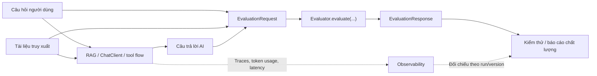

# Evaluator và hợp đồng `evaluate` trong Spring AI

## 1. Vì sao ứng dụng AI cần một hợp đồng đánh giá?

Trong ứng dụng Java thông thường, kết quả của một hàm thường được kiểm tra bằng giá trị kỳ vọng: `assertEquals(expected, actual)`. Với mô hình ngôn ngữ lớn (LLM), nhiều câu trả lời khác nhau về cách diễn đạt vẫn có thể đúng. Ngược lại, một câu trả lời trôi chảy có thể sai sự thật, lạc đề hoặc dựa trên tài liệu không liên quan.

Ví dụ, hệ thống RAG (Retrieval-Augmented Generation) trả lời câu hỏi về chính sách hoàn tiền:

- **Câu hỏi:** “Tôi có thể yêu cầu hoàn tiền trong bao lâu?”
- **Tài liệu được truy xuất:** “Khách hàng được yêu cầu hoàn tiền trong vòng 30 ngày kể từ khi nhận hàng.”
- **Câu trả lời A:** “Bạn có thể yêu cầu hoàn tiền trong 30 ngày kể từ ngày nhận hàng.”
- **Câu trả lời B:** “Bạn có 90 ngày để yêu cầu hoàn tiền.”

Cả hai câu đều có vẻ phù hợp về ngôn ngữ; chỉ A được tài liệu hỗ trợ. Kiểm thử chỉ xem ứng dụng trả về HTTP 200 hoặc câu trả lời khác rỗng sẽ bỏ lọt lỗi này.

Spring AI cung cấp **API `Evaluator`** để biểu diễn một phép kiểm tra chất lượng theo cùng một kiểu đầu vào và đầu ra. Đây là phần nền tảng của module **SPRING_AI_EVALUATION_OBSERVABILITY**: dùng tập dữ liệu và tiêu chí như relevance/fact checking để đánh giá chất lượng từng phiên bản prompt, model hoặc RAG pipeline; sau đó kết hợp với metrics, traces, chi phí và độ trễ để tìm nguyên nhân suy giảm chất lượng.

**Kết quả học tập:** sau bài này, bạn có thể đọc hợp đồng `evaluate(...)`, tạo `EvaluationRequest` đúng dữ liệu, diễn giải `EvaluationResponse`, chạy một evaluator sẵn có hoặc tự viết evaluator, và hiểu ranh giới giữa đánh giá chất lượng với quan sát hệ thống.

## 2. Hợp đồng cốt lõi: từ request đến response

API thuộc package `org.springframework.ai.evaluation`. Hình thức rút gọn:

```java
@FunctionalInterface
public interface Evaluator {

    EvaluationResponse evaluate(EvaluationRequest evaluationRequest);
}
```

Một lần đánh giá nhận vào **một `EvaluationRequest`** và trả về **một `EvaluationResponse`**. Chữ ký này là hợp đồng chung để thay thế evaluator, thử nhiều tiêu chí hoặc chạy cùng một tập ca kiểm thử. `@FunctionalInterface` cũng cho phép tự định nghĩa evaluator bằng lambda hoặc method reference.

Trong API hiện hành còn có phương thức hỗ trợ mặc định `doGetSupportingData(EvaluationRequest)` để lấy dữ liệu ngữ cảnh; đó **không phải** một tham số bổ sung của `evaluate(...)`.



Lưu ý: `Evaluator` là **hợp đồng đánh giá một kết quả đã có**. Nó không tự động truy xuất tài liệu, gọi công cụ, sinh câu trả lời, lưu dataset hoặc xuất dashboard. Những trách nhiệm đó thuộc pipeline và hệ thống đo lường xung quanh.

### 2.1. `EvaluationRequest` — dữ liệu cần được chấm

Ở Spring AI 2.1.x, kiểu dữ liệu chính là:

```java
public class EvaluationRequest {
    // Mô tả các thành phần quan trọng; không phải toàn bộ mã nguồn.
    private final String userText;
    private final List<Document> dataList;
    private final String responseContent;

    public EvaluationRequest(
            String userText,
            List<Document> dataList,
            String responseContent) { /* ... */ }

    public String getUserText() { /* ... */ }
    public List<Document> getDataList() { /* ... */ }
    public String getResponseContent() { /* ... */ }
}
```

| Thành phần | Ý nghĩa | Cần lưu ý |
|---|---|---|
| `userText` | Câu hỏi/yêu cầu gốc của người dùng | Giữ nguyên ý định ban đầu; không thay bằng prompt của judge. |
| `dataList` | Các `Document` làm ngữ cảnh tham chiếu | Với RAG, thường là tài liệu **thực sự được truy xuất** cho lượt trả lời. |
| `responseContent` | Nội dung câu trả lời đã sinh | Đây là đối tượng cần đánh giá, không phải câu trả lời mẫu. |

Các hàm tạo được API hỗ trợ:

```java
new EvaluationRequest(question, answer);
new EvaluationRequest(documents, answer);
new EvaluationRequest(question, documents, answer);
```

Hai dạng ngắn tiện cho tiêu chí không cần tất cả dữ liệu. Tuy nhiên, với **relevance theo ngữ cảnh RAG**, nên truyền đủ câu hỏi, tài liệu và câu trả lời. Với **fact checking**, phải có nguồn tham chiếu đáng tin cậy; thiếu ngữ cảnh có thể khiến kết quả trở nên vô nghĩa.

> **Lưu ý phiên bản:** tài liệu tham khảo cũ đôi khi mô tả `dataList` là `List<Content>`. Javadoc Spring AI 2.1.x sử dụng `List<Document>`. Hãy đối chiếu phiên bản Spring AI thực tế trong dự án khi sao chép ví dụ.

### 2.2. `EvaluationResponse` — cách đọc phán quyết

Spring AI cung cấp các thành phần sau:

| API | Kiểu | Vai trò |
|---|---|---|
| `isPass()` | `boolean` | Phán quyết đạt/không đạt tiêu chí của evaluator. |
| `getScore()` | `float` | Điểm số do evaluator định nghĩa. |
| `getFeedback()` | `String` | Giải thích hoặc thông báo đánh giá, nếu evaluator có cung cấp. |
| `getMetadata()` | `Map<String, Object>` | Thông tin phụ như rubric, số liệu, mã mẫu hoặc dữ liệu chẩn đoán. |

Ví dụ cấu trúc một phản hồi do **evaluator tự viết** tạo ra:

```java
EvaluationResponse result = new EvaluationResponse(
    false,                       // pass
    0.0f,                        // score theo thang của evaluator này
    "Câu trả lời vượt quá giới hạn ký tự",
    Map.of("criterion", "max-length", "limit", 200)
);

boolean passed = result.isPass();
float score = result.getScore();
String feedback = result.getFeedback();
```

API có hai constructor: `(boolean pass, float score, String feedback, Map<String, Object> metadata)` và `(boolean pass, String feedback, Map<String, Object> metadata)`.

**Không suy ra `pass` từ `score` theo một ngưỡng cố định nếu evaluator chưa định nghĩa quy tắc đó.** `isPass()` là kết luận đã được evaluator đưa ra; ý nghĩa và thang `score` phụ thuộc từng triển khai. Một số evaluator tích hợp có thể trả điểm nhị phân; không nên xem đó là xác suất “câu trả lời đúng 80%” hoặc điểm đo khách quan tuyệt đối. `feedback` có thể rỗng và `metadata` có thể không chứa chi tiết hữu ích.

## 3. Hai evaluator thường dùng trong Spring AI

Spring AI cung cấp các triển khai trong `org.springframework.ai.chat.evaluation`.

| Tiêu chí | `RelevancyEvaluator` | `FactCheckingEvaluator` |
|---|---|---|
| Câu hỏi cần trả lời | Câu trả lời có phù hợp với câu hỏi **và ngữ cảnh** không? | Các khẳng định của câu trả lời có được tài liệu hỗ trợ không? |
| Dữ liệu cần | Câu hỏi, câu trả lời, ngữ cảnh | Câu trả lời/claim và tài liệu làm căn cứ |
| Lỗi muốn phát hiện | Trả lời lạc đề, không bám tài liệu liên quan | Khẳng định không được nguồn hỗ trợ, bịa thông tin |
| Phương pháp | Dùng LLM làm judge với prompt về relevance | Dùng LLM/judge kiểm tra claim so với document |
| Không thay thế được | Kiểm chứng mọi sự kiện trong câu trả lời | Đánh giá mức độ hữu ích, đầy đủ, dễ hiểu của câu trả lời |

Ví dụ, câu trả lời “Bạn có 90 ngày để yêu cầu hoàn tiền” có thể **trông liên quan** đến câu hỏi thời hạn hoàn tiền, nhưng **sai theo tài liệu** ghi 30 ngày. Do vậy, một hệ thống đánh giá nghiêm túc thường cần nhiều tiêu chí thay vì kết luận từ một tiêu chí.

Một câu trả lời “Tôi không có đủ dữ liệu để xác nhận” có thể không chứa sự kiện bịa đặt; điều đó không đồng nghĩa câu trả lời đáp ứng được yêu cầu của người dùng. Bên cạnh groundedness/factuality, có thể cần thêm tiêu chí correctness đối chiếu đáp án chuẩn, completeness hoặc tool-use correctness.

### 3.1. Ví dụ integration test: chấm relevance và factuality

Ví dụ sau dùng Spring Boot Test với một `ChatModel` đã cấu hình qua starter/provider của dự án. Để dễ theo dõi hợp đồng, tài liệu đầu vào được tạo cố định; với RAG thật, hãy thay bằng các `Document` được truy xuất ở chính lượt hỏi đó.

```java
import java.util.List;

import org.junit.jupiter.api.Test;
import org.springframework.ai.chat.client.ChatClient;
import org.springframework.ai.chat.evaluation.FactCheckingEvaluator;
import org.springframework.ai.chat.evaluation.RelevancyEvaluator;
import org.springframework.ai.chat.model.ChatModel;
import org.springframework.ai.document.Document;
import org.springframework.ai.evaluation.EvaluationRequest;
import org.springframework.ai.evaluation.EvaluationResponse;
import org.springframework.ai.evaluation.Evaluator;
import org.springframework.beans.factory.annotation.Autowired;
import org.springframework.boot.test.context.SpringBootTest;

import static org.junit.jupiter.api.Assertions.assertTrue;

@SpringBootTest
class EvaluatorContractIT {

    @Autowired
    ChatModel judgeModel;

    @Test
    void answerShouldBeRelevantAndSupportedByDocuments() {
        String question = "Khách hàng có thể yêu cầu hoàn tiền trong bao lâu?";

        List<Document> retrievedDocuments = List.of(
            new Document(
                "Chính sách hoàn tiền: khách hàng có thể yêu cầu hoàn tiền "
                + "trong 30 ngày kể từ khi nhận hàng.")
        );

        String answer = "Bạn có thể yêu cầu hoàn tiền trong 30 ngày "
            + "kể từ ngày nhận hàng.";

        EvaluationRequest request = new EvaluationRequest(
            question,
            retrievedDocuments,
            answer
        );

        Evaluator relevance = new RelevancyEvaluator(
            ChatClient.builder(judgeModel)
        );

        Evaluator factuality = FactCheckingEvaluator
            .builder(ChatClient.builder(judgeModel))
            .build();

        EvaluationResponse relevanceResult = relevance.evaluate(request);
        EvaluationResponse factResult = factuality.evaluate(request);

        assertTrue(
            relevanceResult.isPass(),
            "Câu trả lời không đạt relevance: "
                + relevanceResult.getFeedback()
        );
        assertTrue(
            factResult.isPass(),
            "Câu trả lời chưa được tài liệu hỗ trợ: "
                + factResult.getFeedback()
        );
    }
}
```

**Điều kiện để chạy:** dự án có dependency Spring AI phù hợp, JUnit 5, provider `ChatModel` và cấu hình kết nối cần thiết. Test gọi judge model thật nên có thể tốn token, chịu độ trễ và đôi khi cho kết quả khác nhau giữa các lần chạy. Đây là **integration test dựa trên LLM-as-a-judge**, không phải unit test thuần túy, và không thể bảo đảm pass giống nhau trên mọi model.

Dù ví dụ dùng cùng một `ChatModel`, hệ thống thực tế có thể dùng **judge model riêng** để tránh phụ thuộc quá nhiều vào model đang được kiểm tra, kiểm soát chi phí và hiệu chỉnh độ tin cậy của phán quyết.

### 3.2. Đưa đúng ngữ cảnh RAG vào `EvaluationRequest`

Trong ứng dụng RAG, lỗi phổ biến là lấy tài liệu “đáng lẽ được truy xuất” từ một fixture, trong khi pipeline thực tế đã truy xuất tập tài liệu khác. Khi đó đánh giá bỏ qua lỗi retrieval.

Một luồng kiểm thử thực tế cần giữ cùng nhau ba thành phần thuộc **cùng một lần chạy**:

1. Câu hỏi người dùng được gửi vào ChatClient.
2. Tập tài liệu truy xuất mà model nhận làm context.
3. Câu trả lời cuối cùng do model tạo.

Ví dụ phác thảo cách lấy metadata khi dùng `RetrievalAugmentationAdvisor` (các đối tượng `chatClient` và `ragAdvisor` đã được cấu hình sẵn):

```java
String question = "Thời hạn hoàn tiền là bao lâu?";

ChatResponse chatResponse = chatClient.prompt()
    .user(question)
    .advisors(ragAdvisor)
    .call()
    .chatResponse();

Object contextValue = chatResponse.getMetadata()
    .get(RetrievalAugmentationAdvisor.DOCUMENT_CONTEXT);

if (!(contextValue instanceof List<?> rawDocuments)
        || !rawDocuments.stream().allMatch(Document.class::isInstance)) {
    throw new IllegalStateException(
        "Không lấy được danh sách Document của lượt truy xuất RAG");
}

List<Document> contextDocuments = rawDocuments.stream()
    .map(Document.class::cast)
    .toList();

String answer = chatResponse.getResult().getOutput().getText();

EvaluationRequest request = new EvaluationRequest(
    question, contextDocuments, answer
);
EvaluationResponse verdict = relevanceEvaluator.evaluate(request);
```

Các kiểu cần import trong phần tích hợp tương ứng gồm `ChatResponse`, `Document`, `EvaluationRequest`, `EvaluationResponse` và `RetrievalAugmentationAdvisor`. Khả năng lấy `DOCUMENT_CONTEXT` phụ thuộc advisor và phiên bản API được sử dụng; nếu pipeline tự cài đặt, phải tự lưu và truyền danh sách tài liệu truy xuất.

**Một pass của evaluator không chứng minh truy xuất đúng tài liệu:** relevance và fact checking có thể chỉ đánh giá câu trả lời dựa trên tập context được đưa vào. Nếu retrieval bỏ sót nguồn quan trọng hoặc trả tài liệu cũ, cần đánh giá retrieval riêng (ví dụ recall@k, precision@k với nhãn nguồn đúng, freshness, quyền truy cập tài liệu).

## 4. Tự triển khai `Evaluator` với quy tắc xác định

Không phải tiêu chí nào cũng cần gọi LLM. Ví dụ, hệ thống đặt giới hạn 200 ký tự cho phần trả lời ngắn. Ta có thể sử dụng đúng hợp đồng `evaluate(...)` với một bộ chấm deterministic:

```java
import java.util.Map;

import org.springframework.ai.evaluation.EvaluationRequest;
import org.springframework.ai.evaluation.EvaluationResponse;
import org.springframework.ai.evaluation.Evaluator;

public final class MaxLengthEvaluator implements Evaluator {

    private final int maxCodePoints;

    public MaxLengthEvaluator(int maxCodePoints) {
        if (maxCodePoints < 1) {
            throw new IllegalArgumentException("Giới hạn phải dương");
        }
        this.maxCodePoints = maxCodePoints;
    }

    @Override
    public EvaluationResponse evaluate(EvaluationRequest request) {
        String answer = request.getResponseContent();
        int actual = answer.codePointCount(0, answer.length());
        boolean passed = actual <= maxCodePoints;

        return new EvaluationResponse(
            passed,
            passed ? 1.0f : 0.0f,
            passed ? "Độ dài hợp lệ" : "Câu trả lời quá dài",
            Map.of(
                "criterion", "max-code-points",
                "actual", actual,
                "limit", maxCodePoints
            )
        );
    }
}
```

Cách sử dụng:

```java
Evaluator lengthEvaluator = new MaxLengthEvaluator(200);
EvaluationResponse result = lengthEvaluator.evaluate(
    new EvaluationRequest("Hãy tóm tắt chính sách hoàn tiền", answer)
);

if (!result.isPass()) {
    // Ghi lại kết quả hoặc báo lỗi kiểm thử theo chính sách dự án.
}
```

Kiểm tra này nhất quán, nhanh, không tốn token judge; tuy nhiên **độ dài không nói lên tính đúng đắn**. Đừng dùng nó thay cho đánh giá relevance hoặc factuality.

Bạn cũng có thể hiện thực một `Evaluator` cho cấu trúc JSON, trường bắt buộc, từ ngữ bị cấm hoặc quy tắc nghiệp vụ rõ ràng. Với tool calling, hãy đánh giá riêng dấu vết lời gọi: công cụ có được gọi không, tên công cụ có đúng không, tham số có hợp lệ không, kết quả có được sử dụng đúng không. **Bản thân `EvaluationRequest` không chứa danh sách tool call hoặc trace**, nên muốn chấm tiêu chí đó phải thu thập log/trace đầu vào ở tầng orchestration và thiết kế evaluator hoặc phép kiểm bổ sung.

## 5. Thiết kế bộ dữ liệu đánh giá thay vì chỉ kiểm tra một ví dụ

Một `EvaluationResponse` chỉ mô tả **một lần đánh giá**. Để so sánh phiên bản prompt/model/pipeline, cần dataset có nhãn kỳ vọng và nhiều ca lỗi.

| Case | Câu hỏi | Context / đáp án chuẩn | Câu trả lời được kiểm tra | Kỳ vọng |
|---|---|---|---|---|
| TC-01 | “Hạn hoàn tiền?” | 30 ngày kể từ nhận hàng | “Trong 30 ngày sau khi nhận hàng.” | Relevance đạt, fact checking đạt |
| TC-02 | “Hạn hoàn tiền?” | 30 ngày kể từ nhận hàng | “Trong 90 ngày.” | Fact checking không đạt |
| TC-03 | “Hạn hoàn tiền?” | 30 ngày kể từ nhận hàng | “Chúng tôi có nhiều màu sản phẩm.” | Relevance không đạt |
| TC-04 | “Chính sách giao quốc tế?” | Context không chứa chính sách giao quốc tế | “Có giao miễn phí toàn cầu.” | Không được phép khẳng định khi thiếu bằng chứng |

Những giá trị “kỳ vọng” trong bảng là **nhãn do người thiết kế dataset định nghĩa**; evaluator LLM có thể phán quyết khác và cần được kiểm tra lại bằng người đánh giá khi phát hiện bất đồng.

Mỗi mẫu dữ liệu nên lưu ít nhất:

- `caseId`, câu hỏi, context hoặc định danh tài liệu (kèm phiên bản), câu trả lời thực tế và đáp án/nhãn mong đợi.
- Tên tiêu chí, phiên bản rubric/prompt judge và model judge.
- Phiên bản prompt ứng dụng, model sinh câu trả lời, cấu hình retrieval (top-k, filter, embedding/index version).
- Kết quả `isPass()`, `score`, `feedback`, metadata có ích và định danh lần chạy.

Sau khi chạy toàn dataset, có thể tính **tỷ lệ pass trên từng tiêu chí**, tỷ lệ bất đồng với nhãn chuẩn, tỷ lệ judge chấm nhầm câu sai là đạt (false positive) và câu đúng là trượt (false negative). Nếu cần thống kê độ ổn định, hãy chạy lại cùng ca nhiều lần với cùng điều kiện và phân tích mức dao động. Không kết luận một pipeline “tốt hơn” chỉ dựa vào vài mẫu hoặc một điểm trung bình không giải thích được.

### 5.1. Ghép nhiều tiêu chí

Với một trường hợp RAG, quy tắc đánh giá tổng hợp có thể là:

```text
PASS(case) =
    relevance.isPass()
    AND factuality.isPass()
    AND businessRules.isPass()
```

Chính sách này là **quy tắc do ứng dụng đặt ra**, không phải phương thức tích hợp sẵn của Spring AI. Lưu kết quả từng tiêu chí để biết chính xác nguyên nhân trượt; một boolean tổng hợp sẽ che mất khác biệt giữa “lạc đề”, “không có căn cứ” và “vi phạm nghiệp vụ”.

Đối với tiêu chí nghiêm trọng như lộ dữ liệu hoặc tạo đơn hàng sai, có thể đặt điều kiện bắt buộc; với tiêu chí mang tính chất lượng trải nghiệm như độ súc tích, có thể theo dõi tỷ lệ hoặc ngưỡng riêng. Luôn hiệu chỉnh ngưỡng với nhãn được con người kiểm chứng.

## 6. Liên hệ Evaluation với Observability

API `Evaluator` trả về phán quyết **chất lượng nội dung**. Metrics và traces phản ánh **hành vi vận hành**. Hai nguồn dữ liệu này cần liên kết qua định danh run/case và phiên bản cấu hình để tìm nguyên nhân.

| Câu hỏi cần trả lời | Nguồn dữ liệu chính |
|---|---|
| Câu trả lời có bám câu hỏi? | `RelevancyEvaluator` |
| Khẳng định có được tài liệu hỗ trợ? | `FactCheckingEvaluator` |
| Pipeline dùng những tài liệu nào? | Retrieval metadata / trace của RAG |
| Đã gọi công cụ nào, tham số gì, thành công không? | Tool invocation trace hoặc event log |
| Lượt chạy mất bao lâu? | Timer/span duration |
| Bao nhiêu token và chi phí ước tính? | Thống kê usage của provider, bảng giá áp dụng, phép tính chi phí |
| Lỗi tăng sau thay đổi nào? | So sánh theo prompt/model/index/pipeline version |

Ví dụ, sau khi thay embedding model, tỷ lệ fact checking trượt tăng nhưng độ trễ giảm. Đừng vội kết luận judge kém hơn: kiểm tra context truy xuất theo từng case, recall@k, phiên bản index và trace của bước retrieval. Nếu context đúng mà câu trả lời vẫn bịa, tiếp tục phân tích prompt sinh và model. Nếu chỉ judge thay đổi, cần chạy lại cùng bộ câu trả lời cố định để tách ảnh hưởng của judge khỏi ứng dụng.

Có thể sử dụng Micrometer và OpenTelemetry ở tầng quan sát, nhưng **lời gọi `evaluate(...)` không mặc định đo toàn bộ token, chi phí, latency hay phát hành dashboard**. Những dữ liệu này cần được thu thập và liên kết bằng hạ tầng observability của ứng dụng. Không lưu nguyên văn dữ liệu nhạy cảm của người dùng vào báo cáo hoặc trace khi không thật sự cần.

## 7. Sai lầm thường gặp và cách xử lý

| Sai lầm | Hệ quả | Cách xử lý |
|---|---|---|
| Đưa nhầm câu trả lời chuẩn vào `responseContent` | Chấm đáp án mẫu thay vì output thực tế | Lưu input, context và output cùng `runId`. |
| Dùng tài liệu không trùng với lượt RAG đã chạy | Không phát hiện retrieval lỗi hoặc stale context | Lấy context từ metadata/trace của chính lượt chạy. |
| Chỉ gọi `RelevancyEvaluator` rồi kết luận không hallucination | Có thể bỏ lọt thông tin sai nhưng có vẻ liên quan | Kết hợp fact checking và kiểm tra dựa trên nguồn chuẩn. |
| Không có context nhưng vẫn kết luận “fact check đạt” | Đánh giá thiếu cơ sở | Yêu cầu context hoặc định nghĩa tiêu chí khác cho closed-book. |
| Xem `getScore()` của các evaluator là một thang chung | So sánh sai ý nghĩa điểm số | Ghi rõ rubric, scale, threshold cho từng evaluator. |
| Dùng chung một LLM để sinh và chấm mà không hiệu chỉnh | Có thể tạo thiên lệch, thiếu độc lập | Đánh giá judge trên bộ mẫu có nhãn người và thử judge model khác. |
| Chạy judge trên mọi request production đồng bộ | Tăng chi phí, độ trễ và nguy cơ lỗi chuỗi | Dùng offline/CI hoặc sampling bất đồng bộ theo yêu cầu vận hành. |
| Chỉ quan sát pass rate, bỏ qua token/latency/traces | Khó xác định nguyên nhân regression | Gắn kết quả đánh giá với telemetry và version của pipeline. |

Đầu vào tài liệu truy xuất có thể chứa chỉ dẫn không đáng tin cậy. Đối với LLM-as-a-judge, cần xử lý context như **dữ liệu tham chiếu**, tránh để nội dung tài liệu điều khiển rubric. Cần kiểm tra bảo mật, quyền truy cập nguồn và dữ liệu nhạy cảm ở những tầng phù hợp; chỉ một phép đánh giá relevance/factuality không thay thế các biện pháp đó.

## 8. Quy trình thực hành đề xuất

1. Tạo một dataset nhỏ gồm câu đúng, câu lạc đề, câu sai theo tài liệu và trường hợp không đủ bằng chứng; gắn nhãn kỳ vọng bằng người đọc.
2. Chạy pipeline sinh câu trả lời; giữ nguyên câu hỏi, context thực tế và response thành một bản ghi có định danh.
3. Tạo `EvaluationRequest`, gọi `RelevancyEvaluator` và `FactCheckingEvaluator`; dùng evaluator tự viết cho quy tắc máy móc.
4. Lưu riêng `isPass()`, `score`, `feedback`, `metadata` theo tiêu chí; kiểm tra các ca judge bất đồng với nhãn người.
5. Gắn kết quả với prompt version, model version, retrieval/index version và telemetry về tokens, latency, tool calls.
6. Chạy lại dataset sau thay đổi; đối chiếu trường hợp bị regression, mở trace để xác định bước có vấn đề, rồi cải thiện đúng bước đó.

### Tự kiểm tra kiến thức

**Câu 1.** `evaluate(...)` nhận gì và trả gì?  
**Đáp án:** Nhận một `EvaluationRequest`, trả một `EvaluationResponse`. Đây là điểm chung giữa các evaluator.

**Câu 2.** Có thể suy ra câu trả lời hoàn toàn đúng khi `RelevancyEvaluator.isPass() == true` không?  
**Đáp án:** Không. Câu trả lời có thể liên quan nhưng chứa khẳng định sai hoặc thiếu nguồn.

**Câu 3.** Vì sao phải truyền danh sách `Document` thực sự được truy xuất?  
**Đáp án:** Vì chất lượng RAG phụ thuộc dữ liệu model đã nhìn thấy. Truyền nguồn khác sẽ che khuất lỗi retrieval và làm kết quả đánh giá khó tin cậy.

**Câu 4.** `EvaluationResponse.getScore()` có tự biểu thị chi phí token hoặc độ trễ không?  
**Đáp án:** Không. Đó là điểm đánh giá do từng evaluator định nghĩa. Token, chi phí và độ trễ phải lấy từ telemetry/usage tương ứng.

## 9. Tài liệu tham khảo

- [Spring AI — Evaluation Testing](https://docs.spring.io/spring-ai/reference/api/testing.html): khái niệm, `RelevancyEvaluator` và `FactCheckingEvaluator`.
- [Javadoc — Evaluator](https://docs.spring.io/spring-ai/docs/current/api/org/springframework/ai/evaluation/Evaluator.html): chữ ký `evaluate(...)` và phương thức hỗ trợ.
- [Javadoc — EvaluationRequest](https://docs.spring.io/spring-ai/docs/current/api/org/springframework/ai/evaluation/EvaluationRequest.html): constructor, getter và kiểu dữ liệu context.
- [Javadoc — EvaluationResponse](https://docs.spring.io/spring-ai/docs/current/api/org/springframework/ai/evaluation/EvaluationResponse.html): trạng thái, điểm, phản hồi và metadata.
- [Javadoc — FactCheckingEvaluator](https://docs.spring.io/spring-ai/docs/current/api/org/springframework/ai/chat/evaluation/FactCheckingEvaluator.html) và [RelevancyEvaluator](https://docs.spring.io/spring-ai/docs/current/api/org/springframework/ai/chat/evaluation/RelevancyEvaluator.html): các triển khai tích hợp.

*Ví dụ Java lấy API Spring AI 2.1.x làm mốc tham chiếu; khi dùng phiên bản khác, kiểm tra Javadoc khớp với dependency thực tế trước khi biên dịch.*
