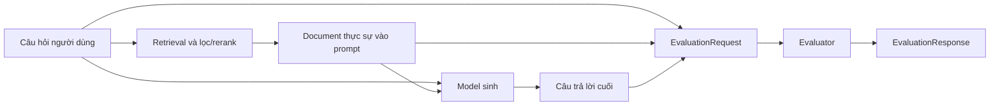

# EvaluationRequest với câu hỏi, dữ liệu hỗ trợ và nội dung phản hồi

## 1. Vai trò của `EvaluationRequest` trong đánh giá ứng dụng Spring AI

Một ứng dụng dùng Spring AI có thể trả lời rất tự nhiên nhưng vẫn sai về nội dung. Ví dụ, người dùng hỏi: “Tôi được yêu cầu hoàn tiền trong bao nhiêu ngày?”, hệ thống RAG truy xuất văn bản “Có thể yêu cầu hoàn tiền trong 30 ngày kể từ khi nhận hàng”, nhưng model trả lời “Trong 60 ngày”. Muốn kiểm tra sai lệch này, bộ đánh giá phải biết **người dùng đã hỏi gì**, **model dựa trên nguồn nào** và **model thực sự đã trả lời gì**.

Trong Spring AI, `org.springframework.ai.evaluation.EvaluationRequest` là đối tượng gom các đầu vào đó để chuyển đến `Evaluator.evaluate(EvaluationRequest)`. Đây là một phần của chương **API Evaluator** trong module **SPRING_AI_EVALUATION_OBSERVABILITY**. Module hướng đến đánh giá chất lượng bằng dataset, tiêu chí relevance, fact checking và kiểm thử luồng RAG/tool calling; đồng thời liên hệ kết quả đánh giá với metrics, traces, chi phí và độ trễ qua các phiên bản prompt, model và pipeline.

Sau bài học, bạn có thể:

- Phân biệt vai trò của ba trường `userText`, `dataList` và `responseContent`.
- Tạo request đúng bằng các constructor Spring AI cung cấp.
- Đưa ngữ cảnh **đúng của cùng một lần chạy RAG** vào request, thay vì dùng tài liệu không liên quan hoặc đáp án chuẩn.
- Nhận diện các tình huống thiếu dữ liệu, nhầm thứ tự đối số và thay đổi nguồn tham chiếu làm sai lệch kết quả đánh giá.
- Biết thông tin nào **không nằm trong** `EvaluationRequest` và cần quản lý ngoài API này.

## 2. Cấu trúc API và ý nghĩa của ba trường

API được công bố trong package `org.springframework.ai.evaluation`. Javadoc Spring AI 2.1.0 ghi ba constructor và ba getter:

```java
import java.util.List;
import org.springframework.ai.document.Document;
import org.springframework.ai.evaluation.EvaluationRequest;

// Các overload có trong API:
new EvaluationRequest(String userText, String responseContent);

new EvaluationRequest(
    List<Document> dataList,
    String responseContent
);

new EvaluationRequest(
    String userText,
    List<Document> dataList,
    String responseContent
);

// Getter:
String getUserText();
List<Document> getDataList();
String getResponseContent();
```

Các dòng `new EvaluationRequest(String ...);` và `String getUserText();` ở trên mô tả **chữ ký API**, không phải chương trình Java có thể chạy nguyên khối. Những ví dụ sử dụng cụ thể nằm ở các phần sau.

| Trường | Kiểu Java | Chứa gì? | Ví dụ cho RAG |
|---|---|---|---|
| `userText` | `String` | Câu hỏi/đầu vào gốc cần đánh giá | “Thời hạn hoàn tiền là bao lâu?” |
| `dataList` | `List<Document>` | Danh sách tài liệu làm ngữ cảnh tham chiếu | Các đoạn chính sách được truy xuất và cung cấp cho model |
| `responseContent` | `String` | Nội dung câu trả lời thực tế cần chấm | “Trong vòng 60 ngày.” |

Ý nghĩa ba trường là một **hợp đồng dữ liệu**; bản thân request không quyết định đạt/trượt. Đối tượng thực hiện phép chấm là một `Evaluator`, chẳng hạn `RelevancyEvaluator` hoặc `FactCheckingEvaluator`. Các evaluator có thể sử dụng những trường này theo các cách khác nhau, vì vậy phải chọn dữ liệu phù hợp với **tiêu chí và phiên bản triển khai** đang chạy.

> **Lưu ý quan trọng về phiên bản:** trang *Evaluation Testing* trong tài liệu tham khảo Spring AI hiện vẫn minh họa `dataList` bằng `List<Content>`, nhưng **Javadoc Spring AI 2.1.0** xác nhận constructor và getter dùng `List<Document>`. Các ví dụ trong bài theo Javadoc 2.1.0. Hãy kiểm tra Javadoc đúng phiên bản dependency của dự án khi tích hợp.

### 2.1. `userText`: câu hỏi gốc của người dùng

`userText` là yêu cầu cần được trả lời, cung cấp cho judge biết ý định nào đang được kiểm tra.

Ví dụ, người dùng nhập:

```text
Hàng đã nhận 20 ngày rồi, tôi còn được yêu cầu hoàn tiền không?
```

Khi tạo request, nên giữ nguyên nội dung câu hỏi này, hoặc một biểu diễn tương đương được hệ thống chấp nhận, để judge hiểu đúng tình huống “đã nhận 20 ngày”. Không nên nhầm với các loại văn bản khác:

| Văn bản | Có nên dùng làm `userText`? | Lý do |
|---|---|---|
| Câu hỏi gốc do người dùng nhập | Thường là có | Thể hiện yêu cầu thật được trả lời. |
| Câu truy vấn đã viết lại để tìm kiếm vector | Không mặc định | Có thể làm mất điều kiện trong câu hỏi gốc, như “20 ngày”. |
| System prompt hướng dẫn model “trả lời ngắn gọn” | Không | Đây là hướng dẫn sinh, không phải câu hỏi người dùng. |
| Prompt của evaluator (“Hãy chấm câu trả lời”) | Không | Đây là chỉ dẫn của bộ chấm, không phải đầu vào ứng dụng. |
| Đáp án đúng do người biên soạn dataset viết | Không | Đây là nhãn hoặc câu trả lời tham chiếu riêng. |

Nếu câu hỏi phụ thuộc lịch sử hội thoại (“Vậy còn đơn hàng thứ hai?”), một chuỗi `userText` đơn lẻ có thể **không đủ ngữ cảnh**. Hãy xây dựng câu hỏi tự chứa theo chính sách dataset, hoặc cung cấp thêm lịch sử ở tầng đánh giá được thiết kế rõ ràng. Đừng tự ý ghép thông tin mà model đã không nhìn thấy vào request rồi coi kết quả là đánh giá đúng lượt chạy gốc.

### 2.2. `dataList`: nguồn dữ liệu hỗ trợ

`dataList` chứa các đối tượng `org.springframework.ai.document.Document`. Mỗi `Document` có thể có nội dung văn bản, ID và metadata như nguồn, phiên bản hoặc tên tài liệu; tài liệu truy xuất cũng có thể mang điểm liên quan. Ví dụ:

```java
import java.util.List;
import java.util.Map;
import org.springframework.ai.document.Document;

List<Document> supportingDocuments = List.of(
    new Document(
        "policy-refund-v3-p2",
        "Khách hàng có thể yêu cầu hoàn tiền trong 30 ngày kể từ khi nhận hàng.",
        Map.of(
            "source", "policies/refund-v3",
            "version", "v3",
            "section", "2"
        )
    )
);
```

Trong RAG, điểm thiết yếu không chỉ là **có tài liệu**, mà là **đúng tài liệu**. Nên đưa vào request các đoạn thực sự đã đi qua retrieval, filtering, reranking và cắt bớt context để **được cung cấp cho model ở chính lượt sinh câu trả lời**.

Phân biệt ba nhóm tài liệu dễ bị đánh đồng:

1. **Retrieved context:** tài liệu pipeline thực tế truy xuất và cung cấp cho model trong lần chạy; thường dùng để kiểm tra câu trả lời có bám context hay không.
2. **Gold/reference documents:** nguồn được người gắn nhãn xác nhận là đúng và đầy đủ; dùng để kiểm thử retrieval, so sánh với đáp án chuẩn hoặc phát hiện nguồn bị thiếu.
3. **Kho tài liệu gốc:** toàn bộ dữ liệu trong vector store/knowledge base; không thể tự động coi là thứ model đã nhìn thấy.

Nếu bộ chấm nhận một đoạn trong gold set mà model **không được truy xuất**, kết quả có thể che giấu lỗi retrieval. Ngược lại, nếu retrieved context đã lỗi thời, judge dùng đúng context đó có thể đánh giá một câu sai theo chính sách mới là “có căn cứ”. Vì vậy cần quan sát cả **groundedness theo context đã cấp** lẫn **chất lượng/chính xác của retrieval**.

Các metadata `source`, `version`, `section` trong ví dụ là khóa **do ứng dụng tự đặt** trong `Document`. Spring AI không tự suy ra nguồn đáng tin cậy, quyền truy cập hoặc thời điểm hiệu lực của tài liệu chỉ vì có các khóa này.

### 2.3. `responseContent`: nội dung phản hồi cần chấm

`responseContent` là câu trả lời cuối cùng mà ứng dụng muốn đánh giá. Ví dụ:

```java
String responseContent =
    "Bạn vẫn có thể yêu cầu hoàn tiền, vì mới qua 20 ngày "
    + "kể từ khi nhận hàng.";
```

Với `ChatClient`, phản hồi có thể lấy từ kết quả model hoặc văn bản cuối cùng sau các bước xử lý theo thiết kế của ứng dụng. Điều quan trọng là **định nghĩa một điểm đo nhất quán** giữa các lần so sánh:

- Muốn kiểm tra khả năng sinh của model, đo câu trả lời **trước** các bước sửa đổi của ứng dụng.
- Muốn kiểm tra nội dung người dùng thật sự nhìn thấy, đo câu trả lời **sau** post-processing, nhưng phải ghi rõ các bước xử lý đã áp dụng.
- Đừng nhét `ChatResponse.toString()`, toàn bộ JSON chứa token usage hay stack trace vào `responseContent`; đó không phải văn bản trả lời cần judge.
- Nếu câu trả lời là JSON có cấu trúc, kiểm tra thêm tính hợp lệ/schema bằng phép chấm deterministic; `EvaluationRequest` chỉ chứa nội dung chuỗi, không tự xác thực JSON.

Một phản hồi có thể ngắn, rỗng hoặc từ chối trả lời. Tuy nhiên, **“không bịa thông tin” chưa chắc là “đã đáp ứng yêu cầu”**: câu từ chối có thể đúng khi context thiếu dữ kiện, nhưng lại là failure nếu dữ liệu đã đủ và ứng dụng được kỳ vọng phải trả lời.

## 3. Ba cách tạo `EvaluationRequest`

Chọn overload theo **dữ liệu mà tiêu chí đánh giá thực sự cần**.

### 3.1. Có đủ câu hỏi, context và phản hồi: phù hợp nhất với RAG

```java
String question = "Thời hạn yêu cầu hoàn tiền là bao lâu?";

List<Document> documents = List.of(
    new Document(
        "Khách hàng được yêu cầu hoàn tiền trong 30 ngày từ khi nhận hàng."
    )
);

String answer =
    "Bạn được yêu cầu hoàn tiền trong vòng 30 ngày từ lúc nhận hàng.";

EvaluationRequest request = new EvaluationRequest(
    question,
    documents,
    answer
);
```

Đây là lựa chọn rõ ràng khi một evaluator cần đồng thời biết `query`, `context` và `response`. Để đánh giá câu trả lời trong một pipeline RAG, nên ưu tiên cách này.

### 3.2. Có câu hỏi và phản hồi, không có tài liệu hỗ trợ

```java
EvaluationRequest request = new EvaluationRequest(
    "Trình bày ba ý chính trong câu trả lời.",
    "Ý thứ nhất ... Ý thứ hai ... Ý thứ ba ..."
);
```

Dạng này tiện cho tiêu chí không dựa trên tài liệu (ví dụ, độ dài, cấu trúc, văn phong) hoặc dữ liệu đã được cung cấp qua một cơ chế được định nghĩa riêng. **Không tự suy luận fact checking có đủ bằng chứng chỉ vì đã tạo request thành công.** Nếu tiêu chí đòi căn cứ từ bên ngoài, hãy chuẩn bị và truyền căn cứ phù hợp.

### 3.3. Có tài liệu hỗ trợ và phản hồi, không truyền câu hỏi

```java
EvaluationRequest request = new EvaluationRequest(
    List.of(
        new Document("Thời hạn hoàn tiền: 30 ngày từ khi nhận hàng.")
    ),
    "Thời hạn hoàn tiền là 30 ngày."
);
```

Dạng này có thể dùng cho phép so sánh giữa phát biểu và nguồn dữ liệu khi câu hỏi không cần thiết cho **evaluator cụ thể**. Không mặc định dùng với `RelevancyEvaluator`, bởi phép kiểm relevance thường cần hiểu câu hỏi mà câu trả lời đang hướng đến.

**Không có constructor nhận “đáp án chuẩn” (expected answer) theo một trường riêng** trong `EvaluationRequest`. Nếu cần so với đáp án chuẩn hoặc bộ nhãn người đánh giá, giữ dữ liệu đó bên ngoài request và triển khai logic/rubric tương ứng.

## 4. Ví dụ Java: tạo request, đọc lại và chuyển cho evaluator

Ví dụ tự chứa dưới đây minh họa cách gom ba thành phần. Đây là một phép kiểm tra dữ liệu đầu vào, không gọi LLM; chỉ cần các dependency Spring AI và thư viện Java tương ứng.

```java
import java.util.List;
import java.util.Map;

import org.springframework.ai.document.Document;
import org.springframework.ai.evaluation.EvaluationRequest;

public class EvaluationRequestExample {

    public static void main(String[] args) {
        String question = "Tôi nhận hàng 20 ngày trước, còn được hoàn tiền chứ?";

        Document policy = new Document(
            "refund-v3-section-2",
            "Có thể yêu cầu hoàn tiền trong 30 ngày kể từ khi nhận hàng.",
            Map.of("source", "refund-policy", "version", "v3")
        );

        List<Document> contextActuallyUsed = List.of(policy);
        String generatedAnswer =
            "Có. Bạn vẫn còn trong thời hạn 30 ngày kể từ lúc nhận hàng.";

        EvaluationRequest request = new EvaluationRequest(
            question, contextActuallyUsed, generatedAnswer
        );

        System.out.println("Question: " + request.getUserText());
        System.out.println("Documents: " + request.getDataList().size());
        System.out.println("Answer: " + request.getResponseContent());
    }
}
```

Một bộ đánh giá đã được cấu hình có thể nhận cùng request:

```java
import org.springframework.ai.chat.client.ChatClient;
import org.springframework.ai.chat.evaluation.RelevancyEvaluator;
import org.springframework.ai.chat.model.ChatModel;
import org.springframework.ai.evaluation.EvaluationResponse;

// judgeModel là ChatModel được ứng dụng cấu hình qua provider/starter.
RelevancyEvaluator evaluator =
    new RelevancyEvaluator(ChatClient.builder(judgeModel));

EvaluationResponse verdict = evaluator.evaluate(request);

boolean passed = verdict.isPass();
String feedback = verdict.getFeedback();
```

Đoạn thứ hai minh họa cách tích hợp, trong đó `judgeModel` và `request` là biến đã có. Nó cần model judge hoạt động, có thể tốn token và độ trễ; kết quả cũng phụ thuộc model, rubric và context. Không dùng `getScore()` như một xác suất đúng độc lập khi evaluator chưa quy định ý nghĩa thang điểm.

## 5. Tạo request từ lượt chạy RAG thực tế

Trong ví dụ tĩnh, lập trình viên biết trước `documents`. Với ứng dụng thật, thứ tự xử lý thường là:



Ba mũi tên vào `EvaluationRequest` phải đến **cùng một lần chạy**. Nếu request được tạo từ câu hỏi lần 1, tài liệu lần 2 và câu trả lời lần 3, bộ chấm không còn phản ánh trạng thái của pipeline.

### 5.1. Với `RetrievalAugmentationAdvisor`

Tài liệu Spring AI minh họa cách lấy context từ metadata của `ChatResponse` khi sử dụng `RetrievalAugmentationAdvisor`:

```java
import org.springframework.ai.chat.client.ChatClient;
import org.springframework.ai.chat.model.ChatResponse;
import org.springframework.ai.document.Document;
import org.springframework.ai.evaluation.EvaluationRequest;
import org.springframework.ai.rag.advisor.RetrievalAugmentationAdvisor;

// client là ChatClient đã được cấu hình;
// ragAdvisor là RetrievalAugmentationAdvisor đã cấu hình retriever.
String question = "Tôi có thể yêu cầu hoàn tiền trong bao lâu?";

ChatResponse chatResponse = client.prompt(question)
    .advisors(ragAdvisor)
    .call()
    .chatResponse();

if (chatResponse == null || chatResponse.getResult() == null) {
    throw new IllegalStateException("Không có ChatResponse để đánh giá");
}

List<Document> retrieved = chatResponse.getMetadata()
    .get(RetrievalAugmentationAdvisor.DOCUMENT_CONTEXT);

if (retrieved == null) {
    throw new IllegalStateException(
        "Không lấy được Document context từ RAG advisor"
    );
}

String answer = chatResponse.getResult().getOutput().getText();
EvaluationRequest evaluationRequest = new EvaluationRequest(
    question, retrieved, answer
);
```

**Giới hạn ví dụ:** các biến `client` và `ragAdvisor` cần được cấu hình trong ứng dụng, và API metadata phải khớp với phiên bản Spring AI đang dùng. Với advisor hoặc pipeline tự viết, hãy lưu riêng tập `Document` sau bước xử lý cuối cùng trước khi đưa vào prompt. Đừng giả định mọi `ChatResponse` đều tự có `DOCUMENT_CONTEXT`.

### 5.2. Cẩn thận với nhiều bước truy xuất hoặc gọi công cụ

Một lượt có thể có retrieval nhiều vòng, query rewrite, rerank, trích dẫn và tool calls. Khi đó nên xác định rõ:

- Tài liệu nào thực sự được đưa vào mỗi lượt sinh?
- Câu trả lời được đánh giá là output của bước nào: lời đáp trung gian hay kết quả cuối?
- Có lượt sinh nào bị retry, fallback model hoặc dùng cache không?
- Context đã qua lọc quyền truy cập và giới hạn token như thế nào?

`EvaluationRequest` chỉ mang `String` câu hỏi, `List<Document>` dữ liệu hỗ trợ và `String` câu trả lời. Nó **không có trường chuẩn cho** tool-call ID, arguments, trạng thái tool, latency hay toàn bộ span trace. Để kiểm thử luồng tool calling, phải lấy các dữ liệu đó từ orchestration/event log hoặc traces và thiết kế kiểm tra riêng.

Nếu mô hình dựa trên kết quả công cụ, có thể chuyển **nội dung làm bằng chứng** thành `Document` (theo tiêu chí đánh giá đã định nghĩa); nhưng điều này không thay thế kiểm thử rằng công cụ đúng đã được gọi với tham số hợp lệ.

## 6. Ba trường đầu vào tác động đến kết quả chấm như thế nào?

Xét chính sách hoàn tiền:

```text
userText:
  "Hàng đã nhận 20 ngày rồi, tôi còn được hoàn tiền không?"

dataList[0].text:
  "Khách hàng được yêu cầu hoàn tiền trong 30 ngày kể từ ngày nhận hàng."

responseContent:
  "Có. Bạn vẫn đang trong thời hạn 30 ngày."
```

Đây là trường hợp có cơ sở để đánh giá câu trả lời **liên quan** và **được hỗ trợ**. Thay từng thành phần sẽ làm đổi ý nghĩa phép kiểm:

| Thay đổi duy nhất | Hậu quả đối với đánh giá |
|---|---|
| Đổi `userText` thành “Đơn hàng có giao quốc tế không?” | Câu trả lời về hoàn tiền có thể thành lạc đề, dù vẫn đúng với tài liệu. |
| Đổi `dataList` sang tài liệu ghi “7 ngày” | Câu trả lời “30 ngày” không còn được ngữ cảnh mới hỗ trợ. |
| Đổi `responseContent` thành “Bạn có 90 ngày” | Câu trả lời có thể liên quan về chủ đề nhưng trái nguồn đã cấp. |
| Bỏ `dataList` | Các tiêu chí cần kiểm chứng nguồn sẽ thiếu căn cứ. |
| Dùng context của lượt khác | Kết quả chấm không đại diện cho lần chạy đã sinh câu trả lời. |

Đặc biệt cần phân biệt:

**Relevance:** câu trả lời có trả lời đúng câu hỏi trong ngữ cảnh đang xét không?

**Groundedness/factual support:** khẳng định trong câu trả lời có được các tài liệu cung cấp hỗ trợ không?

**Correctness theo ground truth:** câu trả lời có đúng với đáp án hoặc dữ liệu chuẩn được xác nhận độc lập không?

Một request đủ ba trường hỗ trợ nhiều phép kiểm, nhưng **không có nghĩa một evaluator tự động đo cả ba**. Thiết kế dataset và bộ tiêu chí phải bao quát các mục tiêu cần kiểm tra.

## 7. Dùng `EvaluationRequest` trong dataset và so sánh phiên bản

Để phát hiện suy giảm sau khi đổi prompt, model hoặc pipeline, nên coi mỗi `EvaluationRequest` là một phép chấm gắn với một ca kiểm thử và một lượt chạy cụ thể.

Ví dụ định dạng **bản ghi dataset do ứng dụng tự thiết kế**:

```json
{
  "caseId": "refund-020",
  "question": "Tôi nhận hàng 20 ngày rồi, có được hoàn tiền không?",
  "expectedAnswer": "Có, nếu đáp ứng các điều kiện chính sách.",
  "referenceDocIds": ["refund-v3-section-2"],
  "run": {
    "runId": "evaluation-run-104",
    "promptVersion": "p7",
    "modelVersion": "model-a",
    "retrieverVersion": "index-v3",
    "retrievedDocIds": ["refund-v3-section-2"],
    "response": "Có, bạn còn trong hạn 30 ngày."
  }
}
```

JSON trên **không phải schema JSON của `EvaluationRequest`**. Ứng dụng phải lấy `question`, các `Document` thật từ `retrievedDocIds` và `response` để tạo request; `expectedAnswer` và phiên bản chạy là metadata phục vụ bộ test/report.

Khi so sánh hai phiên bản, hãy cố định dataset và cách tính metric; đồng thời lưu thông tin model judge, phiên bản prompt chấm và rubric để tránh nhầm biến động của **bộ chấm** với biến động của **ứng dụng**.

| Thông tin nên lưu | Nằm trong `EvaluationRequest`? | Lưu ở đâu? |
|---|---|---|
| Câu hỏi người dùng | Có — `userText` | Request + dataset |
| Tài liệu hỗ trợ | Có — `dataList` | Request; lưu ID/version để truy vết |
| Phản hồi cần chấm | Có — `responseContent` | Request + run record |
| Đáp án đúng và nhãn người đánh giá | Không | Dataset chuẩn |
| Prompt/model/pipeline version | Không | Run metadata |
| Kết luận pass/fail, điểm, feedback | Không | `EvaluationResponse` và báo cáo |
| Thời gian chạy, token, chi phí | Không | Metrics/usage/telemetry |
| Tool call, trace/span ID | Không | Traces/event log |

Kết quả đánh giá trở nên hữu ích hơn khi có thể mở lại đúng trace, đúng văn bản context và đúng cấu hình đã tạo ra một lần trượt. Ví dụ, **pass rate fact checking giảm trong khi thời gian retrieval tăng** có thể chỉ ra hệ thống truy xuất nguồn kém liên quan hoặc đã thay đổi chiến lược tìm kiếm; cần kiểm tra traces và dữ liệu truy xuất mới xác nhận được nguyên nhân.

## 8. Các lỗi thường gặp khi tạo request

| Lỗi | Vì sao sai? | Cách khắc phục |
|---|---|---|
| Truyền `answer` vào vị trí `userText` | Judge mất câu hỏi gốc | Đặt tên biến rõ ràng và kiểm tra bằng getter. |
| Nhầm `List<String>` với `List<Document>` | Sai kiểu API theo Javadoc 2.1.0 | Đưa đoạn nội dung vào `Document` có ID/metadata. |
| Dùng câu trả lời mẫu làm `responseContent` | Chấm mẫu chuẩn thay vì output ứng dụng | Lấy output thật của chính lượt chạy. |
| Dùng gold document thay cho retrieved context mà không phân biệt | Che lỗi retrieval, sai căn cứ của model | Lưu `goldDocIds` và `retrievedDocIds` riêng. |
| Chỉ lưu ID tài liệu, không giữ phiên bản/nội dung | Không tái hiện được request khi tài liệu được sửa | Snapshot context hoặc lưu version bất biến. |
| Lấy dữ liệu hỗ trợ từ lần gọi khác | Kết quả đánh giá không tương ứng với output | Truyền cùng `runId` qua retrieval → generation → evaluation. |
| Đưa error log hoặc metadata thay cho văn bản trả lời | Judge bị nhiễu bởi dữ liệu kỹ thuật | Chỉ đưa nội dung cần người dùng đọc vào `responseContent`. |
| Mặc định bỏ trống context vẫn kiểm chứng được factuality | Thiếu bằng chứng cho phán quyết | Chuẩn bị reference sources phù hợp hoặc dùng tiêu chí khác. |
| Giả định request có trace/chi phí/tool calls | Mất dữ liệu chẩn đoán | Liên kết telemetry bên ngoài request. |
| Ghi nguyên văn mọi prompt/context vào log | Có thể lộ thông tin nhạy cảm | Áp dụng chính sách lưu trữ, ẩn dữ liệu và kiểm soát truy cập. |

Tài liệu truy xuất có thể chứa chỉ dẫn độc hại hoặc không liên quan. Khi dùng LLM làm judge, phải coi chúng là **dữ liệu để thẩm định**, không phải hướng dẫn được phép thay đổi rubric. Việc truyền dữ liệu vào request không tự xử lý prompt injection, quyền truy cập, thông tin cá nhân hoặc tính toàn vẹn của nguồn.

## 9. Thực hành: tự kiểm tra hợp đồng dữ liệu

### Bài tập 1: dựng request cho một lần RAG

**Đầu vào:**

- Người dùng hỏi: “Tài khoản miễn phí được tạo tối đa bao nhiêu dự án?”
- Context truy xuất: “Gói miễn phí cho phép tối đa 3 dự án.”
- Model trả lời: “Bạn có thể tạo tối đa 5 dự án.”

Hãy tạo `EvaluationRequest` theo constructor ba đối số và xác định thông tin nào có khả năng làm cho kết quả fact checking không đạt.

**Gợi ý lời giải:**

```java
EvaluationRequest request = new EvaluationRequest(
    "Tài khoản miễn phí được tạo tối đa bao nhiêu dự án?",
    List.of(new Document("Gói miễn phí cho phép tối đa 3 dự án.")),
    "Bạn có thể tạo tối đa 5 dự án."
);
```

Giá trị “5 dự án” trong `responseContent` không được `dataList` ghi “3 dự án” hỗ trợ. Một evaluator fact checking được cấu hình và hiệu chỉnh phù hợp **nên** phát hiện mâu thuẫn đó; phán quyết thực tế vẫn phụ thuộc model/rubric, nên phải kiểm tra kết quả `EvaluationResponse`.

### Bài tập 2: chọn overload

**Tình huống A:** kiểm tra câu trả lời có ít hơn 200 ký tự, không cần truy xuất tài liệu.  
**Gợi ý:** `EvaluationRequest(userText, responseContent)` đủ cho một evaluator tự viết chỉ dùng `responseContent`.

**Tình huống B:** kiểm tra một đoạn tóm tắt có trung thực với ba tài liệu đã cấp.  
**Gợi ý:** `EvaluationRequest(dataList, responseContent)` có thể phù hợp nếu evaluator chỉ so sánh bản tóm tắt với nguồn; nếu cần xem yêu cầu tóm tắt ban đầu, dùng constructor ba đối số.

**Tình huống C:** kiểm tra câu trả lời có phù hợp câu hỏi và trùng khớp tài liệu RAG.  
**Gợi ý:** dùng `EvaluationRequest(userText, dataList, responseContent)`; đảm bảo `dataList` đến từ chính lượt RAG vừa sinh `responseContent`.

### Bài tập 3: phân biệt dữ liệu đánh giá và dữ liệu quan sát

Một `EvaluationRequest` chấm trượt. Nhóm phát triển muốn biết model nào sinh câu trả lời, truy xuất mất bao lâu và công cụ nào được gọi. Các dữ liệu đó có sẵn trực tiếp trong request không?

**Đáp án:** Không. Request chỉ chứa câu hỏi, dữ liệu hỗ trợ và văn bản phản hồi. Phải tra thêm run metadata, retrieval traces, tool-call events, token usage và timing bằng một định danh lượt chạy nhất quán.

## 10. Ghi nhớ và tài liệu tham khảo

Mỗi `EvaluationRequest` nên mô tả trung thực **một kết quả được tạo ra trong một bối cảnh cụ thể**. Ba trường có vai trò khác nhau:

```text
EvaluationRequest
  userText        → Người dùng yêu cầu gì?
  dataList        → Nguồn nào được đưa ra làm căn cứ?
  responseContent → Ứng dụng đã trả lời gì?
```

Trong RAG, độ tin cậy của đánh giá phụ thuộc mạnh vào việc giữ đúng context và output thuộc **cùng lượt chạy**. `EvaluationRequest` là đầu vào cho phép chấm; kết quả chất lượng do `Evaluator` tạo ra và dữ liệu vận hành được quan sát ở các thành phần khác.

Nguồn chính thức để tra cứu khi triển khai:

1. [Javadoc Spring AI 2.1.0 — EvaluationRequest](https://docs.spring.io/spring-ai/docs/current/api/org/springframework/ai/evaluation/EvaluationRequest.html): các constructor và getter dùng `List<Document>`.
2. [Spring AI Reference — Evaluation Testing](https://docs.spring.io/spring-ai/reference/api/testing.html): giới thiệu ba đầu vào và ví dụ chấm `RelevancyEvaluator` trong RAG.
3. [Javadoc — Document](https://docs.spring.io/spring-ai/docs/current/api/org/springframework/ai/document/Document.html): ID, nội dung, metadata và cách tạo tài liệu.
4. [Javadoc — Evaluator](https://docs.spring.io/spring-ai/docs/current/api/org/springframework/ai/evaluation/Evaluator.html): hợp đồng `evaluate(EvaluationRequest)`.

*Ví dụ và tên API đối chiếu theo Spring AI 2.1.0; hãy kiểm tra dependency và khả năng cung cấp metadata của advisor thực tế trước khi sao chép vào dự án.*
