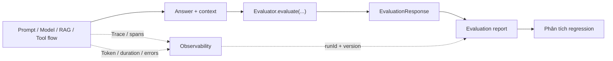

# EvaluationResponse với trạng thái, điểm, phản hồi và metadata

## 1. EvaluationResponse trả lời câu hỏi gì?

Một ứng dụng hỏi đáp dùng RAG có thể nhận câu hỏi “Khách hàng có bao lâu để yêu cầu hoàn tiền?”, truy xuất văn bản “Thời hạn yêu cầu hoàn tiền là 30 ngày kể từ ngày nhận hàng”, nhưng tạo câu trả lời “Bạn có 90 ngày”. Khi chấm theo tài liệu, chỉ biết evaluator đã chạy xong là chưa đủ. Người phát triển cần biết:

- Kết quả **đạt hay không đạt** tiêu chí đã chọn?
- Nếu tiêu chí trả điểm, **điểm số có ý nghĩa và thang đo gì**?
- Có thể giải thích **vì sao không đạt** không?
- Có thông tin bổ sung nào để **đối chiếu theo dataset, rubric và phiên bản** không?

Trong Spring AI, `org.springframework.ai.evaluation.EvaluationResponse` cung cấp một hợp đồng đầu ra thống nhất cho các phép đánh giá qua `Evaluator.evaluate(...)`. Hợp đồng này hỗ trợ cả evaluator xác định bằng Java lẫn các evaluator dùng LLM làm giám khảo.

Đây là bài thuộc chương **API Evaluator** trong module **SPRING_AI_EVALUATION_OBSERVABILITY**. Module học cách đánh giá chất lượng ứng dụng Spring AI bằng dataset, relevance, fact checking và kiểm thử RAG/tool calling; đồng thời dùng metrics, traces, độ trễ và chi phí để giải thích suy giảm chất lượng giữa các phiên bản prompt, model và pipeline.

Sau bài, bạn có thể đọc và tạo `EvaluationResponse`, hiểu ranh giới của từng trường, tổng hợp kết quả theo tiêu chí, đưa thông tin phù hợp vào kiểm thử/observability và tránh các kết luận sai từ một điểm số đơn lẻ.

## 2. Hợp đồng API trong Spring AI

Đầu ra của một `Evaluator` được định nghĩa trong phương thức:

```java
package org.springframework.ai.evaluation;

@FunctionalInterface
public interface Evaluator {
    EvaluationResponse evaluate(EvaluationRequest evaluationRequest);
}
```

Dòng code trên biểu diễn **chữ ký cốt lõi** của interface, không phải mã nguồn đầy đủ của Spring AI. `EvaluationRequest` chứa đầu vào như câu hỏi, tài liệu tham chiếu và câu trả lời; `EvaluationResponse` biểu diễn kết quả chấm.

Javadoc Spring AI **2.1.0** công bố một class `EvaluationResponse` với hai constructor:

```java
// Constructor có điểm số do evaluator xác định:
new EvaluationResponse(
    boolean pass,
    float score,
    String feedback,
    Map<String, Object> metadata
);

// Constructor không yêu cầu người gọi cung cấp điểm số:
new EvaluationResponse(
    boolean pass,
    String feedback,
    Map<String, Object> metadata
);
```

Các dòng trên minh họa **chữ ký constructor**, không phải lệnh Java có thể chạy nguyên văn. Các phương thức truy xuất là:

| Phương thức | Kiểu trả về | Trả lời câu hỏi |
|---|---|---|
| `isPass()` | `boolean` | Kết quả có đạt **tiêu chí của evaluator này** không? |
| `getScore()` | `float` | Điểm số được evaluator biểu diễn như thế nào? |
| `getFeedback()` | `String` | Giám khảo cho biết lý do hoặc nhận xét gì? |
| `getMetadata()` | `Map<String, Object>` | Có thông tin bổ sung gì để diễn giải và truy vết? |

Spring AI cũng cung cấp `equals(...)`, `hashCode()` và `toString()`; chúng không thay thế việc đọc bốn thành phần ý nghĩa của phép đánh giá.

Một ví dụ **do chính ứng dụng tự tạo**:

```java
import java.util.Map;
import org.springframework.ai.evaluation.EvaluationResponse;

EvaluationResponse result = new EvaluationResponse(
    false,
    0.0f,
    "Câu trả lời ghi 90 ngày nhưng chính sách tham chiếu ghi 30 ngày.",
    Map.of(
        "criterion", "policy-factuality",
        "documentId", "refund-policy-v3",
        "rubricVersion", "fact-v1"
    )
);

System.out.println("Pass: " + result.isPass());
System.out.println("Score: " + result.getScore());
System.out.println("Feedback: " + result.getFeedback());
System.out.println("Metadata: " + result.getMetadata());
```

Đây **không phải** kết quả cam kết mà `FactCheckingEvaluator` tích hợp sẽ trả cho cùng câu hỏi. Giá trị `score`, câu feedback và nội dung metadata ở ví dụ được người viết mã chủ động chọn để minh họa hợp đồng.

## 3. `isPass()`: trạng thái đạt/trượt phải gắn với một tiêu chí

`isPass()` là cờ nhị phân. Nhưng chữ “đạt” chỉ có nghĩa khi biết **đang đánh giá điều gì**.

| Tiêu chí | Ý nghĩa của `isPass() == true` | Điều không thể suy ra |
|---|---|---|
| Relevance | Câu trả lời được đánh giá phù hợp câu hỏi/ngữ cảnh theo rubric hiện tại | Mọi khẳng định đều đúng |
| Fact checking | Các khẳng định được evaluator xem là có căn cứ theo tài liệu được cấp | Nguồn được cấp là đúng, mới nhất và đầy đủ |
| JSON schema | Nội dung đáp ứng schema được kiểm tra | Nội dung JSON có ý nghĩa nghiệp vụ đúng |
| Quy tắc “không quá 200 ký tự” | Câu trả lời không vượt giới hạn đã định | Câu trả lời hữu ích, đúng hoặc an toàn |
| Tool correctness tự thiết kế | Lượt gọi công cụ đáp ứng điều kiện đã cài đặt | Mọi tool khác trong toàn pipeline đều đúng |

Ví dụ, câu “Hạn hoàn tiền là 90 ngày” có thể **liên quan về chủ đề** đến câu hỏi thời hạn, nhưng **không được hỗ trợ** bởi tài liệu ghi 30 ngày. Hai phép đánh giá có thể trả kết quả khác nhau mà không mâu thuẫn, vì tiêu chí không giống nhau.

### 3.1. Trạng thái pass khác trạng thái thực thi

Một lỗi kiến trúc thường gặp là coi hai trường hợp sau là như nhau:

1. **Evaluator chạy thành công và chấm không đạt:** có `EvaluationResponse` với `isPass() == false`.
2. **Evaluator không chạy xong:** model judge timeout, bị giới hạn API, lỗi mạng, không giải mã được output hoặc thiếu cấu hình nên **không nhận được kết quả đánh giá đáng tin**.

Trường hợp thứ hai không nên tự động được báo cáo là một *quality fail* của câu trả lời. Cần theo dõi ít nhất ba trạng thái ở **tầng điều phối**:

```text
Evaluation run
├── EVALUATED_PASS  → Có EvaluationResponse, isPass() == true
├── EVALUATED_FAIL  → Có EvaluationResponse, isPass() == false
└── EVALUATION_ERROR → Không có phán quyết đáng tin; lưu lỗi để điều tra
```

Ba trạng thái này là **quy ước của ứng dụng**, không phải enum tích hợp trong `EvaluationResponse`. Phân biệt chúng giúp tránh tính tỷ lệ pass giảm giả tạo trong ngày provider của judge bị gián đoạn.

### 3.2. Dùng `isPass()` trong kiểm thử

```java
import static org.junit.jupiter.api.Assertions.assertTrue;

EvaluationResponse verdict = evaluator.evaluate(request);

assertTrue(
    verdict.isPass(),
    () -> "Không đạt tiêu chí: " + verdict.getFeedback()
);
```

Đây là đoạn minh họa trong phạm vi một phương thức test có sẵn các biến `evaluator` và `request`. Với LLM-as-a-judge, assertion có thể không ổn định tuyệt đối; nên hiệu chỉnh evaluator bằng tập mẫu có nhãn chuẩn trước khi dùng làm cổng phát hành nghiêm ngặt.

## 4. `getScore()`: điểm số phụ thuộc thang đo của evaluator

`getScore()` có kiểu `float`. **Kiểu dữ liệu không cho biết thang điểm, ngưỡng đạt hoặc ý nghĩa thống kê.** Spring AI không biến điểm số của mọi evaluator thành một xác suất “câu trả lời đúng”.

Những quy ước mà **ứng dụng có thể tự định nghĩa**:

| Quy ước | Ví dụ | Cách hiểu |
|---|---|---|
| Nhị phân | `0.0` hoặc `1.0` | Không đạt/đạt của một tiêu chí đơn giản |
| Tỷ lệ điều kiện thỏa mãn | `0.75` | Thỏa 3 trong 4 điều kiện kiểm tra |
| Rubric theo mức | `1` đến `5` | Mức chất lượng theo các mô tả được đặt trước |
| Khoảng liên tục | `0.0` đến `1.0` | Điểm chất lượng đã chuẩn hóa, **không mặc định là xác suất đúng** |

Không được so sánh hai `score` nếu chúng có rubric khác nhau. Điểm `0.8` của một evaluator kiểm tra tính đầy đủ không có nghĩa “tốt hơn” điểm `0.7` của một evaluator fact checking.

### 4.1. Mối quan hệ giữa `score` và `pass`

Với một evaluator **do bạn tự xây dựng**, bạn có thể quy định:

```text
score ∈ [0, 1]
pass = (score >= 0.80) AND (không có lỗi bắt buộc)
```

Đây chỉ là **chính sách ví dụ**, không phải quy tắc toàn cục của Spring AI. Một evaluator khác có thể trả `pass=true` khi điểm đủ 4/5, hoặc chỉ trả verdict nhị phân mà không cung cấp điểm hữu ích.

Vì vậy:

- Dùng `isPass()` để đọc **phán quyết** của evaluator.
- Chỉ dùng `getScore()` để so sánh hoặc đặt ngưỡng khi có **tài liệu mô tả scale, direction và threshold** của evaluator ấy.
- Không tự áp `score >= 0.5f` rồi ghi đè ý nghĩa của `isPass()` nếu rubric đã đưa ra phán quyết khác.
- Không trung bình trực tiếp các điểm của relevance, fact checking, JSON format và tool correctness nếu chưa có cơ chế chuẩn hóa/trọng số được xác nhận.

### 4.2. Với constructor không truyền điểm số

Spring AI có overload:

```java
EvaluationResponse result = new EvaluationResponse(
    true,
    "Câu trả lời đáp ứng quy tắc kiểm tra.",
    Map.of("criterion", "response-format")
);
```

Chữ ký này cho phép caller **không cung cấp tham số `score`**. Nếu downstream cần điểm số có ý nghĩa nghiệp vụ, hãy dùng constructor bốn đối số với một quy ước rõ ràng. Đừng tự gán ý nghĩa cho giá trị `getScore()` của một đối tượng khi evaluator không công bố thang đo, bất kể giá trị thực tế là bao nhiêu.

### 4.3. Kiểm tra tính hợp lệ của điểm số trong evaluator tự viết

Nếu tự xây evaluator với thang `[0, 1]`, cần ngăn lỗi dữ liệu trước khi tạo hoặc lưu điểm:

```java
static float checkedUnitScore(float score) {
    if (!Float.isFinite(score) || score < 0.0f || score > 1.0f) {
        throw new IllegalArgumentException(
            "Score phải là số hữu hạn trong [0, 1]"
        );
    }
    return score;
}
```

Tránh đưa `NaN` hoặc `Infinity` vào báo cáo JSON, tính trung bình và dashboard. Ngoài ra, `float` là số chấm động: so sánh bằng tuyệt đối trong test đôi khi không phù hợp; nếu bắt buộc kiểm tra số tính toán, dùng một sai số nhỏ được định nghĩa trước.

## 5. `getFeedback()`: lời giải thích giúp tìm lỗi

`feedback` là chuỗi văn bản mô tả kết quả chấm. Với evaluator deterministic, bạn có thể trả về mã lỗi được giải thích bằng lời. Với judge LLM, feedback có thể là nhận xét được model tạo theo prompt và cách triển khai.

Để sử dụng hữu ích, một feedback nên nói được:

1. **Tiêu chí:** vì sao evaluator đang chấm điều này?
2. **Phần chưa đạt:** claim, ý cần trả lời, quy tắc hoặc trường dữ liệu nào vi phạm?
3. **Căn cứ:** nguồn tài liệu/đoạn cụ thể hoặc điều kiện trong rubric nào liên quan?
4. **Hướng điều tra:** nên xem prompt, retrieval, logic hậu xử lý hay tool call?

Ví dụ feedback ít hữu ích:

```text
FAIL
```

Feedback hữu ích hơn:

```text
Không đạt factual support: câu trả lời nêu "90 ngày",
trong khi nguồn refund-policy-v3 §2 chỉ ghi "30 ngày".
Kiểm tra context truy xuất và câu trả lời sau generation.
```

Tuy nhiên, **feedback không phải ground truth**. Nếu feedback do judge LLM sinh, chính nó cũng có thể diễn giải sai tài liệu hoặc bịa nguồn. Nên liên kết nó với bằng chứng và nhãn dataset để con người kiểm tra khi cần.

### 5.1. Không dùng văn bản feedback làm khóa quyết định chính

Không nên viết logic:

```java
// Ví dụ không nên làm:
boolean passed = result.getFeedback().contains("PASS");
```

Chuỗi này phụ thuộc ngôn ngữ, định dạng và có thể chứa câu “không phải PASS”. Hãy dùng `result.isPass()` làm kết luận chính thức. Những tiêu chí máy cần xử lý nên có mã ổn định trong metadata do ứng dụng tự định nghĩa, như `errorCode="FACT_UNSUPPORTED"`.

Nếu feedback trống hoặc không có chi tiết, vẫn cần lưu `pass` và metadata đủ để báo cáo. Không giả định mọi evaluator đều cung cấp giải thích dài hoặc có cùng cách viết feedback.

### 5.2. Tránh để feedback gây lộ dữ liệu

Feedback có thể trích nguyên văn câu hỏi, thông tin đơn hàng hoặc đoạn chính sách nội bộ. Trước khi ghi log hoặc đưa vào báo cáo chia sẻ:

- Chỉ trích đoạn cần thiết để hiểu thất bại.
- Loại bỏ PII, secrets, token, thông tin khách hàng và dữ liệu không có quyền công bố.
- Phân quyền truy cập vào báo cáo chi tiết.
- Giới hạn độ dài feedback và thời gian lưu trữ.

## 6. `getMetadata()`: dữ liệu có cấu trúc bổ sung

`getMetadata()` trả về `Map<String, Object>`, nên **kiểu API cho phép nhiều loại giá trị**. Không có một schema metadata cố định áp dụng cho mọi evaluator và mọi phiên bản.

Có thể thiết kế metadata riêng cho evaluator tự viết, chẳng hạn:

```java
Map<String, Object> metadata = Map.of(
    "criterion", "required-phrases",
    "rubricVersion", "phrase-v2",
    "requiredCount", 3,
    "matchedCount", 2,
    "missingPhrases", List.of("30 ngày")
);

EvaluationResponse result = new EvaluationResponse(
    false,
    2.0f / 3.0f,
    "Thiếu một cụm từ bắt buộc.",
    metadata
);
```

Ở đây:

- `criterion` xác định phép kiểm; `rubricVersion` xác định cách chấm.
- `requiredCount` và `matchedCount` là giá trị phục vụ giải thích score.
- `missingPhrases` cho phép hiển thị lỗi theo danh sách có cấu trúc.

Các khóa trên là **quy ước của ví dụ**, không phải những trường metadata do Spring AI tự điền. Với `RelevancyEvaluator` và `FactCheckingEvaluator` có sẵn, **không dựa vào việc luôn tồn tại** những khóa này.

### 6.1. Metadata không thay thế định danh run ở tầng dataset

Ngoài kết quả đánh giá, muốn phát hiện regression theo phiên bản prompt/model/index thường cần:

| Nhóm thông tin | Ví dụ | Nơi nên quản lý |
|---|---|---|
| Định danh phép chấm | `caseId`, `criterion`, `runId` | Bản ghi evaluation/report |
| Phiên bản ứng dụng | `promptVersion`, `modelId`, `retrieverVersion` | Run metadata |
| Phiên bản giám khảo | `judgeModel`, `judgePromptVersion`, `rubricVersion` | Configuration/report |
| Căn cứ | `sourceDocumentIds`, `contextSnapshotId` | Dataset/evidence store |
| Phán quyết | `pass`, `score`, `feedback` | `EvaluationResponse` |
| Vận hành | `latencyMs`, `tokensIn`, `tokensOut`, `estimatedCost` | Metrics, traces, usage records |

Có thể lặp lại một số ID trong metadata của evaluator để tiện theo dõi, nhưng việc **liên kết giữa các hệ thống** vẫn cần thiết kế ở tầng điều phối. `EvaluationResponse` không tự phát hành trace hoặc tính chi phí.

### 6.2. Quy tắc thiết kế metadata bền vững

- Dùng tên khóa có ý nghĩa ổn định; gắn phiên bản rubric nếu thay đổi tiêu chí.
- Ưu tiên chuỗi, số, boolean và danh sách/map đơn giản nếu sẽ tuần tự hóa sang JSON.
- Không đặt object Java phức tạp tùy ý vào metadata rồi kỳ vọng mọi hệ thống báo cáo đều giải mã được.
- Không phụ thuộc vào thứ tự duyệt phần tử của `Map`.
- Đặt giới hạn kích thước; không nhét toàn bộ tài liệu RAG hoặc transcript dài vào metadata.
- Tránh dùng câu hỏi người dùng, run ID duy nhất hoặc nội dung tùy ý làm **metric label**; chúng có cardinality quá lớn và có thể làm lộ thông tin.

## 7. Ví dụ tự triển khai Evaluator trả đủ bốn trường

Để nhìn rõ quan hệ giữa `pass`, `score`, `feedback` và `metadata`, hãy viết evaluator deterministic cho quy tắc **“câu trả lời phải chứa một tập cụm từ bắt buộc”**.

> Mục tiêu ví dụ là dạy hợp đồng đầu ra, **không phải** xác minh ý nghĩa ngữ nghĩa. Phép kiểm chuỗi có thể cho pass một câu phủ định hoặc một câu chứa thuật ngữ sai bối cảnh.

```java
import java.util.ArrayList;
import java.util.List;
import java.util.Locale;
import java.util.Map;
import java.util.Objects;

import org.springframework.ai.evaluation.EvaluationRequest;
import org.springframework.ai.evaluation.EvaluationResponse;
import org.springframework.ai.evaluation.Evaluator;

public final class RequiredPhrasesEvaluator implements Evaluator {

    private final List<String> requiredPhrases;

    public RequiredPhrasesEvaluator(List<String> requiredPhrases) {
        Objects.requireNonNull(requiredPhrases, "requiredPhrases");

        if (requiredPhrases.isEmpty()
                || requiredPhrases.stream().anyMatch(
                    phrase -> phrase == null || phrase.isBlank())) {
            throw new IllegalArgumentException(
                "Cần ít nhất một cụm từ bắt buộc không rỗng"
            );
        }

        this.requiredPhrases = List.copyOf(requiredPhrases);
    }

    @Override
    public EvaluationResponse evaluate(EvaluationRequest request) {
        Objects.requireNonNull(request, "request");

        String answer = request.getResponseContent();
        String normalized = answer == null
            ? ""
            : answer.toLowerCase(Locale.ROOT);

        List<String> missing = new ArrayList<>();

        for (String phrase : requiredPhrases) {
            if (!normalized.contains(phrase.toLowerCase(Locale.ROOT))) {
                missing.add(phrase);
            }
        }

        int total = requiredPhrases.size();
        int matched = total - missing.size();

        float score = (float) matched / total; // Thang [0, 1]
        boolean pass = missing.isEmpty();       // Đạt khi đủ tất cả

        String feedback = pass
            ? "Đủ tất cả cụm từ bắt buộc."
            : "Thiếu các cụm từ: " + String.join(", ", missing);

        Map<String, Object> metadata = Map.of(
            "criterion", "required-phrases",
            "rubricVersion", "v1",
            "requiredCount", total,
            "matchedCount", matched,
            "missingPhrases", List.copyOf(missing)
        );

        return new EvaluationResponse(
            pass, score, feedback, metadata
        );
    }
}
```

Ví dụ gọi:

```java
import java.util.List;
import org.springframework.ai.evaluation.EvaluationRequest;
import org.springframework.ai.evaluation.EvaluationResponse;

var evaluator = new RequiredPhrasesEvaluator(
    List.of("thời hạn", "30 ngày")
);

var request = new EvaluationRequest(
    "Thời hạn hoàn tiền?",
    "Thời hạn hoàn tiền là 90 ngày."
);

EvaluationResponse result = evaluator.evaluate(request);

System.out.println(result.isPass());       // false
System.out.println(result.getScore());     // 0.5
System.out.println(result.getFeedback());  // Thiếu các cụm từ: 30 ngày
System.out.println(result.getMetadata().get("matchedCount")); // 1
```

Giải thích:

- Cụm “thời hạn” xuất hiện, “30 ngày” không xuất hiện: `matchedCount=1`, `requiredCount=2`.
- **Score `0.5`** là tỷ lệ cụm từ khớp theo **rubric của evaluator này**, không phải xác suất câu trả lời đúng 50%.
- **Pass `false`** vì rubric đòi đủ hai cụm từ.
- **Feedback** nói cụm từ nào thiếu; **metadata** giúp máy tính lọc theo mã tiêu chí và số điều kiện đạt.

Nếu nội dung trả lời là “Không có thời hạn 30 ngày”, evaluator chuỗi vẫn có thể cho pass. Muốn phát hiện phủ định hoặc khẳng định sai, cần phép kiểm ngữ nghĩa và chứng cứ (ví dụ, fact checking), không thể suy ra tính đúng chỉ từ kết quả evaluator này.

### 7.1. Kiểm thử riêng hợp đồng kết quả

Một unit test deterministic có thể kiểm tra chính xác hành vi trên:

```java
import java.util.List;

import org.junit.jupiter.api.Test;
import org.springframework.ai.evaluation.EvaluationRequest;
import org.springframework.ai.evaluation.EvaluationResponse;

import static org.junit.jupiter.api.Assertions.assertEquals;
import static org.junit.jupiter.api.Assertions.assertFalse;

class RequiredPhrasesEvaluatorTest {

    @Test
    void reportsMissingPhraseAndPartialScore() {
        var evaluator = new RequiredPhrasesEvaluator(
            List.of("thời hạn", "30 ngày")
        );

        EvaluationResponse result = evaluator.evaluate(
            new EvaluationRequest(
                "Hạn hoàn tiền?",
                "Thời hạn hoàn tiền là 90 ngày."
            )
        );

        assertFalse(result.isPass());
        assertEquals(0.5f, result.getScore(), 0.00001f);
        assertEquals(1, result.getMetadata().get("matchedCount"));
        assertEquals(
            List.of("30 ngày"),
            result.getMetadata().get("missingPhrases")
        );
    }
}
```

Đây là unit test cho **evaluator tự viết**. Với evaluator dựa trên LLM, cần thêm integration test và hiệu chỉnh bằng tập mẫu có nhãn người đánh giá, vì kết quả có thể dao động.

## 8. Đọc kết quả từ evaluator tích hợp

Spring AI có `RelevancyEvaluator` và `FactCheckingEvaluator` trong package `org.springframework.ai.chat.evaluation`. Chúng dùng logic/prompt riêng để tạo `EvaluationResponse`. Ví dụ bên dưới minh họa cách chạy cả hai trên một request:

```java
import java.util.List;

import org.springframework.ai.chat.client.ChatClient;
import org.springframework.ai.chat.evaluation.FactCheckingEvaluator;
import org.springframework.ai.chat.evaluation.RelevancyEvaluator;
import org.springframework.ai.chat.model.ChatModel;
import org.springframework.ai.document.Document;
import org.springframework.ai.evaluation.EvaluationRequest;
import org.springframework.ai.evaluation.EvaluationResponse;
import org.springframework.ai.evaluation.Evaluator;

public class RAGQualityCheck {

    public static void run(ChatModel judgeModel) {
        String question = "Thời hạn hoàn tiền là bao lâu?";

        List<Document> context = List.of(
            new Document(
                "Chính sách: yêu cầu hoàn tiền trong 30 ngày từ khi nhận hàng."
            )
        );

        String answer = "Thời hạn hoàn tiền là 90 ngày.";

        EvaluationRequest request = new EvaluationRequest(
            question, context, answer
        );

        Evaluator relevance = new RelevancyEvaluator(
            ChatClient.builder(judgeModel)
        );

        Evaluator factuality = FactCheckingEvaluator
            .builder(ChatClient.builder(judgeModel))
            .build();

        EvaluationResponse relevanceResult = relevance.evaluate(request);
        EvaluationResponse factualityResult = factuality.evaluate(request);

        System.out.println(
            "Relevance pass = " + relevanceResult.isPass()
        );
        System.out.println(
            "Factual support pass = " + factualityResult.isPass()
        );
        System.out.println(
            "Factuality feedback = " + factualityResult.getFeedback()
        );
    }
}
```

**Điều kiện chạy:** `ChatModel` được cấu hình hợp lệ bằng provider/starter, có kết nối tới model judge và dependency Spring AI tương ứng. Đoạn này có thể phát sinh độ trễ và chi phí gọi model. Các phán quyết không được hardcode trong ví dụ: judge có thể diễn giải khác nhau, và `feedback`/`score`/`metadata` do từng triển khai quyết định.

Giá trị học thuật của trường hợp này là **cùng một câu trả lời có thể được chấm theo nhiều tiêu chí**:

- Relevance có thể xem “90 ngày” vẫn đúng *chủ đề* về thời hạn hoàn tiền.
- Fact checking phải kiểm tra xem phát biểu “90 ngày” có được tài liệu ghi “30 ngày” hỗ trợ không.
- Nếu muốn biết retrieval có lấy đúng tài liệu mới nhất, phải đánh giá **retrieval** riêng; `EvaluationResponse` của fact checking không tự chứng minh điều đó.

### 8.1. Không dùng một verdict thay cho toàn bộ chất lượng

Một bản báo cáo nên giữ kết quả theo từng tiêu chí:

| Case | Relevance | Factuality | Format | Đánh giá tổng hợp của ứng dụng |
|---|---|---|---|---|
| A | Pass | Pass | Pass | Pass |
| B | Pass | Fail | Pass | Fail |
| C | Fail | Pass | Pass | Fail |
| D | Pass | Pass | Fail | Fail |

Phần “Đánh giá tổng hợp” ở đây là chính sách **AND** do ví dụ tự đặt. Spring AI không mặc định biến nhiều `EvaluationResponse` thành một `EvaluationResponse` tổng hợp. Với sản phẩm khác, quy tắc có thể cho phép thiếu tiêu chí không bắt buộc hoặc gán mức độ nghiêm trọng; nên viết rõ chính sách thay vì đoán từ score.

## 9. Tổng hợp nhiều `EvaluationResponse` theo dataset

Một kết quả cho một ca là chưa đủ để so sánh prompt v1 với v2. Cần bộ dữ liệu có nhiều ca, nhiều tiêu chí và phiên bản đánh giá ổn định.

Giả sử mỗi ca đã chạy evaluator thành công và có một `EvaluationResponse`:

```java
import java.util.List;

import org.springframework.ai.evaluation.EvaluationResponse;

public final class PassRateCalculator {

    public record EvaluatedCase(
        String caseId,
        String criterion,
        EvaluationResponse response
    ) {}

    public static double calculate(List<EvaluatedCase> factualityRows) {
        if (factualityRows.isEmpty()) {
            throw new IllegalArgumentException(
                "Không có ca đã đánh giá"
            );
        }

        long passed = factualityRows.stream()
            .filter(row -> row.response().isPass())
            .count();

        return (double) passed / factualityRows.size();
    }
}
```

Đoạn này là ví dụ cách tính **pass rate trên các ca đã có phán quyết**. Phải tính riêng số ca lỗi chạy judge và số ca được bỏ qua:

```text
total cases          = 100
evaluated pass       = 82
evaluated fail       = 10
evaluation error     = 6
skipped/not evaluated= 2

pass rate among evaluated = 82 / (82 + 10) = 89.13%
evaluation coverage        = (82 + 10) / 100 = 92%
evaluation error rate      = 6 / 100 = 6%
```

Nếu tính `82/100` và gọi đó là pass rate chất lượng mà không giải thích 8 ca chưa có phán quyết, có thể kết luận sai về ứng dụng. Nên báo cáo song song **chất lượng trên các ca đánh giá được** và **độ phủ/độ tin cậy của quá trình đánh giá**.

### 9.1. Mẫu kết quả có thể lưu lâu dài

JSON sau là **schema minh họa do ứng dụng thiết kế**, không phải JSON mặc định của Spring AI:

```json
{
  "caseId": "refund-030",
  "runId": "eval-2026-011",
  "criterion": "factual-support",
  "status": "EVALUATED_FAIL",
  "pass": false,
  "score": 0.0,
  "feedback": "Claim 90 ngày không được nguồn tham chiếu hỗ trợ.",
  "metadata": {
    "rubricVersion": "fact-v3",
    "sourceDocumentId": "refund-policy-v3"
  },
  "application": {
    "promptVersion": "prompt-12",
    "generationModel": "model-a",
    "retrievalIndexVersion": "index-v8"
  },
  "judge": {
    "model": "judge-b",
    "rubricVersion": "fact-v3"
  }
}
```

Ngoài các trường của `EvaluationResponse`, bản ghi bổ sung `caseId`, `runId`, tiêu chí và phiên bản. Nhờ vậy, khi một case chuyển từ pass sang fail sau khi thay prompt, người phát triển có thể so sánh đúng cùng trường hợp và cùng cách chấm.

Nếu muốn so sánh **score trung bình**, chỉ làm trong một nhóm tiêu chí có cùng scale và rubric, với cách xử lý missing/error được công bố. Với chỉ số tổng hợp có nhiều tiêu chí, cần định nghĩa trọng số, ngưỡng và điều kiện chặn theo nghiệp vụ.

### 9.2. Hiệu chỉnh và kiểm tra tính tin cậy của judge

Một LLM judge có thể đưa ra verdict sai. Trước khi lấy `isPass()` làm tiêu chí bắt buộc trong CI/CD:

1. Tạo ca dương, ca âm và trường hợp khó (phủ định, số liệu, nguồn mâu thuẫn, thiếu dữ kiện).
2. Lấy nhãn từ người đánh giá hoặc nguồn chuẩn đáng tin.
3. Chạy judge trên cùng tập; phân tích **false pass** và **false fail**.
4. Theo dõi mức bất đồng giữa các lần chạy và giữa các judge/prompt nếu cần.
5. Cố định hoặc lưu phiên bản rubric/judge khi so sánh các phiên bản ứng dụng.

Một thay đổi của judge model có thể làm pass rate đổi dù câu trả lời ứng dụng **không thay**. Khi nghi ngờ, chạy lại judge trên bộ câu trả lời đã được lưu cố định để tách ảnh hưởng evaluator khỏi ảnh hưởng pipeline.

## 10. Liên hệ kết quả đánh giá với metrics, traces, chi phí và độ trễ

`EvaluationResponse` cho biết **chất lượng theo tiêu chí**. Observability giải thích **hệ thống vận hành ra sao khi tạo kết quả**.



Các câu hỏi chẩn đoán thường gặp:

| Quan sát | Dữ liệu EvaluationResponse giúp gì? | Cần xem thêm gì? |
|---|---|---|
| `isPass()` factuality giảm | Xác định ca/claim bị trượt qua feedback và metadata | Context snapshot, retrieval trace, index version |
| Relevance giảm sau prompt mới | Tách case lạc đề và rubric bị ảnh hưởng | Prompt version, model output, query rewrite |
| Tool correctness trượt | Đối chiếu mã lỗi hoặc nhận xét từ evaluator tự viết | Actual tool call, arguments, tool result, retries |
| Chất lượng giữ nguyên, độ trễ tăng | Chứng minh chất lượng không tăng tương ứng | Span duration, số lần retrieval, judge latency |
| Chất lượng tăng nhưng chi phí tăng mạnh | So sánh trade-off chất lượng/chi phí | Input/output tokens, giá provider áp dụng, số lượt judge |

**Không nhầm score với các số liệu vận hành:** `getScore()` không phải token count, chi phí USD, thời gian phản hồi hay confidence của provider trừ khi chính evaluator thiết kế nó như vậy và công bố rõ.

### 10.1. Ghi metric có giới hạn nhãn

Nếu ứng dụng tích hợp Micrometer, có thể đếm kết quả chất lượng đã xác định bằng các tag hữu hạn:

```java
import io.micrometer.core.instrument.Counter;
import io.micrometer.core.instrument.MeterRegistry;
import org.springframework.ai.evaluation.EvaluationResponse;

static void recordOutcome(
        MeterRegistry registry,
        String criterion,
        EvaluationResponse result) {

    Counter.builder("app.ai.evaluation.results")
        .description("Số ca được evaluator chấm")
        .tag("criterion", criterion) // Chỉ nhận giá trị từ tập tiêu chí hữu hạn
        .tag("outcome", result.isPass() ? "pass" : "fail")
        .register(registry)
        .increment();
}
```

Đây là **metric do ứng dụng tự định nghĩa**, không phải metric tự động của `EvaluationResponse`. Không đặt `userText`, nội dung feedback, raw document ID hoặc mỗi `runId` thành label trên metric. Chúng có cardinality cao; khi cần điều tra từng lượt, lưu vào log/trace/đối tượng báo cáo phù hợp có kiểm soát truy cập.

Nếu evaluator gọi một LLM judge, latency và token usage **của judge** cần được tách khỏi latency và token usage **của ứng dụng sinh câu trả lời**. Nếu không, chi phí đánh giá có thể bị nhầm là chi phí serving, làm sai quyết định tối ưu.

### 10.2. Từ verdict đến phân tích nguyên nhân

Giả sử sau khi chuyển prompt v7 sang v8, factuality pass rate giảm:

```text
prompt v7
  factual-support pass rate: 94%
  avg generation latency: 1.2 s

prompt v8
  factual-support pass rate: 84%
  avg generation latency: 1.1 s
```

Các số này chỉ là dữ liệu ví dụ. Không thể kết luận v8 kém **chỉ từ hai số phần trăm**; cần kiểm tra kích thước và tính tương đương của dataset, tình trạng judge, phiên bản model và nguồn. Sau đó mở các case từ pass thành fail, xem feedback, so context snapshot và trace của bước retrieval/generation. Mục tiêu là tìm **nguyên nhân cụ thể của thay đổi**, không chỉ nhận biết một con số giảm.

## 11. Lỗi thường gặp với EvaluationResponse

| Lỗi | Vì sao gây sai | Cách xử lý |
|---|---|---|
| Coi `isPass()==true` là “đáp án đúng tuyệt đối” | Pass chỉ thuộc một tiêu chí | Lưu tên criterion, rubric và kiểm tra các tiêu chí bổ sung |
| Suy ra pass bằng `getScore() >= 0.5` cho mọi evaluator | Thang score/ngưỡng không thống nhất | Dùng `isPass()`, chỉ đặt ngưỡng khi rubric quy định |
| Trung bình điểm relevance và factuality | Trộn thang đo khác nhau | Báo cáo riêng hoặc chuẩn hóa theo chính sách rõ ràng |
| Cho mọi lỗi gọi judge thành `pass=false` | Hạ pass rate giả và che lỗi hạ tầng | Theo dõi `EVALUATION_ERROR` riêng |
| Parse chữ “YES”/“PASS” từ `feedback` | Ngôn ngữ tự nhiên không ổn định | Dùng `isPass()` và metadata có cấu trúc |
| Mặc định `getMetadata()` luôn có các khóa tự đặt | Evaluator tích hợp có schema khác | Chỉ truy xuất khóa đã kiểm tra/đã thỏa thuận |
| Ghi toàn bộ feedback và context vào metric label | Nổ cardinality và có thể rò rỉ PII | Dùng tag hữu hạn; chi tiết vào trace/log bảo vệ |
| Bỏ qua phiên bản judge/rubric | Không phân biệt regression của pipeline và thay đổi evaluator | Version hóa judge model, prompt và rubric |
| Dùng feedback của LLM judge như chứng cứ cuối cùng | Judge có thể hallucinate hoặc bỏ sót | Đối chiếu nguồn thật/nhãn người ở các ca quan trọng |
| Bỏ qua case không có response do lỗi | Báo cáo quá lạc quan hoặc khó tái hiện | Lưu đủ evaluated/error/skipped và tổng số case |

## 12. Quy trình thực hành

Có thể tổ chức quá trình đánh giá của một ứng dụng RAG theo các bước:

1. **Định nghĩa tiêu chí:** relevance, factuality, completeness, JSON validity hoặc tool correctness; thống nhất rubric và các điều kiện bắt buộc.
2. **Chuẩn bị dataset:** có câu hỏi, context thực tế, câu trả lời, nhãn chuẩn, ID tài liệu, phiên bản prompt/model/index.
3. **Chạy evaluator:** tạo `EvaluationRequest` cho từng criterion, nhận `EvaluationResponse` hoặc ghi nhận lỗi thực thi nếu không có phán quyết.
4. **Diễn giải bốn trường:** `isPass()` là kết luận; `getScore()` tuân theo scale; `getFeedback()` giải thích; `getMetadata()` phục vụ phân tích có cấu trúc.
5. **Lưu kết quả:** đưa `caseId`, `criterion`, `runId`, `rubricVersion` cùng verdict vào báo cáo có kiểm soát truy cập.
6. **Tổng hợp thống kê:** pass rate riêng theo tiêu chí, lỗi judge, coverage, phân tích case regression và kiểm tra false pass/false fail.
7. **Đối chiếu observability:** kết nối chất lượng với traces, token usage, chi phí và độ trễ để điều tra đúng bước gây suy giảm.

### Câu hỏi tự kiểm tra

**Câu 1.** `isPass()==true` của `RelevancyEvaluator` có chứng minh tất cả sự kiện trong câu trả lời là đúng không?

**Đáp án:** Không. Nó thể hiện phán quyết relevance theo rubric/context. Cần fact checking và/hoặc so với nguồn chuẩn để đánh giá tính có căn cứ.

**Câu 2.** Một custom evaluator trả `score=0.75` và `pass=false`. Có phải đó là mâu thuẫn?

**Đáp án:** Không, nếu rubric quy định cần đạt đủ mọi điều kiện hoặc ngưỡng ít nhất `0.8`. `score` và `pass` có vai trò khác nhau.

**Câu 3.** Judge gặp timeout trước khi trả kết quả. Có nên tạo `EvaluationResponse(false,...)` rồi đưa vào tổng số lỗi chất lượng không?

**Đáp án:** Không nên mặc định như vậy. Hãy ghi lỗi thực thi riêng, không coi timeout là bằng chứng nội dung câu trả lời không đạt.

**Câu 4.** `metadata` có tự chứa `runId` và phiên bản model không?

**Đáp án:** Không có cam kết đó từ hợp đồng `Map<String,Object>`. Ứng dụng phải quản lý version và correlation ID theo thiết kế, hoặc tự chèn một số trường phù hợp vào metadata của evaluator tự viết.

**Câu 5.** Có nên đặt `feedback` dài hàng nghìn ký tự làm tag Micrometer để tìm lỗi nhanh hơn không?

**Đáp án:** Không. Nên dùng tag hữu hạn như criterion/outcome; lưu feedback ở báo cáo/log/trace phù hợp, đồng thời xử lý dữ liệu nhạy cảm.

## 13. Tài liệu tham khảo

- [Javadoc Spring AI 2.1.0 — EvaluationResponse](https://docs.spring.io/spring-ai/docs/current/api/org/springframework/ai/evaluation/EvaluationResponse.html): xác nhận hai constructor và bốn phương thức `isPass()`, `getScore()`, `getFeedback()`, `getMetadata()`.
- [Javadoc — Evaluator](https://docs.spring.io/spring-ai/docs/current/api/org/springframework/ai/evaluation/Evaluator.html): hợp đồng `evaluate(EvaluationRequest)`.
- [Javadoc — EvaluationRequest](https://docs.spring.io/spring-ai/docs/current/api/org/springframework/ai/evaluation/EvaluationRequest.html): các đầu vào để chấm câu trả lời.
- [Javadoc — RelevancyEvaluator](https://docs.spring.io/spring-ai/docs/current/api/org/springframework/ai/chat/evaluation/RelevancyEvaluator.html): triển khai đánh giá mức độ liên quan.
- [Javadoc — FactCheckingEvaluator](https://docs.spring.io/spring-ai/docs/current/api/org/springframework/ai/chat/evaluation/FactCheckingEvaluator.html): triển khai đánh giá căn cứ theo ngữ cảnh.
- [Spring AI Reference — Evaluation Testing](https://docs.spring.io/spring-ai/reference/api/testing.html): đánh giá RAG bằng các evaluator có sẵn.
- [Spring AI Reference — Observability](https://docs.spring.io/spring-ai/reference/observability/index.html): theo dõi hành vi và thông tin vận hành của ứng dụng AI.

*Ví dụ Java dựa trên hình thức API Spring AI 2.1.0; với phiên bản khác, hãy đối chiếu Javadoc theo dependency thực tế. Các metadata key, rubric, mã trạng thái và metric ví dụ là do ứng dụng tự thiết kế, không phải chức năng tự động của EvaluationResponse.*
